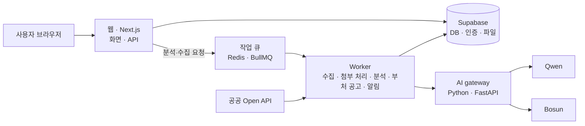

# SOL RADAR

**우리 회사가 참여할 공공사업을 근거와 함께 찾아 주는 AI 입찰 의사결정 지원 플랫폼**

운영 주소: https://www.solideos-radar.com

SOL RADAR는 공공 SI·AX 기업의 영업·입찰 담당자를 위한 서비스입니다.
나라장터를 비롯한 공공 발주 정보를 모으고, 공고의 요구조건을 우리 회사의 기술·자격·실적·인력과 대조합니다.
그 결과를 **필수 자격 판정**, 적합도 점수 **SOL Score**, 참여 **권고**(BID·WATCH·NO-BID)로 보여 줍니다.
최종 참여 여부는 담당자가 정하고, 결정과 사유가 기록으로 남습니다.

---

## 왜 필요한가

입찰 담당자는 공고마다 같은 질문을 되풀이합니다.

- 우리 회사가 참가 자격을 갖췄는가?
- 보유 기술과 수행 실적이 요구사항에 맞는가?
- 그 기간에 투입할 인력이 있는가?
- 여러 공고 가운데 무엇부터 검토할까?

일반적인 입찰정보 서비스는 공고 수집·검색·키워드 알림까지 돕습니다.
공고문과 첨부를 읽고 회사 자료와 하나씩 맞춰 보는 일은 여전히 사람 몫입니다.
SOL RADAR는 이 대조 작업을 맡고, 판단마다 원문 근거를 붙여 담당자가 빠르게 확인하고 결정하도록 돕습니다.

| 단계 | 일반적인 입찰정보 서비스 | SOL RADAR |
| --- | --- | --- |
| 수집·검색·알림 | 제공 | 제공 (공고 변경 이력까지 추적) |
| 우리 회사 기준 자격 판정 | 사람이 공고를 읽고 직접 대조 | 항목별 충족·미충족·확인 필요 + 원문 인용 |
| 적합도 점수 | 없거나 산식이 드러나지 않음 | 규칙 기반 0~100점, 요소별로 분해 |
| 의사결정 기록 | 메일·메모에 흩어짐 | 권고와 담당자의 최종 결정·사유를 함께 저장 |

## 작동 방식


1. **수집** — 공공 Open API에서 입찰공고(나라장터·LH·KEPCO·K-water)와 부처 지원사업 공고를 3시간마다 가져옵니다. 발주계획·사전규격 수집기도 있으나 정기 수집은 아직 켜지 않았습니다. 같은 사업의 단계별 공고를 하나로 잇고, 공고가 바뀌면 이전 내용을 남긴 채 새 개정(revision)으로 쌓습니다. 첨부 제안요청서(HWP·HWPX·PDF)도 내려받아 텍스트로 바꿉니다.
2. **요구조건 추출** — AI가 공고문에서 참가 자격·기술·인력·실적 요건을 구조화합니다. 항목마다 원문 인용을 함께 내야 하고, 인용이 원문과 맞지 않으면 그 값은 쓰지 않습니다.
3. **자격 판정** — 회사 프로필과 대조해 필수 자격을 충족·미충족·확인 필요로 나눕니다. 근거가 부족하면 추측하지 않고 "확인 필요"로 남깁니다.
4. **SOL Score** — 다섯 가지 요소를 정해진 규칙으로 계산합니다. 같은 입력이면 언제나 같은 점수가 나옵니다.
5. **참여 권고** — 자격 판정과 점수로 BID·WATCH·NO-BID를 권고합니다.
6. **담당자 결정** — 담당자가 근거를 확인하고 최종 결정과 사유를 기록합니다. 참여하기로 한 사업은 입찰 프로젝트로 넘겨 제출 준비를 관리합니다.
7. **알림** — 분석 완료·검토 배정·마감 임박을 화면 안 알림으로 알려 줍니다. 공고 변경은 개정 이력에 기록되며 알림으로는 아직 보내지 않습니다. 추천 공고의 카카오톡 "나에게 보내기"는 개인 설정에서 연결한 사람에게만 보냅니다.

## 판단 기준

### 필수 자격 판정

| 판정 | 뜻 |
| --- | --- |
| 충족 (`SATISFIED`) | 회사 기록이 요건을 만족합니다 |
| 미충족 (`NOT_SATISFIED`) | 요건과 회사 기록 양쪽에 근거가 있고, 요건을 만족하지 못합니다 |
| 확인 필요 (`NEEDS_REVIEW`) | 근거가 부족하거나 사람이 직접 확인해야 합니다 |

법적 자격을 시스템이 확정하지 않습니다. 판정마다 공고 원문의 해당 부분과 판단 사유를 함께 보여 줍니다.

### SOL Score (0~100)

| 요소 | 배점 | 보는 것 |
| --- | ---: | --- |
| 기술 스택 적합 | 30 | 필수·우대 기술을 회사가 얼마나 갖췄는가 |
| 유사 수행 실적 | 25 | 분야·금액·시기가 가장 비슷한 수행 실적 |
| 인력 가용성 | 20 | 필요 인력 대비 투입 가능한 인력, 제안 준비 기간 |
| 규모 적합성 | 15 | 사업 예산이 회사의 수행 규모에 맞는가 |
| 전략적 선호 | 10 | 회사가 정한 선호 분야·발주기관 |

> SOL Score는 회사와 사업의 **적합도**이며 **수주 확률이 아닙니다.**
> 가중치와 기준선은 알고리즘 버전에 묶여 있고, 계산에 쓴 입력은 스냅샷으로 저장해 언제든 같은 결과를 재현합니다.

### 참여 권고

| 권고 | 조건 |
| --- | --- |
| **BID** | 필수 자격에 문제가 없고 75점 이상 |
| **WATCH** | 확인이 필요한 자격이 있거나, 판단 자료가 둘 이상 비었거나, 50~74점 |
| **NO-BID** | 필수 자격 미충족이 확인됐거나, 50점 미만 |

확인이 필요한 자격이 남아 있으면 점수가 높아도 BID를 권고하지 않습니다.
권고는 참고 의견이고, 최종 결정은 언제나 담당자가 합니다.

### AI의 역할

| 모델 | 하는 일 |
| --- | --- |
| Qwen3.8-Flash-Next | 공고문·첨부에서 요구조건을 원문 인용과 함께 구조화합니다 |
| Bosun v3.1 0.6B (결정 모델) | 요구사항별 충족 분류, 기술 적합성, 실적 연관성, 수행 리스크를 **참고 지표**로 냅니다. 점수·자격 판정·권고에는 반영하지 않습니다 |

**규칙이 판정하고 AI는 돕습니다.** AI 의견이 규칙 판정을 뒤집지 못합니다.
AI를 쓸 수 없을 때도 규칙만으로 자격 판정과 점수를 내고, 결과를 부분 완료(`PARTIAL`)로 표시합니다.

## 주요 기능

화면은 사이드바의 세 묶음(업무·분석·회사)과 설정으로 나뉩니다.

### 업무

| 화면 | 설명 |
| --- | --- |
| 대시보드 | 우선 검토할 입찰, 예정 사업과 사전규격, 공공조달 요약, 수집 현황을 한눈에 봅니다 |
| 입찰 공고 | 키워드·출처·기관·사업 단계·분야·권고로 공고를 찾고, 최신순·마감순·점수순으로 정렬합니다. 상세 화면에서 자격 판정·점수·원문 근거·변경 이력을 보고, 분석을 요청하고, 최종 결정을 기록합니다 |
| 가정 재계산 | 공고 상세에서 "이 자격을 갖췄다면?"을 켜면 저장 없이 점수와 권고를 다시 계산해 보여 줍니다 |
| 부처 지원사업 공고 | 기업마당·중소벤처기업부의 지원사업 공고를 모아 봅니다 (점수·권고는 계산하지 않음) |
| 관심 공고 | 내가 표시한 공고를 모아 보고, 마감이 다가오면 알림을 받습니다 |
| 입찰 프로젝트 | 참여를 결정한 사업의 담당자·체크리스트·제출 마감·진행 상태·결과를 관리합니다 |
| 입찰 일정 | 관심 공고와 입찰 프로젝트의 마감을 달력으로 봅니다 |
| 알림 | 분석 완료, 검토 배정, 마감 임박 알림을 모아 봅니다 |

### 분석

| 화면 | 설명 |
| --- | --- |
| 자격 갭 레이더 | 마감 전 공고를 훑어 어떤 자격이 몇 건의 공고를 막고 있는지 순위로 보여 줍니다. 자격 하나를 갖췄다고 가정하면 새로 열리는 공고를 다시 셉니다 |
| 발주 현황 | 수집한 입찰공고를 기간·기관·분야·예산 구간·주별로 집계합니다 |
| 분석 결과 비교 | 분석 결과 2~4건을 나란히 놓고 비교합니다 |
| 인력 배치 시뮬레이션 | 공고 요건에 맞는 인력 후보와 기간 충돌을 확인합니다. 결과는 저장하지 않고, 사람이 고릅니다 |

### 회사

| 화면 | 설명 |
| --- | --- |
| 회사 역량 | 자격 판정과 점수가 읽는 회사 프로필(기술·자격·수행 실적)과 개정 이력 |
| 조직·인력 | 직원 명부와 개인 상세. 관리자는 직원 추가·부서 이동·퇴사를 처리합니다 |
| 조직도 | 본부 → 그룹 → 팀 구조 |

### 설정과 계정

| 기능 | 설명 |
| --- | --- |
| 가입·로그인 | 이메일 또는 구글·카카오·네이버 간편 로그인. 가입할 때 부서와 직급을 고르고, 초대를 받아 조직에 합류합니다 |
| 설정 | 개인 정보, 카카오톡 알림 켜기·끄기, 조직 구성원 초대와 역할 관리 |
| 데이터 수집 관리 | 출처별 수집 기록을 보고, 필요하면 바로 수집을 실행합니다 (관리자) |

### 역할과 권한

| 역할 | 할 수 있는 일 |
| --- | --- |
| ADMIN | 모든 기능, 회사 프로필 수정, 구성원·역할 관리, 데이터 수집 관리 |
| SALES | 분석 요청, 최종 참여 결정 기록, 입찰 프로젝트 관리 |
| ANALYST | 분석 요청과 결과 확인 |
| EXECUTIVE | 전체 열람, 회사 역량 열람 |
| VIEWER | 전체 열람 |

조직의 데이터는 조직마다 격리됩니다. 다른 조직의 자료는 존재 여부조차 보이지 않습니다.

## 원칙

1. **규칙이 판정하고 AI는 돕는다.** AI 의견은 참고 지표이고 판정을 바꾸지 못합니다.
2. **근거 없는 값을 만들지 않는다.** 원문에서 확인되지 않으면 "확인 필요"로 남깁니다.
3. **점수는 적합도다.** 수주 확률이나 승률로 표현하지 않습니다.
4. **사람이 최종 결정한다.** 결정과 사유가 감사 가능한 기록으로 남습니다.
5. **가상 데이터는 가상이라고 표시한다.** 시연용 공고에는 `DEMO` 배지를 붙여 실제 공고와 구분합니다.

## 데이터

### 수집 출처

| 구분 | 출처 |
| --- | --- |
| 나라장터 (조달청, 공공데이터포털) | 입찰공고(면허제한·참가가능지역 포함), 사전규격, 발주계획, 업종·근거법규, 첨부파일 |
| 기관 전자조달 | LH 입찰공고, K-water 입찰공고, 한국전력 전자입찰 |
| 부처 지원사업 | 기업마당, 중소벤처기업부 |

수집은 정해진 주기로 자동 실행되고, 관리자가 즉시 실행할 수도 있습니다.
같은 공고를 다시 받아도 중복으로 쌓이지 않고, 내용이 바뀐 경우에만 새 개정으로 남습니다.

### 회사와 시연 데이터

- 사용 회사는 **솔리데오**로 고정합니다. 회사명·부서·직급은 실제이고, 운영 환경의 회사 프로필은 공개 자료로 만들었습니다(로컬 개발 환경은 가상 프로필).
- 직원 200명(이름·사진)은 가상입니다. 실제 직원 이름을 쓰지 않았고, 사진 200장은 생성 이미지입니다.
- 시연용 가상 공고 20건(`FX-01`~`FX-20`)은 화면에 `DEMO` 배지가 붙고, 목록에서 실제 공고와 나눠 볼 수 있습니다.

### 실행 모드

| 모드 | 공고 | AI |
| --- | --- | --- |
| `live` | 실제 수집 공고 | 실제 모델 |
| `fixture` | 시연용 가상 공고 | 실제 모델 |
| `mock` | 시연용 가상 공고 | 미리 정한 고정 응답 (기본값, 자동 시험 기준) |

어떤 모드로 분석했는지는 결과 화면에 함께 표시됩니다.

## 시스템 구성



| 영역 | 기술 |
| --- | --- |
| 웹·API | Next.js 16 · React 19 · TypeScript · Tailwind CSS v4 · shadcn |
| 데이터베이스·인증·파일 | Supabase (Postgres · 행 단위 보안 RLS · Auth · Storage) |
| 비동기 작업 | Redis · BullMQ (Worker는 Node.js) |
| AI | Python · FastAPI AI gateway, Qwen3.8-Flash-Next, Bosun v3.1 0.6B |
| 배포 | 웹은 Vercel, Worker·AI gateway는 회사 서버의 Docker Compose |

웹은 사용자 세션으로만 데이터에 접근하고, 누가 무엇을 읽고 쓰는지는 DB의 RLS 정책이 정합니다.
분석·수집처럼 오래 걸리는 일은 큐에 넣어 Worker가 처리하고, AI 모델 호출은 AI gateway 한 곳에서만 합니다.

## 폴더 구조

```text
web/                 Next.js 앱
  app/               화면과 API(/api/v1)
  server/<도메인>/    서버 로직 (공고·수집·점수·분석·알림·인력 등)
  worker/            BullMQ Worker (수집·첨부 처리·분석·부처 공고·알림)
services/ai/         AI gateway (첨부 파싱·요구조건 추출·결정 모델 호출)
services/decision/   결정 모델(Bosun) 서버와 학습 도구
supabase/migrations/ DB 스키마와 RLS 정책
infra/               Docker Compose, 수집 출처 목록, 환경변수 예시
fixtures/            시연용 가상 공고·가상 직원 명부·녹화한 API 응답
design/tokens.json   색·글꼴·글자 크기 정본
scripts/             DB·시드·검증·운영 스크립트
docs/                설계 문서와 검증 증거
```

## 시작하기

### 준비물

- Node.js 22(22.13 이상) 또는 24(24.3 이상)
- pnpm
- Docker, Supabase CLI (로컬 DB)

### 로컬 실행

```bash
# 1. 의존성 설치 (루트와 web 은 따로 설치합니다)
pnpm install
pnpm -C web install

# 2. 로컬 Supabase 를 켜고 스키마를 적용합니다 (web/.env.local 도 채워 줍니다)
pnpm db:start

# 3. 시험 계정을 넣습니다
pnpm db:seed

# 4. 웹을 띄웁니다 → http://localhost:3000
pnpm -C web dev
```

시연 데이터(가상 공고·직원 200명)는 `pnpm demo:reset`으로 넣습니다.
이 명령은 루트 `.env.local`이 가리키는 Supabase 프로젝트에 쓰므로, 대상이 로컬인지 먼저 확인하고 실행합니다.

분석과 수집까지 돌리려면 Worker·AI gateway·Redis를 Docker Compose로 함께 띄웁니다.

```bash
cp infra/env/demo.env.example infra/.env   # 값을 채운 뒤
docker compose -f infra/compose.yaml up -d --build
```

자세한 기동 절차와 확인 기준은 [배포 문서](docs/10-DEPLOYMENT.md)에 있습니다.
환경변수 이름은 `.env.example`, `web/.env.example`, `infra/env/*.env.example`에서 확인합니다.
API 키·service role 키·DB 연결 문자열 같은 비밀 값은 저장소에 커밋하지 않습니다.

### 자주 쓰는 명령

| 명령 | 하는 일 |
| --- | --- |
| `pnpm -C web dev` | 웹 개발 서버 |
| `pnpm db:start` / `pnpm db:stop` | 로컬 Supabase 켜기 / 끄기 |
| `pnpm db:seed` | 시험 계정을 처음 상태로 되돌리기 |
| `pnpm demo:reset` | 시연 데이터 다시 넣기 |
| `pnpm verify:changed` | 바꾼 영역만 검증 (개발 중) |
| `pnpm verify` | 서식·타입·린트·시험·빌드 전체 검증 (병합·제출 전) |
| `pnpm format` | 서식 맞추기 (루트·`web` 각자) |

## 범위 밖

다음은 만들지 않습니다.

- 자동 투찰
- 수주 확률·승률 예측
- 결제·구독
- 네이티브 모바일 앱 — 웹은 데스크톱(1280px 이상) 배치를 기준으로 하고 좁은 화면은 반응형으로 재배치합니다

## 문서

설계 문서는 `docs/`에 있고, Obsidian에서 `docs/` 폴더를 Vault로 열어 읽을 수 있습니다.

| 문서 | 내용 |
| --- | --- |
| [문서 인덱스](docs/00-README.md) | 전체 문서 목록과 읽는 순서 |
| [제품 요구사항](docs/01-PRD.md) | 사용자, 기능 요구사항, 범위 |
| [아키텍처](docs/02-ARCHITECTURE.md) | 서비스 구성과 데이터 흐름 |
| [AI 파이프라인](docs/03-AI-PIPELINE.md) | 실행 모드, 모델 연동, 분석 흐름 |
| [데이터베이스](docs/04-DATABASE.md) | 스키마와 RLS 정책 |
| [API 명세](docs/05-API-SPEC.md) | `/api/v1` 계약 |
| [화면 설계](docs/06-UI-UX.md) | 화면 명세와 사용자 흐름 |
| [데이터 수집](docs/07-DATA-PIPELINE.md) | Open API 수집과 정규화 |
| [점수 산정](docs/08-SCORING.md) | SOL Score 계산식과 권고 기준 |
| [보안](docs/09-SECURITY.md) | 인증·권한·정보 보호·책임 있는 AI |
| [배포](docs/10-DEPLOYMENT.md) | 운영 구성과 로컬 기동 절차 |
| [테스트](docs/11-TESTING.md) | 검증 기준과 증거 |
| [결정 기록](docs/16-DECISIONS.md) | 설계 결정(ADR)과 미결정 사항 |
| [진행 상황](docs/PROGRESS.md) | 현재 구현 상태와 작업 기록 |

무엇이 실제 데이터·모델로 동작하고 무엇이 시연용인지는 [해커톤 문서의 정직성 표](docs/18-HACKATHON.md)와 [제출물 한계 문서](docs/submission/limitations.md)에 정리돼 있습니다.

## 개발에 참여하기

이 저장소는 AI 코딩 에이전트와 함께 개발합니다.
작업 규칙은 [AGENTS.md](AGENTS.md)와 [구현 규칙](docs/17-CLAUDE-IMPLEMENTATION.md)에 있습니다.

- 커밋 메시지는 `타입: 작업 내용` 형식입니다. 예: `feat: 공고 목록 필터 추가`
- DB 마이그레이션은 새 파일로만 추가하고, 이미 있는 파일은 고치지 않습니다.
- 커밋 전 검사(서식·타입·린트·시험)를 끄거나 우회하지 않습니다.
