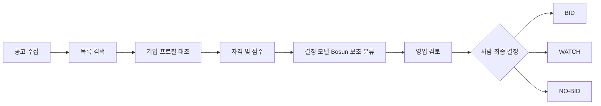

# 01. 제품 요구사항 (PRD)

## 비전
SOL RADAR는 공공 SI·AX 기업이 `어떤 입찰에 참여해야 하는가`에 근거 기반으로 답하도록 돕는 의사결정 지원 플랫폼이다. 사람이 최종 BID 결정을 내리며 자동 투찰은 범위 밖이다.

해커톤 출품 목표: 심사위원(사람 5인 + AI 심사)이 데스크톱 브라우저 한 대에서 **수집 → 자격 판정 → 설명 가능한 점수 → 사람 결정 기록 → 알림**을 5분 안에 끝까지 본다. 데모 장면은 [[19-DEMO-SCENARIO|19 데모 시나리오]], 심사 대응은 [[18-HACKATHON|18 해커톤]]에 둔다.

> [!tip] 심사 포인트
> "정직한 AI"가 제품 원칙이다. 규칙 엔진이 최종, 결정 모델(Bosun)은 보조, 수주확률 표현 금지, 사람이 최종 결정, DEMO 데이터는 DEMO로 표시. 이 다섯 원칙은 [[09-SECURITY|09 보안]]의 책임 있는 AI 절과 [[16-DECISIONS|16 ADR]] ADR-004에서 강제한다.

## 범위
|구분|항목|
|---|---|
|포함 (해커톤)|사용 회사는 **솔리데오** 고정(`org-01`), 직원 명부는 가상 200명(남성 100·여성 100, 로그인 계정과 별개) + 격리 확인용 조직 1개(`org-02`, VIEWER 1명, 보유 공고·분석 없음). 공고는 공용 데이터, 조직별 격리 대상은 자격 판정·점수·검토·배정. 공고 검색·상세, 기업 프로필(revision), 자격 판정, SOL Score, BID/WATCH/NO-BID 권고, 사람 검토 기록, 인앱 알림, 나라장터 Open API 실제 공고 수집·RFP 첨부 파싱, Qwen3.8-Flash-Next(회사 운영 vLLM API)·Bosun v3.1 0.6B 실추론(회사 GPU 추론 엔드포인트, HTTPS, [[16-DECISIONS\|ADR-025·034]]), 실제 공고 평가셋·평가 리포트, fixture 20건 기반 DEMO 데이터(`fixture`·`mock` 모드, [[16-DECISIONS\|ADR-020]]). 회사 프로필은 모든 모드에서 가상 솔리데오 프로필이다. 조직·인력 조회(200명 조직도·명부), 데이터 수집 관리 화면, 사이드바 정보 구조와 설정([[16-DECISIONS\|ADR-021]])|
|포함 (플랫폼)|**데스크톱 웹 전용**. 최소 폭 1280px, 1440px 기준 설계, 반응형은 1280~1920 구간만|
|제외 (영구)|자동 투찰, 평가위원 점수 강제 수집, 보장된 승률 예측, 컨소시엄 자동 계약, ERP 실제 연동|
|제외 (해커톤 범위)|**모바일 레이아웃·네이티브 앱**, **결제·구독·요금제**, 카카오톡 실발송(mock provider만), hosted 모델 API 호출·클라우드 GPU 임대(사용자 승인 전 금지), Bosun LoRA 운영 반영(데모·운영 모델 교체. 학습·E4 비교는 X6, [[16-DECISIONS\|ADR-034]]), 낙찰·계약 데이터 수집|

범위 제외 결정은 [[16-DECISIONS|16 ADR]] ADR-007. 구현 시 금지 규칙은 [[17-CLAUDE-IMPLEMENTATION|17 구현 규칙]].

## 사용자 및 권한
- ADMIN: 기업 정보·구성원·연동 설정 관리. 서비스 운영자(`profiles.is_admin`. 지금 화면은 템플릿 `/admin`이고 `/ops` 분리는 해커톤 뒤)와 다르다([[16-DECISIONS|ADR-021]]·ADR-023).
- SALES: 공고 탐색, 검토, 담당자 배정 및 의사결정.
- ANALYST: 분석 실행, 점수·자격 판정 확인. 검토 의견(코멘트) 기록은 해커톤 범위 밖(P1).
- VIEWER: 허용 범위 내 읽기.

권한은 역할 순서가 아니라 리소스별 정책으로 적용한다. 표기는 `ADMIN, SALES, ANALYST`처럼 허용 역할을 나열한다. 최종 BID 결정 기록은 `ADMIN, SALES`. 상세는 [[09-SECURITY|09 보안]], [[05-API-SPEC|05 API]].

가입·로그인·초대 수락은 Supabase Auth가 맡는다. 회사 선택 없이 솔리데오의 부서와 `직급/직책`을 필수로 받는다(ADR-019). 이메일 가입에서 선택하고 간편 가입·기존 미완료 계정은 첫 로그인 때 보완한다. 이 선택값은 신고 정보이며 조직 합류·권한을 부여하지 않는다. 가입은 공개(이메일+비밀번호 또는 간편 로그인 구글·카카오·네이버)이고 업무 조직 합류는 초대로 한다([[16-DECISIONS|16 ADR]] ADR-018). 간편 로그인 제공자 설정은 해커톤 안 후순위다([[12-ROADMAP|12 로드맵]]). 위 네 역할은 조직 구성원 표의 업무 역할 `memberships.sol_role` 값이다. 구성원 관리 권한은 `sol_role=ADMIN`이다([[16-DECISIONS|ADR-021]]). `org_role`(owner·member)은 템플릿 호환용으로 남는다. 조직 데이터는 `org_id`로 소유를 표시하고 Supabase RLS 정책이 조직 밖 접근을 막는다. 다른 조직 자원 조회는 `404`다 ([[16-DECISIONS|16 ADR]] ADR-017).

## 기존 대안과 차별점
나라장터(국가종합전자조달) 자체 알림과 민간 입찰정보 서비스는 일반적으로 **공고 수집·키워드 알림·검색**까지를 제공한다. SOL RADAR는 그 다음 단계, 즉 "우리 회사가 이 공고에 들어가야 하는가"를 다룬다.

|단계|일반적인 입찰정보 서비스|SOL RADAR|
|---|---|---|
|수집·검색·알림|제공|제공 (공식 API + fixture, 변경 감지·revision)|
|우리 회사 기준 자격 판정|사용자가 공고를 읽고 수작업 대조|필수 항목별 `SATISFIED / NOT_SATISFIED / NEEDS_REVIEW` + 원문 근거 인용|
|적합도 점수|없거나 블랙박스|규칙 기반 SOL Score 0~100, 요소별 분해·버전·입력 스냅샷 저장|
|AI 의견|없음 또는 요약|결정 모델 참고 지표를 규칙 판정 아래에 표시(점수 미반영), 충족 확률·수주확률 아님을 명시|
|의사결정 기록|외부 메모·메일|BID/WATCH/NO-BID 권고 + 사람 최종 결정·사유를 감사 가능하게 저장|

> [!success] 검증됨 (2026-10-19, 공개 페이지 열람)
> 국내 서비스 3곳(인포21C·비드폼·산군)과 나라장터 기준선을 공식 사이트 공개 페이지에서 확인했다. 표와 URL은 [[18-HACKATHON|18 해커톤]] §3.2.1과 `docs/evidence/competitors/2026-10-19-competitors.md`. 공개 페이지에서 찾지 못한 기능은 "미확인"이며 "없다"로 단정하지 않는다.

## 핵심 요구사항
|ID|요구사항|MVP|수용 기준|
|---|---|---|---|
|FR-01|발주계획·사전규격·입찰공고 데이터 수집|P0|나라장터 Open API(`live`)와 fixture(`fixture`·`mock`) 모두 정규화→DB 적재 재실행 시 중복 없음. 실패 유형(API·첨부 다운로드·파싱)을 구분해 표시([[16-DECISIONS\|ADR-020]])|
|FR-02|공고 목록/검색/필터/원문 링크|P0|키워드·기간·단계·상태·점수 필터|
|FR-03|회사 기술/자격/실적 프로필|P0|권한 검증 후 CRUD 및 감사로그, revision 보존|
|FR-04|입찰 자격 충족/미충족/확인필요|P0|각 항목에 출처 및 사유|
|FR-05|규칙 기반 SOL Score(0~100)|P0|버전·입력 스냅샷·분해 점수 저장|
|FR-06|Qwen3.8-Flash-Next 요구사항 추출·설명 + 결정 모델(Bosun) 참고 지표(요구사항별 충족 분류·기술 적합성·실적 연관성·수행 리스크, AI gateway 경유)|P0|모델 장애 시 규칙만으로 완결(`PARTIAL`). 결정 모델 결과는 점수에 넣지 않고 참고 지표·플래그로만 표시|
|FR-07|BID/WATCH/NO-BID 권고 및 사람 최종판단|P0|확인 필요 시 자동 BID 금지|
|FR-08|공고 변경 감지·인앱 알림|P0|중복 알림 없음|
|FR-09|카카오톡 알림|P1|템플릿 승인·동의 확보 후만 발송. 해커톤은 mock provider|
|FR-10|경쟁사/낙찰 이력 분석|P1|데이터 존재 시만 통계|
|FR-11|인력 가용성/중복 배치 점검|P1|기간 충돌 탐지|
|FR-12|정부 정책 기반 발주 예측·승률 모델|P2|검증 데이터와 백테스트 후 노출|
|FR-13|검토 코멘트 API (ANALYST 의견 기록)|P1|리뷰 결정과 분리된 코멘트 스레드. 해커톤 데모에 없음|
|FR-14|솔리데오 가상 인력 200명·고유 정장 사진·가입 부서/직급 선택|P0|팀명 합산·비례 배분, 이름 세 글자·원본 일치 0, 남녀 100/100, 사진 200장, 가입 필수 선택 및 간편 가입 보완. [[16-DECISIONS\|ADR-019]]|
|FR-15|실제 공고 평가셋과 모델 평가(규칙만·Bosun 영어·Bosun 한국어 비교), 회사 GPU용 학습셋 내보내기|X6·확장 컷 ([[16-DECISIONS\|ADR-023·034]]). 평가셋 v0.1·학습셋 번들은 X6, E0·E2 전체 리포트는 확장 컷|test 20·dev 10 사업 리포트와 오류 분석. Bosun LoRA 학습·E4 비교는 X6(회사 측 학습, [[16-DECISIONS\|ADR-034]]), 운영 반영은 후속([[21-MODEL-TRAINING\|21 모델 학습]])|
|FR-16|조직·인력 조회(200명 조직도 본부 → 그룹 → 팀, 명부, 개인 상세, 사진)|확장 컷 ([[16-DECISIONS\|ADR-023]])|200명·점수 계산 대상 27명 구분, 상위 부서·사진이 없어도 오류 없음, 연락처 없음, 다른 조직 0행([[16-DECISIONS\|ADR-021]])|
|FR-17|관심 공고(본인 관심 표시, 관심 등록자 마감 알림)|P1(있으면 좋음 최상단, ADR-021)|본인 행만, 조직에는 관심 인원 수만 공개, 알림 중복 0|
|FR-18|분석 결과 비교(조직 분석 이력, 2~4건 비교)|P1(있으면 좋음 최상단, ADR-021)|PARTIAL·FAILED 표시, 확률·신뢰도 숫자 없음|
|FR-19|입찰 프로젝트(BID 결정 이후 담당자·체크리스트·제출 마감·상태·결과 기록)|P1(있으면 좋음 최상단, ADR-021)|BID 결정 없이 생성 거부, 상태 이력·감사 기록, 결과는 점수·결정 모델·학습에 쓰지 않음|
|FR-20|인력 배치 시뮬레이션(규칙 매칭 후보 표시·기간 충돌, 사람이 고름)|P1(있으면 좋음 최상단, ADR-021)|점수 계산 대상 27명 안에서만, 저장 없음. 후보 저장·배정 확정은 FR-11|
|FR-21|조직·인력 편집(ADMIN 추가·부서/직급 이동·퇴사)|P1(있으면 좋음 최상단, ADR-021)|ADMIN만, 감사 기록, 편집 뒤 골든 94/72/68과 기존 분석 불변|
|FR-22|가정 재계산("보유 가정", 저장 없음)|데모 강화 컷 ([[16-DECISIONS\|ADR-037]])|공고 상세에서 최신 분석 run의 필수 자격 가운데 가정 가능한 항목(자격 코드 사전에 있고 `NOT_SATISFIED` 또는 `NEEDS_REVIEW`·`COMPANY_EVIDENCE_MISSING`)을 보유로 가정하면, 저장된 입력 스냅샷으로 점수·권고·자격 판정을 다시 계산해 원래 → 가정을 보여 준다. DB 쓰기 0(결정 기록·알림·감사 로그 불변), 결정 모델 재호출 없음(원래·가정 모두 결정 모델 의견 제외), 결정 패널은 원래 값, 확률·승률 문구 없음. `FX-03` 정보통신공사업 가정 → NO-BID → WATCH, 68 그대로. 10-23 freeze까지 green이 아니면 데모에서 뺀다|

## 비기능 요구
- API p95 응답 목표: 캐시된 공고 목록 800ms 이내(개발 검증 환경 기준 목표).
- 데이터 수집: 체크포인트·중복 방지·재시도·백필 지원.
- 개인정보/회사 기밀: 테넌트 격리(Supabase RLS, `org_id`, 정책 시험으로 검증), 파일 접근 검증, 로그 마스킹.
- 분석: 실패·근거 부족 시 상태 표시; 무근거 확률 표현 금지. AI 불가 시 규칙 점수만으로 완결(`analysis.status=PARTIAL`).
- 화면: 데스크톱 전용. 최소 폭 1280px, 1440px 기준 레이아웃, 1280~1920 반응형. WCAG AA, 키보드 조작, 색만으로 의미 전달 금지. 상세는 [[06-UI-UX|06 UI]].
- 데모 환경: 노트북 1대(GPU 없음). MVP 완료 기준은 `SOL_RUN_MODE=live`(실제 공고 + 회사 GPU 추론 엔드포인트 실추론, HTTPS 접속, [[16-DECISIONS|ADR-025]])의 E2E 동작이다. 발표의 고정 장면(S2~S7)은 재현성을 위해 `mock`(저장 공고 + mock AI)으로 하고, 실공고 분석은 선택 장면과 증거로 보인다([[19-DEMO-SCENARIO|19 데모 시나리오]]). 공공 API·모델 서버 장애 때도 `fixture`·`mock`으로 전 기능 시연 가능([[16-DECISIONS|ADR-020]]). DB와 인증은 Supabase 클라우드 프로젝트(개발 환경)라 시연 중 인터넷 연결이 필요하다. 네트워크가 끊겼을 때의 대체 경로는 [[19-DEMO-SCENARIO|19 데모 시나리오]] §5다([[16-DECISIONS|ADR-023]], 미결정 8번). 웹 배포처는 아직 미결정이다. 상세는 [[10-DEPLOYMENT|10 배포]].

## 사용자 여정

### 해커톤 데모 여정
위 여정을 fixture 공고 장면 `S0`~`S7`과 실제 공고 1건(S-LIVE)으로 압축해 보여 준다. 장면별 fixture·기대 결과는 [[19-DEMO-SCENARIO|19 데모 시나리오]] §2, 클릭 경로는 §4가 정본이다([[16-DECISIONS|16 ADR]] ADR-013·023). fixture 명세는 [[07-DATA-PIPELINE|07 수집 파이프라인]].

## 성공 측정
> [!warning] 미검증 가정
> 아래 베이스라인과 목표치는 **가설**이다. 실측 베이스라인이 없다. 데모에서는 측정 방법이 동작함을 보이고, 수치는 가설로 표기한다. 베이스라인 확정 방법: 파일럿 조직의 영업 담당 2~3명이 공고 5건을 수작업으로 검토한 시간을 기록한다.

|지표|가설 베이스라인|가설 목표|측정 방법|데모에서|예비 검증 결과(ADR-023 X2)|
|---|---|---|---|---|---|
|공고 1건 검토 소요 시간|30분 (공고 열람 + 자격 대조 + 메모)|10분|상세 화면 진입 시각 ~ `bid_reviews` 기록 시각 차이|타이머로 1건 측정|측정 전|
|적합 공고 상위 K 추천 정밀도 (precision@5)|없음|0.6 이상|fixture 20건의 사람 라벨 대비|골든셋 테스트 결과|측정 전|
|자격 판정 사람 일치율|없음|0.9 이상 (확정 항목 기준)|fixture 라벨 대비 `SATISFIED/NOT_SATISFIED` 일치|테스트 리포트|측정 전|
|잘못된 자동 BID 권고|-|0건|골든 시나리오 `G3`·`G4`|테스트 + NO-BID 장면|측정 전|
|알림 중복|-|0건|동일 이벤트·수신자·채널 unique 위반 수|골든 시나리오 `G2`|측정 전|
|인앱 알림 지연|-|분석 완료 후 5초 이내|outbox `sent_at - created_at`|알림 장면|측정 전|

**예비 검증 실험(ADR-023 X2, 2026-10-22~23 예정, 일정은 ADR-034 17번)**: 실제 공고 3건을 고르고, 공공 SI·AX 입찰 검토 경험이 있는 담당자 1~2명이 기존 방식으로 참가자격·기술 적합도·인력 적합성·위험 요소를 기록하며 시간을 잰다. 같은 공고를 SOL RADAR로 분석하고 사람의 최종 확인 시간을 포함한 총 소요 시간, 필수 항목 누락 수, 검토 후 수정이 필요한 판단 수, 참가자격 판정 일치율, 유용성 평가(5점)를 기록한다. 담당자를 확보하지 못하면 개발자 자체 검증으로 하되 "외부 실무자 검증"이라고 쓰지 않는다. n=3 예비 검증이며 일반화된 성능을 입증하지 않는다. 결과는 `docs/evidence/impact/`에 두고 이 표의 마지막 열을 채운다. "30분 → 10분"은 측정 전까지 성과로 주장하지 않는다.

지표 저장 위치와 관리자 화면 노출은 [[14-OBSERVABILITY|14 관측성]], 테스트 매핑은 [[11-TESTING|11 테스트]].

## 관련 문서
- [[00-README|00 인덱스]]
- [[02-ARCHITECTURE|02 아키텍처]]
- [[08-SCORING|08 스코어링]]
- [[12-ROADMAP|12 로드맵]]
- [[16-DECISIONS|16 ADR]]
- [[18-HACKATHON|18 해커톤]]
- [[19-DEMO-SCENARIO|19 데모 시나리오]]
- [[21-MODEL-TRAINING|21 모델 학습]]
