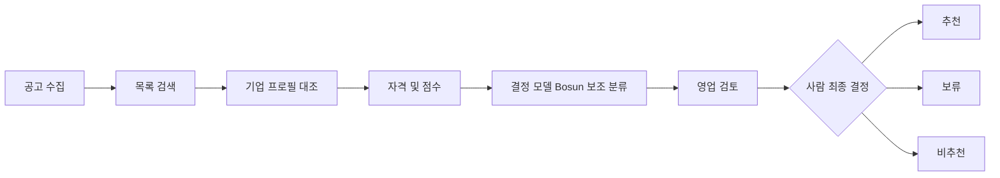

# 01. 제품 요구사항 (PRD)

## 비전
SOL RADAR는 공공 SI·AX 기업이 `어떤 입찰에 참여해야 하는가`에 근거 기반으로 답하도록 돕는 의사결정 지원 플랫폼이다. 사람이 최종 결정을 내리며 자동 투찰은 범위 밖이다.

해커톤 출품 목표: 심사위원(사장·부사장·CFO + AI 심사, 2026-10-21 사용자 입력)이 발표(덱 20분 + 녹화 클립, [[16-DECISIONS|ADR-054]])에서 **수집 → 자격 판정 → 설명 가능한 점수 → 사람 결정 기록 → 알림**을 끝까지 본다. 클립은 D1 운영 사이트에서 찍고, 질의응답은 같은 사이트를 라이브로 연다. 데모 장면은 [[19-DEMO-SCENARIO|19 데모 시나리오]], 심사 대응은 [[18-HACKATHON|18 해커톤]]에 둔다.

> [!tip] 심사 포인트
> "정직한 AI"가 제품 원칙이다. 규칙 엔진이 최종, 결정 모델(Bosun)은 보조, 수주확률 표현 금지, 사람이 최종 결정, DEMO 데이터는 DEMO로 표시. 이 다섯 원칙은 [[09-SECURITY|09 보안]]의 책임 있는 AI 절과 [[16-DECISIONS|16 ADR]] ADR-004에서 강제한다.

## 범위
|구분|항목|
|---|---|
|포함 (해커톤)|사용 회사는 **솔리데오** 고정(`org-01`), 직원 명부는 가상 200명(남성 100·여성 100, 로그인 계정과 별개) + 격리 확인용 조직 1개(`org-02`, VIEWER 1명, 보유 공고·분석 없음). 공고는 공용 데이터, 조직별 격리 대상은 자격 판정·점수·검토·배정. 공고 검색·상세, 기업 프로필(revision), 자격 판정, SOL Score, 추천(`BID`)·보류(`WATCH`)·비추천(`NO_BID`) 권고, 사람 검토 기록, 인앱 알림, 나라장터 Open API 실제 공고 수집·RFP 첨부 파싱, Qwen3.8-Flash-Next(회사 운영 vLLM API, HTTPS)·Bosun v3.1 0.6B(회사 AI gateway와 같은 호스트의 `sol_decision`) 실추론([[16-DECISIONS\|ADR-025·034]]), 버튼으로 부르는 추천 분석([[16-DECISIONS\|ADR-066]]), fixture 20건 기반 DEMO 데이터(`fixture`·`mock` 모드, [[16-DECISIONS\|ADR-020]]). 회사 프로필은 로컬·시험·`demo:reset`에서 가상 솔리데오 프로필이고, 운영(D1)은 공개 자료로 만든 솔리데오 프로필에 회사가 확인한 자격 3건을 더한 revision 6이다([[16-DECISIONS\|ADR-052]], [[16-DECISIONS\|ADR-059]] 2026-10-30 2차 개정). 조직·인력 조회(200명 조직도·명부), 데이터 수집 관리 화면, 사이드바 정보 구조와 설정([[16-DECISIONS\|ADR-021]]), 자격 갭 레이더·발주 현황·입찰 일정([[16-DECISIONS\|ADR-060]])|
|포함 (플랫폼)|**반응형 웹**. 1440px 기준 설계와 1280px 이상 기존 배치를 유지하고, 모바일 웹 기본 대응 포함(ADR-072)|
|제외 (영구)|자동 투찰, 평가위원 점수 강제 수집, 보장된 승률 예측, 컨소시엄 자동 계약, ERP 실제 연동|
|제외 (해커톤 범위)|**네이티브 모바일 앱**, **결제·구독·요금제**, 카카오 알림톡(사업자·비즈니스 채널·템플릿 승인 필요. 해커톤은 "나에게 보내기"로 대체, [[16-DECISIONS\|ADR-038]]), hosted 모델 API 호출·클라우드 GPU 임대(사용자 승인 전 금지), 실제 공고 평가셋 평가 리포트(E0~E3)·Bosun LoRA 학습과 E4 비교(X6)·임팩트 예비 검증(X2)(발표 뒤 진행 예정, [[16-DECISIONS\|ADR-067]]), Bosun LoRA 운영 반영(데모·운영 모델 교체, [[16-DECISIONS\|ADR-034]])·연 1회 재학습 구현(발표 뒤, [[16-DECISIONS\|ADR-066]]), 낙찰·계약 데이터 수집(예외: 공고 상세 참고 낙찰가 범위용 지난 낙찰 이력 한 번 채우기, [[16-DECISIONS\|ADR-077]])|

범위 제외 결정은 [[16-DECISIONS|16 ADR]] ADR-007, 모바일 웹 허용 개정은 ADR-072. 구현 시 금지 규칙은 [[17-CLAUDE-IMPLEMENTATION|17 구현 규칙]].

## 사용자 및 권한
- ADMIN: 기업 정보·구성원·연동 설정 관리. 서비스 운영자(`profiles.is_admin`. 지금 화면은 템플릿 `/admin`이고 `/ops` 분리는 해커톤 뒤)와 다르다([[16-DECISIONS|ADR-021]]·ADR-023).
- SALES: 공고 탐색, 검토, 담당자 배정 및 의사결정.
- ANALYST: 분석 실행, 점수·자격 판정 확인. 검토 의견(코멘트) 기록은 해커톤 범위 밖(P1).
- EXECUTIVE: VIEWER 읽기 + 회사 역량(`/company`) 열람. 쓰기 역할에는 넣지 않는다([[16-DECISIONS|ADR-052]]).
- VIEWER: 허용 범위 내 읽기.

권한은 역할 순서가 아니라 리소스별 정책으로 적용한다. 표기는 `ADMIN, SALES, ANALYST`처럼 허용 역할을 나열한다. 최종 결정 기록은 `ADMIN, SALES`. 상세는 [[09-SECURITY|09 보안]], [[05-API-SPEC|05 API]].

가입·로그인·초대 수락은 Supabase Auth가 맡는다. 회사 선택 없이 솔리데오의 부서와 `직급/직책`을 필수로 받는다(ADR-019). 이메일 가입에서 선택하고 간편 가입·기존 미완료 계정은 첫 로그인 때 보완한다. 이 선택값은 신고 정보이며 조직 합류·권한을 부여하지 않는다. 가입은 공개(이메일+비밀번호 또는 간편 로그인 구글·카카오·네이버)이고 업무 조직 합류는 초대로 한다([[16-DECISIONS|16 ADR]] ADR-018). 간편 로그인 제공자 설정은 해커톤 안 후순위다([[12-ROADMAP|12 로드맵]]). 위 다섯 역할은 조직 구성원 표의 업무 역할 `memberships.sol_role` 값이다. 구성원 관리 권한은 `sol_role=ADMIN`이다([[16-DECISIONS|ADR-021]]). `org_role`(owner·member)은 템플릿 호환용으로 남는다. 조직 데이터는 `org_id`로 소유를 표시하고 Supabase RLS 정책이 조직 밖 접근을 막는다. 다른 조직 자원 조회는 `404`다 ([[16-DECISIONS|16 ADR]] ADR-017).

## 기존 대안과 차별점
나라장터(국가종합전자조달) 자체 알림과 민간 입찰정보 서비스는 일반적으로 **공고 수집·키워드 알림·검색**까지를 제공한다. SOL RADAR는 그 다음 단계, 즉 "우리 회사가 이 공고에 들어가야 하는가"를 다룬다.

|단계|일반적인 입찰정보 서비스|SOL RADAR|
|---|---|---|
|수집·검색·알림|제공|제공 (공식 API + fixture, 변경 감지·revision)|
|우리 회사 기준 자격 판정|사용자가 공고를 읽고 수작업 대조|필수 항목별 `SATISFIED / NOT_SATISFIED / NEEDS_REVIEW` + 원문 근거 인용|
|적합도 점수|없거나 블랙박스|규칙 기반 SOL Score 0~100, 요소별 분해·버전·입력 스냅샷 저장|
|AI 의견|없음 또는 요약|결정 모델 참고 지표를 규칙 판정 아래에 표시(점수 미반영), 충족 확률·수주확률 아님을 명시|
|의사결정 기록|외부 메모·메일|추천·보류·비추천 권고 + 사람 최종 결정·사유를 감사 가능하게 저장|

> [!success] 검증됨 (2026-10-19, 공개 페이지 열람)
> 국내 서비스 3곳(인포21C·비드폼·산군)과 나라장터 기준선을 공식 사이트 공개 페이지에서 확인했다(2026-10-19). 2026-10-29에 4곳으로 다시 조사해 가림 이름으로 표를 바꿨다(`docs/evidence/competitors/2026-10-29-competitors.md`). 현재 표와 URL은 [[18-HACKATHON|18 해커톤]] §3.2.1이 정본이고, 10-19 표는 `docs/evidence/competitors/2026-10-19-competitors.md`에 남는다. 덱·랜딩에는 실명을 쓰지 않는다. 공개 페이지에서 찾지 못한 기능은 "미확인"이며 "없다"로 단정하지 않는다.

## 핵심 요구사항
|ID|요구사항|MVP|수용 기준|
|---|---|---|---|
|FR-01|발주계획·사전규격·입찰공고 데이터 수집|P0|나라장터 Open API(`live`)와 fixture(`fixture`·`mock`) 모두 정규화→DB 적재 재실행 시 중복 없음. 실패 유형(API·첨부 다운로드·파싱)을 구분해 표시([[16-DECISIONS\|ADR-020]])|
|FR-02|공고 목록/검색/필터/원문 링크|P0|키워드·기간·단계·상태·점수 필터|
|FR-03|회사 기술/자격/실적 프로필|P0|권한 검증 후 CRUD 및 감사로그, revision 보존|
|FR-04|입찰 자격 충족/미충족/확인필요|P0|각 항목에 출처 및 사유|
|FR-05|규칙 기반 SOL Score(0~100)|P0|버전·입력 스냅샷·분해 점수 저장|
|FR-06|Qwen3.8-Flash-Next 요구사항 추출·설명 + 결정 모델(Bosun) 참고 지표(요구사항별 충족 분류·기술 적합성·실적 연관성·수행 리스크, AI gateway 경유)|P0|모델 장애 시 규칙만으로 완결(`PARTIAL`). 결정 모델 결과는 점수에 넣지 않고 참고 지표·플래그로만 표시|
|FR-07|추천·보류·비추천 권고 및 사람 최종판단|P0|확인 필요 시 자동 추천 금지|
|FR-08|공고 변경 감지·인앱 알림|P0|중복 알림 없음|
|FR-09|카카오톡 알림|P1|해커톤은 카카오 "나에게 보내기"로 추천 공고(추천·보류 권고)만 본인 카톡에 보낸다. 개인 설정에서 ON/OFF, 같은 공고는 한 사람에게 한 번([[16-DECISIONS\|ADR-038]]). 구현돼 main에 있고 기본 발송 수단은 `mock`이다. live 동작과 운영 상태는 [[18-HACKATHON\|18 해커톤]] §7 카카오톡 알림 행을 본다. 운영 전환은 알림톡이며 템플릿 승인·동의 확보 후만 발송|
|FR-10|경쟁사/낙찰 이력 분석|P1|데이터 존재 시만 통계|
|FR-11|인력 가용성/중복 배치 점검|P1|기간 충돌 탐지|
|FR-12|정부 정책 기반 발주 예측·승률 모델|P2|검증 데이터와 백테스트 후 노출|
|FR-13|검토 코멘트 API (ANALYST 의견 기록)|P1|리뷰 결정과 분리된 코멘트 스레드. 해커톤 데모에 없음|
|FR-14|솔리데오 가상 인력 200명·고유 정장 사진·가입 부서/직급 선택|P0|팀명 합산·비례 배분, 이름 세 글자·원본 일치 0, 남녀 100/100, 사진 200장, 가입 필수 선택 및 간편 가입 보완. [[16-DECISIONS\|ADR-019]]|
|FR-15|실제 공고 평가셋과 모델 평가(규칙만·Bosun 영어·Bosun 한국어 비교), 회사 GPU용 학습셋 내보내기|해커톤 이후(발표 뒤 진행 예정, [[16-DECISIONS\|ADR-067]]). 평가셋 v0.1·학습셋 번들·E4는 X6([[16-DECISIONS\|ADR-034]]), E0~E3 리포트도 발표 뒤|test 20·dev 10 사업 리포트와 오류 분석. Bosun LoRA 학습·E4 비교는 X6(회사 측 학습, [[16-DECISIONS\|ADR-034]]), 운영 반영은 후속([[21-MODEL-TRAINING\|21 모델 학습]])|
|FR-16|조직·인력 조회(200명 조직도 본부 → 그룹 → 팀, 명부, 개인 상세, 사진)|확장 컷 ([[16-DECISIONS\|ADR-023]])|200명·점수 계산 대상 200명 구분, 상위 부서·사진이 없어도 오류 없음, 연락처 없음, 다른 조직 0행([[16-DECISIONS\|ADR-021]])|
|FR-17|관심 공고(본인 관심 표시, 관심 등록자 마감 알림)|P1(있으면 좋음 최상단, ADR-021)|본인 행만, 조직에는 관심 인원 수만 공개, 알림 중복 0|
|FR-18|분석 결과 비교(조직 분석 이력, 2~4건 비교)|P1(있으면 좋음 최상단, ADR-021)|PARTIAL·FAILED 표시, 확률·신뢰도 숫자 없음|
|FR-19|입찰 프로젝트(추천 결정 이후 담당자·체크리스트·제출 마감·상태·결과 기록)|P1(있으면 좋음 최상단, ADR-021)|추천(`BID`) 결정 없이 생성 거부, 상태 이력·감사 기록, 결과는 점수·결정 모델·학습에 쓰지 않음|
|FR-20|인력 배치 시뮬레이션(규칙 매칭 후보 표시·기간 충돌, 사람이 고름)|P1(있으면 좋음 최상단, ADR-021)|점수 계산 대상 200명 안에서만, 저장 없음. 후보 저장·배정 확정은 FR-11|
|FR-21|조직·인력 편집(ADMIN 추가·부서/직급 이동·퇴사)|P1(있으면 좋음 최상단, ADR-021)|ADMIN만, 감사 기록, 편집 뒤 골든 94/72/68과 기존 분석 불변|
|FR-22|가정 재계산("보유 가정", 저장 없음)|데모 강화 컷 ([[16-DECISIONS\|ADR-037]])|공고 상세에서 최신 분석 run의 필수 자격 가운데 가정 가능한 항목(자격 코드 사전에 있고 `NOT_SATISFIED` 또는 `NEEDS_REVIEW`·`COMPANY_EVIDENCE_MISSING`)을 보유로 가정하면, 저장된 입력 스냅샷으로 점수·권고·자격 판정을 다시 계산해 원래 → 가정을 보여 준다. DB 쓰기 0(결정 기록·알림·감사 로그 불변), 결정 모델 재호출 없음(원래·가정 모두 결정 모델 의견 제외), 결정 패널은 원래 값, 확률·승률 문구 없음. `mock` 기준 예: `FX-03` 정보통신공사업 가정 → 비추천 → 보류, 68 그대로. D1 발표는 S3 끝 `FX-16`(70 보류, 방산업체 지정 `NEEDS_REVIEW`)에서 방산업체 지정을 보유로 가정하면 자격은 충족이지만 70이라 보류 그대로다. `FX-01`은 회사 확인 자격 3건으로 저장된 추천 92라 가정할 자격이 없다([[16-DECISIONS\|ADR-059]] 2026-10-30 2차 개정, [[16-DECISIONS\|ADR-071]])|
|FR-23|자격 갭 레이더(마감 전 실공고를 공고 API 구조화 필드로 1차 선별, 막는 자격 순위, 보유 가정 포트폴리오 재계산)|해커톤 추가 ([[16-DECISIONS\|ADR-060]])|공고마다 규칙 엔진의 구조화 필드 판정을 참가 가능(API 기준)·회사 기록 없음·미보유·사람 확인 필요 중 하나로 묶는다(새 판정 규칙 없음, 첨부 자격·AI 미사용). "미보유"는 `NOT_HELD` 기록일 때만, 면허제한 2행 이상·보조 조회 미완료는 사람 확인 필요. 보유 가정은 자격 코드 사전 9코드만, 서버에서 다시 세고 저장·감사·알림 0. 예산 합계는 배정 예산 합이며 수주 금액·확률 문구 없음. PostgREST 1,000행 제한에 걸리지 않음|
|FR-24|발주 현황(수집한 입찰공고의 기간·기관·분야·예산 구간·주별 집계)|해커톤 추가 ([[16-DECISIONS\|ADR-060]])|출처 사본에 나라장터가 있는 사업기회를 대표 공고 값으로 센다. 게시일 기준 최근 30·90일(KST), 관련성 거르기와 끄기, 취소 공고 제외, 예산 없음·출처 금액 충돌은 합에서 빼고 따로 센다. 출처 배지(낙찰·계약 미수집, 발주계획·사전규격 미포함). 점유율·경쟁사·예측 표현 없음(FR-10·FR-12와 다르다)|
|FR-25|입찰 일정(관심 공고·입찰 프로젝트 마감 달력)|해커톤 추가 ([[16-DECISIONS\|ADR-060]])|KST 날짜 경계, 같은 공고가 관심·프로젝트 둘 다면 한 칩, 제출 마감 변경 값 우선, 조직 전체/내 일정, 남의 관심 0, 종류는 아이콘 + 글자, DEMO 공고 표시|
|FR-26|추천 분석(공고 상세 [추천 분석] 버튼을 누를 때만 Qwen이 판단 이유·강점·보완할 점을 근거 번호와 함께 쓴다)|해커톤 추가 ([[16-DECISIONS\|ADR-066]]). 운영 반영됨([[PROGRESS]])|분석된 모든 공고(추천·보류·비추천)의 상세에 버튼을 두고, 결과는 분석 run마다 `recommendation_insights`에 저장한다. 판정은 규칙 엔진 그대로이고 설명은 판정 이름을 다시 쓰지 않는다. 모양·글자 수·숨은 문자·없는 근거 번호·금지어·다른 판정 이름·참여를 권하거나 말리는 표현·입력에 없는 숫자 중 하나라도 걸리면 규칙 결과로 만든 문장(`TEMPLATE`)으로 바꾸고 화면에 밝힌다. 인젝션 의심이면 모델을 부르지 않는다(`INJECTION_SUSPECTED`). 점수·권고·필수 자격 계산, 골든, `/explain`은 그대로다. 로그에 프롬프트·모델 출력을 남기지 않는다|

## 비기능 요구
- API p95 응답 목표: 캐시된 공고 목록 800ms 이내(개발 검증 환경 기준 목표).
- 데이터 수집: 체크포인트·중복 방지·재시도·백필 지원.
- 개인정보/회사 기밀: 테넌트 격리(Supabase RLS, `org_id`, 정책 시험으로 검증), 파일 접근 검증, 로그 마스킹.
- 분석: 실패·근거 부족 시 상태 표시; 무근거 확률 표현 금지. AI 불가 시 규칙 점수만으로 완결(`analysis.status=PARTIAL`).
- 화면: 반응형 웹. 1440px 기준, 1280px 이상 기존 배치, 768~1279px 열 축소, 767px 이하 한 열 중심. 360·390·768·1280·1440px 확인(ADR-072). WCAG AA, 키보드 조작, 색만으로 의미 전달 금지. 상세는 [[06-UI-UX|06 UI]].
- 데모 환경: MVP 완료 기준은 `SOL_RUN_MODE=live`(실제 공고 + 회사 GPU 추론 엔드포인트 실추론, HTTPS 접속, [[16-DECISIONS|ADR-025]])의 E2E 동작이다. 발표는 덱 20분 + 녹화 클립이다. D1 운영 사이트 `https://www.solideos-radar.com`(`?origin=demo`, 운영 DB의 DEMO 데이터, `demo:reset` 안 함)은 촬영 경로이자 질의응답 라이브다([[16-DECISIONS|ADR-054]]). 골든 94/72/68은 `mock` 시험 기준이다. 웹은 Vercel, AI gateway·Worker는 회사 Compose다([[16-DECISIONS|ADR-049]]). 공공 API·모델 서버 장애 때도 `fixture`·`mock`으로 전 기능 시연 가능([[16-DECISIONS|ADR-020]]). 로컬 Compose는 대체 경로다([[19-DEMO-SCENARIO|19 데모 시나리오]], [[16-DECISIONS|ADR-023]]). 상세는 [[10-DEPLOYMENT|10 배포]].

## 사용자 여정

### 해커톤 데모 여정
위 여정을 fixture 공고 장면 `S0`~`S7`, 실제 공고 1건(S-LIVE), 자격 갭 레이더 클립(S-GAPS, [[16-DECISIONS|ADR-060]])으로 압축해 보여 준다. 장면별 fixture·기대 결과는 [[19-DEMO-SCENARIO|19 데모 시나리오]] §2, 클릭 경로는 §4가 정본이다([[16-DECISIONS|16 ADR]] ADR-013·023). fixture 명세는 [[07-DATA-PIPELINE|07 수집 파이프라인]].

## 성공 측정
> [!warning] 미검증 가정
> 아래 베이스라인과 목표치는 **가설**이다. 실측 베이스라인이 없다. 데모에서는 측정 방법이 동작함을 보이고, 수치는 가설로 표기한다. 베이스라인 확정 방법: 파일럿 조직의 영업 담당 2~3명이 공고 5건을 수작업으로 검토한 시간을 기록한다.

|지표|가설 베이스라인|가설 목표|측정 방법|데모에서|예비 검증 결과(ADR-023 X2)|
|---|---|---|---|---|---|
|공고 1건 검토 소요 시간|30분 (공고 열람 + 자격 대조 + 메모)|10분|상세 화면 진입 시각 ~ `bid_reviews` 기록 시각 차이|타이머로 1건 측정|발표 뒤 측정|
|적합 공고 상위 K 추천 정밀도 (precision@5)|없음|0.6 이상|fixture 20건의 사람 라벨 대비|골든셋 테스트 결과|발표 뒤 측정|
|자격 판정 사람 일치율|없음|0.9 이상 (확정 항목 기준)|fixture 라벨 대비 `SATISFIED/NOT_SATISFIED` 일치|테스트 리포트|발표 뒤 측정|
|잘못된 자동 추천 권고|-|0건|골든 시나리오 `G3`·`G4`|테스트 + 비추천 장면|발표 뒤 측정|
|알림 중복|-|0건|동일 이벤트·수신자·채널 unique 위반 수|골든 시나리오 `G2`|발표 뒤 측정|
|인앱 알림 지연|-|분석 완료 후 5초 이내|outbox `sent_at - created_at`|알림 장면|발표 뒤 측정|

**예비 검증 실험(ADR-023 X2, 발표 뒤 진행 예정, [[16-DECISIONS|ADR-067]])**: 실제 공고 3건을 고르고, 공공 SI·AX 입찰 검토 경험이 있는 담당자 1~2명이 기존 방식으로 참가자격·기술 적합도·인력 적합성·위험 요소를 기록하며 시간을 잰다. 같은 공고를 SOL RADAR로 분석하고 사람의 최종 확인 시간을 포함한 총 소요 시간, 필수 항목 누락 수, 검토 후 수정이 필요한 판단 수, 참가자격 판정 일치율, 유용성 평가(5점)를 기록한다. 담당자를 확보하지 못하면 개발자 자체 검증으로 하되 "외부 실무자 검증"이라고 쓰지 않는다. n=3 예비 검증이며 일반화된 성능을 입증하지 않는다. 결과는 `docs/evidence/impact/`에 두고 이 표의 마지막 열을 채운다. "30분 → 10분"은 측정 전까지 성과로 주장하지 않는다.

지표 저장 위치와 관리자 화면 노출은 [[14-OBSERVABILITY|14 관측성]], 테스트 매핑은 [[11-TESTING|11 테스트]].

## 공공 SI·AI·AX 사업기회 확장 (ADR-047)

[[16-DECISIONS|ADR-047]]은 채택됐고 main 통합·운영 적용됐다([기록](evidence/procurement-expansion/20261022-release.md)). 기존 조달청 4서비스에 기관 서비스를 더해 공공 SI·AI 사업을 넓게 모으고 관련 사업을 먼저 보인다([스펙](../polaris/specs/in-progress/2026-10-21-public-procurement-expansion.md)). 관련성은 SOL Score와 별개이고 최종 참여 결정은 사람이 한다.

## 관련 문서
- [[00-README|00 인덱스]]
- [[02-ARCHITECTURE|02 아키텍처]]
- [[08-SCORING|08 스코어링]]
- [[12-ROADMAP|12 로드맵]]
- [[16-DECISIONS|16 ADR]]
- [[18-HACKATHON|18 해커톤]]
- [[19-DEMO-SCENARIO|19 데모 시나리오]]
- [[21-MODEL-TRAINING|21 모델 학습]]
