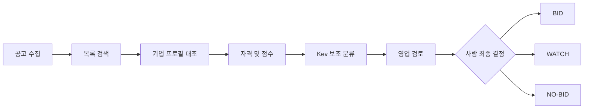

# 01. 제품 요구사항 (PRD)

## 비전
SOL RADAR는 공공 SI·AX 기업이 `어떤 입찰에 참여해야 하는가`에 근거 기반으로 답하도록 돕는 의사결정 지원 플랫폼이다. 사람이 최종 BID 결정을 내리며 자동 투찰은 범위 밖이다.

해커톤 출품 목표: 심사위원(사람 5인 + AI 심사)이 데스크톱 브라우저 한 대에서 **수집 → 자격 판정 → 설명 가능한 점수 → 사람 결정 기록 → 알림**을 5분 안에 끝까지 본다. 데모 장면은 [[19-DEMO-SCENARIO|19 데모 시나리오]], 심사 대응은 [[18-HACKATHON|18 해커톤]]에 둔다.

> [!tip] 심사 포인트
> "정직한 AI"가 제품 원칙이다. 규칙 엔진이 최종, Kev는 보조, 수주확률 표현 금지, 사람이 최종 결정, DEMO 데이터는 DEMO로 표시. 이 다섯 원칙은 [[09-SECURITY|09 보안]]의 책임 있는 AI 절과 [[16-DECISIONS|16 ADR]] ADR-004에서 강제한다.

## 범위
|구분|항목|
|---|---|
|포함 (해커톤)|테스트 기업 1개(가상 "SOL테크", `org-01`) + 격리 확인용 조직 1개(`org-02`, VIEWER 1명, 보유 공고·분석 없음). 공고는 공용 데이터, 조직별 격리 대상은 자격 판정·점수·검토·배정. 공고 검색·상세, 기업 프로필(revision), 자격 판정, SOL Score, BID/WATCH/NO-BID 권고, 사람 검토 기록, 인앱 알림, fixture 20건 기반 DEMO 데이터|
|포함 (플랫폼)|**데스크톱 웹 전용**. 최소 폭 1280px, 1440px 기준 설계, 반응형은 1280~1920 구간만|
|제외 (영구)|자동 투찰, 평가위원 점수 강제 수집, 보장된 승률 예측, 컨소시엄 자동 계약, ERP 실제 연동|
|제외 (해커톤 범위)|**모바일 레이아웃·네이티브 앱**, **결제·구독·요금제**, 카카오톡 실발송(mock provider만), hosted 모델 API 호출(사용자 승인 전 금지)|

범위 제외 결정은 [[16-DECISIONS|16 ADR]] ADR-007. 구현 시 금지 규칙은 [[17-CLAUDE-IMPLEMENTATION|17 구현 규칙]].

## 사용자 및 권한
- ADMIN: 기업 정보·구성원·연동 설정 관리.
- SALES: 공고 탐색, 검토, 담당자 배정 및 의사결정.
- ANALYST: 분석 실행, 점수·자격 판정 확인. 검토 의견(코멘트) 기록은 해커톤 범위 밖(P1).
- VIEWER: 허용 범위 내 읽기.

권한은 역할 순서가 아니라 리소스별 정책으로 적용한다. 표기는 `ADMIN, SALES, ANALYST`처럼 허용 역할을 나열한다. 최종 BID 결정 기록은 `ADMIN, SALES`. 상세는 [[09-SECURITY|09 보안]], [[05-API-SPEC|05 API]].

로그인·초대 수락은 Supabase Auth(이메일+비밀번호, 초대 기반 가입)가 맡는다. 위 네 역할은 조직 구성원 표의 업무 역할 `memberships.sol_role` 값이고, 초대·구성원 관리 같은 조직 관리 권한(`org_role` owner·member)과 구분한다. 조직 데이터는 `org_id`로 소유를 표시하고 Supabase RLS 정책이 조직 밖 접근을 막는다. 다른 조직 자원 조회는 `404`다 ([[16-DECISIONS|16 ADR]] ADR-017).

## 기존 대안과 차별점
나라장터(국가종합전자조달) 자체 알림과 민간 입찰정보 서비스는 일반적으로 **공고 수집·키워드 알림·검색**까지를 제공한다. SOL RADAR는 그 다음 단계, 즉 "우리 회사가 이 공고에 들어가야 하는가"를 다룬다.

|단계|일반적인 입찰정보 서비스|SOL RADAR|
|---|---|---|
|수집·검색·알림|제공|제공 (공식 API + fixture, 변경 감지·revision)|
|우리 회사 기준 자격 판정|사용자가 공고를 읽고 수작업 대조|필수 항목별 `SATISFIED / NOT_SATISFIED / NEEDS_REVIEW` + 원문 근거 인용|
|적합도 점수|없거나 블랙박스|규칙 기반 SOL Score 0~100, 요소별 분해·버전·입력 스냅샷 저장|
|AI 의견|없음 또는 요약|Kev 보조 의견을 규칙 판정 아래에 표시, 수주확률 아님을 명시|
|의사결정 기록|외부 메모·메일|BID/WATCH/NO-BID 권고 + 사람 최종 결정·사유를 감사 가능하게 저장|

> [!warning] 미검증 가정
> 경쟁·대안 서비스의 실제 기능 범위는 개별 확인 전이다. 특정 서비스 이름을 들어 "없다"고 단정하지 않는다. 검증 방법: 해당 서비스의 공개 소개 페이지를 확인한 날짜와 URL을 [[18-HACKATHON|18 해커톤]] 차별점 절에 기록한다.

## 핵심 요구사항
|ID|요구사항|MVP|수용 기준|
|---|---|---|---|
|FR-01|발주계획·사전규격·입찰공고 데이터 수집|P0|fixture→정규화→DB 적재 재실행 시 중복 없음|
|FR-02|공고 목록/검색/필터/원문 링크|P0|키워드·기간·단계·상태·점수 필터|
|FR-03|회사 기술/자격/실적 프로필|P0|권한 검증 후 CRUD 및 감사로그, revision 보존|
|FR-04|입찰 자격 충족/미충족/확인필요|P0|각 항목에 출처 및 사유|
|FR-05|규칙 기반 SOL Score(0~100)|P0|버전·입력 스냅샷·분해 점수 저장|
|FR-06|Kev 1차 추천 + Qwen 설명 (AI gateway 경유)|P0|모델 장애 시 규칙만으로 완결(`PARTIAL`)|
|FR-07|BID/WATCH/NO-BID 권고 및 사람 최종판단|P0|확인 필요 시 자동 BID 금지|
|FR-08|공고 변경 감지·인앱 알림|P0|중복 알림 없음|
|FR-09|카카오톡 알림|P1|템플릿 승인·동의 확보 후만 발송. 해커톤은 mock provider|
|FR-10|경쟁사/낙찰 이력 분석|P1|데이터 존재 시만 통계|
|FR-11|인력 가용성/중복 배치 점검|P1|기간 충돌 탐지|
|FR-12|정부 정책 기반 발주 예측·승률 모델|P2|검증 데이터와 백테스트 후 노출|
|FR-13|검토 코멘트 API (ANALYST 의견 기록)|P1|리뷰 결정과 분리된 코멘트 스레드. 해커톤 데모에 없음|

## 비기능 요구
- API p95 응답 목표: 캐시된 공고 목록 800ms 이내(개발 검증 환경 기준 목표).
- 데이터 수집: 체크포인트·중복 방지·재시도·백필 지원.
- 개인정보/회사 기밀: 테넌트 격리(Supabase RLS, `org_id`, 정책 시험으로 검증), 파일 접근 검증, 로그 마스킹.
- 분석: 실패·근거 부족 시 상태 표시; 무근거 확률 표현 금지. AI 불가 시 규칙 점수만으로 완결(`analysis.status=PARTIAL`).
- 화면: 데스크톱 전용. 최소 폭 1280px, 1440px 기준 레이아웃, 1280~1920 반응형. WCAG AA, 키보드 조작, 색만으로 의미 전달 금지. 상세는 [[06-UI-UX|06 UI]].
- 데모 환경: GPU 없는 노트북 1대에서 `AI_PROVIDER=mock`으로 전 기능 시연 가능. DB와 인증은 Supabase 클라우드 프로젝트(개발 환경)라 시연 중 인터넷 연결이 필요하다. 데모·배포 실행 환경의 최종안과 네트워크가 끊겼을 때의 대체 경로는 미결정이다([[16-DECISIONS|16 ADR]] 미결정 표). 상세는 [[10-DEPLOYMENT|10 배포]].

## 사용자 여정

### 해커톤 데모 여정
위 여정을 fixture 공고로 압축해 보여준다. 장면 번호 `S0`~`S7`은 [[19-DEMO-SCENARIO|19 데모 시나리오]] §4와 같다 ([[16-DECISIONS|16 ADR]] ADR-013). fixture 명세는 [[07-DATA-PIPELINE|07 수집 파이프라인]].

|장면|이름|보여주는 것|
|---|---|---|
|S0|사전 준비|Supabase 프로젝트 접속 확인, `demo` 프로필 기동, `pnpm demo:reset`, `sales@soltech.invalid` 로그인. 조작 없음|
|S1|문제 슬라이드|조작 없음. 수작업 검토의 시간·누락 문제|
|S2|대시보드|DEMO 배지, 우상단 `AI: mock`, 목록 19건(격리 1건 제외), 마감 임박 FX-14, 격리 1건 FX-12(title 누락)|
|S3|자격 판정과 근거|FX-01 필수 자격 3건 SATISFIED + 근거 서랍 → FX-03 NOT_SATISFIED. Kev가 BID 0.55를 내도 권고는 NO-BID, `MODEL_RULE_DISAGREEMENT` 플래그|
|S4|라이브 분석과 결정|FX-02 분석 요청 → polling → SOL Score 72, WATCH → 사람 결정 + 사유 기록 → `REVIEW_ASSIGNED` 인앱 알림|
|S5|LIVE 수집|수집 1회: FX-07 68→76 WATCH→BID, FX-06 기한 변경 revision + 알림 1건, FX-09 중복 0건|
|S6|AI 장애 대체|`docker compose stop ai-gateway` → FX-01 재분석 `PARTIAL`, 배너, `AI: unavailable`|
|S7|테넌트 격리|`org-02` VIEWER로 FX-01 자격 판정 조회 → RLS가 `org-01` 행을 숨겨 `404 NOT_FOUND`|

## 성공 측정
> [!warning] 미검증 가정
> 아래 베이스라인과 목표치는 **가설**이다. 실측 베이스라인이 없다. 데모에서는 측정 방법이 동작함을 보이고, 수치는 가설로 표기한다. 베이스라인 확정 방법: 파일럿 조직의 영업 담당 2~3명이 공고 5건을 수작업으로 검토한 시간을 기록한다.

|지표|가설 베이스라인|가설 목표|측정 방법|데모에서|
|---|---|---|---|---|
|공고 1건 검토 소요 시간|30분 (공고 열람 + 자격 대조 + 메모)|10분|상세 화면 진입 시각 ~ `bid_reviews` 기록 시각 차이|타이머로 1건 측정|
|적합 공고 상위 K 추천 정밀도 (precision@5)|없음|0.6 이상|fixture 20건의 사람 라벨 대비|골든셋 테스트 결과|
|자격 판정 사람 일치율|없음|0.9 이상 (확정 항목 기준)|fixture 라벨 대비 `SATISFIED/NOT_SATISFIED` 일치|테스트 리포트|
|잘못된 자동 BID 권고|-|0건|골든 시나리오 `G3`·`G4`|테스트 + NO-BID 장면|
|알림 중복|-|0건|동일 이벤트·수신자·채널 unique 위반 수|골든 시나리오 `G2`|
|인앱 알림 지연|-|분석 완료 후 5초 이내|outbox `sent_at - created_at`|알림 장면|

지표 저장 위치와 관리자 화면 노출은 [[14-OBSERVABILITY|14 관측성]], 테스트 매핑은 [[11-TESTING|11 테스트]].

## 관련 문서
- [[00-README|00 인덱스]]
- [[02-ARCHITECTURE|02 아키텍처]]
- [[08-SCORING|08 스코어링]]
- [[12-ROADMAP|12 로드맵]]
- [[16-DECISIONS|16 ADR]]
- [[18-HACKATHON|18 해커톤]]
- [[19-DEMO-SCENARIO|19 데모 시나리오]]
