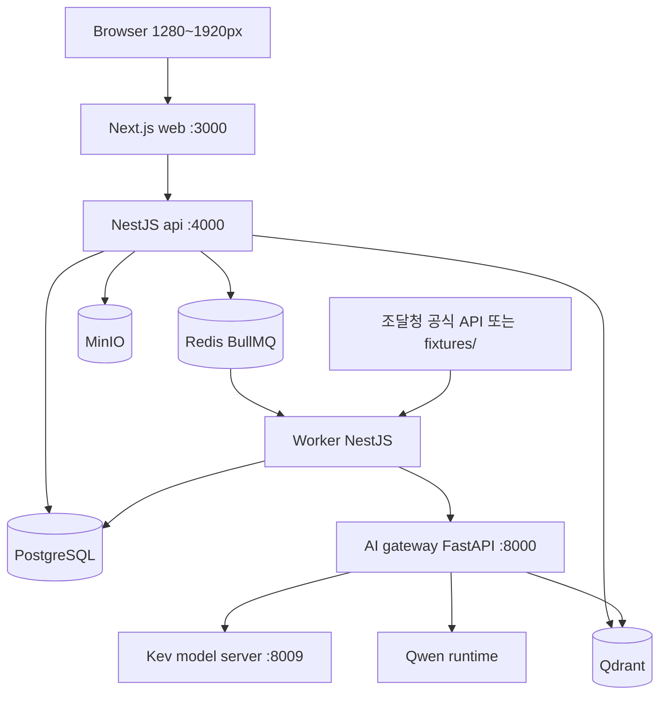
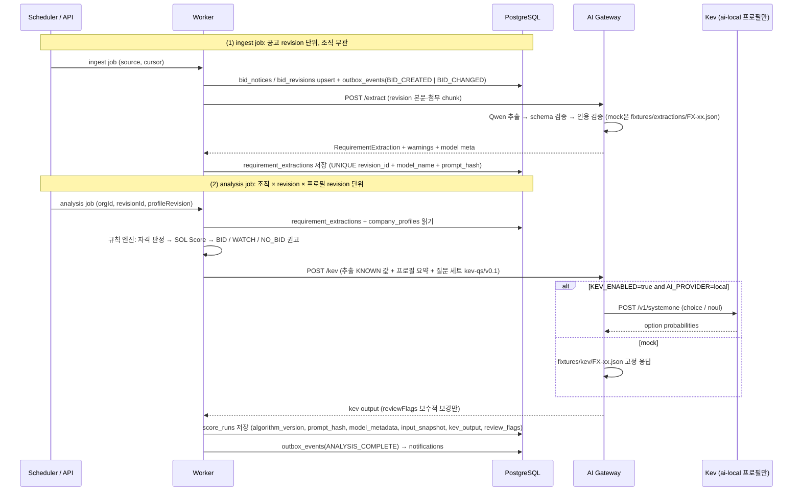
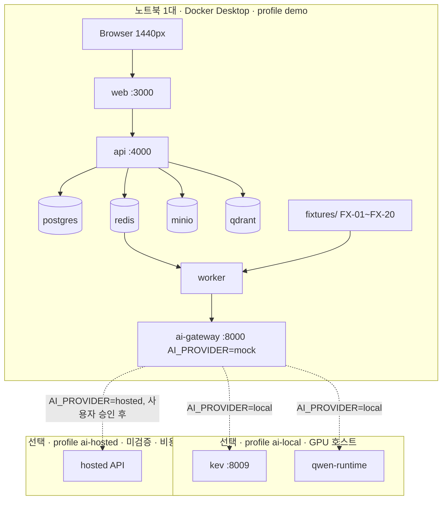

# 02. 시스템 아키텍처

## 경계
- Next.js: UI 및 화면용 server components; 서비스 비즈니스 로직은 NestJS에 집중.
- NestJS: REST API, JWT, 권한, Prisma, 도메인 서비스, BullMQ producer/consumer. Worker는 같은 코드베이스의 별도 entrypoint.
- Python AI gateway (FastAPI :8000): 문서 요구조건 구조화(Qwen), 임베딩, Kev 호출 어댑터, JSON schema 검증, `AI_PROVIDER=mock|local|hosted` 분기. **Kev와 Qwen 런타임을 호출하는 유일한 컴포넌트**다. Worker·API는 Kev에 직접 접근하지 않는다.
- PostgreSQL: 정형 데이터/스코어/감사 이력; Qdrant: 임베딩 검색; MinIO: 첨부파일; Redis: job queue/cache.

## AI 호출 경로 (단일)
|호출자|대상|방식|비고|
|---|---|---|---|
|Worker (ingest job)|AI gateway|HTTP `POST /extract` (Compose 내부 네트워크)|공고 **revision 단위**, 조직 무관. 결과는 `requirement_extractions`에 저장해 모든 조직이 재사용. timeout은 `AI_TIMEOUT_MS`(기본 60000) + 5초|
|Worker (analysis job)|AI gateway|HTTP `POST /kev`|**조직 × revision × 프로필 revision** 단위. 추출 결과 + 프로필 요약 + 질문 세트 `kev-qs/v0.1`을 보낸다. timeout은 `KEV_TIMEOUT_MS`(기본 5000) + 2초. circuit breaker는 Worker가 가진다|
|AI gateway|Kev model server :8009|HTTP `POST /v1/systemone` (TypeSafe System One 호환), `KEV_API_KEY` 설정 시 Bearer|`KEV_ENABLED=true`이고 `AI_PROVIDER=local`일 때만. `mock`은 gateway 안에서 `fixtures/kev/FX-xx.json` 고정 응답|
|AI gateway|Qwen runtime|런타임·프로토콜은 [[03-AI-PIPELINE\|03 AI 파이프라인]]에서 결정|`AI_PROVIDER=local` 또는 `hosted`|
|AI gateway|Qdrant|HTTP/gRPC|근거 chunk 적재·검색|

> [!success] 검증됨 (2026-10-16, https://github.com/jaredpalmer/kev)
> Kev 서버 API는 `POST /v1/systemone`, 질문 타입 `noul`(yes/no)·`choice`·`score`. 텍스트 생성 없이 calibrated probabilities만 반환한다. 기본 바인딩 127.0.0.1이라 컨테이너에서는 `--host 0.0.0.0`이 필요하다. 컨테이너 세부는 [[10-DEPLOYMENT|10 배포]].



## monorepo
```text
apps/web/                    # Next.js App Router (데스크톱 전용)
apps/api/                    # NestJS API + 별도 worker entrypoint
services/ai/                 # Python gateway
services/ai/adapters/        #   mock.py, kev.py, qwen.py (AI_PROVIDER 분기)
packages/contracts/          # OpenAPI generated client, shared DTO definitions
infra/compose.yaml           # 기본 + profile(demo, ai-local, ai-hosted, production)
infra/compose.gpu.yaml       # ai-local 전용 GPU device override
infra/env/                   # demo.env.example, ai-local.env.example, ai-hosted.env.example
infra/nginx/
prisma/schema.prisma
prisma/migrations/
fixtures/                    # FX-01 ~ FX-20
docs/                        # 이 vault
docs/evidence/               # Phase별 증거 (17 참조)
```

## 서비스 책임과 데이터 소유
공고/회사/검토 정보의 단일 기록원은 PostgreSQL. Qdrant는 재생성 가능한 파생 인덱스. MinIO는 원본 바이트 저장, PostgreSQL에 키·해시·접근 권한 기록. 점수 재계산은 비동기 job이며 결과에는 알고리즘 버전·프롬프트 해시·모델 식별자를 남긴다. Kev 출력은 규칙 점수와 별도 컬럼에 저장한다 ([[04-DATABASE|04 DB]]).

## 흐름
두 종류의 job이 있다. **ingest job**은 공고 revision 단위로 수집과 요구조건 추출을 끝내고, **analysis job**은 조직 × revision × 프로필 revision 단위로 규칙 판정·Kev·점수를 만든다. 용어는 [[03-AI-PIPELINE|03 AI 파이프라인]] §2와 같다.


- Worker가 Kev를 직접 호출하는 경로는 없다. Kev 어댑터·mock·질문 세트는 `services/ai/`에만 둔다.
- Kev는 `review_flags`를 추가할 수 있을 뿐 자격 판정·점수·권고를 바꾸지 못한다 ([[03-AI-PIPELINE|03 AI 파이프라인]] §5.5, [[08-SCORING|08 스코어링]]).
- 추출 실패·AI 불가 시 analysis job은 규칙만으로 끝내고 `status=PARTIAL`, `recommendation_basis=RULES_ONLY`.

## 데모 토폴로지 (노트북 1대, GPU 없음)

- 기본은 `mock`. 조달청 공식 API는 `demo` 프로필에서 호출하지 않고 fixture만 사용한다 (데모 네트워크 의존 제거).
- 현재 `AI_PROVIDER` 값은 `/health/ready`의 `checks.ai`와 화면 우상단 `AI: mock | local | hosted` 표시로 노출된다. gateway가 불가하면 `AI: unavailable`. 심사위원이 지금 보는 것이 mock인지 실모델인지 항상 알 수 있다.
- mock 응답은 fixture ID별로 고정된 결정적 값이다. 같은 입력에 같은 출력이 나와야 골든 테스트가 성립한다.
- 실모델 전환은 env 교체와 프로필 추가만으로 끝나야 한다. 코드 변경 없음. 프로필 정의는 [[10-DEPLOYMENT|10 배포]], 결정은 [[16-DECISIONS|16 ADR]] ADR-008.

## 장애 원칙
|장애|감지|사용자에게 보이는 것|데이터 영향|
|---|---|---|---|
|AI gateway 불가 (연결 거부·timeout·5xx·circuit open)|Worker HTTP timeout: `/extract`는 `AI_TIMEOUT_MS`+5초, `/kev`는 `KEV_TIMEOUT_MS`+2초. 연결 거부는 즉시 실패(재시도 없음), timeout·5xx는 1회 재시도. 연속 실패 3회 시 circuit open, 15초 후 half-open. 데모 주입은 `docker compose stop ai-gateway` ([[10-DEPLOYMENT\|10 배포]])|분석 상태 `PARTIAL`, 상세 화면 배너 "AI 분석을 사용할 수 없어 규칙 기반 점수와 자격 판정만 표시합니다. (상태: PARTIAL)" ([[09-SECURITY\|09 보안]] 고지 문구 원천), Kev 영역 숨김, 우상단 `AI: unavailable`|score_runs 저장됨 (`kev_output` null, `recommendation_basis=RULES_ONLY`, `review_flags += AI_UNAVAILABLE`, `error_code=AI_UNAVAILABLE`). 재분석 가능|
|추출 실패 (Qwen 오류, 스키마 재검증 실패)|gateway가 `/extract` 응답에 실패 코드|해당 공고 상세에 "요구조건 추출 실패, 규칙만 적용" 표시, 추출 필드 전부 `UNKNOWN`|`requirement_extractions.status=FAILED`. 분석은 규칙만으로 `PARTIAL`, `review_flags += EXTRACTION_FAILED` ([[03-AI-PIPELINE\|03 AI 파이프라인]] §6)|
|Kev만 불가 (gateway 정상, `KEV_TIMEOUT_MS` 초과·오류)|gateway가 `kev.enabled=false`로 응답|Kev 보조 의견 영역 "사용 불가", 점수·자격은 정상|`kev_output` null, `recommendation_basis=RULES_ONLY`, 상태 `COMPLETED`. 분석은 실패하지 않는다|
|조달청 공식 API 불가·429|connector 지수 백오프 재시도, 체크포인트 유지|목록 상단 신선도 배너 "마지막 동기화 HH:MM", 기존 공고 유지|신규 공고 지연, 손실 없음|
|Redis/큐 장애|BullMQ 연결 오류, `/health/ready` 503|분석 요청 시 `503 SERVICE_UNAVAILABLE` (`component: queue`), 기존 결과 조회 가능|job 유실 없음 (재시도·DLQ)|
|Qdrant 불가|gateway 검색 호출 실패|키워드 검색으로 대체, "의미 검색 비활성" 표시|근거 인용은 문자열 매칭 경로로 유지|
|PostgreSQL 불가|Prisma 연결 오류|쓰기 503, 명확한 오류 메시지|쓰기 불가, 복구 후 재시도|
|MinIO 불가|presigned URL 발급 실패|첨부 다운로드 버튼 비활성 + 사유|원문 텍스트는 PG에 있어 분석 지속|

네트워크 호출은 모두 timeout 및 circuit breaker 적용. 장애 상태 노출 방식은 [[06-UI-UX|06 UI]], 지표는 [[14-OBSERVABILITY|14 관측성]].

## 관련 문서
- [[01-PRD|01 PRD]]
- [[03-AI-PIPELINE|03 AI 파이프라인]]
- [[04-DATABASE|04 DB]]
- [[10-DEPLOYMENT|10 배포]]
- [[14-OBSERVABILITY|14 관측성]]
- [[16-DECISIONS|16 ADR]]
