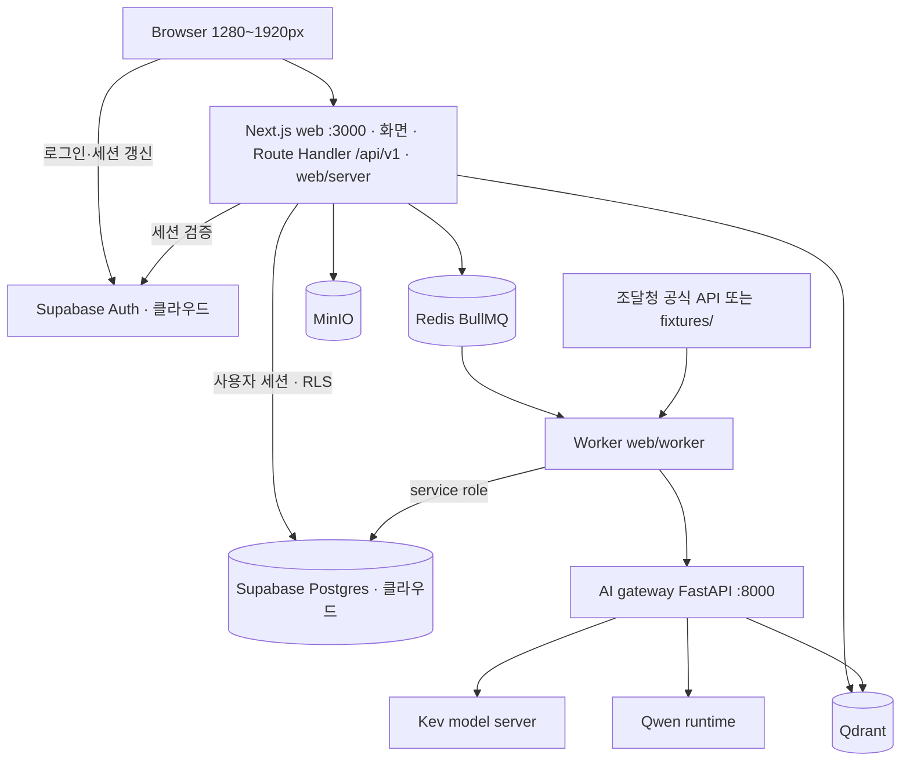
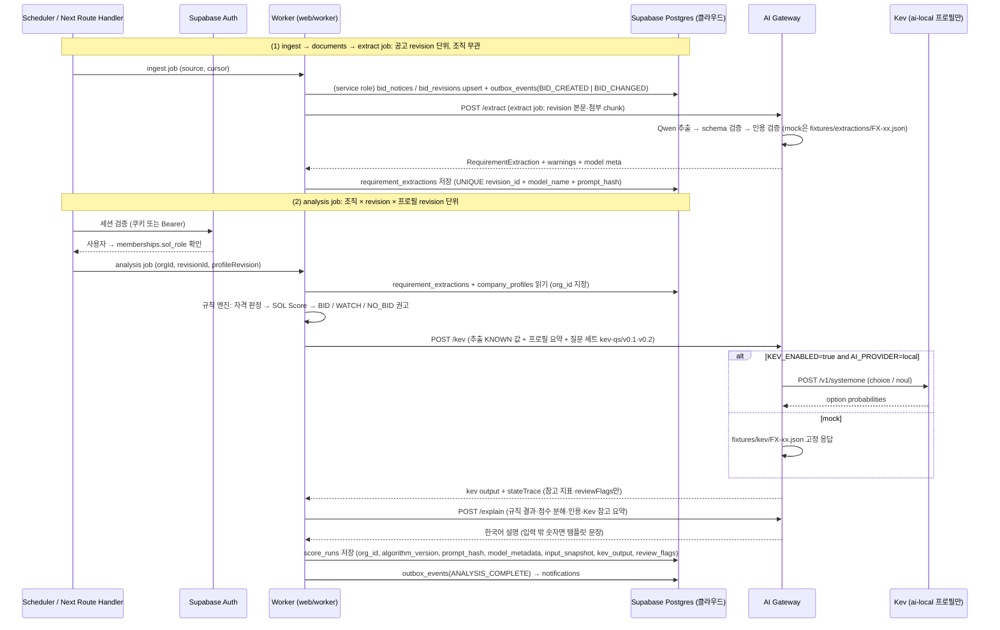
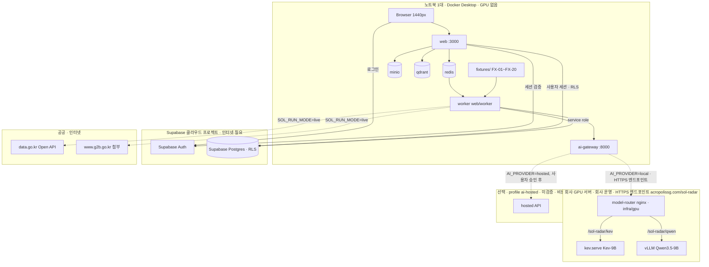

# 02. 시스템 아키텍처

## 경계

> [!note] 해커톤 뒤 전환 예정 ([[16-DECISIONS|ADR-028]])
> 해커톤 제출(2026-10-27) 뒤 `/api/v1` Route Handler와 worker를 NestJS 앱으로 옮기고, Next.js는 화면만 맡는다. Supabase(Postgres·RLS·Auth)와 나머지 구성은 그대로다. 아래는 해커톤 동안의 현재 구조다.

- Next.js (`web/`, :3000): 화면(App Router, server components), Route Handler(`/api/v1/**`, 헬스체크 `/health/live`·`/health/ready`), 서버 도메인 `web/server/<도메인>/`(model·repo·service·index 배럴, `import "server-only"`). 요청 처리 경로는 사용자 세션(anon 키 + 로그인 쿠키, 스크립트는 `Authorization: Bearer <Supabase access token>`)으로 Supabase를 부르고, 권한은 DB의 RLS가 정한다. 분석·수동 수집 요청은 BullMQ job으로 넣는다(producer). 외부 API 계약의 단일 원천은 zod 스키마(`web/server/<도메인>/*.model.ts`, [[16-DECISIONS|16 ADR]] ADR-016·017).
- Supabase (클라우드 프로젝트, Compose 밖): **Postgres + RLS**(정형 데이터·점수·감사 이력, 조직 격리)와 **Auth**(이메일+비밀번호·간편 로그인, 공개 가입 + 초대로 조직 합류, ADR-018)만 맡는다. 스키마·RLS·함수는 `supabase/migrations/*.sql`(append-only), 타입은 생성물 `web/lib/database.types.ts`(`pnpm db:types`). Supabase Storage·pgvector·Supabase Queues는 쓰지 않는다.
- Worker (`web/worker/`, 별도 Node(TypeScript) 프로세스): BullMQ consumer(ingest job·documents job·extract job·analysis job·outbox 처리). `live` 모드에서 나라장터 Open API(data.go.kr)를 부르고 첨부를 `www.g2b.go.kr` allowlist로 내려받는 유일한 컴포넌트다(서비스별 서비스키 4개 `G2B_*_SERVICE_KEY`는 worker env에만, [[07-DATA-PIPELINE|07 수집]] §2.2, [[16-DECISIONS|ADR-022]]). 같은 코드베이스의 `web/server` 도메인 코드를 같이 쓴다. Supabase는 service role 키(`SUPABASE_SERVICE_ROLE_KEY`)로 부르므로 RLS를 거치지 않는다. 그래서 쓸 때 `org_id`를 직접 지정하고 테넌트 혼입을 막는 시험을 둔다([[09-SECURITY|09 보안]]).
- Python AI gateway (FastAPI :8000): 첨부 파싱(`/parse`, 형식별 `DocumentParser`), 문서 요구조건 구조화(Qwen `/extract`), 근거 설명(Qwen `/explain`), 임베딩, Kev 호출 어댑터(`/kev`), JSON schema 검증, `AI_PROVIDER=mock|local|hosted` 분기. **Kev와 Qwen 런타임을 호출하는 유일한 컴포넌트**다. Worker·Next 서버는 Kev에 직접 접근하지 않는다. 실행 모드(`SOL_RUN_MODE=live|fixture|mock`)는 [[03-AI-PIPELINE|03 AI 파이프라인]]과 [[16-DECISIONS|ADR-020]].
- Qdrant: 임베딩 검색; MinIO: 첨부파일; Redis: job queue/cache. 세 서비스와 AI gateway·worker는 Docker Compose로 띄운다([[10-DEPLOYMENT|10 배포]]).

> [!success] 검증됨 (2026-10-18, `docs/evidence/phase-0/worker-conditions.txt`, 커밋 `fa92254`)
> `web/server` 모듈은 `import "server-only"`로 시작한다. worker는 `node --conditions=react-server --import tsx worker/main.ts`로 띄우면 `web/server` 코드를 그대로 불러온다(`pnpm -C web worker:check` → `worker modules loaded`). `--conditions` 없이 띄우면 `server-only`가 "This module cannot be imported from a Client Component module" 오류로 멈춘다. [[16-DECISIONS|16 ADR]] 미결정 9번 종결.

## AI 호출 경로 (단일)
|호출자|대상|방식|비고|
|---|---|---|---|
|Worker `web/worker` (documents job)|AI gateway|HTTP `POST /parse` (바이트 본문)|첨부 1건 단위. worker가 MinIO에서 읽은 바이트를 보내고 결과 텍스트를 MinIO에 쓴다. gateway는 MinIO에 접근하지 않는다|
|Worker `web/worker` (extract job)|AI gateway|HTTP `POST /extract` (Compose 내부 네트워크)|공고 **revision 단위**, 조직 무관. 결과(+ 영어 표기 `translations`)는 `requirement_extractions`에 저장해 모든 조직이 재사용. timeout은 `AI_TIMEOUT_MS`(기본 60000) + 5초|
|Worker `web/worker` (analysis job)|AI gateway|HTTP `POST /kev`, `POST /explain`|**조직 × revision × 프로필 revision** 단위. 추출 결과 + 프로필 요약 + 질문 세트 `kev-qs/v0.1`·`v0.2`를 보낸다. timeout은 `KEV_TIMEOUT_MS`(기본 5000) + 2초. circuit breaker는 Worker가 가진다|
|AI gateway|Kev model server(`kev.serve`)|HTTP(S) `POST /v1/systemone` (TypeSafe System One 호환), `KEV_API_KEY` Bearer|`AI_PROVIDER=local`일 때(기본값은 실행 모드가 정한다). 해커톤은 회사가 제공하는 HTTPS 엔드포인트(`https://acropolissg.com/sol-radar` 아래, [[16-DECISIONS\|ADR-025]])의 Kev-9B@v1.0에 연결. 기동 시 모델 레지스트리와 `/v1/models` 대조. `mock`은 gateway 안에서 `fixtures/kev/FX-xx.json` 고정 응답|
|AI gateway|Qwen runtime|vLLM(OpenAI 호환, guided JSON) — 회사 GPU 추론 엔드포인트, HTTPS + `QWEN_API_KEY` Bearer(ADR-025)|`AI_PROVIDER=local` 또는 `hosted`([[10-DEPLOYMENT\|10 배포]])|
|Worker `web/worker` (ingest job)|data.go.kr Open API|HTTPS GET, `serviceKey`(서비스마다 다른 키)|`live` 모드만. 입찰공고·사전규격·발주계획·업종 코드. 호출 예산은 Redis 카운터([[07-DATA-PIPELINE\|07 수집]])|
|Worker `web/worker` (documents job)|g2b 첨부 다운로드|HTTPS GET, `www.g2b.go.kr` allowlist|DNS 재검증·사설 IP 거부·30 s·50 MB([[09-SECURITY\|09 보안]])|
|AI gateway|Qdrant|HTTP/gRPC|근거 chunk 적재·검색|

> [!success] 검증됨 (2026-10-16, https://github.com/jaredpalmer/kev)
> Kev 서버 API는 `POST /v1/systemone`, 질문 타입 `noul`(yes/no)·`choice`·`score`. 텍스트 생성 없이 calibrated probabilities만 반환한다. 기본 바인딩 127.0.0.1이라 컨테이너에서는 `--host 0.0.0.0`이 필요하다. 컨테이너 세부는 [[10-DEPLOYMENT|10 배포]].



## monorepo
```text
web/                      # Next.js 16 App Router — 화면 + Route Handler(/api/v1) + 서버 도메인
web/server/<도메인>/       #   model·repo·service·index(배럴), import "server-only". 예: bids, ingestion, scoring, analysis, review, notifications, company-profile, health
web/app/(app)/(work)/      #   업무 화면 묶음 — 조직 주소 없는 /dashboard·/bids·/bids/[id]·/notifications(ADR-029 A6 D1). 템플릿 /[slug]/… 화면은 확장 컷에서 정리(D30)
web/app/api/v1/**/route.ts#   외부 계약(05 API) — 경로는 /api/v1/... 그대로
web/app/health/{live,ready}/route.ts  # 헬스체크 /health/live, /health/ready
web/worker/               # BullMQ 소비자 진입점(ingest·documents·extract·analysis job, outbox 처리). web/server 도메인 코드를 같이 쓴다(같은 코드베이스의 별도 프로세스)
supabase/migrations/      # 스키마·RLS·함수(append-only, 이미 있는 파일은 고치지 않는다)
services/ai/              # Python AI gateway (FastAPI :8000), adapters/mock.py·kev.py·qwen.py
infra/compose.yaml        # redis, minio, qdrant, ai-gateway, worker 5개. web 은 호스트 실행(Compose 에 없음). 실행 프로필은 env 묶음(infra/env/)
fixtures/                 # FX-01 ~ FX-20
scripts/                  # 검증·seed(템플릿 scripts 재사용: db-seed, db-push, db-types, database.test 등)
design/tokens.json        # 디자인 토큰 정본 → web/app/globals.css 생성(pnpm tokens)
docs/                     # 이 vault, docs/evidence/
```
- [[16-DECISIONS|ADR-021]]로 더하는 서버 도메인: `people`(조직·인력 조회, 확장 컷 [[16-DECISIONS|ADR-023]]), `ops`(템플릿 `admin`의 새 이름, 서비스 운영자 전용). P1: `watchlist`·`projects`·`workforce`.
- pnpm workspace·`apps/`·`packages/`는 만들지 않는다. 출발 템플릿처럼 `web/`은 독립 설치한다(`pnpm -C web …`).
- 프로필별 env 예시(`infra/env/*.env.example`)와 회사 GPU 서버용 참고 구성(`infra/compose.gpu.yaml`, 모델 라우터만, [[16-DECISIONS|ADR-025]])은 [[10-DEPLOYMENT|10 배포]]에서 다룬다.

## 서비스 책임과 데이터 소유
공고/회사/검토 정보의 단일 기록원은 **Supabase Postgres**다. 조직 소유 데이터는 `org_id`를 갖고 RLS(`org_id in (select public.my_org_ids())`)로 거른다. 공고처럼 조직 소유가 없는 공용 데이터는 로그인 사용자(`authenticated`)에게 읽기만 열고, 쓰기는 worker(service role)만 한다. 다른 조직 자원은 RLS로 행이 보이지 않아 `404`가 된다([[09-SECURITY|09 보안]]). Qdrant는 재생성 가능한 파생 인덱스. MinIO는 원본 바이트 저장, Supabase Postgres에 키·해시·접근 권한 기록. 점수 재계산은 비동기 job이며 결과에는 알고리즘 버전·프롬프트 해시·모델 식별자를 남긴다. Kev 출력은 규칙 점수와 별도 컬럼에 저장한다 ([[04-DATABASE|04 DB]]).

## 흐름
job은 넷이다. **ingest job**(수집·정규화·revision) → **documents job**(첨부 다운로드·`/parse`) → **extract job**(`/extract`, 공고 revision 단위)이 공고 쪽을 끝내고, **analysis job**은 조직 × revision × 프로필 revision 단위로 규칙 판정·Kev·점수를 만든다. 용어는 [[03-AI-PIPELINE|03 AI 파이프라인]] §2와 같다.


- Worker가 Kev를 직접 호출하는 경로는 없다. Kev 어댑터·mock·질문 세트는 `services/ai/`에만 둔다.
- Worker는 service role로 쓰므로 RLS가 막아 주지 않는다. analysis job은 job에 담긴 `orgId`를 모든 읽기·쓰기에 `org_id`로 지정한다.
- Kev는 `review_flags`를 추가하고 참고 지표로 표시될 뿐 자격 판정·점수·권고를 바꾸지 못한다 ([[03-AI-PIPELINE|03 AI 파이프라인]] §5.5, [[08-SCORING|08 스코어링]], [[16-DECISIONS|ADR-020]]).
- 위 시퀀스는 분석 경로다. `live` 모드의 ingest job은 그 앞에 data.go.kr 수집 → documents job(첨부 다운로드 → `/parse`) → extract job 순서로 돈다([[03-AI-PIPELINE|03 AI 파이프라인]] §2).
- 추출 실패·AI 불가 시 analysis job은 규칙만으로 끝내고 `status=PARTIAL`, `recommendation_basis=RULES_ONLY`.

## 데모 토폴로지 (노트북 1대 + 회사 GPU 서버)

- 노트북에서는 Compose 서비스(redis·minio·qdrant·ai-gateway·worker)와 web이 돈다. web은 호스트에서 `pnpm -C web start`로 띄운다. `infra/compose.yaml`에 `web` 서비스는 없다([[16-DECISIONS|ADR-024]] D1, [[10-DEPLOYMENT|10 배포]]). DB·Auth는 노트북 밖 Supabase 클라우드 프로젝트다.
- 실행 모드([[16-DECISIONS|ADR-020]]): `live` = 공공 API + 회사 GPU 실추론(해커톤 MVP 목표), `fixture` = fixture 20건 + 회사 GPU 실추론(공공 API 장애 대체), `mock` = fixture 20건 + mock AI(모델 장애 대체·CI·골든). 장애 대체 순서는 `live` → `fixture` → `mock`이고, 모드 전환은 env 교체와 worker·gateway 재시작으로 한다. 자동으로 바꾸지 않는다.
- 현재 실행 모드와 `AI_PROVIDER` 값은 `/health/ready`의 `checks.ai`와 화면 우상단 표시(`실행 모드` + `AI: mock | local | hosted`)로 노출된다. gateway가 불가하면 `AI: unavailable`. 심사위원이 지금 보는 것이 실데이터·실모델인지 항상 알 수 있다.
- mock 응답은 fixture ID별로 고정된 결정적 값이다. 같은 입력에 같은 출력이 나와야 골든 테스트가 성립하므로 골든은 `mock` 모드에서만 단언한다.
- 회사 GPU 서버는 외부 접근 불가이고, 회사가 모델 런타임을 HTTPS 엔드포인트(`https://acropolissg.com/sol-radar` 아래)로 제공한다. gateway는 TLS 검증을 켠 채 API 키(`QWEN_API_KEY`·`KEV_API_KEY`)로 붙는다([[16-DECISIONS|ADR-025]]). 회사 nginx는 location 하나만 두고, GPU 서버 안 nginx 모델 라우터(`infra/gpu/model-router.conf`)가 `/sol-radar/qwen`·`/sol-radar/kev`를 vLLM·`kev.serve`로 나눈다. 엔드포인트에 접속하지 못하면 gateway가 Qwen·Kev 미접속을 따로 기록하고 `PARTIAL`·`RULES_ONLY`로 끝낸다. 모델 기동·GPU 배분은 회사 운영이다. 프로필 정의는 [[10-DEPLOYMENT|10 배포]].

> [!warning] 데모 네트워크 의존
> 개발 DB·Auth가 Supabase 클라우드 프로젝트라 데모 중 인터넷 연결이 필요하다. 연결이 끊기면 로그인·조회·분석 저장이 모두 멈춘다. 대체 경로는 [[19-DEMO-SCENARIO|19 데모 시나리오]] §5다([[16-DECISIONS|ADR-023]], 미결정 8번). 웹 배포처는 아직 미결정이다.

## 장애 원칙
|장애|감지|사용자에게 보이는 것|데이터 영향|
|---|---|---|---|
|AI gateway 불가 (연결 거부·timeout·5xx·circuit open)|Worker HTTP timeout: `/extract`는 `AI_TIMEOUT_MS`+5초, `/kev`는 `KEV_TIMEOUT_MS`+2초. 연결 거부는 즉시 실패(재시도 없음), timeout·5xx는 1회 재시도. 연속 실패 3회 시 circuit open, 15초 후 half-open. 데모 주입은 `docker compose stop ai-gateway` ([[10-DEPLOYMENT\|10 배포]])|분석 상태 `PARTIAL`, 상세 화면 배너 "AI 분석을 사용할 수 없어 규칙 기반 점수와 자격 판정만 표시합니다. (상태: PARTIAL)" ([[09-SECURITY\|09 보안]] 고지 문구 원천), Kev 영역 숨김, 우상단 `AI: unavailable`|score_runs 저장됨 (`kev_output` null, `recommendation_basis=RULES_ONLY`, `review_flags += AI_UNAVAILABLE`, `error_code=AI_UNAVAILABLE`). 재분석 가능|
|추출 실패 (Qwen 오류, 스키마 재검증 실패)|gateway가 `/extract` 응답에 실패 코드|해당 공고 상세에 "요구조건 추출 실패, 규칙만 적용" 표시, 추출 필드 전부 `UNKNOWN`|`requirement_extractions.status=FAILED`. 분석은 규칙만으로 `PARTIAL`, `review_flags += EXTRACTION_FAILED` ([[03-AI-PIPELINE\|03 AI 파이프라인]] §6)|
|Kev만 불가 (gateway 정상, `KEV_TIMEOUT_MS` 초과·오류)|gateway가 `kev.enabled=false`로 응답|Kev 참고 지표 영역 "사용 불가", 점수·자격은 정상|`kev_output` null, `recommendation_basis=RULES_ONLY`, 상태 `COMPLETED`. 분석은 실패하지 않는다|
|조달청 공식 API 불가·429·일일 한도(에러코드 22)|connector 지수 백오프 재시도, 체크포인트 유지, 한도 도달 시 그날 수집 중단|목록 상단 신선도 배너 "마지막 동기화 HH:MM", 관리자 수집 화면 "공공 API 오류: {코드}", 기존 공고 유지|`ingest_runs`·`ingest_errors`에 코드 기록. 신규 공고 지연, 손실 없음. fixture로 자동 대체하지 않는다|
|첨부 다운로드 불가 (인증 요구·4xx·5xx·allowlist 밖 리다이렉트·50 MB 초과)|documents job|`DOCUMENT_DOWNLOAD_FAILED` 배지, "첨부 원문 확인"|`bid_documents.download_status=FAILED`. 본문만으로 추출, 첨부에 의존하는 항목은 `NEEDS_REVIEW`([[07-DATA-PIPELINE\|07 수집]])|
|파싱 실패·부분 파싱 (미지원 형식·배포용·암호·스캔 PDF·품질 신호 미달)|gateway `/parse` 결과|`PARSE_UNSUPPORTED` 또는 "일부만 읽음" 배지와 사유|`bid_documents.parse_status`. 빠진 내용을 AI가 추측해 채우지 않는다([[03-AI-PIPELINE\|03 AI 파이프라인]])|
|회사 GPU 추론 엔드포인트 미접속·모델 서버 미접속(ADR-025)|gateway → Qwen·Kev 연결 실패(TLS·인증 실패 포함), 레지스트리 불일치|Qwen 불가: "AI 분석 불가 → 규칙만", Kev 불가: Kev 영역 "사용 불가"|`QWEN_UNAVAILABLE`·`KEV_UNAVAILABLE`를 따로 기록. mock 자동 대체는 기본 금지이고, `AI_FALLBACK_TO_MOCK=true`(live 금지)일 때만 `MOCK_FALLBACK`과 배너로 표시|
|Redis/큐 장애|BullMQ 연결 오류, `/health/ready` 503|분석 요청 시 `503 SERVICE_UNAVAILABLE` (`component: queue`), 기존 결과 조회 가능|job 유실 없음 (재시도·DLQ)|
|Qdrant 불가|gateway 검색 호출 실패|키워드 검색으로 대체, "의미 검색 비활성" 표시|근거 인용은 문자열 매칭 경로로 유지|
|Supabase(Postgres) 불가·네트워크 끊김|Supabase 연결 오류·timeout, `/health/ready` `checks.db` 불가 → 503 `status:"unavailable"`|조회·쓰기 요청에 `503 SERVICE_UNAVAILABLE` (`component: db`)과 명확한 오류 메시지. Supabase Auth도 같은 클라우드 프로젝트라 로그인·세션 갱신도 실패한다|쓰기 불가, 복구 후 재시도. Redis에 들어간 job은 남아 재시도된다|
|MinIO 불가|presigned URL 발급 실패|첨부 다운로드 버튼 비활성 + 사유|원문 텍스트는 Supabase Postgres에 있어 분석 지속|

네트워크 호출은 모두 timeout 및 circuit breaker 적용. 장애 상태 노출 방식은 [[06-UI-UX|06 UI]], 지표는 [[14-OBSERVABILITY|14 관측성]].

## 솔리데오 인력·가입 경계 (ADR-019)

사용 회사는 솔리데오 하나이며 `org-02`는 RLS 격리 시험 전용이다. 부서를 별도 테넌트(`organizations`)로 만들지 않는다. 이름·사진·직급 선택으로 Auth 계정·멤버십·권한을 자동 생성하지 않는다. 공개 가상 사진(`web/public/demo/people/<personId>.png`)은 정적 공개 자산이고, 공고 첨부는 MinIO 사설 저장이다. 둘을 섞지 않는다([[09-SECURITY|09 보안]]).

명부 정본(`fixtures/people/solideo.*.json`)과 생성·배분은 [[07-DATA-PIPELINE]], 표(`team_members`·`team_member_scoring`, [[16-DECISIONS|ADR-021]])와 가입 신고 열은 [[04-DATABASE]], 가입 API(`GET /api/v1/signup-options`·`GET·PATCH /api/v1/me/employment`)와 `/auth/complete-profile` 보완 규칙은 [[05-API-SPEC]] §8이 정의한다. 구현 상태는 [[PROGRESS]]를 따른다.

## 관련 문서
- [[01-PRD|01 PRD]]
- [[03-AI-PIPELINE|03 AI 파이프라인]]
- [[04-DATABASE|04 DB]]
- [[09-SECURITY|09 보안]]
- [[10-DEPLOYMENT|10 배포]]
- [[14-OBSERVABILITY|14 관측성]]
- [[16-DECISIONS|16 ADR]]
- [[07-DATA-PIPELINE|07 수집 파이프라인]]
- [[21-MODEL-TRAINING|21 모델 학습]]
