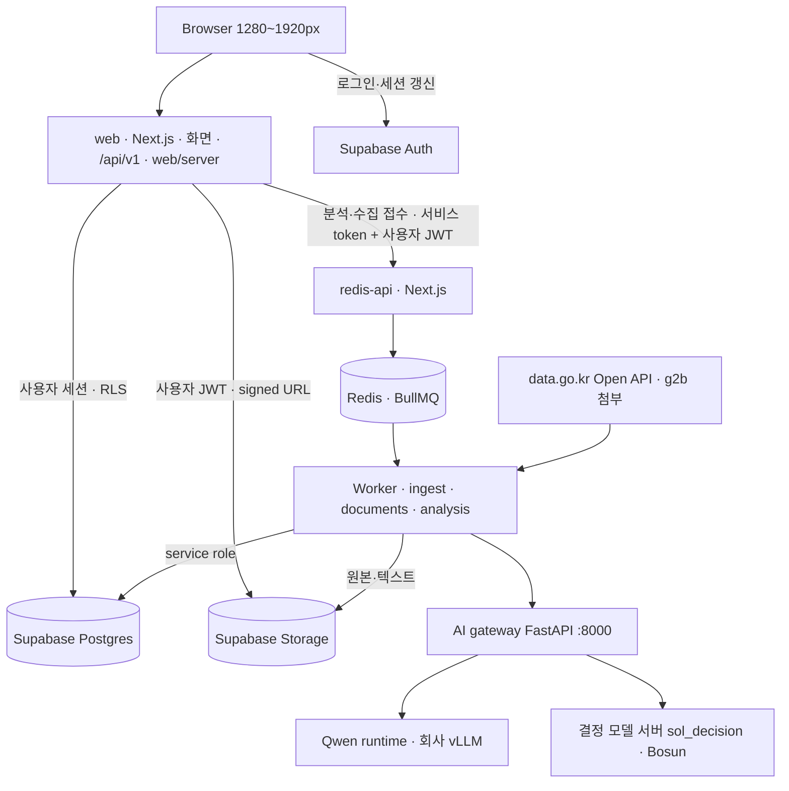
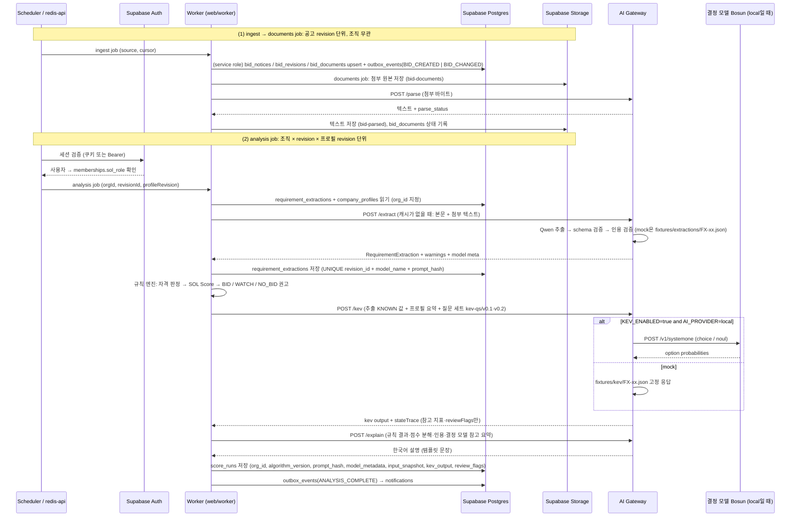
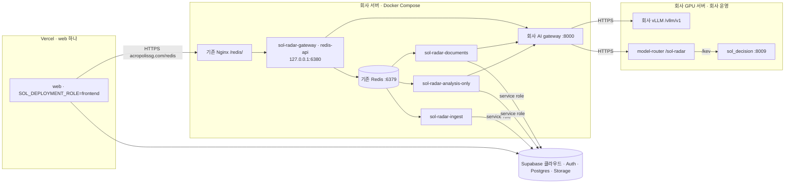

# 02. 시스템 아키텍처

## 운영 구성 (ADR-049)

Vercel은 `web` 하나만 실행한다(`vercel.json`). 회사 서버는 기존 Redis를 재사용하고 그 위에 `redis-api`·AI gateway·Worker 3종(ingest·analysis·documents 전용)을 Compose로 띄운다. 모델은 회사 vLLM의 `Qwen3.8-Flash-Next-AWQ-INT4`와 우리 결정 서버 `sol_decision`(Bosun v3.1 0.6B)이다. 운영은 2026-10-26부터 나라장터 live 수집으로 돌고, AI gateway는 회사 실모델에 붙어 있다(`/health/ready` `ai: local`). 첨부 처리(gateway 파서·documents Worker)의 회사 반영은 [[10-DEPLOYMENT|10 배포]] "첨부 처리 운영 반영"을 따른다. 회사 쪽 절차는 [회사 실행서](../infra/company/README.md)다.

## 경계

> [!note] 해커톤 뒤 전환 예정 ([[16-DECISIONS|ADR-028]])
> 해커톤 제출([[12-ROADMAP|12 로드맵]]) 뒤 `/api/v1` Route Handler와 worker를 NestJS 앱으로 옮기고, Next.js는 화면만 맡는다. Supabase(Postgres·RLS·Auth)와 나머지 구성은 그대로다. 아래는 해커톤 동안의 현재 구조다.

- Next.js (`web/`, :3000): 화면(App Router, server components), Route Handler(`/api/v1/**`, 헬스체크 `/health/live`·`/health/ready`), 서버 도메인 `web/server/<도메인>/`(model·repo·service·index 배럴, `import "server-only"`). 요청 처리 경로는 사용자 세션(anon 키 + 로그인 쿠키, 스크립트는 `Authorization: Bearer <Supabase access token>`)으로 Supabase를 부르고, 권한은 DB의 RLS가 정한다. 외부 API 계약의 단일 원천은 zod 스키마(`web/server/<도메인>/*.model.ts`, ADR-016·017).
  - 같은 빌드가 `SOL_DEPLOYMENT_ROLE`로 역할을 나눈다. `frontend`(Vercel)는 분석·수집 접수와 AI 상태를 회사 `redis-api`에 HTTPS로 넘긴다. `redis-api`(회사)가 BullMQ job을 넣는다(producer). `standalone`은 노트북 대체 경로다.
  - `frontend`·`redis-api`는 `SUPABASE_SERVICE_ROLE_KEY`가 있으면 기동을 거부하고, `frontend`는 `REDIS_URL`도 거부한다(`web/app/_lib/deployment-role.ts:45-47`).
- Supabase (클라우드 프로젝트, Compose 밖): **Postgres + RLS**(정형 데이터·점수·감사 이력, 조직 격리)와 **Auth**(이메일+비밀번호·간편 로그인, 공개 가입 + 초대로 조직 합류, ADR-018), private **Storage**(버킷 `bid-documents`·`bid-parsed`, ADR-048). 스키마·RLS·함수는 `supabase/migrations/*.sql`(append-only), 타입은 생성물 `web/lib/database.types.ts`(`pnpm db:types`). pgvector·Supabase Queues는 쓰지 않는다.
- Worker (`web/worker/`, 별도 Node(TypeScript) 프로세스): BullMQ consumer. 전체 진입점 `worker/main.ts`는 system·ingest·documents·analysis·알림 outbox·마감 알림·부처 공고 등록을 한 프로세스에 둔다(`web/worker/main.ts:908-915`). 회사는 진입점을 나눠 `ingest-only-main.ts`·`analysis-only-main.ts`·`documents-only-main.ts`로 돌린다([[10-DEPLOYMENT|10 배포]] "회사 Compose 프로젝트"). 별도 extract job은 없고 `/extract`는 analysis job 안에서 부른다.
  - `live` 모드에서 나라장터 Open API(data.go.kr)를 부르고 첨부를 `www.g2b.go.kr` allowlist로 내려받는 유일한 컴포넌트다(서비스별 서비스키 `G2B_*_SERVICE_KEY`는 worker env에만, [[07-DATA-PIPELINE|07 수집]] §2.2, [[16-DECISIONS|ADR-022]]).
  - 같은 코드베이스의 `web/server` 도메인 코드를 같이 쓴다. `node --conditions=react-server --import tsx worker/main.ts`로 띄워야 `server-only` 모듈을 불러온다(`docs/evidence/phase-0/worker-conditions.txt`).
  - Supabase는 service role 키로 부르므로 RLS를 거치지 않는다. 그래서 쓸 때 `org_id`를 직접 지정하고 테넌트 혼입을 막는 시험을 둔다([[09-SECURITY|09 보안]]).
- Python AI gateway (FastAPI :8000): 첨부 파싱(`/parse`, 형식별 기본 어댑터 pdfplumber·sol-hwpx·sol-hwp5, `services/ai/src/sol_ai/parsers/`, [[03-AI-PIPELINE|03]] §10.2), 문서 요구조건 구조화(Qwen `/extract`), 근거 설명(`/explain`, 모든 모드가 템플릿 문장, `services/ai/src/sol_ai/explain.py:83-90`), 결정 모델(Bosun) 호출 어댑터(`/kev`), JSON schema 검증, `AI_PROVIDER=mock|local|hosted` 분기. 임베딩은 코드가 없다. **결정 모델과 Qwen 런타임을 호출하는 유일한 컴포넌트**다. Worker·Next 서버는 결정 모델에 직접 접근하지 않는다. 실행 모드(`SOL_RUN_MODE=live|fixture|mock`)는 [[03-AI-PIPELINE|03 AI 파이프라인]]과 [[16-DECISIONS|ADR-020]].
- Redis: job queue·호출 예산 카운터·Worker 상태 보고. 운영은 회사 기존 Redis다. Qdrant: 임베딩 검색 설계만 있고 노트북 Compose에 컨테이너만 띄운다(gateway는 Qdrant를 부르지 않는다).

## AI 호출 경로 (단일)
|호출자|대상|방식|비고|
|---|---|---|---|
|Worker `web/worker` (documents job)|AI gateway|HTTP `POST /parse` (바이트 본문)|첨부 1건 단위. worker가 내려받아 Supabase Storage `bid-documents`에 둔 바이트를 보내고 결과 텍스트를 `bid-parsed`에 쓴다. gateway는 Supabase Storage에 접근하지 않는다|
|Worker `web/worker` (analysis job, 캐시된 추출이 없을 때)|AI gateway|HTTP `POST /extract`|공고 **revision 단위**, 조직 무관. 입력은 본문과 PARSED·PARTIAL 첨부 텍스트다. 결과(+ 영어 표기 `translations`. local은 Qwen 번역, mock은 null, `services/ai/src/sol_ai/extraction.py:441-446`)는 `requirement_extractions`에 저장해 모든 조직이 재사용. timeout은 `AI_TIMEOUT_MS`(기본 60000) + 5초|
|Worker `web/worker` (analysis job)|AI gateway|HTTP `POST /kev`, `POST /explain`|**조직 × revision × 프로필 revision** 단위. 추출 결과 + 프로필 요약 + 질문 세트 `kev-qs/v0.1`·`v0.2`를 보낸다. timeout은 `KEV_TIMEOUT_MS`(기본 5000) + 2초. circuit breaker는 Worker가 가진다|
|AI gateway|결정 모델 서버(`sol_decision`, Bosun v3.1 0.6B, `127.0.0.1:8009`)|HTTPS `POST /v1/systemone` (Kev wire 호환), `KEV_API_KEY` Bearer|`AI_PROVIDER=local`일 때. 회사 엔드포인트 `https://acropolissg.com/sol-radar/kev`(ADR-025·034)의 `Hanno-Labs/bosun-v3.1-0.6b@5e78a37c`. 기동 시 모델 레지스트리와 `/v1/models` 대조. `mock`은 gateway 안에서 `fixtures/kev/FX-xx.json` 고정 응답|
|AI gateway|Qwen runtime(`Qwen3.8-Flash-Next-AWQ-INT4`)|회사가 운영하는 vLLM API `https://acropolissg.com/vllm/v1`(OpenAI 호환, guided JSON. 우리가 띄우지 않는다), HTTPS + `QWEN_API_KEY` Bearer(ADR-025·034)|`AI_PROVIDER=local` 또는 `hosted`([[10-DEPLOYMENT\|10 배포]])|
|Worker `web/worker` (ingest job)|data.go.kr Open API|HTTPS GET, `serviceKey`(서비스마다 다른 키)|`live` 모드만. 입찰공고·사전규격·발주계획·업종 코드. 호출 예산은 Redis 카운터([[07-DATA-PIPELINE\|07 수집]])|
|Worker `web/worker` (documents job)|g2b 첨부 다운로드|HTTPS GET, `www.g2b.go.kr` allowlist|DNS 재검증·사설 IP 거부·30 s·50 MB([[09-SECURITY\|09 보안]])|



## monorepo
```text
web/                      # Next.js 16 App Router — 화면 + Route Handler(/api/v1) + 서버 도메인
web/server/<도메인>/       #   model·repo·service·index(배럴), import "server-only". 예: bids, ingestion, documents, scoring, analysis, opportunities, notifications, kakao-notify, company-profile, people, workforce, health
web/app/(app)/(work)/      #   업무 화면 묶음 — 조직 주소 없는 /dashboard·/bids·/bids/[id]·/notifications 등(ADR-029 A6 D1)
web/app/api/v1/**/route.ts#   외부 계약(05 API) — 경로는 /api/v1/... 그대로
web/app/health/{live,ready}/route.ts  # 헬스체크 /health/live, /health/ready
web/worker/               # BullMQ 소비자. 전체 진입점 main.ts, 회사용 ingest-only-main.ts·analysis-only-main.ts·documents-only-main.ts
supabase/migrations/      # 스키마·RLS·함수(append-only, 이미 있는 파일은 고치지 않는다)
services/ai/              # Python AI gateway (FastAPI :8000), src/sol_ai/adapters/(mock·qwen·kev_wire·kev_local·unavailable 등)·parsers/
services/decision/        # 결정 모델 서버 sol_decision(Bosun v3.1 0.6B, Kev wire POST /v1/systemone, :8009)과 학습기. 회사 GPU 서버에서 띄운다
infra/compose.yaml        # 노트북 대체 경로: redis, qdrant, ai-gateway, worker 4개. web 은 호스트 실행
infra/compose.*.company.yaml  # 회사 운영: compose.company.yaml(redis-api·ai-gateway·worker), ingest·analysis·documents 전용 Worker
fixtures/                 # FX-01 ~ FX-20
scripts/                  # 검증·seed(템플릿 scripts 재사용: db-seed, db-push, db-types, database.test 등)
design/tokens.json        # 디자인 토큰 정본 → web/app/globals.css 생성(pnpm tokens)
docs/                     # 이 vault, docs/evidence/
```
- [[16-DECISIONS|ADR-021]]로 더하는 서버 도메인: `people`(조직·인력 조회, [[16-DECISIONS|ADR-023]]), `ops`(템플릿 `admin`의 새 이름, 서비스 운영자 전용. 해커톤 뒤. 지금 운영자 화면은 템플릿 `/admin`). P1: `watchlist`·`projects`·`workforce`.
- pnpm workspace·`apps/`·`packages/`는 만들지 않는다. 출발 템플릿처럼 `web/`은 독립 설치한다(`pnpm -C web …`).
- 프로필별 env 예시(`infra/env/*.env.example`)와 회사 GPU 서버용 참고 구성(`infra/compose.gpu.yaml`, 모델 라우터만, [[16-DECISIONS|ADR-025]])은 [[10-DEPLOYMENT|10 배포]]에서 다룬다.

## 서비스 책임과 데이터 소유
공고/회사/검토 정보의 단일 기록원은 **Supabase Postgres**다. 조직 소유 데이터는 `org_id`를 갖고 RLS(`org_id in (select public.my_org_ids())`)로 거른다. 공고처럼 조직 소유가 없는 공용 데이터는 로그인 사용자(`authenticated`)에게 읽기만 열고, 쓰기는 worker(service role)만 한다. 다른 조직 자원은 RLS로 행이 보이지 않아 `404`가 된다([[09-SECURITY|09 보안]]). Qdrant는 재생성 가능한 파생 인덱스. Supabase Storage는 원본 바이트 저장, Supabase Postgres에 키·해시·접근 권한 기록. 점수 재계산은 비동기 job이며 결과에는 알고리즘 버전·프롬프트 해시·모델 식별자를 남긴다. 결정 모델 출력은 규칙 점수와 별도 컬럼에 저장한다 ([[04-DATABASE|04 DB]]).

## 흐름
job은 셋이다. **ingest job**(수집·정규화·revision) → **documents job**(첨부 다운로드 → Storage → `/parse` → 텍스트 저장)이 공고 쪽을 끝내고, **analysis job**은 조직 × revision × 프로필 revision 단위로 추출(캐시가 없을 때 `/extract`)·규칙 판정·결정 모델·점수를 만든다. 용어는 [[03-AI-PIPELINE|03 AI 파이프라인]] §2와 같다.


- Worker가 결정 모델을 직접 호출하는 경로는 없다. 결정 모델 어댑터·mock·질문 세트는 `services/ai/`에만 둔다.
- Worker는 service role로 쓰므로 RLS가 막아 주지 않는다. analysis job은 job에 담긴 `orgId`를 모든 읽기·쓰기에 `org_id`로 지정한다.
- 결정 모델(Bosun)은 `review_flags`를 추가하고 참고 지표로 표시될 뿐 자격 판정·점수·권고를 바꾸지 못한다 ([[03-AI-PIPELINE|03 AI 파이프라인]] §5.5, [[08-SCORING|08 스코어링]], [[16-DECISIONS|ADR-020]]).
- 분석 접수는 원문이 있어야 한다. 최신 revision 본문이 비고 PARSED·PARTIAL 첨부도 없으면 `409 ANALYSIS_SOURCE_MISSING`이다(`web/server/bids/bids.service.ts:125`). 회사 documents Worker 기동 전 운영 실공고는 이 상태다.
- 추출 실패·AI 불가 시 analysis job은 규칙만으로 끝내고 `status=PARTIAL`, `recommendation_basis=RULES_ONLY`.

## 운영 토폴로지

- Vercel web은 Redis TCP·service role 없이 회사 `redis-api`에 HTTPS로 접수한다. 회사가 받는 경로는 health·AI 상태·분석 접수/조회·수집 접수/조회·수동 수집 gate 7개다(`web/app/_lib/redis-api-path.ts:16-25`). 회사 Compose 프로젝트별 서비스·등록 job은 [[10-DEPLOYMENT|10 배포]] "회사 Compose 프로젝트"다.
- 회사 Worker와 redis-api가 부르는 AI gateway 주소(`AI_GATEWAY_URL`)와 미확인 사항은 [[10-DEPLOYMENT|10 배포]] "회사 Compose 프로젝트"가 정본이다.
- 회사 GPU 서버는 외부 접근이 불가하고, 회사가 모델 런타임을 HTTPS로 제공한다. gateway는 TLS 검증을 켠 채 API 키(`QWEN_API_KEY`·`KEV_API_KEY`)로 붙는다([[16-DECISIONS|ADR-025]]). 회사 nginx는 `/sol-radar` location 하나를 GPU 서버 안 모델 라우터(`infra/gpu/model-router.conf`)로 넘기고, 라우터가 `/sol-radar/kev`를 `sol_decision`으로 보낸다. `/sol-radar/qwen` 규칙은 쓰지 않는다. 엔드포인트에 접속하지 못하면 gateway가 Qwen·결정 모델 미접속을 따로 기록하고 `PARTIAL`·`RULES_ONLY`로 끝낸다. 모델 기동·GPU 배분은 회사 운영이다.
- 실행 모드([[16-DECISIONS|ADR-020]]): `live` = 공공 API + 회사 실추론, `fixture` = fixture 20건 + 회사 실추론(공공 API 장애 대체), `mock` = fixture 20건 + mock AI(모델 장애 대체·CI·골든). 회사 ingest·documents Worker는 Compose가 `SOL_RUN_MODE=live`로 고정한다(`infra/compose.ingest-only.company.yaml:24`, `infra/compose.documents-only.company.yaml:26`). 모드 전환은 env 교체와 재시작으로 하고 자동으로 바꾸지 않는다.
- `AI_PROVIDER` 값은 `/health/ready`의 `checks.ai`로 노출된다(2026-10-27 운영 `ai: local`). 상단바에는 실행 모드·AI 표시가 없다([[06-UI-UX|06 UI]] §4). 데이터 출처는 상단 `DEMO` 배지(`?origin=demo`일 때)와 공고 행 `DEMO` 배지로, 분석마다의 실행 모드·AI 모델은 공고 상세 분석 요약 띠("분석 실행 모드: …"·"AI: …")와 분석 결과 비교 화면으로 보인다. 런타임 진단은 `GET /api/v1/admin/ai/status`(ADMIN)와 `/admin/ingestion`이 맡는다.
- mock 응답은 fixture ID별로 고정된 결정적 값이다. 같은 입력에 같은 출력이 나와야 골든 테스트가 성립하므로 골든은 `mock` 모드에서만 단언한다.
- **대체 경로(녹화용 S5·S6)**: 노트북 `infra/compose.yaml`(redis·qdrant·ai-gateway·worker 4개)을 띄우고 web은 호스트에서 `SOL_DEPLOYMENT_ROLE=standalone pnpm -C web start`로 띄운다. `infra/compose.yaml`에 `web` 서비스는 없다([[16-DECISIONS|ADR-024]] D1). 절차는 [[10-DEPLOYMENT|10 배포]] "대체 경로·녹화용"이다.

> [!warning] 네트워크 의존
> 운영 DB·Auth·Storage는 Supabase 클라우드 프로젝트라 인터넷 연결이 필요하다. 연결이 끊기면 로그인·조회·분석 저장이 모두 멈춘다. 대체 경로는 격리 로컬 Supabase(`pnpm db:start`)를 쓴다([[19-DEMO-SCENARIO|19 데모 시나리오]] §3.2, [[16-DECISIONS|ADR-023]], 미결정 8번).

## 장애 원칙
|장애|감지|사용자에게 보이는 것|데이터 영향|
|---|---|---|---|
|AI gateway 불가 (연결 거부·timeout·5xx·circuit open)|Worker HTTP timeout: `/extract`는 `AI_TIMEOUT_MS`+5초, `/kev`는 `KEV_TIMEOUT_MS`+2초. 연결 거부는 즉시 실패(재시도 없음), timeout·5xx는 1회 재시도. 연속 실패 3회 시 circuit open, 15초 후 half-open. 녹화 주입은 대체 경로의 `docker compose stop ai-gateway` ([[10-DEPLOYMENT\|10 배포]])|분석 상태 `PARTIAL`, 상세 화면 배너 "AI 분석을 사용할 수 없어 규칙 기반 점수와 자격 판정만 표시합니다. (상태: PARTIAL)" ([[09-SECURITY\|09 보안]] 고지 문구 원천), 결정 모델 영역 숨김, 분석 요약 띠 "· 응답 없음(규칙만)"|score_runs 저장됨 (`kev_output` null, `recommendation_basis=RULES_ONLY`, `review_flags += AI_UNAVAILABLE`, `error_code=AI_UNAVAILABLE`). 재분석 가능|
|추출 실패 (Qwen 오류, 스키마 재검증 실패)|gateway가 `/extract` 응답에 실패 코드|해당 공고 상세에 "요구조건 추출 실패, 규칙만 적용" 표시, 추출 필드 전부 `UNKNOWN`|`requirement_extractions.status=FAILED`. 분석은 규칙만으로 `PARTIAL`, `review_flags += EXTRACTION_FAILED` ([[03-AI-PIPELINE\|03 AI 파이프라인]] §6)|
|결정 모델만 불가 (gateway 정상, `KEV_TIMEOUT_MS` 초과·오류)|gateway가 `kev.enabled=false`로 응답|결정 모델 참고 지표 영역 "사용 불가", 점수·자격은 정상|`kev_output` null, `recommendation_basis=RULES_ONLY`, 상태 `COMPLETED`. 분석은 실패하지 않는다|
|조달청 공식 API 불가·429·일일 한도(에러코드 22)|connector 지수 백오프 재시도, 체크포인트 유지, 한도 도달 시 그날 수집 중단|목록 상단 신선도 배너 "마지막 동기화 HH:MM", 관리자 수집 화면 "공공 API 오류: {코드}", 기존 공고 유지|`ingest_runs`·`ingest_errors`에 코드 기록. 신규 공고 지연, 손실 없음. fixture로 자동 대체하지 않는다|
|첨부 다운로드 불가 (인증 요구·4xx·5xx·allowlist 밖 리다이렉트·50 MB 초과)|documents job. 회사 documents Worker 기동 전 운영 첨부는 `PENDING`으로 남는다|`DOCUMENT_DOWNLOAD_FAILED` 배지, "첨부 원문 확인"|`bid_documents.download_status=FAILED`. 본문만으로 추출, 첨부에 의존하는 항목은 `NEEDS_REVIEW`([[07-DATA-PIPELINE\|07 수집]])|
|파싱 실패·부분 파싱 (미지원 형식·배포용·암호·스캔 PDF·품질 신호 미달)|gateway `/parse` 결과|`PARSE_UNSUPPORTED` 또는 "일부만 읽음" 배지와 사유|`bid_documents.parse_status`. 빠진 내용을 AI가 추측해 채우지 않는다([[03-AI-PIPELINE\|03 AI 파이프라인]])|
|회사 GPU 추론 엔드포인트 미접속·모델 서버 미접속(ADR-025)|gateway → Qwen·결정 모델 연결 실패(TLS·인증 실패 포함), 레지스트리 불일치|Qwen 불가: "AI 분석 불가 → 규칙만", 결정 모델 불가: 결정 모델 영역 "사용 불가"|`QWEN_UNAVAILABLE`·`KEV_UNAVAILABLE`를 따로 기록. mock 자동 대체는 없다. 자동 대체를 만들지 않아 `AI_FALLBACK_TO_MOCK=true`면 세 모드 모두 기동을 거부한다([[16-DECISIONS\|ADR-030]] B11, `infra/run-modes.json`)|
|Redis/큐 장애|BullMQ 연결 오류, `/health/ready` 503|분석 요청 시 `503 SERVICE_UNAVAILABLE` (`component: queue`), 기존 결과 조회 가능|job 유실 없음 (재시도·DLQ)|
|Qdrant 불가(설계, 지금 호출 없음)|gateway 검색 호출 실패|키워드 검색으로 대체, "의미 검색 비활성" 표시|근거 인용은 문자열 매칭 경로로 유지|
|Supabase(Postgres) 불가·네트워크 끊김|Supabase 연결 오류·timeout, `/health/ready` `checks.db` 불가 → 503 `status:"unavailable"`|조회·쓰기 요청에 `503 SERVICE_UNAVAILABLE` (`component: db`)과 명확한 오류 메시지. Supabase Auth도 같은 클라우드 프로젝트라 로그인·세션 갱신도 실패한다|쓰기 불가, 복구 후 재시도. Redis에 들어간 job은 남아 재시도된다|
|Supabase Storage 불가|signed URL 발급 실패|첨부 다운로드 버튼 비활성 + 사유|원문 텍스트는 Supabase Postgres에 있어 분석 지속|

네트워크 호출은 모두 timeout 및 circuit breaker 적용. 장애 상태 노출 방식은 [[06-UI-UX|06 UI]], 지표는 [[14-OBSERVABILITY|14 관측성]].

## 솔리데오 인력·가입 경계 (ADR-019)

사용 회사는 솔리데오 하나이며 `org-02`는 RLS 격리 시험 전용이다. 부서를 별도 테넌트(`organizations`)로 만들지 않는다. 이름·사진·직급 선택으로 Auth 계정·멤버십·권한을 자동 생성하지 않는다. 공개 가상 사진(`web/public/demo/people/<personId>.png`)은 정적 공개 자산이고, 공고 첨부는 Supabase Storage 사설 저장이다. 둘을 섞지 않는다([[09-SECURITY|09 보안]]).

명부 정본(`fixtures/people/solideo.*.json`)과 생성·배분은 [[07-DATA-PIPELINE]], 표(`team_members`·`team_member_scoring`, [[16-DECISIONS|ADR-021]])와 가입 신고 열은 [[04-DATABASE]], 가입 API(`GET /api/v1/signup-options`·`GET·PATCH /api/v1/me/employment`)와 `/auth/complete-profile` 보완 규칙은 [[05-API-SPEC]] §8이 정의한다. 구현 상태는 [[PROGRESS]]를 따른다.

## 다기관 수집·사업기회 (ADR-047, 채택)

기존 Next 도메인·Worker·Postgres·Redis·AI gateway를 재사용한다. 외부 source record/revision과 회사별 분석을 보존하고 opportunity/link 읽기 모델(`web/server/opportunities`)을 더한다. 별도 API 서버·DB·큐는 두지 않는다. 설계는 [스펙](../polaris/specs/in-progress/2026-10-21-public-procurement-expansion.md) §2·§4·§5다.

## 관련 문서
- [[01-PRD|01 PRD]]
- [[03-AI-PIPELINE|03 AI 파이프라인]]
- [[04-DATABASE|04 DB]]
- [[07-DATA-PIPELINE|07 수집 파이프라인]]
- [[09-SECURITY|09 보안]]
- [[10-DEPLOYMENT|10 배포]]
- [[14-OBSERVABILITY|14 관측성]]
- [[16-DECISIONS|16 ADR]]
- [[21-MODEL-TRAINING|21 모델 학습]]
