# 04. Supabase Postgres 데이터 설계

## 1. 정책

- DB는 **Supabase Postgres**다(개발: Supabase 클라우드 프로젝트, [[16-DECISIONS|16 ADR]] ADR-017). 인증은 Supabase Auth가 맡고, 이 문서의 표는 `public` 스키마에 둔다.
- 스키마·RLS·함수는 `supabase/migrations/*.sql`에 한 장씩 쌓는다(append-only). 이미 있는 파일은 고치거나 지우지 않고, 바꿀 것은 새 파일로 쌓는다. 모든 문장은 다시 적용해도 결과가 같게 쓴다(`if not exists`, `drop ... if exists` 뒤 `create`, `create or replace`). 템플릿 마이그레이션과 같은 규칙이다.
- 클라우드 적용은 `pnpm db:push`(`SUPABASE_DB_URL`)이고, 운영 DB를 바꾸므로 **사용자 확인 뒤에만** 실행한다.
- DB 타입은 생성물 `web/lib/database.types.ts`다(`pnpm db:types`). 손으로 고치지 않고, 마이그레이션과 같은 커밋에 넣는다. 어긋나면 `pnpm check:db-types`가 막는다.
- 표·열은 snake_case. 조직 소유 데이터의 열 이름은 **`org_id`**(JSON에서는 `orgId`)다.
- **RLS**: 모든 표는 만드는 즉시 `enable row level security`를 켠다. 화면 역할(`anon`, `authenticated`)의 권한은 `revoke all` 뒤 필요한 것만 다시 준다(열 단위 권한 포함). 행은 정책으로만 연다. 정책 시험은 `scripts/database.test.mjs`(PGlite, `pnpm test:db`)에 더한다.
- **접근 경로는 두 가지다.**
  1. Next 요청 처리(Route Handler `/api/v1`, Server Component, Server Action): 사용자 세션(anon 키 + 로그인 쿠키, 스크립트는 `Authorization: Bearer <Supabase access token>`)으로 DB를 부른다. 권한은 RLS가 정한다.
  2. worker(`web/worker`)와 seed 스크립트(`pnpm demo:reset`): `SUPABASE_SERVICE_ROLE_KEY`로 부른다. service role은 RLS를 무시한다. 그래서 worker는 `org_id`를 직접 지정하고, 복합 외래 키(§5)와 테넌트 혼입 시험으로 막는다. service role 키는 `NEXT_PUBLIC_` 변수·브라우저 번들·로그에 넣지 않는다([[09-SECURITY|09 보안]]).
- **조직 데이터**(프로필, 점수, 검토, 인력, 알림, 감사)는 `org_id`를 가지며 정책 `org_id in (select public.my_org_ids())`로 거른다. 요청 본문·쿼리의 조직 ID는 쓰지 않는다. 다른 조직의 행은 보이지 않으므로 API는 `404`를 낸다. 서비스 운영자(`profiles.is_admin`)도 남의 조직 데이터는 읽지 못한다. 정지된 사용자에게는 `my_org_ids()`가 빈 목록을 돌려준다(템플릿).
- **공고**(`bid_notices`, `bid_revisions`, `bid_documents`, `bid_structured_requirements`, `requirement_extractions`)는 공용이다. `org_id`가 없고, 로그인한 사용자는 읽기만 하며, 쓰기는 worker(service role)만 한다. 나라장터에서 수집한 live 공고(`source`=`g2b-*`, `is_demo=false`)와 fixture 공고(`source=fixture`, `is_demo=true`)가 같은 표에 함께 있을 수 있고, 둘은 `source`와 `is_demo`로 구분한다([[16-DECISIONS|ADR-020]]).
- 원본 공고는 `bid_revisions`로 버전화한다. 외부 공고는 `source + notice_id`로 유일하고, 내용이 바뀌면 revision이 늘어난다. 기존 revision은 수정·삭제하지 않는다.
- AI·점수 결과는 덮어쓰지 않고 새 `score_runs` 행으로 쌓는다. 재현에 필요한 입력은 `input_snapshot`에 넣는다([[15-DATA-CONTRACTS|15 데이터 계약]] §7).
- **실행 모드와 출처 기록**: 실행 모드는 env `SOL_RUN_MODE=live|fixture|mock`(기본 `mock`)이다([[16-DECISIONS|ADR-020]]). 분석 run(`score_runs.run_mode`·`ai_provider`·`qwen_model`·`kev_model`·`question_set_version`), 추출(`requirement_extractions.provider`·`model_name`), 수집 run(`ingest_runs.run_mode`·`source`)마다 그때의 모드와 출처를 남긴다. mock 자동 대체가 일어난 run은 `fallback_reason`과 `MOCK_FALLBACK` 플래그를 함께 남긴다(§3.4).
- **회사 프로필은 모든 실행 모드에서 가상**이다(`company_profiles.is_demo=true`, ADR-020 M19). live 모드의 분석도 "실제 공고 × 가상 회사 프로필"이다. 실제 회사 자료를 넣으려면 별도 ADR과 [[09-SECURITY|09 보안]] 개정이 먼저 있어야 한다.
- **모델 평가 결과**(`eval_runs`)는 플랫폼 표다. 조직·공고와 외래 키가 없고, 운영자 CLI(`pnpm eval:publish`)가 service role로 쓴다(§3.7).
- 금액은 `numeric(18,0)`(KRW 정수)로 저장하고 API에서는 문자열로 내보낸다.
- 여러 표를 한 번에 쓰는 일(검토 결정 → 감사 → outbox)은 트리거나 SQL 함수로 한 트랜잭션에 묶는다. PostgREST 요청 하나가 트랜잭션 하나이기 때문이다. 화면 역할이 직접 쓰지 못하는 표(`audit_logs`, `outbox_events`)에 쓰는 트리거는 `security definer`다(템플릿 `activities` 트리거와 같은 방식).
- JSONB 열의 구조는 DB가 강제하지 않는다. 검증은 zod 스키마(`web/server/<도메인>/*.model.ts`, [[16-DECISIONS|16 ADR]] ADR-016)가 맡는다.

> [!tip] 심사 포인트
> "어떻게 재현하나"에 대한 답: `score_runs`는 `revision_id`·`company_profile_id`·`extraction_id`·`prompt_hash`·`algorithm_version`을 모두 가지므로 같은 입력으로 같은 결과를 다시 만들 수 있다. `audit_logs`는 사람의 모든 결정을 남긴다. 조직 격리는 앱 코드가 아니라 DB 정책(RLS)이 지킨다. 어느 화면이나 스크립트로 접근해도 DB가 같은 답을 준다.

## 2. ERD

```mermaid
erDiagram
 AUTH_USERS ||--|| PROFILE : "1:1 (가입 트리거)"
 ORGANIZATION ||--o{ MEMBERSHIP : has
 PROFILE ||--o{ MEMBERSHIP : joins
 ORGANIZATION ||--o{ INVITATION : invites
 ORGANIZATION ||--o{ ACTIVITY : logs
 ORGANIZATION ||--o{ COMPANY_PROFILE : versions
 ORGANIZATION ||--o{ SCORE_RUN : scores
 ORGANIZATION ||--o{ BID_REVIEW : decides
 ORGANIZATION ||--o{ TEAM_MEMBER : employs
 ORGANIZATION ||--o{ DEPARTMENT : catalogs
 ORGANIZATION ||--o{ JOB_TITLE : catalogs
 DEPARTMENT ||--o{ TEAM_MEMBER : groups
 JOB_TITLE ||--o{ TEAM_MEMBER : labels
 DEPARTMENT |o--o{ DEPARTMENT : "상위 부서 (ADR-021)"
 TEAM_MEMBER ||--o| TEAM_MEMBER_SCORING : "점수 계산 속성 27명 (ADR-021)"
 DEPARTMENT |o--o{ PROFILE : "declared only"
 JOB_TITLE |o--o{ PROFILE : "declared only"
 ORGANIZATION ||--o{ NOTIFICATION : receives
 ORGANIZATION ||--o{ AUDIT_LOG : records
 PROFILE ||--o{ BID_REVIEW : performs
 PROFILE ||--o{ NOTIFICATION : reads
 PROFILE ||--o{ AUDIT_LOG : acts
 BID_NOTICE ||--o{ BID_REVISION : versions
 BID_REVISION ||--o{ BID_DOCUMENT : includes
 BID_REVISION ||--o{ BID_STRUCTURED_REQUIREMENT : "API 자격 필드"
 BID_REVISION ||--o{ REQUIREMENT_EXTRACTION : extracted
 BID_REVISION ||--o{ SCORE_RUN : analyzed
 COMPANY_PROFILE ||--o{ SCORE_RUN : "input of"
 REQUIREMENT_EXTRACTION |o--o{ SCORE_RUN : "input of"
 SCORE_RUN ||--o{ SCORE_FACTOR : breakdown
 SCORE_RUN ||--o{ QUALIFICATION_CHECK : checks
 SCORE_RUN ||--o{ REQUIREMENT_ASSESSMENT : "항목 판정"
 SCORE_RUN |o--o{ BID_REVIEW : "basis of"
 BID_NOTICE ||--o{ BID_REVIEW : reviewed
 BID_NOTICE ||--o{ ASSIGNMENT : requires
 TEAM_MEMBER ||--o{ ASSIGNMENT : assigned
 INGEST_RUN ||--o{ INGEST_ERROR : errors
 OUTBOX_EVENT ||--o{ NOTIFICATION : "fans out"
```

`AUTH_USERS`는 Supabase Auth의 `auth.users`다. `PROFILE`·`ORGANIZATION`·`MEMBERSHIP`·`INVITATION`·`ACTIVITY`는 템플릿 표를 그대로 쓴다(§3.1). 사용자를 가리키는 외래 키는 `auth.users`가 아니라 `public.profiles(id)`를 가리킨다. 템플릿과 같은 이유로, 외래 키가 `public` 표끼리여야 생성 타입에 관계가 생긴다. `eval_runs`(§3.7)는 다른 표와 외래 키가 없어 그림에서 뺐다.

## 3. 테이블

각 표의 `RLS` 칸에서 "조직 전원"은 `org_id in (select public.my_org_ids())`, "역할 X"는 그 조직에서 `memberships.sol_role`이 X인 사용자다(도우미 함수는 §3.1). "worker"는 service role로 쓰는 worker·seed 스크립트다. 표기가 없는 쓰기는 화면 역할에 권한이 없다는 뜻이다.

### 3.1 조직·사용자 (템플릿 재사용)

|테이블|컬럼|제약|RLS (읽기 · 쓰기)|
|---|---|---|---|
|`auth.users`|Supabase Auth 관리. 이메일, 비밀번호 해시, 세션·refresh token(`auth.sessions`, `auth.refresh_tokens`), 로그인 차단(`banned_until`)|SOL RADAR 마이그레이션은 이 표를 만들거나 고치지 않는다|화면 역할은 접근하지 않는다(`auth` 스키마는 생성 타입·화면 대상이 아니다)|
|`profiles`|`id` UUID PK = `auth.users.id`(on delete cascade), `email`(가입 정보 사본), `display_name` nullable, `avatar_url` nullable, **`declared_department_id` UUID nullable FK departments(ON DELETE SET NULL), `declared_job_title_id` UUID nullable FK job_titles(ON DELETE SET NULL)**(가입 신고 정보, 아래 ADR-019), `is_admin` boolean default false(서비스 운영자), `status` text default `active`, `created_at`, `updated_at`|`status` ∈ `active`·`suspended`(check). `display_name` 1~40자. 행은 가입 트리거 `handle_new_user`가 만든다. 가입 트리거는 개인 조직을 만들지 않는다(`20261016000004`부터). 이미 있는 개인 조직은 보존한다([[16-DECISIONS\|ADR-021]])|읽기: 본인, 같은 조직 멤버, 운영자(`is_admin()`). 쓰기: 본인의 `display_name`과 검증된 가입 신고 부서·직급만. 신고 값은 멤버십·업무 권한과 별개다. `is_admin`·`status`는 화면 역할이 못 바꾼다(권한 + 보호 트리거). 정지는 운영자 함수 `admin_set_user_status`|
|`organizations`|`id` UUID PK, `slug` text, `name` text, `personal_owner_id` nullable(개인 조직의 주인, 팀 조직이면 null), `created_at`, **`is_demo` boolean default false**(SOL RADAR가 더한 열, `20261016000001`)|`slug` UNIQUE, `^[a-z0-9-]{3,32}$`, 예약어 제외. `name` 1~40자|읽기: 멤버, 받은 초대가 있는 사람. 쓰기: 팀 만들기는 서비스 운영자(`profiles.is_admin`)만([[16-DECISIONS\|ADR-026]], `20261019000008`), owner의 이름 변경·삭제는 템플릿 정책 그대로. `is_demo`는 화면 역할 쓰기 권한이 없다(seed만)|
|`memberships`|`org_id` FK, `user_id` FK profiles, `org_role` text default `member`, **`sol_role` text default `VIEWER`**(새 열, `20261018000001`), `created_at`|PK(`org_id`,`user_id`). `org_role` ∈ `owner`·`member`, `sol_role` ∈ `ADMIN`·`SALES`·`ANALYST`·`VIEWER`(check)|읽기: 같은 조직 멤버. 쓰기: 초대 수락, 역할(`org_role`·`sol_role`) 변경과 내보내기는 그 조직의 역할 `ADMIN`, 스스로 나가기. `20261019000001`이 템플릿의 owner 기준 정책을 `sol_role='ADMIN'` 기준으로 바꿨다([[16-DECISIONS\|ADR-021]]). `sol_role` 변경 잠금은 아래|
|`invitations`|`id`, `org_id` FK, `email`(소문자), `org_role` text default `member`, **`sol_role` text default `VIEWER`**(새 열, `20261019000001`), `invited_by` FK profiles, `expires_at`(기본 7일), `created_at`|UNIQUE(`org_id`,`email`). `org_role`·`sol_role` check는 `memberships`와 같다|그 조직의 역할 `ADMIN`이 읽기·만들기·갱신·취소, 받은 사람이 읽기·거절·수락. 수락하면 초대의 `sol_role`이 멤버십으로 옮겨진다(초대 수락 트리거·정책). `20261019000001`이 템플릿의 owner 기준 정책을 바꾼 것이다([[16-DECISIONS\|ADR-021]])|
|`activities`|템플릿 그대로: `org_id`, `actor_id`, `kind`, `target_user_id`, `target_name`, `old_role`, `new_role`, `task_title`, `created_at`|`kind` check(템플릿)|읽기: 조직 전원. 쓰기: 트리거만. 멤버 합류·역할 변경·초대 피드다. SOL RADAR의 업무 감사는 `audit_logs`(§3.6)가 맡는다|
|`tasks`|템플릿 그대로(`20261014000004_tasks_and_activity.sql`: `title`, `description`, `status`, `due_date`, `assignee_id` 등). P1: `bid_project_id` nullable 열, (`bid_project_id`,`org_id`) → `bid_projects(id, org_id)` 복합 FK([[16-DECISIONS\|ADR-021]])|템플릿 그대로|템플릿 정책(조직 구성원 쓰기). P1: `bid_project_id`가 있는 행(입찰 프로젝트 체크리스트)은 SALES·ADMIN만 쓰는 제한 정책. 담당자는 로그인 계정|

**없는 것**: `users`·`refresh_tokens` 표, 비밀번호 해시·계정 잠금·마지막 로그인 열. 로그인·세션·토큰·잠금은 Supabase Auth(`auth.users`, `auth.sessions`, `auth.refresh_tokens`)가 맡는다. 계정 비활성화는 `disabled_at` 대신 템플릿 `profiles.status = 'suspended'`를 쓴다(템플릿 `20261015000001_account_status_and_deletion.sql`). 정지하면 로그인이 막히고 세션이 끊기며, `my_org_ids()`가 빈 목록을 돌려줘 조직 데이터가 모두 닫힌다.

역할은 세 가지이고 서로 다르다(`profiles.is_admin`, `memberships.org_role`, `memberships.sol_role`). 열 정의는 위 표다. 쓰임과 권한 규칙은 [[09-SECURITY|09 보안]] RBAC가 정본이다. 데모 계정의 역할은 §6 표다.

정책 도우미 함수:
- 템플릿 함수를 그대로 쓴다: `public.my_org_ids()`(내 조직), `public.my_owner_org_ids()`(내가 owner인 조직), `public.is_admin()`(서비스 운영자), `public.is_active_user()`(활동 중 회원). 넷 다 정지된 사용자에게는 빈 목록 또는 false를 돌려준다.
- SOL RADAR가 하나를 더한다: **`public.my_sol_org_ids(roles text[])`** — 내가 `roles` 중 하나의 `sol_role`로 속한 조직 id 목록. 정책에서는 `org_id in (select public.my_sol_org_ids(array['ADMIN','SALES']))`로 쓴다. 템플릿 도우미와 같이 `security definer`, `set search_path = ''`, 정지 사용자는 빈 목록, 실행 권한은 `authenticated`만 준다. 바깥 행과 상관없는 하위 질의라 행마다 다시 불리지 않는다. `scripts/db-verify.mjs`의 `security definer` 허용 목록에 이유와 함께 올린다.

`sol_role` 변경 잠금: `authenticated`에 `memberships.sol_role` 열의 update 권한을 주고, 정책 "ADMIN은 업무 역할 변경"(`org_id in (select public.my_sol_org_ids(array['ADMIN']))`)으로 연다. 템플릿의 owner 정책도 같은 표의 update를 열기 때문에 정책만으로는 owner가 `sol_role`을 바꿀 수 있다. 그래서 보호 트리거 `protect_sol_role`을 둔다. 템플릿 `protect_is_admin`과 같은 기준으로, JWT가 있는 요청 중 그 조직 ADMIN이 아닌 사람의 `sol_role` 변경을 거절하고 service role·관리 작업은 통과시킨다.

Phase 1 조직·사용자 결정(마이그레이션 머리 주석의 "§3.1 결정 N"이 이 번호다):
1. 개인 조직과 현재 조직: 위 `profiles` 행과 [[05-API-SPEC|05 API 명세]] §1 현재 조직([[16-DECISIONS|ADR-021]]).
2. 구성원 관리 권한: `sol_role='ADMIN'` 기준(위 `memberships`·`invitations` 행, ADR-021).
3. 비활성화: 조직 ADMIN의 비활성화는 그 조직에서 내보내기다([[05-API-SPEC|05 API 명세]] §2 `DELETE /admin/users/:id`, [[09-SECURITY|09 보안]] 인증). 계정 정지(`profiles.status`)는 서비스 운영자만 `admin_set_user_status`로 한다.
4. 로그인 감사: `audit_logs`의 `LOGIN`·`LOGOUT`을 남길 지점은 [[16-DECISIONS|16 ADR]] 미결정 14번이다.

### 3.2 회사 프로필

|테이블|컬럼|제약|RLS (읽기 · 쓰기)|
|---|---|---|---|
|`company_profiles`|`id`, `org_id` FK, `revision` int, `name`, `technologies` JSONB, **`technologies_complete` boolean NOT NULL default false**, `licenses` JSONB, **`industry_codes` JSONB**, `past_projects` JSONB, `financials` JSONB nullable, `preferences` JSONB nullable, **`is_demo` boolean NOT NULL default true**, `effective_at`, `created_by` FK profiles(기본값 `auth.uid()`, on delete set null), `note` text, `created_at`|UNIQUE(`org_id`,`revision`), UNIQUE(`id`,`org_id`)(복합 FK 대상). 행은 불변, 수정은 새 revision|읽기: 조직 전원. 쓰기: insert만 역할 `ADMIN`(`PUT /company-profile`), `created_by = auth.uid()`. update·delete 권한 없음. `revision`은 서버가 최신 + 1로 넣고, 동시 요청이 겹치면 UNIQUE가 거절한다. `is_demo`는 화면 역할의 insert 열 권한에서 빼서 기본값 `true`만 들어간다|

굵게 쓴 열 설명([[16-DECISIONS|ADR-020]]):

- `is_demo`: 모든 실행 모드에서 회사 프로필은 가상 솔리데오 프로필이다(§1). 화면은 이 값으로 "가상 회사 프로필로 분석" 배지를 붙인다. `false`인 행을 만드는 경로는 별도 ADR과 [[09-SECURITY|09 보안]] 개정 전에는 두지 않는다.
- **명시적 부정 기록**: 자격 판정에서 `NOT_SATISFIED`(미충족)는 공고 쪽 근거와 회사 쪽 **명시적 부정 근거**가 둘 다 있어야 한다. 정보가 없다는 사실만으로는 미충족이 되지 않고 `NEEDS_REVIEW`(`COMPANY_EVIDENCE_MISSING`)다([[08-SCORING|08 점수]] §5.1). 그래서 프로필이 "없다"를 적을 수 있어야 한다.
  - `licenses[].status`: `HELD`(보유) 또는 `NOT_HELD`(보유하지 않음을 확인). 목록에 없는 면허·인증은 "모름"이다.
  - `industry_codes[].status`: 같은 규칙. `code`는 나라장터 업종 마스터(업종 및 근거법규 서비스 15129467)의 업종 코드다.
  - `technologies_complete`: `true`면 `technologies`가 회사가 쓰는 기술의 전체 목록이라는 뜻이다. 이때 목록에 없는 기술은 명시적 부정 근거가 된다. 기본값 `false`(목록에 없으면 "모름").

JSONB 구조는 [[05-API-SPEC|05 API 명세]]의 `CompanyProfile`과 같다. `licenses`는 `{code, name, status, validUntil?}[]`, `industry_codes`는 `{code, name, status}[]`이다. JSONB 내부 필드는 DB가 강제하지 않고 zod 스키마가 검증한다(§1). `financials`는 규모 적합성 요소의 "재무 한도"([[08-SCORING|08 점수]])에 쓰는 선택 필드로 `{fiscalYear, annualRevenueKrw?, capitalKrw?, employeeCount?, creditRating?, maxContractKrw?}`이다(`maxContractKrw` = 단일 사업 수행 상한, 솔리데오 seed는 50억). 없으면 해당 요소는 `missingFactors`에 기록된다. `preferences`는 전략적 선호 요소용 `{agencies[], agencyTypes[], domains[], excludedDomains[], excludedKeywords[]}`(`excludedDomains` 예: `["국방"]`, FX-16).

### 3.3 공고 (공용)

다섯 표 모두 RLS는 같다. 읽기는 `authenticated` 중 활동 중 회원(`(select public.is_active_user())`), 쓰기는 worker(service role)만이다. 화면 역할에는 쓰기 권한이 없다.

|테이블|컬럼|제약|
|---|---|---|
|`bid_notices`|`id`, `source` text(bid_source), `notice_id` text, `plan_ref` text nullable, `pre_spec_ref` text nullable, `title`, `agency` nullable, `stage` text(bid_stage), `status` text(bid_status), `budget_krw` numeric(18,0) nullable, `published_at` nullable, `deadline_at` nullable, `source_url`, `latest_revision` int, `content_hash` text, `is_demo` boolean default false, `last_synced_at`, `created_at`, `updated_at`|UNIQUE(`source`,`notice_id`). `budget_krw >= 0`|
|`bid_revisions`|`id`, `bid_id` FK, `revision` int, `amendment_no` text nullable, `raw_payload` JSONB, `normalized` JSONB(`NormalizedBid`), `checksum` text, `changed_fields` text[], `fetched_at`, `created_at`|UNIQUE(`bid_id`,`revision`). `checksum` = `NormalizedBid.checksum`|
|`bid_documents`|`id`, `bid_id` FK, `revision_id` FK, `name`, `original_url`, `download_status` text(document_download_status) default `PENDING`, `download_error_code` text nullable, `format` text nullable, `object_key` text nullable, `sha256` nullable, `mime_type` nullable, `size_bytes` bigint nullable, `parse_status` text(document_parse_status) nullable, `parse_error_code` text(document_parse_error) nullable, `parser_id` text nullable, `parse_quality` JSONB nullable, `text_object_key` nullable, `page_count` int nullable, `created_at`|UNIQUE(`revision_id`,`sha256`). `download_status='OK'`이면 `object_key`·`sha256`·`size_bytes`가 NOT NULL(check). `parse_status ∈ (UNSUPPORTED, FAILED)`이면 `parse_error_code` NOT NULL(check). 원본·추출 텍스트는 MinIO, 키만 저장. 다운로드는 서버가 권한을 확인한 뒤 짧은 presigned URL을 준다([[09-SECURITY\|09 보안]])|
|`bid_structured_requirements`|`id`, `bid_id` FK, `revision_id` FK, `kind` text(structured_requirement_kind), `seq` smallint, `code` text nullable, `name` text nullable, `value` JSONB, `source_operation` text, `created_at`|UNIQUE(`revision_id`,`kind`,`seq`). 공고 API가 구조화 필드로 준 자격 조건 한 행. 조직과 무관|
|`requirement_extractions`|`id`, `bid_id` FK, `revision_id` FK, `provider` text(ai_provider), `model_name` text, `prompt_version` text, `prompt_hash` text, `schema_version` text, `status` text(extraction_status), `payload` JSONB(`RequirementExtraction`), `translations` JSONB nullable, `warnings` JSONB(코드 목록은 [[03-AI-PIPELINE\|03 AI 파이프라인]] §4.4 표), `latency_ms` int, `retries` smallint, `created_at`|UNIQUE(`revision_id`,`model_name`,`prompt_hash`). 조직과 무관, 재사용|

괄호 안 이름(`bid_stage` 등)은 §4의 값 집합이다. 열 타입은 `text`이고 값은 check 제약으로 묶는다.

열 설명([[16-DECISIONS|ADR-020]]):
- `bid_notices.pre_spec_ref`: 사전규격 등록번호(`bfSpecRgstNo`). `plan_ref`(발주계획 `orderPlanUntyNo`)와 함께 단계를 잇는다.
- `bid_documents`: 다운로드와 파싱을 따로 기록한다. 한 유형의 실패를 다른 유형으로 뭉뚱그리지 않는다([[03-AI-PIPELINE|03 AI 파이프라인]] 실패 유형, [[16-DECISIONS|ADR-020]]).
  - `download_status`: `PENDING` → `OK` 또는 `FAILED`. `FAILED`면 `download_error_code`에 사유(`AUTH_REQUIRED`·`HTTP_4XX`·`HTTP_5XX`·`REDIRECT_BLOCKED`·`HOST_NOT_ALLOWED`·`TOO_LARGE`·`TIMEOUT`, 값 집합 check 없이 text)를 적고 파일 열은 비운다. 이때 분석은 본문만으로 추출하고, 첨부에 의존하는 항목은 `NEEDS_REVIEW`가 된다.
  - `format`: 확장자가 아니라 내용(매직 바이트)으로 판정한 형식. gateway `POST /parse` 응답의 `format` 값이다.
  - `parse_status`·`parse_error_code`: `/parse` 결과. 다운로드가 `OK`가 되면 `PENDING`으로 두고 파싱 뒤 결과 값으로 바꾼다. 다운로드가 `PENDING`·`FAILED`인 동안은 NULL(파싱 시도 안 함)이다. 형식별 파서는 실제 RFP 샘플 비교로 정한다([[03-AI-PIPELINE|03 AI 파이프라인]] 문서 파싱 절). 50 MB 초과는 다운로드하지 않으므로 `download_status=FAILED` + `download_error_code=TOO_LARGE`이고 `parse_status`는 NULL이다.
  - `parser_id`: 파서 어댑터와 버전. `parse_quality`: 파서가 낸 품질 신호.
- `bid_structured_requirements`: 면허제한(`lcnsLmtNm`)·허용 업종(`permsnIndstrytyList`)·참가가능지역(`prtcptPsblRgnNm`)·지역의무공동도급(`rgnDutyJntcontrctRt`) 행. 같은 조건을 이 표와 Qwen 추출이 둘 다 주면 **이 표가 우선**이고, 둘이 다르면 그 조건은 `CONFLICTED`다([[08-SCORING|08 점수]] §5.1). `source_operation`은 값을 받은 오퍼레이션 이름, `value`는 그 행의 원본 필드다(담당자 필드는 넣지 않는다).
- `requirement_extractions.translations`: `/extract`가 함께 돌려준 자유 텍스트 값의 영어 표기(`Record<fieldPath, string>`). 원문의 숫자가 그대로 남은 번역만 들어간다. Kev 영어 state를 만들 때 쓴다([[03-AI-PIPELINE|03 AI 파이프라인]]).

> [!warning] 미검증 가정
> `bid_structured_requirements`의 원천 필드 이름은 data.go.kr 서비스 페이지 명세(Swagger·참고문서, 2026-10-16)로 확인했다. 서비스키로 실제 응답을 받아 본 것은 아니다. 면허제한이 여러 행일 때 AND/OR 중 무엇인지도 모른다. 확인 전에는 여러 행이면 규칙이 `NEEDS_REVIEW`(`AMBIGUOUS_MATCH`)로 둔다. 검증 방법: ADR-020 P0-0에서 오퍼레이션별 실제 응답 3건을 저장하고 매핑을 확인한다([[07-DATA-PIPELINE|07 수집]]).

식별자 규칙(fixture 기준, [[07-DATA-PIPELINE|07 수집]]):
- `notice_id`는 차수를 뺀 공고번호다. 예: 원본 `DEMO-2026-0010-01`, `DEMO-2026-0010-02` → `notice_id="DEMO-2026-0010"`, 각각 `bid_revisions.amendment_no="01"`, `"02"`.
- `plan_ref`는 발주계획 공개 식별자(예: `DEMO-PLAN-0042`)다. PLAN·PRE_SPEC·NOTICE 행이 같은 값을 가지면 UI가 한 묶음으로 보여 준다. 제목 유사도로 자동 병합하지 않는다.
- `source_url` 예: `https://demo.sol-radar.invalid/notices/FX-02`. `.invalid` TLD라 실제로 열리지 않는다.

식별자 규칙(live, 나라장터 입찰공고): `notice_id` = `bidNtceNo`, `amendment_no` = `bidNtceOrd`, `plan_ref` = `orderPlanUntyNo`, `pre_spec_ref` = `bfSpecRgstNo`. 식별자로 이어지지 않는 단계 연결은 "연결 후보"로만 표시한다([[07-DATA-PIPELINE|07 수집]]). 응답의 담당자 필드(이름·전화·이메일)는 `normalized`·`raw_payload`·`bid_structured_requirements`에 넣지 않는다. 담당자 필드가 든 원본 응답은 사설 MinIO에만 보관한다([[07-DATA-PIPELINE|07 수집]], [[09-SECURITY|09 보안]]).

### 3.4 분석 결과 (조직별)

|테이블|컬럼|제약|RLS (읽기 · 쓰기)|
|---|---|---|---|
|`score_runs`|`id`, `org_id` FK, `bid_id` FK, `revision_id` FK, `company_profile_id` FK, `profile_revision` int, `extraction_id` FK nullable, `algorithm_version` text, `run_mode` text(run_mode), `ai_provider` text(ai_provider), `qwen_model` text nullable, `kev_model` text nullable, `question_set_version` text nullable, `kev_calibration` text(kev_calibration) nullable, `prompt_hash` text nullable, `input_snapshot_hash` text, `injection_suspected` boolean default false, `status` text(score_run_status), `score` smallint nullable, `recommendation` text(recommendation) nullable, `recommendation_basis` text(recommendation_basis) nullable, `explanation` text nullable, `review_flags` text, `missing_factors` text[], `input_snapshot` JSONB(`AnalysisInput`), `kev_output` JSONB nullable, `model_metadata` JSONB, `fallback_reason` text(fallback_reason) nullable, `idempotency_key` text nullable, `requested_by` FK profiles(on delete set null), `error_code` text nullable, `queued_at`, `started_at` nullable, `finished_at` nullable, `created_at`|`score BETWEEN 0 AND 100`. `idempotency_key` UNIQUE, `<org_id>:`로 시작(check `score_runs_idempotency_key_org_check`, [[16-DECISIONS\|ADR-031]] C5). UNIQUE(`id`,`org_id`)(복합 FK 대상). 부분 UNIQUE 인덱스 §5. `fallback_reason`이 있으면 `ai_provider='MOCK'`, `run_mode <> 'LIVE'`, `review_flags`에 `MOCK_FALLBACK`(check)|읽기: 조직 전원. 쓰기: 요청 행(`status='QUEUED'`) insert는 역할 `ADMIN`·`SALES`·`ANALYST`가 사용자 세션으로 한다(열 단위 권한으로 결과 열 제외, `requested_by = auth.uid()`). 상태 전이와 결과 열은 worker만 갱신하고, 결과 저장은 RPC `finish_score_run(p jsonb)`(service_role 전용) 하나로 한다. delete 없음|
|`score_factors`|`id`, `score_run_id` FK, `org_id` FK, `factor` text, `raw_value` JSONB, `normalized` numeric(5,4) nullable, `points` numeric(5,1), `max_points` numeric(5,1), `missing` boolean, `evidence` JSONB(`EvidenceRef[]`), `note` text|UNIQUE(`score_run_id`,`factor`). `0 <= points <= max_points`. (`score_run_id`,`org_id`) → `score_runs(id, org_id)`|읽기: 조직 전원. 쓰기: worker만|
|`qualification_checks`|`id`, `score_run_id` FK, `org_id` FK, `bid_id` FK, `revision_id` FK, `requirement_code` text nullable, `requirement_name` text, `mandatory` boolean, `outcome` text(qualification_outcome), `reason_code` text(needs_review_reason) nullable, `reason` text, `basis` text(requirement_basis), `evidence` JSONB(`EvidenceRef[]`), `profile_evidence` JSONB, `company_evidence` JSONB(`CompanyEvidenceRef[]`), `checked_at`|`requirement_code` null이면 `outcome`은 `NEEDS_REVIEW`. `outcome='NEEDS_REVIEW'`이면 `reason_code` NOT NULL, 아니면 null(check). (`score_run_id`,`org_id`) → `score_runs(id, org_id)`|읽기: 조직 전원. 쓰기: worker만|
|`requirement_assessments`|`id`, `score_run_id` FK, `org_id` FK, `item_id` text, `item_kind` text(requirement_item_kind), `rule_status` text(qualification_outcome), `rule_reason` text(needs_review_reason) nullable, `basis` text(requirement_basis), `notice_evidence` JSONB(`EvidenceRef[]`), `company_evidence` JSONB(`CompanyEvidenceRef[]`), `kev_distribution` JSONB nullable, `kev_label` text(qualification_outcome) nullable, `flags` text, `created_at`|UNIQUE(`score_run_id`,`item_id`). `rule_status='NEEDS_REVIEW'`이면 `rule_reason` NOT NULL, 아니면 null(check). (`score_run_id`,`org_id`) → `score_runs(id, org_id)`|읽기: 조직 전원. 쓰기: worker만|
|`bid_reviews`|`id`, `org_id` FK, `bid_id` FK, `revision_id` FK, `score_run_id` FK nullable, `reviewer_id` FK profiles(on delete set null), `assignee_id` nullable, `decision` text(review_decision), `system_recommendation` text(recommendation) nullable, `disagreement_flag` boolean default false, `reason` text NOT NULL, `decided_at`, `created_at`|append-only. 최신 행이 현재 결정. (`org_id`,`assignee_id`) → `memberships(org_id, user_id)`(같은 조직 사용자만, 멤버십이 지워지면 `assignee_id`만 비운다). (`score_run_id`,`org_id`) → `score_runs(id, org_id)`. `disagreement_flag = (decision <> system_recommendation)`, 권고 없으면 false|읽기: 조직 전원. 쓰기: insert만 역할 `ADMIN`·`SALES`(`reviewer_id = auth.uid()`). update·delete 권한 없음. `system_recommendation`·`disagreement_flag`는 화면 역할 쓰기 권한이 없고 insert 트리거가 `score_run_id`에서 채운다. 같은 트리거가 `audit_logs`(`REVIEW_DECIDE`)와, 담당자가 있을 때 `REVIEW_ASSIGNED` outbox 1건을 같은 트랜잭션에 쓴다|

`factor` 값은 `skillMatch`, `pastPerformance`, `staffAvailability`, `scaleFit`, `strategicPreference` 다섯 개로 [[08-SCORING|08 점수]]의 요소 순서와 같다. `score_runs`의 `ai_provider`·`qwen_model`·`kev_model`·`question_set_version`·`prompt_hash`·`input_snapshot_hash`·`injection_suspected`는 [[09-SECURITY|09 보안]] 감사 필드 표와 이름이 같은 평문 컬럼이며, `model_metadata` JSONB와 중복 저장한다(조회·감사용). `input_snapshot_hash = sha256(canonical input_snapshot)`. `score_runs.input_snapshot`은 `{schemaVersion:"analysis-input/v0.1", bid: NormalizedBid 요약, extractionId, profile: CompanyProfile 스냅샷, team:{members, assignments, asOf}, config:{algorithmVersion, thresholds}}`. `team.members`는 계산에 쓴 하위 27명의 personId·직무·기술등급·스킬·가용성이고 `team.assignments`는 해당 기간 배정 스냅샷, `team.asOf`는 고정 계산 기준 시각이다. 이름·성별·사진은 점수 입력에 넣지 않는다. 200명 명부가 바뀌어도 당시 계산을 재현할 수 있어야 한다. `score_factors.org_id`는 RLS를 다른 조직 표와 같은 식 하나로 쓰려고 둔다. 값은 부모 `score_runs.org_id`와 같아야 하고 복합 FK가 이를 강제한다.

열 설명([[16-DECISIONS|ADR-020]]):
- `score_runs.run_mode`: 그 분석을 돌린 실행 모드. `kev_calibration`: Kev 임계값의 보정 상태(`UNCALIBRATED`가 기본, Kev를 쓰지 않은 run은 null). `fallback_reason`: `AI_FALLBACK_TO_MOCK=true`에서 mock 자동 대체가 실제로 일어났을 때만 그 원인(`QWEN_UNAVAILABLE`·`KEV_UNAVAILABLE`). 자동 대체는 기본으로 꺼져 있고 `live` 모드에서는 켤 수 없다.
- `score_runs.kev_output`: Kev 응답 원문과 함께 `KevStateTrace`(state 줄마다의 공고 인용·회사 증빙, `stateHash`)를 담는다([[03-AI-PIPELINE|03 AI 파이프라인]]). Kev는 인용을 만들지 못하므로 근거 추적은 이 trace로 한다.
- `qualification_checks`: `reason_code`는 `NEEDS_REVIEW`의 사유, `basis`는 공고 쪽 값이 API 구조화 필드(`API_FIELD`)에서 왔는지 Qwen 추출(`EXTRACTION`)에서 왔는지다. `company_evidence`는 회사 쪽 근거를 `CompanyEvidenceRef`(프로필 revision·종류·레코드 키·증빙 파일·인용, [[15-DATA-CONTRACTS|15 데이터 계약]])로 남긴다. 기존 `profile_evidence`(`{type, ref, label}` 표시용)는 그대로 둔다.
- `requirement_assessments`: 요구사항 항목(기술·실적·인력·자격)마다 규칙 판정·사유·양쪽 근거와 Kev 분포·라벨·플래그를 한 행에 둔다. `item_id`는 추출 필드 경로(예: `requiredSkills[2]`, `qualifications[0]`)다. `kev_distribution`·`kev_label`은 참고 지표이고 `rule_status`·점수·권고를 바꾸지 않는다([[08-SCORING|08 점수]] §5.4).
- 미충족(`NOT_SATISFIED`)에는 공고 쪽 근거와 회사 쪽 명시적 부정 근거가 둘 다 있어야 한다. 이 규칙은 규칙 엔진과 zod 스키마, 단위 시험이 강제한다(JSONB 내부라 DB check로 걸지 않는다, §1).
- `qualification_outcome`에는 `NOT_APPLICABLE`이 없다. 발주계획 단계처럼 자격 요건이 아직 없는 공고([[08-SCORING|08 점수]] §5.1, `FX-17`)는 `NEEDS_REVIEW` + `STAGE_NOT_APPLICABLE`로 저장한다(`web/server/scoring/qualification.ts`). 값 집합은 3값 그대로이고, 결정 경로에서는 다른 `NEEDS_REVIEW`와 같게 다룬다.
- `finish_score_run(p jsonb)`: 같은 시도(markRunning이 쓴 `started_at`)가 잡은 `RUNNING` run일 때만 결과를 쓰고 마감한다. 아니면 `SCORE_RUN_NOT_RUNNING`으로 거절한다. 멱등 키의 requestId 형식(`^[A-Za-z0-9_-]{1,128}$`)은 [[05-API-SPEC|05]] §1이다([[16-DECISIONS|ADR-031]] C5. 구현은 C5-B 마이그레이션 `20261019000011`, main 병합 전).
- 후보: `qualification_checks`에 (`score_run_id`, 항목) UNIQUE를 둘지 정한다. 항목을 가리킬 열은 아직 정하지 않았다(지금 표에는 항목 id 열이 없고 `requirement_code`는 null일 수 있다, ADR-031 C12(d)).

### 3.5 부서·직급 카탈로그와 인력 (ADR-019)

|테이블|컬럼|제약|RLS (읽기 · 쓰기)|
|---|---|---|---|
|`departments`|`id` UUID PK, `org_id` FK, `code` text, `name` text, `source_count` int, `target_count` int nullable, `is_demo`, `created_at`. [[16-DECISIONS\|ADR-021]]: `parent_id` UUID nullable(상위 부서, 같은 org 복합 FK 자기 참조), `kind` text nullable(`DIVISION`·`GROUP`·`TEAM`)|UNIQUE(`org_id`,`code`), UNIQUE(`org_id`,`name`), UNIQUE(`id`,`org_id`). `target_count >= 1`은 팀(`kind`가 `TEAM`이거나 null)에만 건다. 본부·그룹은 `target_count`가 null인 것이 정상이다. 직원 소속(`team_members.department_id`)은 팀만. 순환·없는 `parent_id`·자기 참조·깊이 3 초과는 seed 전 데이터 검증에서 오류로 잡는다|읽기: 조직 전원. 쓰기: seed만. 공개 가입 옵션은 DB 표를 직접 열지 않고 승인 fixture의 ID·표시명만 반환. 가입 선택 목록은 팀만이다|
|`job_titles`|`id` UUID PK, `org_id` FK, `code` text, `label` text, `sort_order` int, `created_at`|UNIQUE(`org_id`,`code`), UNIQUE(`org_id`,`label`), UNIQUE(`id`,`org_id`)|`departments`와 같음|
|`team_members`|운영 정보만([[16-DECISIONS\|ADR-021]]): `id` UUID PK, `org_id` FK, `person_code` text, `name`, `gender` text, `department_id` FK, `job_title_id` FK, `portrait_path` text, `is_demo`, `created_at`, `updated_at`. 점수 계산 속성은 아래 `team_member_scoring`에 둔다. P1: `employment_status` text(`ACTIVE`·`LEFT`, 기본 `ACTIVE`)|UNIQUE(`id`,`org_id`), UNIQUE(`org_id`,`person_code`), UNIQUE(`org_id`,`name`). 부서·직급은 같은 org 복합 FK. 가상 seed 이름은 한글 세 글자, gender는 MALE/FEMALE|읽기: 조직 전원. 쓰기: seed(service role)만. 로그인 계정 자동 생성 없음. 인력 배정 API/화면은 P1. 조회 화면 `/people`(ADR-021)은 해커톤 확장 컷이다([[16-DECISIONS\|ADR-023]]). P1: ADMIN 쓰기 정책(추가·부서/직급 이동·퇴사 처리), 변경마다 `audit_logs`|
|`team_member_scoring`|[[16-DECISIONS\|ADR-021]]: `member_id` UUID PK, `org_id` FK, `role` text, `grade` text nullable, `skills` JSONB, `availability` JSONB, `created_at`|(`member_id`,`org_id`) → `team_members(id, org_id)` 복합 FK. `member_id` = `team_members.id`(같은 직원 식별자). 행이 있는 27명이 점수 계산 대상(`scoringEligible`)|읽기: 조직 전원. 쓰기: seed(service role)만. 화면 역할에 쓰기 권한을 주지 않는다. 퇴사 처리(P1)는 `team_members`만 바꾸고 이 행은 지우지 않는다|
|`assignments`|`id`, `org_id` FK, `bid_id` FK, `member_id` FK, `starts_at`, `ends_at`, `allocation_percent` smallint, `created_at`|`allocation_percent BETWEEN 0 AND 100`, `ends_at > starts_at`. (`member_id`,`org_id`) → `team_members(id, org_id)`|`team_members`와 같다|

`team_member_scoring.role`은 직무(PM·개발 등), `grade`는 기술등급, `team_members.job_title_id`는 엑셀의 직급/직책이다. 셋은 `memberships.sol_role` 및 `org_role`과 다르다. 가상 명부 정본과 정확히 200명 seed, 27명 점수 계산 대상·가용 20 FTE의 관계는 [[07-DATA-PIPELINE]]·[[08-SCORING]]을 따른다. `portrait_path`는 가상 인물 전용 `/demo/people/<personId>.png`다. `profiles.avatar_url`의 HTTPS 제약을 완화해 상대경로를 넣지 않는다. 운영 정보(`team_members`)와 점수 계산 속성(`team_member_scoring`)을 나누는 이유는 골든 보호다([[16-DECISIONS|ADR-021]]): 골든 시험은 DB가 아니라 고정 입력(정본 JSON의 27명 + 고정 `team.asOf`)으로 순수 함수를 계산하고, 저장된 `score_runs`는 입력 스냅샷이라 운영 편집 뒤에도 바뀌지 않는다. 명부 JSON은 한 파일이고 seed가 두 표로 나눠 넣는다.

가입 신고 정보: 이메일 가입의 Auth 메타데이터 `department_code`·`job_title_code`를 가입 트리거가 카탈로그와 대조해 위 두 `profiles` FK로 옮긴다. 다른 회사 카탈로그·존재하지 않는 값은 거절한다. 직접 Auth 가입·OAuth·기존 사용자 때문에 FK는 null을 허용한다. 보완 전 업무 화면·API 차단(`profileComplete`)과 본인 신고 정보 API는 [[05-API-SPEC|05 API 명세]] §8이 정본이다. DB는 자기 신고 값 저장만 본인 RLS로 열고 권한 열은 계속 잠근다. 이름·부서가 같아도 `team_members`와 자동 연결하지 않는다. 신고 FK는 `ON DELETE SET NULL`이다. 데모 카탈로그가 삭제되면 비데모 계정 자체는 보존하고 신고 값만 null로 바뀐다. seed가 새 카탈로그·신고 정보를 만들어도 조직 합류·권한은 자동 부여하지 않는다. 카탈로그를 Auth 계정 seed보다 먼저 넣고, org-02 시험 계정의 솔리데오 신고 정보도 org-01 접근 권한을 만들지 않는지 시험한다.

### 3.6 수집·알림·감사

|테이블|컬럼|제약|RLS (읽기 · 쓰기)|
|---|---|---|---|
|`ingest_runs`|`id`, `source` text(ingest_source), `run_mode` text(run_mode), `job_key` text, `trigger` text(ingest_trigger), `batch` text(ingest_batch) nullable, `params` JSONB nullable(`g2b` run의 `{window:{from,to}, stages:[…]}`, 요청 생략 시 실제 적용한 기본값), `cursor` text nullable, `status` text(ingest_status), `summary` JSONB(`{created, changed, cancelled, skippedDuplicate, quarantined, retried}`), `quota_used` int default 0, `requested_by` FK profiles nullable(on delete set null), `idempotency_key` text nullable, `started_at`, `finished_at` nullable|`job_key` UNIQUE, `idempotency_key` UNIQUE. `batch`는 `source='fixture'`일 때만 값이 있다|공용 표(`org_id` 없음). 읽기: 어느 조직에서든 역할 `ADMIN`인 사용자(`exists (select 1 from public.my_sol_org_ids(array['ADMIN']))`). 쓰기: worker만. 수동 수집도 Route Handler는 job만 넣고 행은 worker가 만든다([[07-DATA-PIPELINE\|07 수집]])|
|`ingest_errors`|`id`, `ingest_run_id` FK, `source_key` text, `error_code` text, `result_code` text nullable, `redacted_detail` text, `created_at`|PII 없음([[15-DATA-CONTRACTS\|15 데이터 계약]] §6). `error_code` 값: `MISSING_REQUIRED_FIELD`, `SCHEMA_INVALID`, `BUDGET_UNPARSED`, `DATE_UNPARSED`, `DATE_ORDER`, `ENCODING_DEGRADED`, `ATTACHMENT_PARSE_FAILED`, `ATTACHMENT_REJECTED`, `RATE_LIMITED`, `DUPLICATE`. `result_code`는 공공 API 응답의 `resultCode` 원문|`ingest_runs`와 같다|
|`outbox_events`|`id`, `org_id` FK nullable, `aggregate_type` text, `aggregate_id` UUID, `event_type` text(notification_type), `payload` JSONB, `idempotency_key` text, `status` text(outbox_status), `attempts` smallint, `next_attempt_at` nullable, `created_at`, `processed_at` nullable|`idempotency_key` UNIQUE = `source+noticeId+revision+eventType`([[07-DATA-PIPELINE\|07 수집]])|내부 표. 화면 역할은 읽기·쓰기 모두 권한이 없다. 쓰기: worker, `bid_reviews` insert 트리거|
|`notifications`|`id`, `org_id` FK, `user_id`, `type` text(notification_type), `channel` text(notification_channel), `idempotency_key` text, `payload` JSONB, `status` text(notification_status), `provider_message_id` nullable, `error` text nullable, `sent_at` nullable, `read_at` nullable, `created_at`|`idempotency_key` UNIQUE = `outboxEventId+userId+channel`([[13-NOTIFICATIONS\|13 알림]]). (`org_id`,`user_id`) → `memberships(org_id, user_id)`(on delete cascade)|읽기: 본인(`user_id = auth.uid()` 그리고 조직 전원 조건). 쓰기: 본인의 `read_at` 열 update만. 생성은 worker. 남의 알림은 보이지 않으므로 `404`|
|`audit_logs`|`id`, `org_id` FK, `actor_id` FK profiles nullable(on delete set null), `action` text, `target_type` text, `target_id` UUID, `before_after` JSONB, `request_id` text, `created_at`|append-only. IP·토큰·원문 미기록|읽기: 그 조직의 역할 `ADMIN`. 쓰기: 화면 역할은 권한이 없다. `security definer` 트리거와 worker·seed만 쓴다. update·delete 없음|

`audit_logs.action` 값과 쓰는 곳:

|action|쓰는 곳|
|---|---|
|`LOGIN`, `LOGOUT`|미정([[16-DECISIONS\|16 ADR]] 미결정 14번)|
|`PROFILE_CREATE_REVISION`|`company_profiles` insert 트리거|
|`ANALYSIS_REQUEST`|`score_runs` insert 트리거|
|`REVIEW_DECIDE`|`bid_reviews` insert 트리거|
|`USER_INVITE`|`invitations` insert 트리거|
|`USER_DISABLE`|조직에서 내보내기(`DELETE /admin/users/:id`, §3.1 결정 3). 이 행을 쓰는 트리거·함수는 아직 없다|
|`INGEST_MANUAL`|worker. 요청자(`actor_id`)와 요청자의 조직(`org_id`)은 job 데이터로 받는다|
|`NOTIFICATION_READ`|`notifications.read_at` update 트리거|
|`SEED`|`pnpm demo:reset`(`actor_id=null`)|

템플릿 `activities`는 조직 피드(멤버·초대)이고 화면이 읽는다. `audit_logs`는 업무 감사이고 ADMIN만 읽는다. 둘을 합치지 않는다.

수집 run 열 설명([[16-DECISIONS|ADR-020]]):
- `ingest_runs.source`: 요청한 소스(`fixture`·`g2b`, [[05-API-SPEC|05 API 명세]] `IngestionRunInput.source`). `g2b` run 하나가 여러 registry 키(입찰공고·면허제한·참가지역·e발주 첨부·사전규격·발주계획)를 부르므로, 키별 오류는 `ingest_errors.source_key`에 registry 키로 남긴다([[15-DATA-CONTRACTS|15 데이터 계약]] §8).
- `ingest_runs.run_mode`: 수집 당시 실행 모드. `quota_used`: 이 run이 쓴 공공 API 호출 수(fixture는 0). 일일 호출 예산 자체는 Redis 카운터가 센다([[07-DATA-PIPELINE|07 수집]]).
- 공공 API 실패(HTTP 오류, `resultCode` 비정상, 일일 한도 초과, timeout)는 `ingest_runs.status`와 `ingest_errors`(`error_code`·`result_code`)에 기록한다. 기존 공고는 그대로 둔다. `error_code`는 우선 `API_HTTP_ERROR`(HTTP 오류)·`API_RESULT_CODE`(`resultCode` 비정상, 원래 코드는 `result_code`)·`API_QUOTA_EXCEEDED`(에러코드 22)·`API_TIMEOUT`을 쓰고, P0-0에서 실제 응답을 확인한 뒤 세분한다.

### 3.7 모델 평가 (플랫폼, ADR-020)

|테이블|컬럼|제약|RLS (읽기 · 쓰기)|
|---|---|---|---|
|`eval_runs`|`id`, `dataset_version` text, `dataset_sha256` text, `system_id` text, `split` text(eval_split), `metrics` JSONB, `git_commit` text, `created_at`|`metrics`는 평가 리포트의 지표 표 전체(지표마다 값·부트스트랩 95% 신뢰구간·표본 수, 채우지 못한 칸은 이유). 조직·공고와 외래 키 없음|공용 표(`org_id` 없음). 읽기: 어느 조직에서든 역할 `ADMIN`인 사용자(`ingest_runs`와 같은 식). 쓰기: service role(`pnpm eval:publish`)만. 화면 역할 쓰기 권한 없음|

`system_id`는 비교 대상 ID(`E0` 규칙만, `E1` Kev-9B 영어 state, `E2` Kev-9B 한국어 state 등, [[21-MODEL-TRAINING|21 모델 학습]] §4.2)다. 열 이름은 예약어 `commit`을 피해 `git_commit`으로 쓴다. 평가셋 원문(실제 RFP)은 이 표에 넣지 않는다. 데이터셋 빌드·평가 실행은 운영자 CLI가 하고 웹은 이 표를 읽기만 한다([[21-MODEL-TRAINING|21 모델 학습]] §6).

### 3.8 입찰 업무 (P1, ADR-021)

[[12-ROADMAP|12 로드맵]] "있으면 좋음" 최상단 기능의 표다. 데모 필수가 모두 끝난 뒤 P1 착수 때 따로 새 마이그레이션으로 만든다([[16-DECISIONS|ADR-021]]).

|테이블|컬럼|제약|RLS (읽기 · 쓰기)|
|---|---|---|---|
|`bid_watches`|`org_id`, `user_id`, `bid_id`, `created_at`|PK(`org_id`,`user_id`,`bid_id`)|본인 행만 읽기·쓰기. 공고별 관심 인원 수는 집계 함수로만 조직에 공개한다|
|`bid_projects`|`id`, `org_id`, `bid_id`, `opened_by_review_id` FK `bid_reviews`, `status`(bid_project_status), `owner_id`(로그인 계정), `submission_due_override` nullable, `result`(bid_project_result) nullable, `result_note`, `result_recorded_at`, `closed_at`, `created_by`, `created_at`, `updated_at`|UNIQUE(`org_id`,`bid_id`), UNIQUE(`id`,`org_id`). 여는 결정은 `decision=BID`(DB 함수가 검사). 마감은 공고 값을 읽고 덮어쓸 때만 override(복제 금지)|읽기: 조직 전원. 쓰기: SALES·ADMIN. 결정이 바뀌면 경고만 하고 자동 종료하지 않는다. 결과는 점수·Kev·평가셋·학습셋에 쓰지 않는다|
|`bid_project_events`|`id`, `org_id`, `bid_project_id`, `actor_id`, `from_status`, `to_status`, `note`, `created_at`|추가만|읽기: 조직 전원. 쓰기: 상태를 바꾸는 DB 함수만. 같은 함수가 `audit_logs`도 쓴다|

체크리스트는 템플릿 `tasks`에 `bid_project_id`를 더해 쓴다(§3.1). 추적성: 프로젝트 → 여는 결정(`bid_reviews`) → 그 결정의 `score_run_id` → `input_snapshot_hash`.

## 4. 값 집합(ENUM)

PostgreSQL `create type ... as enum`을 쓰지 않는다. 열은 `text`이고 값은 **check 제약**으로 묶는다(이름은 `<표>_<열>_check`). 마이그레이션은 다시 적용해도 결과가 같아야 하는데 `create type`은 다시 적용하면 실패하기 때문이다. 템플릿의 `memberships.org_role`·`profiles.status`와 같은 방식이다. 값을 더할 때는 새 마이그레이션에서 `drop constraint if exists` 뒤 `add constraint`로 바꾼다. 배열 열(`score_runs.review_flags`)은 `text[]`이고 `review_flags <@ array[...]::text[]` check로 묶는다.

생성 타입(`web/lib/database.types.ts`)에서 이 열들은 `string`으로 나온다. 값 union은 zod 스키마(`web/server/<도메인>/*.model.ts`)가 정의하며, 값은 이 표와 같아야 한다. 값은 API에 그대로 노출된다.

DB check로 거는 값 집합은 32개(ADR-021 P1 표가 생기면 35개)이고, `field_state`는 JSON 안의 값이다. `employment_status`·`bid_project_status`·`bid_project_result`는 [[16-DECISIONS|ADR-021]] P1 표·열의 값이라 P1 마이그레이션 전에는 DB에 없다.

|값 집합|값|사용 컬럼|비고|
|---|---|---|---|
|`sol_role`|`ADMIN`, `SALES`, `ANALYST`, `VIEWER`|`memberships.sol_role`, `invitations.sol_role`|업무 역할(이전 이름 `user_role`). 기본 `VIEWER`. 리소스별 정책은 [[09-SECURITY\|09 보안]]|
|`bid_stage`|`PLAN`, `PRE_SPEC`, `NOTICE`|`bid_notices.stage`|발주계획 / 사전규격 / 입찰공고|
|`bid_status`|`OPEN`, `AMENDED`, `CANCELLED`, `CLOSED`|`bid_notices.status`|낙찰·계약 상태는 P1에서 추가|
|`document_parse_status`|`PENDING`, `PARSED`, `PARTIAL`, `UNSUPPORTED`, `FAILED`|`bid_documents.parse_status`|`PARTIAL` = 부분 파싱, `UNSUPPORTED` = 처리하지 않는 형식(스캔 PDF·zip·xlsx·암호·배포용 HWP). 50 MB 초과는 다운로드 단계에서 끝나므로(`download_status=FAILED`, `TOO_LARGE`) 이 값이 아니라 NULL이다. 사유는 `parse_error_code`. 이전 값 `SKIPPED`(정책상 미처리)는 `UNSUPPORTED` + 사유 코드로 바뀌었다|
|`ai_provider`|`MOCK`, `LOCAL`, `HOSTED`|`requirement_extractions.provider`, `score_runs.ai_provider`|[[03-AI-PIPELINE\|03 AI 파이프라인]] §3|
|`extraction_status`|`PENDING`, `COMPLETED`, `PENDING_REVIEW`, `FAILED`|`requirement_extractions.status`|`PENDING_REVIEW` = 인용 실패율 > 50% 또는 파싱 품질 저하|
|`score_run_status`|`QUEUED`, `RUNNING`, `COMPLETED`, `PARTIAL`, `FAILED`|`score_runs.status`|`PARTIAL` = AI 없이 규칙만|
|`recommendation`|`BID`, `WATCH`, `NO_BID`|`score_runs.recommendation`, `bid_reviews.system_recommendation`|시스템 권고|
|`recommendation_basis`|`RULES_ONLY`, `RULES_WITH_KEV_ASSIST`|`score_runs.recommendation_basis`|Kev는 `reviewFlags`와 참고 지표만 더한다(점수 미반영)|
|`review_flag`|`MODEL_RULE_DISAGREEMENT`, `KEV_MANDATORY_RISK`, `KEV_NEEDS_REVIEW`, `KEV_REQUIREMENT_DISAGREEMENT`, `KEV_DELIVERY_RISK`, `CITATION_FAILED`, `EXTRACTION_FAILED`, `EXTRACTION_LOW_CONFIDENCE`, `AI_UNAVAILABLE`, `QWEN_UNAVAILABLE`, `KEV_UNAVAILABLE`, `MOCK_FALLBACK`, `PARSE_UNSUPPORTED`, `DOCUMENT_DOWNLOAD_FAILED`, `INSUFFICIENT_DATA`, `INJECTION_SUSPECTED`, `SCALE_LIMIT_EXCEEDED`|`score_runs.review_flags[]`, `requirement_assessments.flags[]`|사람 검토 유도 신호. `INJECTION_SUSPECTED` = 추출 입력·출력에서 지시문 패턴 탐지([[03-AI-PIPELINE\|03 AI 파이프라인]] §4.4, [[09-SECURITY\|09 보안]]). `SCALE_LIMIT_EXCEEDED` = 규모 적합 요소 0점 사유(재무 한도 초과, [[08-SCORING\|08 점수]]). ADR-020으로 더한 7개(`KEV_REQUIREMENT_DISAGREEMENT`·`KEV_DELIVERY_RISK`·`QWEN_UNAVAILABLE`·`KEV_UNAVAILABLE`·`MOCK_FALLBACK`·`PARSE_UNSUPPORTED`·`DOCUMENT_DOWNLOAD_FAILED`)의 조건은 [[08-SCORING\|08 점수]] §5.4. 어느 것도 규칙 판정·점수·권고를 바꾸지 않는다|
|`qualification_outcome`|`SATISFIED`, `NOT_SATISFIED`, `NEEDS_REVIEW`|`qualification_checks.outcome`, `requirement_assessments.rule_status`·`kev_label`|법적 자격 자동 확정 없음. 규칙 판정·Kev 질문·평가셋 라벨이 같은 3값을 쓴다([[08-SCORING\|08 점수]] §5.1). `NOT_APPLICABLE` 처리는 §3.4|
|`review_decision`|`BID`, `WATCH`, `NO_BID`|`bid_reviews.decision`|사람의 최종 결정|
|`field_state`|`KNOWN`, `UNKNOWN`, `NOT_APPLICABLE`, `CONFLICTED`|JSONB 내부(`ExtractedField.state`)|DB check가 아닌 JSON 값. zod로 검증|
|`ingest_trigger`|`SCHEDULED`, `MANUAL`, `DEMO`|`ingest_runs.trigger`|—|
|`ingest_batch`|`SEED`, `LIVE`|`ingest_runs.batch`|fixture 배치. `SEED` = 기동 시 revision 1, `LIVE` = 데모 중 변경분. API `IngestionRunInput.batch`는 소문자 `"seed"\|"live"`이며 Route Handler의 zod 스키마가 대문자로 바꾼다|
|`ingest_status`|`RUNNING`, `SUCCEEDED`, `PARTIAL`, `FAILED`|`ingest_runs.status`|`PARTIAL` = 일부 격리|
|`notification_type`|`BID_CREATED`, `BID_CHANGED`, `DEADLINE_APPROACHING`, `ANALYSIS_COMPLETE`, `REVIEW_ASSIGNED`|`outbox_events.event_type`, `notifications.type`|[[13-NOTIFICATIONS\|13 알림]]|
|`notification_channel`|`IN_APP`, `KAKAO`|`notifications.channel`|`KAKAO`는 mock provider만|
|`notification_status`|`PENDING`, `SENT`, `FAILED`, `DEAD`|`notifications.status`|`DEAD` = 재시도 소진(DLQ). 읽음은 `read_at`|
|`outbox_status`|`PENDING`, `PROCESSED`, `FAILED`, `DEAD`|`outbox_events.status`|—|
|`bid_source`|`fixture`, `g2b-bid-notice`, `g2b-pre-spec`, `g2b-order-plan`|`bid_notices.source`|소문자. 수집 소스 registry `key`와 같은 값([[15-DATA-CONTRACTS\|15 데이터 계약]] §8)|
|`ingest_source`|`fixture`, `g2b`|`ingest_runs.source`|API `IngestionRunInput.source`와 같은 값|
|`run_mode`|`LIVE`, `FIXTURE`, `MOCK`|`score_runs.run_mode`, `ingest_runs.run_mode`|env `SOL_RUN_MODE`와 API `runMode`는 소문자(`live`·`fixture`·`mock`)이고 저장할 때 대문자로 바꾼다(`ingest_batch`와 같은 방식)|
|`document_download_status`|`PENDING`, `OK`, `FAILED`|`bid_documents.download_status`|첨부 다운로드 결과. 실패 사유는 `download_error_code`|
|`document_parse_error`|`UNSUPPORTED_FORMAT`, `NO_TEXT_LAYER`, `ENCRYPTED`, `DISTRIBUTION_PROTECTED`, `TOO_LARGE`, `CORRUPTED`, `PARSER_ERROR`|`bid_documents.parse_error_code`|gateway `POST /parse`의 `errorCode`([[03-AI-PIPELINE\|03 AI 파이프라인]])|
|`structured_requirement_kind`|`LICENSE_LIMIT`, `PERMITTED_INDUSTRY`, `PARTICIPATION_REGION`, `REGIONAL_JOINT_CONTRACT`|`bid_structured_requirements.kind`|면허제한 / 허용 업종 / 참가가능지역 / 지역의무공동도급|
|`kev_calibration`|`UNCALIBRATED`, `CALIBRATED`|`score_runs.kev_calibration`|기본 `UNCALIBRATED`. `CALIBRATED`면 화면에 보정에 쓴 데이터셋 버전을 함께 보인다|
|`fallback_reason`|`QWEN_UNAVAILABLE`, `KEV_UNAVAILABLE`|`score_runs.fallback_reason`|mock 자동 대체가 실제로 일어난 원인(§3.4)|
|`requirement_item_kind`|`SKILL`, `PAST_PERFORMANCE`, `STAFFING`, `QUALIFICATION`|`requirement_assessments.item_kind`|기술·실적·인력·자격. 평가 지표의 항목 종류와 같다([[21-MODEL-TRAINING\|21 모델 학습]] §4.3)|
|`requirement_basis`|`API_FIELD`, `EXTRACTION`|`qualification_checks.basis`, `requirement_assessments.basis`|공고 쪽 값의 출처. 둘 다 있으면 `API_FIELD`가 우선이다([[08-SCORING\|08 점수]] §5.1)|
|`needs_review_reason`|`NOTICE_INFO_MISSING`, `NOTICE_CONFLICTED`, `COMPANY_EVIDENCE_MISSING`, `AMBIGUOUS_MATCH`, `PARSE_UNSUPPORTED`, `STAGE_NOT_APPLICABLE`|`qualification_checks.reason_code`, `requirement_assessments.rule_reason`|`NEEDS_REVIEW`의 사유. 뜻은 [[08-SCORING\|08 점수]] §5.1|
|`eval_split`|`train`, `dev`, `test`|`eval_runs.split`|소문자. 데이터셋 분할 이름([[21-MODEL-TRAINING\|21 모델 학습]] §3.6)|
|`department_kind`|`DIVISION`, `GROUP`, `TEAM`|`departments.kind`|본부·그룹·팀. null 허용(없으면 팀으로 다룬다, [[16-DECISIONS\|ADR-021]])|
|`employment_status`|`ACTIVE`, `LEFT`|`team_members.employment_status`|P1. 기본 `ACTIVE`. `LEFT`는 표시 인원과 다음 분석의 가용 인력에서 빠진다|
|`bid_project_status`|`PREPARING`, `SUBMITTED`, `AWAITING_RESULT`, `CLOSED`|`bid_projects.status`|P1. 제안 준비 / 제출 완료 / 결과 확인 / 종료. 보드의 "검토 대기" 열은 저장하지 않고 기존 표에서 계산한다|
|`bid_project_result`|`WON`, `LOST`, `CANCELLED`, `NOT_SUBMITTED`|`bid_projects.result`|P1. 수동 기록. 점수·Kev·학습에 쓰지 않는다|

## 5. 인덱스·제약

인덱스·UNIQUE·외래 키·CHECK의 목록은 `supabase/migrations/`가 정본이다. 표를 만드는 파일이 그 표의 인덱스·제약을 함께 만들고, 이유를 주석으로 적는다. 표마다의 제약 뜻은 §3 표의 "제약" 칸, 값 집합 check는 §4다. 이 절은 원칙만 둔다.

- **`org_id`를 앞에**: 정책이 거르는 `org_id`를 조직 표 인덱스의 앞에 둔다(템플릿 `tasks`·`activities` 인덱스와 같다). 계정이 지워질 때 외래 키가 찾는 열(`requested_by`, `reviewer_id`, `actor_id`, `created_by`)에도 인덱스를 둔다.
- **부분 UNIQUE**: `score_runs(org_id, bid_id, revision_id, company_profile_id, algorithm_version) WHERE status IN ('QUEUED','RUNNING')`. 같은 입력의 진행 중 job을 하나로 묶는다. 완료된 run은 이력으로 여러 개 허용한다([[05-API-SPEC|05 API 명세]] §7 중복 방지).
- **null이 걸리지 않는 UNIQUE**: `bid_documents(revision_id, sha256)`는 다운로드 전·실패 행(`sha256` null)에 걸리지 않는다.
- **검색**: 공고 제목·기관은 `pg_trgm` trigram 인덱스다. 한국어 검색 품질은 따로 잰다([[16-DECISIONS|16 ADR]] 6번).
- **복합 외래 키(테넌트 혼입 방지)**: worker는 service role로 RLS 없이 쓴다. 그래서 자식 행의 `org_id`가 부모와 다르면 DB가 거절하게 한다. 부모 표에 UNIQUE(`id`,`org_id`)를 두고 자식이 (`<부모>_id`,`org_id`)로 가리킨다. 템플릿 `tasks_assignee_fkey`(`(org_id, assignee_id) → memberships`)와 같은 방식이다.
- **P1 표**(아직 마이그레이션 없음): 관심 인원 수 집계용 `bid_watches(org_id, bid_id)` 인덱스, `bid_projects` UNIQUE(`id`,`org_id`)와 `tasks(bid_project_id, org_id)` 복합 외래 키(§3.1·§3.8).

soft-delete는 쓰지 않는다. 계정 정지는 `profiles.status`, 탈퇴는 즉시 삭제(템플릿 `delete_my_account`)다. 계정이 지워지면 이력 열(`requested_by`, `reviewer_id`, `actor_id`, `created_by`)은 비우고 행은 남긴다(on delete set null). 프로필·검토·점수는 append-only. 개인정보 보존 정책은 [[09-SECURITY|09 보안]].

> [!warning] 미검증 가정
> `pg_trgm` 확장을 Supabase 클라우드 프로젝트에서 켤 수 있는지는 확인하지 않았다(`pnpm db:push` 전). PGlite 쪽은 확인했다. `scripts/supabase-pglite.mjs`가 `pg_trgm`을 싣고, 정책 시험 `pnpm test:db`가 통과한다(168/168, `docs/evidence/phase-1/test-db.txt`). 마이그레이션 `20261019000002`는 확장을 깔 수 없는 서버에서는 trigram 인덱스만 건너뛴다. 검증 방법: `db:push` 뒤 Supabase 대시보드 확장 목록과 `bid_notices_title_trgm_idx` 인덱스를 확인한다.

## 6. 데모 seed 범위

seed는 마이그레이션이 아니라 스크립트 **`pnpm demo:reset`**(`scripts/demo-reset.mjs`)이다. `fixtures/`를 읽어 Supabase 프로젝트(개발은 클라우드)에 넣는다.

- 키: `NEXT_PUBLIC_SUPABASE_URL` + `SUPABASE_SERVICE_ROLE_KEY`(서버 전용). 키 값은 출력하지 않는다.
- 계정 5개는 Supabase Auth 관리 API(`POST /auth/v1/admin/users`, `email_confirm: true`)로 만든다. 템플릿 `scripts/db-seed.mjs`와 같은 방법이다. 비밀번호는 `.env.example`의 `DEMO_SEED_PASSWORD`로만 지정하고, 문서와 저장소에 실제 값을 쓰지 않는다. `profiles` 행은 가입 트리거가 만든다.
- **멱등**: 다시 돌리면 데모 데이터만 지우고 처음 상태로 다시 만든다. 지우는 범위는 `is_demo=true` 조직·공고와 그 하위 행, 데모 계정 5개(이메일로 찾는다)다. 다른 데이터는 건드리지 않는다. live 모드로 수집한 공고(`is_demo=false`)와 그 하위 행, `eval_runs`도 지우지 않는다. 실행 모드와 무관하게 동작한다(`live` 시연에도 데모 계정·가상 회사 프로필이 필요하다, [[16-DECISIONS|ADR-020]]). 지우는 범위가 `is_demo=true` 데이터로 한정되므로 실데이터를 잃지 않는다. 배포(운영) 프로젝트에서 막는 장치는 배포처 결정(미결정 8번) 때 정한다.
- 템플릿 `pnpm db:seed`는 로컬 Supabase 전용(로컬이 아닌 주소면 멈춘다)이므로 SOL RADAR 데모 seed로 쓰지 않는다.
- 모든 공고는 `is_demo=true`, 조직은 `is_demo=true`. UI는 이 플래그로 `DEMO` 배지를 보여 준다.

|테이블|건수|내용|
|---|---:|---|
|`organizations`|2|`org-01` = 사용자 회사 "솔리데오"의 가상 데모 조직(공공 SI 중견 설정, 프로필 상세는 [[08-SCORING\|08 점수]]·[[19-DEMO-SCENARIO\|19 데모 시나리오]]). `org-02` = 비교 조직(테넌트 격리 시연용, 프로필 1개). 값은 `slug`이며 `id`는 seed가 고정 UUID로 만든다. 둘 다 팀 조직(`personal_owner_id is null`)이다|
|`auth.users` / `profiles`|5|`org-01`에 역할당 1명(4), `org-02`에 VIEWER 1명(`viewer@other.invalid`, [[19-DEMO-SCENARIO\|19 데모 시나리오]] S7 격리 시연)|
|`memberships`|5|`org-01`: `admin@soltech.invalid` = `owner` + `ADMIN`, `sales@`·`analyst@`·`viewer@soltech.invalid` = `member` + 각 `sol_role`. `org-02`: `viewer@other.invalid` = `member` + `VIEWER`|
|`company_profiles`|2|revision 1(초기), revision 2(기술·실적 추가). 데모에서 revision 차이를 보여 준다. 둘 다 `is_demo=true`. 미보유 자격은 `licenses[].status=NOT_HELD`로 기록한다(값은 [[08-SCORING\|08 점수]] §6.1)|
|`bid_notices`|19 (+격리 1)|`FX-01`~`FX-20`([[07-DATA-PIPELINE\|07 수집]] fixture 표) 중 `FX-12`는 필수 필드 누락으로 격리(`ingest_errors`, 목록에 없음). 공고는 조직 소유가 아니다. 단계·특수 케이스 분포는 07을 따른다. `batch=SEED` 수집으로 적재. `source=fixture`|
|`bid_revisions`|19 (`LIVE` 뒤 23)|seed 직후는 공고 19건의 r1. 정정·기한변경·취소 fixture(`FX-06`·`FX-07`·`FX-08`·`FX-10`)는 `batch=LIVE` 수집에서 revision 2를 얻어 23이 된다([[16-DECISIONS\|ADR-030]] B15)|
|`bid_documents`|07 표 기준|첨부가 있는 fixture만(`download_status=OK`). 파싱 실패 케이스(`parse_status` `UNSUPPORTED` 또는 `FAILED`) 1건 이상 포함|
|`bid_structured_requirements`|07 표 기준|API 구조화 자격 필드를 담은 fixture만|
|`requirement_extractions`|0|seed는 추출을 넣지 않는다(seed는 gateway 출력을 지어내지 않는다). 검증된 추출은 `pnpm demo:preanalyze`가 worker → gateway `/extract`로 저장하고(인용 검증 포함, [[03-AI-PIPELINE\|03]] §4.4), `FX-02`는 S4 라이브 분석 때 저장한다. `fixtures/extractions/` 파일 20개는 gateway mock이 읽는 정본으로 그대로다([[16-DECISIONS\|ADR-031]] C16)|
|`score_runs` / `requirement_assessments`|0|seed 시점에는 없음. 데모 기동 절차([[10-DEPLOYMENT\|10 배포]])에서 `pnpm demo:preanalyze`로 18건을 사전 분석해 채운다([[16-DECISIONS\|ADR-030]] B22)|
|`eval_runs`|0|seed 대상이 아니다. `pnpm eval:publish`가 채운다|
|`bid_reviews`|2|`FX-01` BID, `FX-03` NO-BID(사전 기록). `FX-02` WATCH는 데모 S4에서 라이브로 기록한다([[19-DEMO-SCENARIO\|19 데모 시나리오]])|
|`departments` / `job_titles`|승인 fixture 기준|같은 팀명 합산·총 배정 200, 직급/직책 12개. 계정 seed 전에 적재. 상위 본부·그룹 행도 넣는다(`target_count` 없음, 배분 대상은 팀만, [[16-DECISIONS\|ADR-021]])|
|`team_members`|200|남성 100·여성 100, 고유 세 글자 가상 이름·고유 정장 사진. 점수 계산 대상은 이 중 27명, 가용 20 FTE([[08-SCORING\|08 점수]])|
|`team_member_scoring`|27|점수 계산 대상 27명의 직무·등급·스킬·가용성. 명부 JSON 한 파일에서 seed가 나눠 넣고, `team_members`와 같은 직원 ID로 잇는다(ADR-021)|
|`assignments`|2|기간 충돌 데모용 1건 포함. 기존 사업에 투입된 가상 인력 7명은 이 표가 아니라 `team_member_scoring.availability`의 해당 기간 fte를 낮춰 표현한다(가용 창을 나누고 덧붙이지 않는다). 그래서 `FX-01`·`FX-02`·`FX-03` 기간의 가용 인력은 20 FTE다(main `3e181b7`, [[16-DECISIONS\|ADR-030]] B19)|
|`notifications`|0|데모 중 이벤트로 생성|
|`audit_logs`|seed 작업분|seed 자체도 `actor_id=null`, `action=SEED`로 남긴다|

SEED 배치 공고는 공고 적재 함수 하나(`scripts/demo/bid-notices.mjs`의 `seedBidNotices`)로 넣는다. 수집 코드(`web/server/ingestion`, `FixtureConnector`)가 main에 들어오기 전까지는 07 §6.4·15 §3 규칙을 `scripts/demo/plan.mjs`의 순수 함수로 직접 계산한다. 들어오면 스크립트가 `FixtureConnector`의 `runIngest({ source: "fixture", batch: "SEED" })`를 직접 부르도록 바꾼다(파일 머리 주석). `server-only` 모듈을 Node 프로세스에서 쓰는 실행 방식은 `node --conditions=react-server --import tsx`로 검증됐다([[16-DECISIONS|16 ADR]] 미결정 9번).

seed 멱등과 건수는 시험으로 고정한다. 정책 시험(`scripts/database.test.mjs`)에서 "두 번 돌려도 건수가 같다"와 "`org-02` 사용자가 `org-01` 행을 읽지 못한다"를 확인한다([[11-TESTING|11 테스트]] G5).

## 7. migration 순서

템플릿 마이그레이션(`20261013000001_init.sql` ~ `20261015000002_team_settings.sql`)은 그대로 둔다. SOL RADAR 스키마는 그 뒤에 새 파일로 쌓는다. 파일 이름은 템플릿 형식(`<YYYYMMDD><6자리 순번>_<이름>.sql`)을 따르고, 마지막 템플릿 파일보다 뒤 순번을 쓴다. 표를 만드는 파일 안에서 RLS 켜기, 권한 회수·부여, 정책까지 함께 쓴다(표는 만드는 즉시 잠근다).

적용 순서와 파일별 내용은 `supabase/migrations/`가 정본이다(파일 이름 순서가 적용 순서다). SOL 마이그레이션 머리 주석의 "04 §7 순서 N"은 설계 때 정한 아래 묶음 번호다.

|순서|묶음|파일|
|---|---|---|
|1|템플릿 확장(`organizations.is_demo`, `memberships.sol_role`, `invitations.sol_role`, 초대 수락 정책 교체, `my_sol_org_ids()`, `protect_sol_role`)|`20261016000001`(`is_demo`), `20261018000001`(`memberships.sol_role`), `20261019000001`(나머지)|
|2|공고 다섯 표|`20261019000002`|
|3|`company_profiles`|`20261019000003`|
|4|분석 결과 네 표|`20261019000004`|
|5|부서·직급·인력(가입 신고 열·트리거 포함), `bid_reviews`, `assignments`|`20261016000001`~`20261016000004`, `20261019000005`|
|6|수집·outbox·알림·감사·평가 표|`20261019000006`|
|7|감사·outbox 트리거|`20261019000007`|

`20261019000008`은 팀 만들기를 서비스 운영자만 하게 좁힌다([[16-DECISIONS|ADR-026]]). ADR-021 P1 표·열(§3.1 `tasks.bid_project_id`, §3.5 `employment_status`·ADMIN 쓰기 정책, §3.8)은 P1 착수 때 새 파일로 만든다.

템플릿 견본 정리: `tasks`와 그 함수·트리거(`task_dashboard_stats`, 작업 활동 기록)는 지우지 않는다. ADR-021 P1 입찰 프로젝트 체크리스트로 재사용하고(`bid_project_id` 열은 P1 마이그레이션), 사이드바의 "작업" 메뉴만 뺀다([[16-DECISIONS|ADR-021]]). `memos`는 템플릿 `20261014000004_tasks_and_activity.sql`이 이미 지웠다.

파일마다 지킬 것:
- 파일 머리 주석에 담은 것과 되돌리는 방법을 적는다. 되돌리기는 새 마이그레이션으로 한다(이미 적용한 파일은 고치지 않는다).
- 같은 커밋에 생성 타입(`pnpm db:types`)과 정책 시험(`scripts/database.test.mjs`)을 넣는다. 새 `security definer` 함수는 `scripts/db-verify.mjs` 허용 목록에 이유와 함께 올린다.
- 클라우드 적용(`pnpm db:push`)은 사용자 확인 뒤에 한다.
- seed는 마이그레이션이 아니다(§6 `pnpm demo:reset`).

## 관련 문서

- [[15-DATA-CONTRACTS|15 데이터 계약]] — JSONB 안에 들어가는 타입
- [[03-AI-PIPELINE|03 AI 파이프라인]] — `requirement_extractions`, `score_runs.kev_output`
- [[05-API-SPEC|05 API 명세]] — zod 스키마와 컬럼 대응, 권한 열
- [[07-DATA-PIPELINE|07 수집]] — 수집 worker, fixture
- [[08-SCORING|08 점수]] — `score_factors`, `financials`
- [[09-SECURITY|09 보안]] — 테넌트 격리(RLS), RBAC, 보존
- [[11-TESTING|11 테스트]] — 정책 시험, G5 격리
- [[13-NOTIFICATIONS|13 알림]] — outbox
- [[16-DECISIONS|16 ADR]] — ADR-017 아키텍처 전환, ADR-020 실데이터 MVP와 AI 파이프라인 v0.2(실행 모드·첨부 파싱·항목 판정·평가 표)
- [[21-MODEL-TRAINING|21 모델 학습]] — `eval_runs`에 올리는 평가 리포트, 비교 대상·지표
