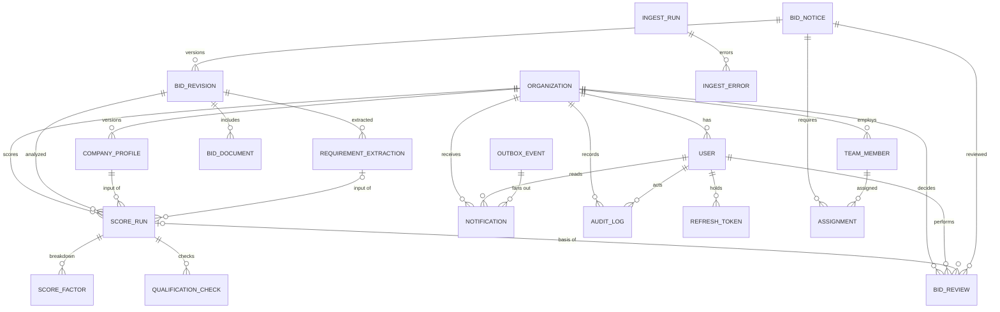

# 04. PostgreSQL · Prisma 데이터 설계

## 1. 정책

- PostgreSQL 직접 운영, Prisma Migrate로 스키마 이력 관리. 테이블·컬럼은 snake_case, Prisma 모델은 PascalCase + `@@map`.
- 조직 데이터(프로필, 점수, 검토, 인력, 알림, 감사)는 모두 `organization_id`를 가지며 모든 조회·변경 query에 토큰의 `organizationId`를 조건으로 넣는다([[09-SECURITY|09 보안]]). 공고(`bid_notices`, `bid_revisions`, `bid_documents`, `requirement_extractions`)는 공용이다.
- 원본 공고는 `bid_revisions`로 버전화한다. 외부 공고는 `source + notice_id`로 유일하고, 내용이 바뀌면 revision이 늘어난다. 기존 revision은 수정·삭제하지 않는다.
- AI·점수 결과는 덮어쓰지 않고 새 `score_runs` 행으로 쌓는다. 재현에 필요한 입력은 `input_snapshot`에 넣는다([[15-DATA-CONTRACTS|15 데이터 계약]] §7).
- 금액은 `numeric(18,0)`(KRW 정수)로 저장하고 API에서는 문자열로 내보낸다.

> [!tip] 심사 포인트
> "어떻게 재현하나"에 대한 답: `score_runs`는 `revision_id`·`company_profile_id`·`extraction_id`·`prompt_hash`·`algorithm_version`을 모두 가지므로 같은 입력으로 같은 결과를 다시 만들 수 있다. `audit_logs`는 사람의 모든 결정을 남긴다.

## 2. ERD

## 3. 테이블

### 3.1 조직·사용자

|테이블|컬럼|제약|
|---|---|---|
|`organizations`|`id` UUID PK, `name`, `slug` text, `is_demo` boolean default false, `created_at`|`slug` UNIQUE|
|`users`|`id`, `organization_id` FK, `email`, `name`, `password_hash`(Argon2id), `role` user_role, `disabled_at` nullable, `last_login_at`, `created_at`|`email` UNIQUE|
|`refresh_tokens`|`id`, `user_id` FK, `token_hash`, `expires_at`, `revoked_at` nullable, `replaced_by` UUID nullable, `created_at`|`token_hash` UNIQUE. 회전·재사용 탐지([[09-SECURITY\|09 보안]])|

### 3.2 회사 프로필

|테이블|컬럼|제약|
|---|---|---|
|`company_profiles`|`id`, `organization_id` FK, `revision` int, `name`, `technologies` JSONB, `licenses` JSONB, `past_projects` JSONB, `financials` JSONB nullable, `preferences` JSONB nullable, `effective_at`, `created_by` FK users, `note` text, `created_at`|UNIQUE(`organization_id`,`revision`). 행은 불변, 수정은 새 revision|

JSONB 구조는 [[05-API-SPEC|05 API 명세]]의 `CompanyProfile`과 같다. `financials`는 규모 적합성 요소의 "재무 한도"([[08-SCORING|08 점수]])에 쓰는 선택 필드로 `{fiscalYear, annualRevenueKrw?, capitalKrw?, employeeCount?, creditRating?, maxContractKrw?}`이다(`maxContractKrw` = 단일 사업 수행 상한, SOL테크 seed는 50억). 없으면 해당 요소는 `missingFactors`에 기록된다. `preferences`는 전략적 선호 요소용 `{agencies[], agencyTypes[], domains[], excludedDomains[], excludedKeywords[]}`(`excludedDomains` 예: `["국방"]`, FX-16).

### 3.3 공고 (공용)

|테이블|컬럼|제약|
|---|---|---|
|`bid_notices`|`id`, `source` text, `notice_id` text, `plan_ref` text nullable, `title`, `agency` nullable, `stage` bid_stage, `status` bid_status, `budget_krw` numeric(18,0) nullable, `published_at` nullable, `deadline_at` nullable, `source_url`, `latest_revision` int, `content_hash` text, `is_demo` boolean default false, `last_synced_at`, `created_at`, `updated_at`|UNIQUE(`source`,`notice_id`). `budget_krw >= 0`|
|`bid_revisions`|`id`, `bid_id` FK, `revision` int, `amendment_no` text nullable, `raw_payload` JSONB, `normalized` JSONB(`NormalizedBid`), `checksum` text, `changed_fields` text[], `fetched_at`, `created_at`|UNIQUE(`bid_id`,`revision`). `checksum` = `NormalizedBid.checksum`|
|`bid_documents`|`id`, `bid_id` FK, `revision_id` FK, `name`, `object_key` text, `sha256`, `mime_type`, `size_bytes` bigint, `parse_status` document_parse_status, `text_object_key` nullable, `page_count` int nullable, `original_url`, `created_at`|UNIQUE(`revision_id`,`sha256`). 원본·추출 텍스트는 MinIO, 키만 저장|
|`requirement_extractions`|`id`, `bid_id` FK, `revision_id` FK, `provider` ai_provider, `model_name` text, `prompt_version` text, `prompt_hash` text, `schema_version` text, `status` extraction_status, `payload` JSONB(`RequirementExtraction`), `warnings` JSONB(코드 목록은 [[03-AI-PIPELINE\|03 AI 파이프라인]] §4.4 표), `latency_ms` int, `retries` smallint, `created_at`|UNIQUE(`revision_id`,`model_name`,`prompt_hash`). 조직과 무관, 재사용|

식별자 규칙(fixture 기준, [[07-DATA-PIPELINE|07 수집]]):
- `notice_id`는 차수를 뺀 공고번호다. 예: 원본 `DEMO-2026-0010-01`, `DEMO-2026-0010-02` → `notice_id="DEMO-2026-0010"`, 각각 `bid_revisions.amendment_no="01"`, `"02"`.
- `plan_ref`는 발주계획 공개 식별자(예: `DEMO-PLAN-0042`)다. PLAN·PRE_SPEC·NOTICE 행이 같은 값을 가지면 UI가 한 묶음으로 보여 준다. 제목 유사도로 자동 병합하지 않는다.
- `source_url` 예: `https://demo.sol-radar.invalid/notices/FX-02`. `.invalid` TLD라 실제로 열리지 않는다.

### 3.4 분석 결과 (조직별)

|테이블|컬럼|제약|
|---|---|---|
|`score_runs`|`id`, `organization_id` FK, `bid_id` FK, `revision_id` FK, `company_profile_id` FK, `profile_revision` int, `extraction_id` FK nullable, `algorithm_version` text, `ai_provider` ai_provider, `qwen_model` text nullable, `kev_model` text nullable, `question_set_version` text nullable, `prompt_hash` text nullable, `input_snapshot_hash` text, `injection_suspected` boolean default false, `status` score_run_status, `score` smallint nullable, `recommendation` recommendation nullable, `recommendation_basis` recommendation_basis nullable, `explanation` text nullable, `review_flags` review_flag[], `missing_factors` text[], `input_snapshot` JSONB(`AnalysisInput`), `kev_output` JSONB nullable, `model_metadata` JSONB, `idempotency_key` text nullable, `requested_by` FK users, `error_code` text nullable, `queued_at`, `started_at` nullable, `finished_at` nullable, `created_at`|`score BETWEEN 0 AND 100`. `idempotency_key` UNIQUE. 부분 UNIQUE 인덱스 §4|
|`score_factors`|`id`, `score_run_id` FK, `factor` text, `raw_value` JSONB, `normalized` numeric(5,4) nullable, `points` numeric(5,1), `max_points` numeric(5,1), `missing` boolean, `evidence` JSONB(`EvidenceRef[]`), `note` text|UNIQUE(`score_run_id`,`factor`). `0 <= points <= max_points`|
|`qualification_checks`|`id`, `score_run_id` FK, `organization_id` FK, `bid_id` FK, `revision_id` FK, `requirement_code` text nullable, `requirement_name` text, `mandatory` boolean, `outcome` qualification_outcome, `reason` text, `evidence` JSONB(`EvidenceRef[]`), `profile_evidence` JSONB, `checked_at`|`requirement_code` null이면 `outcome`은 `NEEDS_REVIEW`|
|`bid_reviews`|`id`, `organization_id` FK, `bid_id` FK, `revision_id` FK, `score_run_id` FK nullable, `reviewer_id` FK users, `assignee_id` FK users nullable, `decision` review_decision, `system_recommendation` recommendation nullable, `disagreement_flag` boolean default false, `reason` text NOT NULL, `decided_at`, `created_at`|append-only. 최신 행이 현재 결정. `assignee_id`는 같은 조직 사용자, 지정 시 `REVIEW_ASSIGNED` outbox 1건. `disagreement_flag = (decision <> system_recommendation)`, 권고 없으면 false|

`factor` 값은 `skillMatch`, `pastPerformance`, `staffAvailability`, `scaleFit`, `strategicPreference` 다섯 개로 [[08-SCORING|08 점수]]의 요소 순서와 같다. `score_runs`의 `ai_provider`·`qwen_model`·`kev_model`·`question_set_version`·`prompt_hash`·`input_snapshot_hash`·`injection_suspected`는 [[09-SECURITY|09 보안]] 감사 필드 표와 이름이 같은 평문 컬럼이며, `model_metadata` JSONB와 중복 저장한다(조회·감사용). `input_snapshot_hash = sha256(canonical input_snapshot)`. `score_runs.input_snapshot`은 `{schemaVersion:"analysis-input/v0.1", bid: NormalizedBid 요약, extractionId, profile: CompanyProfile 스냅샷, config:{algorithmVersion, thresholds}}`.

### 3.5 인력 (P1 요소, 스키마는 P0에 만든다)

|테이블|컬럼|제약|
|---|---|---|
|`team_members`|`id`, `organization_id` FK, `name`, `role` text, `grade` text nullable, `skills` JSONB, `availability` JSONB, `created_at`|—|
|`assignments`|`id`, `organization_id` FK, `bid_id` FK, `member_id` FK, `starts_at`, `ends_at`, `allocation_percent` smallint, `created_at`|`allocation_percent BETWEEN 0 AND 100`, `ends_at > starts_at`|

### 3.6 수집·알림·감사

|테이블|컬럼|제약|
|---|---|---|
|`ingest_runs`|`id`, `source` text(`fixture` 또는 registry 키, [[15-DATA-CONTRACTS\|15 데이터 계약]] §8), `job_key` text, `trigger` ingest_trigger, `batch` ingest_batch nullable, `cursor` text nullable, `status` ingest_status, `summary` JSONB(`{created, changed, cancelled, skippedDuplicate, quarantined, retried}`), `requested_by` FK users nullable, `idempotency_key` text nullable, `started_at`, `finished_at` nullable|`job_key` UNIQUE, `idempotency_key` UNIQUE|
|`ingest_errors`|`id`, `ingest_run_id` FK, `source_key` text, `error_code` text, `redacted_detail` text, `created_at`|PII 없음([[15-DATA-CONTRACTS\|15 데이터 계약]] §6). `error_code` 값: `MISSING_REQUIRED_FIELD`, `SCHEMA_INVALID`, `BUDGET_UNPARSED`, `DATE_UNPARSED`, `DATE_ORDER`, `ENCODING_DEGRADED`, `ATTACHMENT_PARSE_FAILED`, `ATTACHMENT_REJECTED`, `RATE_LIMITED`, `DUPLICATE`|
|`outbox_events`|`id`, `organization_id` FK nullable, `aggregate_type` text, `aggregate_id` UUID, `event_type` notification_type, `payload` JSONB, `idempotency_key` text, `status` outbox_status, `attempts` smallint, `next_attempt_at` nullable, `created_at`, `processed_at` nullable|`idempotency_key` UNIQUE = `source+noticeId+revision+eventType`([[07-DATA-PIPELINE\|07 수집]])|
|`notifications`|`id`, `organization_id` FK, `user_id` FK, `type` notification_type, `channel` notification_channel, `idempotency_key` text, `payload` JSONB, `status` notification_status, `provider_message_id` nullable, `error` text nullable, `sent_at` nullable, `read_at` nullable, `created_at`|`idempotency_key` UNIQUE = `outboxEventId+userId+channel`([[13-NOTIFICATIONS\|13 알림]])|
|`audit_logs`|`id`, `organization_id` FK, `actor_id` FK users nullable, `action` text, `target_type` text, `target_id` UUID, `before_after` JSONB, `request_id` text, `created_at`|append-only. IP·토큰·원문 미기록|

`audit_logs.action` 값: `LOGIN`, `LOGOUT`, `PROFILE_CREATE_REVISION`, `ANALYSIS_REQUEST`, `REVIEW_DECIDE`, `USER_INVITE`, `USER_DISABLE`, `INGEST_MANUAL`, `NOTIFICATION_READ`.

## 4. ENUM

Prisma `enum`으로 정의하고 PostgreSQL 네이티브 ENUM으로 생성한다. 값은 API에 그대로 노출된다.

|ENUM|값|사용 컬럼|비고|
|---|---|---|---|
|`user_role`|`ADMIN`, `SALES`, `ANALYST`, `VIEWER`|`users.role`|리소스별 정책은 [[09-SECURITY\|09 보안]]|
|`bid_stage`|`PLAN`, `PRE_SPEC`, `NOTICE`|`bid_notices.stage`|발주계획 / 사전규격 / 입찰공고|
|`bid_status`|`OPEN`, `AMENDED`, `CANCELLED`, `CLOSED`|`bid_notices.status`|낙찰·계약 상태는 P1에서 추가|
|`document_parse_status`|`PENDING`, `PARSED`, `FAILED`, `SKIPPED`|`bid_documents.parse_status`|`SKIPPED` = 정책상 미처리(크기·MIME)|
|`ai_provider`|`MOCK`, `LOCAL`, `HOSTED`|`requirement_extractions.provider`|[[03-AI-PIPELINE\|03 AI 파이프라인]] §3|
|`extraction_status`|`PENDING`, `COMPLETED`, `PENDING_REVIEW`, `FAILED`|`requirement_extractions.status`|`PENDING_REVIEW` = 인용 실패율 > 50% 또는 파싱 품질 저하|
|`score_run_status`|`QUEUED`, `RUNNING`, `COMPLETED`, `PARTIAL`, `FAILED`|`score_runs.status`|`PARTIAL` = AI 없이 규칙만|
|`recommendation`|`BID`, `WATCH`, `NO_BID`|`score_runs.recommendation`|시스템 권고|
|`recommendation_basis`|`RULES_ONLY`, `RULES_WITH_KEV_ASSIST`|`score_runs.recommendation_basis`|Kev는 `reviewFlags`만 추가|
|`review_flag`|`MODEL_RULE_DISAGREEMENT`, `KEV_MANDATORY_RISK`, `KEV_NEEDS_REVIEW`, `CITATION_FAILED`, `EXTRACTION_FAILED`, `EXTRACTION_LOW_CONFIDENCE`, `AI_UNAVAILABLE`, `INSUFFICIENT_DATA`, `INJECTION_SUSPECTED`, `SCALE_LIMIT_EXCEEDED`|`score_runs.review_flags[]`|사람 검토 유도 신호. `INJECTION_SUSPECTED` = 추출 입력·출력에서 지시문 패턴 탐지([[03-AI-PIPELINE\|03 AI 파이프라인]] §4.4, [[09-SECURITY\|09 보안]]). `SCALE_LIMIT_EXCEEDED` = 규모 적합 요소 0점 사유(재무 한도 초과, [[08-SCORING\|08 점수]])|
|`qualification_outcome`|`SATISFIED`, `NOT_SATISFIED`, `NEEDS_REVIEW`|`qualification_checks.outcome`|법적 자격 자동 확정 없음|
|`review_decision`|`BID`, `WATCH`, `NO_BID`|`bid_reviews.decision`|사람의 최종 결정|
|`field_state`|`KNOWN`, `UNKNOWN`, `NOT_APPLICABLE`, `CONFLICTED`|JSONB 내부(`ExtractedField.state`)|DB ENUM이 아닌 JSON 값. Zod로 검증|
|`ingest_trigger`|`SCHEDULED`, `MANUAL`, `DEMO`|`ingest_runs.trigger`|—|
|`ingest_batch`|`SEED`, `LIVE`|`ingest_runs.batch`|fixture 배치. `SEED` = 기동 시 revision 1, `LIVE` = 데모 중 변경분. API `IngestionRunInput.batch`는 소문자 `"seed"\|"live"`이며 컨트롤러가 대문자로 매핑|
|`ingest_status`|`RUNNING`, `SUCCEEDED`, `PARTIAL`, `FAILED`|`ingest_runs.status`|`PARTIAL` = 일부 격리|
|`notification_type`|`BID_CREATED`, `BID_CHANGED`, `DEADLINE_APPROACHING`, `ANALYSIS_COMPLETE`, `REVIEW_ASSIGNED`|`outbox_events.event_type`, `notifications.type`|[[13-NOTIFICATIONS\|13 알림]]|
|`notification_channel`|`IN_APP`, `KAKAO`|`notifications.channel`|`KAKAO`는 mock provider만|
|`notification_status`|`PENDING`, `SENT`, `FAILED`, `DEAD`|`notifications.status`|`DEAD` = 재시도 소진(DLQ). 읽음은 `read_at`|
|`outbox_status`|`PENDING`, `PROCESSED`, `FAILED`, `DEAD`|`outbox_events.status`|—|

## 5. 인덱스·제약

- `bid_notices(stage, status, published_at DESC)`, `bid_notices(deadline_at)`, `bid_notices(is_demo)`, `bid_notices` 제목·기관 trigram 인덱스(`pg_trgm`). 한국어 검색 품질은 별도 측정([[16-DECISIONS|16 ADR]] 6번).
- `bid_revisions(bid_id, revision DESC)`, `bid_documents(revision_id)`.
- `requirement_extractions(revision_id, created_at DESC)`.
- `score_runs(organization_id, bid_id, created_at DESC)`, `score_runs(organization_id, status)`.
- **부분 UNIQUE**: `score_runs(organization_id, bid_id, revision_id, company_profile_id, algorithm_version) WHERE status IN ('QUEUED','RUNNING')`. 같은 입력의 진행 중 job을 하나로 묶는다. 완료된 run은 이력으로 여러 개 허용.
- `qualification_checks(score_run_id)`, `score_factors(score_run_id)`.
- `bid_reviews(organization_id, bid_id, decided_at DESC)`.
- `notifications(user_id, read_at NULLS FIRST, created_at DESC)`, `outbox_events(status, next_attempt_at)`.
- `audit_logs(organization_id, created_at DESC)`, `audit_logs(target_type, target_id)`.
- CHECK: `score BETWEEN 0 AND 100`, `budget_krw >= 0`, `allocation_percent BETWEEN 0 AND 100`, `ends_at > starts_at`.
- soft-delete는 쓰지 않는다. 사용자는 `disabled_at`, 프로필·검토·점수는 append-only. 개인정보 보존 정책은 [[09-SECURITY|09 보안]].

## 6. 데모 seed 범위

seed는 `prisma/seed.ts`가 `fixtures/`를 읽어 넣는다. 모든 공고는 `is_demo=true`, 조직은 `is_demo=true`. UI는 이 플래그로 `DEMO` 배지를 보여 준다.

|테이블|건수|내용|
|---|---:|---|
|`organizations`|2|`org-01` = 가상 기업 "SOL테크"(공공 SI 중견, 프로필 상세는 [[08-SCORING\|08 점수]]·[[19-DEMO-SCENARIO\|19 데모 시나리오]]). `org-02` = 비교 조직(테넌트 격리 시연용, 프로필 1개). 값은 `slug`이며 `id`는 seed가 고정 UUID로 만든다|
|`users`|5|`org-01`에 역할당 1명(4), `org-02`에 VIEWER 1명(`viewer@other.invalid`, [[19-DEMO-SCENARIO\|19 데모 시나리오]] S7 격리 시연). 비밀번호는 `.env.example`의 seed 비밀번호 변수로만 지정|
|`company_profiles`|2|revision 1(초기), revision 2(기술·실적 추가). 데모에서 revision 차이를 보여 준다|
|`bid_notices`|19 (+격리 1)|`FX-01`~`FX-20`([[07-DATA-PIPELINE\|07 수집]] fixture 표) 중 `FX-12`는 필수 필드 누락으로 격리(`ingest_errors`, 목록에 없음). 공고는 조직 소유가 아니다. 단계·특수 케이스 분포는 07을 따른다. `batch=SEED` 수집으로 적재|
|`bid_revisions`|20 + 정정 건수|정정·기한변경·취소 fixture는 `batch=LIVE` 수집에서 revision 2를 얻는다. 정확한 수는 07 표 기준|
|`bid_documents`|07 표 기준|첨부가 있는 fixture만. 파싱 실패 케이스 1건 이상 포함|
|`requirement_extractions`|20|`fixtures/extractions/FX-xx.json`(mock 추출). 인용 검증 실패 케이스 1건 이상 포함|
|`score_runs`|0|seed 시점에는 없음. 데모 기동 절차([[10-DEPLOYMENT\|10 배포]])에서 사전 분석을 돌려 채운다|
|`bid_reviews`|2|`FX-01` BID, `FX-03` NO-BID(사전 기록). `FX-02` WATCH는 데모 S4에서 라이브로 기록한다([[19-DEMO-SCENARIO\|19 데모 시나리오]])|
|`team_members`|6|PM 1, 개발 4, AI 엔지니어 1|
|`assignments`|2|기간 충돌 데모용 1건 포함|
|`notifications`|0|데모 중 이벤트로 생성|
|`audit_logs`|seed 작업분|seed 자체도 `actor_id=null`, `action=SEED`로 남긴다|

## 7. migration 순서

1. `organizations`, `users`, `refresh_tokens`, ENUM 전체.
2. `bid_notices`, `bid_revisions`, `bid_documents`, `requirement_extractions`.
3. `company_profiles`.
4. `score_runs`, `score_factors`, `qualification_checks`.
5. `bid_reviews`, `team_members`, `assignments`.
6. `ingest_runs`, `ingest_errors`, `outbox_events`, `notifications`, `audit_logs`.
7. 인덱스·CHECK·부분 UNIQUE.
8. seed(§6).

각 migration에는 되돌리기 SQL 주석과 테스트([[11-TESTING|11 테스트]])를 둔다. JSONB 컬럼은 DB에서 구조를 강제하지 않으므로 API 경계의 Zod 스키마가 단일 검증 지점이다.

## 관련 문서

- [[15-DATA-CONTRACTS|15 데이터 계약]] — JSONB 안에 들어가는 타입
- [[03-AI-PIPELINE|03 AI 파이프라인]] — `requirement_extractions`, `score_runs.kev_output`
- [[05-API-SPEC|05 API 명세]] — DTO와 컬럼 대응
- [[08-SCORING|08 점수]] — `score_factors`, `financials`
- [[09-SECURITY|09 보안]] — 테넌트 격리, 보존
- [[13-NOTIFICATIONS|13 알림]] — outbox
