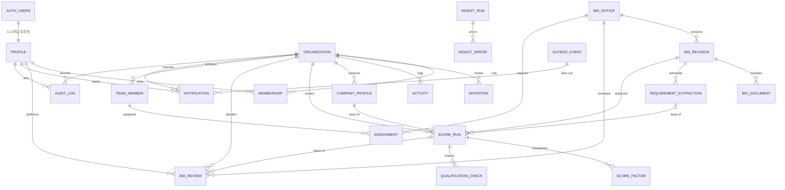

# 04. Supabase Postgres 데이터 설계

## 1. 정책

- DB는 **Supabase Postgres**다(개발: Supabase 클라우드 프로젝트, [[16-DECISIONS|16 ADR]] ADR-017). 인증은 Supabase Auth가 맡고, 이 문서의 표는 `public` 스키마에 둔다.
- 스키마·RLS·함수는 `supabase/migrations/*.sql`에 한 장씩 쌓는다(append-only). 이미 있는 파일은 고치거나 지우지 않고, 바꿀 것은 새 파일로 쌓는다. 모든 문장은 다시 적용해도 결과가 같게 쓴다(`if not exists`, `drop ... if exists` 뒤 `create`, `create or replace`). 템플릿 마이그레이션과 같은 규칙이다.
- 클라우드 적용은 `pnpm db:push`(`SUPABASE_DB_URL`)이고, 운영 DB를 바꾸므로 **사용자 확인 뒤에만** 실행한다.
- DB 타입은 생성물 `web/lib/database.types.ts`다(`pnpm db:types`). 손으로 고치지 않고, 마이그레이션과 같은 커밋에 넣는다. 어긋나면 `pnpm check:db-types`가 막는다.
- 표·열은 snake_case. 조직 소유 데이터의 열 이름은 **`org_id`**(JSON에서는 `orgId`)다.
- **RLS**: 모든 표는 만드는 즉시 `enable row level security`를 켠다. 화면 역할(`anon`, `authenticated`)의 권한은 `revoke all` 뒤 필요한 것만 다시 준다(열 단위 권한 포함). 행은 정책으로만 연다. 정책 시험은 `scripts/database.test.mjs`(PGlite, `pnpm test:db`)에 더한다.
- **접근 경로는 두 가지다.**
  1. Next 요청 처리(Route Handler `/api/v1`, Server Component, Server Action): 사용자 세션(anon 키 + 로그인 쿠키, 스크립트는 `Authorization: Bearer <Supabase access token>`)으로 DB를 부른다. 권한은 RLS가 정한다.
  2. worker(`web/worker`)와 seed 스크립트(`pnpm demo:reset`): `SUPABASE_SERVICE_ROLE_KEY`로 부른다. service role은 RLS를 무시한다. 그래서 worker는 `org_id`를 직접 지정하고, 복합 외래 키(§5)와 테넌트 혼입 시험으로 막는다. service role 키는 `NEXT_PUBLIC_` 변수·브라우저 번들·로그에 넣지 않는다([[09-SECURITY|09 보안]]).
- **조직 데이터**(프로필, 점수, 검토, 인력, 알림, 감사)는 `org_id`를 가지며 정책 `org_id in (select public.my_org_ids())`로 거른다. 요청 본문·쿼리의 조직 ID는 쓰지 않는다. 다른 조직의 행은 보이지 않으므로 API는 `404`를 낸다. 서비스 운영자(`profiles.is_admin`)도 남의 조직 데이터는 읽지 못한다. 정지된 사용자에게는 `my_org_ids()`가 빈 목록을 돌려준다(템플릿).
- **공고**(`bid_notices`, `bid_revisions`, `bid_documents`, `requirement_extractions`)는 공용이다. `org_id`가 없고, 로그인한 사용자는 읽기만 하며, 쓰기는 worker(service role)만 한다.
- 원본 공고는 `bid_revisions`로 버전화한다. 외부 공고는 `source + notice_id`로 유일하고, 내용이 바뀌면 revision이 늘어난다. 기존 revision은 수정·삭제하지 않는다.
- AI·점수 결과는 덮어쓰지 않고 새 `score_runs` 행으로 쌓는다. 재현에 필요한 입력은 `input_snapshot`에 넣는다([[15-DATA-CONTRACTS|15 데이터 계약]] §7).
- 금액은 `numeric(18,0)`(KRW 정수)로 저장하고 API에서는 문자열로 내보낸다.
- 여러 표를 한 번에 쓰는 일(검토 결정 → 감사 → outbox)은 트리거나 SQL 함수로 한 트랜잭션에 묶는다. PostgREST 요청 하나가 트랜잭션 하나이기 때문이다. 화면 역할이 직접 쓰지 못하는 표(`audit_logs`, `outbox_events`)에 쓰는 트리거는 `security definer`다(템플릿 `activities` 트리거와 같은 방식).
- JSONB 열의 구조는 DB가 강제하지 않는다. 검증은 zod 스키마(`web/server/<도메인>/*.model.ts`, [[16-DECISIONS|16 ADR]] ADR-016)가 맡는다.

> [!tip] 심사 포인트
> "어떻게 재현하나"에 대한 답: `score_runs`는 `revision_id`·`company_profile_id`·`extraction_id`·`prompt_hash`·`algorithm_version`을 모두 가지므로 같은 입력으로 같은 결과를 다시 만들 수 있다. `audit_logs`는 사람의 모든 결정을 남긴다. 조직 격리는 앱 코드가 아니라 DB 정책(RLS)이 지킨다. 어느 화면이나 스크립트로 접근해도 DB가 같은 답을 준다.

## 2. ERD

`AUTH_USERS`는 Supabase Auth의 `auth.users`다. `PROFILE`·`ORGANIZATION`·`MEMBERSHIP`·`INVITATION`·`ACTIVITY`는 템플릿 표를 그대로 쓴다(§3.1). 사용자를 가리키는 외래 키는 `auth.users`가 아니라 `public.profiles(id)`를 가리킨다. 템플릿과 같은 이유로, 외래 키가 `public` 표끼리여야 생성 타입에 관계가 생긴다.

## 3. 테이블

각 표의 `RLS` 칸에서 "조직 전원"은 `org_id in (select public.my_org_ids())`, "역할 X"는 그 조직에서 `memberships.sol_role`이 X인 사용자다(도우미 함수는 §3.1). "worker"는 service role로 쓰는 worker·seed 스크립트다. 표기가 없는 쓰기는 화면 역할에 권한이 없다는 뜻이다.

### 3.1 조직·사용자 (템플릿 재사용)

|테이블|컬럼|제약|RLS (읽기 · 쓰기)|
|---|---|---|---|
|`auth.users`|Supabase Auth 관리. 이메일, 비밀번호 해시, 세션·refresh token(`auth.sessions`, `auth.refresh_tokens`), 로그인 차단(`banned_until`)|SOL RADAR 마이그레이션은 이 표를 만들거나 고치지 않는다|화면 역할은 접근하지 않는다(`auth` 스키마는 생성 타입·화면 대상이 아니다)|
|`profiles`|`id` UUID PK = `auth.users.id`(on delete cascade), `email`(가입 정보 사본), `display_name` nullable, `avatar_url` nullable, `is_admin` boolean default false(서비스 운영자), `status` text default `active`, `created_at`, `updated_at`|`status` ∈ `active`·`suspended`(check). `display_name` 1~40자. 행은 가입 트리거 `handle_new_user`가 만든다|읽기: 본인, 같은 조직 멤버, 운영자(`is_admin()`). 쓰기: 본인의 `display_name`만. `is_admin`·`status`는 화면 역할이 못 바꾼다(권한 + 보호 트리거). 정지는 운영자 함수 `admin_set_user_status`|
|`organizations`|`id` UUID PK, `slug` text, `name` text, `personal_owner_id` nullable(개인 조직의 주인, 팀 조직이면 null), `created_at`, **`is_demo` boolean default false**(SOL RADAR가 새 마이그레이션으로 더한다)|`slug` UNIQUE, `^[a-z0-9-]{3,32}$`, 예약어 제외. `name` 1~40자|읽기: 멤버, 받은 초대가 있는 사람. 쓰기: 템플릿 정책 그대로(팀 만들기, owner의 이름 변경·삭제). `is_demo`는 화면 역할 쓰기 권한이 없다(seed만)|
|`memberships`|`org_id` FK, `user_id` FK profiles, `org_role` text default `member`, **`sol_role` text default `VIEWER`**(새 열), `created_at`|PK(`org_id`,`user_id`). `org_role` ∈ `owner`·`member`, `sol_role` ∈ `ADMIN`·`SALES`·`ANALYST`·`VIEWER`(check)|읽기: 같은 조직 멤버. 쓰기: 템플릿 정책(초대 수락, owner의 `org_role` 변경·내보내기, 스스로 나가기). `sol_role` 변경은 그 조직의 역할 `ADMIN`만(아래)|
|`invitations`|`id`, `org_id` FK, `email`(소문자), `org_role` text default `member`, **`sol_role` text default `VIEWER`**(새 열), `invited_by` FK profiles, `expires_at`(기본 7일), `created_at`|UNIQUE(`org_id`,`email`). `org_role`·`sol_role` check는 `memberships`와 같다|템플릿 정책: owner가 읽기·만들기·갱신·취소, 받은 사람이 읽기·거절·수락. 수락하면 초대의 `sol_role`이 멤버십으로 옮겨진다(초대 수락 정책을 새 마이그레이션에서 교체)|
|`activities`|템플릿 그대로: `org_id`, `actor_id`, `kind`, `target_user_id`, `target_name`, `old_role`, `new_role`, `task_title`, `created_at`|`kind` check(템플릿)|읽기: 조직 전원. 쓰기: 트리거만. 멤버 합류·역할 변경·초대 피드다. SOL RADAR의 업무 감사는 `audit_logs`(§3.6)가 맡는다|

**없는 것**: `users`·`refresh_tokens` 표, 비밀번호 해시·계정 잠금·마지막 로그인 열. 로그인·세션·토큰·잠금은 Supabase Auth(`auth.users`, `auth.sessions`, `auth.refresh_tokens`)가 맡는다. 계정 비활성화는 `disabled_at` 대신 템플릿 `profiles.status = 'suspended'`를 쓴다(템플릿 `20261015000001_account_status_and_deletion.sql`). 정지하면 로그인이 막히고 세션이 끊기며, `my_org_ids()`가 빈 목록을 돌려줘 조직 데이터가 모두 닫힌다.

역할은 세 가지이고 서로 다르다.

|열|값|쓰임|
|---|---|---|
|`profiles.is_admin`|boolean|서비스 운영자. 조직 역할과 별개이고, 운영자도 남의 조직 데이터는 못 읽는다|
|`memberships.org_role`|`owner`·`member`|조직 관리(초대·구성원 관리). 템플릿 정책이 본다|
|`memberships.sol_role`|`ADMIN`·`SALES`·`ANALYST`·`VIEWER`|업무 권한. [[05-API-SPEC\|05 API 명세]] 권한 열과 [[09-SECURITY\|09 보안]] RBAC가 이 값을 본다|

데모 `admin@soltech.invalid`는 `org_role=owner` + `sol_role=ADMIN`이다.

정책 도우미 함수:
- 템플릿 함수를 그대로 쓴다: `public.my_org_ids()`(내 조직), `public.my_owner_org_ids()`(내가 owner인 조직), `public.is_admin()`(서비스 운영자), `public.is_active_user()`(활동 중 회원). 넷 다 정지된 사용자에게는 빈 목록 또는 false를 돌려준다.
- SOL RADAR가 하나를 더한다: **`public.my_sol_org_ids(roles text[])`** — 내가 `roles` 중 하나의 `sol_role`로 속한 조직 id 목록. 정책에서는 `org_id in (select public.my_sol_org_ids(array['ADMIN','SALES']))`로 쓴다. 템플릿 도우미와 같이 `security definer`, `set search_path = ''`, 정지 사용자는 빈 목록, 실행 권한은 `authenticated`만 준다. 바깥 행과 상관없는 하위 질의라 행마다 다시 불리지 않는다. `scripts/db-verify.mjs`의 `security definer` 허용 목록에 이유와 함께 올린다.

`sol_role` 변경 잠금: `authenticated`에 `memberships.sol_role` 열의 update 권한을 주고, 정책 "ADMIN은 업무 역할 변경"(`org_id in (select public.my_sol_org_ids(array['ADMIN']))`)으로 연다. 템플릿의 owner 정책도 같은 표의 update를 열기 때문에 정책만으로는 owner가 `sol_role`을 바꿀 수 있다. 그래서 보호 트리거 `protect_sol_role`을 둔다. 템플릿 `protect_is_admin`과 같은 기준으로, JWT가 있는 요청 중 그 조직 ADMIN이 아닌 사람의 `sol_role` 변경을 거절하고 service role·관리 작업은 통과시킨다.

> [!todo] Phase 1에서 정할 것 (조직·사용자)
> 1. **개인 조직**: 템플릿 가입 트리거는 계정마다 개인 조직(`personal_owner_id`)과 owner 멤버십을 만든다. SOL RADAR 조직(SOL테크·비교 조직)은 팀 조직(`personal_owner_id is null`)이다. 트리거를 유지하면 계정마다 멤버십이 둘이 된다. 유지할지, 새 마이그레이션으로 끌지 정하고, 세션의 "현재 조직" 선택 규칙([[05-API-SPEC|05 API 명세]] `Me.organization`)을 같이 정한다.
> 2. **초대·구성원 관리 권한**: 템플릿 정책은 `org_role=owner`를 본다. 05는 `sol_role=ADMIN`을 요구한다. 정책을 ADMIN 기준으로 바꿀지, ADMIN에게 owner를 함께 줄지 정한다. 데모 계정은 둘 다 가져서 동작은 같다.
> 3. **비활성화**: 템플릿에서 `profiles.status`(계정 정지)는 서비스 운영자(`is_admin`)만 `admin_set_user_status`로 바꾼다. 05 `PATCH /admin/users/:id`의 조직 ADMIN 비활성화를 구성원 내보내기로 할지, 운영자 정지로 넘길지 정한다.
> 4. **로그인 감사**: 로그인은 브라우저가 Supabase Auth로 직접 한다(템플릿 `web/app/auth/login/sign-in-form.tsx`). `audit_logs`의 `LOGIN`·`LOGOUT`을 남길 지점(로그인 직후 서버 호출, 또는 Supabase Auth 쪽 로그 사용)을 정한다(미검증).

### 3.2 회사 프로필

|테이블|컬럼|제약|RLS (읽기 · 쓰기)|
|---|---|---|---|
|`company_profiles`|`id`, `org_id` FK, `revision` int, `name`, `technologies` JSONB, `licenses` JSONB, `past_projects` JSONB, `financials` JSONB nullable, `preferences` JSONB nullable, `effective_at`, `created_by` FK profiles(기본값 `auth.uid()`, on delete set null), `note` text, `created_at`|UNIQUE(`org_id`,`revision`), UNIQUE(`id`,`org_id`)(복합 FK 대상). 행은 불변, 수정은 새 revision|읽기: 조직 전원. 쓰기: insert만 역할 `ADMIN`(`PUT /company-profile`), `created_by = auth.uid()`. update·delete 권한 없음. `revision`은 서버가 최신 + 1로 넣고, 동시 요청이 겹치면 UNIQUE가 거절한다|

JSONB 구조는 [[05-API-SPEC|05 API 명세]]의 `CompanyProfile`과 같다. `financials`는 규모 적합성 요소의 "재무 한도"([[08-SCORING|08 점수]])에 쓰는 선택 필드로 `{fiscalYear, annualRevenueKrw?, capitalKrw?, employeeCount?, creditRating?, maxContractKrw?}`이다(`maxContractKrw` = 단일 사업 수행 상한, SOL테크 seed는 50억). 없으면 해당 요소는 `missingFactors`에 기록된다. `preferences`는 전략적 선호 요소용 `{agencies[], agencyTypes[], domains[], excludedDomains[], excludedKeywords[]}`(`excludedDomains` 예: `["국방"]`, FX-16).

### 3.3 공고 (공용)

네 표 모두 RLS는 같다. 읽기는 `authenticated` 중 활동 중 회원(`(select public.is_active_user())`), 쓰기는 worker(service role)만이다. 화면 역할에는 쓰기 권한이 없다.

|테이블|컬럼|제약|
|---|---|---|
|`bid_notices`|`id`, `source` text, `notice_id` text, `plan_ref` text nullable, `title`, `agency` nullable, `stage` text(bid_stage), `status` text(bid_status), `budget_krw` numeric(18,0) nullable, `published_at` nullable, `deadline_at` nullable, `source_url`, `latest_revision` int, `content_hash` text, `is_demo` boolean default false, `last_synced_at`, `created_at`, `updated_at`|UNIQUE(`source`,`notice_id`). `budget_krw >= 0`|
|`bid_revisions`|`id`, `bid_id` FK, `revision` int, `amendment_no` text nullable, `raw_payload` JSONB, `normalized` JSONB(`NormalizedBid`), `checksum` text, `changed_fields` text[], `fetched_at`, `created_at`|UNIQUE(`bid_id`,`revision`). `checksum` = `NormalizedBid.checksum`|
|`bid_documents`|`id`, `bid_id` FK, `revision_id` FK, `name`, `object_key` text, `sha256`, `mime_type`, `size_bytes` bigint, `parse_status` text(document_parse_status), `text_object_key` nullable, `page_count` int nullable, `original_url`, `created_at`|UNIQUE(`revision_id`,`sha256`). 원본·추출 텍스트는 MinIO, 키만 저장. 다운로드는 서버가 권한을 확인한 뒤 짧은 presigned URL을 준다([[09-SECURITY\|09 보안]])|
|`requirement_extractions`|`id`, `bid_id` FK, `revision_id` FK, `provider` text(ai_provider), `model_name` text, `prompt_version` text, `prompt_hash` text, `schema_version` text, `status` text(extraction_status), `payload` JSONB(`RequirementExtraction`), `warnings` JSONB(코드 목록은 [[03-AI-PIPELINE\|03 AI 파이프라인]] §4.4 표), `latency_ms` int, `retries` smallint, `created_at`|UNIQUE(`revision_id`,`model_name`,`prompt_hash`). 조직과 무관, 재사용|

괄호 안 이름(`bid_stage` 등)은 §4의 값 집합이다. 열 타입은 `text`이고 값은 check 제약으로 묶는다.

식별자 규칙(fixture 기준, [[07-DATA-PIPELINE|07 수집]]):
- `notice_id`는 차수를 뺀 공고번호다. 예: 원본 `DEMO-2026-0010-01`, `DEMO-2026-0010-02` → `notice_id="DEMO-2026-0010"`, 각각 `bid_revisions.amendment_no="01"`, `"02"`.
- `plan_ref`는 발주계획 공개 식별자(예: `DEMO-PLAN-0042`)다. PLAN·PRE_SPEC·NOTICE 행이 같은 값을 가지면 UI가 한 묶음으로 보여 준다. 제목 유사도로 자동 병합하지 않는다.
- `source_url` 예: `https://demo.sol-radar.invalid/notices/FX-02`. `.invalid` TLD라 실제로 열리지 않는다.

### 3.4 분석 결과 (조직별)

|테이블|컬럼|제약|RLS (읽기 · 쓰기)|
|---|---|---|---|
|`score_runs`|`id`, `org_id` FK, `bid_id` FK, `revision_id` FK, `company_profile_id` FK, `profile_revision` int, `extraction_id` FK nullable, `algorithm_version` text, `ai_provider` text(ai_provider), `qwen_model` text nullable, `kev_model` text nullable, `question_set_version` text nullable, `prompt_hash` text nullable, `input_snapshot_hash` text, `injection_suspected` boolean default false, `status` text(score_run_status), `score` smallint nullable, `recommendation` text(recommendation) nullable, `recommendation_basis` text(recommendation_basis) nullable, `explanation` text nullable, `review_flags` text, `missing_factors` text[], `input_snapshot` JSONB(`AnalysisInput`), `kev_output` JSONB nullable, `model_metadata` JSONB, `idempotency_key` text nullable, `requested_by` FK profiles(on delete set null), `error_code` text nullable, `queued_at`, `started_at` nullable, `finished_at` nullable, `created_at`|`score BETWEEN 0 AND 100`. `idempotency_key` UNIQUE. UNIQUE(`id`,`org_id`)(복합 FK 대상). 부분 UNIQUE 인덱스 §5|읽기: 조직 전원. 쓰기: 요청 행(`status='QUEUED'`) insert는 역할 `ADMIN`·`SALES`·`ANALYST`가 사용자 세션으로 한다(열 단위 권한으로 결과 열 제외, `requested_by = auth.uid()`). 상태 전이와 결과 열은 worker만 갱신한다. delete 없음|
|`score_factors`|`id`, `score_run_id` FK, `org_id` FK, `factor` text, `raw_value` JSONB, `normalized` numeric(5,4) nullable, `points` numeric(5,1), `max_points` numeric(5,1), `missing` boolean, `evidence` JSONB(`EvidenceRef[]`), `note` text|UNIQUE(`score_run_id`,`factor`). `0 <= points <= max_points`. (`score_run_id`,`org_id`) → `score_runs(id, org_id)`|읽기: 조직 전원. 쓰기: worker만|
|`qualification_checks`|`id`, `score_run_id` FK, `org_id` FK, `bid_id` FK, `revision_id` FK, `requirement_code` text nullable, `requirement_name` text, `mandatory` boolean, `outcome` text(qualification_outcome), `reason` text, `evidence` JSONB(`EvidenceRef[]`), `profile_evidence` JSONB, `checked_at`|`requirement_code` null이면 `outcome`은 `NEEDS_REVIEW`. (`score_run_id`,`org_id`) → `score_runs(id, org_id)`|읽기: 조직 전원. 쓰기: worker만|
|`bid_reviews`|`id`, `org_id` FK, `bid_id` FK, `revision_id` FK, `score_run_id` FK nullable, `reviewer_id` FK profiles(on delete set null), `assignee_id` nullable, `decision` text(review_decision), `system_recommendation` text(recommendation) nullable, `disagreement_flag` boolean default false, `reason` text NOT NULL, `decided_at`, `created_at`|append-only. 최신 행이 현재 결정. (`org_id`,`assignee_id`) → `memberships(org_id, user_id)`(같은 조직 사용자만, 멤버십이 지워지면 `assignee_id`만 비운다). (`score_run_id`,`org_id`) → `score_runs(id, org_id)`. `disagreement_flag = (decision <> system_recommendation)`, 권고 없으면 false|읽기: 조직 전원. 쓰기: insert만 역할 `ADMIN`·`SALES`(`reviewer_id = auth.uid()`). update·delete 권한 없음. `system_recommendation`·`disagreement_flag`는 화면 역할 쓰기 권한이 없고 insert 트리거가 `score_run_id`에서 채운다. 같은 트리거가 `audit_logs`(`REVIEW_DECIDE`)와, 담당자가 있을 때 `REVIEW_ASSIGNED` outbox 1건을 같은 트랜잭션에 쓴다|

`factor` 값은 `skillMatch`, `pastPerformance`, `staffAvailability`, `scaleFit`, `strategicPreference` 다섯 개로 [[08-SCORING|08 점수]]의 요소 순서와 같다. `score_runs`의 `ai_provider`·`qwen_model`·`kev_model`·`question_set_version`·`prompt_hash`·`input_snapshot_hash`·`injection_suspected`는 [[09-SECURITY|09 보안]] 감사 필드 표와 이름이 같은 평문 컬럼이며, `model_metadata` JSONB와 중복 저장한다(조회·감사용). `input_snapshot_hash = sha256(canonical input_snapshot)`. `score_runs.input_snapshot`은 `{schemaVersion:"analysis-input/v0.1", bid: NormalizedBid 요약, extractionId, profile: CompanyProfile 스냅샷, config:{algorithmVersion, thresholds}}`. `score_factors.org_id`는 RLS를 다른 조직 표와 같은 식 하나로 쓰려고 둔다. 값은 부모 `score_runs.org_id`와 같아야 하고 복합 FK가 이를 강제한다.

### 3.5 인력 (P1 요소, 스키마는 P0에 만든다)

|테이블|컬럼|제약|RLS (읽기 · 쓰기)|
|---|---|---|---|
|`team_members`|`id`, `org_id` FK, `name`, `role` text, `grade` text nullable, `skills` JSONB, `availability` JSONB, `created_at`|UNIQUE(`id`,`org_id`)(복합 FK 대상)|읽기: 조직 전원. 쓰기: 해커톤에서는 seed(service role)만. P1 인력 API를 만들 때 역할 `ADMIN`으로 연다|
|`assignments`|`id`, `org_id` FK, `bid_id` FK, `member_id` FK, `starts_at`, `ends_at`, `allocation_percent` smallint, `created_at`|`allocation_percent BETWEEN 0 AND 100`, `ends_at > starts_at`. (`member_id`,`org_id`) → `team_members(id, org_id)`|`team_members`와 같다|

`team_members.role`은 직무(PM·개발 등) 텍스트이고 `sol_role`과 무관하다.

### 3.6 수집·알림·감사

|테이블|컬럼|제약|RLS (읽기 · 쓰기)|
|---|---|---|---|
|`ingest_runs`|`id`, `source` text(`fixture` 또는 registry 키, [[15-DATA-CONTRACTS\|15 데이터 계약]] §8), `job_key` text, `trigger` text(ingest_trigger), `batch` text(ingest_batch) nullable, `cursor` text nullable, `status` text(ingest_status), `summary` JSONB(`{created, changed, cancelled, skippedDuplicate, quarantined, retried}`), `requested_by` FK profiles nullable(on delete set null), `idempotency_key` text nullable, `started_at`, `finished_at` nullable|`job_key` UNIQUE, `idempotency_key` UNIQUE|공용 표(`org_id` 없음). 읽기: 어느 조직에서든 역할 `ADMIN`인 사용자(`exists (select 1 from public.my_sol_org_ids(array['ADMIN']))`). 쓰기: worker만. 수동 수집도 Route Handler는 job만 넣고 행은 worker가 만든다([[07-DATA-PIPELINE\|07 수집]])|
|`ingest_errors`|`id`, `ingest_run_id` FK, `source_key` text, `error_code` text, `redacted_detail` text, `created_at`|PII 없음([[15-DATA-CONTRACTS\|15 데이터 계약]] §6). `error_code` 값: `MISSING_REQUIRED_FIELD`, `SCHEMA_INVALID`, `BUDGET_UNPARSED`, `DATE_UNPARSED`, `DATE_ORDER`, `ENCODING_DEGRADED`, `ATTACHMENT_PARSE_FAILED`, `ATTACHMENT_REJECTED`, `RATE_LIMITED`, `DUPLICATE`|`ingest_runs`와 같다|
|`outbox_events`|`id`, `org_id` FK nullable, `aggregate_type` text, `aggregate_id` UUID, `event_type` text(notification_type), `payload` JSONB, `idempotency_key` text, `status` text(outbox_status), `attempts` smallint, `next_attempt_at` nullable, `created_at`, `processed_at` nullable|`idempotency_key` UNIQUE = `source+noticeId+revision+eventType`([[07-DATA-PIPELINE\|07 수집]])|내부 표. 화면 역할은 읽기·쓰기 모두 권한이 없다. 쓰기: worker, `bid_reviews` insert 트리거|
|`notifications`|`id`, `org_id` FK, `user_id`, `type` text(notification_type), `channel` text(notification_channel), `idempotency_key` text, `payload` JSONB, `status` text(notification_status), `provider_message_id` nullable, `error` text nullable, `sent_at` nullable, `read_at` nullable, `created_at`|`idempotency_key` UNIQUE = `outboxEventId+userId+channel`([[13-NOTIFICATIONS\|13 알림]]). (`org_id`,`user_id`) → `memberships(org_id, user_id)`(on delete cascade)|읽기: 본인(`user_id = auth.uid()` 그리고 조직 전원 조건). 쓰기: 본인의 `read_at` 열 update만. 생성은 worker. 남의 알림은 보이지 않으므로 `404`|
|`audit_logs`|`id`, `org_id` FK, `actor_id` FK profiles nullable(on delete set null), `action` text, `target_type` text, `target_id` UUID, `before_after` JSONB, `request_id` text, `created_at`|append-only. IP·토큰·원문 미기록|읽기: 그 조직의 역할 `ADMIN`. 쓰기: 화면 역할은 권한이 없다. `security definer` 트리거와 worker·seed만 쓴다. update·delete 없음|

`audit_logs.action` 값과 쓰는 곳:

|action|쓰는 곳|
|---|---|
|`LOGIN`, `LOGOUT`|미정(§3.1 Phase 1 결정 4)|
|`PROFILE_CREATE_REVISION`|`company_profiles` insert 트리거|
|`ANALYSIS_REQUEST`|`score_runs` insert 트리거|
|`REVIEW_DECIDE`|`bid_reviews` insert 트리거|
|`USER_INVITE`|`invitations` insert 트리거|
|`USER_DISABLE`|비활성화 경로가 정해지면 그 경로(§3.1 Phase 1 결정 3)|
|`INGEST_MANUAL`|worker. 요청자(`actor_id`)와 요청자의 조직(`org_id`)은 job 데이터로 받는다|
|`NOTIFICATION_READ`|`notifications.read_at` update 트리거|
|`SEED`|`pnpm demo:reset`(`actor_id=null`)|

템플릿 `activities`는 조직 피드(멤버·초대)이고 화면이 읽는다. `audit_logs`는 업무 감사이고 ADMIN만 읽는다. 둘을 합치지 않는다.

## 4. 값 집합(ENUM)

PostgreSQL `create type ... as enum`을 쓰지 않는다. 열은 `text`이고 값은 **check 제약**으로 묶는다(이름은 `<표>_<열>_check`). 마이그레이션은 다시 적용해도 결과가 같아야 하는데 `create type`은 다시 적용하면 실패하기 때문이다. 템플릿의 `memberships.org_role`·`profiles.status`와 같은 방식이다. 값을 더할 때는 새 마이그레이션에서 `drop constraint if exists` 뒤 `add constraint`로 바꾼다. 배열 열(`score_runs.review_flags`)은 `text[]`이고 `review_flags <@ array[...]::text[]` check로 묶는다.

생성 타입(`web/lib/database.types.ts`)에서 이 열들은 `string`으로 나온다. 값 union은 zod 스키마(`web/server/<도메인>/*.model.ts`)가 정의하며, 값은 이 표와 같아야 한다. 값은 API에 그대로 노출된다.

DB check로 거는 값 집합은 19개이고, `field_state`는 JSON 안의 값이다.

|값 집합|값|사용 컬럼|비고|
|---|---|---|---|
|`sol_role`|`ADMIN`, `SALES`, `ANALYST`, `VIEWER`|`memberships.sol_role`, `invitations.sol_role`|업무 역할(이전 이름 `user_role`). 기본 `VIEWER`. 리소스별 정책은 [[09-SECURITY\|09 보안]]|
|`bid_stage`|`PLAN`, `PRE_SPEC`, `NOTICE`|`bid_notices.stage`|발주계획 / 사전규격 / 입찰공고|
|`bid_status`|`OPEN`, `AMENDED`, `CANCELLED`, `CLOSED`|`bid_notices.status`|낙찰·계약 상태는 P1에서 추가|
|`document_parse_status`|`PENDING`, `PARSED`, `FAILED`, `SKIPPED`|`bid_documents.parse_status`|`SKIPPED` = 정책상 미처리(크기·MIME)|
|`ai_provider`|`MOCK`, `LOCAL`, `HOSTED`|`requirement_extractions.provider`, `score_runs.ai_provider`|[[03-AI-PIPELINE\|03 AI 파이프라인]] §3|
|`extraction_status`|`PENDING`, `COMPLETED`, `PENDING_REVIEW`, `FAILED`|`requirement_extractions.status`|`PENDING_REVIEW` = 인용 실패율 > 50% 또는 파싱 품질 저하|
|`score_run_status`|`QUEUED`, `RUNNING`, `COMPLETED`, `PARTIAL`, `FAILED`|`score_runs.status`|`PARTIAL` = AI 없이 규칙만|
|`recommendation`|`BID`, `WATCH`, `NO_BID`|`score_runs.recommendation`, `bid_reviews.system_recommendation`|시스템 권고|
|`recommendation_basis`|`RULES_ONLY`, `RULES_WITH_KEV_ASSIST`|`score_runs.recommendation_basis`|Kev는 `reviewFlags`만 추가|
|`review_flag`|`MODEL_RULE_DISAGREEMENT`, `KEV_MANDATORY_RISK`, `KEV_NEEDS_REVIEW`, `CITATION_FAILED`, `EXTRACTION_FAILED`, `EXTRACTION_LOW_CONFIDENCE`, `AI_UNAVAILABLE`, `INSUFFICIENT_DATA`, `INJECTION_SUSPECTED`, `SCALE_LIMIT_EXCEEDED`|`score_runs.review_flags[]`|사람 검토 유도 신호. `INJECTION_SUSPECTED` = 추출 입력·출력에서 지시문 패턴 탐지([[03-AI-PIPELINE\|03 AI 파이프라인]] §4.4, [[09-SECURITY\|09 보안]]). `SCALE_LIMIT_EXCEEDED` = 규모 적합 요소 0점 사유(재무 한도 초과, [[08-SCORING\|08 점수]])|
|`qualification_outcome`|`SATISFIED`, `NOT_SATISFIED`, `NEEDS_REVIEW`|`qualification_checks.outcome`|법적 자격 자동 확정 없음|
|`review_decision`|`BID`, `WATCH`, `NO_BID`|`bid_reviews.decision`|사람의 최종 결정|
|`field_state`|`KNOWN`, `UNKNOWN`, `NOT_APPLICABLE`, `CONFLICTED`|JSONB 내부(`ExtractedField.state`)|DB check가 아닌 JSON 값. zod로 검증|
|`ingest_trigger`|`SCHEDULED`, `MANUAL`, `DEMO`|`ingest_runs.trigger`|—|
|`ingest_batch`|`SEED`, `LIVE`|`ingest_runs.batch`|fixture 배치. `SEED` = 기동 시 revision 1, `LIVE` = 데모 중 변경분. API `IngestionRunInput.batch`는 소문자 `"seed"\|"live"`이며 Route Handler의 zod 스키마가 대문자로 바꾼다|
|`ingest_status`|`RUNNING`, `SUCCEEDED`, `PARTIAL`, `FAILED`|`ingest_runs.status`|`PARTIAL` = 일부 격리|
|`notification_type`|`BID_CREATED`, `BID_CHANGED`, `DEADLINE_APPROACHING`, `ANALYSIS_COMPLETE`, `REVIEW_ASSIGNED`|`outbox_events.event_type`, `notifications.type`|[[13-NOTIFICATIONS\|13 알림]]|
|`notification_channel`|`IN_APP`, `KAKAO`|`notifications.channel`|`KAKAO`는 mock provider만|
|`notification_status`|`PENDING`, `SENT`, `FAILED`, `DEAD`|`notifications.status`|`DEAD` = 재시도 소진(DLQ). 읽음은 `read_at`|
|`outbox_status`|`PENDING`, `PROCESSED`, `FAILED`, `DEAD`|`outbox_events.status`|—|

## 5. 인덱스·제약

인덱스:
- `bid_notices(stage, status, published_at DESC)`, `bid_notices(deadline_at)`, `bid_notices(is_demo)`, `bid_notices` 제목·기관 trigram 인덱스(`pg_trgm`). 한국어 검색 품질은 별도 측정([[16-DECISIONS|16 ADR]] 6번).
- `bid_revisions(bid_id, revision DESC)`, `bid_documents(revision_id)`.
- `requirement_extractions(revision_id, created_at DESC)`.
- `score_runs(org_id, bid_id, created_at DESC)`, `score_runs(org_id, status)`.
- **부분 UNIQUE**: `score_runs(org_id, bid_id, revision_id, company_profile_id, algorithm_version) WHERE status IN ('QUEUED','RUNNING')`. 같은 입력의 진행 중 job을 하나로 묶는다. 완료된 run은 이력으로 여러 개 허용.
- `qualification_checks(score_run_id)`, `score_factors(score_run_id)`.
- `bid_reviews(org_id, bid_id, decided_at DESC)`.
- `notifications(user_id, read_at NULLS FIRST, created_at DESC)`, `outbox_events(status, next_attempt_at)`.
- `audit_logs(org_id, created_at DESC)`, `audit_logs(target_type, target_id)`.
- 정책이 거르는 `org_id`를 조직 표 인덱스의 앞에 둔다(템플릿 `tasks`·`activities` 인덱스와 같다). 계정이 지워질 때 외래 키가 찾는 열(`requested_by`, `reviewer_id`, `actor_id`, `created_by`)에도 인덱스를 둔다.

UNIQUE:
- `organizations(slug)`, `memberships(org_id, user_id)`(PK), `invitations(org_id, email)` — 템플릿.
- `bid_notices(source, notice_id)`, `bid_revisions(bid_id, revision)`, `bid_documents(revision_id, sha256)`, `requirement_extractions(revision_id, model_name, prompt_hash)`.
- `company_profiles(org_id, revision)`, `score_runs(idempotency_key)`, `score_factors(score_run_id, factor)`.
- `ingest_runs(job_key)`, `ingest_runs(idempotency_key)`, `outbox_events(idempotency_key)`, `notifications(idempotency_key)`.
- 복합 FK 대상: `company_profiles(id, org_id)`, `score_runs(id, org_id)`, `team_members(id, org_id)`.

복합 외래 키(테넌트 혼입 방지): worker는 service role로 RLS 없이 쓴다. 그래서 자식 행의 `org_id`가 부모와 다르면 DB가 거절하게 한다. 템플릿 `tasks_assignee_fkey`(`(org_id, assignee_id) → memberships`)와 같은 방식이다.
- `score_runs(company_profile_id, org_id)` → `company_profiles(id, org_id)`
- `score_factors`·`qualification_checks`·`bid_reviews`의 `(score_run_id, org_id)` → `score_runs(id, org_id)`
- `bid_reviews(org_id, assignee_id)` → `memberships(org_id, user_id)` on delete set null (`assignee_id`)
- `notifications(org_id, user_id)` → `memberships(org_id, user_id)` on delete cascade
- `assignments(member_id, org_id)` → `team_members(id, org_id)`

CHECK: `score BETWEEN 0 AND 100`, `budget_krw >= 0`, `allocation_percent BETWEEN 0 AND 100`, `ends_at > starts_at`, `0 <= points <= max_points`, §4의 값 집합 19개, 템플릿 check(`org_role`, `status`, `slug`, `name`, `display_name` 등).

soft-delete는 쓰지 않는다. 계정 정지는 `profiles.status`, 탈퇴는 즉시 삭제(템플릿 `delete_my_account`)다. 계정이 지워지면 이력 열(`requested_by`, `reviewer_id`, `actor_id`, `created_by`)은 비우고 행은 남긴다(on delete set null). 프로필·검토·점수는 append-only. 개인정보 보존 정책은 [[09-SECURITY|09 보안]].

> [!warning] 미검증 가정
> `pg_trgm` 확장을 Supabase 프로젝트와 PGlite 양쪽에서 켤 수 있는지 확인하지 않았다. 정책 시험(`pnpm test:db`)과 타입 생성(`pnpm db:types`)은 마이그레이션을 PGlite에 적용하므로 PGlite에서 실패하면 게이트가 깨진다. 검증 방법: Phase 1에서 `create extension if not exists pg_trgm`을 담은 마이그레이션으로 `pnpm test:db`·`pnpm check:db-types`를 돌리고 Supabase 대시보드 확장 목록을 확인한다. 안 되면 trigram 인덱스를 빼고 [[16-DECISIONS|16 ADR]]에 기록한다.

## 6. 데모 seed 범위

seed는 마이그레이션이 아니라 스크립트 **`pnpm demo:reset`**이다(Phase 1에 `scripts/` 아래 만든다). `fixtures/`를 읽어 Supabase 프로젝트(개발은 클라우드)에 넣는다.

- 키: `NEXT_PUBLIC_SUPABASE_URL` + `SUPABASE_SERVICE_ROLE_KEY`(서버 전용). 키 값은 출력하지 않는다.
- 계정 5개는 Supabase Auth 관리 API(`POST /auth/v1/admin/users`, `email_confirm: true`)로 만든다. 템플릿 `scripts/db-seed.mjs`와 같은 방법이다. 비밀번호는 `.env.example`의 `DEMO_SEED_PASSWORD`로만 지정하고, 문서와 저장소에 실제 값을 쓰지 않는다. `profiles` 행은 가입 트리거가 만든다.
- **멱등**: 다시 돌리면 데모 데이터만 지우고 처음 상태로 다시 만든다. 지우는 범위는 `is_demo=true` 조직·공고와 그 하위 행, 데모 계정 5개(이메일로 찾는다)다. 다른 데이터는 건드리지 않는다. `DEMO_MODE=true`가 아니면 아무것도 하지 않는다.
- 템플릿 `pnpm db:seed`는 로컬 Supabase 전용(로컬이 아닌 주소면 멈춘다)이므로 SOL RADAR 데모 seed로 쓰지 않는다.
- 모든 공고는 `is_demo=true`, 조직은 `is_demo=true`. UI는 이 플래그로 `DEMO` 배지를 보여 준다.

|테이블|건수|내용|
|---|---:|---|
|`organizations`|2|`org-01` = 가상 기업 "SOL테크"(공공 SI 중견, 프로필 상세는 [[08-SCORING\|08 점수]]·[[19-DEMO-SCENARIO\|19 데모 시나리오]]). `org-02` = 비교 조직(테넌트 격리 시연용, 프로필 1개). 값은 `slug`이며 `id`는 seed가 고정 UUID로 만든다. 둘 다 팀 조직(`personal_owner_id is null`)이다. 가입 트리거가 만드는 개인 조직은 이 건수에 들지 않는다(§3.1 Phase 1 결정 1)|
|`auth.users` / `profiles`|5|`org-01`에 역할당 1명(4), `org-02`에 VIEWER 1명(`viewer@other.invalid`, [[19-DEMO-SCENARIO\|19 데모 시나리오]] S7 격리 시연)|
|`memberships`|5|`org-01`: `admin@soltech.invalid` = `owner` + `ADMIN`, `sales@`·`analyst@`·`viewer@soltech.invalid` = `member` + 각 `sol_role`. `org-02`: `viewer@other.invalid` = `member` + `VIEWER`|
|`company_profiles`|2|revision 1(초기), revision 2(기술·실적 추가). 데모에서 revision 차이를 보여 준다|
|`bid_notices`|19 (+격리 1)|`FX-01`~`FX-20`([[07-DATA-PIPELINE\|07 수집]] fixture 표) 중 `FX-12`는 필수 필드 누락으로 격리(`ingest_errors`, 목록에 없음). 공고는 조직 소유가 아니다. 단계·특수 케이스 분포는 07을 따른다. `batch=SEED` 수집으로 적재|
|`bid_revisions`|20 + 정정 건수|정정·기한변경·취소 fixture는 `batch=LIVE` 수집에서 revision 2를 얻는다. 정확한 수는 07 표 기준|
|`bid_documents`|07 표 기준|첨부가 있는 fixture만. 파싱 실패 케이스 1건 이상 포함|
|`requirement_extractions`|20|`fixtures/extractions/FX-xx.json`(mock 추출). 인용 검증 실패 케이스 1건 이상 포함|
|`score_runs`|0|seed 시점에는 없음. 데모 기동 절차([[10-DEPLOYMENT\|10 배포]])에서 사전 분석을 돌려 채운다|
|`bid_reviews`|2|`FX-01` BID, `FX-03` NO-BID(사전 기록). `FX-02` WATCH는 데모 S4에서 라이브로 기록한다([[19-DEMO-SCENARIO\|19 데모 시나리오]])|
|`team_members`|6|PM 1, 개발 4, AI 엔지니어 1|
|`assignments`|2|기간 충돌 데모용 1건 포함|
|`notifications`|0|데모 중 이벤트로 생성|
|`audit_logs`|seed 작업분|seed 자체도 `actor_id=null`, `action=SEED`로 남긴다|

SEED 배치 공고는 worker와 같은 수집 코드(`web/server/ingestion`, `FixtureConnector`)로 적재한다. 스크립트가 그 코드를 직접 부를지 worker 큐에 넣고 기다릴지는 Phase 1에서 정한다. `server-only` 모듈을 Node 프로세스에서 쓰는 실행 방식 검증과 같은 문제다([[16-DECISIONS|16 ADR]] 미결정).

seed 멱등과 건수는 시험으로 고정한다. 정책 시험(`scripts/database.test.mjs`)에서 "두 번 돌려도 건수가 같다"와 "`org-02` 사용자가 `org-01` 행을 읽지 못한다"를 확인한다([[11-TESTING|11 테스트]] G5).

## 7. migration 순서

템플릿 마이그레이션(`20261013000001_init.sql` ~ `20261015000002_team_settings.sql`)은 그대로 둔다. SOL RADAR 스키마는 그 뒤에 새 파일로 쌓는다. 파일 이름은 템플릿 형식(`<YYYYMMDD><6자리 순번>_<이름>.sql`)을 따르고, 마지막 템플릿 파일보다 뒤 순번을 쓴다. 표를 만드는 파일 안에서 RLS 켜기, 권한 회수·부여, 정책까지 함께 쓴다(표는 만드는 즉시 잠근다).

1. 템플릿 확장: `organizations.is_demo`, `memberships.sol_role`, `invitations.sol_role`, 초대 수락 정책 교체(`sol_role` 옮기기), `my_sol_org_ids()`, `protect_sol_role` 트리거.
2. `bid_notices`, `bid_revisions`, `bid_documents`, `requirement_extractions`.
3. `company_profiles`.
4. `score_runs`, `score_factors`, `qualification_checks`.
5. `bid_reviews`, `team_members`, `assignments`.
6. `ingest_runs`, `ingest_errors`, `outbox_events`, `notifications`, `audit_logs`.
7. 감사·outbox 트리거, 인덱스·부분 UNIQUE.
8. 템플릿 견본 정리: `tasks`와 그 함수·트리거(`task_dashboard_stats`, 작업 활동 기록)는 SOL RADAR가 쓰지 않는다. 지운다면 새 마이그레이션 한 장으로 Phase 1에 한다(`activities.kind`의 `task_*` 값 처리 포함). `memos`는 템플릿 `20261014000004_tasks_and_activity.sql`이 이미 지웠다.

파일마다 지킬 것:
- 파일 머리 주석에 담은 것과 되돌리는 방법을 적는다. 되돌리기는 새 마이그레이션으로 한다(이미 적용한 파일은 고치지 않는다).
- 같은 커밋에 생성 타입(`pnpm db:types`)과 정책 시험(`scripts/database.test.mjs`)을 넣는다. 새 `security definer` 함수는 `scripts/db-verify.mjs` 허용 목록에 이유와 함께 올린다.
- 클라우드 적용(`pnpm db:push`)은 사용자 확인 뒤에 한다.
- seed는 마이그레이션이 아니다(§6 `pnpm demo:reset`).

## 관련 문서

- [[15-DATA-CONTRACTS|15 데이터 계약]] — JSONB 안에 들어가는 타입
- [[03-AI-PIPELINE|03 AI 파이프라인]] — `requirement_extractions`, `score_runs.kev_output`
- [[05-API-SPEC|05 API 명세]] — zod 스키마와 컬럼 대응, 권한 열
- [[07-DATA-PIPELINE|07 수집]] — 수집 worker, fixture
- [[08-SCORING|08 점수]] — `score_factors`, `financials`
- [[09-SECURITY|09 보안]] — 테넌트 격리(RLS), RBAC, 보존
- [[11-TESTING|11 테스트]] — 정책 시험, G5 격리
- [[13-NOTIFICATIONS|13 알림]] — outbox
- [[16-DECISIONS|16 ADR]] — ADR-017 아키텍처 전환
