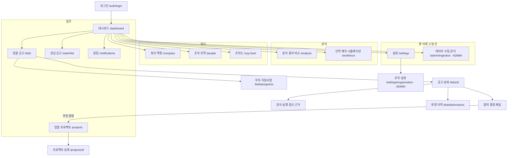

# 06. Next.js 화면 및 UX

> [!tip] 심사 포인트
> 화면은 "책임 있는 AI" 원칙을 그대로 드러낸다. 모든 가상 데이터에 `DEMO` 배지, 결정 모델 분포 옆에 항상 "수주 확률 아님", 규칙이 결정 모델을 이기면 그 사실을 배너로 보여 주고, AI가 죽어도 규칙 점수로 화면이 완결된다. 이 문서는 구현자가 추측 없이 옮길 수 있도록 토큰·레이아웃·라우트별 상태·와이어프레임을 고정한다.

## 1. 범위와 원칙

- **데스크톱 전용.** 최소 폭 1280px, 기준 설계 폭 1440px, 1280~1920px 구간만 유동 레이아웃. 모바일·태블릿 레이아웃은 만들지 않는다([[16-DECISIONS|16 ADR]] 범위 제외). 1280px 미만에서는 가로 스크롤을 허용하고 "데스크톱 화면에서 이용하세요" 안내만 띄운다.
- 결제·구독·요금 화면 없음.
- 데이터 밀도 우선: 영업·분석 담당자가 공고 수십 건을 훑는 도구다. 카드보다 표, 장식보다 숫자·배지.
- 상태는 **아이콘 + 텍스트 + 색**을 항상 함께 쓴다. 색만으로 의미를 전달하지 않는다.
- 서버 컴포넌트로 데이터를 읽고, 필터·폼·polling만 클라이언트 컴포넌트. 서버 비밀값은 브라우저 번들에 넣지 않는다([[09-SECURITY|09 보안]]).

## 2. 화면 구조



업무 화면 `/dashboard`·`/bids`·`/bids/[id]`·`/notifications`는 조직 주소가 없는 경로이고 `web/app/(app)/(work)/` 경로 묶음에 둔다. 그 묶음의 레이아웃이 서버에서 현재 업무 조직을 정해 앱 틀을 그린다. 템플릿의 조직 주소 경로(`/{slug}/tasks`·`/{slug}/dashboard` 등)는 핵심 컷에서 그대로 두고 확장 컷(N1)에서 정리한다([[16-DECISIONS|ADR-029]] A6 D1·D30). 사이드바 묶음은 업무·분석·회사 셋이고, 설정·데이터 수집 관리는 맨 아래 고정 칸에 둔다(§4.1, 2026-10-26 사용자 결정). 조직도를 맨 아래 고정 칸에 두던 2026-10-18 결정은 이 결정으로 바뀌어 조직도는 회사 묶음에 들어간다.

## 3. 디자인 토큰

색·글꼴·글자 눈금·모서리의 값은 `design/tokens.json`이 정본이다. 이 문서는 값을 적지 않는다. `pnpm tokens`가 `web/app/globals.css`(`:root` CSS 변수 + Tailwind v4 `@theme`)를 만든다. 생성물은 손으로 고치지 않고, 컴포넌트는 변수(또는 그 변수에 이어진 Tailwind 클래스)만 쓴다. 색 이름은 shadcn 의미 체계를 따르고, 쓰임 규칙은 `tokens.json`의 `$comment`에 있다. 라이트 테마만 P0, 다크는 P1.

### 3.1 의미색 대응

이 문서가 쓰는 의미색 이름과 `tokens.json` 색 이름의 대응이다.

| 이 문서 | `tokens.json` | 쓰는 곳 |
|---|---|---|
| success | `success` | 추천(`BID`), SATISFIED, 완료 |
| warning | `warning` | 보류(`WATCH`), NEEDS_REVIEW, PARTIAL, 신선도 경고 |
| danger | `destructive` | 비추천(`NO_BID`), NOT_SATISFIED, FAILED, 오류 |
| demo | `demo` | `DEMO` 배지 전용. 다른 의미에 쓰지 않음 |
| brand | `brand` | 브랜드 색(차트 첫 계열·강조 배지·링크). 주요 버튼은 `primary`, 포커스 링은 `ring` |
| selected | `selected`·`selected-foreground` | 선택·켜짐 바탕과 글자(사이드바 지금 메뉴, 탭·보기 전환·거르기 칩의 켜짐). `brand`의 연한 색(파스텔), 대비 4.8:1(2026-10-28 화면 개편, §3.5) |
| info | 없음 → `muted-foreground` + 회전 아이콘 | 진행 중(QUEUED·RUNNING), 안내 |
| neutral | 없음 → `muted-foreground` | 분석 없음, CANCELLED, 미확인 |
| 바탕·카드 | `background`(흰색)·`card` | 화면 바탕은 흰색이고 구역은 가는 선(`border`)으로 나눈다 |

`info`·`neutral`, 의미색의 연한 바탕 변형(`-soft`)은 `tokens.json`에 없다. 새 토큰을 더하지 않고 있는 토큰으로 바꾼다: `info`·`neutral`은 `muted-foreground`, 표 hover는 `bg-muted/50`, 상태색의 연한 바탕 채움은 쓰지 않는다. 선택 바탕만 예외로 `selected` 짝을 더했다(2026-10-28 화면 개편, [[16-DECISIONS|ADR-061]]). 사이드바 활성(`sidebar-accent` 짝)도 같은 값이다. `accent`(회색)는 드롭다운·고스트 버튼·사이드바 hover 바탕이라 선택 표시에 쓰지 않는다. danger 값도 `destructive`를 따른다([[16-DECISIONS|ADR-029]] A6 D15). 상태색은 글자·아이콘·테두리에만 쓰고 흰 바탕 위에 둔다(`$comment`). 텍스트 대비는 WCAG AA 4.5:1 이상을 목표로 하고, 구현 시 Playwright axe 검사로 확인한다(값을 바꾸면 검사도 다시).

### 3.2 상태 표기 (아이콘 + 텍스트 병기)

| 상태 | 텍스트 | 아이콘 (lucide) | 색 토큰 |
|---|---|---|---|
| 권고 `BID` | `추천` | `arrow-up-circle` | success |
| 권고 `WATCH` | `보류` | `eye` | warning |
| 권고 `NO_BID` | `비추천` | `x-octagon` | danger |
| 자격 SATISFIED | `충족` | `check-circle` | success |
| 자격 NEEDS_REVIEW | `확인 필요` | `help-circle` | warning |
| 자격 NOT_SATISFIED | `미충족` | `x-circle` | danger |
| 자격 NEEDS_REVIEW, 사유 `STAGE_NOT_APPLICABLE` | `해당 없음` · 사유 `발주계획 단계(자격 요건 없음)` | `circle-minus` | muted(회색) |
| 분석 없음(`latestAnalysis=null`) | `미분석` | `circle-dashed` | neutral |
| 분석 QUEUED / RUNNING | `대기 중` / `분석 중` | `loader` (회전) | info |
| 분석 COMPLETED | `완료` | `check` | success |
| 분석 PARTIAL | `부분 완료 (규칙만)` | `alert-triangle` | warning |
| 분석 FAILED | `실패` | `alert-octagon` | danger |
| 공고 CANCELLED | `취소됨` | `ban` | neutral |
| 수집 접수됨(화면 전용) | `접수됨` / 서랍·상태 줄 `접수됨 · 작업 시작 대기` | `loader` (회전) | info |
| 수집 run RUNNING | `실행 중` | `loader` (회전) | info |
| 수집 run SUCCEEDED | `완료` | `check` | success |
| 수집 run PARTIAL | 표 칸은 `부분 완료`. 실행 상세 서랍은 `부분 완료 (격리 N건)`(격리 건수를 넘기면 0건이어도 붙는다, `status-badge.tsx`) | `alert-triangle` | warning |
| 수집 run FAILED | `실패` | `alert-octagon` | danger |
| 가상 데이터 | `DEMO` | `flask-conical` | demo |
| 결정 모델 의견 상이 | `규칙 우선` | `shield-check` | warning |

수집 run 상태는 `ingest_runs.status` 4값([[04-DATABASE|04 DB]] `ingest_status`)이다. `접수됨`은 API 상태가 아니라 화면 전용이다. `POST /admin/ingestion/runs`가 202를 준 뒤 worker가 그 run 행을 만들기 전까지 이력 표에 이 행을 보이고, 같은 id의 행이 목록에 나타나면 그 행으로 바꾼다(worker가 멈춰 있으면 "실행 중"이라고 보이지 않으려는 것이다, §5.8).

자격 판정은 `SATISFIED`·`NOT_SATISFIED`·`NEEDS_REVIEW` 3값이다. 발주계획처럼 자격 요건이 없는 공고는 `NEEDS_REVIEW` + 사유 `STAGE_NOT_APPLICABLE`로 저장하므로([[04-DATABASE|04 DB]] §3.4), 판정 배지는 `해당 없음`(`circle-minus`, 회색)으로, 사유는 `발주계획 단계(자격 요건 없음)`으로 적는다(`web/components/bids/status-badge.tsx`·`labels.ts`). 저장 값은 그대로 `NEEDS_REVIEW`다.

### 3.3 글자·간격·형태

글꼴(`fonts`)·글자 눈금(`typography`, `type-<이름>` 클래스)·모서리(`radius`)는 `tokens.json`이 정본이다. 로그인 뒤 화면은 `title`·`heading`·`body`·`label`·`caption` 눈금만 쓴다(`$comment`). 화면 제목(h1)은 `type-title`(30/36), 구역 제목은 `type-heading`, 상세의 큰 점수(94 등)도 새 눈금 없이 `type-title` + `tabular-nums`다([[16-DECISIONS|ADR-029]] A6 D14·D15). 식별자·금액은 `mono` 글꼴이다.

| 항목 | 규칙 |
|---|---|
| 간격 | 4px 기반: `4 8 12 16 24 32 48`. 섹션 간 32, 카드 내부 16~24, 표 셀 8×12 |
| 그림자 | 카드 없음(테두리만), 드로어·모달 `0 8px 24px rgba(0,0,0,.12)` |
| 모서리 | 하나로 맞춘다. `Card`·화면에서 만든 테두리 상자·버튼·입력칸은 `rounded-lg`(`radius` 8px), 더 큰 모서리는 떠 있는 창(대화상자)만. 임의 값(`rounded-[10px]`)을 쓰지 않는다(2026-10-28, design.actibooky.com DESIGN_RULES) |
| 표 | 행 높이 44, 헤더 고정, 숫자 열 우측 정렬, 홀짝 배경 없음(hover만). 머리 줄 연한 회색 바탕·바깥 둥근 1px 테두리(§3.5) |
| 애니메이션 | 150ms ease-out. `prefers-reduced-motion`이면 회전 아이콘 제외 전부 끔 |

**글자 눈금 예외 — 대시보드**([[16-DECISIONS|ADR-030]] B25): `/dashboard` 본문(`AppPage` 안)만 글자 눈금을 +3px 키운다. body 14→17, label 13→16, caption 12→15, heading 16→19, title 30→33이고 줄 높이도 각각 +3px, 굵기·자간은 그대로다. 사이드바·Topbar·다른 화면은 그대로다. 값의 정본은 `design/tokens.json`의 대시보드 범위 변형이고 `pnpm tokens`가 범위 CSS를 만든다. design-system 스킬의 디자인 규칙 3번("같은 역할의 글자는 어느 화면에서나 같은 크기")의 예외다. 사이드바의 같은 예외는 §4.1이다.

### 3.4 공개 랜딩의 시각 구성

중앙 정렬 히어로와 최대 1200px의 단 폭을 쓰고 장식은 걷어냈다(근거: [AI 티 걷어내기 스펙](../polaris/specs/done/2026-10-26-design-declutter.md)). 규칙은 다음과 같다.

- 히어로와 흐르는 줄 둘(아래)이 가운데 정렬이고(사용자 결정), 나머지 구역의 제목·설명은 왼쪽 정렬이다(결정 L1).
- **흐르는 줄 둘**(2026-10-28 화면 개편, [[16-DECISIONS|ADR-061]]): 히어로 바로 아래에 "솔리데오가 수행한 공공 서비스"(솔리데오 누리집 govSM.do의 17개 서비스 이미지) 줄과 "SOL RADAR 가 공고를 가져오는 곳"(9개 기관 로고) 줄을 둔다. 둘 다 로고·이미지만 있고 이름 글자·"연결 예정" 꼬리표가 없다. 제목은 작은 회색 글자 한 줄이고, 출처 줄 아래에 "기관 로고는 공고 데이터 출처 표시이며 제휴·인증을 뜻하지 않습니다."를 둔다. CSS만으로 목록을 두 번 이어 붙여 흘리고(둘째 사본 `aria-hidden`), 양 끝은 흐려지는 마스크다. 마우스를 올리거나 키보드 초점이 들어오면 멈추고, `prefers-reduced-motion`이면 흐르지 않고 줄바꿈한 멈춘 줄이다. 기관 로고는 기본 회색조이고 마우스를 올리면 원래 색이다. 로고는 각 기관 공식 CI 파일(나라장터·LH·한국전력공사는 마크 + 국문 이름 시그니처)을 고치지 않고 쓰며, 넓이가 같아지도록 기관마다 높이를 맞춘다. 9곳 가운데 아직 수집하지 않는 곳은 [랜딩 출처 연결 목록](plans/2026-10-28-landing-sources-to-connect.md)이 관리한다.
- **업무 데모**(2026-10-28 사용자 지시로 녹화 영상을 대체, [[16-DECISIONS|ADR-061]]): 히어로와 흐르는 줄 사이에 동영상 파일이 아니라 앱 화면을 닮게 HTML로 그린 데모 판을 둔다(`web/components/landing/work-demo.tsx`). 이름표("담당자")가 붙은 가짜 커서가 대시보드 수집 에이전트 [확인] → 출처 5곳(나라장터·LH·K-water·한국전력공사·기업마당)에서 새 공고를 받는 수집 표(숫자가 오르고 완료) → 우리 업종에 맞는 관련 공고 표 → 분석 상세(참가 자격 판정·공고문 인용·SOL Score 다섯 요소·시스템 권고와 담당자 결정) → 관심 공고에 담기·알림 일정 → [다시보기] 순서로 누른다. 한 바퀴 약 30초이고 처음으로 돌아간다. 공고·기관·숫자·인용은 지어낸 것이고 기관 이름은 "가상"으로 시작한다(`demo-bids.ts` 규칙). 출처 이름과 로고만 실제이며 판 아래에 "가상 공고로 만든 예시 화면입니다. 출처 이름과 로고만 실제입니다."를 둔다. 판은 단 폭 안 `rounded-xl`·1px 선·그림자 없음이다. 판이 화면에 30% 이상 보이고 탭이 보일 때만 흐른다. 판 밖 캡션 줄 오른쪽에 "데모 멈춤/재생" 버튼을 늘 둔다. `prefers-reduced-motion`이면 분석 상세 완성 화면에 멈춰 있고 애니메이션이 없다. 움직이는 판은 `aria-hidden`·`inert`이고 같은 흐름을 sr-only 문단으로 읽게 한다. 새 의존성 없이 CSS 전환과 단계 상태 하나로 만든다.
- 흰 바탕에 `brand` 파랑은 시작 버튼·메뉴 hover·링크·초점에만 쓴다. 큰 면을 `brand`로 칠하지 않고, 버튼에 색 그림자를 두지 않는다.
- 분석 예시는 가짜 창 점과 큰 그림자 없이 1px 선 테두리이고, 무대는 중립 바탕이다.
- 기능 4개와 원칙 4개는 같은 배치를 되풀이하는 구분선 행이다(왼쪽 제목·설명, 오른쪽 화면 조각 또는 "화면에서" 예시). 제목 앞 아이콘·좌우 교차·색 바탕 교차·번호가 없다. 번호는 순서가 정보인 3단계에만 본문 색으로 붙인다("01").
- 움직임은 첫 화면과 분석 예시의 등장, 흐르는 줄 둘(2026-10-28)이다. 구역마다 같은 떠오르기를 되풀이하지 않는다.
- FAQ는 왼쪽 제목과 오른쪽 펼친 답변이다. 마지막 안내는 잉크색(`foreground`) 띠에 흰 글자와 시작하기 버튼 하나다(결정 L2). 바닥글은 흰 바탕이다.

이 랜딩의 단 폭·흰 바닥글·브랜드 색 쓰임은 design-system 스킬의 마케팅 틀 규정보다 우선한다. 이전 랜딩 설계 문서는 보관 기록으로 유지한다.

색·글꼴·글자 눈금은 기존 `design/tokens.json`을 유지한다. 제품 문구·기능 개발 상태·앵커·계정 진입 경로는 바꾸지 않는다. 분석 예시의 예시 데이터 표시, 점수 옆 수주 확률 고지, 담당자 결정 대기, 공고 선택·방향키 조작과 움직임 줄이기를 유지한다. 1440×900·1280×800에서 "분석 예시 보기"를 누르면 점수와 고지가 함께 화면 안에 보이고, 가로 넘침이 없어야 한다(2026-10-28 흐르는 줄이 히어로와 분석 예시 사이에 들어와 "스크롤 없이 첫 화면에서"를 바꿨다. 점수가 고지 없이 보이지 않는다는 단언은 그대로다). 확인 결과는 [[PROGRESS]]와 `docs/evidence/landing/20261021-*`·`docs/evidence/design-declutter/`에 남긴다.

### 3.5 업무 화면 공통 (2026-10-28 화면 개편)

로그인 뒤 모든 업무 화면이 같은 틀을 쓴다([[16-DECISIONS|ADR-061]], 근거 [화면 개편 스펙](../polaris/specs/in-progress/2026-10-28-ui-refresh.md) §4.3). 화면 고유의 데이터·문구·링크·`aria-*`는 바꾸지 않았다.

- **화면 머리**(`web/components/app-page.tsx`): 경로(묶음 / 화면, 회색 `type-label`, `web/components/app-breadcrumb.tsx`) → `eyebrow`(뒤로 링크처럼 기능이 있을 때만) → 제목(`type-title`) → 설명 → 1px 아래 구분선이다. 경로는 사이드바 메뉴 정의(`app-nav.ts`의 `breadcrumbOf`)에서 찾고, 묶음이 없는 화면(설정 등)은 경로 줄이 없다. 경로의 두 칸은 링크가 아니다. 본문 위 여백은 16px다(`/gaps` 1440×900 첫 화면에 순위 1~3행이 들어가게).
- **표**(`web/components/ui/table.tsx`): 머리 줄 연한 회색(`bg-muted/50`), 바깥 둥근 1px 테두리(`rounded-lg border`), 행 구분선. 이미 테두리가 있는 상자 안의 표는 `containerClassName="rounded-none border-0"`으로 바깥 테두리를 꺼서 두 겹이 되지 않게 한다. 표를 감싼 `Card`는 두지 않는다.
- **칩**(`web/components/ui/chip.tsx`): 회색 칩(`tone="neutral"`, `secondary` 바탕)과 강조 배지(`tone="brand"`, 파란 1px 테두리 + 파란 글자). 촘촘한 곳은 `size="sm"`(높이 20px, `type-caption`). 상태색 배지(충족·확인 필요·미충족, 추천·보류·비추천), `DEMO`, 출처 배지(기관 로고 색·회사 프로필 출처)는 뜻이 있는 표시라 이 부품으로 바꾸지 않는다.
- **카드**: 기본 그림자가 없다(1px 선과 여백, 2026-10-26 원칙).
- **선택·켜짐 표시**: 켜짐은 `bg-selected text-selected-foreground font-semibold`, 꺼짐은 `text-muted-foreground hover:bg-muted`, 크기 `rounded-md px-3 py-1.5 type-label`이다. 하는 일에 따라 세 모양이다.

| 종류 | 예 | 모양 |
|---|---|---|
| 1. 다른 화면·구역으로 가는 탭 | 설정 메뉴, 입찰 공고 종류(`bids-source-nav`), `/company` 탭 | 바깥 테두리 없이 `flex gap-1` |
| 2. 같은 목록을 다른 기준으로 보는 하나 고르기 전환 | 입찰 일정 조직 전체/내 일정, 알림 전체/안 읽음, `/market` 기간·업종 범위 | 바깥 `inline-flex rounded-lg border border-border p-0.5` 상자 안의 알약(상자 안은 `py-1`) |
| 3. 여러 개 켜는 거르기 칩 | 입찰 일정 일정 종류, 입찰 공고 출처 빠른 선택 | 칩마다 1px 테두리(`rounded-md border border-border`), 켜짐은 `border-transparent` + 선택 바탕. 바깥 상자 없음 |

## 4. 레이아웃 그리드

```text
┌─ Topbar ──────────────────────────────────────────────────────────────────────────────────┐
│ SOL RADAR 솔리데오 │ [DEMO]* │ 수집 12분 전 │ 🔔 3 │ 사용자 ▾                              │
├──────────┬────────────────────────────────────────────────────────────────────────────────┤
│ Sidebar  │ Content (max 1440, padding 24, 12-col grid, gutter 24)                         │
│ 256px    │                                                                                │
│SOL RADAR │  페이지 제목 ─────────────────────────── [주요 액션]                           │
│솔리데오  │  ┌────────────────────────────────┬─────────────────────┐                      │
│          │  │ 주 영역 8col                   │ 우측 레일 4col      │                      │
│▾ 업무    │  │                                │ (상세에서만, sticky)│                      │
││대시보드 │  └────────────────────────────────┴─────────────────────┘                      │
││입찰 공고│                                                                                │
││…        │                                                                                │
│▾ 분석    │                                                                                │
││…        │                                                                                │
│▾ 회사    │                                                                                │
││…        │                                                                                │
│──────────│                                                                                │
│ 설정     │                                                                                │
│ 수집 관리│                                                                                │
│ (이) 이름│                                                                                │
└──────────┴────────────────────────────────────────────────────────────────────────────────┘
```

- 사이드바는 256px 고정(템플릿 `Sidebar` 폭 `16rem`, [[16-DECISIONS|ADR-029]] A6 D15). 접으면 메뉴 아이콘만 남는 64px 아이콘 줄이 된다(§4.1). 펼친 상태에서 묶음은 회색 묶음 아이콘 + 굵은 묶음 이름 + 오른쪽 끝 접기 화살표 줄로 나누고, 묶음 안 메뉴는 아이콘 없이 글자만 묶음 이름 선까지 들여 쓴다(§4.1, 2026-10-28 4차 결정. 그림은 묶음 아이콘을 생략했다). 활성 항목은 연한 파랑 바탕(`sidebar-accent`) + 파란 글자 + 굵기 600 + `aria-current="page"` 하나로 표시하고 `brand` 막대는 쓰지 않는다(§4.1). 바탕은 본문과 같은 흰색이고 오른쪽 1px 선으로 본문과 나눈다. 그림의 "…"는 §4.1 표의 나머지 메뉴다.
- 사이드바 묶음과 메뉴 15개(모두 `released`)는 §4.1이 정본이다. 묶음 아래 선으로 나눈 맨 아래 고정 칸에 설정·데이터 수집 관리와 사용자 칸이 있다. 노출 조건 5개([[16-DECISIONS|ADR-021]])를 채운 메뉴는 링크로, 아직 화면이 없는 메뉴는 링크 없이 메뉴 이름만 보인다. 2026-10-21 사용자 후속 요청으로 "준비 중" 배지와 툴팁 문구를 제거한다. 미출시 메뉴는 초점을 받지 않고 경로는 404 그대로다. 메뉴 정의는 `web/components/app-nav.ts` 한 곳(`released`·`planned`)이다. 메뉴 숨김은 권한이 아니며, 서버가 라우트마다 권한을 따로 검사한다. 미인증은 기존 인증 정책, 미출시 경로 404, 출시 경로에 권한 없음 403이다. 그림의 "수집 관리"는 데이터 수집 관리(`/admin/ingestion`, ADMIN만)다. 사용자 메뉴: 설정, 서비스 운영(`/ops`, 운영자만. `/ops` 분리는 해커톤 이후, [[16-DECISIONS|ADR-023]]), 로그아웃([[16-DECISIONS|ADR-021]]). 사이드바 맨 위는 로고(대시보드 링크)만 있고 조직 전환 메뉴가 없다(회사 이름 줄은 2026-10-28 사용자 결정으로 뺐다, `e9224f46`).
- 위 막대에는 화면 이름을 두지 않는다. 화면 이름은 본문 머리의 경로(묶음 / 화면)와 제목에 있다(§3.5, 2026-10-28 화면 개편: 한 화면에 같은 이름이 세 번 나오지 않게). 사이드바가 안 보일 때(접은 넓은 폭) 지금 조직을 알 수 있게 위 막대 왼쪽에 조직 이름을 둔다.
- Topbar 우측 순서는 고정: `DemoBadge` → `DataFreshnessIndicator` → `NotificationBell` → 사용자 메뉴(2026-10-26 현재, `web/components/topbar-status.tsx`). 그림의 `[DEMO]*`는 지금 보는 데이터 출처(주소의 `?origin=`, 없으면 서버 기본 출처)가 `demo`일 때만 보인다(`web/components/topbar-demo-indicator.tsx`). 실행 모드와 따로다. 템플릿 사이드바는 접으면 숨어서 로고 옆 배지가 사라지므로 Topbar에 둔다([[16-DECISIONS|ADR-029]] A6 D3). 행 단위 `DEMO` 배지는 모드와 무관하게 `isDemo=true` 레코드에 붙는다.
- **2026-10-26 변경**: Topbar의 `RunModeIndicator`("실행 모드: mock")와 `AiModeIndicator`("AI: …")를 렌더링에서 뺐다([[plans/2026-10-26-live-ops-cutover|10-26 실운영 전환 실행서]] §1). 배포 설정 값이라 업무 사용자에게 뜻이 없고, 실공고를 보는 운영 화면에 "mock"이 보여 데모로 오해하게 했기 때문이다. 값과 연결은 그대로다. 지금 실행 모드·AI는 공고 상세 분석 요약 띠("분석 실행 모드: …"·"AI: …", §7)와 분석 결과 비교 화면의 "실행 모드" 행·분석 이력 필터에서 분석 단위로 보인다. 런타임 진단은 `GET /api/v1/admin/ai/status`(ADMIN, 지금 이를 보여 주는 화면은 없다)와 `/admin/ingestion`(수집 모드·정기 일정·[지금 불러오기], §5.8)이 맡는다.
- Topbar 지표(`DataFreshnessIndicator`)의 값·색·갱신 주기는 §8이 정본이다.
- `/bids` 표는 11열이라 1280px에서는 표 영역 안에서만 가로 스크롤한다. 페이지 가로 스크롤은 없다(열 목록은 §5.4).
- 1920px 이상은 콘텐츠를 1440에 가두고 좌우 여백으로 처리한다.

### 4.1 사이드바 묶음과 메뉴

**묶음 머리 아이콘·파스텔 선택(4차 결정, 2026-10-28)**: 사용자가 대시보드 레퍼런스(`web/public/reference/ui.png`, granter User Guide 캡처)를 주며 "사이드바를 눌렀을 때 파스텔톤이고, 아이콘이 심플하고 깔끔함"을 좋다고 했고, 브라우저 시안 A를 골랐다(스펙 U2). 묶음 줄은 회색 묶음 아이콘(업무 `briefcase`, 분석 `chart-no-axes-column`, 회사 `building-2`) + 본문 색 굵은 묶음 이름 + 늘 보이는 접기 화살표다. 묶음 안 메뉴는 펼친 상태에서 아이콘 없이 글자만 묶음 이름 선(아이콘 16px + 사이 8px)까지 들여 쓴다. 활성은 연한 파랑 바탕 + 파란 글자 + 굵기 600이고, hover는 회색이다(파랑이면 선택이 둘로 보인다). 첫 결과 스크린샷을 사용자가 보고 확정했다. 3차 결정의 트리 세로선 없음·묶음 사이 16px, 접기 기능, 글자 크기 예외(+3px), 묶음 3개와 순서, 맨 아래 고정 칸(아이콘 + 글자 그대로), 흰 바탕, 64px 아이콘 줄(접으면 메뉴별 아이콘)은 그대로다. 줄 높이는 32px 그대로다(36px이면 1280×800에서 메뉴가 아래 고정 칸에 가려 사이드바 안 스크롤이 생긴다). 결정 기록은 [[16-DECISIONS|ADR-061]]·[[16-DECISIONS|ADR-021]] 2026-10-28 4차 개정, 증거는 [화면 개편](evidence/ui-refresh/README.md)이다. 아래 3차 결정 문단의 "묶음 줄"·"메뉴 아이콘"·"활성 굵기 500"은 이 결정으로 바뀌었다.

**actibooky 톤(3차 결정, 2026-10-28)**: 사용자가 "아직도 촌스럽다"며 design.actibooky.com 사이드바를 참고하라고 했고, 비교 시안의 A안을 골랐다. 트리 세로선과 들여쓰기를 없애고, 묶음 줄은 작은 회색 묶음 이름 + 오른쪽 끝 접기 화살표로 바꾸고, 메뉴 아이콘을 회색으로 낮추고, 활성 굵기를 600에서 500으로 낮추고, 묶음 사이를 16px 띄웠다. 묶음 접기 기능, 펼친 상태 아이콘, 글자 크기 예외(+3px), 묶음 3개와 순서, 맨 아래 고정 칸, 흰 바탕, 64px 아이콘 줄은 그대로다. 결정 기록은 [[16-DECISIONS|ADR-021]] 2026-10-28 3차 개정, 증거는 [사이드바 actibooky 톤](evidence/sidebar-actibooky/20261028/README.md)이다.

**트리·아이콘 되돌림(2차 결정)**: 펼친 상태의 메뉴 아이콘, 접는 묶음 줄, 트리 세로선을 2026-10-18 결정의 모습으로 되살렸다. 사이드바 전체를 되돌린 것은 아니다. 묶음 3개와 순서, 맨 아래 고정 칸, 맨 위 로고와 회사 이름, 흰 바탕, 회색 바탕 활성 표시(`brand` 막대 없음), 64px 아이콘 줄은 1차 결정 그대로다. 결정 기록은 [[16-DECISIONS|ADR-021]] 2026-10-26 2차 개정이고, 구현은 git `26efefc1` 커밋과 [[PROGRESS]] 최근 작업 로그에 있다.

**묶음 3개(1차 결정)**: 근거·결정표(S1·S2)·수용 기준은 [AI 티 걷어내기 스펙](../polaris/specs/done/2026-10-26-design-declutter.md)이다. 2026-10-18 결정(원문: git `5261730f` 의 `docs/plans/2026-10-18-org-chart-sidebar-design.md` §4)의 접는 트리·펼친 상태 메뉴 아이콘·3px `brand` 막대·조직도 고정 칸을 대체했다. 이 가운데 접는 묶음 줄과 펼친 상태 메뉴 아이콘은 2차 결정으로 되살렸고(트리 세로선은 3차 결정으로 다시 없앴다), 3px `brand` 막대와 조직도 고정 칸은 1차 결정대로 없다. 64px 아이콘 줄은 유지한다(S1). 64px 줄 시험은 [[11-TESTING|11]] NAV-10이다.

**2026-10-21 사용자 후속 요청 — 표시 변경**: 미출시 메뉴는 이름만 링크 없이 표시한다. "준비 중" 배지와 접힌 사이드바의 툴팁 접미사는 모두 제거한다. `planned` 상태·초점 제외·미출시 경로 404·권한 가드는 유지한다. 지금 `planned` 메뉴는 없으며, 이 규칙은 향후 미출시 메뉴에도 적용한다.

- **맨 위**: SOL RADAR 로고(`web/components/logo.tsx`, 대시보드 링크)만 있다. 회사 이름 줄과 머리글자 사각형은 두지 않는다. 받은 초대가 있으면 그 아래 아이콘 + "받은 초대" 줄과 개수를 둔다.
- **묶음 줄**: 접기 버튼이다(높이 32px). 왼쪽에 회색 묶음 아이콘(16px)과 묶음 이름(`type-label`, 본문 색, 굵기 600), 오른쪽 끝에 회색 접기 화살표(펼침 `chevron-down`/접힘 `chevron-right`, 16px)를 둔다. 화살표는 늘 보인다. hover는 회색(`accent`) 바탕이다. 첫 묶음 밖의 묶음은 위 묶음과 16px 띄운다. `aria-expanded`·`aria-controls`를 단다. 묶음 목록의 접근 이름은 묶음 이름(업무·분석·회사)이다. 지금 화면이 속한 묶음은 처음 열거나 다른 묶음의 화면에서 옮겨 올 때 펼친다(같은 묶음 안에서 옮기면 접어 둔 그대로다, `web/components/app-nav.ts`의 `currentNavGroupId`). 접힘 상태는 보는 사람 브라우저의 `localStorage`(키 `sol-radar.sidebar.collapsed-groups`, `web/lib/stores/sidebar-groups.ts`)에만 두며, 저장값을 읽지 못하면 모두 펼친 상태로 시작하고, 저장하지 못해도 지금 창의 접고 펴기는 그대로 된다(다음 방문 때 모두 펼친다). 서버 렌더와 첫 그림은 모두 펼친 상태로 그리고 저장값은 그 뒤에 읽어 하이드레이션이 어긋나지 않는다.
- **메뉴**: 묶음 안 메뉴는 펼친 상태에서 아이콘 없이 글자만, 세로선 없이 묶음 이름 선까지 들여 쓴다(`pl-8`). 글자 16px(`type-label` 13px에 아래 글자 크기 예외 +3px). 메뉴별 아이콘은 접은 64px 줄에서만 보인다(장식, `aria-hidden`). 가장 긴 이름 "인력 배치 시뮬레이션"도 펼친 폭 256px에서 말줄임 없이 들어가야 한다(1440·1280 두 폭). 링크이며 지금 화면이면 `aria-current="page"`다. 활성 표시는 연한 파랑 바탕(`sidebar-accent` = `selected`) + 파란 글자(`sidebar-accent-foreground`) + 굵기 600 하나이고 `brand` 막대를 쓰지 않는다. 활성 메뉴는 마우스를 올려도 그 바탕 그대로다. hover는 회색(`accent`) 바탕이다.
- **맨 아래 고정 칸**: 위쪽 1px 선으로 메뉴 영역과 나눈다. 설정·데이터 수집 관리(ADMIN만) 다음 사용자 칸이다. 설정·데이터 수집 관리는 묶음 줄 없이 회색 아이콘 + 글자로 보인다(들여 쓰지 않는다, 활성·hover는 위 메뉴와 같다). 사용자 칸은 한 줄(작은 아바타 + 이름 + 메뉴 표시)이고 이메일은 열린 메뉴 안에만 보인다. 메뉴 영역이 길어지면 메뉴 영역만 스크롤되고 고정 칸 자리는 바뀌지 않는다.
- **접은 상태(64px)**: 묶음 줄을 숨기고 메뉴 아이콘만 세로로 놓는다. 묶음을 접어 두었어도 이 상태에서는 모든 메뉴 아이콘이 보인다. 묶음 사이와 고정 칸 위에 짧은 1px 선을 긋는다. 마우스를 올리거나 키보드 초점이 오면 메뉴 이름 툴팁이 뜨고, 링크에는 `aria-label`로 이름을 준다. 맨 위에는 로고 마크만 남는다.
- **바탕**: 본문과 같은 흰색(`design/tokens.json`의 `sidebar`) + 오른쪽 1px 선이다(S2).
- **글자 크기 예외**([[16-DECISIONS|ADR-030]] B26): 앱 틀 사이드바 전체(회사 이름·메뉴·묶음 줄·맨 아래 사용자 칸)의 글자는 모든 화면에서 앱 틀 기본 눈금보다 3px 크다. 실제 사이드바 눈금에 +3px 하므로 메뉴 `type-label` 13→16px, caption 12→15px다(B25 대시보드와 같은 규칙, 기준 정정은 [[16-DECISIONS|ADR-031]] C1). 방식은 §3.3 대시보드 예외와 같은 `design/tokens.json` 범위 변형이고 design-system 디자인 규칙 3번의 예외다. 항목 높이는 글자에 맞춰 늘 수 있다(C6 B2에서 확정). 사용자 원문 "사이드 바 글씨도 작은데 같이 올려"(2026-10-19).

| 묶음 | 메뉴 | 경로 | 아이콘 (lucide) | 해커톤 노출 |
|---|---|---|---|---|
| 업무 | 대시보드 | `/dashboard` | `layout-dashboard` | 예 |
| 업무 | 입찰 공고 | `/bids` | `file-text` | 예 |
| 업무 | 관심 공고 | `/watchlist` | `star` | 예 (P1 N3, `released`) |
| 업무 | 입찰 프로젝트 | `/projects` | `folder-kanban` | 예 (P1 N6, `released`) |
| 업무 | 입찰 일정 | `/calendar` | `calendar-days` | 예 ([[16-DECISIONS\|ADR-060]], `released`) |
| 업무 | 알림 | `/notifications` | `bell` | 예 |
| 분석 | 자격 갭 레이더 | `/gaps` | `radar` | 예 ([[16-DECISIONS\|ADR-060]], `released`) |
| 분석 | 발주 현황 | `/market` | `chart-column` | 예 ([[16-DECISIONS\|ADR-060]], `released`) |
| 분석 | 분석 결과 비교 | `/analysis` | `git-compare-arrows` | 예 (P1 N5, `released`) |
| 분석 | 인력 배치 시뮬레이션 | `/workforce` | `users-round` | 예 (P1 N7, `released`) |
| 회사 | 회사 역량 | `/company` | `award` | 예. 메뉴 `roles`는 ADMIN·EXECUTIVE(ADR-052) |
| 회사 | 조직·인력 | `/people` | `users` | 예 |
| 회사 | 조직도 | `/org-chart` | `network` | 예 |
| 맨 아래 고정 칸 | 설정 | `/settings` | `settings` | 예 (개인 `/{slug}/settings`, 조직 탭 `/settings/organization`은 ADMIN) |
| 맨 아래 고정 칸 | 데이터 수집 관리 | `/admin/ingestion` | `database` | 예 (ADMIN만) |

묶음과 순서는 `web/components/app-nav.ts` 기준이다. 분석 묶음은 새 메뉴(자격 갭 레이더·발주 현황)를 위에 둔다([[16-DECISIONS|ADR-060]]). 15개 메뉴 모두 `released`이며 "예"는 역할에 맞게 링크로 보인다는 뜻이다. `/settings`는 개인 설정 `/{slug}/settings`로 넘기는 옛 주소이자 카카오 알림이 가리키는 주소다. 아이콘은 펼친 상태에서 글자 왼쪽에, 접은 64px 줄에서는 홀로 보인다(2026-10-26 2차 결정). 아이콘 이름은 `web/`에 설치된 `lucide-react`에서 확인했다. React에서는 `LayoutDashboardIcon`처럼 `Icon` 접미사 이름으로 부른다.

## 5. 라우트별 명세

### 5.1 공통 상태 규칙

| 상태 | 표시 | 구현 |
|---|---|---|
| 로딩 | 레이아웃과 같은 형태의 skeleton. 스피너 단독 금지 | `loading.tsx` |
| 빈 상태 | 아이콘 + 한 줄 설명 + 다음 행동 버튼 1개 | 라우트별 §5.2~5.8 |
| 오류 | 제목 "불러오지 못했습니다" + `requestId` + [다시 시도]. 원인 텍스트는 서버가 준 `error.message`만 | `error.tsx` |
| 권한 없음 | 403: 화면 틀(`AppPage` 제목)은 그대로 두고 본문만 안내한다. 화면 응답은 HTTP 200이고 API는 `403 FORBIDDEN`이다. `/admin/ingestion`은 "이 화면을 볼 권한이 없습니다" + "데이터 수집 관리는 업무 역할이 ADMIN인 구성원만 볼 수 있습니다. 지금 역할: {역할}" + [대시보드로] 버튼이다(`IngestionForbidden`). `/people`·`/org-chart`는 "조회 권한이 없습니다" 한 줄이다(`PeopleForbidden`). 404: 공고·분석이 다른 조직 것이면 404로 통일([[09-SECURITY\|09 보안]]) | 라우트 가드 |
| 신선도 경고 | §8 `DataFreshnessIndicator` | `DataFreshnessIndicator` |

### 5.2 `/auth/login`

| 항목 | 내용 |
|---|---|
| 섹션 | 중앙 카드 1개: 이메일, 비밀번호, [로그인], 회원가입·비밀번호 찾기 링크. 그 아래 가는 선 뒤에 간편 로그인 버튼(구글·카카오·네이버. `NEXT_PUBLIC_AUTH_*`로 켠 제공자만, [[16-DECISIONS\|16 ADR]] ADR-018). |
| 주요 액션 | 로그인(Supabase Auth) → 가입 정보 미완료면 `/auth/complete-profile`, 완료면 멤버십 확인 후 `/dashboard`. 간편 로그인은 제공자 화면을 거쳐 `/auth/callback`으로 돌아온다 |
| 빈/로딩/오류 | 로딩: 버튼 비활성 + 스피너. 오류: 필드 아래 텍스트 "이메일 또는 비밀번호가 올바르지 않습니다"(계정 존재 여부 노출 금지). 시도 제한(Supabase Auth 요청 제한): "잠시 후 다시 시도" |
| 권한 | public. 로그인 상태면 가입 정보 완료 여부를 확인해 `/auth/complete-profile` 또는 업무 진입 경로로 |

### 5.2.1 `/auth/sign-up` (ADR-019, 구현됨)

| 항목 | 내용 |
|---|---|
| 회사 | 솔리데오 고정 표시. 회사 선택·회사 생성 없음 |
| 필수 선택 | 기존 이름 입력 가까이에 `부서`, `직급/직책` 두 select. 원본의 동일 팀명은 한 번만 표시. 목록은 `GET /api/v1/signup-options` |
| 검증 | 최초에는 미선택. 빈 값·목록에 없는 값은 해당 칸 아래 오류를 표시하고 제출 거절. 기존 약관·이메일·비밀번호 검증 유지 |
| 저장 | 이름 + 카탈로그 코드를 Auth 가입 메타데이터로 전송하고 검증된 가입 신고 정보로 영속화. 단순 UI 선택으로 끝내지 않음 |
| 접근성 | label·필수 표기·키보드 선택·오류 연결. 1440px·1280px에서 확인 |

한글 세 글자·남녀 100/100은 가상 명부 생성 규칙이다. 실제 가입자의 이름을 그 규칙으로 제한하거나 가상 직원 이름을 선택하게 하지 않는다. `직급/직책` 선택은 업무 권한 선택이 아니다.

### 5.2.2 `/auth/complete-profile` (ADR-019, 구현됨)

간편 가입 또는 기존 계정의 이름·부서·직급/직책이 미완료면 첫 업무 진입 전에 보완한다. 회사는 솔리데오 고정이며 이름이 이미 있으면 유지하고 두 선택값을 필수로 받는다. 본인 신고 정보 조회/저장 계약은 [[05-API-SPEC]] §8이다. 저장 실패 시 입력을 유지하고 오류와 재시도를 제공한다. 성공 시 서버가 완료 상태를 다시 확인한 뒤 기존 초대·멤버십 정책에 따라 진입한다. 로그인·초대 수락·가입 보완 뒤 업무 첫 화면은 모두 `/dashboard`다([[16-DECISIONS|ADR-033]] E9). 미완료 상태에서 URL 직접 접근으로 업무 화면/API에 들어갈 수 없다. 로그아웃·계정 보완·초대 안내 경로를 허용해 이동 반복을 막는다.

### 5.3 `/dashboard`

**배치 (2026-10-26, [AI 티 걷어내기](../polaris/specs/done/2026-10-26-design-declutter.md))**: 카드 상자 없이 숫자 띠와 구분선 목록으로 짠다. 머리(제목·설명·기준 시각·새로고침) 아래에 "공공조달 요약" 숫자 띠 한 줄이 있다: 신규 발견·마감 임박(7일)·분석 대기·추천 권고·진행 중 입찰 프로젝트. 띠는 위아래 1px 선과 칸 사이 세로선으로 나누고 숫자는 `tabular-nums`다. 그 아래는 두 단이다. 왼쪽 주 영역은 "우선 검토할 입찰"·"예정 사업 및 사전규격"이고 제목 줄(제목·설명·전체 보기) + 구분선 행이다. 오른쪽 좁은 칸은 수집 지표(전체 수집 공고·마지막 수집 성공·다음 수집 예정·진행 중 보류. "다음 수집 예정"은 웹이 정기 일정을 직접 알 수 없어 지금 숨는다, `web/app/_lib/run-mode.ts` `currentIngestIntervalMinutes`. 실제 다음 정기 실행은 `/admin/ingestion`이 보인다)·수집 소스 상태·기관별 공고 수·입찰 포트폴리오이고 모두 제목 + 구분선 목록이다. 중복 후보 안내는 "우선 검토할 입찰" 설명 줄의 회색 글자다. 단 폭이 좁으면(1280px) 한 단으로 내려간다.

| 항목 | 내용 |
|---|---|
| 섹션 | ① 숫자 띠 5칸(`web/app/(app)/(work)/dashboard/dashboard-view.tsx`): **신규 발견**(최근 24시간 입찰공고)·**마감 임박 (7일)**·**분석 대기**(현재 입력의 분석 결과 없음)·**추천 권고**(현재 유효 분석)·**진행 중 입찰 프로젝트**(`/projects` 링크, 조회 실패면 "—"). 모든 칸이 상단 `origin`을 따른다. ② 왼쪽 주 영역: "우선 검토할 입찰"(공공 SI·AI 우선, 최근 공고 순)과 "예정 사업 및 사전규격"(발주계획·조달요청·사전규격, 별도 집계). ③ 오른쪽 좁은 칸: 위 배치 문단의 수집 지표·수집 소스 상태·기관별 공고 수·입찰 포트폴리오. 최근 변경(revision 이벤트) 목록은 화면에 없고 응답에도 `recentChanges`가 없다([[05-API-SPEC\|05]] §4) |
| 주요 액션 | 각 행 클릭 → `/bids/[id]`. "전체 보기" → `/bids?decision=…` 필터 적용 링크 |
| 빈 상태 | 공고 0건: "아직 수집된 공고가 없습니다". ADMIN에게는 [수집 실행] 단추(`/admin/ingestion`으로 가는 `outline` 링크, 그 화면의 [수동 수집 실행]으로 돌린다), 다른 역할에게는 단추 없이 "관리자에게 수집을 요청하세요"를 보인다(`web/app/(app)/(work)/empty-state.tsx`) |
| 로딩 | 숫자 띠 + 두 단 목록 skeleton |
| 오류 | §5.1 |
| 권한 | 모든 역할 |

### 5.4 `/bids`

| 항목 | 내용 |
|---|---|
| 섹션 | ① `BidFilters`(상단 고정): 검색어, 단계(PLAN/PRE_SPEC/NOTICE), 상태(기본은 활성 = `OPEN`·`AMENDED`이고 취소 공고는 숨긴다. "취소 포함"을 고르면 취소 공고도 보이고 그 행 단계 칸 아래에 `취소됨`을 표시한다. 핵심 컷(C6) 목록에도 이 선택지를 둔다, [[16-DECISIONS\|ADR-029]] A7), 발주기관, 예산 범위, 마감 기간, 점수 하한, 권고(추천·보류·비추천), 결정 여부. ② `BidTable` ③ 커서 페이지네이션 [더 보기] |
| 기본 열 (11열) | 출처(`DEMO`칩 또는 소스 이름, 100px. 소스 배지는 기관 로고의 상징 색 칸이다, [[16-DECISIONS\|ADR-058]]) · 기관(120, 2줄 말줄임) · 단계(80) · 제목(228, 2줄 말줄임) · 분야(96) · 예산(88) · 마감(D-n, 88) · SOL Score(88) · 권고(88) · 분석 상태(112) · 최종 결정(96). 열 폭 합은 1,184px(관심 공고 화면은 관심 열이 붙어 1,224px)이고 표 영역이 `overflow-x-auto`라서 1280px에서는 표 안에서만 가로 스크롤한다. 스크롤이 생기면 표 영역이 초점을 받고 안내 문구가 붙는다(`web/components/work/opportunities-table.tsx`, [[16-DECISIONS\|ADR-047]]). 예산은 줄인 표기(`12억`·`21.6억`)이고 전체 금액은 `title`과 스크린리더 글자로 준다 |
| 주요 액션 | 행 클릭 → 상세. 필터는 URL 쿼리에 동기화(공유 가능). 정렬: 점수·마감·수집일 |
| 빈 상태 | 필터 결과 0건: "조건에 맞는 공고가 없습니다" + [필터 초기화]. 전체 0건: 대시보드와 동일 |
| 로딩 | 표 10행 skeleton. 필터 변경 시 표만 갱신 |
| 오류 | §5.1 |
| 권한 | 모든 역할. 점수·권고 열은 분석 결과가 있을 때만 값, 없으면 `미분석` |

### 5.4.1 `/bids/programs` (부처 지원사업, [[16-DECISIONS|ADR-040]])

| 항목 | 내용 |
|---|---|
| 섹션 | 위에 공고 종류 탭(`공공 조달 공고`·`부처 지원사업`). ① 필터: 소관기관 검색, 출처(전체·기업마당·중기부), 정렬(마감 빠른 순이 기본, 최근 등록 순), "마감 지난 공고 포함"(기본 꺼짐). ② 표: 출처·공고명·소관기관·신청 마감(D-n)·등록일. 쪽 나누기 없이 서버가 거르고 정렬한 최대 300건을 보인다. ③ 공고명을 누르면 상세 서랍(신청 기간·사업개요·신청방법·지원대상·분야·태그·원문 링크. 출처가 제목과 등록일만 주면 그렇게 안내한다) |
| 주요 액션 | 행 클릭 → 서랍. 필터는 URL 쿼리와 동기화 |
| 빈 상태 | 수집 0건: "수집된 부처 지원사업 공고가 없습니다" + [나라장터 공고 보기]. 진행 중 0건: "진행 중인 부처 지원사업 공고가 없습니다". 필터 결과 0건: "조건에 맞는 공고가 없습니다" + [필터 초기화] |
| 로딩/오류 | §5.1 |
| 권한 | 로그인한 모든 역할. 분석 대상이 아니라서 SOL Score·권고·분석·결정이 없다(`web/app/(app)/(work)/bids/programs/`) |

### 5.5 `/bids/[id]` (상세)

섹션 순서와 와이어프레임은 §6. 상태 표:

| 항목 | 내용 |
|---|---|
| 주요 액션 | [분석 실행/재분석](ANALYST·SALES·ADMIN, 분석이 없으면 [분석 실행], 있으면 [재분석]), [원문 보기](새 탭, `sourceUrl`), [결정 기록](SALES·ADMIN), 근거 인용 클릭 → `EvidenceDrawer` |
| 빈 상태 | 미분석: 점수 영역에 "아직 분석하지 않았습니다". 빈 상태 안에 [분석 실행]을 따로 두지 않는다. 화면의 기본(default) 버튼은 하나라서 상단의 [분석 실행]이 그 버튼이다([[16-DECISIONS\|ADR-033]] E9). 근거 0건: 09 고지 문구 그대로 "근거를 확인할 수 없어 INSUFFICIENT_DATA로 표시합니다. 이 항목은 점수에 반영하지 않았습니다."(`FX-04`). 첨부 파싱 실패: "첨부를 읽지 못했습니다. 원문을 직접 확인하세요" + 원문 링크(`FX-05`) |
| 로딩 | 상단 요약은 서버 렌더, 분석 결과는 polling 중 skeleton + `AnalysisStatus` |
| 오류 | 분석 FAILED: 사유 + [재분석]. 점수가 있는 이전 run 없이 최신 run이 `FAILED`뿐이면 상단 [재분석]이 default 버튼이다([[16-DECISIONS\|ADR-033]] E9). 403/404는 §5.1 |
| 취소 공고 | 상단에 `취소됨` 배지 + "이 공고는 취소되었습니다. 기존 분석·결정 기록은 보존됩니다". 분석·결정 버튼 비활성(`FX-08`). 목록 기본 필터에서 숨겨져도 상세는 언제나 열린다(알림·직접 주소, [[16-DECISIONS\|ADR-029]] A7) |
| 권한 | 읽기 모든 역할. VIEWER·ANALYST는 결정 패널이 읽기 전용 + "ADMIN·SALES 역할만 결정할 수 있습니다"(`sol_role`은 순서 관계가 아니라 허용 역할 목록이다, [[09-SECURITY\|09 보안]], [[16-DECISIONS\|ADR-029]] A6 D22) |
| 가정 재계산 | 점수 run이 있고 서버가 가정 가능하다고 준 필수 자격 행에만 "보유 가정" 스위치, 켜면 "가정 시나리오" 띠(§6.1, [[16-DECISIONS\|ADR-037]] 데모 강화 컷). 모든 역할. 저장하지 않고 결정 패널은 원래 값 그대로 |

### 5.5.1 `/bids/[id]/revisions` (변경 이력)

| 항목 | 내용 |
|---|---|
| 섹션 | 공고 상세 단계 이력의 변경 이력 링크로 연다(최신 revision이 2 이상일 때만 링크가 있다). "revision 목록"에서 `?rev=N`으로 고르고, 없으면 최신 revision과 그 직전을 비교한다. "바뀐 항목" 표는 항목·이전 r{N}·이후 r{N}이다(`FX-06`, `FX-07`) |
| 빈 상태 | revision이 하나뿐이면 "이전 revision 이 없어 비교할 내용이 없습니다". 직전 기록이 없으면 "이전 revision 을 찾을 수 없습니다" |
| 로딩/오류 | §5.1. 없는 공고·없는 `rev`·같은 `rev`를 여러 번 준 주소는 "변경 이력을 찾을 수 없습니다"(404) |
| 권한 | 로그인한 모든 역할. 공고와 revision은 공용이다(RLS) |

### 5.6 `/company`

| 항목 | 내용 |
|---|---|
| 섹션 | 탭: 기술 스택 · 보유 자격 · 수행 실적 · 인력 · 선호 설정 · 재무(선택). 상단에 현재 revision과 `effective_at`, [변경 이력]. 인력 탭은 점수 계산 대상 200명·고정 기간 가용95.5 FTE 요약과 `/people?scoring=1` 링크다([[16-DECISIONS\|ADR-021]]) |
| 주요 액션 | 조회 전용이다. 탭 이동(`?tab=`)과 [변경 이력] 보기뿐이다. 편집·새 revision 저장은 아직 만들지 않았다(계획: ADMIN 편집 폼, 저장 시 "기존 분석은 이전 revision 기준입니다. 재분석이 필요합니다" 안내). 공개 자료 프로필([[16-DECISIONS\|ADR-052]])은 운영자 CLI로만 쌓는다 |
| 빈 상태 | 항목 0건: "등록된 기술이 없습니다. 점수 요소 `기술 스택 적합`이 0점으로 계산됩니다" + [추가](ADMIN). 점수 영향을 문장으로 명시([[08-SCORING\|08 SOL Score]] missing 정책) |
| 로딩/오류 | §5.1 |
| 권한 | **읽기 ADMIN·EXECUTIVE만**(ADR-052). 그 밖의 역할은 메뉴가 없고, 주소로 들어오면 §5.1 권한 없음 화면("이 화면을 볼 권한이 없습니다" + "회사 역량은 업무 역할이 ADMIN 또는 EXECUTIVE인 구성원만 볼 수 있습니다. 지금 역할: {역할}" + [대시보드로], HTTP 200)이고 API는 `403 FORBIDDEN`이다. 편집 화면은 없다(아래 구현 상태) |
| 구현 상태 | 읽기 전용이다: 링크 탭 7개(기술 스택·보유 자격·수행 실적·인력·선호 설정·재무·변경 이력, `?tab=`), 인력 탭은 200명·200명만(가용 FTE는 공고 기간마다 달라 고정 숫자로 보이지 않는다). 편집·새 revision 저장·[추가]는 미구현이다. 증거 [회사 역량 검증 보고](evidence/phase-3/company/20261020-company-read-report.md) |
| 공개 자료 프로필 (2026-10-27, [[16-DECISIONS\|ADR-052]]) | `is_demo=false`(운영 DB)인 프로필은 상단의 "가상 회사 프로필" 칩 대신 "공개 자료 기준 · 확인일 {출처 확인일 중 가장 늦은 날}"을 보이고 출처 목록을 둔다. 기술·자격·실적·재무 값 옆에 출처 링크를 둔다(`sourceIds`). 공개 자료가 없어 비운 칸은 "공개 자료 없음"으로 표시한다. 회사가 직접 확인한 자격은 출처 종류를 "회사 확인"(확인자·확인일)으로 구분해 "공개 자료"와 섞이지 않게 한다. 보유 자격 탭 아래에 "인증·등록 이력(점수 미사용)"(`publicHistory`)을 보인다. 수행 실적은 완료일 내림차순이고 완료일을 모르는 실적은 맨 아래에 둔다. 가상 프로필(`is_demo=true`)은 지금처럼 "가상 회사 프로필" 칩이다 |

### 5.7 `/notifications`

| 항목 | 내용 |
|---|---|
| 섹션 | 목록(최신순): 유형 아이콘, 제목, 공고명, 시각, 읽음 여부. 필터: 전체/안 읽음. 유형 필터는 핵심 컷에서 뺀다(API 없음, [[16-DECISIONS\|ADR-029]] A6 D7) |
| 주요 액션 | 행 클릭 → 읽음 처리(`PATCH /notifications/:id/read`) + 공고 상세. [모두 읽음]은 핵심 컷에서 뺀다(API 없음, D7) |
| 빈 상태 | "알림이 없습니다. 공고가 바뀌면 여기에 표시됩니다" |
| 로딩/오류 | §5.1 |
| 권한 | 본인 인앱 알림만(`channel = 'IN_APP'`). 카카오톡으로 보낸 추천 공고는 이 목록에 나오지 않고, 카카오 연결 만료 안내(`KAKAO_EXPIRED`, 링크 `/settings`)만 인앱으로 온다([[16-DECISIONS\|ADR-038]], [[13-NOTIFICATIONS\|13 알림]]) |

### 5.8 `/admin/ingestion`

| 항목 | 내용 |
|---|---|
| 섹션 | ① 소스별 카드: 마지막 성공·실패 시각, 적재 건수, 격리 건수. ② 실행 이력 표: 시작 시각(누르면 ③ 서랍)·걸린 시간, 상태(§3.2 수집 run 상태)·run id 앞 8자리, 소스·배치와 실행 모드(`run_mode`)·실행 방식(`trigger`·요청자), 신규·변경·취소·중복·격리·재시도 수. 최근 실행이 위이고 다음 쪽은 [더 보기]로 받는다(커서 방식). ③ 실행 상세 서랍(오른쪽 480px, 주소 `?run=<id>`): 종료 시각, 공공 API 호출 수(`quotaUsed`), 오류를 중단 원인·격리·경고·그 밖으로 나눠 소스 키·오류 코드(한국어 라벨과 코드 글자를 함께)·민감정보 제거된 상세를 보인다(`FX-12` → `fixture:DEMO-2026-0012` `MISSING_REQUIRED_FIELD` `missing: title`). ④ 재시도: `summary.retried` 횟수만 보인다("재시도 N회", `FX-20`은 2회). 시도별 기록(429 대기 시간 등)은 저장하지 않는다([[16-DECISIONS\|ADR-035]] F3) |
| 주요 액션 | 수집 모드가 `live`(회사 redis-api `SOL_INGEST_MODE=live`)면 [지금 불러오기] 단추와 "정기 수집: 매일 00·03·06·09·12·15·18·21시(KST) · 다음 HH:MM" 줄이 보인다(`GET /api/v1/admin/ingestion/manual-gate`, [[05-API-SPEC\|05]] §2). 서버 gate가 같은 사용자 60분·전역 공유 실행 10분·하루 20회를 막고, 막히면 "다음 불러오기 가능: HH:MM"을 보인다. 아래는 원래의 대화상자 흐름이다. [수동 수집 실행] → 대화상자에서 **소스 → 배치** 순서로 고른다. 소스는 `fixture`·`g2b` 둘 다 보이고 지금 실행 모드에서 받지 않는 소스는 숨기지 않고 비활성 + 이유 문장이다(`live`는 `g2b`만, `fixture`·`mock`은 `fixture`만). 배치(`seed`/`live`)는 `fixture`일 때만 보이고 기본 선택이 없다. `g2b`는 입력 칸 없이 기본 창·단계(입찰공고) 안내만 보이고 본문은 `{source:"g2b"}`다. `Idempotency-Key`는 대화상자를 열 때 만들고 같은 본문을 다시 보내면 같은 키, 소스·배치를 바꾸면 새 키다 → 202 → 이력 표 맨 위에 화면 전용 **접수됨** 행(§3.2)과 상태 줄 → 이력 표 첫 쪽 polling(§7과 같은 주기) |
| 빈 상태 | 실행 이력 0건: "아직 수집을 실행하지 않았습니다" + [수동 수집 실행]. 기록이 없는 항목은 빈 상태로 두고 임의 값을 보이지 않는다 |
| 로딩/오류 | §5.1. 화면 위 상태 줄 하나(`role="status"`, 토스트 없음)가 접수됨·실행 중·끝남을 알린다. 접수됨이 60초를 넘으면 "worker가 실행 중인지 확인하세요", 실행 중이 30분을 넘으면 경고를 붙인다. 지금 모드에서 실행할 수 있는 소스의 `RUNNING` 또는 접수됨 행이 있으면 [수동 수집 실행]을 비활성하고 도움말("실행 중인 수집이 끝나면 다시 실행할 수 있습니다")을 단다. 최종 판정은 서버 `409 INGESTION_IN_PROGRESS`다([[05-API-SPEC\|05 API]] §2·§5) |
| 권한 | ADMIN만. 그 외는 §5.1 403 안내(`IngestionForbidden`). 서버 가드 + RLS로 거부한다(메뉴 숨김만으로 막지 않는다). 사이드바 줄은 ADMIN에게만 보인다. 경로 접근은 메뉴와 별개다([[11-TESTING\|11 테스트]] NAV-09·NAV-10) |

### 5.9 `/people` (ADR-021, 구현됨)

> [!note] 구현됨 (사이드바 "조직·인력" 상시 노출)

| 항목 | 내용 |
|---|---|
| 섹션 | ① 명부 표: 사진, 이름, 부서, 직급/직책, 점수 계산 대상 여부. ② 검색·필터: 이름·부서·직급/직책·점수 계산 대상. ③ 개인 상세 서랍(`PersonDrawer`): 사진·부서·직급/직책, 점수 계산 대상이면 직무·등급·스킬·가용성. 조직도는 이 화면에 두지 않고 §5.9.1 `/org-chart`로 따로 둔다(2026-10-18 사용자 결정). 명부/조직도 전환은 없고, `view` 쿼리가 와도 무시하고 명부를 보인다 |
| 주요 액션 | 행 클릭 → 개인 상세. 필터는 URL 쿼리와 동기화(`/people?scoring=1` 등) |
| 빈 상태 | seed 전: "등록된 인력이 없습니다" |
| 누락 처리 | 사진이 없으면 이니셜로 대신한다. 오류 화면이 아니다 |
| 표시 | 점수 계산 대상 배지(200명), "가상 인물" `DEMO` 배지. 연락처 칸은 없다 |
| 권한 | 조회는 모든 역할. 편집(추가·이동·퇴사)은 ADMIN이고 P1이다 |

### 5.9.1 `/org-chart` (2026-10-18 사용자 결정, 구현됨)

> [!note] 구현됨 (사이드바 회사 묶음)

사이드바 회사 묶음의 "조직도"가 여는 화면이다(§4.1). 두 칸 탐색기로, 왼쪽은 부서 트리, 오른쪽은 고른 팀의 사진 카드다. 레이아웃 그림·상태표·결정 근거의 원문은 git `5261730f` 의 `docs/plans/2026-10-18-org-chart-sidebar-design.md` §5다. ADR-021 N4a(조직·인력 조회)에 속한다.

| 항목 | 내용 |
|---|---|
| 섹션 | ① 머리: `h1` "조직도", `DEMO · 가상 인물` 표시, `전체 N명 · 본부 N · 그룹 N · 팀 N`(읽은 자료에서 센다), 오른쪽에 "이름으로 찾기". ② 왼쪽 부서 트리(약 300px, 길면 이 칸만 스크롤): "본부" 구역과 "상위 미지정" 구역. ③ 오른쪽 팀 칸: 상위 경로, 팀 이름 · `N명`(`targetCount`가 있으면 ` · 목표 N명`), 사진 카드 격자(사진 44px·이름·직급/직책·점수 계산 대상 표시). 1440에서 약 4열, 1280에서 약 3열이며 가로 넘침이 없다 |
| 부서 트리 | 실제 `parentId` 연결만 따른다. 본부 바로 아래 팀에 그룹을 끼우지 않는다. **본부** 구역은 `kind=DIVISION`·`parentId=null`인 본부를 소속 인원이 많은 순(같으면 부서 코드 순)으로 놓고, 팀·그룹은 부서 코드 순이다. 팀이 없는 본부는 "연결된 팀 없음". **상위 미지정** 구역은 본부가 아니면서 `parentId=null`인 부서이고, 안내 "자료에서 상위 부서가 확인되지 않은 부서입니다."와 함께 "그룹 N개"·"팀 N개"로 나눈다. 구역·묶음 이름은 화면용이며 DB 부서가 아니다. 상위 미지정은 정보 안내라 warning·danger 색을 쓰지 않는다. 부서 이름은 자료 그대로 보인다 |
| 인원 수 | 팀은 재직자 수. 본부·그룹·구역은 하위 팀 재직자의 직원 ID를 중복 없이 센 수. 본부·그룹에는 목표 인원이 없다. 현재 seed 기준 본부 6개 합 81명, 상위 미지정 29개 부서 · 119명 |
| 주요 액션 | 본부·그룹·묶음 줄은 펼치고 접기만 한다. 팀 줄을 누르면 오른쪽에 그 팀이 열리고 URL `?team=<departmentId>`와 맞춘다. 처음 열면 첫 본부를 펼치고 첫 팀을 고른다. 카드를 누르거나 Enter·Space로 `PersonDrawer`를 연다. 이름으로 찾기(combobox, 후보는 이름·팀·직급 최대 8개)에서 고르면 그 팀까지 펼쳐 고르고 그 카드로 초점을 옮긴다 |
| 카드 순서 | 직급 카탈로그 순서, 같은 직급은 이름 가나다순 |
| 빈 상태 | 부서·인력 0: "등록된 조직·인력이 없습니다". 팀 0명: "소속 인력이 없습니다". 찾기 결과 0: "일치하는 이름이 없습니다" |
| 누락 처리 | 없는 `team` 값·다른 조직 값은 무시하고 기본 선택. 사진이 없거나 못 읽으면 이름 첫 글자. 모두 오류 화면이 아니다 |
| 오류 | §5.1. "조직도를 불러오지 못했습니다" + [다시 시도]. 일부만 읽힌 숫자는 보이지 않는다 |
| 표시 | 점수 계산 대상 표시(200명), `DEMO · 가상 인물`. 연락처·성별·내부 ID는 보이지 않는다. 점수 속성은 서랍에서만 보인다 |
| 권한 | 조회는 모든 역할(ADMIN·SALES·ANALYST·VIEWER). 서버가 현재 조직을 정하고 다른 조직은 RLS로 0행이다. 편집 없음 |
| 데이터 | 서버 컴포넌트가 `@/server/people` 서비스로 현재 조직의 부서·명부 전체를 한 번에 읽는다. 새 Route Handler를 만들지 않는다 |

### 5.10 `/settings` (ADR-021, 구현됨)

| 탭 | 내용 | 권한 |
|---|---|---|
| 개인(`/{slug}/settings`) | 이름·부서/직급 신고 정보(ADR-019 보완 흐름과 같은 검증), 비밀번호·로그인 수단, 카카오톡 알림(§5.10.1, ADR-038), 계정 삭제(템플릿 기능 재사용) | 본인 |
| 조직(`/settings/organization`) | 가입 신청 승인, 구성원 목록, 초대, 업무 역할(`sol_role`) 변경, 감사 기록 | ADMIN. 그 외 403 안내 화면(서버 가드 + RLS) |

같은 하위 메뉴에 템플릿의 멤버·팀 탭(`/{slug}/settings/members`·`/team`)도 있다. 회사 선호 설정은 `/company`가 맡는다. 개인 알림 수신 설정은 카카오톡 알림(§5.10.1, ADR-038)을 포함한다. 이메일 추천 공고 알림([[16-DECISIONS|ADR-041]])은 해커톤에서 뺐고 화면과 코드가 없다([[13-NOTIFICATIONS|13]]).

### 5.10.1 개인 설정 "카카오톡 알림" ([[16-DECISIONS|ADR-038]], 기본 `mock`, 실제 공고 수신 녹화 때만 `memo`, [[16-DECISIONS|ADR-054]])

개인 설정의 "로그인 수단" 절 바로 아래에 새 절 "카카오톡 알림"을 둔다(`web/app/account/account-settings.tsx`의 `SettingsSection`). 설명 문구는 "추천 공고(추천·보류 권고)가 나오면 내 카톡 '나와의 채팅'으로 받습니다."다. 동작은 [[13-NOTIFICATIONS|13 알림]] "카카오톡 추천 공고", API는 [[05-API-SPEC|05 API]] §9다. 설정 칸은 `web/app/(app)/[slug]/settings/kakao-notify-section.tsx`다. 기본은 `mock` 발송이고 연결·발송은 0건이다. 실제 카톡 수신은 첨부 처리가 운영에 반영된 뒤 녹화 때 확인한다([[16-DECISIONS|ADR-054]], 미확인).

| 상태 | 보이는 것 |
|---|---|
| ① 연결 전(`DISCONNECTED`) | 스위치 비활성 + "카카오 계정을 먼저 연결해야 켤 수 있습니다. 연결할 때 카카오 화면에서 '카카오톡 메시지 전송' 동의를 한 번 묻습니다." + [카카오톡 알림 연결] |
| ② 연결됨·꺼짐(`OFF`) | 스위치 끔 + [연결 해제]. 다시 켤 때 동의를 다시 받지 않는다 |
| ③ 켜짐(`ON`) | 스위치 켬 + "마지막 발송: <시각> · <결과>" + [시험 메시지 보내기] |
| ④ 연결 만료(`EXPIRED`) | 스위치 켬 + 경고 "카카오 연결이 만료되어 보내지 못하고 있습니다. 앱 안 알림으로도 알려 드립니다." + [다시 연결]. 만료는 켬·끔보다 먼저 보인다 |

- 버튼 이름 "카카오톡 알림 연결"은 로그인 수단 절의 카카오 연결과 헷갈리지 않게 정한 것이다. 노란 버튼은 `kakao`·`kakao-foreground` 토큰을 쓴다(토큰 설명은 구현 브랜치가 고친다). 스위치·버튼은 기존 shadcn 부품이다.
- 연결 결과(`/settings?kakao=connected|consent_denied|state_mismatch|failed`)는 설정 화면의 안내 문구로 보인다. 로그인 수단 절의 연결 결과 표시 방식을 따른다. 동의를 거부하면 "메시지 전송에 동의해야 켤 수 있습니다."다.
- [시험 메시지 보내기]는 본인에게 고정 문구 한 통을 보내고(1분에 한 번), 결과는 ③의 "마지막 발송" 줄로 보인다.
- [연결 해제]는 저장된 토큰을 지우고 ①로 돌아간다. 카카오 쪽 연결 끊기(`unlink`)는 부르지 않는다.
- 카톡 메시지의 버튼을 누르면 카톡 안 브라우저로 데스크톱 화면이 열린다. 1280px 미만 화면은 만들지 않는다(ADR-007).
- 1440·1280 두 폭에서 네 상태를 확인한다.

### 5.11 현재 조직과 계정 상태 (ADR-021, 구현됨)

현재 조직은 서버가 정한다(`@/server/organization`의 `getCurrentOrganization`). 화면에 조직 전환 메뉴가 없다. 0개·2개 이상일 때의 안내 화면은 `/auth/organization-state`다.

| 업무 조직 멤버십 | 화면 |
|---|---|
| 0개 | 조직 초대 안내 화면 "조직 초대가 필요합니다". 받은 초대 목록(`/invitations`) 링크를 보인다. 업무 화면은 열지 않는다 |
| 1개 | 그 조직으로 들어간다 |
| 2개 이상 | "지원되지 않는 계정 상태입니다. 관리자에게 문의하세요". 업무 API는 `403 UNSUPPORTED_ACCOUNT_STATE` |

### 5.12 P1 화면 (ADR-021)

아래 네 화면은 ADR-021 P1 화면이고 모두 `released`다. 미출시 경로 404와 역할 가드 정책은 바뀌지 않는다. 화면별 책임은 [사이드바 정보 구조 설계](plans/2026-10-16-sidebar-ia-design.md) §2.2다.

| 경로 | 화면 | 요지 |
|---|---|---|
| `/watchlist` | 관심 공고 | 내 관심 공고만 미리 거른 공고 표. `/bids`와 같은 현재 `OpportunityTable`·`OpportunityFilters`를 쓴다 |
| `/analysis` | 분석 결과 비교 | 조직의 분석 이력과 2~4건 비교. 분석 실행은 `/bids/[id]`에서만 |
| `/projects` | 입찰 프로젝트 | 추천 결정 이후 업무(담당자·체크리스트·제출 마감·상태·결과 기록) |
| `/workforce` | 인력 배치 시뮬레이션 | 점수 계산 대상 200명 안의 규칙 매칭 후보와 기간 충돌. 저장하지 않는다 |

상세 배치의 원문은 git `5261730f` 의 `docs/plans/2026-10-22-dashboard-pages-ui-spec.md`다. 관심 목록은 해제 직후 행을 유지한다. 분석 비교는 2~4열·열별 오류 복구·PARTIAL/FAILED 빈 값 보존, 인력 시뮬레이션은 분석 스냅샷과 현재 배정의 기준 시각 분리, 프로젝트는 5열 보드·ADMIN/SALES 변경·읽기 전용 조회다.

### 5.12.1 `/projects/[id]` (입찰 프로젝트 상세)

| 항목 | 내용 |
|---|---|
| 섹션 | 제목 줄 오른쪽에 [최신 공고 보기]. ① 상태·담당자·제출 마감 덮어쓰기(한국 시각) ② 제출 체크리스트(항목마다 담당자·마감) ③ 프로젝트 개요 ④ 상태 이력 ⑤ 수동 결과 기록(결과·메모. 점수·모델·학습 입력에 쓰지 않는 업무 기록이다) |
| 권한 | 조회는 모든 역할. 상태·체크리스트·결과 수정은 ADMIN·SALES이고, 그 외는 "읽기 전용입니다" 안내가 뜬다. 없는 프로젝트나 다른 조직의 것은 404 |

### 5.13 `/gaps` 자격 갭 레이더 ([[16-DECISIONS|ADR-060]])

마감 전 실공고를 공고 API 구조화 필드로 1차 선별해, 어떤 자격이 몇 건·얼마의 공고를 막는지와 보유를 가정하면 무엇이 열리는지 보인다. 판정 묶음 정의는 ADR-060 표다. 화면 배치·상태·문구 초안은 자격 갭 레이더 화면 스펙(`docs/plans/2026-10-28-gaps-ui-spec.md`)이다.

| 항목 | 내용 |
|---|---|
| 대상 | live 입찰공고(`is_demo=false`, 데모 수집기 아님, `stage=NOTICE`, 대표 공고), `OPEN`·`AMENDED`, 마감이 지금 이후. 기본은 관련성 `RELEVANT`·`CANDIDATE`이고 "전체 업종 보기"(`?scope=all`)로 끈다. 회사 프로필은 조직의 최신 revision이다. PostgREST 1,000행 제한 때문에 나눠 읽는다(`web/server/gaps/gaps.repo.ts`) |
| 섹션 | 머리말에 "전체 업종 보기" 스위치와 "관련 {n}건 · 전체 {n}건". 메타 줄에 프로필 배지("공개 자료 회사 프로필로 분석"·"가상 회사 프로필로 분석"), 회사 프로필 revision, 기준 시각(읽은 공고의 최신 수집 시각, KST), 출처 줄. ① 요약 띠 5칸: 대상 공고·참가 가능(API 기준)·회사 기록 없음·미보유·사람 확인 필요(건수·예산 합), 띠 아래 고정 문구 두 줄. ② 가정 시나리오 띠(점선, 늘 자리를 차지한다). ③ 막는 자격 표: 회사 기록 없음·미보유(와 사전 밖 1행)를 API 업종별로 묶은 막힌 공고 수·예산 합·"조건 묶음 포함"(같은 업종이 든 면허제한 2행 이상 공고 수)·보유 가정 스위치. 막힌 공고가 많은 순, 같으면 예산 합이 큰 순. 표는 남은 장애가 그 자격 하나뿐인 공고만 센다(그래야 표 건수 = 가정으로 열리는 건수). 그래서 표 아래에 "다른 확인 사항이 함께 걸려 순위에서 뺀 미보유 공고 {n}건" 한 줄로 요약 띠와 어긋난 만큼을 밝힌다. ④ 새로 열리는 공고(가정이 있을 때만, 예산 큰 순). ⑤ 사람 확인 필요 사유별 건수(공고 하나에 사유가 여러 개일 수 있다) |
| 주요 액션 | 표 행의 "보유 가정" 스위치(자격 코드 사전 9코드인 행만, 사전 밖은 "가정 불가") → 주소 `?assume=코드,…` → 서버가 프로필 사본으로 다시 센다 → 가정 띠에 참가 가능 N → N′건, 배정 예산 합 X → X′, 묶음 이동, 고정 문구. [가정 지우기]. 공고 제목 → `/bids/[id]?origin=live`. 요약 띠와 막는 자격 표는 가정을 켜도 원래 값이다 |
| 고정 문구 | "공고 API 의 구조화 필드(면허제한·참가가능지역)만으로 1차 선별했습니다. 첨부(제안요청서)의 자격 요건은 반영하지 않았습니다." · "예산 합계는 참가 자격이 열리는 공고의 배정 예산 합이며 수주 금액이나 확률이 아닙니다." · "가정 결과입니다. 저장되지 않고 결정 기록에 쓰이지 않습니다." · "나라장터 입찰공고 수집분 기준 · 낙찰·계약 데이터는 수집하지 않습니다 · 발주계획·사전규격 미포함" (`web/server/gaps/gaps.model.ts`) |
| 빈 상태 | 회사 프로필 없음: "회사 프로필을 찾지 못했습니다". 관련 공고 0건: "마감 전 관련 공고가 없습니다" + "전체 업종에는 {n}건이 있습니다." + [전체 업종 보기]. 대상 0건: "마감 전 수집 공고가 없습니다". 막는 자격 0건: "막는 자격이 없습니다. …". 열리는 공고 0건: "새로 열리는 공고가 없습니다. 이 자격 말고도 다른 조건(복수 면허·지역)이 함께 걸려 있을 수 있습니다." |
| 로딩/오류 | §5.1. 스위치를 누른 뒤 계산 중에는 가정 띠만 skeleton이다 |
| 권한 | 모든 업무 역할 읽기(VIEWER 포함). 저장·감사·알림 0. 회사 프로필 읽기는 RLS(조직 구성원)다 |
| 쓰지 않는 말 | 승률·확률(고정 문구의 부정문 예외)·가능성·수주 금액·기대 매출·점유율·경쟁사·`%` |

### 5.14 `/market` 발주 현황 ([[16-DECISIONS|ADR-060]])

수집한 입찰공고로 수요기관·분야·예산 규모별 발주 흐름을 본다. 낙찰·계약·발주계획·사전규격은 없다. 시장 점유율·경쟁 분석이 아니다.

| 항목 | 내용 |
|---|---|
| 대상 | 사업기회 뷰 `opportunity_list_items` 중 출처 사본에 나라장터가 하나라도 있는 사업기회(`source_families`에 G2B, live·데모 수집기 아님, 입찰공고 단계). 대표 공고 출처로 거르지 않는다. 같은 사업이면 KWATER·LH·KEPCO 사본이 대표가 될 수 있어 나라장터에도 실린 공고가 빠지기 때문이다. 단계·제목·기관·예산·마감은 대표 공고 값이다(`web/server/market/market.repo.ts`). 기간은 게시일 기준 오늘 포함 최근 30·90일(`?period=`, 기본 90, KST). 기본은 관련성 `RELEVANT`·`CANDIDATE`("SI·AI 관련")이고 `?relevance=all`("전체 업종")로 끈다. 취소 공고는 집계에서 빼고 건수만 보인다 |
| 섹션 | 고정 배지 "나라장터 입찰공고 수집분 기준 · 낙찰·계약 데이터는 수집하지 않습니다 · 발주계획·사전규격 미포함". ① 요약 띠 4칸: 최근 {기간}일 게시 공고(취소 제외 건수, 관련 범위면 전체 업종 건수)·배정 예산 합(예산 미확인 건수 제외. 예산이 없거나 출처 사본끼리 금액이 다르면 미확인)·마감 전 공고·기준 시각(나라장터 마지막 수집 성공). ② 상위 발주기관 10곳(건수·확인 예산 합, CSS 막대). ③ 분야별 공고(수집 때 관련성 판정의 분야, 공고 하나가 여러 분야에 들 수 있다, "분야 미분류" 포함). ④ 예산 규모별 공고: 1억 미만·1~5억·5~20억·20~100억·100억 이상·"예산 미확인 · 출처 간 금액 불일치". ⑤ 주별 게시 추이(이번 주 포함 최근 13주, 월요일 시작, 기간 선택과 별개). ⑥ 마감 다가오는 큰 사업: 기간 선택과 별개로 읽은 범위 전체(기간과 13주 중 이른 쪽부터 게시)에서 지금부터 14일 안에 마감하는 진행 중 공고 중 예산 확인분을 배정 예산 큰 순으로 10건(`/bids/[id]?origin=live`) |
| 겹쳐 보기(2단계, B2) | 기관·분야 행 아래에 자격 갭 레이더 판정 묶음 분포(참가 가능(API 기준)·회사 기록 없음·미보유·사람 확인 필요. 아이콘 + 글자 + 건수, 0건 생략)를 둔다. 기간 내 공고 중 마감 전 공고만 묶고, 그 범위를 한 줄로 밝힌다(자격 갭 레이더는 게시 기간과 무관하게 마감 전 공고 전부를 본다). 회사 프로필이 없으면 그리지 않고, 판정을 읽지 못하면 안내 한 줄만 둔다. 예산 구간에는 겹치지 않는다 |
| 빈 상태 | 기간 내 공고 0건: "최근 {기간}일 안에 게시된 입찰공고가 없습니다". 관련 범위인데 전체 업종에 공고가 있으면 "전체 업종으로 보면 {n}건이 있습니다." + [전체 업종 보기], 아니면 "수집 현황은 대시보드에서 확인하세요." 상위 기관 0곳: "기관이 확인된 공고가 없습니다". 큰 사업 0건: "14일 안에 마감하는, 예산이 확인된 공고가 없습니다". 기준 시각은 기록이 없으면 "수집 성공 기록 없음", 조회에 실패하면 "수집 기록 조회 실패" |
| 로딩/오류 | §5.1 |
| 권한 | 모든 업무 역할 읽기. 저장 없음 |
| 쓰지 않는 말 | `/intelligence`·"시장 분석"·"시장 점유율"·"경쟁사" |

### 5.15 `/calendar` 입찰 일정 ([[16-DECISIONS|ADR-060]])

| 항목 | 내용 |
|---|---|
| 섹션 | 월간 달력(KST, 월요일 시작), 이전 달·다음 달 이동(`?month=YYYY-MM`), 오늘 칸 표시(`aria-current="date"`). 칸마다 일정 칩 2개까지, 나머지는 "+n건" 메뉴. 메뉴 항목은 하루 15건까지 그리고, 넘으면 "그 밖에 n건 · 일정 종류를 거르면 줄어듭니다" 글자 한 줄을 둔다. 같은 날 2건 이상이면 칸 머리에 겹침 아이콘 + "n건"(전체 건수). 제목 아래 출처 한 줄(조직 전체 "나라장터 입찰공고 원본의 일정 · 관련 업종의 마감 전·최근 14일 마감 공고 · 변경 공고는 수집 주기마다 반영", 내 일정 "나라장터 입찰공고 원본의 일정 · 변경 공고는 수집 주기마다 반영"). 일정 종류 거르기 칩 7개(아래 "거르기"). 표시 설명 줄(내 관심·데모용 가상 공고·같은 날 일정 2건 이상, 종류는 거르기 칩이 보인다). "다가오는 14일" 목록(D-Day·D-n)은 처음 8건만 펼치고 나머지는 "나머지 n건 더 보기"로 접으며, 펼침까지 총 40건만 그린다. 넘는 건수는 "그 밖에 n건은 일정 종류를 거르거나 달력에서 봅니다." 한 줄로 알린다. 두 상한은 관련 공고가 많을 때 페이지 크기를 줄이려는 것이다(가상 222건에서 2MB 넘음, [측정](evidence/calendar/20261028/README.md)). 단이 넓으면 오른쪽, 좁으면 달력 아래다 |
| 일정 | 종류는 7가지다. ① 제출 마감: 조직 입찰 프로젝트의 제출 마감(`effectiveDueAt`, 바꾼 값이면 "(변경)"). ② 공고 마감: 내 관심 공고 마감(본인 `bid_watches`), 입찰 프로젝트가 있는 공고 마감, 관련 업종 실공고 마감. ③~⑦ 나라장터 입찰공고 원본 일정 5종: 최신 revision `raw_payload`의 `bidBeginDt` 제출 시작, `bidQlfctRgstDt` 자격 등록 마감, `cmmnSpldmdAgrmntClseDt` 협정서 마감, `dcmtgOprtnDt` 현장설명회(장소 `dcmtgOprtnPlce`가 있으면 "장소 …"), `opengDt` 개찰. 원본 시각은 오프셋 없는 KST 글자로 읽고, 빈 값·날짜만 있는 값·형식이 틀린 값은 일정으로 싣지 않는다. 입찰 마감(`bidClseDt`)은 공고 마감과 같은 값이라 따로 싣지 않는다. 제출 마감이 공고 마감과 같거나 바꾼 값이 없으면 한 건으로 합친다. 같은 공고가 관심이면서 프로젝트면 프로젝트 일정에 관심 표시만 얹는다. 관련 공고가 관심·프로젝트이기도 하면 그쪽 일정만 남긴다. 같은 공고·종류·시각은 한 번만 그린다. 종류는 색이 아니라 아이콘 + 글자로 나눈다(칩은 짧은 이름, 접근 이름·title·다가오는 목록은 정식 이름). 취소된 공고는 마감 칩에 "공고 취소"를 붙이고 원본 일정은 싣지 않는다 |
| 보기 | 조직 전체(기본): 내 관심 + 조직의 진행 중 프로젝트 + 관련 업종 실공고(최신 관련성 판정 `RELEVANT`·`CANDIDATE`). 내 일정(`?view=mine`): 내 관심 + 내가 담당인 프로젝트이고, 그 공고들의 원본 일정도 함께 보인다. 남의 관심은 어느 보기에도 없다(RLS) |
| 관련 공고 읽기 | 조직 전체 보기에서만 읽는다. live(데모 수집기 아님) 대표 입찰공고, `OPEN`·`AMENDED`. 대상 조건은 §5.13 `/gaps`와 같고 마감 하한만 다르다: 마감 전 공고에 더해 최근 14일 안에 마감한 공고까지 읽는다. 그래서 마감이 지나도 개찰처럼 마감 뒤에 오는 일정이 14일 동안 남고, 그보다 오래된 관련 공고 일정은 보이지 않는다. 마감 범위는 `relevantDeadlineWindow`와 저장 질의가 정한다: 마감이 오늘(KST 0시) −14일 이후이고 보일 칸(달력 격자와 다가오는 14일)의 끝날 +45일 전인 공고다. 원본 일정이 마감 45일 전 ~ 마감 14일 뒤 안에 있다고 가정한다(그 밖의 일정은 공고가 범위에 들 때만 보인다). 원본 일정은 수집이 이미 저장한 값을 필요한 키만 골라 읽는다. 공공 API 추가 호출·Worker·마이그레이션·service role 추가는 0이다. 운영 실측(2026-10-28 읽기 SELECT, 대상 1,148건): 제출 시작 1,148·자격 등록 마감 1,147·협정서 마감 379·현장설명회 13·개찰 1,148건에 값이 있다([기록](evidence/calendar/20261028/prod-raw-check.md)) |
| 거르기 | 일정 종류 칩 7개(제출 마감·공고 마감·제출 시작·자격 등록 마감·협정서 마감·현장설명회·개찰). 칩은 그 종류를 켜고 끈 주소로 가는 링크다(`?kinds=A,B`). 켜진 칩은 체크 아이콘·굵은 글자, 화면 읽기는 "보는 중"·"숨김"으로 알린다. 전부 켜진 기본 상태는 주소에 적지 않는다. 하나도 고르지 않으면 `?kinds=`(빈 값)로 0건이 유지되고 "전체 보기" 링크가 나온다. 달 이동·보기 전환 링크는 고른 종류를 유지한다 |
| 주요 액션 | 칩 클릭 → 제출 마감은 `/projects/[id]`, 나머지는 `/bids/[id]?origin=demo\|live`(공고의 출처). 마감 D-3·D-1 알림(기존 `deadline_reminders`)은 운영 알림 Worker 기동 전이라 오지 않으므로 화면에 안내하지 않는다([[PROGRESS]] 운영 상태 "알림 처리") |
| 빈 상태 | 일정이 하나도 없으면(거르기 전 기준) "아직 일정이 없습니다" + "입찰 공고에서 별을 눌러 관심 표시하거나 입찰 프로젝트를 열면 일정이 여기에 모입니다." + [입찰 공고 보기]. 종류를 거르는 중에 이 달에 없으면 "이 달에는 고른 종류의 일정이 없습니다." + [전체 보기], 거르지 않을 때 이 달에 없으면 "이 달에는 일정이 없습니다.", 14일 안에 없으면 "다가오는 14일 안에 일정이 없습니다." |
| 로딩/오류 | §5.1. 관련 업종 공고 읽기만 실패하면 관심·프로젝트 일정은 그대로 그리고, 출처 줄 아래에 "관련 업종 공고 일정을 불러오지 못했습니다. 관심·프로젝트 일정만 보입니다." 한 줄을 보인다(원인은 서버 로그, §5.14 겹쳐 보기와 같은 방식) |
| 권한 | 모든 업무 역할 읽기. 저장 없음. 새 표 없음. 데이터 접근은 anon 키 + RLS |

## 6. `/bids/[id]` 와이어프레임 (1440px)

```text
┌─ Topbar ──────────────────────────────────────────────────────────────────────────────┐
│ SOL RADAR  솔리데오  [DEMO]  수집 12분 전  🔔 3  김영업 ▾                               │
├─ Sidebar ─┬─ Content ──────────────────────────────────────────────────────────────────┤
│▾ 업무     │ ← 공고 목록                                                                │
││대시보드  │ [DEMO] [NOTICE] 세종특별자치시 차세대 행정정보시스템 고도화 (가상)            │
││입찰 공고 │ 발주기관 세종특별자치시 · 예산 1,200,000,000원 · 마감 2026-11-06 (D-21)      │
││…        │ 공고번호 DEMO-2026-0001 · revision 1 · 수집 2026-10-16 09:12 KST            │
│▾ 분석     │ [원문 보기 ↗]  [재분석]                          분석 완료 ✓ 2026-10-16 09:15 │
││…        ├──────────────────────────────────────────┬─────────────────────────────────┤
│▾ 회사     │ ■ 단계 이력 (StageTimeline)              │ ■ 결정 패널 (DecisionPanel)     │
││…        │ ○ 발주계획 — · ○ 사전규격 — · ● 공고 r1  │ 권고: ▲ 추천                    │
│───────────│                                          │ SOL Score 94 / 100              │
│ 설정      │ ■ 필수자격 체크리스트                     │ ─────────────────────────────  │
│ 수집 관리 │ ✓ 충족  소프트웨어사업자 신고   근거 p.3  │ 최종 결정                       │
│           │ ✓ 충족  직접생산확인증명        근거 p.3  │ (●) 추천  ( ) 보류  ( ) 비추천 │
│           │ ✓ 충족  중소기업 제한경쟁       근거 p.2  │ 사유 [________________________]│
│           │                                          │ 담당자 [김영업 ▾]               │
│           │ ■ SOL Score 분해 (ScoreFactors)          │ [결정 기록]                     │
│           │ 기술 스택 적합   ████████░░ 24.0 / 30     │ 마지막 결정: 추천 · 김영업      │
│           │ 유사 수행 실적   ██████████ 25.0 / 25     │ ─────────────────────────────  │
│           │ 인력 가용성      ██████████ 20.0 / 20     │ 검토 의견 (P1, 비활성)          │
│           │ 규모 적합성      ██████████ 15.0 / 15     │                                 │
│           │ 전략적 선호      ██████████ 10.0 / 10     │                                 │
│           │ 알고리즘 sol-v0.1.0 · 프로필 rev 2        │                                 │
│           │                                          │                                 │
│           │ ■ 결정 모델 참고 지표                     │                                 │
│           │ 모델 선택지 신뢰 분포 (충족·수주 확률 아님)│                                 │
│           │ 추천 71% · 보류 24% · 비추천 5%           │                                 │
│           │ 낙찰 확률 아님 · 규칙 판정을 뒤집지 않음   │                                 │
│           │ Mock 응답(데모 데이터) · kev-qs/v0.1      │                                 │
│           │                                          │                                 │
│           │ ■ 근거 인용 (EvidenceDrawer 트리거)        │                                 │
│           │ "요구기술: Java, Spring Boot…"  p.4 [열기] │                                 │
│           │ "중소기업 제한경쟁…"             p.2 [열기] │                                 │
│           │ 근거 3건 · 원문 대조 검증 통과             │                                 │
└───────────┴──────────────────────────────────────────┴─────────────────────────────────┘
```

그림에서 활성 메뉴(입찰 공고)는 회색 바탕이고 "…"는 §4.1 표의 나머지 메뉴다. 섹션 순서는 고정이다: 상단 요약 → 단계 이력 → 필수자격 체크리스트 → 점수 분해 → 결정 모델 참고 지표 → 근거 인용. 결정 모델 참고 지표는 점수에 반영하지 않는다는 점을 섹션 안에 항상 적는다([[08-SCORING|08 점수]], [[16-DECISIONS|ADR-020]]).

`kev-qs/v0.2`(실모델 `live`·`fixture` 모드)에서는 결정 모델 참고 지표 섹션이 아래를 더 보여 준다. 구현은 `web/components/bids/kev-opinion.tsx`의 v0.2 영역이다.
- 요구사항 항목별 3값 분포(충족·미충족·확인 필요)와 규칙 판정 나란히. 다르면 `KEV_REQUIREMENT_DISAGREEMENT` 배지
- `techFit`·`perfRelevance` 등급, `risk.*` 리스크 목록(`KEV_DELIVERY_RISK`)
- 보정 상태 태그 `미보정`/`보정됨(데이터셋 버전)`
- 항목을 누르면 그 판단에 쓰인 state 줄과 공고 인용·회사 증빙(`KevStateTrace`)을 근거 서랍에 연다

상단 요약의 회사 프로필 배지는 분석에 쓴 프로필 revision의 `is_demo`로 고른다(조직의 최신 프로필이 아니다. 프로필을 알 수 없으면 가상으로 본다). `true`(로컬·시험·`demo:reset`의 가상 솔리데오 프로필)면 "가상 회사 프로필로 분석"이고 `live` 공고에는 "실제 공고 × 가상 회사 프로필"을 곁들인다. `false`(운영 DB의 공개 자료 프로필, ADR-052)면 "공개 자료 회사 프로필로 분석"이고 `live` 공고에는 "실제 공고 × 공개 자료 회사 프로필"을 곁들인다. 우측 레일(결정 패널)은 sticky. 숫자는 [[08-SCORING|08 SOL Score]] §6.2 Example A(`FX-01`)와 같다. 결정 모델 섹션 하단에는 [[09-SECURITY|09 보안]] "모델 한계 고지 문구"의 결정 모델 블록 3줄이 그대로 들어간다(와이어프레임에는 지면상 요약).

상태별 변형:

| 상황 | 변형 |
|---|---|
| `PARTIAL` (AI 불가) | 상단 요약 아래 warning 배너, 문구는 [[09-SECURITY\|09 보안]] 고지 그대로: "AI 분석을 사용할 수 없어 규칙 기반 점수와 자격 판정만 표시합니다. (상태: PARTIAL)". 배너 우측에 `recommendationBasis: RULES_ONLY`와 `errorCode`(예 `AI_UNAVAILABLE`). 결정 모델 섹션은 "사용 불가". 분석 요약 띠의 "AI: … · 응답 없음(규칙만)"과 이 배너가 알린다 |
| 결정 모델 상이 (`MODEL_RULE_DISAGREEMENT`) | 결정 모델 섹션에 `규칙 우선` 배지 + "결정 모델은 추천을 제시했지만 필수자격 미충족으로 규칙 판정이 우선합니다"(`FX-03`). 결정 패널 상단 "사람 검토 권장" |
| 자격 `NEEDS_REVIEW` | 체크리스트 행 warning + "확인 필요". 근거가 없으면 09 문구 "근거를 확인할 수 없어 INSUFFICIENT_DATA로 표시합니다. 이 항목은 점수에 반영하지 않았습니다." 권고 보류 |
| `missingFactors` | 해당 요소 행 회색 바 + `미확인` 배지 + 툴팁 사유(`FX-11`) |
| 첨부 파싱 실패 | 근거 섹션에 danger 배지 "첨부 원문 확인" + 원문 링크(`FX-05`). 사유(`UNSUPPORTED_FORMAT`·`NO_TEXT_LAYER`·`ENCRYPTED`·`DISTRIBUTION_PROTECTED` 등)를 툴팁으로 |
| 첨부 다운로드 실패 | 근거 섹션에 danger 배지 `DOCUMENT_DOWNLOAD_FAILED` "첨부를 내려받지 못했습니다" + 원문 링크. 파싱 실패와 다른 배지 |
| 부분 파싱 (`PARTIAL`) | 해당 첨부에 warning 배지 "일부만 읽음". 근거 없는 항목은 확인 필요 |
| Qwen 미접속 / 결정 모델 사용 불가 | 각각 다른 문구: Qwen 불가는 `PARTIAL` 배너(위), 결정 모델 불가(`KEV_UNAVAILABLE` = 결정 모델 미접속·timeout + 응답 형식 오류)는 결정 모델 섹션 "결정 모델 사용 불가" + `RULES_ONLY`. 원인을 "서버 미접속"으로 단정하지 않는다([[03-AI-PIPELINE\|03]] §8, [[16-DECISIONS\|ADR-031]] C6) |
| mock 자동 대체 (`MOCK_FALLBACK`) | 상단 danger 배너 "모델 서버에 연결하지 못해 Mock 결과를 표시합니다. (실제 모델 결과 아님)". `AI_FALLBACK_TO_MOCK=true`일 때만 생기고 `live` 모드에서는 생기지 않는다 |
| 취소 | §5.5 |

### 6.1 가정 시나리오 (ADR-037, 데모 강화 컷)

[[16-DECISIONS|ADR-037]]의 BOOST-2 가정 재계산이다. 상태표·문구 W1~W21·접근성·토큰 매핑은 화면 디자인 스펙 `docs/plans/2026-10-20-boost2-what-if-ui.md`(2026-10-20 승인)가 정본이고, 여기에는 위계와 고정 규칙만 둔다. 화면은 구현돼 있다.

- **자리**: §6 섹션 순서는 그대로다. 가정이 하나라도 켜져 있을 때만 상단 요약의 분석 요약 띠(와 그 아래 경고 배너) 바로 아래, 단계 이력 위에 점선 테두리 "가정 시나리오" 띠가 낀다. 켠 가정이 없으면 띠도 자리도 없다.
- **스위치**: 최신 run이 점수 run(`COMPLETED`·`PARTIAL`)이고 필수 자격에 `NOT_SATISFIED` 또는 `NEEDS_REVIEW`(`COMPANY_EVIDENCE_MISSING`)가 있으면, 진입 때 빈 가정으로 [[05-API-SPEC|05]] `POST /analyses/:id/what-if`를 한 번 부른다. 응답 `assumable`에 든 필수자격 행에만 첫 줄 오른쪽 끝에 "보유 가정" 스위치를 붙인다. 서버가 유일한 판정 근거이고, 화면이 미충족 행을 보고 스위치를 미리 그리지 않는다. 행의 판정 배지·사유·근거는 바꾸지 않는다(켜도 "미충족"이다). 스위치가 있으면 필수자격 제목 아래에 안내 한 줄을 둔다.
- **띠 내용**: 켠 가정 칩, 원래 → 가정 비교표(권고·SOL Score·필수자격. 같으면 "변화 없음", 점수 차이는 "+N점"), 바뀐 자격 항목, 바뀐 요소별 점수, [가정 지우기]. "원래"는 같은 스냅샷을 `kev=null`로 다시 계산한 값이다.
- **고정 문구**(띠에 늘, 계산 중·실패 때도): "가정 결과입니다. 저장되지 않고 결정 기록에 쓰이지 않습니다." / "결정 모델 의견은 가정에 포함하지 않았습니다." 버튼 이름은 "가정 지우기"다.
- **섞지 않는다**: 분석 요약 띠·배너·필수자격 배지·점수 분해·결정 모델 참고 지표·근거 인용·오른쪽 결정 패널(DecisionPanel)은 저장된 run 값 그대로다. 가정 값은 띠에만 쓴다. 결정 패널에 가정 안내를 더하지 않고, 가정 값을 결정 사유에 넣지 않는다. 띠에는 결정 모델 플래그·분포를 두지 않는다.
- **금지 글자**: 띠·스위치·안내·낭독 문구에 "확률"·"승률"·"가능성"·"수주"·"%"를 쓰지 않는다(ADR-007 범위 외 승률 예측).
- **상태**: 연타하면 앞 요청을 취소하고 마지막 요청의 응답만 그린다. 새로 고침·다른 화면 이동은 가정 상태를 버린다(클라이언트 상태만, 저장 없음). 404 `NO_SNAPSHOT`이면 스위치 대신 입력 기록이 없다는 안내, 다시 계산한 원래 값(권고·반올림 점수·자격 종합)이 저장된 run과 다르면 스위치를 내지 않고 재분석 안내, 계산 실패는 띠 안 오류와 [다시 시도]다. 재분석이 시작되면 가정 상태를 비운다.
- **폭**: 1440·1280에서 가로 넘침이 없어야 한다. 1280에서는 띠 아래쪽 "바뀐 자격 항목"과 "요소별 점수"가 위아래로 쌓인다.
- **데모**: `FX-03`에서 스위치 한 번 → 띠에 비추천 → 보류, 68 → 68, 필수자격 미충족 → 충족. 결정 패널은 비추천 68 그대로다([[19-DEMO-SCENARIO|19]] S3).

## 7. 분석 상태와 polling

```text
(분석 없음) → QUEUED → RUNNING → COMPLETED
                                   → PARTIAL   (AI 불가, 규칙만)
                                   → FAILED    (규칙도 실패, 사유 코드)
```

- [분석 실행] → `POST /bids/:id/analyses` 202 → `pollUrl`을 2초 간격으로 60초, 이후 5초 간격으로 최대 5분. 종료 상태(`COMPLETED|PARTIAL|FAILED`)에서 중단.
- 5분 초과: "분석이 지연되고 있습니다" + [새로고침]. 자동 polling 중단(큐 적체 시 브라우저 부하 방지).
- 상태 변화는 `aria-live="polite"` 영역으로 읽어 준다.
- 상태 이름은 [[05-API-SPEC|05 API]]의 값(`QUEUED`·`RUNNING`·`COMPLETED`·`PARTIAL`·`FAILED`)을 쓴다. 분석이 없는 공고는 상태 값이 아니라 `latestAnalysis=null`이고 화면 글자는 `미분석`이다([[16-DECISIONS|ADR-029]] A6 D17).
- 분석 결과에는 항상 `createdAt`, `algorithmVersion`, 프로필 revision, 결정 모델 식별자(또는 `mock`)를 표시한다.
- 분석 출처는 상세의 분석 요약 띠에 "분석 실행 모드: live|fixture|mock"과 "AI: local · {qwen 모델 식별자} · {kev 모델 식별자}"(또는 "AI: mock")로 보인다. 상단바에는 실행 모드·AI 표시가 없어 이 띠가 주 자리다. run 에 `AI_UNAVAILABLE` 플래그가 있으면 기록된 출처 뒤에 "· 응답 없음(규칙만)"을 덧붙인다(예 "AI: mock · 응답 없음(규칙만)", PARTIAL 배너와 맞춘다). 모델 이름은 받은 식별자 그대로 쓰고(예 `Qwen3.8-Flash-Next-AWQ-INT4`·`Hanno-Labs/bosun-v3.1-0.6b@5e78a37c`) 표시 이름 대응표는 만들지 않는다.

## 8. 데모 친화 요소

| 요소 | 위치 | 동작 |
|---|---|---|
| `DEMO` 배지 | Topbar 맨 앞(D3), 목록 각 행, 상세 제목 앞 | 행·상세는 `isDemo=true` 레코드에 표시. Topbar는 지금 보는 출처(`?origin=`, 없으면 서버 기본 출처 `SOL_DEFAULT_ORIGIN`)가 `demo`일 때만 표시한다(`web/components/topbar-demo-indicator.tsx`). 실행 모드와 따로다. 예전 설계의 로그인 카드 배지는 지금 코드(`web/app/auth/login/`)에 없다. 툴팁은 09 문구 그대로: "이 데이터는 데모용 가상 공고입니다. 실제 입찰 공고가 아닙니다." |
| 회사 프로필 배지 | 상세 상단 요약 | 분석에 쓴 프로필이 `is_demo=true`면 "가상 회사 프로필로 분석", 툴팁 "실제 공고를 가상 솔리데오 프로필과 대조한 결과입니다". `false`면 "공개 자료 회사 프로필로 분석", 툴팁 "공개 자료(홈페이지·기사·채용공고·나라장터 계약·DART 공시·협회 등록 조회)로 만든 솔리데오 프로필과 대조한 결과입니다. 선호 분야는 회사가 정한 선택값입니다. 공개되지 않은 실적·자격은 들어 있지 않습니다" |
| 공고 출처 필터 | `/bids` 필터 바 | `origin=live\|demo\|all`. 기본은 서버 env `SOL_DEFAULT_ORIGIN`(`live`·`demo`·`all`)이고, 없거나 틀리면 실행 모드를 따른다(`live` 모드 `live`, `fixture`·`mock` 모드 `demo`, `web/server/bids/bid-query.ts` `defaultOrigin`) |
| `DataFreshnessIndicator` | Topbar | 마지막 수집 성공 시각 상대 표시("수집 12분 전"). 지연 기준은 정기 수집 간격 180분 + 30분 = **210분**이고(2026-10-26, 서버 `ingestStaleAfterMs`, 받지 못하면 같은 값) 넘으면 warning 색 + "수집 지연 · …", 수집 실패면 danger + "수집 실패 · …", 기록이 없으면 "수집 기록 없음". 30초마다 다시 읽는다. |
| `AnalysisStatus` | 상세·목록 | §7 상태 + 실시간 polling |
| AI 불가 배너 | 상세 상단, 대시보드 상단 | `analysis.status=PARTIAL` 또는 `/health/ready` `status: degraded`일 때. 문구는 09 고지 그대로: "AI 분석을 사용할 수 없어 규칙 기반 점수와 자격 판정만 표시합니다. (상태: PARTIAL)" + `recommendationBasis: RULES_ONLY` |
| 결정 모델 섹션 제목·고지 | 결정 모델 섹션 | 섹션 이름은 "결정 모델 참고 지표"(ADR-034로 "Kev 참고 지표"에서 개정)이고 바로 아래 꼬리 글자로 "모델 참고 지표 (점수 미반영)"(03·05·08·09의 영역 이름)를 함께 보인다([[16-DECISIONS\|ADR-029]] A6 D13, ADR-034 5번). 분포 제목은 "모델 선택지 신뢰 분포 (충족·수주 확률 아님)" 고정. 점수 미반영 문구 필수. 본문 하단에 09 "모델 한계 고지 문구" 결정 모델 블록 3줄을 그대로. 고지 줄은 화면 문구 "결정 모델 확률은 …"이고 API literal "Kev 확률은 …"을 그대로 보이지 않는다(구현됨). `{kev.model}`·`{kev.questionSetVersion}`·`{kev.provider}`는 `AnalysisResult.kev.model`·`kev.questionSetVersion`·`kev.provider`로 치환. 셋 다 생략 금지. `kev.provider`가 `mock`이면 `모델: {kev.model}` 자리에 "Mock 응답(데모 데이터)"를 쓰고 모델명을 쓰지 않는다([[16-DECISIONS\|ADR-034]] 15번, `web/components/bids/kev-opinion.tsx`). 분석 요약 띠는 "AI: mock"이다(§7) |
| 변경 diff | 상세 단계 이력 → revision 클릭 | 예산·마감·자격·첨부 변경 전/후 나란히(`FX-06`, `FX-07`) |

## 9. 컴포넌트

| 컴포넌트 | 쓰는 곳 | 핵심 props / 상태 |
|---|---|---|
| `BidFilters` | `/bids` | URL 쿼리 ↔ 상태 동기화, [초기화] |
| `BidTable` | `/bids`, 대시보드 | `items`, `sort`, 행 클릭, 열 고정 세트 |
| `StageTimeline` | 상세 | `stages[]`(PLAN/PRE_SPEC/NOTICE 각 상태·revision), 연결 후보 표시(`FX-19`) |
| `ScoreGauge` | 상세 우측, 목록 셀 | `score`, `max=100`, 숫자 항상 텍스트로 |
| `ScoreFactors` | 상세 | `factors[]`, `missingFactors[]`, 행별 툴팁 |
| `QualificationChecklist` | 상세 | `checks[]`, 각 행 근거 링크 |
| `EvidenceDrawer` | 상세 (우측 슬라이드) | `evidence`, 원문 하이라이트, 페이지·좌표, [원문 열기]. Esc로 닫힘 |
| `KevOpinion` | 상세 | `probabilities`, `mandatoryRisk`, `needsHumanReview`, `fit`, `enabled`, `reviewFlags`, 09 고지 문구 |
| `WhatIfBand` | 상세 | 가정 시나리오 띠(§6.1, ADR-037). 켠 가정, `before`·`after` 비교, 계산 중·실패, [가정 지우기]. 필수자격 행의 "보유 가정" 스위치는 `QualificationChecklist`의 선택 prop |
| `DecisionPanel` | 상세 우측 | `recommendation`, `lastReview`, 역할별 활성/읽기 전용 |
| `AnalysisStatus` | 상세·목록 | §7 상태 머신 + polling |
| `NotificationBell` | Topbar | 안 읽음 수, 드롭다운 5건, [모두 보기] |
| `DataFreshnessIndicator` | Topbar | §8 |
| `DemoBadge` | 여러 곳 | 툴팁은 09 DEMO 문구 |
| `AiUnavailableBanner` | 상세·대시보드 | 09 AI 불가 문구 + `recommendationBasis` + `errorCode` |
| `SidebarNav` | 사이드바 | 로고·회사 이름, 묶음 3개(묶음 이름 + 오른쪽 접기 화살표 줄·`aria-expanded`·`aria-controls`, 접힘은 `localStorage` `sol-radar.sidebar.collapsed-groups`, 지금 화면의 묶음은 들어올 때 펼침, 들여쓰기 없음), 회색 메뉴 아이콘 + 글자, 맨 아래 고정 칸(설정·데이터 수집 관리·사용자 칸), 64px 접은 상태 아이콘·툴팁(§4.1) |
| `OrgChart` | `/org-chart` | 두 칸 탐색기. 왼쪽 부서 트리("본부"·"상위 미지정" 구역, 부서별 표시 인원), 오른쪽 고른 팀의 사진 카드, 이름으로 찾기(§5.9.1, [[16-DECISIONS\|ADR-021]]) |
| `PersonDrawer` | `/people`·`/org-chart` (우측 서랍) | 개인 상세. 사진 없으면 이니셜, 점수 계산 대상이면 직무·등급·스킬·가용성. Esc로 닫힘 |

## 10. 접근성

- WCAG 2.1 AA 목표. 모든 상태는 아이콘 + 텍스트 병기(§3.2).
- 키보드: skip link, 표 행 `Enter`로 열기, 드로어·모달 포커스 트랩과 `Esc`, 필터 폼 `Tab` 순서 = 시각 순서.
- `aria-label`은 한국어, `html[lang="ko"]`. 아이콘 단독 버튼에 레이블 필수.
- 오류·상태 변경은 `aria-live`. 점수 바는 `role="meter"` + `aria-valuenow`.
- 색 대비 AA, 포커스 링 2px `brand` 항상 보임, `prefers-reduced-motion` 존중.
- 검사: Playwright + axe를 E2E에 포함([[11-TESTING|11 테스트]]). 위반 0건이 통과 조건.

## 11. 구현 메모

- App Router. 서버 컴포넌트는 `web/server/<도메인>`의 service를 배럴(`@/server/<도메인>`)로 직접 불러 데이터를 읽는다(사용자 세션으로 DB를 불러 RLS 적용). 클라이언트 컴포넌트는 필터·폼·polling만 담당하고, polling(`pollUrl`)과 변경 요청은 `/api/v1` Route Handler(세션 쿠키 + `X-Requested-With: sol-radar`) 또는 Server Action으로 한다([[05-API-SPEC|05 API]] §1).
- 인증·CSRF·XSS 규칙은 [[09-SECURITY|09 보안]] 인증 절이 정본이다. Route Handler·Server Action의 처리 순서와 업무 로직 위치는 [[05-API-SPEC|05 API]] §7과 [[02-ARCHITECTURE|02 아키텍처]]다.
- 클라이언트 상태는 zustand, 입력 검증은 zod를 쓴다([[16-DECISIONS|ADR-016]]). 여러 클라이언트 컴포넌트가 함께 쓰는 UI 상태(예: `EvidenceDrawer` 열림과 선택한 근거)만 zustand store에 둔다. 서버 데이터는 store에 복사하지 않고, `BidFilters` 필터 값은 URL 쿼리가 정본이라 store에 두지 않는다. 폼은 react-hook-form + zod로 검증하고, 같은 zod 스키마로 서버(Route Handler·Server Action)가 다시 검증한다([[05-API-SPEC|05 API]] §7).
- 라우트마다 `loading.tsx`, `error.tsx`, `not-found.tsx`.
- 금액은 서버에서 문자열로 받아 `Intl.NumberFormat('ko-KR')`로 표시. 시각은 UTC 저장값을 KST로 변환해 표시하고 툴팁에 UTC 원값.
- 스타일 토큰은 템플릿 방식(`design/tokens.json` → `pnpm tokens` → `web/app/globals.css`, Tailwind v4)을 쓴다. 토큰 값은 `design/tokens.json`이 정본이고(§3), 색·글꼴·글자 눈금을 다른 곳에 직접 쓰지 않는다. Tailwind v4·Next.js 16 세부는 Phase 3 시작 시 설치된 버전 문서(`web/node_modules/next/dist/docs/` 등)를 읽고 따른다.

## 12. 증거 스크린샷 상태명

[[17-CLAUDE-IMPLEMENTATION|17 구현 규칙]]의 파일명 규칙 `YYYYMMDD-phaseN-<route>-<state>-<width>.png`를 따른다. `state`는 아래 8개만 쓴다. `width`는 1440(기준)과 1280(최소) 두 가지를 찍는다.

| state | 뜻 | 찍는 라우트 (최소) |
|---|---|---|
| `loaded` | 정상 데이터 표시 | `bids-list`, `bid-detail`, `dashboard`, `company`, `notifications`, `admin-ingestion`, `people`, `org-chart`, `settings` |
| `empty` | 빈 상태 (§5) | `bids-list`(필터 0건), `notifications`, `admin-ingestion`(실행 이력 0건) |
| `loading` | skeleton | `bid-detail`(분석 polling 중) |
| `error` | 오류 화면 + `requestId` | `bid-detail` |
| `forbidden` | 403/404 | `admin-ingestion`(VIEWER), `settings-org`(VIEWER) |
| `partial` | AI 불가 배너 + `RULES_ONLY` | `bid-detail`(`FX-01`), `dashboard` |
| `demo-badge` | `DEMO` 배지·툴팁 클로즈업 | `bids-list` |
| `what-if` | 보유 가정 스위치 1개를 켠 가정 시나리오 띠(원래 → 가정), 결정 패널은 원래 값([[16-DECISIONS\|ADR-037]]) | `bid-detail`(`FX-03`) |

S7(`org-02`)의 화면 증거는 `forbidden`이 아니다. 공고는 공용이라 `org-02`의 상세는 `200`이고 분석·자격·검토가 비어 보인다. 그래서 `bid-detail`(`org-02`)의 "분석 없음" 상태를 `loaded`로 찍고, `GET /api/v1/bids/{FX-01}/qualification-checks`의 `404` 응답을 함께 캡처한다([[16-DECISIONS|ADR-029]] A6 D18). `/ops`는 해커톤 이후라 찍지 않는다.

예: `20261020-phase3-bid-detail-partial-1440.png`. 저장 위치와 목록은 [[11-TESTING|11 테스트]] §6.

## 관련 문서

- [[05-API-SPEC|05 API]] — 화면이 소비하는 DTO·오류 코드
- [[08-SCORING|08 SOL Score]] — 점수 분해·missing 배지·결정 모델 상이 처리
- [[07-DATA-PIPELINE|07 수집]] — 화면 상태를 재현하는 fixture `FX-01`~`FX-20`
- [[13-NOTIFICATIONS|13 알림]] — 알림 유형·읽음 처리
- [[09-SECURITY|09 보안]] — 403/404 정책, Supabase Auth 세션, 모델 한계 고지 문구(원문)
- [[17-CLAUDE-IMPLEMENTATION|17 구현 규칙]] — 스크린샷 파일명 규칙
- [[11-TESTING|11 테스트]] — E2E·a11y 검사, 데모 수용 체크리스트
- [[19-DEMO-SCENARIO|19 데모 시나리오]] — 클릭 경로
