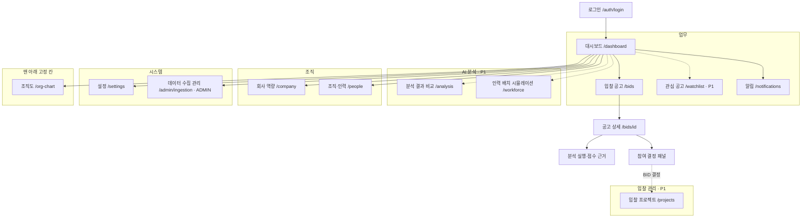

# 06. Next.js 화면 및 UX

> [!tip] 심사 포인트
> 화면은 "정직한 AI" 원칙을 그대로 드러낸다. 모든 가상 데이터에 `DEMO` 배지, Kev 분포 옆에 항상 "수주 확률 아님", 규칙이 Kev를 이기면 그 사실을 배너로 보여 주고, AI가 죽어도 규칙 점수로 화면이 완결된다. 이 문서는 구현자가 추측 없이 옮길 수 있도록 토큰·레이아웃·라우트별 상태·와이어프레임을 고정한다.

## 1. 범위와 원칙

- **데스크톱 전용.** 최소 폭 1280px, 기준 설계 폭 1440px, 1280~1920px 구간만 유동 레이아웃. 모바일·태블릿 레이아웃은 만들지 않는다([[16-DECISIONS|16 ADR]] 범위 제외). 1280px 미만에서는 가로 스크롤을 허용하고 "데스크톱 화면에서 이용하세요" 안내만 띄운다.
- 결제·구독·요금 화면 없음.
- 데이터 밀도 우선: 영업·분석 담당자가 공고 수십 건을 훑는 도구다. 카드보다 표, 장식보다 숫자·배지.
- 상태는 **아이콘 + 텍스트 + 색**을 항상 함께 쓴다. 색만으로 의미를 전달하지 않는다.
- 서버 컴포넌트로 데이터를 읽고, 필터·폼·polling만 클라이언트 컴포넌트. 서버 비밀값은 브라우저 번들에 넣지 않는다([[09-SECURITY|09 보안]]).

## 2. 화면 구조



점선은 [[16-DECISIONS|ADR-021]] P1 화면이다. 구현과 검증 전에는 메뉴에 없다(§4). 조직도(`/org-chart`)는 핵심 업무가 아니어서 묶음 밖, 사이드바 맨 아래 고정 칸에 둔다(§4.1, 2026-10-18 사용자 결정).

## 3. 디자인 토큰

아래 표의 값이 토큰 값의 기준이다. 구현은 템플릿 방식을 따른다: 값을 `design/tokens.json`(디자인 토큰 정본)에 적고 `pnpm tokens`로 `web/app/globals.css`(`:root` CSS 변수 + Tailwind v4 `@theme`)를 생성한다. 생성물은 손으로 고치지 않고, 컴포넌트는 변수(또는 그 변수에 이어진 Tailwind 클래스)만 쓴다. 아래 `--color-*` 이름과 `tokens.json`의 의미 이름(shadcn 체계) 사이의 대응은 Phase 3에서 정한다. 라이트 테마만 P0, 다크는 P1.

### 3.1 색

| 토큰 | 값 | 용도 |
|---|---|---|
| `--color-bg` | `#F7F8FA` | 페이지 배경 |
| `--color-surface` | `#FFFFFF` | 카드·표·패널 |
| `--color-border` | `#E3E6EB` | 구분선·표 테두리 |
| `--color-text` | `#1A1D23` | 본문 |
| `--color-text-muted` | `#5B6472` | 보조 텍스트·레이블 |
| `--color-brand` | `#1F4FD8` | 주 버튼·링크·활성 탭 |
| `--color-brand-soft` | `#E8EEFC` | 선택 행·활성 배경 |
| `--color-success` | `#15803D` | BID, SATISFIED, 완료 |
| `--color-warning` | `#B45309` | WATCH, NEEDS_REVIEW, PARTIAL, 신선도 경고 |
| `--color-danger` | `#B91C1C` | NO-BID, NOT_SATISFIED, FAILED, 오류 |
| `--color-info` | `#1D4ED8` | 진행 중(QUEUED·PROCESSING), 안내 |
| `--color-neutral` | `#6B7280` | NOT_ANALYZED, CANCELLED, 미확인 |
| `--color-demo` | `#7C3AED` | `DEMO` 배지 전용. 다른 의미에 쓰지 않음 |

각 의미색은 `-soft`(배경용 연한 톤) 변형을 가진다. 텍스트 대비는 WCAG AA 4.5:1 이상을 목표로 하고, 구현 시 Playwright axe 검사로 확인한다(값을 바꾸면 검사도 다시).

### 3.2 상태 표기 (아이콘 + 텍스트 병기)

| 상태 | 텍스트 | 아이콘 (lucide) | 색 토큰 |
|---|---|---|---|
| 권고 BID | `BID` | `arrow-up-circle` | success |
| 권고 WATCH | `WATCH` | `eye` | warning |
| 권고 NO-BID | `NO-BID` | `x-octagon` | danger |
| 자격 SATISFIED | `충족` | `check-circle` | success |
| 자격 NEEDS_REVIEW | `확인 필요` | `help-circle` | warning |
| 자격 NOT_SATISFIED | `미충족` | `x-circle` | danger |
| 자격 NOT_APPLICABLE | `해당 없음` | `minus-circle` | neutral |
| 분석 NOT_ANALYZED | `미분석` | `circle-dashed` | neutral |
| 분석 QUEUED / PROCESSING | `대기 중` / `분석 중` | `loader` (회전) | info |
| 분석 COMPLETED | `완료` | `check` | success |
| 분석 PARTIAL | `부분 완료 (규칙만)` | `alert-triangle` | warning |
| 분석 FAILED | `실패` | `alert-octagon` | danger |
| 공고 CANCELLED | `취소됨` | `ban` | neutral |
| 가상 데이터 | `DEMO` | `flask-conical` | demo |
| Kev 의견 상이 | `규칙 우선` | `shield-check` | warning |

### 3.3 타이포·간격·형태

| 토큰 | 값 |
|---|---|
| 글꼴 | `Pretendard Variable`, 대체 `system-ui, -apple-system, "Apple SD Gothic Neo", "Noto Sans KR", sans-serif`. 식별자·금액은 `ui-monospace` |
| 크기/행간 | 페이지 제목 24/32 600, 섹션 제목 18/28 600, 본문 14/20 400, 보조 12/16 400, 큰 숫자(점수) 36/40 700 |
| 간격 | 4px 기반: `4 8 12 16 24 32 48`. 섹션 간 32, 카드 내부 16~24, 표 셀 8×12 |
| 모서리 | 배지 4, 카드·입력 8, 모달 12 |
| 그림자 | 카드 없음(테두리만), 드로어·모달 `0 8px 24px rgba(0,0,0,.12)` |
| 표 | 행 높이 44, 헤더 고정, 숫자 열 우측 정렬, 홀짝 배경 없음(hover만) |
| 애니메이션 | 150ms ease-out. `prefers-reduced-motion`이면 회전 아이콘 제외 전부 끔 |

## 4. 레이아웃 그리드

```text
┌─ Topbar ──────────────────────────────────────────────────────────────────────────────────┐
│ SOL RADAR [DEMO] 솔리데오 │ 실행 모드: mock │ AI: mock │ 수집 12분 전 ● │ 🔔 3 │ 사용자 ▾ │
├──────────┬────────────────────────────────────────────────────────────────────────────────┤
│ Sidebar  │ Content (max 1440, padding 24, 12-col grid, gutter 24)                         │
│ 240px    │                                                                                │
│▾ 업무    │  페이지 제목 ─────────────────────────── [주요 액션]                           │
││대시보드 │  ┌────────────────────────────────┬─────────────────────┐                      │
││입찰 공고│  │ 주 영역 8col                   │ 우측 레일 4col      │                      │
││알림     │  │                                │ (상세에서만, sticky)│                      │
│▾ 조직    │  └────────────────────────────────┴─────────────────────┘                      │
││회사 역량│                                                                                │
││조직·인력│                                                                                │
│▾ 시스템  │                                                                                │
││설정     │                                                                                │
││수집 관리│                                                                                │
│          │                                                                                │
│──────────│                                                                                │
│ 조직도   │                                                                                │
└──────────┴────────────────────────────────────────────────────────────────────────────────┘
```

- 사이드바는 240px 고정, 접으면 64px(아이콘만). 묶음과 메뉴는 트리로 보인다(§4.1). 활성 항목은 `brand-soft` 배경 + 좌측 3px `brand` 바(트리 세로선 자리).
- 사이드바 묶음은 업무·AI 분석·입찰 관리·조직·시스템이다. 그 아래 선으로 나눈 맨 아래 고정 칸에 조직도(`/org-chart`)가 있다. 구현과 검증이 끝난 메뉴만 보인다(노출 조건 5개는 [[16-DECISIONS|ADR-021]]). 메뉴 숨김은 권한이 아니며, 서버가 라우트마다 권한을 따로 검사한다. 미인증은 기존 인증 정책, 미출시 경로 404, 출시 경로에 권한 없음 403이다. 해커톤에는 조건을 채운 업무·조직·시스템 메뉴가 보인다. 그림의 "수집 관리"는 데이터 수집 관리(`/admin/ingestion`, ADMIN만)다. 사용자 메뉴: 설정, 서비스 운영(`/ops`, 운영자만), 로그아웃([[16-DECISIONS|ADR-021]]). Topbar의 회사 이름 "솔리데오"는 고정 표시이고 조직 전환 메뉴가 없다.
- Topbar 우측 순서는 고정: `RunModeIndicator` → `AiModeIndicator` → `DataFreshnessIndicator` → `NotificationBell` → 사용자 메뉴. `DEMO` 배지는 로고 바로 옆, 실행 모드가 `fixture`·`mock`일 때만(`live`에서는 숨긴다. 행 단위 `DEMO` 배지는 모드와 무관하게 `isDemo=true` 레코드에 붙는다).
- `RunModeIndicator`는 `실행 모드: live | fixture | mock`을 표시한다([[16-DECISIONS|ADR-020]]). `live`는 중립 색, `fixture`·`mock`은 warning 색.
- `AiModeIndicator`는 `AI: mock | local | hosted | unavailable` 네 값만 표시한다. 값은 `GET /health/ready`의 `checks.ai`([[14-OBSERVABILITY|14 관측성]])이며 gateway 불가면 `unavailable` + danger 색. 30초 간격 갱신.
- 1280px에서 `/bids` 표의 기본 열이 가로 스크롤 없이 모두 보여야 한다(열 목록은 §5.3).
- 1920px 이상은 콘텐츠를 1440에 가두고 좌우 여백으로 처리한다.

### 4.1 사이드바 트리와 메뉴 아이콘

2026-10-18 사용자 결정이다. 근거와 시안 비교는 [조직도 설계](plans/2026-10-18-org-chart-sidebar-design.md) §4다. 구조(트리·아이콘·고정 칸)는 N1 앱 셸 작업이 만든다([[12-ROADMAP|12 로드맵]]).

- **묶음 줄**: 접기 버튼이다. 접기 화살표(`chevron-down`/`chevron-right`, 16px)와 묶음 이름(작은 회색 굵은 글자)만 두고 아이콘은 없다. `aria-expanded`·`aria-controls`를 단다. 지금 화면이 속한 묶음은 들어올 때 항상 펼친다. 접힘 상태는 보는 사람 브라우저(`localStorage`)에만 두며, 읽기·쓰기가 실패해도 사이드바는 정상으로 보인다.
- **메뉴**: 묶음 화살표 아래 1px 세로선(`border`) 안쪽으로 들여 쓴다. 아이콘 16px + 글자 14px. 링크이며 지금 화면이면 `aria-current="page"`다. 아이콘은 장식(`aria-hidden`)이고 이름은 항상 글자로 보인다.
- **맨 아래 고정 칸**: 위쪽 1px 선으로 메뉴 영역과 나눈다. 묶음 없이 조직도 메뉴 하나다. 메뉴 영역이 길어지면 메뉴 영역만 스크롤되고 고정 칸 자리는 바뀌지 않는다. 사이드바 바닥에 사용자 메뉴가 있으면 그 바로 위다. `/org-chart`가 노출 조건을 채우기 전에는 고정 칸 전체를 숨긴다.
- **접은 상태(64px)**: 묶음 줄을 숨기고 메뉴 아이콘만 세로로 놓는다. 묶음 사이와 고정 칸 위에 짧은 1px 선을 긋는다. 마우스를 올리거나 키보드 초점이 오면 메뉴 이름 툴팁이 뜨고, 링크에는 `aria-label`로 이름을 준다.

| 묶음 | 메뉴 | 경로 | 아이콘 (lucide) | 해커톤 노출 |
|---|---|---|---|---|
| 업무 | 대시보드 | `/dashboard` | `layout-dashboard` | 예 |
| 업무 | 입찰 공고 | `/bids` | `file-text` | 예 |
| 업무 | 관심 공고 | `/watchlist` | `star` | P1 |
| 업무 | 알림 | `/notifications` | `bell` | 예 |
| AI 분석 | 분석 결과 비교 | `/analysis` | `git-compare-arrows` | P1 |
| AI 분석 | 인력 배치 시뮬레이션 | `/workforce` | `users-round` | P1 |
| 입찰 관리 | 입찰 프로젝트 | `/projects` | `folder-kanban` | P1 |
| 조직 | 회사 역량 | `/company` | `award` | 예 |
| 조직 | 조직·인력 | `/people` | `users` | 예 |
| 시스템 | 설정 | `/settings` | `settings` | 예 |
| 시스템 | 데이터 수집 관리 | `/admin/ingestion` | `database` | 예 (ADMIN만) |
| 맨 아래 고정 칸 | 조직도 | `/org-chart` | `network` | 예 |

아이콘 이름은 `web/`에 설치된 `lucide-react` 1.54.0에서 확인했다. React에서는 `LayoutDashboardIcon`처럼 `Icon` 접미사 이름으로 부른다.

## 5. 라우트별 명세

### 5.1 공통 상태 규칙

| 상태 | 표시 | 구현 |
|---|---|---|
| 로딩 | 레이아웃과 같은 형태의 skeleton. 스피너 단독 금지 | `loading.tsx` |
| 빈 상태 | 아이콘 + 한 줄 설명 + 다음 행동 버튼 1개 | 라우트별 §5.2~5.8 |
| 오류 | 제목 "불러오지 못했습니다" + `requestId` + [다시 시도]. 원인 텍스트는 서버가 준 `error.message`만 | `error.tsx` |
| 권한 없음 | 403: "이 화면을 볼 권한이 없습니다" + 현재 역할 표시 + [대시보드로]. 404: 공고·분석이 다른 조직 것이면 404로 통일([[09-SECURITY\|09 보안]]) | 라우트 가드 |
| 신선도 경고 | 마지막 수집 성공이 60분 초과면 Topbar 지표가 warning 색 + "수집 지연" 텍스트 | `DataFreshnessIndicator` |

### 5.2 `/auth/login`

| 항목 | 내용 |
|---|---|
| 섹션 | 중앙 카드 1개: 이메일, 비밀번호, [로그인], 회원가입·비밀번호 찾기 링크. 그 아래 가는 선 뒤에 간편 로그인 버튼(구글·카카오·네이버. `NEXT_PUBLIC_AUTH_*`로 켠 제공자만, [[16-DECISIONS\|16 ADR]] ADR-018). 카드 상단 `DEMO` 배지(데모 모드일 때) |
| 주요 액션 | 로그인(Supabase Auth) → 가입 정보 미완료면 `/auth/complete-profile`, 완료면 멤버십 확인 후 `/dashboard`. 간편 로그인은 제공자 화면을 거쳐 `/auth/callback`으로 돌아온다 |
| 빈/로딩/오류 | 로딩: 버튼 비활성 + 스피너. 오류: 필드 아래 텍스트 "이메일 또는 비밀번호가 올바르지 않습니다"(계정 존재 여부 노출 금지). 시도 제한(Supabase Auth 요청 제한): "잠시 후 다시 시도" |
| 권한 | public. 로그인 상태면 가입 정보 완료 여부를 확인해 `/auth/complete-profile` 또는 업무 진입 경로로 |

### 5.2.1 `/auth/sign-up` (ADR-019, 구현됨)

| 항목 | 내용 |
|---|---|
| 회사 | 솔리데오 고정 표시. 회사 선택·회사 생성 없음 |
| 필수 선택 | 기존 이름 입력 가까이에 `부서`, `직급/직책` 두 select. 원본의 동일 팀명은 한 번만 표시. 목록은 `GET /api/v1/signup-options` |
| 검증 | 최초에는 미선택. 빈 값·목록에 없는 값은 해당 칸 아래 오류를 표시하고 제출 거절. 기존 약관·이메일·비밀번호 검증 유지 |
| 저장 | 이름 + 카탈로그 코드를 Auth 가입 메타데이터로 전송하고 검증된 가입 신고 정보로 영속화. 단순 UI 선택으로 끝내지 않음 |
| 접근성 | label·필수 표기·키보드 선택·오류 연결. 1440px·1280px에서 확인 |

한글 세 글자·남녀 100/100은 가상 명부 생성 규칙이다. 실제 가입자의 이름을 그 규칙으로 제한하거나 가상 직원 이름을 선택하게 하지 않는다. `직급/직책` 선택은 업무 권한 선택이 아니다.

### 5.2.2 `/auth/complete-profile` (ADR-019, 구현됨)

간편 가입 또는 기존 계정의 이름·부서·직급/직책이 미완료면 첫 업무 진입 전에 보완한다. 회사는 솔리데오 고정이며 이름이 이미 있으면 유지하고 두 선택값을 필수로 받는다. 본인 신고 정보 조회/저장 계약은 [[05-API-SPEC]] §8이다. 저장 실패 시 입력을 유지하고 오류와 재시도를 제공한다. 성공 시 서버가 완료 상태를 다시 확인한 뒤 기존 초대·멤버십 정책에 따라 진입한다. 미완료 상태에서 URL 직접 접근으로 업무 화면/API에 들어갈 수 없다. 로그아웃·계정 보완·초대 안내 경로를 허용해 이동 반복을 막는다.

### 5.3 `/dashboard`

| 항목 | 내용 |
|---|---|
| 섹션 | ① 요약 카드 5개(한 줄): BID 권고 N건, 검토 대기 N건, 마감 임박(7일) N건, 수집 카드(마지막 수집 시각 + "적재 N · 격리 N", 값은 `DashboardSummary.dataFreshness.lastIngestSummary`), 분석 현황(공고별 최신 분석 1건 기준 완료·부분·실패 건수, 중복 실행 이중 집계 없음, 값은 `DashboardSummary.analyses.latestByStatus`). 다섯 번째 슬롯은 입찰 프로젝트([[16-DECISIONS\|ADR-021]] P1)가 들어오면 "진행 중 입찰 프로젝트"로 바꾼다. ② "BID 권고" 표(상위 5, 점수순). ③ "마감 임박" 표(마감순). ④ 최근 변경(revision 이벤트 10건) |
| 주요 액션 | 각 행 클릭 → `/bids/[id]`. "전체 보기" → `/bids?decision=…` 필터 적용 링크 |
| 빈 상태 | 공고 0건: "아직 수집된 공고가 없습니다" + [수집 실행](ADMIN만) 또는 "관리자에게 요청". 권고 0건: "BID 권고 공고가 없습니다". 분석 0건: 분석 현황 카드에 0을 보이고 "아직 분석한 공고가 없습니다" |
| 로딩 | 카드 5개 + 표 skeleton |
| 오류 | §5.1 |
| 권한 | 모든 역할 |

### 5.4 `/bids`

| 항목 | 내용 |
|---|---|
| 섹션 | ① `BidFilters`(상단 고정): 검색어, 단계(PLAN/PRE_SPEC/NOTICE), 상태(활성/취소), 발주기관, 예산 범위, 마감 기간, 점수 하한, 권고(BID/WATCH/NO-BID), 결정 여부. ② `BidTable` ③ 커서 페이지네이션 [더 보기] |
| 기본 열 (1280px에서 전부 표시) | `DEMO`칩 · 단계 · 제목(2줄 말줄임) · 발주기관 · 예산 · 마감(D-n) · SOL Score · 권고 · 분석 상태 · 최종 결정 |
| 주요 액션 | 행 클릭 → 상세. 필터는 URL 쿼리에 동기화(공유 가능). 정렬: 점수·마감·수집일 |
| 빈 상태 | 필터 결과 0건: "조건에 맞는 공고가 없습니다" + [필터 초기화]. 전체 0건: 대시보드와 동일 |
| 로딩 | 표 10행 skeleton. 필터 변경 시 표만 갱신 |
| 오류 | §5.1 |
| 권한 | 모든 역할. 점수·권고 열은 분석 결과가 있을 때만 값, 없으면 `미분석` |

### 5.5 `/bids/[id]` (상세)

섹션 순서와 와이어프레임은 §6. 상태 표:

| 항목 | 내용 |
|---|---|
| 주요 액션 | [분석 실행/재실행](ANALYST·SALES·ADMIN), [원문 보기](새 탭, `sourceUrl`), [결정 기록](SALES·ADMIN), 근거 인용 클릭 → `EvidenceDrawer` |
| 빈 상태 | 미분석: 점수 영역에 "아직 분석하지 않았습니다" + [분석 실행]. 근거 0건: 09 고지 문구 그대로 "근거를 확인할 수 없어 INSUFFICIENT_DATA로 표시합니다. 이 항목은 점수에 반영하지 않았습니다."(`FX-04`). 첨부 파싱 실패: "첨부를 읽지 못했습니다. 원문을 직접 확인하세요" + 원문 링크(`FX-05`) |
| 로딩 | 상단 요약은 서버 렌더, 분석 결과는 polling 중 skeleton + `AnalysisStatus` |
| 오류 | 분석 FAILED: 사유 + [재실행]. 403/404는 §5.1 |
| 취소 공고 | 상단에 `취소됨` 배지 + "이 공고는 취소되었습니다. 기존 분석·결정 기록은 보존됩니다". 분석·결정 버튼 비활성(`FX-08`) |
| 권한 | 읽기 모든 역할. VIEWER·ANALYST는 결정 패널이 읽기 전용 + "SALES 이상만 결정할 수 있습니다" |

### 5.6 `/company`

| 항목 | 내용 |
|---|---|
| 섹션 | 탭: 기술 스택 · 보유 자격 · 수행 실적 · 인력 · 선호 설정 · 재무(선택). 상단에 현재 revision과 `effective_at`, [변경 이력]. 인력 탭은 점수 계산 대상 27명·가용 20 FTE 요약과 `/people?scoring=1` 링크다([[16-DECISIONS\|ADR-021]]) |
| 주요 액션 | ADMIN: [편집] → 폼 → [새 revision 저장]. 저장 시 "기존 분석은 이전 revision 기준입니다. 재분석이 필요합니다" 안내 |
| 빈 상태 | 항목 0건: "등록된 기술이 없습니다. 점수 요소 `기술 스택 적합`이 0점으로 계산됩니다" + [추가](ADMIN). 점수 영향을 문장으로 명시([[08-SCORING\|08 SOL Score]] missing 정책) |
| 로딩/오류 | §5.1 |
| 권한 | 읽기 모든 역할. 편집 ADMIN. 비ADMIN에는 편집 버튼 자체를 숨기지 않고 비활성 + 툴팁 "ADMIN만 편집" |

### 5.7 `/notifications`

| 항목 | 내용 |
|---|---|
| 섹션 | 목록(최신순): 유형 아이콘, 제목, 공고명, 시각, 읽음 여부. 필터: 전체/안 읽음/유형 |
| 주요 액션 | 행 클릭 → 읽음 처리 + 공고 상세. [모두 읽음] |
| 빈 상태 | "알림이 없습니다. 공고가 바뀌면 여기에 표시됩니다" |
| 로딩/오류 | §5.1 |
| 권한 | 본인 알림만. 해커톤 범위는 in-app만, 카카오는 mock([[13-NOTIFICATIONS\|13 알림]]) |

### 5.8 `/admin/ingestion`

| 항목 | 내용 |
|---|---|
| 섹션 | ① 소스별 카드: 마지막 성공·실패 시각, 적재 건수, 격리 건수. ② 실행 이력 표: run id, 배치, 상태, 시작/종료, 처리/격리/재시도 수. ③ 격리 오류 표: fixture/소스 키, 오류 코드, 민감정보 제거된 상세(`FX-12`). ④ 재시도 로그(429 대기 포함, `FX-20`). 각 실행의 데이터 출처(`source`)·실행 모드(`run_mode`), 마지막 수집 시각([[16-DECISIONS\|ADR-021]]) |
| 주요 액션 | [수동 수집 실행] → 배치 선택(`seed`/`live`, 데모 모드) + `Idempotency-Key` 자동 → 202 → 이력 표 polling |
| 빈 상태 | 실행 이력 0건: "아직 수집을 실행하지 않았습니다" + [수동 수집 실행]. 기록이 없는 항목은 빈 상태로 두고 임의 값을 보이지 않는다 |
| 로딩/오류 | §5.1. 실행 중 버튼 비활성 + "실행 중 (run id)" |
| 권한 | ADMIN만. 그 외 403. 서버 가드 + RLS로 거부한다(메뉴 숨김만으로 막지 않는다) |

### 5.9 `/people` (ADR-021, 구현 예정)

| 항목 | 내용 |
|---|---|
| 섹션 | ① 명부 표: 사진, 이름, 부서, 직급/직책, 점수 계산 대상 여부. ② 검색·필터: 이름·부서·직급/직책·점수 계산 대상. ③ 개인 상세 서랍(`PersonDrawer`): 사진·부서·직급/직책, 점수 계산 대상이면 직무·등급·스킬·가용성. 조직도는 이 화면에 두지 않고 §5.9.1 `/org-chart`로 따로 둔다(2026-10-18 사용자 결정). 명부/조직도 전환은 없고, `view` 쿼리가 와도 무시하고 명부를 보인다 |
| 주요 액션 | 행 클릭 → 개인 상세. 필터는 URL 쿼리와 동기화(`/people?scoring=1` 등) |
| 빈 상태 | seed 전: "등록된 인력이 없습니다" |
| 누락 처리 | 사진이 없으면 이니셜로 대신한다. 오류 화면이 아니다 |
| 표시 | 점수 계산 대상 배지(27명), "가상 인물" `DEMO` 배지. 연락처 칸은 없다 |
| 권한 | 조회는 모든 역할. 편집(추가·이동·퇴사)은 ADMIN이고 P1이다 |

### 5.9.1 `/org-chart` (2026-10-18 사용자 결정, 구현 예정)

사이드바 맨 아래 고정 칸의 "조직도"가 여는 화면이다(§4.1). 두 칸 탐색기로, 왼쪽은 부서 트리, 오른쪽은 고른 팀의 사진 카드다. 레이아웃 그림·상태표·결정 근거는 [조직도 설계](plans/2026-10-18-org-chart-sidebar-design.md) §5다. ADR-021 데모 필수 N4a(조직·인력 조회)에 속한다.

| 항목 | 내용 |
|---|---|
| 섹션 | ① 머리: `h1` "조직도", `DEMO · 가상 인물` 표시, `전체 N명 · 본부 N · 그룹 N · 팀 N`(읽은 자료에서 센다), 오른쪽에 "이름으로 찾기". ② 왼쪽 부서 트리(약 300px, 길면 이 칸만 스크롤): "본부" 구역과 "상위 미지정" 구역. ③ 오른쪽 팀 칸: 상위 경로, 팀 이름 · `N명`(`targetCount`가 있으면 ` · 목표 N명`), 사진 카드 격자(사진 44px·이름·직급/직책·점수 계산 대상 표시). 1440에서 약 4열, 1280에서 약 3열이며 가로 넘침이 없다 |
| 부서 트리 | 실제 `parentId` 연결만 따른다. 본부 바로 아래 팀에 그룹을 끼우지 않는다. **본부** 구역은 `kind=DIVISION`·`parentId=null`인 본부를 소속 인원이 많은 순(같으면 부서 코드 순)으로 놓고, 팀·그룹은 부서 코드 순이다. 팀이 없는 본부는 "연결된 팀 없음". **상위 미지정** 구역은 본부가 아니면서 `parentId=null`인 부서이고, 안내 "자료에서 상위 부서가 확인되지 않은 부서입니다."와 함께 "그룹 N개"·"팀 N개"로 나눈다. 구역·묶음 이름은 화면용이며 DB 부서가 아니다. 상위 미지정은 정보 안내라 warning·danger 색을 쓰지 않는다. 부서 이름은 자료 그대로 보인다 |
| 인원 수 | 팀은 재직자 수. 본부·그룹·구역은 하위 팀 재직자의 직원 ID를 중복 없이 센 수. 본부·그룹에는 목표 인원이 없다. 현재 seed 기준 본부 6개 합 81명, 상위 미지정 29개 부서 · 119명 |
| 주요 액션 | 본부·그룹·묶음 줄은 펼치고 접기만 한다. 팀 줄을 누르면 오른쪽에 그 팀이 열리고 URL `?team=<departmentId>`와 맞춘다. 처음 열면 첫 본부를 펼치고 첫 팀을 고른다. 카드를 누르거나 Enter·Space로 `PersonDrawer`를 연다. 이름으로 찾기(combobox, 후보는 이름·팀·직급 최대 8개)에서 고르면 그 팀까지 펼쳐 고르고 그 카드로 초점을 옮긴다 |
| 카드 순서 | 직급 카탈로그 순서, 같은 직급은 이름 가나다순 |
| 빈 상태 | 부서·인력 0: "등록된 조직·인력이 없습니다". 팀 0명: "소속 인력이 없습니다". 찾기 결과 0: "일치하는 이름이 없습니다" |
| 누락 처리 | 없는 `team` 값·다른 조직 값은 무시하고 기본 선택. 사진이 없거나 못 읽으면 이름 첫 글자. 모두 오류 화면이 아니다 |
| 오류 | §5.1. "조직도를 불러오지 못했습니다" + [다시 시도]. 일부만 읽힌 숫자는 보이지 않는다 |
| 표시 | 점수 계산 대상 표시(27명), `DEMO · 가상 인물`. 연락처·성별·내부 ID는 보이지 않는다. 점수 속성은 서랍에서만 보인다 |
| 권한 | 조회는 모든 역할(ADMIN·SALES·ANALYST·VIEWER). 서버가 현재 조직을 정하고 다른 조직은 RLS로 0행이다. 편집 없음 |
| 데이터 | 서버 컴포넌트가 `@/server/people` 서비스로 현재 조직의 부서·명부 전체를 한 번에 읽는다. 새 Route Handler를 만들지 않는다 |

### 5.10 `/settings` (ADR-021, 구현 예정)

| 탭 | 내용 | 권한 |
|---|---|---|
| 개인 | 이름·부서/직급 신고 정보(ADR-019 보완 흐름과 같은 검증), 비밀번호·로그인 수단, 계정 삭제(템플릿 기능 재사용) | 본인 |
| 조직 | 구성원 목록, 초대, 업무 역할(`sol_role`) 변경과 감사 기록 | ADMIN. 그 외 403(서버 가드 + RLS) |

회사 선호 설정은 `/company`가 맡는다. 개인 알림 수신 설정은 해커톤 이후다.

### 5.11 현재 조직과 계정 상태 (ADR-021, 구현 예정)

현재 조직은 서버가 정한다. 화면에 조직 전환 메뉴가 없다.

| 업무 조직 멤버십 | 화면 |
|---|---|
| 0개 | 조직 초대 안내 화면. 받은 초대 목록 링크를 보인다(문구는 구현 때 정한다). 업무 화면은 열지 않는다 |
| 1개 | 그 조직으로 들어간다 |
| 2개 이상 | "지원되지 않는 계정 상태입니다. 관리자에게 문의하세요". 업무 API는 `403 UNSUPPORTED_ACCOUNT_STATE` |

### 5.12 P1 화면 (ADR-021)

아래 화면은 [[12-ROADMAP|12 로드맵]] "있으면 좋음" 최상단이다. 데모 필수가 모두 끝난 뒤 착수하고, 구현과 검증 전에는 메뉴에 없다. 화면별 책임은 [사이드바 정보 구조 설계](plans/2026-10-16-sidebar-ia-design.md) §2.2다.

| 경로 | 화면 | 요지 |
|---|---|---|
| `/watchlist` | 관심 공고 | 내 관심 공고만 미리 거른 공고 표. `/bids`와 같은 `BidTable`·`BidFilters`를 쓴다 |
| `/analysis` | 분석 결과 비교 | 조직의 분석 이력과 2~4건 비교. 분석 실행은 `/bids/[id]`에서만 |
| `/projects` | 입찰 프로젝트 | BID 결정 이후 업무(담당자·체크리스트·제출 마감·상태·결과 기록) |
| `/workforce` | 인력 배치 시뮬레이션 | 점수 계산 대상 27명 안의 규칙 매칭 후보와 기간 충돌. 저장하지 않는다 |

## 6. `/bids/[id]` 와이어프레임 (1440px)

```text
┌─ Topbar ──────────────────────────────────────────────────────────────────────────────┐
│ SOL RADAR [DEMO]  솔리데오  실행 모드: mock  AI: mock  수집 12분 전 ●  🔔 3  김영업 ▾    │
├─ Sidebar ─┬─ Content ──────────────────────────────────────────────────────────────────┤
│▾ 업무     │ ← 공고 목록                                                                │
││대시보드  │ [DEMO] [NOTICE] 세종특별자치시 차세대 행정정보시스템 고도화 (가상)            │
│┃입찰 공고 │ 발주기관 세종특별자치시 · 예산 1,200,000,000원 · 마감 2026-11-06 (D-21)      │
││알림      │ 공고번호 DEMO-2026-0001 · revision 1 · 수집 2026-10-16 09:12 KST            │
│▾ 조직     │ [원문 보기 ↗]  [분석 재실행]                     분석 완료 ✓ 2026-10-16 09:15 │
││회사 역량 ├──────────────────────────────────────────┬─────────────────────────────────┤
││조직·인력 │ ■ 단계 이력 (StageTimeline)              │ ■ 결정 패널 (DecisionPanel)     │
│▾ 시스템   │ ○ 발주계획 — · ○ 사전규격 — · ● 공고 r1  │ 권고: ▲ BID                     │
││설정      │                                          │ SOL Score 94 / 100              │
││수집 관리 │ ■ 필수자격 체크리스트                     │ ─────────────────────────────  │
│           │ ✓ 충족  소프트웨어사업자 신고   근거 p.3  │ 최종 결정                       │
│           │ ✓ 충족  직접생산확인증명        근거 p.3  │ (●) BID  ( ) WATCH  ( ) NO-BID │
│           │ ✓ 충족  중소기업 제한경쟁       근거 p.2  │ 사유 [________________________]│
│           │                                          │ 담당자 [김영업 ▾]               │
│           │ ■ SOL Score 분해 (ScoreFactors)          │ [결정 기록]                     │
│           │ 기술 스택 적합   ████████░░ 24.0 / 30     │ 마지막 결정: BID · 김영업       │
│           │ 유사 수행 실적   ██████████ 25.0 / 25     │ ─────────────────────────────  │
│           │ 인력 가용성      ██████████ 20.0 / 20     │ 검토 의견 (P1, 비활성)          │
│           │ 규모 적합성      ██████████ 15.0 / 15     │                                 │
│           │ 전략적 선호      ██████████ 10.0 / 10     │                                 │
│           │ 알고리즘 sol-v0.1.0 · 프로필 rev 2        │                                 │
│           │                                          │                                 │
│           │ ■ Kev 참고 지표                           │                                 │
│           │ 모델 선택지 신뢰 분포 (충족·수주 확률 아님)│                                 │
│           │ BID 71% · WATCH 24% · NO-BID 5%           │                                 │
│           │ 낙찰 확률 아님 · 규칙 판정을 뒤집지 않음   │                                 │
│           │ kev-9b · kev-qs/v0.1 · mock · 규칙과 일치  │                                 │
│           │                                          │                                 │
│           │ ■ 근거 인용 (EvidenceDrawer 트리거)        │                                 │
│           │ "요구기술: Java, Spring Boot…"  p.4 [열기] │                                 │
│───────────│ "중소기업 제한경쟁…"             p.2 [열기] │                                 │
│ 조직도    │ 근거 3건 · 원문 대조 검증 통과             │                                 │
└───────────┴──────────────────────────────────────────┴─────────────────────────────────┘
```

섹션 순서는 고정이다: 상단 요약 → 단계 이력 → 필수자격 체크리스트 → 점수 분해 → Kev 참고 지표 → 근거 인용. Kev 참고 지표는 점수에 반영하지 않는다는 점을 섹션 안에 항상 적는다([[08-SCORING|08 점수]], [[16-DECISIONS|ADR-020]]).

`kev-qs/v0.2`(실모델 `live`·`fixture` 모드)에서는 Kev 참고 지표 섹션이 아래를 더 보여 준다. 시각 표현은 구현 전 `web-designer` 디자인 스펙으로 정한다.
- 요구사항 항목별 3값 분포(충족·미충족·확인 필요)와 규칙 판정 나란히. 다르면 `KEV_REQUIREMENT_DISAGREEMENT` 배지
- `techFit`·`perfRelevance` 등급, `risk.*` 리스크 목록(`KEV_DELIVERY_RISK`)
- 보정 상태 태그 `미보정`/`보정됨(데이터셋 버전)`
- 항목을 누르면 그 판단에 쓰인 state 줄과 공고 인용·회사 증빙(`KevStateTrace`)을 근거 서랍에 연다

상단 요약에는 모든 실행 모드에서 "가상 회사 프로필로 분석" 배지를 붙인다(회사 프로필은 언제나 가상 솔리데오 프로필이다. `live` 공고면 "실제 공고 × 가상 회사 프로필"). 우측 레일(결정 패널)은 sticky. 숫자는 [[08-SCORING|08 SOL Score]] §6.2 Example A(`FX-01`)와 같다. Kev 섹션 하단에는 [[09-SECURITY|09 보안]] "모델 한계 고지 문구"의 Kev 블록 3줄이 그대로 들어간다(와이어프레임에는 지면상 요약).

상태별 변형:

| 상황 | 변형 |
|---|---|
| `PARTIAL` (AI 불가) | 상단 요약 아래 warning 배너, 문구는 [[09-SECURITY\|09 보안]] 고지 그대로: "AI 분석을 사용할 수 없어 규칙 기반 점수와 자격 판정만 표시합니다. (상태: PARTIAL)". 배너 우측에 `recommendationBasis: RULES_ONLY`와 `errorCode`(예 `AI_UNAVAILABLE`). Kev 섹션은 "사용 불가". Topbar `AI: unavailable` |
| Kev 상이 (`MODEL_RULE_DISAGREEMENT`) | Kev 섹션에 `규칙 우선` 배지 + "Kev는 BID를 제시했지만 필수자격 미충족으로 규칙 판정이 우선합니다"(`FX-03`). 결정 패널 상단 "사람 검토 권장" |
| 자격 `NEEDS_REVIEW` | 체크리스트 행 warning + "확인 필요". 근거가 없으면 09 문구 "근거를 확인할 수 없어 INSUFFICIENT_DATA로 표시합니다. 이 항목은 점수에 반영하지 않았습니다." 권고 WATCH |
| `missingFactors` | 해당 요소 행 회색 바 + `미확인` 배지 + 툴팁 사유(`FX-11`) |
| 첨부 파싱 실패 | 근거 섹션에 danger 배지 "첨부 원문 확인" + 원문 링크(`FX-05`). 사유(`UNSUPPORTED_FORMAT`·`NO_TEXT_LAYER`·`ENCRYPTED`·`DISTRIBUTION_PROTECTED` 등)를 툴팁으로 |
| 첨부 다운로드 실패 | 근거 섹션에 danger 배지 `DOCUMENT_DOWNLOAD_FAILED` "첨부를 내려받지 못했습니다" + 원문 링크. 파싱 실패와 다른 배지 |
| 부분 파싱 (`PARTIAL`) | 해당 첨부에 warning 배지 "일부만 읽음". 근거 없는 항목은 확인 필요 |
| Qwen 미접속 / Kev 미접속 | 각각 다른 문구: Qwen 불가는 `PARTIAL` 배너(위), Kev 불가는 Kev 섹션 "사용 불가 (Kev 서버 미접속)" + `RULES_ONLY` |
| mock 자동 대체 (`MOCK_FALLBACK`) | 상단 danger 배너 "모델 서버에 연결하지 못해 Mock 결과를 표시합니다. (실제 모델 결과 아님)". `AI_FALLBACK_TO_MOCK=true`일 때만 생기고 `live` 모드에서는 생기지 않는다 |
| 취소 | §5.5 |

## 7. 분석 상태와 polling

```text
NOT_ANALYZED → QUEUED → PROCESSING → COMPLETED
                                   → PARTIAL   (AI 불가, 규칙만)
                                   → FAILED    (규칙도 실패, 사유 코드)
```

- [분석 실행] → `POST /bids/:id/analyses` 202 → `pollUrl`을 2초 간격으로 60초, 이후 5초 간격으로 최대 5분. 종료 상태(`COMPLETED|PARTIAL|FAILED`)에서 중단.
- 5분 초과: "분석이 지연되고 있습니다" + [새로고침]. 자동 polling 중단(큐 적체 시 브라우저 부하 방지).
- 상태 변화는 `aria-live="polite"` 영역으로 읽어 준다.
- 분석 결과에는 항상 `createdAt`, `algorithmVersion`, 프로필 revision, Kev 모델 식별자(또는 `mock`)를 표시한다.

## 8. 데모 친화 요소

| 요소 | 위치 | 동작 |
|---|---|---|
| `DEMO` 배지 | Topbar 로고 옆, 목록 각 행, 상세 제목 앞, 로그인 카드 | 행·상세는 `isDemo=true` 레코드에, Topbar·로그인 카드는 실행 모드가 `fixture`·`mock`일 때 표시. 툴팁은 09 문구 그대로: "이 데이터는 데모용 가상 공고입니다. 실제 입찰 공고가 아닙니다." |
| `RunModeIndicator` | Topbar | `실행 모드: live \| fixture \| mock`. `/health/ready` 응답의 실행 모드 값 |
| 가상 회사 프로필 배지 | 상세 상단 요약 | 모든 분석에 "가상 회사 프로필로 분석". 툴팁 "실제 공고를 가상 솔리데오 프로필과 대조한 결과입니다" |
| 공고 출처 필터 | `/bids` 필터 바 | `origin=live\|demo\|all`(기본: `live` 모드 `live`, `fixture`·`mock` 모드 `demo`) |
| `AiModeIndicator` | Topbar | `AI: mock \| local \| hosted \| unavailable`. `/health/ready` `checks.ai` 값. `unavailable`이면 danger 색 + 툴팁 "AI gateway에 연결할 수 없습니다" |
| `DataFreshnessIndicator` | Topbar | 마지막 수집 성공 시각 상대 표시("12분 전"). 60분 초과 warning, 수집 실패 시 danger + 관리자 링크 |
| `AnalysisStatus` | 상세·목록 | §7 상태 + 실시간 polling |
| AI 불가 배너 | 상세 상단, 대시보드 상단 | `analysis.status=PARTIAL` 또는 `/health/ready` `status: degraded`일 때. 문구는 09 고지 그대로: "AI 분석을 사용할 수 없어 규칙 기반 점수와 자격 판정만 표시합니다. (상태: PARTIAL)" + `recommendationBasis: RULES_ONLY` |
| Kev 섹션 제목·고지 | Kev 섹션 | 섹션 이름은 "Kev 참고 지표", 분포 제목은 "모델 선택지 신뢰 분포 (충족·수주 확률 아님)" 고정. 점수 미반영 문구 필수. 본문 하단에 09 "모델 한계 고지 문구" Kev 블록 3줄을 그대로. `{kevModel}`·`{questionSetVersion}`은 `AnalysisResult.kev.model`·`kev.questionSetVersion`으로 치환. 둘 다 생략 금지 |
| 변경 diff | 상세 단계 이력 → revision 클릭 | 예산·마감·자격·첨부 변경 전/후 나란히(`FX-06`, `FX-07`) |

## 9. 컴포넌트

| 컴포넌트 | 쓰는 곳 | 핵심 props / 상태 |
|---|---|---|
| `BidFilters` | `/bids` | URL 쿼리 ↔ 상태 동기화, [초기화] |
| `BidTable` | `/bids`, 대시보드 | `items`, `sort`, 행 클릭, 열 고정 세트 |
| `StageTimeline` | 상세 | `stages[]`(PLAN/PRE_SPEC/NOTICE 각 상태·revision), 연결 후보 표시(`FX-19`) |
| `ScoreGauge` | 상세 우측, 목록 셀 | `score`, `max=100`, 숫자 항상 텍스트로 |
| `ScoreFactors` | 상세 | `factors[]`, `missingFactors[]`, 행별 툴팁 |
| `QualificationChecklist` | 상세 | `checks[]`, 각 행 근거 링크 |
| `EvidenceDrawer` | 상세 (우측 슬라이드) | `evidence`, 원문 하이라이트, 페이지·좌표, [원문 열기]. Esc로 닫힘 |
| `KevOpinion` | 상세 | `probabilities`, `mandatoryRisk`, `needsHumanReview`, `fit`, `enabled`, `reviewFlags`, 09 고지 문구 |
| `AiModeIndicator` | Topbar | `checks.ai` 값 4종, 30초 polling |
| `DecisionPanel` | 상세 우측 | `recommendation`, `lastReview`, 역할별 활성/읽기 전용 |
| `AnalysisStatus` | 상세·목록 | §7 상태 머신 + polling |
| `NotificationBell` | Topbar | 안 읽음 수, 드롭다운 5건, [모두 보기] |
| `DataFreshnessIndicator` | Topbar | §8 |
| `DemoBadge` | 여러 곳 | 툴팁은 09 DEMO 문구 |
| `AiUnavailableBanner` | 상세·대시보드 | 09 AI 불가 문구 + `recommendationBasis` + `errorCode` |
| `SidebarNav` | 사이드바 | 묶음 트리(접기·`aria-expanded`), 메뉴 아이콘, 맨 아래 고정 칸 조직도, 64px 접은 상태 툴팁(§4.1) |
| `OrgChart` | `/org-chart` | 두 칸 탐색기. 왼쪽 부서 트리("본부"·"상위 미지정" 구역, 부서별 표시 인원), 오른쪽 고른 팀의 사진 카드, 이름으로 찾기(§5.9.1, [[16-DECISIONS\|ADR-021]]) |
| `PersonDrawer` | `/people`·`/org-chart` (우측 서랍) | 개인 상세. 사진 없으면 이니셜, 점수 계산 대상이면 직무·등급·스킬·가용성. Esc로 닫힘 |
| `DashboardCardSlots` | 대시보드 | 요약 카드 슬롯 정의 한 곳(슬롯 5개, 다섯 번째는 분석 현황 → P1 입찰 프로젝트로 교체) |

## 10. 접근성

- WCAG 2.1 AA 목표. 모든 상태는 아이콘 + 텍스트 병기(§3.2).
- 키보드: skip link, 표 행 `Enter`로 열기, 드로어·모달 포커스 트랩과 `Esc`, 필터 폼 `Tab` 순서 = 시각 순서.
- `aria-label`은 한국어, `html[lang="ko"]`. 아이콘 단독 버튼에 레이블 필수.
- 오류·상태 변경은 `aria-live`. 점수 바는 `role="meter"` + `aria-valuenow`.
- 색 대비 AA, 포커스 링 2px `brand` 항상 보임, `prefers-reduced-motion` 존중.
- 검사: Playwright + axe를 E2E에 포함([[11-TESTING|11 테스트]]). 위반 0건이 통과 조건.

## 11. 구현 메모

- App Router. 서버 컴포넌트는 `web/server/<도메인>`의 service를 배럴(`@/server/<도메인>`)로 직접 불러 데이터를 읽는다(사용자 세션으로 DB를 불러 RLS 적용). 클라이언트 컴포넌트는 필터·폼·polling만 담당하고, polling(`pollUrl`)과 변경 요청은 `/api/v1` Route Handler(세션 쿠키 + `X-Requested-With: sol-radar`) 또는 Server Action으로 한다([[05-API-SPEC|05 API]] §1).
- 인증은 Supabase Auth 세션 쿠키(`@supabase/ssr`)다. 이 쿠키는 HttpOnly가 아니므로 XSS 방어(CSP nonce, `dangerouslySetInnerHTML` 금지)를 지킨다([[09-SECURITY|09 보안]] 인증). Route Handler·Server Action은 인증·CSRF·zod 검증·오류 변환만 하고 업무 로직은 `web/server/<도메인>`에 둔다([[02-ARCHITECTURE|02 아키텍처]]).
- 클라이언트 상태는 zustand, 입력 검증은 zod를 쓴다([[16-DECISIONS|ADR-016]]). 여러 클라이언트 컴포넌트가 함께 쓰는 UI 상태(예: `EvidenceDrawer` 열림과 선택한 근거)만 zustand store에 둔다. 서버 데이터는 store에 복사하지 않고, `BidFilters` 필터 값은 URL 쿼리가 정본이라 store에 두지 않는다. 폼은 react-hook-form + zod로 검증하고, 같은 zod 스키마로 서버(Route Handler·Server Action)가 다시 검증한다([[05-API-SPEC|05 API]] §7).
- 라우트마다 `loading.tsx`, `error.tsx`, `not-found.tsx`.
- 금액은 서버에서 문자열로 받아 `Intl.NumberFormat('ko-KR')`로 표시. 시각은 UTC 저장값을 KST로 변환해 표시하고 툴팁에 UTC 원값.
- 스타일 토큰은 템플릿 방식(`design/tokens.json` → `pnpm tokens` → `web/app/globals.css`, Tailwind v4)을 쓴다. 토큰 값은 §3 표를 기준으로 `design/tokens.json`에 적고, 색·글꼴·글자 눈금을 다른 곳에 직접 쓰지 않는다. Tailwind v4·Next.js 16 세부는 Phase 3 시작 시 설치된 버전 문서(`web/node_modules/next/dist/docs/` 등)를 읽고 따른다.

## 12. 증거 스크린샷 상태명

[[17-CLAUDE-IMPLEMENTATION|17 구현 규칙]]의 파일명 규칙 `YYYYMMDD-phaseN-<route>-<state>-<width>.png`를 따른다. `state`는 아래 7개만 쓴다. `width`는 1440(기준)과 1280(최소) 두 가지를 찍는다.

| state | 뜻 | 찍는 라우트 (최소) |
|---|---|---|
| `loaded` | 정상 데이터 표시 | `bids-list`, `bid-detail`, `dashboard`, `company`, `notifications`, `admin-ingestion`, `people`, `org-chart`, `settings` |
| `empty` | 빈 상태 (§5) | `bids-list`(필터 0건), `notifications`, `admin-ingestion`(실행 이력 0건) |
| `loading` | skeleton | `bid-detail`(분석 polling 중) |
| `error` | 오류 화면 + `requestId` | `bid-detail` |
| `forbidden` | 403/404 | `admin-ingestion`(VIEWER), `bid-detail`(`org-02`), `settings-org`(VIEWER), `ops`(조직 ADMIN, 404) |
| `partial` | AI 불가 배너 + `RULES_ONLY` | `bid-detail`(`FX-01`), `dashboard` |
| `demo-badge` | `DEMO` 배지·툴팁 클로즈업 | `bids-list`, `login` |

예: `20261020-phase3-bid-detail-partial-1440.png`. 저장 위치와 목록은 [[11-TESTING|11 테스트]] §6.

## 관련 문서

- [[05-API-SPEC|05 API]] — 화면이 소비하는 DTO·오류 코드
- [[08-SCORING|08 SOL Score]] — 점수 분해·missing 배지·Kev 상이 처리
- [[07-DATA-PIPELINE|07 수집]] — 화면 상태를 재현하는 fixture `FX-01`~`FX-20`
- [[13-NOTIFICATIONS|13 알림]] — 알림 유형·읽음 처리
- [[09-SECURITY|09 보안]] — 403/404 정책, Supabase Auth 세션, 모델 한계 고지 문구(원문)
- [[17-CLAUDE-IMPLEMENTATION|17 구현 규칙]] — 스크린샷 파일명 규칙
- [[11-TESTING|11 테스트]] — E2E·a11y 검사, 데모 수용 체크리스트
- [[19-DEMO-SCENARIO|19 데모 시나리오]] — 클릭 경로
