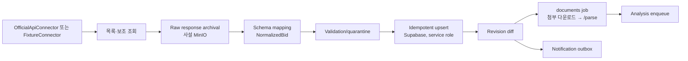

# 07. 조달청 데이터 수집

> [!tip] 심사 포인트
> "진짜 동작하는가"와 "어디까지가 mock인가"에 답하는 문서다. 해커톤 MVP의 목표는 `live` 모드에서 나라장터 공식 Open API(data.go.kr)로 **실제 공고와 RFP 첨부를 수집·파싱**하는 것이다([[16-DECISIONS|ADR-020]]). fixture 20건(`FX-01`~`FX-20`)은 지우지 않고 `fixture`·`mock` 모드와 CI·골든 시험에 쓴다. 공고마다 출처(`source`·`is_demo`)가, 수집마다 실행 모드(`ingest_runs.run_mode`)가 남고 화면에 보인다. 공공 API 실패·첨부 다운로드 불가·파싱 실패는 서로 섞지 않고 따로 기록하며, 읽지 못한 내용을 AI가 추측해 채우지 않는다(§2.6).

## 1. 데이터 소스

발주계획(`PLAN`), 사전규격(`PRE_SPEC`), 입찰공고(`NOTICE`)가 P0. 계약과정 통합공개·낙찰·계약정보는 후속이다. 낙찰 결과는 학습 목표로도 쓰지 않는다([[21-MODEL-TRAINING|21 모델 학습]]).

해커톤 MVP는 `live` 모드의 실수집을 목표로 한다. 수집 대상은 입찰공고 중 **용역이면서 정보화사업(`infoBizYn='Y'`)** 인 공고다. 사전규격·발주계획은 단계 연결(§4)에 쓴다. fixture 20건은 `fixture`·`mock` 모드와 CI에서 그대로 쓴다(§1.2, §6).



### 1.1 사용할 서비스

| 단계 | 서비스 (ID) | 기본 URL | 쓰는 오퍼레이션 | 해커톤 |
|---|---|---|---|---|
| `NOTICE` | 입찰공고정보서비스 (15129394) | `http://apis.data.go.kr/1230000/ad/BidPublicInfoService` | `getBidPblancListInfoServc`(용역 목록), `getBidPblancListInfoChgHstryServc`(변경이력), `getBidPblancListInfoLicenseLimit`(면허제한), `getBidPblancListInfoPrtcptPsblRgn`(참가가능지역), `getBidPblancListInfoEorderAtchFileInfo`(e발주 첨부·제안요청서) | P0 |
| `PRE_SPEC` | 사전규격정보서비스 (15129437) | `/1230000/ao/HrcspSsstndrdInfoService` | `getPublicPrcureThngInfoServc`(용역), `getPublicPrcureThngInfoServcPPSSrch`(`swBizObjYn` 필터) | P0 (P0-8) |
| `PLAN` | 발주계획현황서비스 (15129462) | `/1230000/ao/OrderPlanSttusService` | `getOrderPlanSttusListServc` | P0 (P0-8) |
| 코드 마스터 | 업종 및 근거법규 (15129467) | `/1230000/ao/IndstrytyBaseLawrgltInfoService` | `getIndstrytyBaseLawrgltInfoList`(전체 업종 코드·명·근거법) | P0 (한 번 받아 사전으로 저장) |
| 단계 연결 보조 | 계약과정통합공개 (15129459) | — | `getCntrctProcssIntgOpenServc` | 후속 (평가셋 사업 묶기에 선택 사용) |
| 후속 | 낙찰정보 (15129397), 계약정보 (15129427), 사용자정보 (15129466) | — | — | 해커톤 밖. 낙찰은 학습 목표 아님 |

registry 키(`g2b-bid-notice` 등 8개)와 호출 시점은 [[15-DATA-CONTRACTS|15 데이터 계약]] §8에 등록한다.

> [!success] 검증됨 (2026-10-16, data.go.kr 서비스 페이지 Swagger·참고문서 — 명세 확인, 실제 응답 미수신)
> 위 서비스 ID·기본 URL·오퍼레이션과 §2.2·§3.1의 요청 파라미터·응답 필드 이름은 각 서비스 페이지의 명세에서 확인했다. 무료이고 개발·운영 계정 모두 자동승인이며, 개발계정 호출 한도는 서비스마다 1,000이다(사용자정보·개방표준은 10,000). **서비스키로 실제 응답을 받아 본 것은 아니다.**
> - 입찰공고정보서비스: https://www.data.go.kr/data/15129394/openapi.do
> - 사전규격정보서비스: https://www.data.go.kr/data/15129437/openapi.do
> - 발주계획현황서비스: https://www.data.go.kr/data/15129462/openapi.do
> - 업종 및 근거법규: https://www.data.go.kr/data/15129467/openapi.do

> [!warning] 미검증 가정
> 서비스키로 받은 실제 응답, 조회 기간 상한, `infoBizYn`을 요청 파라미터로 거를 수 있는지, 면허제한이 여러 행일 때 AND/OR 중 무엇인지는 확인하지 않았다([[16-DECISIONS|16 ADR]] 미결정 1·19번). 확인되지 않은 엔드포인트를 만들어 호출하지 않는다. 검증 방법: 서비스키 발급(사용자 작업) → ADR-020 P0-0에서 오퍼레이션별 실제 응답 3건 저장 → §3.1 매핑표 대조 → `infra/sources/registry.yaml`([[15-DATA-CONTRACTS|15 데이터 계약]] §8)과 16 미결정 1번 갱신.

### 1.2 실행 모드와 출처 기록

실행 모드는 env `SOL_RUN_MODE=live|fixture|mock` 하나로 고른다. 기본은 `mock`이다(CI·테스트·골든). 모드 전체 표와 AI 쪽 동작은 [[03-AI-PIPELINE|03 AI 파이프라인]]이 정본이고, 여기서는 수집 쪽만 적는다.

| 모드 | 공고 Connector | 첨부 | 새로 적재되는 공고의 `source` / `is_demo` | 용도 |
|---|---|---|---|---|
| `live` | `OfficialApiConnector`(data.go.kr) | `G2bAttachmentFetcher` | `g2b-bid-notice`·`g2b-pre-spec`·`g2b-order-plan` / `false` | 실운영·실데이터 시연 |
| `fixture` | `FixtureConnector`(fixture 20건) | `FixtureAttachmentFetcher` | `fixture` / `true` | 공공 API 장애 시 시연. AI는 실모델 그대로 |
| `mock` | `FixtureConnector` | `FixtureAttachmentFetcher` | `fixture` / `true` | 모델 장애 시 시연, CI, 골든 |

- live 공고와 fixture 공고는 같은 DB에 함께 있을 수 있다. 공고는 `source`와 `is_demo`로 구분하고, 공고 목록은 `origin=live|demo|all`로 거른다([[05-API-SPEC|05 API]]). `is_demo=true` 공고에는 `DEMO` 배지가 붙는다.
- 수집 run마다 `ingest_runs.run_mode`·`source`·`quota_used`를 남긴다([[04-DATABASE|04 DB]]). 분석 run의 모드 기록(`score_runs.run_mode` 등)은 03·04.
- `SOL_RUN_MODE`가 `DEMO_MODE`·`AI_PROVIDER`·`KEV_ENABLED`의 기본값을 정한다. 값을 직접 줬는데 모드와 모순되면 `pnpm check:env`와 gateway가 기동을 거부한다(예: `live`인데 `AI_PROVIDER=mock`). 조용히 바꾸지 않는다.
- 데이터 출처를 자동으로 바꾸지 않는다. `live`에서 공공 API가 실패해도 `FixtureConnector`로 넘어가지 않는다(§2.6). 모드 전환은 env를 바꾸고 worker·gateway를 재시작해서 한다. 시연 중 장애 대체 순서는 `live` → `fixture` → `mock`이다.
- **회사 프로필은 모든 모드에서 가상 솔리데오 프로필**(`company_profiles.is_demo=true`)이다. live 모드의 분석은 "실제 공고 × 가상 회사 프로필"이고 화면에 "가상 회사 프로필로 분석" 배지를 붙인다(ADR-019, [[09-SECURITY|09 보안]]). 실제 회사 자료를 쓰려면 별도 ADR과 09 개정이 먼저 있어야 한다.
- 골든 수치(94/72/68)는 `mock` 모드에서만 단언한다. `fixture` 모드의 실모델 추출은 mock 추출과 다를 수 있어 골든 대상이 아니다([[11-TESTING|11 테스트]]).

## 2. Connector 계약

Connector 인터페이스 `BidSourceConnector`의 핵심 메서드는 `fetchPage({from,to,cursor}) -> {records,nextCursor,rateLimitInfo}`다. 요청 timeout 15s, 오류 시 지수 backoff + jitter(1s·2s·4s, 최대 3회), 429는 `Retry-After` 헤더를 존중한다. 일정 실행은 BullMQ repeatable scheduler로 구성하되 `job_key`로 중복 예약을 막는다. data.go.kr 서비스키 4개(`G2B_*_SERVICE_KEY`, §2.2)는 worker 전용 서버 env이고 로그·오류 메시지·`ingest_errors`에 남기지 않는다. 쿼리 파라미터로 가므로 요청 URL도 기록 전에 가린다([[09-SECURITY|09 보안]]).

실행 위치와 DB 쓰기:
- 수집 job(ingest job)은 **`web/worker`**가 돌린다. BullMQ 소비자이고, 같은 코드베이스의 별도 Node(TypeScript) 프로세스다. Connector·정규화·변경 감지 코드는 `web/server/ingestion`에 두고 worker가 import한다.
- worker는 `SUPABASE_SERVICE_ROLE_KEY`로 Supabase에 쓴다. 공고 표(`bid_notices`, `bid_revisions`, `bid_documents`)와 `ingest_runs`·`ingest_errors`·`outbox_events`는 화면 역할에 쓰기 권한이 없고 worker만 쓴다([[04-DATABASE|04 DB]] §3).
- service role은 RLS를 무시한다. 공고는 공용 데이터라 `org_id`가 없다. 조직이 걸리는 행(수동 수집 감사 `INGEST_MANUAL`, 조직 사용자에게 가는 알림)은 job 데이터의 `orgId`를 직접 넣는다. 조직 표에 쓰는 worker 코드에는 테넌트 혼입 시험을 둔다.
- 수동 수집(`POST /api/v1/admin/ingestion/runs`)은 Route Handler가 `sol_role=ADMIN`을 확인한 뒤 job만 넣는다. `ingest_runs` 행은 worker가 만든다.
- 첨부 원본·추출 텍스트는 MinIO에 쓰고 DB에는 키만 둔다. 변경 감지 뒤 분석 job 등록도 Redis/BullMQ로 한다.

> [!warning] 미검증 가정
> `web/server` 모듈은 `import "server-only"`로 시작한다. 그래서 worker는 `node --conditions=react-server`(또는 같은 효과의 실행 방식)로 띄워야 한다고 본다. 이 방식은 아직 확인하지 않았다. 검증 방법: Phase 0에서 worker 진입점이 `web/server/ingestion`을 import해 fixture 1건을 적재하는지 확인하고 [[16-DECISIONS|16 ADR]] 미결정 표를 갱신한다.

### 2.1 인터페이스와 구현체

외부 의존성은 인터페이스로 떼어 낸다. 서비스키나 회사 GPU가 아직 없어도 나머지를 개발할 수 있게 하려는 것이다([[16-DECISIONS|ADR-020]]). 같은 인터페이스로 fixture 경로와 live 경로를 함께 만든다.

| 인터페이스 | 구현체 | 조건 | 동작 |
|---|---|---|---|
| `BidSourceConnector` | `OfficialApiConnector` | `SOL_RUN_MODE=live` + registry 항목([[15-DATA-CONTRACTS\|15]] §8) + 그 소스의 서비스키(registry `serviceKeyEnv`, §2.2) | data.go.kr 실제 HTTP 호출(§2.2) |
| | `FixtureConnector` | `SOL_RUN_MODE=fixture` 또는 `mock` | `fixtures/manifest.yaml` 순서대로 페이지 반환, 네트워크 호출 없음 |
| | `RecordedApiConnector` | 시험·개발 | 저장한 실제 응답을 재생한다(서비스키 발급 전에는 공식 참고문서의 응답 예시, §2.3). 네트워크 호출 없음 |
| `AttachmentFetcher` | `G2bAttachmentFetcher` | `live` | `www.g2b.go.kr` allowlist 다운로드(§2.4) |
| | `FixtureAttachmentFetcher` | `fixture`·`mock`·시험 | `fixtures/docs/`의 첨부 샘플(PDF·HWPX·HWP) |
| `DocumentParser` | 형식별 어댑터 | 모든 모드 | gateway `POST /parse` 안에서 동작(§2.5) |

- 세 실행 모드는 `RecordedApiConnector`를 고르지 않는다. `OfficialApiConnector`의 응답 해석(정규화·오류 처리)을 네트워크 없이 시험하는 데 쓴다.
- `OfficialApiConnector`는 registry 항목이나 서비스키 4개 중 하나라도 없으면 기동할 때 빠진 env 이름을 알리고 멈춘다(값은 출력하지 않는다). 다른 Connector로 조용히 바꾸지 않고, 다른 서비스의 키를 대신 쓰지 않는다.

### 2.2 나라장터 요청 규칙

서비스키는 data.go.kr 서비스마다 따로 둔다([[16-DECISIONS|ADR-022]]). 소스마다 registry `serviceKeyEnv`([[15-DATA-CONTRACTS|15 데이터 계약]] §8)가 env 이름을 가리키고, `OfficialApiConnector`는 그 env만 읽는다.

| 서비스 (ID) | env | 쓰는 registry 키 |
|---|---|---|
| 입찰공고정보서비스 (15129394) | `G2B_BID_NOTICE_SERVICE_KEY` | `g2b-bid-notice`·`g2b-bid-license-limit`·`g2b-bid-region`·`g2b-bid-eorder-attach` |
| 사전규격정보서비스 (15129437) | `G2B_PRE_SPEC_SERVICE_KEY` | `g2b-pre-spec` |
| 발주계획현황서비스 (15129462) | `G2B_ORDER_PLAN_SERVICE_KEY` | `g2b-order-plan` |
| 업종 및 근거법규 (15129467) | `G2B_INDUSTRY_MASTER_SERVICE_KEY` | `g2b-industry-master` |

- 네 env는 worker의 `infra/.env`에만 둔다([[10-DEPLOYMENT|10 배포]] env 표). 네 값이 같아도 env를 나눈다. 서비스별로 키를 바꾸거나 폐기할 수 있게 하기 위해서다.
- 값은 data.go.kr 일반 인증키 중 Decoding 키(인코딩 전 원문)를 넣는다. Connector가 요청을 만들 때 한 번만 URL 인코딩한다. Encoding 키를 넣으면 두 번 인코딩될 수 있다. 실제 호출 확인은 P0-0이다.
- 공통 파라미터: `serviceKey`(그 서비스의 env 값, 서버 전용·로그 금지), `type=json`, `pageNo`, `numOfRows=100`.
- 공고 목록 조회(`getBidPblancListInfoServc`)
  - 신규: `inqryDiv=1`(등록일시)
  - 정정·취소: `inqryDiv=3`(변경일시)
  - 기간: `inqryBgnDt`·`inqryEndDt`(`YYYYMMDDHHMM`)
- 수집 창
  - 일정 실행(BullMQ repeatable job): 직전 성공 체크포인트 ~ 지금. 요청 한 번은 최대 1일 단위로 나눠 조회한다.
  - 수동 실행(`POST /api/v1/admin/ingestion/runs`의 `window`, [[05-API-SPEC|05 API]]): 최대 7일.
  - API가 허용하는 조회 기간 상한은 미확인이다(§1.1 콜아웃). 실측해서 나눠 조회하는 단위를 조정한다.
- 정보화사업 필터: 응답의 `infoBizYn='Y'`로 클라이언트 쪽에서 거른다. 요청 파라미터로 거를 수 있는지는 미확인이다. 그 밖의 보조 필터(키워드)를 쓸지는 구현자가 정한다.
- 보조 조회 3종(면허제한 `getBidPblancListInfoLicenseLimit`, 참가가능지역 `getBidPblancListInfoPrtcptPsblRgn`, e발주 첨부 `getBidPblancListInfoEorderAtchFileInfo`)은 `bidNtceNo`+`bidNtceOrd`로 공고마다 1회씩, **새 revision일 때만** 부른다.
- 사전규격은 일정 실행, 발주계획은 하루 1회, 업종 코드 마스터는 수동으로 받아 사전으로 저장한다(키별 호출 시점은 [[15-DATA-CONTRACTS|15 데이터 계약]] §8).
- 호출 예산은 서비스마다 Redis 카운터 `quota:{serviceId}:{YYYYMMDD}`(KST)로 따로 센다.
  - 한도의 90%에 닿으면 보조 조회를 멈춘다. 그 공고는 `확인 필요`(`NEEDS_REVIEW`, 정보 부족)로 남긴다.
  - 에러코드 22(일일 허용량 초과)를 받으면 그 서비스의 그날 호출을 멈춘다. 다른 서비스의 수집은 계속한다. 입찰공고정보서비스가 멈추면 목록과 보조 조회 3종이 함께 멈춘다.
- 용량 추정(가정): 목록 1회당 100건, 정보화 공고 1건당 보조 조회 3회. 그러면 개발계정 1,000건/일로 하루 약 300건의 정보화 공고를 처리할 수 있다. 부족하면 운영계정으로 올린다(자동승인).
- timeout 15 s, 지수 backoff, `Retry-After` 존중은 위 Connector 계약 그대로다. 초당 30 tps(참고문서)를 넘지 않는다.

### 2.3 서비스키 없이 개발하기

- 서비스키 발급 전: 공식 참고문서의 응답 예시로 `OfficialApiConnector` 계약 시험을 만든다. 시험 데이터와 시험 이름에 "공식 참고문서 예시"라고 표시하고, 실제 응답이라고 쓰지 않는다.
- 서비스키 발급 뒤(ADR-020 P0-0·P0-2): 오퍼레이션별 실제 응답 3건으로 바꾸고 `RecordedApiConnector`로 재생한다. 경로는 registry `sampleResponses`([[15-DATA-CONTRACTS|15 데이터 계약]] §8)에 적는다.
- 실제 응답에는 담당자 이름·전화·이메일이 있다. 저장소에 두는 사본은 담당자 필드를 빼거나 마스킹하고, 서비스키가 든 요청 URL은 남기지 않는다. 원본은 사설 MinIO에만 둔다([[09-SECURITY|09 보안]], [[11-TESTING|11 테스트]]).
- 회사 GPU가 없을 때의 AI 쪽 개발(mock과 wire 계약 시험)은 [[03-AI-PIPELINE|03 AI 파이프라인]].

### 2.4 첨부 다운로드 (`AttachmentFetcher`)

documents job이 새 revision의 첨부를 내려받아 MinIO에 쓰고, 바이트를 gateway `POST /parse`로 보낸다. 추출 텍스트도 MinIO에 쓰고 `bid_documents`에 상태를 기록한다([[04-DATABASE|04 DB]]). 다운로드는 worker만 한다. gateway는 네트워크·MinIO에 접근하지 않는다.

- 첨부 목록: 입찰공고 응답의 `ntceSpecDocUrl1~10`·`ntceSpecFileNm1~10`과 e발주 첨부 오퍼레이션 결과.
- 허용 호스트는 `www.g2b.go.kr`(https)뿐이다. 경로는 공식 문서 예시의 `/pn/` 아래 다운로드 엔드포인트다.
- 리다이렉트는 같은 allowlist 안에서만 따른다. DNS를 다시 확인하고 사설 IP는 거부한다. timeout 30 s, 최대 50 MB다([[09-SECURITY|09 보안]] SSRF).
- 저장 키는 `raw/bids/{bidId}/{revisionId}/{sha256}.{ext}`다. 형식은 확장자가 아니라 내용(매직 바이트)으로 판단한다.
- 다운로드와 파싱은 따로 기록한다. 다운로드는 `download_status`(`PENDING`·`OK`·`FAILED`)·`download_error_code`, 파싱은 `parse_status`·`parse_error_code`다. 다운로드가 `OK`가 아니면 `parse_status`는 NULL(파싱 시도 안 함)이다([[04-DATABASE|04 DB]]).

**지원 범위와 처리할 수 없는 경우**

| 경우 | 처리 | 표시 |
|---|---|---|
| 정보화사업이 아닌 공고(`infoBizYn≠Y`) | 수집 단계에서 제외 | — |
| 첨부 다운로드 실패(인증 요구·4xx·5xx·timeout·allowlist 밖 리다이렉트) | `download_status=FAILED` + `download_error_code`, `parse_status` NULL. 본문으로만 추출 | `DOCUMENT_DOWNLOAD_FAILED`, 관련 자격 `확인 필요` |
| 50 MB 초과 | 다운로드하지 않음. `download_status=FAILED` + `download_error_code=TOO_LARGE`, `parse_status` NULL | `DOCUMENT_DOWNLOAD_FAILED`(사유 `TOO_LARGE`) |
| PDF(텍스트 레이어 있음)·HWPX·HWP 5.0 | 파싱 | — |
| 스캔 PDF(텍스트 없음)·zip·xlsx·암호 문서·배포용 HWP·기타 | `parse_status=UNSUPPORTED` + `parse_error_code` | `PARSE_UNSUPPORTED`, "첨부 원문 확인" 배지 |
| 첨부 없음 | 본문만 | `FX-04` 경로 |

> [!warning] 미검증 가정
> g2b 첨부 다운로드에 로그인·세션이 필요한지 확인하지 않았다. 나라장터 이용약관상 자동 다운로드 제한도 미확인이다([[16-DECISIONS|16 ADR]] 미결정 16번). 검증 방법: ADR-020 P0-0에서 공고 3건의 첨부를 실제로 받아 본다. 막히면 첨부 없이 공고 본문·API 필드만으로 진행하고 `DOCUMENT_DOWNLOAD_FAILED`를 표시하며, 사용자에게 바로 보고한다(RFP 파싱이 MVP의 핵심이다).

### 2.5 문서 파싱 (`DocumentParser`)

gateway `POST /parse`의 요청·응답(`ParseResult`)·오류 코드 계약은 [[03-AI-PIPELINE|03 AI 파이프라인]]이 정본이다. 이 절은 수집 쪽에서 알아야 할 것과 파서를 고르는 절차만 적는다.

- 파서는 **형식별 어댑터 인터페이스**로 둔다. 어떤 라이브러리를 쓸지는 미리 정하지 않고, 실제 RFP 샘플 비교로 형식마다 정한다([[16-DECISIONS|16 ADR]] 미결정 4·20번).
- 어댑터는 `services/ai/parsers/{pdf,hwpx,hwp}/` 아래 후보마다 하나씩 둔다. 형식마다 쓸 어댑터는 env `PARSER_PDF`·`PARSER_HWPX`·`PARSER_HWP`로 고른다. 기본값은 아래 비교가 끝난 뒤 정한다.
- 결과 상태는 `PARSED`·`PARTIAL`·`UNSUPPORTED`·`FAILED`다. 형식은 매직 바이트로 판정한다.
- 표는 행마다 한 줄로, 셀 사이에 ` | `(공백·세로 막대·공백)를 넣어 `ParseResult.text`에 직렬화한다. 이 `text`가 첨부 인용 오프셋의 기준이라 표 안 문장도 인용 검증([[15-DATA-CONTRACTS|15 데이터 계약]] §5)을 그대로 통과할 수 있다.
- Python 밖 런타임이 필요한 후보(Node·JVM)는 gateway 안에서 상주 하위 프로세스로 부른다. 이미지 크기와 기동 시간을 비교 표에 함께 적는다. 하위 프로세스 운영 방식(상주 워커 수, 재시작 정책)은 구현자가 정한다.

#### 후보 (2026-10-16 조사)

> [!success] 검증됨 (2026-10-16, 각 프로젝트의 LICENSE 파일·PyPI·npm·crates.io)
> 아래 라이선스·최근 릴리스는 각 저장소와 패키지 페이지에서 확인했다. 추출 품질은 아직 재지 않았다(아래 샘플 비교에서 잰다).

| 형식 | 1순위 후보 | 2순위 후보 | 메모 |
|---|---|---|---|
| HWP 5.0 | kordoc (MIT, Node 20+, v4.22.2) | rhwp-python (MIT, PyO3, v0.8.1. 상류 rhwp는 v0.8.7) | JVM을 허용하면 hwplib(Apache-2.0)도 후보. unhwp(MIT, Rust, 표→CSV)는 보조 후보 |
| HWPX | python-hwpx (Apache-2.0, 순수 Python, 6.8.0) | kordoc | hwpxlib(Apache-2.0, Java)도 가능 |
| PDF | pdfplumber (MIT, 0.11.10) | opendataloader-pdf (Apache-2.0, Java 11+) | 복잡한 표가 많으면 Docling(MIT, torch 필요)을 추가로 비교 |

- 세 형식을 엔진 하나로 묶고 싶으면 kordoc이 단일 후보다. 이 경우 gateway 이미지에 Node 20이 들어간다.
- **쓰지 않는 것** (라이선스 기준은 [[09-SECURITY|09 보안]])
  - pyhwp·PyMuPDF(AGPL-3.0): 네트워크 서비스로 제공하면 서비스 전체 소스 공개 의무가 생긴다.
  - H2Orestart(GPL-3.0)·poppler(GPL): 이미지 배포 시 의무 발생. 별도 프로세스 호출이 의무를 피하는지 법률 검토 전이다.
  - camelot의 `ghostscript` extra(Ghostscript AGPL)
  - marker 모델 가중치(수정 OpenRAIL-M, 상업 이용 제한)
  - pyhwpx(Windows·한/글 COM 필요)
  - LibreOffice 내장 hwpfilter(HWP 3.0까지만)
  - hwp.js(작성자 기준 커버리지 약 20%)
- **배포용(보호) HWP는 복호화하지 않는다.** 일부 후보(kordoc·rhwp·pyhwp·hwplib)는 배포용 문서를 풀 수 있다. 하지만 작성자가 건 보호를 푸는 것이 저작권법상 기술적 보호조치 해제에 해당하는지 확인하지 않았다. 법무 확인 전에는 `UNSUPPORTED`(`DISTRIBUTION_PROTECTED`)로 처리한다. 열기 암호 문서도 `ENCRYPTED`다.
- 스캔 PDF(텍스트 레이어 없음)는 OCR을 하지 않고 `NO_TEXT_LAYER`로 둔다. zip·xlsx는 `UNSUPPORTED_FORMAT`이다(후속).

#### 실제 RFP 샘플 비교와 결정 규칙 (P0-0 → P0-3)

1. **샘플**: live 공고 첨부에서 형식마다 10건 이상 고른다(HWP·HWPX·PDF 각각).
   - 표가 많은 문서(요구사항 총괄표, 평가표, 금액표)와 자격 조항이 긴 문서를 일부러 넣는다.
   - 같은 RFP가 HWP와 PDF로 함께 올라온 공고가 있으면 짝으로 넣어 형식 간 결과를 맞대 본다.
2. **기준표(사람 작성)**: 문서마다 아래를 직접 적는다.
   - 표 개수, 표마다 셀 3개의 위치와 내용
   - 문서에 나오는 금액 문자열 전부
   - 참가자격 조항 문장 전부
   - 요구사항 고유번호 목록(예: 요구사항 총괄표의 `SFR-001` 같은 번호)
   - 쪽수
3. **지표** (어댑터마다)
   - 본문 재현율: 기준 문단이 `text`에 들어 있는 비율
   - 표 검출 재현율, 표본 셀 정확도
   - 금액 재현율
   - 자격 조항 재현율
   - 요구사항 번호 재현율과 **누락 건수**
   - 실패율, 문서당 처리 시간, 메모리, 이미지 크기 증가분
4. **결정 규칙**
   - 형식마다 자격 조항 재현율과 요구사항 번호 재현율이 가장 높은 어댑터를 고른다. 같으면 표본 셀 정확도, 그다음 런타임 단순성(Python 안 > 하위 프로세스)으로 정한다.
   - 그 형식을 "지원"으로 표시하는 조건: 샘플에서 자격 조항 누락 0건, 요구사항 번호 재현율 0.95 이상.
   - 조건을 못 넘은 형식은 파싱은 하되 언제나 `PARTIAL`로 표시한다. 그 형식의 첨부에 의존하는 항목은 `NEEDS_REVIEW`(`PARSE_UNSUPPORTED`)다.
5. **기록**: 결과 표는 `docs/evidence/phase-0/parser-benchmark.md`에 둔다. 형식별 선택은 [[16-DECISIONS|16 ADR]] 미결정 4·20번에 기록한다. 실제 RFP 원문은 증거에 넣지 않고 지표와 문서 id만 넣는다.

#### 운영 중 부분 파싱 신호

파싱이 "성공"해도 내용이 빠졌을 수 있다. 문서마다 아래 품질 신호를 계산해 `bid_documents.parse_quality`에 저장한다.

| 신호 | `PARTIAL` 판정 (초기값, 샘플 비교 결과로 조정) |
|---|---|
| 쪽당 글자 수 | 중앙값이 200자 미만 |
| 대체 문자(`�`) 비율 | 1% 초과 |
| 요구사항 번호 연속성 | `SFR-001`~`SFR-020`처럼 같은 접두어 번호에 빈 번호가 있음 |
| 표 캡션 대비 표 수 | 본문에 `<표` 캡션이 있는데 검출 표가 0개 |
| 빈 셀 비율 | 표의 빈 셀이 50% 초과 |

- `PARTIAL`인 문서는 화면에 "일부만 읽음" 배지를 붙인다. 그 문서에서 나온 값은 인용이 검증되면 쓰되, 그 문서가 다뤄야 할 항목 중 근거가 없는 것은 `NEEDS_REVIEW`(`PARSE_UNSUPPORTED`)로 둔다.
- 파싱 실패·부분 파싱의 빈자리를 AI가 추측으로 채우지 않는다(§2.6).

**수용 기준**: 세 형식 모두 비교표가 있고 형식별 선택과 "지원/`PARTIAL`" 표시가 정해져 있다. 실제 공고 30건 이상 첨부의 형식별 `PARSED`·`PARTIAL`·`UNSUPPORTED`·`FAILED` 비율이 증거로 남는다. 배포용·암호·스캔 문서가 각각 정해진 오류 코드로 끝나고, 분석 화면에 사유가 보인다.

### 2.6 실패 유형별 처리 (수집·첨부·파싱)

실패는 유형마다 따로 기록하고 따로 보여 준다. 한 유형의 실패를 다른 유형으로 뭉뚱그리지 않는다([[16-DECISIONS|ADR-020]]). 모델 서버(Qwen·Kev)·gateway 미접속은 [[03-AI-PIPELINE|03 AI 파이프라인]]의 장애와 대체 절이 정본이다.

| 유형 | 감지 지점 | 기록 | 결과 | 화면 |
|---|---|---|---|---|
| 공공 API 실패 | `OfficialApiConnector`(HTTP 오류, `resultCode` 비정상, 에러코드 22 일일 한도, timeout) | `ingest_runs.status`·`ingest_errors`(오류 코드·`result_code`) | 그 창의 수집 중단. 기존 공고는 그대로 | 관리자 수집 화면 "공공 API 오류: {코드}" |
| 첨부 다운로드 불가 | `AttachmentFetcher`(인증 요구, 4xx·5xx, allowlist 밖 리다이렉트, 크기 초과, timeout) | `bid_documents.download_status=FAILED` + `download_error_code`, `parse_status` NULL | 본문으로만 추출. 첨부에 의존하는 항목은 `NEEDS_REVIEW`(`PARSE_UNSUPPORTED`) | `DOCUMENT_DOWNLOAD_FAILED` 배지, "첨부 원문 확인" |
| 파싱 실패·부분 파싱 | `/parse`(`UNSUPPORTED`·`FAILED`·`PARTIAL`) | `bid_documents.parse_status`·`parse_error_code`·`parse_quality` | 위와 같다 | `PARSE_UNSUPPORTED` 배지. `PARTIAL`은 "일부만 읽음" |

- job은 단계마다 따로 재시도할 수 있게 나눈다(ingest → documents → extract → analysis). 앞 단계가 실패해도 다음 단계는 가진 정보로 진행한다. 예: 첨부가 실패하면 본문만으로 추출하고 경고를 단다.
- **실패한 단계의 내용을 AI가 추측해 채우지 않는다.**
  - Qwen에는 파싱된 텍스트만 들어간다. "첨부가 있었다"는 사실로 내용을 추정하게 하는 지시를 프롬프트에 넣지 않는다.
  - 근거가 파싱 텍스트에 없는 값은 인용 검증([[15-DATA-CONTRACTS|15 데이터 계약]] §5)에서 걸려 `UNKNOWN`이 된다.
  - Kev state에는 "RFP attachment could not be read; requirements may be incomplete"라는 사실 한 줄만 넣는다. 읽지 못한 문서의 요구사항으로 Kev 질문을 만들지 않는다.
  - `/explain`은 파싱 실패를 문장에 반드시 밝힌다.
- 데이터 출처는 자동으로 바꾸지 않는다(live → fixture 없음). AI의 mock 자동 대체는 기본 금지이고, 켜는 조건(`AI_FALLBACK_TO_MOCK`)과 표시(`MOCK_FALLBACK`·배너)는 [[03-AI-PIPELINE|03 AI 파이프라인]]을 따른다.

## 3. 데이터 정규화

통일 필드: `source, noticeId, amendmentNo, planRef, preSpecRef, title, agency, budgetKrw, noticeDate, deadlineAt, stage, sourceUrl, content, attachments, structuredQualifications, rawPayload, fetchedAt, isDemo`. 스키마 정의와 `fieldState`는 [[15-DATA-CONTRACTS|15 데이터 계약]]의 `NormalizedBid`를 따른다. live 공고의 원본 필드 매핑은 §3.1이다.

| 항목 | 규칙 | 검증 fixture |
|---|---|---|
| 금액 | `"1,500백만원"`, `"12억"`, `"1200000000"` 모두 KRW 정수 문자열로. 원본 문자열은 `rawPayload`에 보존 | `FX-13` |
| 날짜 | 원본 Asia/Seoul → UTC 저장. 시각 없는 날짜는 KST 18:00으로 간주하고 `fieldState=KNOWN` 유지, 가정 사실을 `normalizationNotes`에 기록 | `FX-14` |
| 누락 | 선택 필드 null 허용. null을 0·미래 날짜로 대체하지 않음 | `FX-11` |
| 필수 누락 | `noticeId, title, sourceUrl, source` 중 하나라도 없으면 격리 | `FX-12` |
| 취소·정정 | 상태 `CANCELLED`, 정정은 revision | `FX-06`, `FX-07`, `FX-08` |
| 복합 공고번호 | `noticeId`는 차수를 뺀 공고번호. 차수·정정 회차는 `amendmentNo`(`01`, `02`…)로 분리하고 같은 bid의 revision으로 쌓는다([[04-DATABASE\|04 DB]] 식별자 규칙) | `FX-10` |
| 첨부 | 링크·파일명·MIME 기록. 파싱 실패해도 원문 다운로드는 유지 | `FX-05` |

### 3.1 나라장터 입찰공고 매핑

`OfficialApiConnector`가 입찰공고 응답을 `NormalizedBid`로 바꾸는 규칙이다. 필드 이름은 명세로 확인했고 실제 응답 대조는 P0-0에서 한다(§1.1 콜아웃).

| `NormalizedBid` / 추가 필드 | 입찰공고 응답 필드 |
|---|---|
| `noticeId`, `amendmentNo` | `bidNtceNo`, `bidNtceOrd` |
| `title` | `bidNtceNm` |
| `agency` | `dminsttNm`(수요기관). 공고기관 `ntceInsttNm`은 `rawPayload`에 둔다 |
| `budgetKrw` | `asignBdgtAmt`가 있으면 그 값, 없으면 `presmptPrce`. 어느 값을 썼는지는 `normalizationNotes`에 적는다 |
| `deadlineAt` | `bidClseDt` (KST → UTC) |
| `sourceUrl` | `bidNtceDtlUrl` (없으면 `bidNtceUrl`) |
| 상태·정정 | `ntceKindNm`(등록·변경·취소·재공고), `chgNtceRsn`, `reNtceYn`, `befBidBbancNo` |
| `planRef` | `orderPlanUntyNo` |
| `preSpecRef` (추가) | `bfSpecRgstNo` |
| `attachments` | `ntceSpecDocUrl1~10` + `ntceSpecFileNm1~10`, e발주 첨부 오퍼레이션 결과 |
| `structuredQualifications` (추가) | 면허제한 `lcnsLmtNm`, `permsnIndstrytyList`, 참가가능지역 `prtcptPsblRgnNm`, `indstrytyLmtYn`, `bidPrtcptLmtYn`, `rgnDutyJntcontrctRt` |
| 계약 방식 | `cntrctCnclsMthdNm`, `sucsfbidMthdNm` |

- 같은 조건을 API 구조화 필드와 Qwen 추출이 둘 다 주면 **API 구조화 필드가 우선**이다(면허제한 `lcnsLmtNm`, 참가가능지역 `prtcptPsblRgnNm`, 금액 `presmptPrce`·`asignBdgtAmt`, 마감 `bidClseDt`). 두 값이 다르면 그 필드를 `CONFLICTED`로 둔다([[15-DATA-CONTRACTS|15 데이터 계약]] §3·§4, [[08-SCORING|08 점수]] §5.1).
- **개인정보**: 담당자 필드(이름·전화·이메일)는 `NormalizedBid`에 넣지 않는다. 담당자 필드가 든 원본 응답은 사설 MinIO에만 보관하고, 모델 입력과 데이터셋 내보내기에서도 뺀다([[09-SECURITY|09 보안]], [[21-MODEL-TRAINING|21 모델 학습]]).
- 업종 코드는 업종 및 근거법규 마스터(15129467)를 받아 만든 사전으로 이름과 잇는다. 소프트웨어사업자 등 업종 코드의 실제 값은 마스터를 받아 확인한다(미확인).

## 4. 공고 이력 연결

- 같은 `noticeId`(차수 제외) + `amendmentNo`는 동일 bid의 revision으로 관리한다.
- 계획 → 사전규격 → 공고 연결은 **공개 식별자**가 우선이다. fixture는 `planRef`(예 `DEMO-PLAN-0042`, `FX-17` ↔ `FX-18`)로 잇는다. live는 입찰공고의 `orderPlanUntyNo`(`planRef`)·`bfSpecRgstNo`(`preSpecRef`)와 사전규격·발주계획 응답의 `bidNtceNoList`로 잇는다. 식별자로 이어지지 않으면 제목 유사도만으로 자동 병합하지 않고 "연결 후보"로만 표시한다(`FX-19`).
- 단계는 누락·역전 가능성이 있으므로 선형 진행을 강제하지 않는다.
- 외부 공고 링크의 재확인 가능성과 provenance(`fetchedAt`, `rawPayload` 해시)를 기록한다.

## 5. 변경 감지

`sha256(canonical normalized payload)`로 변경을 탐지한다. diff에 예산·마감·자격·첨부 변화가 있으면 새 revision을 저장하고 `source+noticeId+revision+eventType` 멱등키로 이벤트를 만든다. 동일 payload 재수신은 revision도 이벤트도 만들지 않는다(`FX-09`). 실패한 수집은 로그·격리 후 재실행하고, 이전 공고 정보는 삭제하지 않는다.

| 변화 | revision | 이벤트 ([[13-NOTIFICATIONS\|13 알림]]) | 재분석 |
|---|---|---|---|
| 신규 | 1 | `BID_CREATED` | 큐 등록 |
| 동일 payload 재수신 | 없음 | 없음 | 없음 |
| 마감·예산·자격·첨부 변경 | +1 | `BID_CHANGED` 1건 | 큐 등록 |
| 취소 | +1, `status=CANCELLED` | `BID_CHANGED` 1건 | 하지 않음. 기존 `score_runs`·`bid_reviews` 보존 |
| 마감 72시간 이내 진입 | 없음 | `DEADLINE_APPROACHING` 1건 (하루 1회) | 없음 |

## 6. Fixture 20건 명세

> [!warning] 가상 데이터
> 아래 20건은 **모두 가상 공고**다. 기관명은 실제 공공기관 이름을 빌렸지만 해당 기관이 낸 공고가 아니다. 모든 레코드는 `isDemo=true`로 적재되고 화면에 `DEMO` 배지가 붙는다([[06-UI-UX|06 UI]]). `sourceUrl`은 예약 도메인 `*.invalid`를 써서 실제 링크로 오인되지 않게 한다.

### 6.1 파일 구조

```text
fixtures/
  manifest.yaml            # 배치(seed/live) 순서, FX-ID, 시나리오 태그
  bids/FX-01.json … FX-20.json
  docs/FX-01-rfp.pdf …     # 첨부 샘플(가상 RFP 본문, 텍스트 추출 가능)
  docs/FX-05-rfp.hwp       # 의도적으로 깨진 HWP (파싱 실패 재현)
  extractions/FX-01.json … # mock Qwen 추출 결과 (03 §4 RequirementExtraction 스키마)
  kev/FX-01.json …         # mock Kev 응답 (03 §5 질문 4종, FX별 고정값)
  goldens/FX-01.json …     # Phase 4에서 고정하는 기대 점수·결정 (11 골든 테스트 입력)
```

fixture 한 건의 형태:

```json
{
  "fixtureId": "FX-06",
  "isDemo": true,
  "stage": "NOTICE",
  "connectorBehavior": "normal",
  "records": [
    {
      "amendmentNo": "01",
      "ingestBatch": "SEED",
      "noticeId": "DEMO-2026-0006",
      "planRef": null,
      "title": "대전광역시 스마트시티 통합플랫폼 유지보수 (가상)",
      "agency": "대전광역시",
      "budgetKrw": "900000000",
      "noticeDate": "-3d",
      "deadlineAt": "+14d",
      "stage": "NOTICE",
      "sourceUrl": "https://demo.sol-radar.invalid/notices/FX-06",
      "content": "…본문 텍스트…",
      "attachments": [{ "name": "제안요청서.pdf", "objectKey": "fixtures/docs/FX-06-rfp.pdf" }]
    },
    { "amendmentNo": "02", "ingestBatch": "LIVE", "deadlineAt": "+28d", "…": "나머지 동일" }
  ]
}
```

- 날짜는 `+21d`, `-3d` 같은 상대 표기다. seed 시점에 KST 18:00 기준으로 절대값으로 바꾼다. 데모를 어느 날 해도 "마감 임박" 카드가 나온다.
- `ingestBatch`는 04의 `ingest_batch` ENUM과 같다. `SEED`는 기동 시 적재되는 1차 레코드, `LIVE`는 데모 중 수동 수집으로 투입하는 변경분이다.
- 식별자는 04 규칙을 따른다: `noticeId`는 차수 제외, `amendmentNo`는 `01`/`02`…, 단계 연결은 `planRef`, 가상 표시는 `isDemo`.
- `connectorBehavior`: `normal` | `duplicate-delivery`(같은 레코드 2회 반환) | `rate-limit-then-ok`(429 두 번 후 200).

### 6.2 명세 표

열 설명: 단계 = `PLAN`(발주계획)·`PRE_SPEC`(사전규격)·`NOTICE`(입찰공고). 기대 결과의 점수는 [[08-SCORING|08 SOL Score]] v0.1 가중치 기준 **설계 목표값**이며, `FX-01`~`FX-03`은 08 §6에서 끝까지 계산했다. 정확한 값은 Phase 4에서 `fixtures/goldens/`에 고정한다. 골든 시나리오 `G1`~`G8`은 [[11-TESTING|11 테스트]] §3. 데모 장면 `S0`~`S7`은 [[19-DEMO-SCENARIO|19 데모 시나리오]] §3·§4(`S0` 사전 준비, `S1` 문제 슬라이드).

| ID | 단계 | 제목 (가상) | 기관 | 예산 | 마감 | 특수 케이스 | 기대 결과 | 골든 시나리오 | 데모 장면 (19) |
|---|---|---|---|---:|---|---|---|---|---|
| `FX-01` | NOTICE | 세종특별자치시 차세대 행정정보시스템 고도화 | 세종특별자치시 | 12억 | +21d | 신규·정상. 첨부 RFP 파싱 성공, 자격 3건 모두 충족 | **BID** (점수 94) | G5, G6, G8 | S3 자격·근거 서랍, S6 장애 대체(force 재분석), S7 격리 |
| `FX-02` | NOTICE | 경기도교육청 통합 LMS 구축 | 경기도교육청 | 28억 | +10d | 신규·정상. 요구기술 6개 중 3개 보유, 마감 촉박 | **WATCH** (점수 72) | — | S4 라이브 분석 + 사람 결정 |
| `FX-03` | NOTICE | 부산광역시 지능형 CCTV 통합관제센터 구축 | 부산광역시 | 45억 | +15d | 필수자격 미충족(정보통신공사업 등록). mock Kev는 `BID 0.55` 제시 | **NO-BID** (자격). 점수 68은 참고. `MODEL_RULE_DISAGREEMENT` 기록 | G3 | S3 "규칙이 Kev를 이긴다" |
| `FX-04` | NOTICE | 한국지능정보사회진흥원 데이터 거버넌스 체계 수립 컨설팅 | 한국지능정보사회진흥원 | 6억 | +12d | 첨부 없음. 본문에 자격 요건 문장 없음 | 자격 **NEEDS_REVIEW** → WATCH. 근거 인용 0건, 수주확률 문구 없음 | G4 | — |
| `FX-05` | NOTICE | 국민건강보험공단 대국민 포털 재구축 | 국민건강보험공단 | 32억 | +20d | 첨부 HWP 파싱 실패(의도적으로 손상) | `parse_status=FAILED`, 추출 `PENDING_REVIEW`, 자격 NEEDS_REVIEW → WATCH. "첨부 원문 확인" 배지 | G4 변형 | — |
| `FX-06` | NOTICE | 대전광역시 스마트시티 통합플랫폼 유지보수 | 대전광역시 | 9억 | +14d → r2 +28d | 기한변경 정정(`LIVE` 배치, `amendmentNo` 02) | **BID** (점수 78) 유지. revision 2, `BID_CHANGED` 알림 정확히 1건 | G2 | S5 변경 알림 |
| `FX-07` | NOTICE | 한국도로공사 교통정보 데이터플랫폼 고도화 | 한국도로공사 | 18억 → r2 21.6억 | +18d | 정정: 예산 증액 + 요구기술 `Kubernetes` 추가(`LIVE`, `amendmentNo` 02) | r1 WATCH (68) → r2 **BID** (76). 재분석 1회, 알림 1건 | G2 변형 | S5 재분석으로 점수 변동 |
| `FX-08` | NOTICE | 충청북도 농업기술정보시스템 구축 | 충청북도 | 7억 | +16d | 취소 공고(`LIVE`에서 r2 `CANCELLED`) | 상태 `CANCELLED`, 재분석 없음, r1 검토 기록 보존, 알림 1건 | — | — |
| `FX-09` | NOTICE | 서울특별시 공공데이터 개방 플랫폼 운영 | 서울특별시 | 11억 | +25d | `duplicate-delivery`: 동일 payload가 `SEED`와 `LIVE` 두 번 전달 | bid 1건, revision 1, 이벤트 0건 추가. WATCH | G1 | S5 중복 0건 |
| `FX-10` | NOTICE | 강원특별자치도 관광정보시스템 재구축 (재공고) | 강원특별자치도 | 8억 | +14d | 차수 변경: `noticeId=DEMO-2026-0010`, `amendmentNo` `01` → `02`(유찰 후 재공고, `LIVE`) | 같은 bid의 revision 2, 재분석, 알림 1건. WATCH | G1 변형 | — |
| `FX-11` | NOTICE | 인천광역시 민원 챗봇 고도화 | 인천광역시 | null | null | 예산·마감 누락 | 적재 OK. 규모 적합 `missingFactors` 기록(중립 7.5점), 마감 임박 집계 제외. WATCH | — | — |
| `FX-12` | NOTICE | (제목 없음) | 경상북도 | 3억 | +10d | 필수 필드 `title` 누락 | 격리. `ingest_errors` 1건, 목록 미노출, 관리자 화면에 오류 1건 | — | S2 격리 1건 |
| `FX-13` | NOTICE | 울산광역시 산업안전 모니터링 플랫폼 | 울산광역시 | `"1,500백만원"` | +19d | 금액 텍스트 정규화 + 추출 fixture에 원문과 불일치하는 인용 1건 | `budgetKrw="1500000000"`, 원본 문자열 보존. 인용 검증 실패 → 해당 필드 `CONFLICTED`, 근거 미표시, 자격 NEEDS_REVIEW. WATCH | — | — |
| `FX-14` | NOTICE | 광주광역시 AI 행정 비서 시범사업 | 광주광역시 | 5억 | +2d (KST 18:00) | 마감 임박, 타임존 변환 | UTC 09:00 저장. 대시보드 "마감 임박" 카드, `DEADLINE_APPROACHING` 1건. WATCH (일정 감점) | — | S2 마감 임박 |
| `FX-15` | NOTICE | 행정안전부 차세대 지방행정 공통기반 구축 | 행정안전부 | 80억 | +30d | 규모 초과(솔리데오 수행 상한 50억) | 규모 적합 0점 + `SCALE_LIMIT_EXCEEDED` 경고. WATCH (58) | — | — |
| `FX-16` | NOTICE | 국방부 군 지휘통제체계 SW 유지보수 | 국방부 | 40억 | +20d | 비선호 분야(국방) + 방산업체 지정 필수 미충족. mock Kev도 `NO_BID 0.70` | **NO-BID** (자격). 규칙·Kev 일치 | G3 일치 사례 | — |
| `FX-17` | PLAN | 과학기술정보통신부 2027년 AI 행정서비스 구축 발주계획 | 과학기술정보통신부 | 50억 (예정) | 없음 (2027-03 예정) | 발주계획 단계. `planRef=DEMO-PLAN-0042` | 자격 `NOT_APPLICABLE`, WATCH (조기 추적). StageTimeline 1단계 | — | — |
| `FX-18` | PRE_SPEC | 과학기술정보통신부 AI 행정서비스 구축 사전규격 | 과학기술정보통신부 | 48억 | 의견등록 +7d | `planRef=DEMO-PLAN-0042`로 `FX-17`과 연결 | 연결 확정(식별자). **BID** (82). StageTimeline 2단계 | — | — |
| `FX-19` | PRE_SPEC | 세종특별자치시 행정정보 연계 플랫폼 사전규격 | 세종특별자치시 | 10억 | +7d | `planRef` 없음. `FX-01`과 제목 유사도만 높음 | "연결 후보"로만 표시, 자동 병합 없음. WATCH | — | — |
| `FX-20` | PLAN | 경상남도 2027년 정보화사업 발주계획 | 경상남도 | 15억 (예정) | 없음 | `rate-limit-then-ok`: `SEED` 배치 안에서 429 두 번(`Retry-After: 2`) 후 200 | 지수 재시도 후 적재, `ingest_runs` 체크포인트 복구, `BID_CREATED` 1건. WATCH (조기 추적) | G7 | — |

단계 분포: NOTICE 16, PLAN 2, PRE_SPEC 2. 기대 결과 분포(최종 revision 기준): BID 4, WATCH 10, NO-BID 2, 취소 1, 격리 1, 조기 추적 2.

### 6.3 mock 추출·Kev fixture

`AI_PROVIDER=mock`일 때 AI gateway는 모델을 부르지 않고 아래 두 파일을 읽는다. 스키마는 [[03-AI-PIPELINE|03 AI 파이프라인]]이 단일 원천이고, 값은 이 절이 원천이다.

**`fixtures/extractions/FX-xx.json`** — mock Qwen 추출 결과(`RequirementExtraction`). 필수 포함 케이스:

| ID | 추출 fixture 내용 | 검증 대상 |
|---|---|---|
| `FX-01` | 요구기술 5 + 우대 2, 자격 3, 필요 인력 12 FTE, 인용 3건 모두 원문과 일치 | 정상 경로 |
| `FX-02` | 요구기술 6 + 우대 2, 필요 인력 `UNKNOWN`, 인용 2건 | `fieldState=UNKNOWN` 처리 |
| `FX-03` | 자격 문장 "정보통신공사업법에 따른 정보통신공사업 등록업체" 인용 포함 | NOT_SATISFIED 근거 |
| `FX-04` | 첨부 없음 → 추출 결과 비어 있음, 인용 0건 | 근거 없음 → NEEDS_REVIEW |
| `FX-05` | 첨부 파싱 실패 → 추출 `PENDING_REVIEW`, 본문 인용만 | 파싱 실패 경로 |
| `FX-13` | 인용 1건의 `quotedText`가 원문에 없음 → 인용 검증 실패 | 해당 필드 `CONFLICTED`, 근거 미표시 |
| 그 외 | 제목·본문에서 만든 단순 추출. 인용은 본문 문자열과 일치 | 회귀 |

**`fixtures/kev/FX-xx.json`** — mock Kev 응답. 03 §5의 질문 4종(`recommendation` choice, `mandatoryRisk` noul, `needsHumanReview` noul, `fit` score 5등급)을 모두 채운다. `fit`의 wire `score`는 0부터 세는 index(0~4)다. 아래 표와 고정값의 `fit`은 화면 표시값(1~5)이고 파일에는 표시값 − 1을 쓴다(예: `FX-01` 표시 4.5 → wire 3.5). 질문 세트 `kev-qs/v0.1`, `provider="mock"`. **20건 전부 명시 파일로 제공한다**(격리되는 `FX-12`는 생략 가능). 특수 4건(`FX-01`·`02`·`03`·`16`)은 아래 표의 값, 나머지 16건은 다음 값을 파일에 고정값으로 기록한다: `recommendation`은 규칙 권고 선택지 0.60 / 나머지 0.25·0.15, `mandatoryRisk` 0.10, `needsHumanReview`는 자격 NEEDS_REVIEW면 0.70 아니면 0.20, `fit`은 화면 표시값 규칙 점수/20(wire는 그 값 − 1). 이렇게 하면 데모·골든에서 의도치 않은 `MODEL_RULE_DISAGREEMENT`가 생기지 않는다. 파일이 없을 때만 [[03-AI-PIPELINE|03 AI 파이프라인]] §5.7 fallback 공식을 쓴다.

| ID | recommendation (BID/WATCH/NO_BID) | mandatoryRisk | needsHumanReview | fit (표시값) | 의도 |
|---|---|---:|---:|---:|---|
| `FX-01` | 0.71 / 0.24 / 0.05 | 0.05 | 0.12 | 4.5 | 규칙 BID와 일치 |
| `FX-02` | 0.36 / 0.52 / 0.12 | 0.10 | 0.74 | 3.2 | 규칙 WATCH와 일치, 사람 검토 권장 |
| `FX-03` | 0.55 / 0.30 / 0.15 | 0.85 | 0.58 | 2.8 | `recommendation`은 규칙 NO-BID와 상충. 승격 금지 검증 |
| `FX-16` | 0.10 / 0.20 / 0.70 | 0.90 | 0.30 | 1.6 | 규칙 NO-BID와 일치 |

> [!warning] 미검증 가정
> 위 분포는 데모용 고정값이다. 실제 Kev 출력이 아니며, Kev 한국어 성능은 미검증이다([[03-AI-PIPELINE|03 AI 파이프라인]]). 화면에는 항상 "모델 선택지 신뢰 분포 (충족·수주 확률 아님)"으로 표시한다.

### 6.4 배치와 데모 조작

| 배치 | 내용 | 투입 방법 | 기대 `ingest_runs.summary` |
|---|---|---|---|
| `SEED` | 20건의 r1 레코드. `FX-12`는 격리, `FX-20`은 429 두 번 뒤 적재 | `pnpm demo:reset`(스크립트, service role로 Supabase 프로젝트에 seed, 멱등, [[10-DEPLOYMENT\|10 배포]]) | `{created:19, changed:0, cancelled:0, skippedDuplicate:0, quarantined:1, retried:2}` |
| `LIVE` | `FX-06` r2, `FX-07` r2, `FX-08` r2(취소), `FX-09` 재전송, `FX-10` 02차 | 관리자 화면 "수동 수집" 또는 `POST /api/v1/admin/ingestion/runs` 본문 `{"source":"fixture","batch":"live"}`(API는 소문자, Route Handler의 zod 스키마가 `LIVE`로 바꾼다, [[05-API-SPEC\|05 API]]). 적재는 worker가 한다 | `{created:0, changed:3, cancelled:1, skippedDuplicate:1, quarantined:0, retried:0}` |

`summary` 키는 [[04-DATABASE|04 DB]]의 `ingest_runs.summary`와 같다. `SEED`를 두 번 돌리면 두 번째는 `skippedDuplicate:19, quarantined:1`이어야 한다(멱등). seed는 공고 외에 조직 2(`org-01` 솔리데오, `org-02` 비교조직), 계정 5(Supabase Auth 사용자. org-01 4역할 + org-02 VIEWER, 역할은 `memberships.sol_role`), 프로필 revision 2, 사전 리뷰 2건(`FX-01` BID, `FX-03` NO-BID)을 함께 넣는다. 범위와 멱등 규칙은 [[04-DATABASE|04 DB]] §6, 계정 목록은 [[19-DEMO-SCENARIO|19 데모 시나리오]] §1, 기대 로그는 `seed: orgs=2 users=5 profileRevisions=2 people=200 portraits=200 bids=19 quarantined=1 reviews=2 isDemo=true`.

## 7. 개발·테스트

- `SOL_RUN_MODE=mock`(기본)·`fixture`에서는 조달청 외부 API를 호출하지 않는다. `FixtureConnector`가 같은 인터페이스를 구현한다. `DEMO_MODE`는 호환을 위해 남기되 값은 실행 모드에서 파생된다(`live` → `false`, `fixture`·`mock` → `true`). 직접 준 값이 모드와 모순되면 기동을 거부한다(§1.2). DB는 Supabase 프로젝트(개발은 클라우드)라 수집 결과를 쓰려면 Supabase에 닿아야 한다.
- CI의 수집 시험은 `FixtureConnector`·`RecordedApiConnector`로 돈다. 실제 data.go.kr 호출과 실제 첨부 다운로드는 CI에 없다(§2.3).
- fixture 로더는 `fixtures/manifest.yaml`의 JSON Schema 검증을 통과해야 기동한다. 잘못된 fixture는 조용히 건너뛰지 않고 기동 실패로 드러낸다.
- 단위 테스트는 fixture ID로 입력을 고른다. 수집 파이프라인 시험은 Vitest로 `web/server/ingestion/*.test.ts`, worker 진입점 시험은 `web/worker/*.test.ts`에 둔다(`pnpm -C web test`). 공고·수집 표의 쓰기 권한(화면 역할은 쓰기 불가) 시험은 `scripts/database.test.mjs`(`pnpm test:db`)에 둔다. 골든 시나리오 ↔ fixture ↔ 테스트 파일 매핑은 [[11-TESTING|11 테스트]] §3.
- `live` 모드는 registry 항목([[15-DATA-CONTRACTS|15 데이터 계약]] §8)과 서비스키 4개(§2.2)가 모두 있어야 기동한다. 없으면 `OfficialApiConnector`가 기동 시 명확한 오류로 멈춘다(§2.1).

## 8. 솔리데오 가상 직원 fixture (ADR-019, 구현 예정)

공고 `FX-01`~`FX-20`과 별도의 인력 데이터다. 원본은 저장소 밖 `/Users/leegwanghui/dev/hackathon/sol-radar-inputs/people.xlsx`이며 읽기 전용이다. 팀명과 이름 오른쪽 직급/직책만 구조의 근거로 사용한다. 원본 이름·연락처·주소·실제 인물 사진은 적재하거나 저장소로 복사하지 않는다.

| 정본/산출물 | 위치 |
|---|---|
| 동일 팀명 합산·원본 가중치·200명 목표 배분 | `fixtures/people/solideo.departments.json` |
| 직급/직책 12개 선택 목록 | `fixtures/people/solideo.job-titles.json` |
| 가상 이름 200개·남녀 100/100·부서·직급·사진 경로 | `fixtures/people/solideo.people.json` |
| 인물별 프롬프트·생성 상태·검수·해시 | `fixtures/people/solideo.portraits.json` |
| 최종 정장 프로필 PNG 200장 | `web/public/demo/people/<personId>.png` |

고정 인물 ID는 `SOL-P0001`~`SOL-P0200`이며 이름을 파일명에 쓰지 않는다. 같은 팀명은 앞뒤 공백만 제거해 정확 일치로 합산한다. 본부·근무지·주소를 팀으로 오인하지 않고, 분류할 수 없는 인력 행은 임의 부서 생성 대신 오류로 보고한다. 각 팀 1명 배치 후 남은 인원을 원본 인력 행 수에 비례해 최대 나머지 방식으로 나눈다. 동률은 부서 ID 순으로 고정한다. 부서 내 직급 비율도 최대 나머지 방식(동률은 직급 ID 순)으로 맞추고 남녀를 각각 정확히 100명으로 맞춘다. 원본 동명이인만으로 같은 인물이라고 추정하지 않는다.

부서 계층([[16-DECISIONS|ADR-021]]): `solideo.departments.json`의 항목에 선택 필드 `parentId`(상위 부서 `id` 또는 `null`)와 `kind`(`DIVISION`·`GROUP`·`TEAM` 또는 생략)를 둔다. 계층은 본부 → 그룹 → 팀이고 깊이는 3 이하다. 본부·그룹 항목은 `targetCount`가 없고(오류 아님) 팀만 `targetCount`를 가진다. 가입 선택 목록과 200명 배분 검사는 팀(`kind`가 `TEAM`이거나 생략)만 대상이고, 직원의 `departmentId`는 팀만 가리킨다. 상위를 확정할 수 없으면 지어내지 않고 `parentId: null`로 두며 검증 보고에 남긴다(화면은 "상위 미지정"). 존재하지 않는 `parentId`·자기 참조·순환·깊이 3 초과·팀이 아닌 직원 소속은 검증 오류다. 검증 보고에는 팀별 목표·실제·차이 표를 남기고, 정본 JSON을 처음 만들 때는 차이가 0이어야 한다. 기존 부서 `id`·직원 연결·`personId`는 바꾸지 않는다. 명부 JSON은 한 파일이고 seed가 `team_members`(운영)와 `team_member_scoring`(점수 계산 속성 27명) 두 표로 나눠 넣는다.

이름은 실제 사용되는 두 글자 이름 통계와 한 글자 성씨를 참고한 자연스러운 한글 세 글자로 한다. 출처: [남성 이름 통계](https://www.namechart.kr/chart/2008?gender=m), [여성 이름 통계](https://www.namechart.kr/chart/2008?gender=f)(2026-10-16 확인). 최종 200개 이름은 중복 0·원본 이름 교집합 0이어야 한다. 원본 이름 제외 집합은 로컬 검사 중에만 사용하며 로그·fixture·프롬프트에 남기지 않는다. 원본 파일이 없으면 제외 검사는 실패로 보고한다.

imagegen 스킬의 기본 내장 도구로 인물별 1개 작업씩 생성한다. 남녀 각 100개 작업, 총 200개의 다른 가상 성인 얼굴·정장·정사각형 프로필이다. 콜라주·사진 재사용은 완료로 인정하지 않는다. 결과를 Codex 기본 생성 캐시에서 위 프로젝트 경로로 복사하고 manifest의 READY·고유 경로·고유 해시 200건 및 사람의 얼굴 중복 검수를 확인한다. CLI/API 모드로 전환하려면 별도 선택을 받는다.

상세 승인 스펙: [솔리데오 인력·가입](../polaris/specs/planned/2026-10-16-solideo-people-signup.md). 해당 JSON·사진·seed·폼은 아직 생성/구현 전이며, 인력 배정 API는 기존대로 P1이다.

## 관련 문서

- [[15-DATA-CONTRACTS|15 데이터 계약]] — `NormalizedBid`, `fieldState`, 수집 소스 registry
- [[03-AI-PIPELINE|03 AI 파이프라인]] — 실행 모드 전체 표, gateway `POST /parse` 계약(`ParseResult`), 모델 장애와 대체
- [[04-DATABASE|04 DB]] — `bid_notices`, `bid_revisions`, `bid_documents`, `bid_structured_requirements`, `ingest_runs`, seed 범위
- [[09-SECURITY|09 보안]] — SSRF allowlist, 서비스키, 공공 API 응답 개인정보, 첨부 저작권·파서 라이선스
- [[16-DECISIONS|16 ADR]] — ADR-020, 미결정 1·4·16·19·20번
- [[21-MODEL-TRAINING|21 모델 학습]] — live 공고로 만드는 평가셋
- [[08-SCORING|08 SOL Score]] — fixture별 기대 점수의 계산 근거
- [[11-TESTING|11 테스트]] — 골든 시나리오 ↔ FX-ID 매핑
- [[19-DEMO-SCENARIO|19 데모 시나리오]] — FX-ID별 데모 장면
- [[13-NOTIFICATIONS|13 알림]] — revision 이벤트와 outbox
