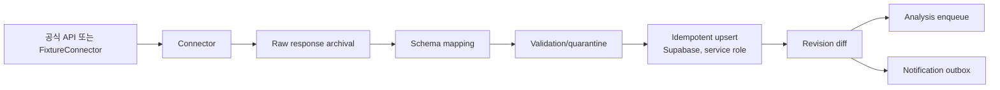

# 07. 조달청 데이터 수집

> [!tip] 심사 포인트
> "진짜 동작하는가"와 "어디까지가 mock인가"에 답하는 문서다. 해커톤 데모는 조달청 외부 API 없이 **fixture 20건(`FX-01`~`FX-20`)** 만으로 수집 → 정규화 → revision → 분석 → 알림까지 돈다. 실제 조달청 API 연결은 [[16-DECISIONS|16 ADR]] 미결정 1번이 검증된 뒤에만 켠다.

## 1. 데이터 소스

발주계획(`PLAN`), 사전규격(`PRE_SPEC`), 입찰공고(`NOTICE`)가 P0. 계약과정·낙찰·계약정보는 P1.

| 단계 | 후보 서비스 (data.go.kr 검색어 수준) | 해커톤 범위 |
|---|---|---|
| `PLAN` | 나라장터 발주계획 정보 | fixture만 |
| `PRE_SPEC` | 나라장터 사전규격 정보 | fixture만 |
| `NOTICE` | 나라장터 입찰공고 정보 | fixture만 |

> [!warning] 미검증 가정
> 위 서비스 이름은 검색어 수준이다. 정확한 서비스 ID·메서드·필드·호출 한도·페이지네이션은 data.go.kr 신청 승인 후 공식 문서로 확인해 `infra/sources/registry.yaml`에 등록한다(점검표는 [[15-DATA-CONTRACTS|15 데이터 계약]]). 확인되지 않은 엔드포인트를 만들어 호출하지 않는다. 검증 방법: 서비스키 발급 → 테스트 응답 3건 저장 → 필드 매핑표 작성 → ADR 갱신.



## 2. Connector 계약

`fetchPage({from,to,cursor}) -> {records,nextCursor,rateLimitInfo}`. 요청 timeout 15s, 오류 시 지수 backoff + jitter(1s·2s·4s, 최대 3회), 429는 `Retry-After` 헤더를 존중한다. 일정 실행은 BullMQ repeatable scheduler로 구성하되 `job_key`로 중복 예약을 막는다. API 접근키는 env secret이며 로그에 남기지 않는다.

실행 위치와 DB 쓰기:
- 수집 job(ingest job)은 **`web/worker`**가 돌린다. BullMQ 소비자이고, 같은 코드베이스의 별도 Node(TypeScript) 프로세스다. Connector·정규화·변경 감지 코드는 `web/server/ingestion`에 두고 worker가 import한다.
- worker는 `SUPABASE_SERVICE_ROLE_KEY`로 Supabase에 쓴다. 공고 표(`bid_notices`, `bid_revisions`, `bid_documents`)와 `ingest_runs`·`ingest_errors`·`outbox_events`는 화면 역할에 쓰기 권한이 없고 worker만 쓴다([[04-DATABASE|04 DB]] §3).
- service role은 RLS를 무시한다. 공고는 공용 데이터라 `org_id`가 없다. 조직이 걸리는 행(수동 수집 감사 `INGEST_MANUAL`, 조직 사용자에게 가는 알림)은 job 데이터의 `orgId`를 직접 넣는다. 조직 표에 쓰는 worker 코드에는 테넌트 혼입 시험을 둔다.
- 수동 수집(`POST /api/v1/admin/ingestion/runs`)은 Route Handler가 `sol_role=ADMIN`을 확인한 뒤 job만 넣는다. `ingest_runs` 행은 worker가 만든다.
- 첨부 원본·추출 텍스트는 MinIO에 쓰고 DB에는 키만 둔다. 변경 감지 뒤 분석 job 등록도 Redis/BullMQ로 한다.

> [!warning] 미검증 가정
> `web/server` 모듈은 `import "server-only"`로 시작한다. 그래서 worker는 `node --conditions=react-server`(또는 같은 효과의 실행 방식)로 띄워야 한다고 본다. 이 방식은 아직 확인하지 않았다. 검증 방법: Phase 0에서 worker 진입점이 `web/server/ingestion`을 import해 fixture 1건을 적재하는지 확인하고 [[16-DECISIONS|16 ADR]] 미결정 표를 갱신한다.

구현체는 둘이다. 인터페이스는 같다.

| 구현체 | 조건 | 동작 |
|---|---|---|
| `OfficialApiConnector` | `DEMO_MODE=false` + registry 검증 완료 | 실제 HTTP 호출 |
| `FixtureConnector` | `DEMO_MODE=true` (해커톤 기본) | `fixtures/manifest.yaml` 순서대로 페이지 반환, 네트워크 호출 없음 |

## 3. 데이터 정규화

통일 필드: `source, noticeId, title, agency, budgetKrw, noticeDate, deadlineAt, stage, sourceUrl, content, rawPayload, fetchedAt, isDemo`. 스키마 정의와 `fieldState`는 [[15-DATA-CONTRACTS|15 데이터 계약]]의 `NormalizedBid`를 따른다.

| 항목 | 규칙 | 검증 fixture |
|---|---|---|
| 금액 | `"1,500백만원"`, `"12억"`, `"1200000000"` 모두 KRW 정수 문자열로. 원본 문자열은 `rawPayload`에 보존 | `FX-13` |
| 날짜 | 원본 Asia/Seoul → UTC 저장. 시각 없는 날짜는 KST 18:00으로 간주하고 `fieldState=KNOWN` 유지, 가정 사실을 `normalizationNotes`에 기록 | `FX-14` |
| 누락 | 선택 필드 null 허용. null을 0·미래 날짜로 대체하지 않음 | `FX-11` |
| 필수 누락 | `noticeId, title, sourceUrl, source` 중 하나라도 없으면 격리 | `FX-12` |
| 취소·정정 | 상태 `CANCELLED`, 정정은 revision | `FX-06`, `FX-07`, `FX-08` |
| 복합 공고번호 | `noticeId`는 차수를 뺀 공고번호. 차수·정정 회차는 `amendmentNo`(`01`, `02`…)로 분리하고 같은 bid의 revision으로 쌓는다([[04-DATABASE\|04 DB]] 식별자 규칙) | `FX-10` |
| 첨부 | 링크·파일명·MIME 기록. 파싱 실패해도 원문 다운로드는 유지 | `FX-05` |

## 4. 공고 이력 연결

- 같은 `noticeId`(차수 제외) + `amendmentNo`는 동일 bid의 revision으로 관리한다.
- 계획 → 사전규격 → 공고 연결은 **공개 사업 식별자 `planRef`**(예 `DEMO-PLAN-0042`)가 우선이다(`FX-17` ↔ `FX-18`). 제목 유사도만으로는 자동 병합하지 않고 "연결 후보"로만 표시한다(`FX-19`).
- 단계는 누락·역전 가능성이 있으므로 선형 진행을 강제하지 않는다.
- 외부 공고 링크의 재확인 가능성과 provenance(`fetchedAt`, `rawPayload` 해시)를 기록한다.

## 5. 변경 감지

`sha256(canonical normalized payload)`로 변경을 탐지한다. diff에 예산·마감·자격·첨부 변화가 있으면 새 revision을 저장하고 `source+noticeId+revision+eventType` 멱등키로 이벤트를 만든다. 동일 payload 재수신은 revision도 이벤트도 만들지 않는다(`FX-09`). 실패한 수집은 로그·격리 후 재실행하고, 이전 공고 정보는 삭제하지 않는다.

| 변화 | revision | 이벤트 ([[13-NOTIFICATIONS\|13 알림]]) | 재분석 |
|---|---|---|---|
| 신규 | 1 | `BID_CREATED` | 큐 등록 |
| 동일 payload 재수신 | 없음 | 없음 | 없음 |
| 마감·예산·자격·첨부 변경 | +1 | `BID_CHANGED` 1건 | 큐 등록 |
| 취소 | +1, `status=CANCELLED` | `BID_CHANGED` 1건 | 하지 않음. 기존 `score_runs`·`bid_reviews` 보존 |
| 마감 72시간 이내 진입 | 없음 | `DEADLINE_APPROACHING` 1건 (하루 1회) | 없음 |

## 6. Fixture 20건 명세

> [!warning] 가상 데이터
> 아래 20건은 **모두 가상 공고**다. 기관명은 실제 공공기관 이름을 빌렸지만 해당 기관이 낸 공고가 아니다. 모든 레코드는 `isDemo=true`로 적재되고 화면에 `DEMO` 배지가 붙는다([[06-UI-UX|06 UI]]). `sourceUrl`은 예약 도메인 `*.invalid`를 써서 실제 링크로 오인되지 않게 한다.

### 6.1 파일 구조

```text
fixtures/
  manifest.yaml            # 배치(seed/live) 순서, FX-ID, 시나리오 태그
  bids/FX-01.json … FX-20.json
  docs/FX-01-rfp.pdf …     # 첨부 샘플(가상 RFP 본문, 텍스트 추출 가능)
  docs/FX-05-rfp.hwp       # 의도적으로 깨진 HWP (파싱 실패 재현)
  extractions/FX-01.json … # mock Qwen 추출 결과 (03 §4 RequirementExtraction 스키마)
  kev/FX-01.json …         # mock Kev 응답 (03 §5 질문 4종, FX별 고정값)
  goldens/FX-01.json …     # Phase 4에서 고정하는 기대 점수·결정 (11 골든 테스트 입력)
```

fixture 한 건의 형태:

```json
{
  "fixtureId": "FX-06",
  "isDemo": true,
  "stage": "NOTICE",
  "connectorBehavior": "normal",
  "records": [
    {
      "amendmentNo": "01",
      "ingestBatch": "SEED",
      "noticeId": "DEMO-2026-0006",
      "planRef": null,
      "title": "대전광역시 스마트시티 통합플랫폼 유지보수 (가상)",
      "agency": "대전광역시",
      "budgetKrw": "900000000",
      "noticeDate": "-3d",
      "deadlineAt": "+14d",
      "stage": "NOTICE",
      "sourceUrl": "https://demo.sol-radar.invalid/notices/FX-06",
      "content": "…본문 텍스트…",
      "attachments": [{ "name": "제안요청서.pdf", "objectKey": "fixtures/docs/FX-06-rfp.pdf" }]
    },
    { "amendmentNo": "02", "ingestBatch": "LIVE", "deadlineAt": "+28d", "…": "나머지 동일" }
  ]
}
```

- 날짜는 `+21d`, `-3d` 같은 상대 표기다. seed 시점에 KST 18:00 기준으로 절대값으로 바꾼다. 데모를 어느 날 해도 "마감 임박" 카드가 나온다.
- `ingestBatch`는 04의 `ingest_batch` ENUM과 같다. `SEED`는 기동 시 적재되는 1차 레코드, `LIVE`는 데모 중 수동 수집으로 투입하는 변경분이다.
- 식별자는 04 규칙을 따른다: `noticeId`는 차수 제외, `amendmentNo`는 `01`/`02`…, 단계 연결은 `planRef`, 가상 표시는 `isDemo`.
- `connectorBehavior`: `normal` | `duplicate-delivery`(같은 레코드 2회 반환) | `rate-limit-then-ok`(429 두 번 후 200).

### 6.2 명세 표

열 설명: 단계 = `PLAN`(발주계획)·`PRE_SPEC`(사전규격)·`NOTICE`(입찰공고). 기대 결과의 점수는 [[08-SCORING|08 SOL Score]] v0.1 가중치 기준 **설계 목표값**이며, `FX-01`~`FX-03`은 08 §6에서 끝까지 계산했다. 정확한 값은 Phase 4에서 `fixtures/goldens/`에 고정한다. 골든 시나리오 `G1`~`G8`은 [[11-TESTING|11 테스트]] §3. 데모 장면 `S0`~`S7`은 [[19-DEMO-SCENARIO|19 데모 시나리오]] §3·§4(`S0` 사전 준비, `S1` 문제 슬라이드).

| ID | 단계 | 제목 (가상) | 기관 | 예산 | 마감 | 특수 케이스 | 기대 결과 | 골든 시나리오 | 데모 장면 (19) |
|---|---|---|---|---:|---|---|---|---|---|
| `FX-01` | NOTICE | 세종특별자치시 차세대 행정정보시스템 고도화 | 세종특별자치시 | 12억 | +21d | 신규·정상. 첨부 RFP 파싱 성공, 자격 3건 모두 충족 | **BID** (점수 94) | G5, G6, G8 | S3 자격·근거 서랍, S6 장애 대체(force 재분석), S7 격리 |
| `FX-02` | NOTICE | 경기도교육청 통합 LMS 구축 | 경기도교육청 | 28억 | +10d | 신규·정상. 요구기술 6개 중 3개 보유, 마감 촉박 | **WATCH** (점수 72) | — | S4 라이브 분석 + 사람 결정 |
| `FX-03` | NOTICE | 부산광역시 지능형 CCTV 통합관제센터 구축 | 부산광역시 | 45억 | +15d | 필수자격 미충족(정보통신공사업 등록). mock Kev는 `BID 0.55` 제시 | **NO-BID** (자격). 점수 68은 참고. `MODEL_RULE_DISAGREEMENT` 기록 | G3 | S3 "규칙이 Kev를 이긴다" |
| `FX-04` | NOTICE | 한국지능정보사회진흥원 데이터 거버넌스 체계 수립 컨설팅 | 한국지능정보사회진흥원 | 6억 | +12d | 첨부 없음. 본문에 자격 요건 문장 없음 | 자격 **NEEDS_REVIEW** → WATCH. 근거 인용 0건, 수주확률 문구 없음 | G4 | — |
| `FX-05` | NOTICE | 국민건강보험공단 대국민 포털 재구축 | 국민건강보험공단 | 32억 | +20d | 첨부 HWP 파싱 실패(의도적으로 손상) | `parse_status=FAILED`, 추출 `PENDING_REVIEW`, 자격 NEEDS_REVIEW → WATCH. "첨부 원문 확인" 배지 | G4 변형 | — |
| `FX-06` | NOTICE | 대전광역시 스마트시티 통합플랫폼 유지보수 | 대전광역시 | 9억 | +14d → r2 +28d | 기한변경 정정(`LIVE` 배치, `amendmentNo` 02) | **BID** (점수 78) 유지. revision 2, `BID_CHANGED` 알림 정확히 1건 | G2 | S5 변경 알림 |
| `FX-07` | NOTICE | 한국도로공사 교통정보 데이터플랫폼 고도화 | 한국도로공사 | 18억 → r2 21.6억 | +18d | 정정: 예산 증액 + 요구기술 `Kubernetes` 추가(`LIVE`, `amendmentNo` 02) | r1 WATCH (68) → r2 **BID** (76). 재분석 1회, 알림 1건 | G2 변형 | S5 재분석으로 점수 변동 |
| `FX-08` | NOTICE | 충청북도 농업기술정보시스템 구축 | 충청북도 | 7억 | +16d | 취소 공고(`LIVE`에서 r2 `CANCELLED`) | 상태 `CANCELLED`, 재분석 없음, r1 검토 기록 보존, 알림 1건 | — | — |
| `FX-09` | NOTICE | 서울특별시 공공데이터 개방 플랫폼 운영 | 서울특별시 | 11억 | +25d | `duplicate-delivery`: 동일 payload가 `SEED`와 `LIVE` 두 번 전달 | bid 1건, revision 1, 이벤트 0건 추가. WATCH | G1 | S5 중복 0건 |
| `FX-10` | NOTICE | 강원특별자치도 관광정보시스템 재구축 (재공고) | 강원특별자치도 | 8억 | +14d | 차수 변경: `noticeId=DEMO-2026-0010`, `amendmentNo` `01` → `02`(유찰 후 재공고, `LIVE`) | 같은 bid의 revision 2, 재분석, 알림 1건. WATCH | G1 변형 | — |
| `FX-11` | NOTICE | 인천광역시 민원 챗봇 고도화 | 인천광역시 | null | null | 예산·마감 누락 | 적재 OK. 규모 적합 `missingFactors` 기록(중립 7.5점), 마감 임박 집계 제외. WATCH | — | — |
| `FX-12` | NOTICE | (제목 없음) | 경상북도 | 3억 | +10d | 필수 필드 `title` 누락 | 격리. `ingest_errors` 1건, 목록 미노출, 관리자 화면에 오류 1건 | — | S2 격리 1건 |
| `FX-13` | NOTICE | 울산광역시 산업안전 모니터링 플랫폼 | 울산광역시 | `"1,500백만원"` | +19d | 금액 텍스트 정규화 + 추출 fixture에 원문과 불일치하는 인용 1건 | `budgetKrw="1500000000"`, 원본 문자열 보존. 인용 검증 실패 → 해당 필드 `CONFLICTED`, 근거 미표시, 자격 NEEDS_REVIEW. WATCH | — | — |
| `FX-14` | NOTICE | 광주광역시 AI 행정 비서 시범사업 | 광주광역시 | 5억 | +2d (KST 18:00) | 마감 임박, 타임존 변환 | UTC 09:00 저장. 대시보드 "마감 임박" 카드, `DEADLINE_APPROACHING` 1건. WATCH (일정 감점) | — | S2 마감 임박 |
| `FX-15` | NOTICE | 행정안전부 차세대 지방행정 공통기반 구축 | 행정안전부 | 80억 | +30d | 규모 초과(SOL테크 수행 상한 50억) | 규모 적합 0점 + `SCALE_LIMIT_EXCEEDED` 경고. WATCH (58) | — | — |
| `FX-16` | NOTICE | 국방부 군 지휘통제체계 SW 유지보수 | 국방부 | 40억 | +20d | 비선호 분야(국방) + 방산업체 지정 필수 미충족. mock Kev도 `NO_BID 0.70` | **NO-BID** (자격). 규칙·Kev 일치 | G3 일치 사례 | — |
| `FX-17` | PLAN | 과학기술정보통신부 2027년 AI 행정서비스 구축 발주계획 | 과학기술정보통신부 | 50억 (예정) | 없음 (2027-03 예정) | 발주계획 단계. `planRef=DEMO-PLAN-0042` | 자격 `NOT_APPLICABLE`, WATCH (조기 추적). StageTimeline 1단계 | — | — |
| `FX-18` | PRE_SPEC | 과학기술정보통신부 AI 행정서비스 구축 사전규격 | 과학기술정보통신부 | 48억 | 의견등록 +7d | `planRef=DEMO-PLAN-0042`로 `FX-17`과 연결 | 연결 확정(식별자). **BID** (82). StageTimeline 2단계 | — | — |
| `FX-19` | PRE_SPEC | 세종특별자치시 행정정보 연계 플랫폼 사전규격 | 세종특별자치시 | 10억 | +7d | `planRef` 없음. `FX-01`과 제목 유사도만 높음 | "연결 후보"로만 표시, 자동 병합 없음. WATCH | — | — |
| `FX-20` | PLAN | 경상남도 2027년 정보화사업 발주계획 | 경상남도 | 15억 (예정) | 없음 | `rate-limit-then-ok`: `SEED` 배치 안에서 429 두 번(`Retry-After: 2`) 후 200 | 지수 재시도 후 적재, `ingest_runs` 체크포인트 복구, `BID_CREATED` 1건. WATCH (조기 추적) | G7 | — |

단계 분포: NOTICE 16, PLAN 2, PRE_SPEC 2. 기대 결과 분포(최종 revision 기준): BID 4, WATCH 10, NO-BID 2, 취소 1, 격리 1, 조기 추적 2.

### 6.3 mock 추출·Kev fixture

`AI_PROVIDER=mock`일 때 AI gateway는 모델을 부르지 않고 아래 두 파일을 읽는다. 스키마는 [[03-AI-PIPELINE|03 AI 파이프라인]]이 단일 원천이고, 값은 이 절이 원천이다.

**`fixtures/extractions/FX-xx.json`** — mock Qwen 추출 결과(`RequirementExtraction`). 필수 포함 케이스:

| ID | 추출 fixture 내용 | 검증 대상 |
|---|---|---|
| `FX-01` | 요구기술 5 + 우대 2, 자격 3, 필요 인력 12 FTE, 인용 3건 모두 원문과 일치 | 정상 경로 |
| `FX-02` | 요구기술 6 + 우대 2, 필요 인력 `UNKNOWN`, 인용 2건 | `fieldState=UNKNOWN` 처리 |
| `FX-03` | 자격 문장 "정보통신공사업법에 따른 정보통신공사업 등록업체" 인용 포함 | NOT_SATISFIED 근거 |
| `FX-04` | 첨부 없음 → 추출 결과 비어 있음, 인용 0건 | 근거 없음 → NEEDS_REVIEW |
| `FX-05` | 첨부 파싱 실패 → 추출 `PENDING_REVIEW`, 본문 인용만 | 파싱 실패 경로 |
| `FX-13` | 인용 1건의 `quotedText`가 원문에 없음 → 인용 검증 실패 | 해당 필드 `CONFLICTED`, 근거 미표시 |
| 그 외 | 제목·본문에서 만든 단순 추출. 인용은 본문 문자열과 일치 | 회귀 |

**`fixtures/kev/FX-xx.json`** — mock Kev 응답. 03 §5의 질문 4종(`recommendation` choice, `mandatoryRisk` noul, `needsHumanReview` noul, `fit` score 1~5)을 모두 채운다. 질문 세트 `kev-qs/v0.1`, `provider="mock"`. **20건 전부 명시 파일로 제공한다**(격리되는 `FX-12`는 생략 가능). 특수 4건(`FX-01`·`02`·`03`·`16`)은 아래 표의 값, 나머지 16건은 다음 값을 파일에 고정값으로 기록한다: `recommendation`은 규칙 권고 선택지 0.60 / 나머지 0.25·0.15, `mandatoryRisk` 0.10, `needsHumanReview`는 자격 NEEDS_REVIEW면 0.70 아니면 0.20, `fit`은 규칙 점수/20. 이렇게 하면 데모·골든에서 의도치 않은 `MODEL_RULE_DISAGREEMENT`가 생기지 않는다. 파일이 없을 때만 [[03-AI-PIPELINE|03 AI 파이프라인]] §5.7 fallback 공식을 쓴다.

| ID | recommendation (BID/WATCH/NO_BID) | mandatoryRisk | needsHumanReview | fit | 의도 |
|---|---|---:|---:|---:|---|
| `FX-01` | 0.71 / 0.24 / 0.05 | 0.05 | 0.12 | 4.5 | 규칙 BID와 일치 |
| `FX-02` | 0.36 / 0.52 / 0.12 | 0.10 | 0.74 | 3.2 | 규칙 WATCH와 일치, 사람 검토 권장 |
| `FX-03` | 0.55 / 0.30 / 0.15 | 0.85 | 0.58 | 2.8 | `recommendation`은 규칙 NO-BID와 상충. 승격 금지 검증 |
| `FX-16` | 0.10 / 0.20 / 0.70 | 0.90 | 0.30 | 1.6 | 규칙 NO-BID와 일치 |

> [!warning] 미검증 가정
> 위 분포는 데모용 고정값이다. 실제 Kev 출력이 아니며, Kev 한국어 성능은 미검증이다([[03-AI-PIPELINE|03 AI 파이프라인]]). 화면에는 항상 "모델 선택지 신뢰 분포(수주 확률 아님)"으로 표시한다.

### 6.4 배치와 데모 조작

| 배치 | 내용 | 투입 방법 | 기대 `ingest_runs.summary` |
|---|---|---|---|
| `SEED` | 20건의 r1 레코드. `FX-12`는 격리, `FX-20`은 429 두 번 뒤 적재 | `pnpm demo:reset`(스크립트, service role로 Supabase 프로젝트에 seed, 멱등, [[10-DEPLOYMENT\|10 배포]]) | `{created:19, changed:0, cancelled:0, skippedDuplicate:0, quarantined:1, retried:2}` |
| `LIVE` | `FX-06` r2, `FX-07` r2, `FX-08` r2(취소), `FX-09` 재전송, `FX-10` 02차 | 관리자 화면 "수동 수집" 또는 `POST /api/v1/admin/ingestion/runs` 본문 `{"source":"fixture","batch":"live"}`(API는 소문자, Route Handler의 zod 스키마가 `LIVE`로 바꾼다, [[05-API-SPEC\|05 API]]). 적재는 worker가 한다 | `{created:0, changed:3, cancelled:1, skippedDuplicate:1, quarantined:0, retried:0}` |

`summary` 키는 [[04-DATABASE|04 DB]]의 `ingest_runs.summary`와 같다. `SEED`를 두 번 돌리면 두 번째는 `skippedDuplicate:19, quarantined:1`이어야 한다(멱등). seed는 공고 외에 조직 2(`org-01` SOL테크, `org-02` 비교조직), 계정 5(Supabase Auth 사용자. org-01 4역할 + org-02 VIEWER, 역할은 `memberships.sol_role`), 프로필 revision 2, 사전 리뷰 2건(`FX-01` BID, `FX-03` NO-BID)을 함께 넣는다. 범위와 멱등 규칙은 [[04-DATABASE|04 DB]] §6, 계정 목록은 [[19-DEMO-SCENARIO|19 데모 시나리오]] §1, 기대 로그는 `seed: orgs=2 users=5 profileRevisions=2 bids=19 quarantined=1 reviews=2 isDemo=true`.

## 7. 개발·테스트

- `DEMO_MODE=true`(기본)에서는 조달청 외부 API를 호출하지 않는다. `FixtureConnector`가 같은 인터페이스를 구현한다. DB는 Supabase 프로젝트(개발은 클라우드)라 수집 결과를 쓰려면 Supabase에 닿아야 한다.
- fixture 로더는 `fixtures/manifest.yaml`의 JSON Schema 검증을 통과해야 기동한다. 잘못된 fixture는 조용히 건너뛰지 않고 기동 실패로 드러낸다.
- 단위 테스트는 fixture ID로 입력을 고른다. 수집 파이프라인 시험은 Vitest로 `web/server/ingestion/*.test.ts`, worker 진입점 시험은 `web/worker/*.test.ts`에 둔다(`pnpm -C web test`). 공고·수집 표의 쓰기 권한(화면 역할은 쓰기 불가) 시험은 `scripts/database.test.mjs`(`pnpm test:db`)에 둔다. 골든 시나리오 ↔ fixture ↔ 테스트 파일 매핑은 [[11-TESTING|11 테스트]] §3.
- 공식 API 확인 전 실서비스 연결 기능은 보류한다. `OfficialApiConnector`는 registry 항목이 없으면 기동 시 명확한 오류로 멈춘다.

## 관련 문서

- [[15-DATA-CONTRACTS|15 데이터 계약]] — `NormalizedBid`, `fieldState`, 수집 소스 점검표
- [[04-DATABASE|04 DB]] — `bid_notices`, `bid_revisions`, `ingest_runs`, seed 범위
- [[08-SCORING|08 SOL Score]] — fixture별 기대 점수의 계산 근거
- [[11-TESTING|11 테스트]] — 골든 시나리오 ↔ FX-ID 매핑
- [[19-DEMO-SCENARIO|19 데모 시나리오]] — FX-ID별 데모 장면
- [[13-NOTIFICATIONS|13 알림]] — revision 이벤트와 outbox
