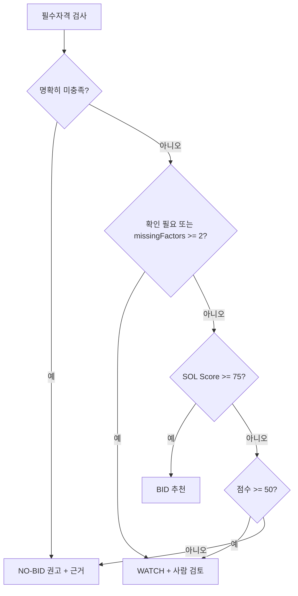

# 08. SOL Score 및 참여 권고

> [!tip] 심사 포인트
> SOL Score는 **설명 가능한 결정론적 점수**다. 같은 입력이면 같은 점수가 나오고, 모든 점수는 요소별 raw → normalized → points 분해와 근거를 함께 저장한다. 이 문서는 숫자를 끝까지 계산한 worked example 3건(§6)으로 그 주장을 증명한다. 결정 모델(Bosun, [[16-DECISIONS|ADR-034]]. 이름 `KEV_*`는 호환 유지)은 보조 의견일 뿐이고 규칙 판정을 뒤집지 못한다(§5, `FX-03`). 결정 모델 확률은 점수 입력이 아니고 "모델 참고 지표"와 검토 플래그로만 보인다(§5.4). 정보가 없다는 이유로 "미충족"을 내지 않는다(§5.1).

## 1. 핵심 정의

SOL Score는 **우리 회사와 특정 공고의 내부 적합도(0~100)** 이지 낙찰 확률이 아니다. 점수는 결정론적 규칙으로 계산하고 결정 모델 출력은 별도의 보조 신호로 저장한다. 입력은 `bid_revisions.normalized` + `RequirementExtraction`([[03-AI-PIPELINE|03 AI 파이프라인]] §4.1) + `company_profiles` 특정 revision이며, 입력 스냅샷은 `score_runs.input_snapshot`에 저장한다([[04-DATABASE|04 DB]]). live 공고는 공고 API의 구조화 자격 필드(`bid_structured_requirements`)도 입력이다(§5.1).

알고리즘은 세 실행 모드(`live`·`fixture`·`mock`, [[16-DECISIONS|ADR-020]])에서 모두 `sol-v0.1.0` 하나다. 모드가 바꾸는 것은 입력(실제 공고인지 fixture인지, 추출이 실모델인지 mock인지)뿐이다. 그래서 골든 수치(§6의 94/72/68)는 입력이 고정된 `mock` 모드에서만 단언한다. `fixture` 모드는 실모델 추출이 mock 추출과 다를 수 있어 골든 대상이 아니다. 회사 프로필은 모든 모드에서 가상 솔리데오 프로필이다(§6.1).

추출값을 그대로 쓰지 않고 규칙 쪽이 만드는 파생값 두 개:

| 파생값 | 출처 | 규칙 |
|---|---|---|
| `bid.domain` | `extraction.domain`([[03-AI-PIPELINE\|03]] §4.1)이 `KNOWN`이면 그 값을 아래 값 집합으로 맞춘다. 아니면 제목 + `extraction.summary`를 키워드 표로 분류 | 값 집합: `민원`, `데이터 플랫폼`, `교육`, `AX`, `스마트시티`, `국방`, `기타`. 키워드 표와 동률 규칙의 정본은 `web/server/scoring/domain-keywords.ts`(`DOMAIN_KEYWORDS`, TS 상수)다. 어느 것도 안 맞으면 `UNKNOWN`(§4 missing) |
| `requiredFte` | `extraction.staffing`이 `KNOWN`이면 `Σ staffing[].minCount`(없는 항목은 1) | `UNKNOWN`이면 §3.3 `FTE_BY_BUDGET` 예산 구간 표 |

> [!warning] 미검증 가정
> 도메인 값 집합과 키워드 표는 v0.1 가정이다. fixture 20건으로 사람이 분류한 정답과 비교해 틀리면 표를 고친다.

## 2. v0.1 점수표

| 요소 (`factor`, 05 `FactorKey`) | 최대점 | 계산 개요 |
|---|---:|---|
| 기술 스택 적합 `skillMatch` | 30 | 필수/우대 기술 매칭률, 별칭표 보조 |
| 유사 수행 실적 `pastPerformance` | 25 | 분야·금액·최근성이 가장 비슷한 실적 1건의 유사도 |
| 인력 가용성 `staffAvailability` | 20 | 필요 FTE 대비 가용 FTE, 제안 준비 일정 계수 |
| 규모 적합성 `scaleFit` | 15 | 최대 수행 실적 대비 예산 비율, 내부 수행 상한 |
| 전략적 선호 `strategicPreference` | 10 | 사업 분야·발주기관 선호 설정 |
| 합계 | 100 | `algorithm_version` 별 불변 |

```text
factor.points = clamp(round(maxPoints * normalized, 1), 0, maxPoints)   # 소수 1자리
solScore      = clamp(round(sum(points)), 0, 100)                          # 정수
```

> [!warning] 미검증 가정
> 가중치 30/25/20/15/10과 임계값 75/50은 초기 제품 가정이다. 실제 조직의 판정 기준과 맞는지는 백테스트 후에만 알 수 있다([[16-DECISIONS|16 ADR]] 미결정 7번). 그래서 가중치·임계값은 `algorithm_version`(`sol-v0.1.0`)에 묶어 config로 버전 관리하고, 바뀌면 기존 `score_runs`를 덮어쓰지 않고 새 run을 만든다.

## 3. 정규화 함수 (의사코드)

모든 함수는 `0.0~1.0`을 반환한다. 입력이 없으면 §4의 missing 정책을 따른다. 아래는 TypeScript 스타일 의사코드이며 서버 도메인 `web/server/scoring/`의 정규화 함수로 1:1 옮긴다(규칙 엔진은 Next 서버와 `web/worker`가 같은 코드를 쓴다).

### 3.1 기술 스택 적합 `skillMatch`

```ts
function skillMatch(req: string[], pref: string[], company: Set<string>, alias: AliasTable) {
  if (req.length === 0 && pref.length === 0) return MISSING;        // §4
  const has = (s: string) => company.has(alias.canonical(s));        // 정확 일치 + 별칭표만. 임베딩 유사도는 P1
  const reqRate  = req.length  ? count(req,  has) / req.length  : null;
  const prefRate = pref.length ? count(pref, has) / pref.length : null;
  if (reqRate === null)  return prefRate;                             // 필수 없음: 우대만
  if (prefRate === null) return reqRate;                              // 우대 없음: 필수만
  return 0.8 * reqRate + 0.2 * prefRate;
}
```

별칭표 예: `Spring Framework ≈ Spring Boot`, `K8s ≈ Kubernetes`, `Postgres ≈ PostgreSQL`. 별칭으로 맞춘 항목은 evidence에 `matchedVia: "alias"`로 남긴다.

### 3.2 유사 수행 실적 `pastPerformance`

```ts
function pastPerformance(bid: Bid, projects: Project[], today: Date) {
  if (projects.length === 0) return 0.0;                              // 회사 실적 자체가 없음: 보수적 0 (§4)
  if (bid.domain === UNKNOWN) return MISSING;                         // 공고 분야 미확인: 중립
  const sim = (p: Project) => {
    const domain   = sameDomain(p.domain, bid.domain) ? 1 : 0;       // 분야 코드 + 별칭표 (예: CCTV 관제 ≈ 스마트시티)
    const amount   = bid.budgetKrw ? Math.min(p.amountKrw, bid.budgetKrw) / Math.max(p.amountKrw, bid.budgetKrw) : 0.5;
    const years    = yearsBetween(p.completedAt, today);
    const recency  = years <= 3 ? 1.0 : years <= 5 ? 0.6 : 0.2;
    const evidence = p.evidenceRef ? 1.0 : 0.5;                       // 증빙 없는 실적은 반만 인정
    return (0.4 * domain + 0.3 * amount + 0.3 * recency) * evidence;
  };
  return Math.max(...projects.map(sim));                              // v0.1: 가장 비슷한 실적 1건
}
```

### 3.3 인력 가용성 `staffAvailability`

```ts
const FTE_BY_BUDGET = [ [5e8, 3], [2e9, 8], [5e9, 20], [Infinity, 40] ]; // 예산 상한(KRW) → 필요 FTE (v0.1 가정)
const SCHEDULE = (bizDays: number) => bizDays >= 10 ? 1.0 : bizDays >= 5 ? 0.7 : 0.4;

function staffAvailability(bid: Bid, extraction: RequirementExtraction, team: TeamAvailability, today: Date) {
  const requiredFte = fteFromStaffing(extraction.staffing) ?? fteByBudget(bid.budgetKrw); // staffing KNOWN이면 Σ minCount. 둘 다 없으면 MISSING (§4)
  if (requiredFte === null) return MISSING;
  const period      = bid.projectPeriod ?? defaultPeriod(bid);                 // 기간 미상: 마감 +1개월 이후 첫 월초부터 6개월(calendar.ts defaultProjectPeriod. 마감이 없으면 계산 기준일)
  const available   = team.availableFte(period);                           // assignments 겹침 제외한 FTE 합. scoringEligible=true인 가상 계산 대상만 전달(전체 명부 인원수와 구분)
  // ADR-021: team_member_scoring 행이 있는 인력만 전달. P1 이후 재직 상태가 LEFT인 인력은 입력에서 빠진다(계산식 변화 아님, sol-v0.1.0 유지)
  const ratio       = Math.min(1, available / requiredFte);
  const bizDays     = bid.deadlineAt ? businessDaysBetween(today, bid.deadlineAt) : null;
  return ratio * (bizDays === null ? 1.0 : SCHEDULE(bizDays));                 // 마감 미상: 일정 계수 미적용
}
```

### 3.4 규모 적합성 `scaleFit`

```ts
function scaleFit(bid: Bid, profile: CompanyProfile) {
  if (!bid.budgetKrw) return MISSING;
  const cap = profile.financials?.maxContractKrw;                      // 내부 수행 상한 (선택 필드)
  if (cap && bid.budgetKrw > cap) return { value: 0.0, reviewFlag: "SCALE_LIMIT_EXCEEDED" };
  const maxPast = Math.max(...profile.pastProjects.map(p => p.amountKrw), 0);
  if (maxPast === 0) return MISSING;
  const ratio = bid.budgetKrw / maxPast;
  return ratio <= 1.5 ? 1.0 : ratio <= 3 ? 0.6 : 0.2;
}
```

`maxContractKrw`는 [[04-DATABASE|04 DB]]·[[05-API-SPEC|05 API]] `financials`의 선택 필드(KRW 정수 문자열)다.

`SCALE_LIMIT_EXCEEDED` 조건: `company_profiles.financials.maxContractKrw`가 설정되어 있고 `budgetKrw > maxContractKrw`이면 `scaleFit` normalized 0.0(points 0)과 함께 `reviewFlags`에 `SCALE_LIMIT_EXCEEDED`를 넣는다([[04-DATABASE|04 DB]] `review_flags` 값). `FX-15`: 80억 > 50억. 상한이 null이면 플래그 없이 비율만 계산한다. 이 플래그는 권고를 직접 바꾸지 않고 점수(0점)와 화면 경고로만 작용한다.

### 3.5 전략적 선호 `strategicPreference`

```ts
// prefs = company_profiles.preferences (04·05)
//       = { agencies: string[], agencyTypes: string[], domains: string[], excludedDomains: string[], excludedKeywords: string[] }
function strategicPreference(bid: Bid, prefs: OrgPreferences | null) {
  if (!prefs) return MISSING;
  if (bid.domain !== UNKNOWN && prefs.excludedDomains.includes(bid.domain)) return 0.0;   // 제외 분야 → 0
  const text = `${bid.title} ${bid.agency}`;
  if (prefs.excludedKeywords.some(k => text.includes(k))) return 0.0;                     // 제외 키워드 1개라도 → 0
  const domainLevel = bid.domain === UNKNOWN ? 0.5 : prefs.domains.includes(bid.domain) ? 1.0 : 0.5;
  const agencyLevel = prefs.agencies.includes(bid.agency) || prefs.agencyTypes.includes(agencyType(bid.agency)) ? 1.0 : 0.5;
  return 0.6 * domainLevel + 0.4 * agencyLevel;
}
// agencyType: 이름 끝이 시·도·군·구·특별자치시·특별자치도 → "지자체", "교육청" 포함 → "교육청",
//             부·처·청(중앙) → "중앙부처", 그 외 → "공공기관".
```

## 4. Missing 데이터 정책

> [!tip] 심사 포인트
> 데이터가 없을 때 점수를 **올리는** 쪽으로 메우지 않는다. 중립(0.5) 또는 보수(0.0)만 쓰고, 어떤 요소가 비었는지 `score_runs.input_snapshot.missingFactors`에 남겨 화면에 그대로 보여준다.

| 요소 | 없는 데이터 | normalized | points | `missingFactors` 기록 | 화면 표시 ([[06-UI-UX\|06 UI]]) |
|---|---|---:|---:|---|---|
| `skillMatch` | 공고에 요구기술 없음 (추출 `UNKNOWN` 또는 파싱 실패) | 0.5 | 15.0 | `{factor:"skillMatch", reason:"NO_REQUIREMENTS_EXTRACTED"}` | 요소 행에 "미확인" 배지 + 회색 바 |
| `skillMatch` | 회사 기술 목록 비어 있음 | 0.0 | 0.0 | `reason:"PROFILE_TECHNOLOGIES_EMPTY"` | "회사 프로필 보완 필요" 링크 |
| `pastPerformance` | 공고 분야 미확인 | 0.5 | 12.5 | `reason:"BID_DOMAIN_UNKNOWN"` | "미확인" 배지 |
| `pastPerformance` | 회사 실적 0건 | 0.0 | 0.0 | `reason:"PROFILE_PROJECTS_EMPTY"` | "회사 프로필 보완 필요" 링크 |
| `staffAvailability` | 필요 FTE·예산 모두 없음 | 0.5 | 10.0 | `reason:"REQUIRED_FTE_UNKNOWN"` | "미확인" 배지 |
| `staffAvailability` | 팀 데이터 없음 | 0.5 | 10.0 | `reason:"TEAM_EMPTY"` | "인력 정보 없음" |
| `scaleFit` | 예산 null (`FX-11`) | 0.5 | 7.5 | `reason:"BUDGET_UNKNOWN"` | "예산 미기재" 배지 |
| `scaleFit` | 회사 실적 0건 | 0.5 | 7.5 | `reason:"PROFILE_PROJECTS_EMPTY"` | 위와 동일 |
| `strategicPreference` | 조직 선호 미설정 | 0.5 | 5.0 | `reason:"PREFERENCES_NOT_SET"` | "선호 설정" 링크 (ADMIN) |

규칙: `missingFactors`가 **2개 이상**이면 점수와 무관하게 결정 경로에서 `NEEDS_REVIEW`로 취급해 BID 자동 권고를 막는다. 1개면 점수대로 가되 요소 행에 배지를 붙인다. 이 정책은 요소별 단위 테스트로 고정한다([[11-TESTING|11 테스트]]).

## 5. 자격 판정과 결정 정책

### 5.1 자격 판정

각 필수 항목은 `SATISFIED`, `NOT_SATISFIED`, `NEEDS_REVIEW` 중 하나다. 자격 요건 문장이 추출되지 않았거나(`FX-04`) 회사 증빙이 빠져 있으면 `NEEDS_REVIEW`. 발주계획 단계처럼 자격 요건이 아직 없는 공고는 `NEEDS_REVIEW` + 사유 코드 `STAGE_NOT_APPLICABLE`로 기록한다(`FX-17`, 아래). 법적 자격을 자동으로 확정하지 않는다. 각 항목에는 공고 쪽 근거(`EvidenceRef`)와 회사 쪽 근거(면허·증명서 레코드)를 함께 남긴다.

#### 판정 라벨 (3값 + 사유 코드, ADR-020)

규칙 판정, 결정 모델 항목 질문(`req.{itemId}.status`), 평가셋 라벨([[21-MODEL-TRAINING|21 모델 학습]] §2)이 같은 3값을 쓴다([[16-DECISIONS|ADR-020]]).

| 값 (화면) | 조건 |
|---|---|
| `SATISFIED` (충족) | 공고 요구가 근거와 함께 `KNOWN`이고, 회사 쪽에 이를 충족하는 기록이 있다 |
| `NOT_SATISFIED` (미충족) | 공고 요구가 근거와 함께 `KNOWN`이고, 회사 쪽에 **명시적 부정 근거**가 있다. 예: `NOT_HELD`로 기록된 면허·업종, 요구치보다 작은 실적 금액·인원 수, `technologiesComplete=true`인 기술 목록에 그 기술이 없음 |
| `NEEDS_REVIEW` (확인 필요) | 위 둘이 아닌 모든 경우. 사유 코드를 반드시 붙인다 |

`NEEDS_REVIEW` 사유 코드(`reasonCode`, [[04-DATABASE|04 DB]] `needs_review_reason`):

| 코드 | 뜻 | 예 |
|---|---|---|
| `NOTICE_INFO_MISSING` | 공고에서 요구를 꺼내지 못함(`UNKNOWN`, 첨부 미파싱 포함) | `FX-04` 자격 요건 미추출 |
| `NOTICE_CONFLICTED` | 공고 안의 값이 상충함(`CONFLICTED`). API 구조화 필드와 추출이 다른 경우 포함(아래) | 본문 예산 ≠ 첨부 예산 |
| `COMPANY_EVIDENCE_MISSING` | 회사 프로필에 해당 정보·증빙이 없음 | 면허 목록에 그 면허가 아예 없음(`NOT_HELD`도 `HELD`도 아님) |
| `AMBIGUOUS_MATCH` | 의미 대응이 불확실함(규칙 사전 밖, 결정 모델 판단 필요) | 사전 코드가 없는 자격(`code=null`), "MSA 기반 클라우드 네이티브" 같은 사전 밖 기술 표현, 면허제한 여러 행의 AND/OR 미확인 |
| `PARSE_UNSUPPORTED` | 첨부를 읽지 못함(다운로드 실패 포함) | 스캔 PDF, 배포용 HWP |
| `STAGE_NOT_APPLICABLE` | 발주계획 단계라 자격 요건이 아직 없음 | `FX-17` |

원칙:
- **미충족에는 양쪽 근거가 필요하다.** 공고 쪽 근거(`EvidenceRef`)와 회사 쪽 명시적 부정 근거(`CompanyEvidenceRef`)가 둘 다 없으면 `NOT_SATISFIED`를 내지 않는다.
- **정보 부족은 미충족이 아니다.** 공고든 회사든 정보가 없으면 언제나 `NEEDS_REVIEW`다. 이 구분이 무너지면(정보 부족 → 미충족) 실패로 본다. 단위 시험으로 고정한다(§8).
- 회사 프로필은 "없다"를 기록할 수 있어야 한다: `licenses[].status`·`industryCodes[].status`(`HELD`/`NOT_HELD`), `technologiesComplete`([[05-API-SPEC|05 API]] `CompanyProfile`, [[04-DATABASE|04 DB]] §3.2).
- 발주계획(`stage=PLAN`, `FX-17`)과 추출 상태 `NOT_APPLICABLE`인 자격 항목은 `NEEDS_REVIEW` + `STAGE_NOT_APPLICABLE`로 저장한다. 판정 값 집합(3값)을 늘리지 않고, 결정 경로에서 확인 필요와 같게 다룬다(`web/server/scoring/qualification.ts`, [[04-DATABASE|04 DB]] §3.4).

#### 규칙 담당과 결정 모델 담당

규칙 엔진은 명시 조건을 판정한다: 업종·면허, 참가 지역, 금액, 인력 수, 자격증, 마감. 사전 코드가 있는 자격, API 구조화 필드, 숫자 조건은 규칙만 판정한다. 비정형 요구사항은 규칙이 판정할 수 없으면 `NEEDS_REVIEW`(`AMBIGUOUS_MATCH`)로 두고 결정 모델이 참고 분포를 낸다(§5.4). 결정 모델 담당 항목은 다음이다.
- `requiredSkills[i]`: 기술별 의미 대응. 별칭표로 맞으면 규칙이 `SATISFIED`, 사전에 있는 기술인데 `technologiesComplete=true` 목록에 없으면 규칙이 `NOT_SATISFIED`다.
- `pastPerformance[i]`: 실적 요구의 분야·유사성. 금액·건수·기간은 규칙 담당.
- `staffing[i]`: 역할·등급의 의미 대응. 인원 수는 규칙 담당.
- `qualifications[i]` 중 사전 코드가 없는 것(`code=null`).

항목마다의 판정·사유·양쪽 근거·결정 모델 분포는 `requirement_assessments`에 저장한다([[04-DATABASE|04 DB]] §3.4). 이 항목 판정은 화면 근거와 평가에 쓰인다. 결정 정책(§5.2)의 "필수자격"은 지금처럼 `qualification_checks`의 필수 항목만 본다. 기술·실적·인력 항목은 점수(§3)로 반영되고 권고 경로를 따로 바꾸지 않는다.

#### API 구조화 필드 우선 (ADR-020)

같은 조건을 공고 API의 구조화 필드와 Qwen 추출이 둘 다 주면 **API 구조화 필드가 우선**이다. 예: 면허제한 `lcnsLmtNm`, 참가가능지역 `prtcptPsblRgnNm`, 금액 `presmptPrce`·`asignBdgtAmt`, 마감 `bidClseDt`. 두 값이 다르면 그 조건을 `CONFLICTED`로 두고 `NEEDS_REVIEW`(`NOTICE_CONFLICTED`)로 판정한다. 판정 행에는 공고 쪽 값의 출처를 `basis`(`API_FIELD`·`EXTRACTION`)로 남긴다. 업종 코드는 나라장터 업종 마스터(업종 및 근거법규 서비스)에서 받은 사전으로 맞춘다. [[03-AI-PIPELINE|03 AI 파이프라인]] §4.4 7단계 "메타데이터 대조"를 넓힌 것이다.

> [!warning] 미검증 가정
> 2026-10-19 C1 ①에서 서비스키로 실제 응답을 받았다([C1 API 증거](evidence/phase-0/external-deps-api-20261019.md), 녹음 응답 `fixtures/recorded/`). 업종 코드는 업종 마스터 응답으로 확인했다: 소프트웨어사업자 `1468`(컴퓨터관련서비스사업)·`1426`(패키지소프트웨어개발.공급사업), 정보통신공사업 `0036`. 면허제한 `lcnsLmtNm`은 "이름/코드" 문자열이다. 남은 미검증은 면허제한이 여러 행일 때의 뜻이다. 응답에 AND/OR 필드는 없고 `lmtGrpNo`(그룹)·`lmtSno`(일련번호)만 있다. "그룹 안은 AND, 그룹끼리는 OR"로 읽히지만 확인하지 않았다. 확인 전에는 면허제한 여러 행을 `NEEDS_REVIEW`(`AMBIGUOUS_MATCH`)로 둔다([[16-DECISIONS|16 ADR]] 미결정 19번).

### 5.2 결정 정책 v0.1



BID/WATCH/NO-BID은 **권고**다. 최종 참여 결정은 `bid_reviews`에 사람의 결정·사유로 기록한다. 75/50은 초기 가정이며 조직별로 바꿀 수 있도록 config versioning한다.

"명확히 미충족"은 §5.1의 `NOT_SATISFIED`(양쪽 근거가 있는 미충족)만이다. "확인 필요"는 사유 코드와 상관없이 같은 경로(WATCH + 사람 검토)다. 결정 모델 확률(v0.1·v0.2 모두)은 이 흐름의 입력이 아니다([[16-DECISIONS|ADR-020]]).

### 5.3 결정 모델 처리 (`kev-qs/v0.1`)

결정 모델 질문 세트 `kev-qs/v0.1`은 4종(`recommendation`·`mandatoryRisk`·`needsHumanReview`·`fit`)이다. 질문 정의·임계값(0.70)·플래그(`MODEL_RULE_DISAGREEMENT`·`KEV_MANDATORY_RISK`·`KEV_NEEDS_REVIEW`)의 정본은 [[03-AI-PIPELINE|03 AI 파이프라인]] §5.5다. 어느 것도 규칙 판정이나 점수를 바꾸지 못한다. `kev-qs/v0.2`(§5.4)는 이 4종을 그대로 포함하고 질문을 더한다. mock 모드와 데모 S3("규칙이 결정 모델을 이긴다")는 v0.1 `recommendation`을 계속 쓴다([[16-DECISIONS|ADR-020]]).

점수·결정 쪽에서 정하는 표시는 둘이다.
- `KEV_MANDATORY_RISK`가 붙으면 "사람 검토 권장"을, `KEV_NEEDS_REVIEW`가 붙으면 결정 패널 상단에 "사람 검토 권장"을 띄운다. 자격 결과와 권고는 바꾸지 않는다.
- `fit`(wire `score`는 0부터 세는 index 0~4)은 결정 모델 섹션에 "적합도 의견 n/5"(n = index + 1)로만 보인다. SOL Score에 합산하지 않는다.

`recommendation` 분포는 설명 가능한 보조 의견으로만 쓴다. 규칙상 NO-BID·확인 필요를 BID로 승격할 수 없다.

| 규칙 권고 | 결정 모델 최상위 선택지 | 결과 | `recommendationBasis` |
|---|---|---|---|
| 같음 | 같음 | 규칙 권고 그대로 | `RULES_WITH_KEV_ASSIST` |
| BID | WATCH 또는 NO_BID | 규칙 BID 유지. 상세 화면에 "결정 모델 의견 상이" 표시, 사람 검토 권장 | `RULES_WITH_KEV_ASSIST` + `reviewFlags:["MODEL_RULE_DISAGREEMENT"]` |
| WATCH / NO-BID | BID | 규칙 유지. 결정 모델은 승격 불가 | 위와 동일 |
| 아무거나 | 결정 모델 없음(장애·비활성, gateway·Qwen은 정상) | 규칙 권고 그대로, `analysis.status=COMPLETED`(gateway나 Qwen까지 불가하면 `PARTIAL`, [[03-AI-PIPELINE\|03]] §8) | `RULES_ONLY` |

결정 모델의 confidence는 입찰 승률이 아니다. 화면 제목은 "모델 선택지 신뢰 분포 (충족·수주 확률 아님)"으로 고정하고 본문에는 [[09-SECURITY|09 보안]] "모델 한계 고지 문구"의 결정 모델 블록 3줄을 그대로 쓴다. 임계값 0.70과 플래그 이름은 [[03-AI-PIPELINE|03 AI 파이프라인]] §5와 같다. 질문 세트 버전 `kev-qs/v0.1`.

### 5.4 결정 모델 v0.2 참고 지표와 플래그 (`kev-qs/v0.2`, ADR-020·034)

`live`·`fixture` 모드는 결정 모델(Bosun v3.1 0.6B, ADR-034)에 `kev-qs/v0.2`를 묻는다. v0.1 4종(§5.3)에 `req.{itemId}.status`·`techFit`·`perfRelevance`·`risk.*` 5종이 더해진다. 질문 정의는 [[03-AI-PIPELINE|03 AI 파이프라인]] §5.10, 플래그 `KEV_REQUIREMENT_DISAGREEMENT`·`KEV_DELIVERY_RISK`의 조건은 03 §5.13이 정본이다. 어느 것도 규칙 판정·점수·권고를 바꾸지 않는다. 점수 쪽에서 지키는 것은 다음이다.

- `techFit`·`perfRelevance`는 "모델 참고 지표"에 표시만 한다. `skillMatch`·`pastPerformance`에 더하지 않는다.
- `req.{itemId}.status`는 결정 모델 담당 항목(§5.1)에 묻는다. `KEV_REQUIREMENT_DISAGREEMENT`는 규칙이 `SATISFIED`·`NOT_SATISFIED`인 항목에서만 생기고, 해당 항목 행과 `reviewFlags`에 보인다. 규칙이 `NEEDS_REVIEW`인 항목에는 플래그를 달지 않고 결정 모델 분포를 참고 지표로만 보인다.
- `KEV_DELIVERY_RISK`는 "모델 참고 지표"의 리스크 목록에 보인다. 어떤 리스크인지는 `kev.risks`다.
- **τ = 0.70, 미보정**(`kev_calibration=UNCALIBRATED`)으로 시작한다. 베이스라인 평가 뒤 dev 분할로 다시 정하고, 값은 `services/ai/kev/thresholds.v0.x.json`에 버전으로 둔다([[21-MODEL-TRAINING|21 모델 학습]]). 화면에 보정 상태를 함께 보인다.
- v0.1 질문의 임계값(`mandatoryRisk`·`needsHumanReview` 0.70, §5.3)과 처리 표는 그대로다.
- 결정 모델 결과는 화면의 "모델 참고 지표 (점수 미반영)" 영역에만 보인다. 고지 문구는 "Kev 확률은 선택지에 대한 모델 분포이며 충족 확률·수주확률이 아닙니다."(literal 유지, ADR-034)이고 API가 `KevAssist.disclaimer`로 내려 준다([[05-API-SPEC|05 API]]). 화면은 [[09-SECURITY|09]]의 모델 중립 문구("결정 모델 확률은 …")를 쓴다([[16-DECISIONS|16]] 미결정 30-2, 구현 전).
- 결정 모델이 결과를 냈으면 `recommendationBasis=RULES_WITH_KEV_ASSIST`, 결정 모델이 없으면(비활성·장애) `RULES_ONLY`다(§5.3 표와 같다).
- 결정 모델 출력이 할 수 있는 일은 `review_flags` 추가와 참고 지표 표시뿐이다([[17-CLAUDE-IMPLEMENTATION|17 구현 규칙]] 절대 규칙).

같은 run에 붙을 수 있는 파이프라인 실패 플래그(`DOCUMENT_DOWNLOAD_FAILED`·`PARSE_UNSUPPORTED`·`QWEN_UNAVAILABLE`·`KEV_UNAVAILABLE`·`MOCK_FALLBACK`)의 조건과 처리는 [[03-AI-PIPELINE|03 AI 파이프라인]] §8이 정본이다(첨부 쪽 플래그는 §5.13에도 있다). 이것들도 점수 계산식을 바꾸지 않는다. 입력이 비면 §4 missing 정책과 §5.1 `NEEDS_REVIEW`가 그대로 적용될 뿐이다.

### 5.5 결정 모델을 점수에 반영하려면

지금은 결정 모델 확률을 SOL Score에 가산하지 않는다(사용자 결정, [[16-DECISIONS|ADR-020]]). 나중에 반영하려면 아래 순서를 밟는다. 이 순서 전에는 결정 모델을 점수에 넣는 코드 경로를 만들지 않는다.

1. **평가**: 평가셋 test 분할에서 신뢰성 기준을 통과한다. 기준은 사용자가 정한다(제안값은 [[21-MODEL-TRAINING|21 모델 학습]] §4.4).
2. **오류 분석**: 오답을 원인 단계(파싱·추출·번역·state·규칙·라벨·모델)로 나눠, 반영하려는 판단이 모델 쪽에서 믿을 만한지 확인한다(21 §4.4).
3. **새 알고리즘 버전 `sol-v0.2.x`**: 가중치·임계값과 함께 새 버전으로 만든다. 기존 `score_runs`는 덮어쓰지 않는다(§2).
4. **ADR**: [[16-DECISIONS|16 ADR]]에 결정을 기록한다. 결정은 사람이 한다.

### 5.6 가정 재계산 (ADR-037)

가정 재계산(`whatIf`, `web/server/scoring/what-if.ts`)은 저장된 `score_runs.input_snapshot`(§7)을 `AnalysisInput` 스키마로 검증한 뒤, 가정한 자격 코드만 `profile.licenses`에서 `HELD`로 바꾸거나 더한 사본(`applyAssumptions`)으로 `analyze()`를 다시 부른다. 원래와 가정 모두 `kev=null`로 계산하고, `config`(`today`·`thresholds`)·`bid`·`extraction`·`team`과 계산식·가중치·임계값(75/50)은 그대로다. 가정할 수 있는 항목은 원래 결과의 필수 항목 가운데 자격 코드 사전(`QUALIFICATION_CODES`)에 있는 코드이면서 `NOT_SATISFIED`이거나 `NEEDS_REVIEW`(`COMPANY_EVIDENCE_MISSING`)인 것뿐이다. 결과는 저장하지 않고 `analyze()`도 고치지 않는다. 점수·권고·자격 판정은 결정 모델 영향을 받지 않으므로(§5.4) `kev=null`로 다시 계산한 원래 값은 저장값과 같다([[16-DECISIONS|ADR-037]], API는 [[05-API-SPEC|05]] §4.5 "가정 재계산").

`FX-03`(§6.4)에 정보통신공사업 등록을 가정하면 자격 종합이 `SATISFIED`가 되어 §5.2의 "명확히 미충족" 갈래를 지나고, 점수 68이 50~75 구간이라 권고는 NO-BID → WATCH다. 자격 판정은 점수에 들어가지 않으므로 SOL Score는 68 그대로다(골든 `web/server/scoring/what-if.test.ts`).

## 6. Worked example: 솔리데오의 가상 데모 프로필

> [!warning] 가상 데이터
> 회사명 솔리데오와 엑셀의 부서·직급 명칭은 사용자 회사 기준이다(ADR-019). 아래 직원 이름·얼굴·실적·자격·재무·가용 인력은 **가상 데모 설정**이며 실제 회사 현황을 뜻하지 않는다. seed 데이터에 `isDemo=true`로 들어간다. 공고 `FX-01`·`FX-02`·`FX-03`은 [[07-DATA-PIPELINE|07 수집]] §6.2의 가상 fixture다. 계산 기준일은 2026-10-16. 이 절이 프로필 값의 단일 원천이며 [[19-DEMO-SCENARIO|19 데모 시나리오]] §1이 같은 값을 쓴다. 아래 수치와 결정 모델 값은 `mock` 실행 모드(mock 추출, `kev-qs/v0.1` mock 응답)의 골든이다(§1, [[16-DECISIONS|ADR-020]]).

### 6.1 프로필 요약 (`org-01`, `company_profiles` revision 2)

| 항목 | 값 |
|---|---|
| 테넌트 | `org-01`. 격리 시연용 비교 조직은 `org-02`(계정 `viewer@other.invalid`). seed 사전 리뷰 2건: `FX-01` BID, `FX-03` NO-BID(`FX-02`는 데모 S4에서 라이브로 기록) |
| 업종·규모 | 공공 SI 중견, 중기업, 가상 직원 명부 200명(남성 100·여성 100) |
| 기술 (`technologies`) | Java, Spring Boot, 전자정부 표준프레임워크, NestJS, Next.js, PostgreSQL, Kubernetes, RAG/LLM 적용 |
| 보유 자격 (`licenses`, `status: HELD`) | 소프트웨어사업자 신고확인서, 직접생산확인증명서(소프트웨어개발), 중소기업확인서(중기업), ISO 27001, CMMI L3 |
| 미보유 자격 (`licenses`, `status: NOT_HELD`) | 정보통신공사업 등록, 방산업체 지정, ISMS-P, CSAP. 보유하지 않음을 프로필에 명시적으로 기록한다(§5.1). 이 기록이 있어야 `FX-03`이 `NOT_SATISFIED`가 된다 |
| 프로필 구분 | `isDemo=true`(가상 프로필, 모든 실행 모드 공통) |
| 재무 (`financials`, 선택 필드) | `fiscalYear` 2025, `annualRevenueKrw` 180억(가설), `employeeCount` 200, 단일 사업 수행 상한 `maxContractKrw` 50억 |
| 인력 (`team_members` + `team_member_scoring`) | 전체 가상 직원 200명 전원이 계산 대상. PM19·PL21·개발35·데이터AI20·DevOps17·QA17·디자인17·업무분석18·보안18·DBA18. 기존27명의 속성과 배정7건을 보존하고 추가173명의 가상 속성을 생성했다. 2026-12-01 이상 2027-07-01 미만 기간의 최소 가용 합은95.5 FTE. seed와 마이그레이션은 기존 배정7건을 availability에 한 번 접고, DB assignments의 데모2건은 별도로 차감한다(ADR-043). |
| 선호 (`preferences`) | `agencies: []`, `agencyTypes: [지자체, 교육청]`, `domains: [데이터 플랫폼, AX, 민원, 교육]`, `excludedDomains: [국방]`, `excludedKeywords: [무기체계]` |
| 기술 목록 완결 (`technologiesComplete`) | `true`. 요구 기술이 `technologies`(별칭 포함)에 없으면 `requirement_assessments` 기술 항목이 `NOT_SATISFIED`가 된다(§5.1, `web/server/scoring/requirement-assessment.ts`). 점수·권고(94/72/68, BID/WATCH/NO-BID)에는 영향이 없다 |
| 업종 코드 (`industryCodes`) | 빈 목록 `[]`. 공고가 업종 코드를 요구하면 그 항목은 `NEEDS_REVIEW`(`COMPANY_EVIDENCE_MISSING`)다 |

| 실적 ID | 사업명 (가상) | 분야 | 금액 | 완료 | 증빙 |
|---|---|---|---:|---|---|
| P1 | 지자체 민원 시스템 고도화 | 민원 | 12억 | 2024-11 | 있음 |
| P2 | 공공기관 데이터 플랫폼 구축 | 데이터 플랫폼 | 28억 | 2024-03 | 있음 |
| P3 | 교육기관 AI 챗봇 PoC | 교육 | 3억 | 2025-09 | 있음 |

세 실적 모두 완료 3년 이내라 최근성 계수는 1.0이다. 최대 실적 금액은 28억.

프로필 값의 데이터 파일은 `fixtures/company/solideo-profile.json`(revision 2)이다. `technologiesComplete`·`industryCodes` 값도 이 파일에서 왔다(`e22de09`).

### 6.2 Example A — `FX-01` → BID

공고: 세종특별자치시 차세대 행정정보시스템 고도화, 분야 민원, 예산 12억, 마감 +21일(영업일 15), 기간 8개월. 추출: 필수 Java·Spring Boot·PostgreSQL·전자정부 표준프레임워크·Kubernetes, 우대 Elasticsearch·Kafka, 필요 인력 PM 1 + PL 1 + 개발 10 = 12 FTE. 자격: 소프트웨어사업자, 직접생산확인, 중소기업 제한경쟁 → 모두 `SATISFIED`.

| 요소 | raw | normalized | points |
|---|---|---:|---:|
| `skillMatch` | 필수 5/5 = 1.0, 우대 0/2 = 0.0 (Elasticsearch·Kafka 없음) | 0.8×1.0 + 0.2×0.0 = **0.80** | 24.0 |
| `pastPerformance` | P1: 분야 1, 금액 12/12 = 1.0, 최근성 1.0(1.9년), 증빙 1.0 | 0.4 + 0.30 + 0.30 = **1.00** | 25.0 |
| `staffAvailability` | 필요 12 FTE, 가용95.5 → ratio 1.0, 영업일 15 → 계수 1.0 | **1.00** | 20.0 |
| `scaleFit` | 12억 / 최대 실적 28억 = 0.43 ≤ 1.5, 상한 50억 이내 | **1.00** | 15.0 |
| `strategicPreference` | 제외 키워드 없음. 분야 민원 ∈ domains → 1.0, 세종특별자치시 → 유형 지자체 → 1.0 | 0.6 + 0.4 = **1.00** | 10.0 |
| 합계 | | | **94.0 → 94** |

결정 경로: 자격 미충족 없음 → 확인 필요 없음, `missingFactors` 0 → 94 ≥ 75 → **BID**. 결정 모델(mock): BID 0.71 / WATCH 0.24 / NO_BID 0.05 → 일치, `recommendationBasis=RULES_WITH_KEV_ASSIST`.

### 6.3 Example B — `FX-02` → WATCH

공고: 경기도교육청 통합 LMS 구축, 분야 교육, 예산 28억, 마감 +10일(영업일 6. 엔진은 월~금을 센다. 처음 적은 7은 달력일 × 5/7 근사였고 일정 계수 구간 ≥5는 같다, `web/server/scoring/calendar.ts`), 기간 12개월. 추출: 필수 Java·Spring Boot·PostgreSQL·Vue.js·SCORM 연동·WebRTC, 우대 Kubernetes·AWS, 필요 인력 `UNKNOWN`. 자격: 소프트웨어사업자, 직접생산확인, 공동수급 허용 → 모두 `SATISFIED`.

| 요소 | raw | normalized | points |
|---|---|---:|---:|
| `skillMatch` | 필수 3/6 = 0.5 (Java, Spring Boot, PostgreSQL. Vue.js·SCORM·WebRTC 없음), 우대 1/2 = 0.5 (Kubernetes만) | 0.8×0.5 + 0.2×0.5 = **0.50** | 15.0 |
| `pastPerformance` | P3: 분야 1, 금액 3/28 = 0.107, 최근성 1.0, 증빙 1.0 → 0.4 + 0.032 + 0.3 = 0.732. P2: 분야 0, 금액 1.0, 최근성 1.0 → 0.60. 최대 | **0.732** | 18.3 |
| `staffAvailability` | 필요 FTE 미추출 → 예산 구간 20~50억 = 20 FTE, 가용95.5 → ratio 1.0, 영업일 6 → 계수 0.7 | **0.70** | 14.0 |
| `scaleFit` | 28억 / 28억 = 1.0 ≤ 1.5 | **1.00** | 15.0 |
| `strategicPreference` | 제외 키워드 없음. 분야 교육 → 1.0, 경기도교육청 → 유형 교육청 → 1.0 | **1.00** | 10.0 |
| 합계 | | | **72.3 → 72** |

결정 경로: 자격 OK → `missingFactors` 0 (필요 FTE는 예산 구간으로 대체되어 missing이 아님, evidence에 `estimatedFrom:"budgetTier"` 기록) → 72 < 75, ≥ 50 → **WATCH**. 결정 모델(mock): BID 0.36 / WATCH 0.52 / NO_BID 0.12 → 일치. `needsHumanReview` 0.74 ≥ 0.70 → `reviewFlags:["KEV_NEEDS_REVIEW"]`, 결정 패널에 "사람 검토 권장". 화면 설명: "요구기술 6개 중 3개 보유. Vue.js·SCORM·WebRTC 경험 없음. 제안 준비 기간 7영업일로 촉박."

### 6.4 Example C — `FX-03` → NO-BID (자격)

공고: 부산광역시 지능형 CCTV 통합관제센터 구축, 분야 스마트시티(선호 목록에 없음 → 중립), 예산 45억, 마감 +15일(영업일 11). 추출: 필수 Java·Spring Boot·PostgreSQL·영상분석 AI·Kubernetes·VMS 연동, 우대 없음. 자격: 소프트웨어사업자 `SATISFIED`, **정보통신공사업 등록 `NOT_SATISFIED`** (공고 근거: "정보통신공사업법에 따른 정보통신공사업 등록업체", 회사 근거: `licenses`에 `status: NOT_HELD`로 기록된 정보통신공사업 등록). 미충족은 양쪽 근거가 다 있을 때만 낸다(§5.1). 프로필에 이 면허 기록이 아예 없었다면 판정은 `NEEDS_REVIEW`(`COMPANY_EVIDENCE_MISSING`)이고 권고는 WATCH가 된다.

점수는 설명용으로 끝까지 계산한다.

| 요소 | raw | normalized | points |
|---|---|---:|---:|
| `skillMatch` | 필수 4/6 = 0.667 (영상분석 AI, VMS 연동 없음), 우대 없음 | **0.667** | 20.0 |
| `pastPerformance` | P2: 분야 0, 금액 28/45 = 0.622, 최근성 1.0, 증빙 1.0 → 0 + 0.187 + 0.3 = 0.487. P1 0.38, P3 0.32. 최대 | **0.487** | 12.2 |
| `staffAvailability` | 예산 구간 20~50억 = 20 FTE, 가용95.5 → 1.0, 영업일 11 → 1.0 | **1.00** | 20.0 |
| `scaleFit` | 45억 / 28억 = 1.61 → 0.6, 상한 50억 이내 | **0.60** | 9.0 |
| `strategicPreference` | 제외 키워드 없음. 분야 스마트시티 ∉ domains → 0.5, 부산광역시 → 유형 지자체 ∈ agencyTypes → 1.0 | 0.3 + 0.4 = **0.70** | 7.0 |
| 합계 | | | **68.2 → 68** |

결정 경로: **필수자격 명확히 미충족 → NO-BID**. 점수 68은 참고용으로만 표시한다. 결정 모델(mock): BID 0.55 / WATCH 0.30 / NO_BID 0.15 → 상충. 처리: 권고는 NO-BID 유지, `reviewFlags:["MODEL_RULE_DISAGREEMENT"]`, 상세 화면에 "결정 모델은 BID를 제시했지만 필수자격 미충족으로 규칙 판정이 우선합니다" 배너, 사람 검토 항목에 올림. 골든 시나리오 G3([[11-TESTING|11 테스트]]).

### 6.5 세 사례 요약

| | `FX-01` | `FX-02` | `FX-03` |
|---|---|---|---|
| 자격 | 모두 충족 | 모두 충족 | 1건 미충족 |
| SOL Score | 94 | 72 | 68 (참고) |
| 규칙 권고 | BID | WATCH | NO-BID |
| 결정 모델 최상위 | BID | WATCH | BID |
| 최종 권고 | BID | WATCH | NO-BID |
| `reviewFlags` | 없음 | `KEV_NEEDS_REVIEW` | `MODEL_RULE_DISAGREEMENT` |

`FX-03`은 점수만 보면 WATCH 구간(68)이지만 자격 1건 미충족으로 NO-BID다. 점수가 자격을 대신하지 않는다는 점이 이 설계의 핵심이다.

## 7. 저장 형식

`score_runs` 1건 + `score_factors` 5건(`factor` 값은 05 `FactorKey`: `skillMatch`, `pastPerformance`, `staffAvailability`, `scaleFit`, `strategicPreference`). 각 factor 행은 `raw_value`(위 표의 raw 열에 해당하는 JSON), `points`, `max_points`, `evidence`(매칭된 기술 목록, 선택된 실적 ID, FTE 계산 근거, `EvidenceRef` 배열)를 가진다. `score_runs.model_metadata`에 결정 모델 식별자(실제 모델명, ADR-034)·`prompt_hash`·처리 시간, 결정 모델 질문 4종의 출력(wire 응답 원문)은 `score_runs.kev_output`에, `review_flags[]`·`missing_factors[]`는 04의 전용 열에, `input_snapshot`에는 `AnalysisInput`(입력 전체)과 `input_snapshot_hash`를 넣는다. API 응답 형태는 [[05-API-SPEC|05 API]]의 `AnalysisResult`.

[[16-DECISIONS|ADR-020]]으로 더해지는 것: `score_runs.run_mode`(실행 모드)·`kev_calibration`(τ 보정 상태)·`fallback_reason`(mock 자동 대체 원인), `score_runs.kev_output`에 결정 모델 응답 원문과 `KevStateTrace`, 요구사항 항목마다 `requirement_assessments` 1행(규칙 판정·사유·`basis`·양쪽 근거·결정 모델 분포·라벨·플래그), `qualification_checks`의 `reason_code`·`company_evidence`·`basis`([[04-DATABASE|04 DB]] §3.4). `kev-qs/v0.2` run의 `kev_output`에는 v0.2 질문 출력(24개씩 나눈 요청이면 응답 전부)도 들어간다([[03-AI-PIPELINE|03 AI 파이프라인]] §7).

규칙 엔진 출력의 `explanation`에는 파이프라인 플래그(`CITATION_FAILED` 등)가 반영되지 않는다. 화면에 보이는 설명은 분석 메타의 `explanation`(gateway `/explain` 문장 또는 템플릿 문장)이다([[03-AI-PIPELINE|03 AI 파이프라인]] §2.1, [[16-DECISIONS|ADR-030]] B24).

## 8. 검증

- 골든셋: `fixtures/goldens/FX-xx.json`에 요소별 points와 최종 권고를 고정하고 규칙 단위 테스트(Vitest, `web/server/scoring/*.test.ts`) 100% 통과. 단언은 `mock` 모드에서만 한다(§1).
- 재현성: 같은 `input_snapshot_hash` + `algorithm_version`이면 같은 `score`와 같은 요소별 `points`. 두 번 계산해 byte-동일.
- 요소별 missing 정책 테스트(§4 표의 행마다 1개).
- 결정 모델 승격 금지 테스트(`FX-03`, `FX-16`). 골든 시나리오 G3.
- 판정 라벨 테스트(§5.1, ADR-020 P0-5): 정보 부족 → `NEEDS_REVIEW`이지 `NOT_SATISFIED`가 아님(공고 `UNKNOWN`, 회사 기록 없음, `technologiesComplete=false`, 첨부 미파싱 각각), `NOT_SATISFIED`는 양쪽 근거가 있을 때만, `NEEDS_REVIEW`에는 사유 코드가 반드시 있음.
- API 구조화 필드 우선 테스트(§5.1): API 필드와 추출이 같으면 `basis=API_FIELD`, 다르면 `CONFLICTED` → `NEEDS_REVIEW`(`NOTICE_CONFLICTED`), 면허제한 여러 행 → `AMBIGUOUS_MATCH`.
- 결정 모델 v0.2 규칙 불변 테스트(§5.4, ADR-020 P0-6): 결정 모델 분포를 극단값으로 바꿔도 규칙 판정·요소 points·SOL Score·권고가 byte-동일하고 `reviewFlags`만 달라진다.
- 모델 평가 지표(Macro-F1, 정보부족→미충족 혼동률, Brier·ECE 등)는 이 문서가 아니라 [[21-MODEL-TRAINING|21 모델 학습]] §4가 정한다.
- 사람이 평가한 자격 검토와 비교, 추천 precision@K, 잘못된 자격 충족 판정률, 날짜 누설 방지 백테스트([[15-DATA-CONTRACTS|15 데이터 계약]] 시점 일치). 실제 낙찰확률 모델은 낙찰 라벨·시점 정합성이 검증될 때만 별도로 만든다.

## 9. 가상 명부 200명과 점수 계산 범위

ADR-043(2026-10-21 사용자 요청)으로 200명 전원에 가상 계산 속성을 부여하고 기존 점수 검증도 200명 전원 입력으로 확장했다. 개인 자격증·실적은 SYNTHETIC 출처와 가상 증거 참조를 보존한다. 원래 직급·직책에서 실제 기술을 추론하지 않고 이름·성별·정장 사진은 점수 입력에서 제외한다. 입력 스냅샷에 계산 대상200명과 가용성을 보존한다. FX-01/02/03의 골든94/72/68은 인력 요소가 포화되어 유지되고, FX-15는 가용 인력 증가로 인력10→20점·총점58→68(WATCH)로 바뀐다. 기존 저장된 score_runs는 변경하지 않는다.

## 관련 문서

- [[07-DATA-PIPELINE|07 수집]] — fixture `FX-01`~`FX-20`과 기대 점수
- [[19-DEMO-SCENARIO|19 데모 시나리오]] — 솔리데오 프로필·데모 계정 (이 문서 §6.1과 동일 값)
- [[03-AI-PIPELINE|03 AI 파이프라인]] — `RequirementExtraction`, 결정 모델 질문 세트
- [[04-DATABASE|04 DB]] — `score_runs`, `score_factors`, `company_profiles.financials`
- [[05-API-SPEC|05 API]] — `AnalysisResult` DTO
- [[06-UI-UX|06 UI]] — 점수 분해·missing 배지·결정 모델 상이 배너 표시
- [[11-TESTING|11 테스트]] — 골든 시나리오 G3·G4
- [[16-DECISIONS|16 ADR]] — ADR-004(결정 모델은 보조), ADR-020(판정 라벨 3값 + 사유 코드, 결정 모델 v0.2 참고 지표, 점수 미반영), ADR-034(결정 모델 Bosun v3.1 0.6B), ADR-037(가정 재계산, §5.6)
- [[21-MODEL-TRAINING|21 모델 학습]] — 평가셋 라벨, 결정 모델 반영 전 신뢰성 기준·오류 분석
- [[17-CLAUDE-IMPLEMENTATION|17 구현 규칙]] — 결정 모델 출력은 플래그·참고 지표만
