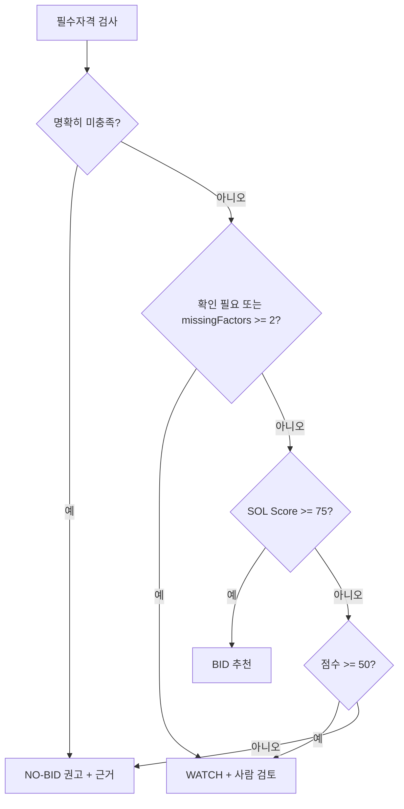

# 08. SOL Score 및 참여 권고

> [!tip] 심사 포인트
> SOL Score는 **설명 가능한 결정론적 점수**다. 같은 입력이면 같은 점수가 나오고, 모든 점수는 요소별 raw → normalized → points 분해와 근거를 함께 저장한다. 이 문서는 숫자를 끝까지 계산한 worked example 3건(§6)으로 그 주장을 증명한다. Kev는 보조 의견일 뿐이고 규칙 판정을 뒤집지 못한다(§5, `FX-03`).

## 1. 핵심 정의

SOL Score는 **우리 회사와 특정 공고의 내부 적합도(0~100)** 이지 낙찰 확률이 아니다. 점수는 결정론적 규칙으로 계산하고 Kev는 별도의 보조 신호로 저장한다. 입력은 `bid_revisions.normalized` + `RequirementExtraction`([[03-AI-PIPELINE|03 AI 파이프라인]] §4.1) + `company_profiles` 특정 revision이며, 입력 스냅샷은 `score_runs.input_snapshot`에 저장한다([[04-DATABASE|04 DB]]).

추출 스키마에 없어서 규칙 쪽이 만드는 파생값 두 개:

| 파생값 | 출처 | 규칙 |
|---|---|---|
| `bid.domain` | `extraction.domain`(03에 `ExtractedField<string>`으로 추가 예정)이 `KNOWN`이면 그 값. 아니면 제목 + `extraction.summary`를 `web/server/scoring/domain-keywords.yaml`로 분류 | 값 집합: `민원`, `데이터 플랫폼`, `교육`, `AX`, `스마트시티`, `국방`, `기타`. 키워드 예: 민원·행정정보 → `민원`, 데이터 플랫폼·데이터허브 → `데이터 플랫폼`, LMS·교육 → `교육`, AI·챗봇·지능형 → `AX`, CCTV·관제·스마트시티 → `스마트시티`, 국방·군 → `국방`. 어느 것도 안 맞으면 `UNKNOWN`(§4 missing) |
| `requiredFte` | `extraction.staffing`이 `KNOWN`이면 `Σ staffing[].minCount`(없는 항목은 1) | `UNKNOWN`이면 §3.3 `FTE_BY_BUDGET` 예산 구간 표 |

> [!warning] 미검증 가정
> 도메인 값 집합과 키워드 표는 v0.1 가정이다. fixture 20건으로 사람이 분류한 정답과 비교해 틀리면 표를 고친다.

## 2. v0.1 점수표

| 요소 (`factor`, 05 `FactorKey`) | 최대점 | 계산 개요 |
|---|---:|---|
| 기술 스택 적합 `skillMatch` | 30 | 필수/우대 기술 매칭률, 별칭표 보조 |
| 유사 수행 실적 `pastPerformance` | 25 | 분야·금액·최근성이 가장 비슷한 실적 1건의 유사도 |
| 인력 가용성 `staffAvailability` | 20 | 필요 FTE 대비 가용 FTE, 제안 준비 일정 계수 |
| 규모 적합성 `scaleFit` | 15 | 최대 수행 실적 대비 예산 비율, 내부 수행 상한 |
| 전략적 선호 `strategicPreference` | 10 | 사업 분야·발주기관 선호 설정 |
| 합계 | 100 | `algorithm_version` 별 불변 |

```text
factor.points = clamp(round(maxPoints * normalized, 1), 0, maxPoints)   # 소수 1자리
solScore      = clamp(round(sum(points)), 0, 100)                          # 정수
```

> [!warning] 미검증 가정
> 가중치 30/25/20/15/10과 임계값 75/50은 초기 제품 가정이다. 실제 조직의 판정 기준과 맞는지는 백테스트 후에만 알 수 있다([[16-DECISIONS|16 ADR]] 미결정 7번). 그래서 가중치·임계값은 `algorithm_version`(`sol-v0.1.0`)에 묶어 config로 버전 관리하고, 바뀌면 기존 `score_runs`를 덮어쓰지 않고 새 run을 만든다.

## 3. 정규화 함수 (의사코드)

모든 함수는 `0.0~1.0`을 반환한다. 입력이 없으면 §4의 missing 정책을 따른다. 아래는 TypeScript 스타일 의사코드이며 서버 도메인 `web/server/scoring/`의 정규화 함수로 1:1 옮긴다(규칙 엔진은 Next 서버와 `web/worker`가 같은 코드를 쓴다).

### 3.1 기술 스택 적합 `skillMatch`

```ts
function skillMatch(req: string[], pref: string[], company: Set<string>, alias: AliasTable) {
  if (req.length === 0 && pref.length === 0) return MISSING;        // §4
  const has = (s: string) => company.has(alias.canonical(s));        // 정확 일치 + 별칭표만. 임베딩 유사도는 P1
  const reqRate  = req.length  ? count(req,  has) / req.length  : null;
  const prefRate = pref.length ? count(pref, has) / pref.length : null;
  if (reqRate === null)  return prefRate;                             // 필수 없음: 우대만
  if (prefRate === null) return reqRate;                              // 우대 없음: 필수만
  return 0.8 * reqRate + 0.2 * prefRate;
}
```

별칭표 예: `Spring Framework ≈ Spring Boot`, `K8s ≈ Kubernetes`, `Postgres ≈ PostgreSQL`. 별칭으로 맞춘 항목은 evidence에 `matchedVia: "alias"`로 남긴다.

### 3.2 유사 수행 실적 `pastPerformance`

```ts
function pastPerformance(bid: Bid, projects: Project[], today: Date) {
  if (projects.length === 0) return 0.0;                              // 회사 실적 자체가 없음: 보수적 0 (§4)
  if (bid.domain === UNKNOWN) return MISSING;                         // 공고 분야 미확인: 중립
  const sim = (p: Project) => {
    const domain   = sameDomain(p.domain, bid.domain) ? 1 : 0;       // 분야 코드 + 별칭표 (예: CCTV 관제 ≈ 스마트시티)
    const amount   = bid.budgetKrw ? Math.min(p.amountKrw, bid.budgetKrw) / Math.max(p.amountKrw, bid.budgetKrw) : 0.5;
    const years    = yearsBetween(p.completedAt, today);
    const recency  = years <= 3 ? 1.0 : years <= 5 ? 0.6 : 0.2;
    const evidence = p.evidenceRef ? 1.0 : 0.5;                       // 증빙 없는 실적은 반만 인정
    return (0.4 * domain + 0.3 * amount + 0.3 * recency) * evidence;
  };
  return Math.max(...projects.map(sim));                              // v0.1: 가장 비슷한 실적 1건
}
```

### 3.3 인력 가용성 `staffAvailability`

```ts
const FTE_BY_BUDGET = [ [5e8, 3], [2e9, 8], [5e9, 20], [Infinity, 40] ]; // 예산 상한(KRW) → 필요 FTE (v0.1 가정)
const SCHEDULE = (bizDays: number) => bizDays >= 10 ? 1.0 : bizDays >= 5 ? 0.7 : 0.4;

function staffAvailability(bid: Bid, extraction: RequirementExtraction, team: TeamAvailability, today: Date) {
  const requiredFte = fteFromStaffing(extraction.staffing) ?? fteByBudget(bid.budgetKrw); // staffing KNOWN이면 Σ minCount. 둘 다 없으면 MISSING (§4)
  if (requiredFte === null) return MISSING;
  const period      = bid.projectPeriod ?? defaultPeriod(bid);                 // 기간 미상: 마감 +1개월부터 6개월
  const available   = team.availableFte(period); // scoringEligible=true인 가상 계산 대상만 전달. 전체 명부 인원수와 구분                               // assignments 겹침 제외한 FTE 합
  const ratio       = Math.min(1, available / requiredFte);
  const bizDays     = bid.deadlineAt ? businessDaysBetween(today, bid.deadlineAt) : null;
  return ratio * (bizDays === null ? 1.0 : SCHEDULE(bizDays));                 // 마감 미상: 일정 계수 미적용
}
```

### 3.4 규모 적합성 `scaleFit`

```ts
function scaleFit(bid: Bid, profile: CompanyProfile) {
  if (!bid.budgetKrw) return MISSING;
  const cap = profile.financials?.maxContractKrw;                      // 내부 수행 상한 (선택 필드)
  if (cap && bid.budgetKrw > cap) return { value: 0.0, reviewFlag: "SCALE_LIMIT_EXCEEDED" };
  const maxPast = Math.max(...profile.pastProjects.map(p => p.amountKrw), 0);
  if (maxPast === 0) return MISSING;
  const ratio = bid.budgetKrw / maxPast;
  return ratio <= 1.5 ? 1.0 : ratio <= 3 ? 0.6 : 0.2;
}
```

`maxContractKrw`는 [[04-DATABASE|04 DB]]·[[05-API-SPEC|05 API]] `financials`의 선택 필드(KRW 정수 문자열)다.

`SCALE_LIMIT_EXCEEDED` 조건: `company_profiles.financials.maxContractKrw`가 설정되어 있고 `budgetKrw > maxContractKrw`이면 `scaleFit` normalized 0.0(points 0)과 함께 `reviewFlags`에 `SCALE_LIMIT_EXCEEDED`를 넣는다([[04-DATABASE|04 DB]] `review_flags` 값). `FX-15`: 80억 > 50억. 상한이 null이면 플래그 없이 비율만 계산한다. 이 플래그는 권고를 직접 바꾸지 않고 점수(0점)와 화면 경고로만 작용한다.

### 3.5 전략적 선호 `strategicPreference`

```ts
// prefs = company_profiles.preferences (04·05)
//       = { agencies: string[], agencyTypes: string[], domains: string[], excludedDomains: string[], excludedKeywords: string[] }
function strategicPreference(bid: Bid, prefs: OrgPreferences | null) {
  if (!prefs) return MISSING;
  if (bid.domain !== UNKNOWN && prefs.excludedDomains.includes(bid.domain)) return 0.0;   // 제외 분야 → 0
  const text = `${bid.title} ${bid.agency}`;
  if (prefs.excludedKeywords.some(k => text.includes(k))) return 0.0;                     // 제외 키워드 1개라도 → 0
  const domainLevel = bid.domain === UNKNOWN ? 0.5 : prefs.domains.includes(bid.domain) ? 1.0 : 0.5;
  const agencyLevel = prefs.agencies.includes(bid.agency) || prefs.agencyTypes.includes(agencyType(bid.agency)) ? 1.0 : 0.5;
  return 0.6 * domainLevel + 0.4 * agencyLevel;
}
// agencyType: 이름 끝이 시·도·군·구·특별자치시·특별자치도 → "지자체", "교육청" 포함 → "교육청",
//             부·처·청(중앙) → "중앙부처", 그 외 → "공공기관".
```

## 4. Missing 데이터 정책

> [!tip] 심사 포인트
> 데이터가 없을 때 점수를 **올리는** 쪽으로 메우지 않는다. 중립(0.5) 또는 보수(0.0)만 쓰고, 어떤 요소가 비었는지 `score_runs.input_snapshot.missingFactors`에 남겨 화면에 그대로 보여준다.

| 요소 | 없는 데이터 | normalized | points | `missingFactors` 기록 | 화면 표시 ([[06-UI-UX\|06 UI]]) |
|---|---|---:|---:|---|---|
| `skillMatch` | 공고에 요구기술 없음 (추출 `UNKNOWN` 또는 파싱 실패) | 0.5 | 15.0 | `{factor:"skillMatch", reason:"NO_REQUIREMENTS_EXTRACTED"}` | 요소 행에 "미확인" 배지 + 회색 바 |
| `skillMatch` | 회사 기술 목록 비어 있음 | 0.0 | 0.0 | `reason:"PROFILE_TECHNOLOGIES_EMPTY"` | "회사 프로필 보완 필요" 링크 |
| `pastPerformance` | 공고 분야 미확인 | 0.5 | 12.5 | `reason:"BID_DOMAIN_UNKNOWN"` | "미확인" 배지 |
| `pastPerformance` | 회사 실적 0건 | 0.0 | 0.0 | `reason:"PROFILE_PROJECTS_EMPTY"` | "회사 프로필 보완 필요" 링크 |
| `staffAvailability` | 필요 FTE·예산 모두 없음 | 0.5 | 10.0 | `reason:"REQUIRED_FTE_UNKNOWN"` | "미확인" 배지 |
| `staffAvailability` | 팀 데이터 없음 | 0.5 | 10.0 | `reason:"TEAM_EMPTY"` | "인력 정보 없음" |
| `scaleFit` | 예산 null (`FX-11`) | 0.5 | 7.5 | `reason:"BUDGET_UNKNOWN"` | "예산 미기재" 배지 |
| `scaleFit` | 회사 실적 0건 | 0.5 | 7.5 | `reason:"PROFILE_PROJECTS_EMPTY"` | 위와 동일 |
| `strategicPreference` | 조직 선호 미설정 | 0.5 | 5.0 | `reason:"PREFERENCES_NOT_SET"` | "선호 설정" 링크 (ADMIN) |

규칙: `missingFactors`가 **2개 이상**이면 점수와 무관하게 결정 경로에서 `NEEDS_REVIEW`로 취급해 BID 자동 권고를 막는다. 1개면 점수대로 가되 요소 행에 배지를 붙인다. 이 정책은 요소별 단위 테스트로 고정한다([[11-TESTING|11 테스트]]).

## 5. 자격 판정과 결정 정책

### 5.1 자격 판정

각 필수 항목은 `SATISFIED`, `NOT_SATISFIED`, `NEEDS_REVIEW` 중 하나다. 자격 요건 문장이 추출되지 않았거나(`FX-04`) 회사 증빙이 빠져 있으면 `NEEDS_REVIEW`. 발주계획 단계처럼 자격 요건이 아직 없는 공고는 `NOT_APPLICABLE`로 기록하고 결정 경로에서는 `NEEDS_REVIEW`와 같게 다룬다(`FX-17`). 법적 자격을 자동으로 확정하지 않는다. 각 항목에는 공고 쪽 근거(`EvidenceRef`)와 회사 쪽 근거(면허·증명서 레코드)를 함께 남긴다.

### 5.2 결정 정책 v0.1



BID/WATCH/NO-BID은 **권고**다. 최종 참여 결정은 `bid_reviews`에 사람의 결정·사유로 기록한다. 75/50은 초기 가정이며 조직별로 바꿀 수 있도록 config versioning한다.

### 5.3 Kev 처리

Kev 질문 세트는 [[03-AI-PIPELINE|03 AI 파이프라인]] §5의 4종이다. 어느 것도 규칙 판정이나 점수를 바꾸지 못한다.

| 질문 | 타입 | 결과에서 쓰는 방식 |
|---|---|---|
| `recommendation` | choice BID/WATCH/NO_BID | 규칙 권고와 비교해 일치/상충 표시(아래 표). `kev.suggestedOption`에 저장 |
| `mandatoryRisk` | noul | ≥ 0.70이고 규칙이 모든 자격을 `SATISFIED`로 봤으면 `reviewFlags += KEV_MANDATORY_RISK` + "사람 검토 권장". 자격 결과는 바꾸지 않음 |
| `needsHumanReview` | noul | ≥ 0.70이면 `reviewFlags += KEV_NEEDS_REVIEW` + 결정 패널 상단 "사람 검토 권장". 권고 불변 |
| `fit` | score 1~5 | Kev 섹션에 "적합도 의견 n/5"로만 표시. SOL Score에 합산하지 않음 |

`recommendation` 분포는 설명 가능한 보조 의견으로만 쓴다. 규칙상 NO-BID·확인 필요를 BID로 승격할 수 없다.

| 규칙 권고 | Kev 최상위 선택지 | 결과 | `recommendationBasis` |
|---|---|---|---|
| 같음 | 같음 | 규칙 권고 그대로 | `RULES_WITH_KEV_ASSIST` |
| BID | WATCH 또는 NO_BID | 규칙 BID 유지. 상세 화면에 "Kev 의견 상이" 표시, 사람 검토 권장 | `RULES_WITH_KEV_ASSIST` + `reviewFlags:["MODEL_RULE_DISAGREEMENT"]` |
| WATCH / NO-BID | BID | 규칙 유지. Kev는 승격 불가 | 위와 동일 |
| 아무거나 | Kev 없음(장애·비활성) | 규칙 권고 그대로, `analysis.status=PARTIAL` | `RULES_ONLY` |

Kev의 모델 confidence는 입찰 승률이 아니다. 화면 제목은 "모델 선택지 신뢰 분포 (수주 확률 아님)"으로 고정하고 본문에는 [[09-SECURITY|09 보안]] "모델 한계 고지 문구"의 Kev 블록 3줄을 그대로 쓴다. 임계값 0.70과 플래그 이름은 [[03-AI-PIPELINE|03 AI 파이프라인]] §5와 같다. 질문 세트 버전 `kev-qs/v0.1`.

## 6. Worked example: 솔리데오의 가상 데모 프로필

> [!warning] 가상 데이터
> 회사명 솔리데오와 엑셀의 부서·직급 명칭은 사용자 회사 기준이다(ADR-019). 아래 직원 이름·얼굴·실적·자격·재무·가용 인력은 **가상 데모 설정**이며 실제 회사 현황을 뜻하지 않는다. seed 데이터에 `isDemo=true`로 들어간다. 공고 `FX-01`·`FX-02`·`FX-03`은 [[07-DATA-PIPELINE|07 수집]] §6.2의 가상 fixture다. 계산 기준일은 2026-10-16. 이 절이 프로필 값의 단일 원천이며 [[19-DEMO-SCENARIO|19 데모 시나리오]] §1이 같은 값을 쓴다.

### 6.1 프로필 요약 (`org-01`, `company_profiles` revision 2)

| 항목 | 값 |
|---|---|
| 테넌트 | `org-01`. 격리 시연용 비교 조직은 `org-02`(계정 `viewer@other.invalid`). seed 사전 리뷰 2건: `FX-01` BID, `FX-03` NO-BID(`FX-02`는 데모 S4에서 라이브로 기록) |
| 업종·규모 | 공공 SI 중견, 중기업, 가상 직원 명부 200명(남성 100·여성 100) |
| 기술 (`technologies`) | Java, Spring Boot, 전자정부 표준프레임워크, NestJS, Next.js, PostgreSQL, Kubernetes, RAG/LLM 적용 |
| 보유 자격 (`licenses`) | 소프트웨어사업자 신고확인서, 직접생산확인증명서(소프트웨어개발), 중소기업확인서(중기업), ISO 27001, CMMI L3 |
| 미보유 자격 | 정보통신공사업 등록, 방산업체 지정, ISMS-P, CSAP |
| 재무 (`financials`, 선택 필드) | `fiscalYear` 2025, `annualRevenueKrw` 180억(가설), `employeeCount` 200, 단일 사업 수행 상한 `maxContractKrw` 50억 |
| 인력 (`team_members`) | 전체 가상 명부 200명. 그 안의 점수 계산 대상 하위 집합(`scoringEligible=true`)은 PM 2, PL 4, 개발 18, 데이터·AI 3의 27명. 나머지 173명은 계산 대상에서 제외. 2026-12~2027-06 구간 가용 20 FTE(기존 배정 제외) |
| 선호 (`preferences`) | `agencies: []`, `agencyTypes: [지자체, 교육청]`, `domains: [데이터 플랫폼, AX, 민원, 교육]`, `excludedDomains: [국방]`, `excludedKeywords: [무기체계]` |

| 실적 ID | 사업명 (가상) | 분야 | 금액 | 완료 | 증빙 |
|---|---|---|---:|---|---|
| P1 | 지자체 민원 시스템 고도화 | 민원 | 12억 | 2024-11 | 있음 |
| P2 | 공공기관 데이터 플랫폼 구축 | 데이터 플랫폼 | 28억 | 2024-03 | 있음 |
| P3 | 교육기관 AI 챗봇 PoC | 교육 | 3억 | 2025-09 | 있음 |

세 실적 모두 완료 3년 이내라 최근성 계수는 1.0이다. 최대 실적 금액은 28억.

### 6.2 Example A — `FX-01` → BID

공고: 세종특별자치시 차세대 행정정보시스템 고도화, 분야 민원, 예산 12억, 마감 +21일(영업일 15), 기간 8개월. 추출: 필수 Java·Spring Boot·PostgreSQL·전자정부 표준프레임워크·Kubernetes, 우대 Elasticsearch·Kafka, 필요 인력 PM 1 + PL 1 + 개발 10 = 12 FTE. 자격: 소프트웨어사업자, 직접생산확인, 중소기업 제한경쟁 → 모두 `SATISFIED`.

| 요소 | raw | normalized | points |
|---|---|---:|---:|
| `skillMatch` | 필수 5/5 = 1.0, 우대 0/2 = 0.0 (Elasticsearch·Kafka 없음) | 0.8×1.0 + 0.2×0.0 = **0.80** | 24.0 |
| `pastPerformance` | P1: 분야 1, 금액 12/12 = 1.0, 최근성 1.0(1.9년), 증빙 1.0 | 0.4 + 0.30 + 0.30 = **1.00** | 25.0 |
| `staffAvailability` | 필요 12 FTE, 가용 20 → ratio 1.0, 영업일 15 → 계수 1.0 | **1.00** | 20.0 |
| `scaleFit` | 12억 / 최대 실적 28억 = 0.43 ≤ 1.5, 상한 50억 이내 | **1.00** | 15.0 |
| `strategicPreference` | 제외 키워드 없음. 분야 민원 ∈ domains → 1.0, 세종특별자치시 → 유형 지자체 → 1.0 | 0.6 + 0.4 = **1.00** | 10.0 |
| 합계 | | | **94.0 → 94** |

결정 경로: 자격 미충족 없음 → 확인 필요 없음, `missingFactors` 0 → 94 ≥ 75 → **BID**. Kev(mock): BID 0.71 / WATCH 0.24 / NO_BID 0.05 → 일치, `recommendationBasis=RULES_WITH_KEV_ASSIST`.

### 6.3 Example B — `FX-02` → WATCH

공고: 경기도교육청 통합 LMS 구축, 분야 교육, 예산 28억, 마감 +10일(영업일 7), 기간 12개월. 추출: 필수 Java·Spring Boot·PostgreSQL·Vue.js·SCORM 연동·WebRTC, 우대 Kubernetes·AWS, 필요 인력 `UNKNOWN`. 자격: 소프트웨어사업자, 직접생산확인, 공동수급 허용 → 모두 `SATISFIED`.

| 요소 | raw | normalized | points |
|---|---|---:|---:|
| `skillMatch` | 필수 3/6 = 0.5 (Java, Spring Boot, PostgreSQL. Vue.js·SCORM·WebRTC 없음), 우대 1/2 = 0.5 (Kubernetes만) | 0.8×0.5 + 0.2×0.5 = **0.50** | 15.0 |
| `pastPerformance` | P3: 분야 1, 금액 3/28 = 0.107, 최근성 1.0, 증빙 1.0 → 0.4 + 0.032 + 0.3 = 0.732. P2: 분야 0, 금액 1.0, 최근성 1.0 → 0.60. 최대 | **0.732** | 18.3 |
| `staffAvailability` | 필요 FTE 미추출 → 예산 구간 20~50억 = 20 FTE, 가용 20 → ratio 1.0, 영업일 7 → 계수 0.7 | **0.70** | 14.0 |
| `scaleFit` | 28억 / 28억 = 1.0 ≤ 1.5 | **1.00** | 15.0 |
| `strategicPreference` | 제외 키워드 없음. 분야 교육 → 1.0, 경기도교육청 → 유형 교육청 → 1.0 | **1.00** | 10.0 |
| 합계 | | | **72.3 → 72** |

결정 경로: 자격 OK → `missingFactors` 0 (필요 FTE는 예산 구간으로 대체되어 missing이 아님, evidence에 `estimatedFrom:"budgetTier"` 기록) → 72 < 75, ≥ 50 → **WATCH**. Kev(mock): BID 0.36 / WATCH 0.52 / NO_BID 0.12 → 일치. `needsHumanReview` 0.74 ≥ 0.70 → `reviewFlags:["KEV_NEEDS_REVIEW"]`, 결정 패널에 "사람 검토 권장". 화면 설명: "요구기술 6개 중 3개 보유. Vue.js·SCORM·WebRTC 경험 없음. 제안 준비 기간 7영업일로 촉박."

### 6.4 Example C — `FX-03` → NO-BID (자격)

공고: 부산광역시 지능형 CCTV 통합관제센터 구축, 분야 스마트시티(선호 목록에 없음 → 중립), 예산 45억, 마감 +15일(영업일 11). 추출: 필수 Java·Spring Boot·PostgreSQL·영상분석 AI·Kubernetes·VMS 연동, 우대 없음. 자격: 소프트웨어사업자 `SATISFIED`, **정보통신공사업 등록 `NOT_SATISFIED`** (공고 근거: "정보통신공사업법에 따른 정보통신공사업 등록업체", 회사 근거: `licenses`에 없음).

점수는 설명용으로 끝까지 계산한다.

| 요소 | raw | normalized | points |
|---|---|---:|---:|
| `skillMatch` | 필수 4/6 = 0.667 (영상분석 AI, VMS 연동 없음), 우대 없음 | **0.667** | 20.0 |
| `pastPerformance` | P2: 분야 0, 금액 28/45 = 0.622, 최근성 1.0, 증빙 1.0 → 0 + 0.187 + 0.3 = 0.487. P1 0.38, P3 0.32. 최대 | **0.487** | 12.2 |
| `staffAvailability` | 예산 구간 20~50억 = 20 FTE, 가용 20 → 1.0, 영업일 11 → 1.0 | **1.00** | 20.0 |
| `scaleFit` | 45억 / 28억 = 1.61 → 0.6, 상한 50억 이내 | **0.60** | 9.0 |
| `strategicPreference` | 제외 키워드 없음. 분야 스마트시티 ∉ domains → 0.5, 부산광역시 → 유형 지자체 ∈ agencies → 1.0 | 0.3 + 0.4 = **0.70** | 7.0 |
| 합계 | | | **68.2 → 68** |

결정 경로: **필수자격 명확히 미충족 → NO-BID**. 점수 68은 참고용으로만 표시한다. Kev(mock): BID 0.55 / WATCH 0.30 / NO_BID 0.15 → 상충. 처리: 권고는 NO-BID 유지, `reviewFlags:["MODEL_RULE_DISAGREEMENT"]`, 상세 화면에 "Kev는 BID를 제시했지만 필수자격 미충족으로 규칙 판정이 우선합니다" 배너, 사람 검토 항목에 올림. 골든 시나리오 G3([[11-TESTING|11 테스트]]).

### 6.5 세 사례 요약

| | `FX-01` | `FX-02` | `FX-03` |
|---|---|---|---|
| 자격 | 모두 충족 | 모두 충족 | 1건 미충족 |
| SOL Score | 94 | 72 | 68 (참고) |
| 규칙 권고 | BID | WATCH | NO-BID |
| Kev 최상위 | BID | WATCH | BID |
| 최종 권고 | BID | WATCH | NO-BID |
| `reviewFlags` | 없음 | `KEV_NEEDS_REVIEW` | `MODEL_RULE_DISAGREEMENT` |

`FX-03`은 점수만 보면 WATCH 구간(68)이지만 자격 1건 미충족으로 NO-BID다. 점수가 자격을 대신하지 않는다는 점이 이 설계의 핵심이다.

## 7. 저장 형식

`score_runs` 1건 + `score_factors` 5건(`factor` 값은 05 `FactorKey`: `skillMatch`, `pastPerformance`, `staffAvailability`, `scaleFit`, `strategicPreference`). 각 factor 행은 `raw_value`(위 표의 raw 열에 해당하는 JSON), `points`, `max_points`, `evidence`(매칭된 기술 목록, 선택된 실적 ID, FTE 계산 근거, `EvidenceRef` 배열)를 가진다. `score_runs.model_metadata`에 Kev 모델 식별자·질문 4종의 출력·`prompt_hash`·처리 시간, `review_flags[]`·`missing_factors[]`는 04의 전용 열에, `input_snapshot`에는 `AnalysisInput`(입력 전체)과 `input_snapshot_hash`를 넣는다. API 응답 형태는 [[05-API-SPEC|05 API]]의 `AnalysisResult`.

## 8. 검증

- 골든셋: `fixtures/goldens/FX-xx.json`에 요소별 points와 최종 권고를 고정하고 규칙 단위 테스트(Vitest, `web/server/scoring/*.test.ts`) 100% 통과.
- 재현성: 같은 `input_snapshot_hash` + `algorithm_version`이면 같은 `score`와 같은 요소별 `points`. 두 번 계산해 byte-동일.
- 요소별 missing 정책 테스트(§4 표의 행마다 1개).
- Kev 승격 금지 테스트(`FX-03`, `FX-16`). 골든 시나리오 G3.
- 사람이 평가한 자격 검토와 비교, 추천 precision@K, 잘못된 자격 충족 판정률, 날짜 누설 방지 백테스트([[15-DATA-CONTRACTS|15 데이터 계약]] 시점 일치). 실제 낙찰확률 모델은 낙찰 라벨·시점 정합성이 검증될 때만 별도로 만든다.

## 9. 가상 명부 200명과 점수 계산 범위

ADR-019는 전체 직원 명부·프로필 `employeeCount`를 200으로 통일한다. 200명을 전원 가용 인력으로 입력하거나, 원본 직급/직책에서 PM·기술등급·실제 스킬을 추론하지 않는다. §6.1의 27명·20 FTE는 명부 안의 별도 가상 계산용 설정으로 유지한다. 이름·성별·정장 사진은 점수 입력이 아니며 직급/직책은 권한도 아니다. 입력 스냅샷에는 계산 대상 인력 ID·가용성을 보존한다. FX-01/02/03의 골든 94/72/68과 권고가 바뀌면 완료가 아니다.

## 관련 문서

- [[07-DATA-PIPELINE|07 수집]] — fixture `FX-01`~`FX-20`과 기대 점수
- [[19-DEMO-SCENARIO|19 데모 시나리오]] — 솔리데오 프로필·데모 계정 (이 문서 §6.1과 동일 값)
- [[03-AI-PIPELINE|03 AI 파이프라인]] — `RequirementExtraction`, Kev 질문 세트
- [[04-DATABASE|04 DB]] — `score_runs`, `score_factors`, `company_profiles.financials`
- [[05-API-SPEC|05 API]] — `AnalysisResult` DTO
- [[06-UI-UX|06 UI]] — 점수 분해·missing 배지·Kev 상이 배너 표시
- [[11-TESTING|11 테스트]] — 골든 시나리오 G3·G4
