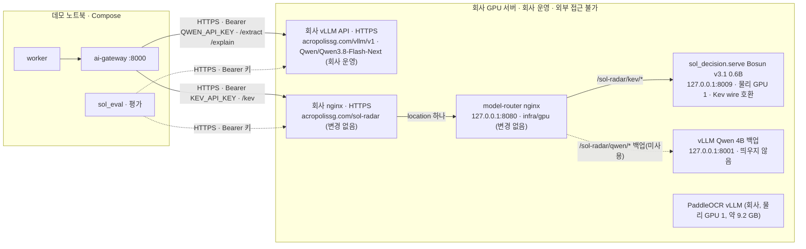

# 10. Docker Compose 배포·실행 프로필

## 원칙
DB·Auth는 Compose 밖의 **Supabase 클라우드 프로젝트**다(개발 환경, [[16-DECISIONS|16 ADR]] ADR-017). Compose는 그 둘레의 서비스만 띄운다: `redis`·`minio`·`qdrant`·`ai-gateway`·`worker`, 그리고 선택으로 `web`. 데모 기본은 Supabase 클라우드 그대로다. 네트워크·클라우드 장애 때의 대체 경로는 [[19-DEMO-SCENARIO|19 데모 시나리오]] §5에 정했다(16 미결정 8번). **웹 배포처만 미결정**이다.

Compose 정의는 하나의 `infra/compose.yaml`이다. 실행 프로필은 env 묶음(`infra/env/<profile>.env.example` → `infra/.env`)이다. `infra/compose.yaml`에는 Compose `profiles`가 없어서 어느 프로필이든 같은 5개 서비스가 뜬다. Redis·Qdrant·MinIO는 named volume. 이미지는 각각 버전(태그 또는 digest)을 고정한다. GPU가 없으면 `demo` 프로필로 구동한다. 모델 런타임이 도는 회사 GPU 서버는 회사가 운영한다([[16-DECISIONS|ADR-025]]). NVIDIA Container Toolkit·`nvidia-smi` 확인은 회사 측 몫이다.

실행 모드 `SOL_RUN_MODE=live|fixture|mock`([[16-DECISIONS|ADR-020]], [[03-AI-PIPELINE|03 AI 파이프라인]] §3)은 **데이터 출처와 AI 공급자**를 정하고, 프로필은 **어떤 env 묶음을 쓰는지**(모델 런타임 주소·키 포함)를 정한다. 해커톤 실추론의 모델 런타임(추출·설명 `Qwen/Qwen3.8-Flash-Next`는 회사가 운영하는 vLLM API, 결정 모델 Bosun v3.1 0.6B는 우리 `sol_decision` 서버)은 노트북 Compose 밖, **회사 GPU 서버**에 있고, 회사가 제공하는 HTTPS 엔드포인트로 붙는다([[16-DECISIONS|ADR-025]]·[[16-DECISIONS|ADR-034]], 2026-10-20 사용자 결정. 아래 "회사 GPU 추론 엔드포인트").

## 실행 모드와 프로필

|`SOL_RUN_MODE`|프로필|모델 런타임 위치|공고|추가로 필요한 것|
|---|---|---|---|---|
|`mock`(기본)|`demo`|없음(gateway의 mock adapter)|fixture 20건(`is_demo=true`)|없음. GPU·서비스키 없이 돈다. CI·골든·모델 장애 시 시연|
|`fixture`|`ai-local`|회사 GPU 추론 엔드포인트(회사 운영 vLLM API `Qwen/Qwen3.8-Flash-Next` + `sol_decision` Bosun v3.1 0.6B. HTTPS, ADR-025·034)|fixture 20건(`is_demo=true`)|엔드포인트 접속(TLS), `QWEN_API_KEY`·`KEV_API_KEY`. 공공 API 장애 시 시연. 한국어 state 평가용 gateway도 이 모드로만 띄운다|
|`live`|`ai-local`|회사 GPU 추론 엔드포인트(위와 같다)|data.go.kr 실공고(`is_demo=false`)|위 + worker의 서비스키 4개(`G2B_*_SERVICE_KEY`, [[07-DATA-PIPELINE\|07 수집]] §2.2). `KEV_ALLOW_KO_STATE=true`와 함께 쓸 수 없다(gateway 기동 거부)|

- 모드가 `DEMO_MODE`·`AI_PROVIDER`·`KEV_ENABLED`의 기본값을 정한다(`live` → `DEMO_MODE=false`·`AI_PROVIDER=local`·`KEV_ENABLED=true`, `fixture` → `true`·`local`·`true`, `mock` → `true`·`mock`·`true`(mock adapter가 응답)). `KEV_ENABLED`는 세 모드 모두 `false`도 허용한다. `false`면 결정 모델 없이 `RULES_ONLY`이고 분석은 `COMPLETED`다(`infra/run-modes.json`, [[16-DECISIONS|ADR-029]] A5). 직접 준 값이 모드와 모순되면 `pnpm check:env`와 gateway가 기동을 거부한다. 예: `live` + `AI_PROVIDER=mock`, `live` + `AI_FALLBACK_TO_MOCK=true`, `live` + `KEV_ALLOW_KO_STATE=true`. 모드와 상관없이 `AI_PROVIDER=hosted` + `KEV_ALLOW_KO_STATE=true`(사유 `KEV_ALLOW_KO_STATE(FORBIDDEN_WITH_HOSTED)`)도 거부한다([[16-DECISIONS|ADR-030]] B11).
- 모드 전환은 env를 바꾸고 worker·ai-gateway를 재시작해서 한다. 시연 중 장애 대체 순서는 `live` → `fixture` → `mock`이고 사람이 전환한다. 자동 대체(`AI_FALLBACK_TO_MOCK`)는 기본 `false`이고 `live`에서는 켤 수 없다([[03-AI-PIPELINE|03]] §8). 해커톤 동안은 구현하지 않아 어느 모드에서든 `true`면 기동을 거부한다([[16-DECISIONS|ADR-030]] B11).
- 한국어 state 평가(E2, [[21-MODEL-TRAINING|21 모델 학습]])는 노트북에서 `sol_eval`이 `KEV_BASE_URL` 엔드포인트에 직접 붙거나, `SOL_RUN_MODE=fixture` + `KEV_ALLOW_KO_STATE=true`로 띄운 평가용 gateway에서만 한다(ADR-025). 데모용 gateway에는 켜지 않는다.
- 회사 프로필은 모든 모드에서 가상 솔리데오 프로필이다(ADR-019). live 분석은 "실제 공고 × 가상 회사 프로필"이다.

## 실행 프로필 3단
|프로필|대상 환경|AI 동작|추가 서비스|필수 env (요지)|기동 명령|
|---|---|---|---|---|---|
|`demo`|노트북 1대, GPU 없음, Docker Desktop, **인터넷 연결(Supabase 클라우드)**|`AI_PROVIDER=mock`: gateway가 fixture 기반 결정적 응답|없음 (seed는 Compose 서비스가 아니라 스크립트 `pnpm demo:reset`)|공통 env + `SOL_RUN_MODE=mock`, `DEMO_MODE=true`, `AI_PROVIDER=mock`, `KEV_ENABLED=true`(기본값. mock adapter가 응답, `false` 허용), `AI_HOSTED_APPROVED=false`|`docker compose -f infra/compose.yaml up -d --build`|
|`ai-local`|**노트북**(기본 5개 서비스, gateway 포함) + **회사 GPU 추론 엔드포인트**(회사가 모델 런타임을 HTTPS로 제공, ADR-025). 클라우드 GPU 임대는 비용 승인 뒤만(ADR-010)|`Qwen/Qwen3.8-Flash-Next`(회사 운영 vLLM API) + Bosun v3.1 0.6B(`sol_decision`) 실제 추론([[16-DECISIONS\|ADR-034]], 2026-10-20 사용자 결정)|노트북: 없음. 회사 GPU 서버(회사 운영): 모델 라우터 `model-router`(`infra/compose.gpu.yaml`) + 호스트에 직접 띄우는 `sol_decision.serve`(`:8009`). 추출·설명은 회사가 이미 운영하는 vLLM API(`https://acropolissg.com/vllm/v1`)라 우리가 띄우지 않는다|공통 env + `SOL_RUN_MODE=live` 또는 `fixture`, `AI_PROVIDER=local`, `KEV_ENABLED=true`(기본값, `false` 허용), `QWEN_BASE_URL=https://acropolissg.com/vllm/v1`(회사 vLLM API. 끝의 `/v1` 중복은 게이트웨이가 정규화)·`KEV_BASE_URL=https://acropolissg.com/sol-radar/kev`(아래 env 예시), `QWEN_MODEL=Qwen/Qwen3.8-Flash-Next`, `KEV_MODEL_ID=bosun-v3.1-0.6b`, `QWEN_API_KEY`·`KEV_API_KEY`, `AI_FALLBACK_TO_MOCK=false`. `live`면 worker에 서비스키 4개(`G2B_*_SERVICE_KEY`)|노트북: 엔드포인트 `GET /sol-radar/healthz`·`GET /v1/models` 확인 뒤 `docker compose -f infra/compose.yaml up -d --build`(아래 "회사 GPU 추론 엔드포인트"). 회사 GPU 서버 쪽은 회사가 띄운다: `docker compose -f infra/compose.gpu.yaml up -d`(라우터) + `sol_decision.serve` 호스트 기동(`infra/gpu/README.md`). vLLM은 회사 운영 API를 쓰므로 띄우지 않는다|
|`ai-hosted` (**미구현**)|GPU 없는 환경에서 실모델이 필요할 때|hosted API 호출. **미검증, 비용 발생, 사용자 승인 필요**|없음|설계: 공통 env + `AI_PROVIDER=hosted`, `AI_HOSTED_APPROVED=true`(승인 후만), `HOSTED_API_BASE_URL`, `HOSTED_API_KEY`(placeholder). 지금은 env 예시 파일(`infra/env/`에는 `demo`·`ai-local` 두 개뿐)이 없고 Compose가 `HOSTED_*`를 gateway에 넘기지 않는다. 구현된 것은 승인 게이트(`infra/run-modes.json`·`pnpm check:env`·gateway 기동 거부)뿐이다|없음(미구현)|

- **공통 env**: `NEXT_PUBLIC_SUPABASE_URL`, `NEXT_PUBLIC_SUPABASE_ANON_KEY`(공개 가능, 권한은 RLS가 정함. web 전용이라 `web/.env.local`에만 있고 Compose 쪽 `infra/.env`·`compose.yaml`에는 없다), `SUPABASE_SERVICE_ROLE_KEY`(RLS를 무시하는 비밀. worker·seed 전용), `REDIS_URL`/`REDIS_PASSWORD`, `MINIO_ROOT_USER`/`MINIO_ROOT_PASSWORD`. `SUPABASE_DB_URL`은 마이그레이션 적용(`pnpm db:push`, 클라우드 DB를 바꾸므로 사용자 확인 뒤에만)과 상태 확인(`pnpm db:verify`)에만 쓴다. 자체 인증 서명 비밀이나 DB 컨테이너 비밀번호 변수는 없다(Auth·DB는 Supabase).
- env 전체 표(`SOL_RUN_MODE`, `AI_GATEWAY_URL`, `AI_TIMEOUT_MS`, `KEV_TIMEOUT_MS`, `KEV_QUESTION_SET`, `KEV_MODEL_ID`, `KEV_ALLOW_KO_STATE`, `AI_FALLBACK_TO_MOCK`, `PARSER_*`, `AI_PROMPT_VERSION` 등)는 [[03-AI-PIPELINE|03 AI 파이프라인]] §3이 원천이다. 여기 표는 프로필별로 달라지는 값만 적었다.
- `DEMO_MODE=true`면 공식 API connector를 비활성화하고 `fixtures/`만 읽는다. 적재되는 공고는 `is_demo=true`. `DEMO_MODE`는 `SOL_RUN_MODE`에서 파생된다([[07-DATA-PIPELINE|07 수집]]).
- 프로필 전환은 `infra/.env` 교체와 재기동만으로 끝난다. 코드 변경 없음 ([[16-DECISIONS|16 ADR]] ADR-008).
- `ai-hosted`(미구현)는 사용자 명시 승인 후 `AI_HOSTED_APPROVED=true`로만 켠다 (ADR-010). 승인 플래그 없이 `hosted`를 지정하면 gateway가 기동을 거부한다. CI·테스트에서는 항상 `mock`.
- `infra/compose.yaml`에는 `kev`·`qwen-runtime` 서비스가 없다(Phase 0 구현). 노트북은 어느 프로필이든 같은 5개 서비스를 띄우고, `ai-local`이면 `ai-local` env 묶음을 쓴다. 회사 GPU 서버용 구성은 프로필이 아니라 별도 파일 `infra/compose.gpu.yaml`(`name: sol-radar-gpu`, 모델 라우터만)로 나눴다(ADR-025. ADR-020 P0-1의 "프로필 이름을 나눌지"는 이렇게 닫혔다).

### env 파일 위치
세 파일 모두 깃에서 제외한다. 값은 `.env.example`·`infra/env/*.env.example`의 키 이름을 보고 채운다.

|파일|읽는 쪽|담는 값 (요지)|
|---|---|---|
|`infra/.env`|`docker compose -f infra/compose.yaml`의 변수 치환. Compose는 `--project-directory`가 없으면 첫 `-f` 파일의 디렉터리(`infra/`)를 프로젝트 디렉터리로 삼고 거기서 `.env`를 찾는다(https://docs.docker.com/compose/how-tos/environment-variables/variable-interpolation/, 2026-10-16 확인). 컨테이너에 넘기는 값은 `compose.yaml`의 `environment`가 정한다. 아래는 지금 `compose.yaml`이 넘기는 키만 적었다|`worker`: `NEXT_PUBLIC_SUPABASE_URL`, `SUPABASE_SERVICE_ROLE_KEY`, `MINIO_ROOT_USER`/`MINIO_ROOT_PASSWORD`, `SOL_RUN_MODE`, `DEMO_MODE`, `G2B_BID_NOTICE_SERVICE_KEY`·`G2B_PRE_SPEC_SERVICE_KEY`·`G2B_ORDER_PLAN_SERVICE_KEY`·`G2B_INDUSTRY_MASTER_SERVICE_KEY`(서비스별 서비스키 4개, `live`만 필수, 서버 전용·로그 금지), 선택 `G2B_INGEST_INTERVAL_MINUTES`·`ANALYSIS_STALE_QUEUED_MS`·`ANALYSIS_STALE_RUNNING_MS`·`ANALYSIS_RECONCILE_INTERVAL_MS`·`KEV_TIMEOUT_MS`·`AI_TIMEOUT_MS`·`NOTIFY_POLL_INTERVAL_MS`(아래). worker의 `REDIS_URL`은 Compose가 `REDIS_PASSWORD`로 만들고 `AI_GATEWAY_URL`은 `http://ai-gateway:8000` 고정이다. `redis`·`minio`: 각 비밀번호. `ai-gateway`: `SOL_RUN_MODE`, `DEMO_MODE`, `AI_PROVIDER`, `AI_HOSTED_APPROVED`, `AI_FALLBACK_TO_MOCK`, `KEV_ENABLED`, `KEV_ALLOW_KO_STATE`, `QWEN_BASE_URL`·`QWEN_MODEL`·`QWEN_API_KEY`, `KEV_BASE_URL`·`KEV_MODEL_ID`·`KEV_QUESTION_SET`·`KEV_API_KEY`, 선택 `KEV_TIMEOUT_MS`·`AI_TIMEOUT_MS`(아래). 호스트 포트 선택: `REDIS_HOST_PORT`(기본 6380)·`MINIO_HOST_PORT`(9000)·`QDRANT_HOST_PORT`(6333)·`AI_GATEWAY_HOST_PORT`(8000)|
|`web/.env.local`|Next.js `web/`(템플릿 위치)|`NEXT_PUBLIC_SUPABASE_URL`, `NEXT_PUBLIC_SUPABASE_ANON_KEY`, `REDIS_URL`(분석 요청 큐 등록과 속도 제한), `MINIO_ENDPOINT`(`/health/ready` 의 `checks.storage` 확인용 끝점만. MinIO root 계정은 web 에 넣지 않는다), `AI_GATEWAY_URL`, `API_CURSOR_SECRET`(목록 커서 HMAC 키, 32자 이상, [[05-API-SPEC\|05 API]] §3. 아니면 커서 목록 API가 503 `{component:"cursor"}`), `SOL_RUN_MODE`(없으면 `mock`. Topbar 실행 모드 표시와 `/bids`·`/dashboard/summary`의 `origin` 기본값에 쓴다. web env 예시와 `pnpm check:env`에 등록하고 구현은 C6 B단계, [[16-DECISIONS\|ADR-029]] A6 D2. `infra/.env`의 값과 같게 둔다. 다르면 `pnpm check:env`가 `CONTRADICTS_MODE`로 실패한다). `REDIS_URL`의 쓰임·`API_CURSOR_SECRET` 503·`SOL_RUN_MODE` 검사는 적용됨(main `4ae09f9`, [[16-DECISIONS\|ADR-032]] D8·[[16-DECISIONS\|ADR-033]] E5). 선택 `AI_PROVIDER`·`AI_HOSTED_APPROVED`·`KEV_ENABLED`(`GET /api/v1/admin/ai/status`가 읽는다. gateway에 닿지 못할 때 보이는 값이고 `infra/.env`와 같은 값을 둔다, main `c5c91b5`): hosted는 gateway와 web **둘 다** `AI_HOSTED_APPROVED=true`여야 한다. web 쪽 값이 `true`가 아니면 gateway가 hosted로 떠 있어도 `422 HOSTED_NOT_APPROVED`다([[05-API-SPEC\|05 API]] §5, [[16-DECISIONS\|ADR-035]] F6). **`SUPABASE_SERVICE_ROLE_KEY`와 서비스키 4개(`G2B_*_SERVICE_KEY`)는 넣지 않는다**(요청 처리는 사용자 세션 + RLS, 공공 API 호출은 worker만)|
|루트 `.env.local`|`pnpm db:push`·`pnpm db:verify`(템플릿 `scripts/db-push.sh`·`scripts/db-verify.sh`가 `SUPABASE_DB_URL`을 여기서 읽는다), `pnpm demo:reset`|`SUPABASE_DB_URL`, `NEXT_PUBLIC_SUPABASE_URL`, `SUPABASE_SERVICE_ROLE_KEY`, `DEMO_SEED_PASSWORD`|

- service role 키와 서비스키 4개(`G2B_*_SERVICE_KEY`)는 `NEXT_PUBLIC_` 변수·브라우저 번들·로그에 절대 넣지 않는다([[09-SECURITY|09 보안]]). 서비스키는 worker의 `OfficialApiConnector`만 읽고, 소스마다 registry `serviceKeyEnv`가 가리키는 키 하나만 쓴다([[07-DATA-PIPELINE|07 수집]] §2.2). gateway에도 넘기지 않는다.
- `pnpm check:env`는 세 파일의 placeholder를 세고, 실행 모드와 모순된 값(위 "실행 모드와 프로필")이 있으면 실패한다. Phase 0에서 구현했다(`scripts/check-env.mjs`). `process.env`가 아니라 `infra/.env`·`web/.env*` **파일**을 읽으므로 셸에서 env 만 주어서는 검사되지 않는다.
- worker의 선택 env `G2B_INGEST_INTERVAL_MINUTES`(일정 수집 주기, 기본 `30`분, 양의 정수, [[07-DATA-PIPELINE|07 수집]] §2.2)와 `ANALYSIS_STALE_QUEUED_MS`·`ANALYSIS_STALE_RUNNING_MS`·`ANALYSIS_RECONCILE_INTERVAL_MS`(멈춘 분석 복구, [[03-AI-PIPELINE|03]] §3)는 main `4895010`부터 `compose.yaml`이 worker `environment`에 키만 둔다. `infra/.env`·셸에 값이 있으면 그 값이 넘어가고, 없으면 컨테이너에 변수가 없어 코드 기본값이 쓰인다(`compose.yaml` 주석, [[16-DECISIONS|ADR-031]] C12(e)·C13).
- `KEV_TIMEOUT_MS`·`AI_TIMEOUT_MS`(모델 호출 시간 제한, 기본 `5000`·`60000`)는 main `01fa51a`(병합 `9f71244`)부터 `compose.yaml`이 ai-gateway와 worker **둘 다**에 값 없는 키로 넘긴다. `infra/.env`에 값이 있으면 두 서비스가 같은 값을 받고, 없으면 둘 다 기본값이다. 빈 문자열을 넘기면 gateway 설정 검증이 실패해 기동하지 않으므로 값 없는 키여야 한다. 기본값을 바꿀 때는 gateway `settings.py`와 worker `gateway.model.ts`를 함께 바꾼다([[03-AI-PIPELINE|03]] §3, [[16-DECISIONS|ADR-033]] E4).
- worker의 선택 env `NOTIFY_POLL_INTERVAL_MS`(인앱 알림 outbox 처리 간격, ms, 500~60000 10진 정수, 기본 `2000`, [[13-NOTIFICATIONS|13 알림]] "인앱 알림 2종"). 값이 틀리면 worker가 키 이름만 알리고 기동을 멈춘다. main `301f2a5`(`fix/compose-notify-poll` @ `574aaad`)부터 `compose.yaml`이 worker `environment`에 값 없는 키로 넘긴다. `infra/.env`·셸에 값이 없으면 기본값 2000을 쓴다([[16-DECISIONS|ADR-033]] E5).
- 카카오톡 알림(나에게 보내기, [[16-DECISIONS|ADR-038]]) env. 구현 중(`feat/kakao-notify`, main 병합 전)이다.
  - worker(`infra/.env`): `NOTIFY_KAKAO_PROVIDER`·`KAKAO_REST_API_KEY`·`KAKAO_CLIENT_SECRET`·`KAKAO_TOKEN_ENC_KEY`·`SITE_URL`. `52adabb`부터 `compose.yaml`이 worker `environment`에 값 없는 키 다섯 개로 넘기고, 이름은 `.env.example`·`infra/env/demo.env.example`에 주석으로만 있다(값 없음).
  - `NOTIFY_KAKAO_PROVIDER`가 비거나 `mock`이면 mock(외부 호출 없이 보낸 것으로 친다), `memo`면 나에게 보내기 실발송이다. 그 밖의 값이면 worker가 키 이름만 알리고 기동을 멈춘다.
  - `memo`면 `KAKAO_REST_API_KEY`·`KAKAO_CLIENT_SECRET`·`KAKAO_TOKEN_ENC_KEY`·`SITE_URL` 넷이 모두 있어야 하고 `KAKAO_TOKEN_ENC_KEY`는 base64 32바이트여야 한다. 틀리면 worker가 Redis·큐 연결을 만들기 전에 키 이름만 알리고 멈춘다. 나에게 보내기 요청 시간 제한은 5000ms다.
  - `SITE_URL`은 피드 링크의 웹 주소(http·https)다. mock에서 비면 `http://localhost:3000`이다. 근거는 `web/worker/notify-outbox.ts` `readKakaoSettings`와 시험 `notify-outbox.test.ts`·`main.test.ts`(`52adabb`)다.
  - web(`web/.env.local`): `KAKAO_REST_API_KEY`·`KAKAO_CLIENT_SECRET`·`KAKAO_TOKEN_ENC_KEY`·`KAKAO_REDIRECT_URI`·`SITE_URL`. 연결 Route Handler가 아직 없어 계획의 이름이다. 확정되면 env 예시 파일과 이 줄을 맞춘다.
  - `KAKAO_TOKEN_ENC_KEY`는 카카오 토큰 암호화 키(base64 32바이트, AES-256-GCM)다. web이 암호화해 저장하고 worker가 복호화하므로 두 쪽이 같은 값을 쓴다. 바꾸면 모든 연결을 다시 해야 한다.
  - 카카오 키·시크릿·암호화 키는 서버 전용이다. `NEXT_PUBLIC_` 변수·브라우저 번들·로그에 넣지 않는다([[16-DECISIONS|ADR-018]] 예외, [[09-SECURITY|09 보안]] "카카오톡 알림").
  - 실발송은 사용자가 `NOTIFY_KAKAO_PROVIDER=memo`로 바꿀 때만 일어난다. 시험·CI는 `mock`이다([[13-NOTIFICATIONS|13 알림]] "카카오톡 추천 공고").

**Phase 0 확정 사항**: 결정과 이유는 [[16-DECISIONS|ADR-024]] 상세 표가 정본이다(placeholder `CHANGE_ME`·`minioadmin` 금지·Redis 비밀번호 영숫자·MinIO 길이, 호스트 포트 `127.0.0.1`·redis 기본 6380, Compose 프로젝트 이름 `sol-radar-stack`, 실행 모드 규칙 원천 `infra/run-modes.json`과 빈 문자열은 미지정). 여기에는 운영에 필요한 것만 적는다.
- gateway 이미지는 `AI_HOST=0.0.0.0`·`SOL_RUN_MODES_FILE=/app/infra/run-modes.json`을 이미지 ENV로 가지고, 저장소 루트를 빌드 컨텍스트로 쓴다(`context: ..`). Compose는 실행 모드 키를 `${VAR:-}`로 넘긴다.
- `infra/smoke.sh` 는 `-p` 를 받지 않는다. 다른 프로젝트·env 로 격리해 돌리려면 Compose 환경변수 `COMPOSE_PROJECT_NAME`(파일의 `name:` 보다 우선)·`COMPOSE_ENV_FILES` 를 준다. `REDIS_URL` 은 호출한 셸이 준다(`redis://:<비밀번호>@127.0.0.1:6380`).
- `pnpm verify` 는 `services/ai` 를 `ai` 프로젝트로 등록해 pytest 를 돌리므로 `uv` 가 있어야 한다.

### `ai-local` env 예시

`infra/env/ai-local.env.example`의 AI·실행 모드 부분(값은 placeholder, 비밀값을 적지 않는다):

```bash
SOL_RUN_MODE=live                 # live | fixture | mock. live 와 모순되는 값은 기동 거부
DEMO_MODE=false                   # SOL_RUN_MODE 에서 파생(live → false, fixture·mock → true)
AI_PROVIDER=local
KEV_ENABLED=true
AI_FALLBACK_TO_MOCK=false         # live 에서 true 면 기동 거부
KEV_ALLOW_KO_STATE=false          # live 에서 true 면 기동 거부. 평가용 fixture gateway 에서만 true
QWEN_BASE_URL=https://acropolissg.com/vllm/v1   # 회사가 운영하는 vLLM API(2026-10-20 사용자 결정). 회사 안내 값 그대로. 게이트웨이가 끝의 /v1 을 인식해 /chat/completions·/models 를 붙인다(B1 정규화). 라우터의 /sol-radar/qwen(→8001)은 백업 경로(미사용)
QWEN_MODEL=Qwen/Qwen3.8-Flash-Next           # 회사 vLLM /v1/models 의 id 와 같아야 레지스트리 대조를 통과한다(2026-10-21 사용자 보고 값). 레지스트리 항목 qwen3.8-flash-next(default, active)는 main 1b68f9b 에 있고 qwen3.5-27b 는 retired 다. 회사 /v1/models 실대조(B2 G2)를 통과하기 전에는 이 env 로 live·fixture 를 기동하지 않는다(ADR-034 16번)
KEV_BASE_URL=https://acropolissg.com/sol-radar/kev     # /kev 도 라우터 기준. 바깥 nginx 가 접두어를 떼도 라우터가 받는다. TLS 검증을 끄지 않는다
QWEN_API_KEY=<placeholder>        # 회사가 제공하는 vLLM API 키(별도 환경변수, 값은 infra/.env 에만)
KEV_API_KEY=<placeholder>         # 결정 서버(sol_decision)의 DECISION_API_KEY 와 같은 값
KEV_MODEL_ID=bosun-v3.1-0.6b      # services/ai/models/registry.yaml 항목 → Hanno-Labs/bosun-v3.1-0.6b@5e78a37c(결정 모델. KEV_* 이름은 호환 유지, ADR-034. 항목은 main 1b68f9b(B1)에 있다)
KEV_QUESTION_SET=kev-qs/v0.2
# data.go.kr 서비스키 — 서비스마다 하나씩(ADR-022). worker 전용, live 에서만 필수. 로그 금지
# 값은 포털의 Encoding 키 그대로. worker 가 decodeURIComponent 로 한 번 디코딩해 Decoding 키로 쓴다(07 §2.2)
G2B_BID_NOTICE_SERVICE_KEY=<placeholder>       # 입찰공고정보서비스 15129394
G2B_PRE_SPEC_SERVICE_KEY=<placeholder>         # 사전규격정보서비스 15129437
G2B_ORDER_PLAN_SERVICE_KEY=<placeholder>       # 발주계획현황서비스 15129462
G2B_INDUSTRY_MASTER_SERVICE_KEY=<placeholder>  # 업종 및 근거법규 15129467
```

- gateway는 `QWEN_API_KEY`·`KEV_API_KEY`를 `Authorization: Bearer`로 보낸다(회사 vLLM API의 키·`sol_decision.serve`의 `DECISION_API_KEY`와 같은 값). 회사 측 추가 인증이 있으면 회사가 알려 주는 방식으로 바꾼다(ADR-025, [[03-AI-PIPELINE|03 AI 파이프라인]] §3).
- `PARSER_PDF`·`PARSER_HWPX`·`PARSER_HWP`는 예정이라 env 예시 파일에 아직 없다. 기본값은 실제 RFP 샘플 비교(03 §10.3) 뒤 정한다.
- `KEV_ENABLED=true`는 기본값이다. `false`로 두면 결정 모델 없이 규칙만으로 분석을 끝낸다(`RULES_ONLY`, 분석 `COMPLETED`). `live`·`fixture`·`mock` 모두 허용한다([[16-DECISIONS|ADR-029]] A5).

### seed
seed 적용·재적용은 스크립트 `pnpm demo:reset`이다(Compose 서비스가 아니다). 루트 `.env.local`의 service role 키로 Supabase 프로젝트에 seed를 넣고, 다시 돌려도 같은 상태가 된다(멱등). 마이그레이션은 적용하지 않는다. 스키마 적용은 `pnpm db:push`(사용자 확인 뒤에만)이고, seed 전에 `pnpm db:verify`로 미적용 마이그레이션이 없는지 본다.

적재 내용: 조직 2개(`org-01` 솔리데오, `org-02` 격리 확인용), 계정 5개(Supabase Auth 계정 + `profiles` + `memberships`. `org-01`에 `sol_role` ADMIN/SALES/ANALYST/VIEWER 각 1, 그중 `admin@soltech.invalid`는 `org_role=owner`. `org-02`에 VIEWER 1), 프로필 revision 2, fixture 20건 중 공고 19건 적재 + FX-12 1건 격리(title 누락 → `ingest_errors`), 사전 리뷰 2건(FX-01 BID·FX-03 NO-BID), 부서·직급 카탈로그와 가상 인력 명부 200명·인력 기간 배정(`assignments`, 아래 "솔리데오 인력·사진 준비"). 사진 200장은 DB에 넣지 않고 READY 검증만 한다. 추출(`requirement_extractions`)도 넣지 않는다. seed는 gateway 출력을 지어내지 않는다. 검증된 추출은 기동 절차 14번 `pnpm demo:preanalyze`가 worker → gateway `/extract`로 저장한다(`fixtures/extractions/`는 gateway mock이 읽는 정본, [[16-DECISIONS|ADR-031]] C16). 공고는 공용 데이터라 조직 소유가 없다. 계정 비밀번호는 `DEMO_SEED_PASSWORD`로만 정한다. 템플릿의 `pnpm db:seed`는 로컬 Supabase에서만 쓰는 시험 계정용이라 데모 seed로 쓰지 않는다. seed는 live로 수집한 공고(`is_demo=false`)를 지우지 않는다([[04-DATABASE|04 DB]] §6).

**`live` 모드의 seed**: `pnpm demo:reset`은 실행 모드와 무관하게 데모 조직·계정 5개·가상 회사 프로필·fixture 공고·사전 리뷰를 넣는다. `is_demo=true` 데이터만 지우고 다시 만들므로 live 공고는 그대로다([[04-DATABASE|04 DB]] §6). 목록 기본 필터는 실행 모드를 따르므로 `live` 모드에서는 fixture 공고가 기본 목록에 섞이지 않는다([[05-API-SPEC|05 API]] §3).

> [!warning] 미검증 가정
> - `ai-hosted`: hosted 공급자, 요청·응답 포맷, 가격 모두 미확인. Kev README의 Modal 배포 스크립트도 비용이 든다. 승인(`AI_HOSTED_APPROVED=true`) 전에는 구현·호출하지 않는다. 검증 방법은 [[03-AI-PIPELINE|03 AI 파이프라인]] §5.8.
> - 결정 모델을 노트북 CPU로 돌리는 경로는 쓰지 않는다(미결정 8번, [[03-AI-PIPELINE|03]] §5.9). Kev-0.8B CPU 항목은 ADR-034로 퇴역했고 Bosun 0.6B의 CPU 추론은 미측정이다.
> - Qwen 런타임은 회사가 운영하는 vLLM API다(16 미결정 3번, 2026-10-20 사용자 결정). GPU 메모리 배분은 회사 측 결정이다(ADR-025, 아래 "GPU 1 공유"). vLLM guided JSON 동작은 C1 ③ G4에서 확인한다.

## 회사 GPU 추론 엔드포인트 (해커톤 실추론)

해커톤 기간의 실추론은 회사 GPU 서버에서 한다([[16-DECISIONS|ADR-020]]·[[16-DECISIONS|ADR-034]]). 추출·설명은 회사가 이미 운영하는 vLLM API(`https://acropolissg.com/vllm/v1`, 모델 `Qwen/Qwen3.8-Flash-Next`)를 쓰고, 결정 모델 Bosun v3.1 0.6B는 우리 `sol_decision.serve`가 `127.0.0.1:8009`에서 Kev wire 호환으로 제공한다(2026-10-20 사용자 결정, ADR-034 1·4번. 처음 안이던 Qwen3-4B-Instruct-2507 자체 서빙은 백업으로만 보존한다 — [분석·변경 계획](plans/2026-10-20-bosun-qwen4b-migration-plan.md) §0.2). 회사 GPU 서버는 외부에서 접근할 수 없으므로(SSH·VPN 터널 불가) 회사가 HTTPS 엔드포인트 **`https://acropolissg.com`** 아래로 제공하고(`/vllm`은 회사 vLLM API, `/sol-radar`는 우리 모델 라우터), 노트북 Compose의 ai-gateway가 HTTPS로 붙는다([[16-DECISIONS|ADR-025]], 2026-10-19. 폐기한 터널 전제는 ADR-025 상세 1번).



- **gateway는 노트북 Compose에 그대로 둔다.** 아키텍처(Worker → gateway → 모델)와 실행 모드(`live`·`fixture`·`mock`)·`AI_PROVIDER=local`은 바뀌지 않는다. 모델 런타임은 둘 다 회사 GPU 서버에 있다: `Qwen/Qwen3.8-Flash-Next`는 회사가 운영하는 vLLM API(우리가 띄우지 않는다), Bosun은 우리 `sol_decision.serve`(회사가 기동한다. 사용자 승인 뒤, ADR-034 10번).
- **env 이름은 그대로다**: `QWEN_BASE_URL`·`KEV_BASE_URL`·`QWEN_API_KEY`·`KEV_API_KEY`·`QWEN_MODEL`·`KEV_MODEL_ID`(`KEV_*` 이름은 해커톤 동안 호환 유지, ADR-034 4번). 값: `QWEN_BASE_URL=https://acropolissg.com/vllm/v1`(회사 안내 값 그대로. 게이트웨이 어댑터가 끝의 `/v1`을 인식해 `/chat/completions`·`/models`를 붙인다, B1 정규화), `QWEN_MODEL=Qwen/Qwen3.8-Flash-Next`, `QWEN_API_KEY`는 회사 제공 키(값 미기재), `KEV_BASE_URL=https://acropolissg.com/sol-radar/kev`, `KEV_MODEL_ID=bosun-v3.1-0.6b`, `KEV_API_KEY`는 결정 서버 `DECISION_API_KEY`와 같은 값. 호스트가 `acropolissg.com` 그대로라 레지스트리 `allowedHosts`는 바꾸지 않는다. 남은 미확인은 바깥 nginx의 접두어 처리·회사 측 추가 인증 여부·실제 응답이다(아래 콜아웃).
- **모델 라우터(ADR-025 추가 결정 2026-10-19, ADR-034 뒤에도 변경 없음)**: 회사 nginx는 location 하나(`https://acropolissg.com/sol-radar`)만 등록할 수 있어, GPU 서버 안에 경로 분기용 nginx 라우터를 둔다. 설정은 `infra/gpu/model-router.conf`(`127.0.0.1:8080` 바인딩). `/sol-radar/kev/<path>` → `sol_decision.serve` `127.0.0.1:8009/<path>`. `/sol-radar/qwen/<path>` → `127.0.0.1:8001/<path>` 규칙은 남겨 두되 **백업 경로(미사용)**다 — 추출·설명은 회사 vLLM API `/vllm`을 쓰고 `:8001`에는 아무것도 띄우지 않는다(Qwen 4B 백업용). 학습본(E4)은 HTTPS로 서빙하지 않고 서버 안 오프라인 `sol_eval.bosun_score` 채점으로 평가한다(main `1b68f9b`, 실모델 경로는 미검증. [[16-DECISIONS|ADR-034]] 7번, [[23-WEEKEND-FINETUNE|23]] §2.2). 그래서 `infra/gpu/model-router.conf`는 `qwen`·`kev` 두 경로가 전부이고 주말에도 바꾸지 않는다. `/sol-radar/kev-lora/*`(`:8010`) B안은 퇴역했다(ADR-034). 데모 gateway는 `/kev`(공개 Bosun v3.1)만 쓴다. 바깥 nginx가 `/sol-radar` 접두어를 떼고 넘겨도(`/qwen/…`·`/kev/…`) 같은 곳으로 간다. `/sol-radar/healthz`(인증 없음)는 라우터 자체 확인용으로 `200 ok`, 그 외 404. 인증은 라우터가 아니라 각 런타임이 한다(`Authorization` 헤더 통과, 로그에는 `$uri`만 기록해 키·쿼리를 남기지 않는다).
- **회사 GPU 서버에서 띄우는 것(회사 운영, 인수 문서 `infra/gpu/README.md`)**: 라우터는 `infra/compose.gpu.yaml`(`name: sol-radar-gpu`, 서비스 `model-router` = `nginx:1.27-alpine`, `network_mode: host`, Linux 전용)로 띄우거나 호스트 nginx에 `model-router.conf`를 넣는다. `sol_decision.serve`는 아래 명령으로 호스트 `127.0.0.1:8009`에 직접 띄운다(`DECISION_API_KEY` 필수, 물리 GPU 1, PaddleOCR와 공유). vLLM은 띄우지 않는다(회사 운영 API 사용). `services/decision`은 노트북 Compose에도 `compose.gpu.yaml`에도 넣지 않는다(회사 호스트 실행. 코드는 main `1b68f9b`(B1)에 있다. 회사 서버 기동은 보안 후속(`fix/decision-hardening`, main 병합 전)이 main에 들어가고 사용자가 승인한 뒤다).
- **회사 nginx에 요청할 설정**: `location /sol-radar/ { proxy_pass http://127.0.0.1:8080; }` + `Authorization` 헤더 통과, `proxy_read_timeout 300s`(기본 60s면 긴 RFP 추출이 504), `client_max_body_size 20m`(기본 1m면 첨부 본문을 담은 추출 요청이 413), `proxy_buffering off`. 전체 블록은 `infra/gpu/README.md`. ADR-034 뒤에도 변경 없음.
- **운영 책임**: 모델 런타임 기동, GPU 메모리 배분, Bosun 패키지 sha256 대조, `nvidia-smi` 실측은 회사 측이 한다. 우리는 하지 않는다. 우리가 하는 검증은 gateway 기동 시 결정 서버 `GET /v1/models`의 `run`·`base`·`lora`(응답에 있으면 `revision`도)와 회사 vLLM `GET /v1/models`의 모델 `id`(= `QWEN_MODEL`)를 레지스트리(`services/ai/models/registry.yaml`)와 대조하는 것([[03-AI-PIPELINE|03 AI 파이프라인]] §11)과 지연 실측(03 §5.9 G3)이다.
- **참고 구성**: `infra/compose.gpu.yaml`·`infra/gpu/`, 아래 `sol_decision.serve` 기동 명령은 회사 GPU 서버용 참고 구성으로 남긴다. 우리가 기동하지 않는다. 검증(2026-10-19): `docker run --rm -v "$PWD/infra/gpu/model-router.conf:/etc/nginx/conf.d/default.conf:ro" nginx:1.27-alpine nginx -t` 통과, `docker compose -f infra/compose.gpu.yaml config --quiet` 통과. 실제 GPU 서버 기동은 미실행.
- **보안**: 엔드포인트는 공개 인터넷에 있으므로 TLS 필수(인증서 검증을 끄지 않는다), API 키 필수, 키는 `infra/.env`에만 둔다. 엔드포인트 URL은 비밀이 아니라 문서에 적지만 키 값은 적지 않는다. 회사 GPU(회사 vLLM API·결정 서버)로 가는 데이터는 실제 공고(공공 데이터, 개인정보 마스킹)와 가상 회사 프로필뿐이다([[09-SECURITY|09 보안]]).
- **평가**: `sol_eval`은 노트북에서 `KEV_BASE_URL` 엔드포인트(결정 서버 직접)·`QWEN_BASE_URL`(회사 vLLM API) 또는 평가용 gateway에 붙여 돌린다(E0~E3·EX0. E3 대조군은 Qwen3.8-Flash-Next logprob — 회사 vLLM의 `prompt_logprobs` 지원은 B2에서 확인). E4는 엔드포인트에 붙지 않고 회사가 서버 안에서 돌린 오프라인 채점 `sol_eval.bosun_score`(main `1b68f9b`, 실모델 경로는 미검증) 출력을 읽는다. 기준선 E1'은 공개 Bosun v3.1 0.6B zero-shot(같은 test 분할·state·질문)이다. F1(메모리 smoke)·F2(LoRA 학습)·채점(E1'·E4)은 GPU 서버 셸이 필요하므로 회사가 **물리 GPU 1에서** 실행한다(아래 "GPU 1 공유"). 결과는 E4 비교로만 쓴다(데모 모델은 공개 Bosun, [[16-DECISIONS|ADR-034]] 7·9번, [[21-MODEL-TRAINING|21 모델 학습]]). Qwen 파인튜닝은 하지 않는다(2026-10-20 사용자 결정).
- 클라우드 GPU 임대는 비용이 들어 hosted와 같은 사용자 승인 대상이다(ADR-010). 승인 전에는 임대하지 않는다.

회사 GPU 서버의 결정 서버 기동 명령(회사 측이 실행하는 참고 구성. 키 값은 셸 변수로만):

```bash
# GPU 서버(회사 운영): 결정 서버만 호스트 127.0.0.1:8009 에 직접 띄운다. 라우터(127.0.0.1:8080)가 /sol-radar/kev 로 넘긴다(경로·포트 불변)
# 추출·설명(Qwen3.8-Flash-Next)은 회사가 운영하는 vLLM API(https://acropolissg.com/vllm/v1)를 쓴다 — 우리가 띄우지 않는다. :8001 은 비워 둔다(백업 경로)
export CUDA_DEVICE_ORDER=PCI_BUS_ID CUDA_VISIBLE_DEVICES=1        # 물리 GPU 1 (PaddleOCR 와 공유). 가시성만 제한한다
# .venv-bosun. --package 는 고정 snapshot(리비전 5e78a37c) 또는 학습본 run 디렉터리. manifest.json sha256 대조 실패 시 기동 거부, 다운로드 금지
# DECISION_API_KEY 는 셸 변수로만(노트북 KEV_API_KEY 와 같은 값). sol_decision 은 main 1b68f9b(B1)에 있다 — 기동은 보안 후속(fix/decision-hardening) main 병합과 사용자 승인 뒤
HF_HUB_OFFLINE=1 DECISION_API_KEY="$DECISION_API_KEY" python -m sol_decision.serve --package <snapshot dir> --host 127.0.0.1 --port 8009
docker compose -f infra/compose.gpu.yaml up -d        # model-router (Linux, host 네트워크. 설정 변경 없음)
```

연결 확인(노트북, C1 ③ G1·G2. 키 값은 env 변수 참조만 쓴다):

```bash
# G1: 라우터 healthz 200 + TLS 유효. 인증서 검증을 끄지 않는다(-k 금지)
curl -sS -o /dev/null -w 'http=%{http_code}\n' https://acropolissg.com/sol-radar/healthz
# G2: 모델 확인. 결정 서버는 data[0].run == Hanno-Labs/bosun-v3.1-0.6b@5e78a37c, 회사 vLLM 은 data[].id 에 Qwen/Qwen3.8-Flash-Next
curl -sS --fail -H "Authorization: Bearer $KEV_API_KEY"  "$KEV_BASE_URL/v1/models"     # https://acropolissg.com/sol-radar/kev/v1/models
curl -sS --fail -H "Authorization: Bearer $QWEN_API_KEY" "$QWEN_BASE_URL/models"       # https://acropolissg.com/vllm/v1/models (값이 /v1 로 끝나므로 /models 만 붙인다)
```

> [!warning] 미검증 가정 (2026-10-20)
> - 결정 서버 엔드포인트(`/sol-radar/kev`)는 회사가 제공 예정이며 2026-10-20 기준 응답을 확인하지 않았다(16 미결정 17번). 선행 조건은 P2(회사가 경로·인증 방식 통보)·P3(회사 측 모델 기동 완료 통보)다. `sol_decision` 코드는 main `1b68f9b`(B1)에 있고, 회사 서버 기동은 보안 후속(`fix/decision-hardening`, main 병합 전)이 main에 들어가고 사용자가 승인한 뒤다.
> - 회사 vLLM API(`https://acropolissg.com/vllm/v1`)는 2026-10-20, 그 모델 `Qwen/Qwen3.8-Flash-Next`(128B, 이전 `Qwen/Qwen3.5-27B`)는 2026-10-21 사용자 안내다. 이 모델은 회사 vLLM 에서 돌고 우리 GPU 1 은 쓰지 않는다. Bosun v3.1 0.6B 를 A40 GPU 1 에서 쓰는 것은 2026-10-21 사용자가 다시 확인했다. 응답·`/v1/models`의 `id`·인증 방식·guided JSON(C1 ③ G4)·지연은 이 세션이 확인하지 않았다. B2에서 잰다. 어댑터의 `enable_thinking: false`([[03-AI-PIPELINE|03]] §4.3)는 그대로 둔다(새 모델의 사고 모드 기본값은 미확인).
> - 경로 분리(`/kev`, 백업 `/qwen`)는 우리 모델 라우터가 정한 값이라 결정이다. 남은 미확인: 바깥(회사) nginx가 `/sol-radar` 접두어를 떼고 넘기는지(떼도 라우터가 받는다), 회사 측 추가 인증 여부(Bearer 키 외), 실제 응답. 다르면 ADR-025 상세를 갱신한다.
> - 노트북 `ai-gateway` 컨테이너에서 공개 인터넷 HTTPS로 나가는 경로(데모 장소 회선·프록시)는 C1 ③ G1에서 확인한다.
> - Bosun 질문당 지연(6,000 토큰 state × 11+N 문항 순차 prefill)이 `KEV_TIMEOUT_MS` 5000 안인지는 미측정이다(16 미결정 24번, G3 p95). 넘으면 [[16-DECISIONS|ADR-033]] E4 규칙대로 기본값을 함께 바꾼다.
> - 회사 vLLM의 E3용 `prompt_logprobs` 지원·호출 한도·리비전·양자화는 회사 운영 사항이라 미확인이다(ADR-034 1·8번). 우리는 `GET /v1/models`의 `id`를 레지스트리 `qwen3.8-flash-next`(`run: Qwen/Qwen3.8-Flash-Next`, `revision: null`, main `1b68f9b`)와 대조만 한다.

### GPU 1 공유(학습·추론·PaddleOCR) (ADR-034, 2026-10-20)

GPU 메모리 배분은 회사 측 결정이다([[16-DECISIONS|ADR-025]], 16 미결정 3번 이관). 아래 표는 우리가 요청하는 참고 계획이고, 실제 적재·양자화·장수는 회사가 정한다. 회사가 알려 주는 GPU 모델·VRAM·점유 값은 `docs/evidence/phase-0/external-deps.md`(C1 ③ G5)에 적고, 없으면 "회사 운영, 측정 불가"로 남긴다. 회사 vLLM API(`Qwen/Qwen3.8-Flash-Next`)가 어느 GPU에서 어떤 양자화로 도는지는 회사 운영 사항이라 미확인이다 — 양자화(FP8/AWQ 등)를 알려 주면 추출 품질에 영향이 있을 수 있어 평가 리포트에 적는다.

Bosun 결정 서버(`sol_decision.serve`, `:8009`)·Bosun LoRA 학습(F1·F2)·오프라인 채점(E1'·E4)은 같은 서버의 **물리 GPU 1 한 장**에서 회사 측이 돌린다. GPU 1은 **SOL RADAR 전용이 아니다**: 회사 PaddleOCR vLLM 서비스가 상주한다(2026-10-20 사용자 보고 약 9,167 MiB, 미검증). 2026-10-20 오전 서버 셸 스냅샷의 "GPU 1 5 MiB"는 그 시점 기록으로 남긴다. 실행 절차의 정본은 [[22-FINETUNE-RUNBOOK|22 파인튜닝 실행서]] §3·§4, [[23-WEEKEND-FINETUNE|23]], 인수 문서는 `infra/gpu/README.md` "GPU 1 공유", 메모리 계획은 [분석·변경 계획](plans/2026-10-20-bosun-qwen4b-migration-plan.md) §8이다.

| 물리 GPU(nvidia-smi index) | 모델 | VRAM | 2026-10-20 오전 스냅샷(당시 기록) | 2026-10-20 사용자 보고(미검증) | 정책 |
|---|---|---:|---:|---|---|
| 0 | NVIDIA A40 | 46,068 MiB | 4,747 MiB | — | 회사 기존 서비스. 프로세스 종료·모델 이동·설정 변경 금지 |
| 1 | NVIDIA A40 (CC 8.6) | 46,068 MiB | 5 MiB | PaddleOCR vLLM 약 9,167 MiB 상주 | **공유**: 회사 PaddleOCR + SOL RADAR `sol_decision` 서빙·Bosun LoRA 학습·채점. 어떤 프로세스도 종료·이동 금지 |
| 2 | NVIDIA A40 | 46,068 MiB | 9,240 MiB | — | 회사 기존 서비스. 위와 같다 |

GPU 1 메모리 계획(**추정, F1 실측 전**. 계획 §8의 값. vLLM Qwen 4B 행은 2026-10-20 사용자 결정으로 뺐다 — 추출·설명은 회사 vLLM API):

| 상주·작업 | 추정 | 비고 |
|---|---|---|
| PaddleOCR vLLM(회사) | 약 9.2 GB | 건드리지 않는다 |
| `sol_decision.serve` Bosun v3.1 0.6B bf16 | 약 1.5~3 GB | 6k 토큰 state 활성값 포함 |
| Bosun LoRA 학습(bf16, batch 1, 6k 토큰, grad checkpointing) | 약 6~10 GB | F1 20 step으로 실측 |
| 합계 | 약 17~22 GB | 가용 약 36,900 MiB(46,068 − 9,167, 사용자 보고 기준) 안. Qwen 파인튜닝은 하지 않는다(2026-10-20 사용자 결정) |

- 서버 `sol-NF5280M6`, 계정 `bim`, 작업 경로 `/data/www/ai_workspace/sol-radar`. venv는 `.venv-bosun`(Bosun 서빙·학습. 2026-10-20 사용자 보고, 패키지 핀은 B2에서 기록 — 미확인). `.venv-qwen`과 Qwen 4B 다운로드는 중단하고 백업으로 보존한다(ADR-034 10번, 삭제하지 않는다). 이전 `.venv-kev`(Python 3.12.3, torch 2.8.0+cu128, triton 3.4.0)는 Kev용 기록이다. 드라이버 580.173.02(CUDA 13.0), CUDA Toolkit 12.8, `/data` 가용 약 1,011 GB(2026-10-20 오전 확인).
- **GPU 선택**: 매 셸 세션마다 `export CUDA_DEVICE_ORDER=PCI_BUS_ID CUDA_VISIBLE_DEVICES=1`. 프로세스 안에서는 GPU 1이 `cuda:0`으로 보인다(정상). SSH 재접속·새 세션·`nohup`·`tmux`에서는 다시 적어야 한다. `PCI_BUS_ID`를 두는 이유는 nvidia-smi 번호와 CUDA 번호를 같게 하기 위해서다. 이 변수는 **가시성만 제한하고 독점이 아니다**. 보존한 `infra/gpu/kev-preflight.sh`·`kev-f1.sh`(Kev-9B용, ADR-034로 퇴역)가 하던 값 확인·GPU uuid 대조는 Bosun 전용 `infra/gpu/bosun-preflight.sh`·`bosun-f1.sh`(main `1b68f9b`, 회사 서버 실행은 아직)가 이어받는다.
- **격리·공존**: 실행 전후 `nvidia-smi -i 1`로 점유 프로세스·메모리를 확인하고 기록한다(`*.pre.txt`·`*.post.txt`). GPU 1의 PaddleOCR 프로세스는 정상 상주라 **FAIL 사유도 종료 대상도 아니다**. 그 외 미지의 프로세스가 있으면 종료하지 않고 멈춘 뒤 회사에 확인한다. GPU 0·1·2 어느 프로세스에도 `kill`·`pkill`·`docker compose down`을 쓰지 않는다(스크립트가 끝낼 때 멈추는 것은 자기가 띄운 `nvidia-smi -l 1` 기록 프로세스뿐). 3장의 VRAM을 합산하지 않고 다중 GPU 학습을 하지 않는다. `kev-preflight.sh`의 전용 전제(`SOL_MIN_FREE_MIB=40000`, GPU 1에 다른 프로세스 → FAIL)는 공유 GPU 1에서 PaddleOCR 때문에 FAIL하므로 그대로 쓰지 않는다. `bosun-preflight.sh`는 `SOL_MIN_FREE_MIB`를 위 계획 합계 + 여유로 재산정하고 PaddleOCR를 허용 목록에 둔다(계획 §8).
- **추론 런타임과의 관계**: `sol_decision.serve`(약 1.5~3 GB)와 Bosun LoRA 학습(약 6~10 GB)은 PaddleOCR(약 9.2 GB)와 함께 GPU 1에 **동시 상주**하는 계획이다(위 표). 학습 시간에 추론 런타임을 내리는 절차는 두지 않는다 — 어떤 프로세스도 종료·이동하지 않는다. 메모리가 계획을 넘으면 회사에 보고하고 멈춘다. 추출·설명 `Qwen/Qwen3.8-Flash-Next`는 회사 vLLM API라 GPU 1 계획에 들어가지 않는다. 포트 8080·8009의 실제 실행 여부는 미검증이다(C1 ③ G1·G2).
- **금지**(계획 §8, ADR-034 10번): GPU 0·2 사용, 프로세스 종료·이동, `docker compose down`, nginx 변경, 사용자·회사 승인 전 GPU 학습·모델 서빙 시작·배포, 학습본 HTTPS 서빙, `score_runs`·`analyses` 덮어쓰기.
- 2026-10-20 기준 **확인된 것**(오전, 서버 셸): A40 ×3, torch 2.8.0+cu128·CUDA·bf16. **사용자 보고(미검증)**: PaddleOCR 약 9,167 MiB, `.venv-bosun`, Bosun 392 LoRA 텐서 CPU 2-step 학습·저장·재로딩 성공(장난감 6건, 성능 증거 아님). **미실행**: A40에서 Bosun 로딩·서빙·학습 메모리(F1), F2, E1'·E4. Kev 기록은 `docs/evidence/kev-train-feasibility.md`에 보존하고, Bosun 결과는 새 파일 `docs/evidence/bosun-train-feasibility.md`에 쓴다(ADR-034 11번).

> [!warning] 미검증 가정 (2026-10-20)
> - PaddleOCR 약 9,167 MiB·`.venv-bosun`·CPU 2-step 성공은 사용자 보고다. B2에서 `nvidia-smi`·`pip list` 기록으로 교차 확인한다.
> - 위 메모리 계획은 추정이다. PaddleOCR 피크 메모리·지연 간섭은 미지라(16 미결정 24번) F1 실측과 회사 점유 추이로 확정한다.
> - `bosun-preflight.sh`·`bosun-f1.sh`·`sol_decision`·`sol_eval.bosun_score`는 main `1b68f9b`(B1)에 있다. 회사 서버에서 돌린 기록은 아직 없다(2026-10-21).

### 데모 날 위험

`live`·`fixture` 모드는 회사 엔드포인트에 의존한다. 엔드포인트에 접속하지 못하면(TLS·인증 실패 포함) gateway → 모델 연결이 실패해 `QWEN_UNAVAILABLE`·`KEV_UNAVAILABLE` → `PARTIAL`·`RULES_ONLY`로 끝난다([[03-AI-PIPELINE|03]] §8). mock으로 조용히 바뀌지 않는다. 필요하면 사람이 `mock` 모드로 전환한다. 엔드포인트 재접속 확인(`GET /v1/models` curl) 절차는 아래 기동 절차 4·10번과 D-1 리허설에 넣는다.

## Compose 서비스
|service|이미지|내부 포트|호스트 노출|상태 저장|프로필|
|---|---|---:|---|---|---|
|worker|`web/` 코드로 빌드, 진입점 `web/worker`|-|없음|`../fixtures`·`../infra/sources` 읽기 전용 바인드(컨테이너 `FIXTURES_DIR=/srv/sol-radar/fixtures`, `SOURCES_REGISTRY_FILE=/srv/sol-radar/infra/sources/registry.yaml`, C3 수집 입력)|기본|
|redis|`redis:8.8.3-alpine`|6379|`127.0.0.1:6380` (기본, `REDIS_HOST_PORT`로 변경. web을 호스트에서 띄울 때)|redisdata|기본|
|qdrant|`qdrant/qdrant:v1.19.2-unprivileged`|6333|`127.0.0.1:6333` (`QDRANT_HOST_PORT`, 같은 조건)|qdrantdata|기본|
|minio|`cgr.dev/chainguard/minio@sha256:2136d593beacf4461187035eca949fe49abd589d5079735025c711ca58fee0c8` (비root UID 65532)|9000|`127.0.0.1:9000` (`MINIO_HOST_PORT`, 같은 조건)|miniodata|기본|
|ai-gateway|`services/ai/` 빌드|8000|`127.0.0.1:8000` (`AI_GATEWAY_HOST_PORT`, 같은 조건)|없음|기본 (`SOL_RUN_MODE`·`AI_PROVIDER`로 동작 결정)|
|web|`web/` 빌드|3000|3000|없음|선택(Phase 0 Compose 에는 정의 없음). 기본은 호스트에서 `pnpm -C web start`|
|model-router|`nginx:1.27-alpine` + `infra/gpu/model-router.conf`|8080(host 네트워크, `127.0.0.1`)|회사 GPU 서버 `127.0.0.1:8080`만(회사 nginx가 `/sol-radar`를 넘긴다)|없음|`infra/compose.gpu.yaml`(`sol-radar-gpu`, 회사 GPU 서버 전용, Linux). 우리가 띄우지 않는다(ADR-025)|

- `postgres`·`api`·`seed-demo` 서비스는 없다. DB·Auth는 Supabase, seed는 `pnpm demo:reset`이다.
- 모델 런타임은 어느 Compose 파일에도 없다. `Qwen/Qwen3.8-Flash-Next`는 회사가 운영하는 vLLM API이고, `sol_decision.serve`(Bosun)는 회사가 GPU 서버 호스트에 직접 띄운다(위 "회사 GPU 추론 엔드포인트").
- MinIO는 Docker Hub `minio/minio`가 404라(2026-10-16 확인) Chainguard 이미지를 digest로 고정한다(비root 65532, 검증됨).
- web을 호스트에서 띄우면 Next 서버가 redis·qdrant·minio·ai-gateway에 닿아야 하므로 이 네 서비스만 `127.0.0.1`에 포트를 연다(외부 인터페이스에는 열지 않는다). Compose `web`을 쓰면 호스트 노출은 필요 없다. 기본은 호스트 실행(`pnpm -C web start`)으로 확정했다(Phase 0, [[16-DECISIONS|ADR-024]] D1 제안). Phase 0 `infra/compose.yaml` 에는 `web` 서비스가 없다.
- HTTPS reverse proxy와 웹 배포처는 데모·배포 실행 환경 결정(미결정, ADR-017) 뒤에 정한다.
- healthcheck(Phase 0 구현): `worker` 는 heartbeat 파일을 본다. worker 가 `WORKER_HEARTBEAT_FILE`(기본 `/tmp/sol-worker-heartbeat`)을 10초마다 갱신하고, healthcheck 는 파일 수정 시각이 30초 이내인지 판정한다([[16-DECISIONS|ADR-024]] D3 제안). `ai-gateway` 는 `GET /health` 200 이고 `start_period: 20s`(기동 4~8초). `minio`·`qdrant` 이미지에는 curl·wget 이 없어 bash `/dev/tcp` 로 `GET /minio/health/live`·`GET /readyz` 의 200 을 확인한다. `redis` 는 `redis-cli ping`(비밀번호는 `REDISCLI_AUTH` 로만 전달).
- redis 비밀번호는 프로세스 인자·`docker inspect` 에 남지 않게 설정을 stdin 으로 넘기고, 컨테이너는 `setpriv` 로 `redis` 사용자로 내려 실행한다. worker 이미지의 CMD 는 pnpm 이 아니라 `node --conditions=react-server --import tsx worker/main.ts` 이고 Compose 는 `init: true` 다.

## 파서 런타임

`POST /parse`의 형식별 어댑터는 실제 RFP 샘플 비교([[03-AI-PIPELINE|03 AI 파이프라인]] §10.3) 뒤 정한다. 후보에 따라 gateway 이미지에 Python 밖 런타임이 들어갈 수 있다.
- Node 20: kordoc(HWP·HWPX·PDF 단일 엔진 후보)
- JVM(Java 11+): hwplib·hwpxlib·opendataloader-pdf
- 이런 후보는 gateway 안의 상주 하위 프로세스로 부른다. 이미지 크기 증가분과 기동 시간을 비교 표에 함께 적고, 선택이 끝나면 이 절과 `services/ai` Dockerfile을 확정한다.
- gateway는 파서가 들어가도 DB·MinIO·외부 네트워크에 접근하지 않는다. AGPL·GPL 후보(pyhwp·PyMuPDF·poppler 등)는 이미지에 넣지 않는다(03 §10.2).

## 데모 당일 기동 절차
전제: D-1에 이미지 빌드·pull, `pnpm -C web build`, 마이그레이션 적용(`pnpm db:push`, 사용자 확인 뒤), 전체 리허설을 끝냈다 ([[12-ROADMAP|12 로드맵]]). 당일에는 스키마를 바꾸지 않는다. 증거는 `docs/evidence/demo-day/YYYYMMDD-HHMM/`에 저장한다([[11-TESTING|11 테스트]]). 어느 실행 모드로 시연할지는 [[19-DEMO-SCENARIO|19 데모 시나리오]]를 따른다. 아래 단계에서 **[live·fixture]** 표시는 `ai-local`일 때만 한다. 순서의 뼈대는 Compose(4) → `pnpm demo:reset`(12) → 모드 확인·mock 복귀(13) → `pnpm demo:preanalyze`(14) → S2다. `pnpm demo:reset`은 사전 분석을 지우므로(직후 `score_runs` 0건, [[04-DATABASE|04 DB]] §6) 마지막 reset 뒤에 사전 분석을 만든다([[16-DECISIONS|ADR-031]] C12(f)).

> [!warning] 데모 네트워크 의존
> DB·Auth가 Supabase 클라우드 프로젝트라 1~15 모두 인터넷 연결이 필요하다. 연결이 끊기면 로그인·조회·분석 저장이 멈춘다. 대체 경로는 [[19-DEMO-SCENARIO|19 데모 시나리오]] §5가 정본이다(16 미결정 8번). 데모 장소의 네트워크는 미리 확인한다. `live`·`fixture`는 회사 GPU 추론 엔드포인트(HTTPS) 접속도 필요하다(ADR-025).

1. Docker Desktop 실행, 인터넷 연결 확인. `docker info`가 Server 정보를 출력하면 통과.
2. 실행 모드 확인과 env 준비: 시연 모드를 정하고 env 묶음을 고른다. `mock`은 `cp infra/env/demo.env.example infra/.env`, `live`·`fixture`는 `cp infra/env/ai-local.env.example infra/.env` 후 `SOL_RUN_MODE`를 맞춘다. placeholder를 실제 값으로 교체하고 `web/.env.local`과 루트 `.env.local`도 채운다(위 "env 파일 위치" 표). `pnpm check:env`가 "placeholder 0건"을 출력하고 모드 모순(예: `live` + `AI_FALLBACK_TO_MOCK=true`, `live` + `KEV_ALLOW_KO_STATE=true`)이 0건이면 통과. `infra/.env`의 `SOL_RUN_MODE` 줄을 `run-mode.txt`로 저장.
3. Supabase 프로젝트 접근·마이그레이션 상태 확인: `pnpm db:verify`가 `✓ DB 연결·마이그레이션 N개·RLS 활성화·화면 역할 권한·뷰·함수 확인`을 출력하면 통과. `미적용 마이그레이션: …` 또는 연결 오류면 중단한다(당일에 `pnpm db:push`로 고치지 않는다).
4. 서비스 기동.
   - `mock`: `docker compose -f infra/compose.yaml up -d --build`.
   - **[live·fixture]** ① 회사 측 모델 기동 완료 통보(P3)를 확인한다. ② 노트북에서 엔드포인트 접속을 확인한다(G1: `GET https://acropolissg.com/sol-radar/healthz` 200 + TLS 유효, `-k` 금지. 위 "회사 GPU 추론 엔드포인트"의 curl). ③ 결정 서버 `GET /v1/models`(Bearer, `$KEV_BASE_URL`)가 `run: Hanno-Labs/bosun-v3.1-0.6b@5e78a37c`를, 회사 vLLM `GET /v1/models`(`$QWEN_BASE_URL`)가 `Qwen/Qwen3.8-Flash-Next`를 돌려주면 통과. 응답을 `endpoint-models.json`으로 저장. ④ `docker compose -f infra/compose.yaml up -d --build`(`mock`과 같은 명령). gateway가 레지스트리 불일치로 기동을 거부하면 중단한다(다른 패키지·리비전이 떠 있을 수 있다. `kev.serve`의 `runs/smoke` 무음 대체 경고는 ADR-034로 퇴역).
   - 공통: `docker compose -f infra/compose.yaml ps`에서 기본 5개 서비스(redis·minio·qdrant·ai-gateway·worker) `healthy`. `ps` 출력을 `compose-ps.txt`로 저장.
5. web 기동: `pnpm -C web start`(:3000). Compose `web`(선택)을 쓰면 4에서 함께 뜨고 `ps`에 `healthy`로 보인다.
6. seed: `pnpm demo:reset` 마지막 줄이 `seed: orgs=2 users=5 profileRevisions=2 people=200 portraits=200 bids=19 quarantined=1 reviews=2 isDemo=true` 형식인지 확인(사전 리뷰 2건은 FX-01, FX-03). 숫자가 다르면 중단. 사전 분석은 아직 하지 않는다. 7~11번 리허설 뒤 12번 초기화가 지우므로 14번에서 만든다.
7. `curl -s http://localhost:3000/health/ready`: `status` ok, `checks.db`(Supabase)·`checks.redis`·`checks.storage`(MinIO) ok, `checks.ai`가 모드와 맞는지 본다(`mock` → `mock`, `live`·`fixture` → `local`). AI만 불가면 `status` degraded(HTTP 200)로 통과. db·redis·storage 중 하나라도 불가면 503 `status:"unavailable"`이므로 중단. 응답을 `health-ready.json`으로 저장. **[live·fixture]** gateway `GET /health`의 `runMode`가 2번에서 정한 모드이고 `kev.registryMatch=true`인지도 확인해 `gateway-health.json`으로 저장. 응답 형식은 [[05-API-SPEC|05 API]], `checks.ai` 의미는 [[14-OBSERVABILITY|14 관측성]].
8. API 스모크: `org-01` 계정으로 Supabase Auth 비밀번호 로그인을 해 access token을 받는다(`supabase-js` `signInWithPassword` 또는 Auth REST `POST /auth/v1/token?grant_type=password`). `Authorization: Bearer <token>`으로 `GET /api/v1/bids` 19건(`live` 모드는 기본 필터가 `origin=live`라 fixture가 안 보이므로 `origin=demo`로 19건) → `POST /api/v1/bids/:id/analyses` 202 → poll이 10초 안에 `COMPLETED`(`mock` 기준, [[19-DEMO-SCENARIO|19 데모 시나리오]] S4·[[11-TESTING|11 테스트]] §5와 같은 값. 실모델 모드의 소요 시간은 리허설 실측값으로 판단). Bearer 요청은 CSRF 헤더 검사 대상이 아니다([[05-API-SPEC|05 API]]).
9. 브라우저(폭 1440px, 줌 100%)에서 `/auth/login` → 머리말 "실행 모드: …"가 2번의 모드와 같은지, 우상단 `AI: mock`(또는 `live`·`fixture`면 `AI: local`, 분석 요약 띠 "분석 실행 모드: live"·"AI: local · Qwen/Qwen3.8-Flash-Next · Hanno-Labs/bosun-v3.1-0.6b@5e78a37c". 모델명은 저장된 `kev_model`·`QWEN_MODEL` 값이다)과 DEMO 배지 확인 → 목록 19건(`live`는 `origin=demo` 필터), 격리 1건(FX-12)은 관리자 수집 현황에만 표시 → 상세 1건이 자격·점수·근거·결정 모델 참고 지표 영역까지 렌더. 화면 캡처를 `run-mode-header.png`로 저장.
10. 장애 대체 리허설 (아래 "장애 주입" 절): `docker compose -f infra/compose.yaml stop ai-gateway` → FX-01 재분석 → 상세에 `PARTIAL` 배너, 우상단 `AI: unavailable` → `docker compose -f infra/compose.yaml start ai-gateway` → `ps`에서 ai-gateway `healthy` 확인 → FX-01 재분석 `COMPLETED`. **[live·fixture]** 엔드포인트 미접속 리허설도 한다(C1 ③ G6과 같은 경로): 엔드포인트 접속을 끊는다(예: `QWEN_BASE_URL`·`KEV_BASE_URL`을 닿지 않는 주소로 바꿔 ai-gateway 재시작, 또는 노트북 방화벽으로 `acropolissg.com` 차단) → FX-01 재분석이 `PARTIAL`·`RULES_ONLY`(`QWEN_UNAVAILABLE` 또는 `KEV_UNAVAILABLE`)로 끝나고 mock 결과가 나오지 않는지 확인 → 원래 값으로 되돌려 ai-gateway를 재시작하고 4번 ②·③의 curl로 재접속을 확인 → FX-01 재분석 `COMPLETED`. 재접속 확인 소요 시간을 기록한다.
11. 테넌트 격리 리허설: `org-02` VIEWER(`viewer@other.invalid`)로 Supabase Auth 로그인해 받은 access token을 `Authorization: Bearer`로 붙여 `GET /api/v1/bids/{FX-01 id}/qualification-checks` → `404 NOT_FOUND`(RLS가 `org-01` 행을 보여 주지 않는다). 공고 자체(`GET /api/v1/bids/{FX-01 id}`)는 공용이라 200. 404 응답을 `isolation-404.json`으로 저장. 절차는 [[19-DEMO-SCENARIO|19 데모 시나리오]] S7.
12. 리허설로 생긴 리뷰·알림·분석 run 초기화: `pnpm demo:reset` (멱등, DEMO 데이터 재생성). 마지막 줄이 6번과 같은지 확인한다. 이 reset 뒤에는 `score_runs`가 0건이다.
13. 모드 확인·mock 복귀: `infra/.env`의 `SOL_RUN_MODE`가 `mock`인지 본다. `live`·`fixture`로 리허설했으면 `mock`으로 바꾸고 worker·ai-gateway를 재시작한다. `ps`에서 ai-gateway `healthy`, `/health/ready`의 `checks.ai`가 `mock`이면 통과.
14. 사전 분석: `pnpm demo:preanalyze`로 S2용 사전 분석을 만든다. 대상은 18건(SEED 19건 − `FX-02`, `FX-18` 포함)이고 18건 모두 `COMPLETED`여야 한다(`mock` 모드·gateway 필수, [[19-DEMO-SCENARIO|19 데모 시나리오]] §3 5번, [[16-DECISIONS|ADR-030]] B22, ADR-031 C12(f)). 실행은 사용자 확인 뒤다. 이 뒤로 `pnpm demo:reset`을 다시 돌렸으면 13·14번을 다시 한다.
15. S2 준비: 브라우저 탭 1개만 남긴다. **[live·fixture]** 엔드포인트가 응답하는지 마지막으로 확인한다(4번 ②·③).

> [!tip] 심사 포인트
> 10번이 "AI가 죽어도 제품이 동작한다"의 증거다. 데모 중 실제로 ai-gateway를 내리고 PARTIAL 배너를 보여 준다. 실모델 모드에서는 엔드포인트에 닿지 않아도 mock으로 몰래 바뀌지 않고 실패 유형이 그대로 보인다.

## D-1 리허설 추가 항목 (ADR-020)

위 1~15에 더해 D-1에 한다. 결과는 `docs/evidence/demo-day/rehearsal-log.md`에 날짜·소요 시간·실패 단계와 함께 적는다([[17-CLAUDE-IMPLEMENTATION|17 구현 규칙]]).
- **세 모드 전환**: `live` → `fixture` → `mock` 순서로 env의 `SOL_RUN_MODE`를 바꾸고 worker·ai-gateway를 재시작한다. 모드마다 머리말 "실행 모드", 우상단 `AI: …`, 새로 적재되는 공고의 DEMO 배지, gateway `/health`의 `runMode`를 확인한다. 전환 소요 시간을 기록한다.
- **모순 env 거부**: `live` + `AI_FALLBACK_TO_MOCK=true`, `live` + `KEV_ALLOW_KO_STATE=true`, `AI_PROVIDER=hosted` + `KEV_ALLOW_KO_STATE=true`(모든 모드, B11)로 `pnpm check:env`와 gateway가 기동을 거부하는지 본다.
- **엔드포인트 미접속과 재접속 확인**: 기동 절차 10번의 엔드포인트 단계를 반복하고 재접속 확인(`GET /v1/models` curl) 소요 시간을 잰다. 회사 측이 런타임을 재시작했다고 알려 오면 gateway `/health`의 `kev.registryMatch`가 다시 `true`인지도 본다.
- **live 호출 예산**: 리허설의 공공 API 호출 수가 일일 한도(개발계정 서비스당 1,000건/일) 안인지 관리자 수집 화면으로 확인한다([[07-DATA-PIPELINE|07 수집]]).

## 장애 주입 (데모 S6)
데모에서 쓰는 AI 장애 주입은 **(a) ai-gateway 컨테이너 중지** 하나다. [[02-ARCHITECTURE|02 아키텍처]] 장애 원칙 표의 "AI gateway 불가" 행과 같은 경로를 탄다.

|단계|명령|기대 결과|
|---|---|---|
|주입|`docker compose -f infra/compose.yaml stop ai-gateway`|Worker의 `/kev` 호출이 연결 거부로 즉시 실패(재시도 없음). FX-01 재분석 run 이 1~2초 안에 `PARTIAL`(화면 반영은 분석 상세 폴링 2초 간격이라 수 초, [[16-DECISIONS\|16]] 미결정 30-5), `recommendationBasis=RULES_ONLY`, `reviewFlags`에 `AI_UNAVAILABLE`, 상세 배너 "AI 분석을 사용할 수 없어 규칙 기반 점수와 자격 판정만 표시합니다. (상태: PARTIAL)"([[09-SECURITY\|09 보안]] 원문), 우상단 `AI: unavailable`, `/health/ready` `status: degraded`, `checks.ai: unavailable`|
|복구|`docker compose -f infra/compose.yaml start ai-gateway` → `docker compose -f infra/compose.yaml ps`에서 ai-gateway `healthy`|FX-01 재분석 `COMPLETED`, 우상단 `AI: mock`(실모델 모드는 `AI: local`). 분석 1건으로는 circuit이 열리지 않으므로 대기 시간 없음|

후보 (b) `AI_FAULT_INJECT` env 토글은 컨테이너 재시작이 필요하고 (c) mock adapter의 장애 fixture는 "실제로 꺼졌다"는 인상이 약하다. 둘은 테스트([[11-TESTING|11 테스트]] 골든 시나리오 `G6`)에서만 쓴다. `AI_FAULT_INJECT` 값(`kev_timeout`·`qwen_error`·`qwen_unreachable`·`kev_unreachable`·`gateway_down`)은 [[03-AI-PIPELINE|03 AI 파이프라인]] §3. 실모델 모드의 엔드포인트 미접속은 장애 주입 장면이 아니라 리허설 항목이다(기동 절차 10번).

## 결정 모델 런타임 주의 (Bosun, ADR-034)

회사 GPU 서버는 우리 `sol_decision.serve`(Bosun v3.1 0.6B, Kev wire 호환)를 호스트 `127.0.0.1:8009`에 직접 띄운다([[16-DECISIONS|ADR-025]]·[[16-DECISIONS|ADR-034]] 3번). 결정 서버 컨테이너는 `infra/compose.gpu.yaml`에도 없다. 런타임 기동과 패키지 sha256 대조는 회사 측이 하고, 우리가 기동하지 않는다. gateway 쪽 레지스트리 대조는 그대로 우리가 한다. Bosun의 외부 사실(리비전·어댑터·decision token·공개 API)은 [분석·변경 계획](plans/2026-10-20-bosun-qwen4b-migration-plan.md) §1.1과 [[03-AI-PIPELINE|03 AI 파이프라인]] §5가 정본이다. `kev.serve`·stock vLLM·Hanno `jev-compatible-server`로 Bosun을 띄우지 않는다. 이전 `kev.serve` Kev-9B@v1.0 절은 ADR-034로 퇴역했다.

데모 결정 서버는 공개 Bosun v3.1 0.6B를 리비전 `5e78a37c8d86860ebac9ef2d5327d6299498498e`(main, 2026-10-09)로 고정한다([[16-DECISIONS|ADR-034]] 1·9번). 학습본(`runs/bosun-sol-lora-v0.1`)으로 바꾸는 것은 E4에서 Δ 95% CI가 0을 배제하고 사용자가 승인한 뒤에만이다.

- **기동 전 sha256 대조**: `--package` 디렉터리의 `manifest.json`에 적힌 sha256과 파일을 대조한다. 공개본 기준값은 `adapter/adapter_model.safetensors` `961d237bc60a88f133bc723dd3cbf1133f743a7fde673cee96d1171c67b425d5`, `decision_embeddings.safetensors` `88f9e856054f78ac521ba0180052d25720c3786d1db4e80aa7a8ecf39be01188`(계획 §1.1, Hugging Face `manifest.json`)이고 레지스트리(`services/ai/models/registry.yaml` `bosun-v3.1-0.6b` 항목, main `1b68f9b`)의 `lora`·`decision_embeddings_sha256`과 같아야 한다. manifest와 파일이 다르거나 어댑터·decision 임베딩이 manifest에 없으면 `sol_decision.serve`가 기동을 거부한다(exit 78, `services/decision/src/sol_decision/package.py`). `HF_HUB_OFFLINE=1`로 다운로드를 막고 리비전을 고정한다. 회사 측이 한다. 절차는 [[22-FINETUNE-RUNBOOK|22 파인튜닝 실행서]] §2다.
- **gateway의 레지스트리 대조**: gateway는 기동할 때 결정 서버 `GET /v1/models`의 `run`(`Hanno-Labs/bosun-v3.1-0.6b@5e78a37c`)·`base`(`Qwen/Qwen3-0.6B@c1899de`)·`lora`(어댑터 sha256)·응답에 있으면 `revision`이 레지스트리 `KEV_MODEL_ID` 항목과 같은지 확인하고, 다르면 기동을 거부한다(`KEV_MODEL_ID(REGISTRY_MISMATCH)`, [[03-AI-PIPELINE|03 AI 파이프라인]] §11). `POST /v1/systemone`의 `model`은 서버 alias `bosun-v3.1-0.6b`와 같아야 하며 다르면 422다(계획 §5.1).
- 두 검사가 필요한 이유: 공개본과 학습본 패키지의 레이아웃이 같아 `--package` 경로 실수가 가능하다. 검사가 없으면 다른 패키지의 확률이 공개 Bosun 결과처럼 저장된다. (`kev.serve`가 `--run` 경로가 틀리면 오류 없이 `runs/smoke`로 대체하던 경고는 퇴역했다.)

> [!warning] 미검증 가정 (2026-10-20)
> - `sol_decision.serve`·`bosun-preflight.sh`·레지스트리 `bosun-v3.1-0.6b` 항목은 main `1b68f9b`(B1)에 있다. 위 기동 거부·422(`MODEL_MISMATCH`) 동작의 시험은 `services/decision/tests`(`test_package.py`·`test_app.py` 등)에 있다(ADR-034 3번). 회사 서버의 실제 패키지로 돌린 기록은 아직 없다(2026-10-21).
> - 리비전 `5e78a37c`와 Hanno 레지스트리 핀 `87cea31`은 커밋 메시지 기준 문서 차이만이다. B2에서 두 리비전의 `manifest.json` sha256을 대조한다.
> - 첫 기동 때 패키지 로딩 시간·VRAM은 재지 않았다. 기동은 회사 측이 하므로 회사가 주는 값이 있으면 적고 없으면 "회사 운영, 측정 불가"로 남긴다(ADR-025). GPU 자체는 2026-10-20 확인했다(A40 46,068 MiB ×3, 위 "GPU 1 공유").
> - Bosun 질문당 지연 p95(`KEV_TIMEOUT_MS` 5000)는 B2 G3에서 잰다(16 미결정 24번).

## 카카오 앱 설정 ([[16-DECISIONS|ADR-038]], 구현 중)
카카오톡 알림을 `memo`로 실발송하려면 사용자가 카카오 디벨로퍼스에서 아래를 한다. 작업 세션은 카카오 API 호출·키 발급·외부 계정 연동을 하지 않는다. 원천은 [설계](plans/2026-10-20-kakao-memo-notify-design.md) §6 "카카오 앱 설정"·§11(S0)·§12-6(사용자가 할 일)이다.
1. 앱을 하나 만든다. 간편 로그인과 같은 앱을 써도 된다. 같은 앱이면 카카오 `unlink`가 로그인 연결도 끊으므로, 연결 해제는 `unlink`를 부르지 않는다.
2. 카카오 로그인을 활성화한다.
3. Redirect URI에 콜백 주소 `<앱 주소>/api/v1/me/kakao-notify/callback`을 등록한다. `KAKAO_REDIRECT_URI` 값과 같아야 한다([[05-API-SPEC|05 API]] §9).
4. 동의항목에서 "카카오톡 메시지 전송(`talk_message`)"을 선택 동의로 켠다.
5. 플랫폼 웹 도메인에 앱 주소를 등록한다. 메시지 링크(`web_url`·`mobile_web_url`)의 도메인은 여기 등록한 도메인과 같아야 한다. 공고 원문 도메인(나라장터 등)을 등록할 수 있는지는 아래 카카오 S0 수신 시험에서 확인한다.
6. 클라이언트 시크릿을 발급한다. 시크릿을 켜면 토큰 요청에 필수다.
7. REST API 키·시크릿·암호화 키 값은 사용자가 서버 env 파일(`web/.env.local`·`infra/.env`)에 직접 넣는다. 키 이름은 위 "env 파일 위치"의 카카오 줄을 따른다. 값은 문서·커밋·로그에 쓰지 않는다.

- **카카오 S0 수신 시험(설계 §11, 코드보다 먼저, 사용자 몫. 데모 당일 S0 사전 준비와 다르다)**: 사용자 휴대폰으로 나에게 보내기 한 통을 보내 휴대폰 알림이 울리는지, `talk_message`가 검수 없이 되는지, 피드 모양이 시안과 같은지, 원문 도메인을 등록할 수 있는지 본다. 결과는 `docs/evidence/`에 적는다. 2026-10-21 현재 하지 않았다. 알림이 울리지 않으면 멈추고 사용자에게 묻는다.
- 수동 실발송 1회(U10): `NOTIFY_KAKAO_PROVIDER=memo`로 실제 분석 한 건을 돌려 휴대폰 수신을 녹화하고 `docs/evidence/`에 둔다([[19-DEMO-SCENARIO|19 데모]] 녹화 장면).

## 운영
- Compose 서비스: healthcheck, restart policy, log rotation, 비root 실행(MinIO UID 65532, qdrant `-unprivileged` 태그), 포트는 외부 인터페이스에 열지 않는다, 볼륨(redisdata·qdrantdata·miniodata) 백업 및 복구 리허설. 서비스 시작 시 Supabase·Redis readiness 확인, 무한 재시작 대신 명확한 오류 출력.
- 마이그레이션 선행: 새 마이그레이션은 `supabase/migrations/`에 새 파일로만 더하고, `pnpm db:push`(클라우드 DB를 바꾸므로 사용자 확인 뒤에만)로 적용한 뒤 `pnpm db:verify`로 확인하고 나서 worker·web을 새 코드로 띄운다. 타입 생성물은 `pnpm db:types`.
- 클라우드 `pnpm db:push` 전 멱등 키 사전 질의([[16-DECISIONS|ADR-032]] D3): 마이그레이션 `20261019000011`의 check `score_runs_idempotency_key_org_check`는 `NOT VALID`로 걸려 있다. push 전에 아래 질의를 돌리고 0행일 때만 적용한다.
  - 질의: `select status, count(*) from public.score_runs where idempotency_key is not null and not starts_with(idempotency_key, org_id::text || ':') group by status;`
  - 상태와 상관없이 확인한다. `score_runs`의 FK 두 개(`extraction_id`·`requested_by`)가 `on delete set null`이라, 끝난 행도 부모가 지워질 때 UPDATE되어 check 위반(23514)이 날 수 있다.
  - 행이 나오면 정리한 뒤 `validate constraint`를 새 마이그레이션으로 둔다(번호는 조정 세션 e8이 배정한다). 0행이면 validate는 필요 없다. `NOT VALID`여도 새로 쓰는 행은 검사된다.
  - 클라우드 적용은 2026-10-20에 했다. 첫 `pnpm db:push`(29개, `20261019000017`까지, dd 세션·사용자 승인)는 클라우드에 `score_runs` 표가 아직 없어 이 질의를 건너뛰었고([`migrate.log`](evidence/phase-1/migrate.log) 3행), `20261019000019`는 sol-radar-3e가 20:48 KST에 적용했다([[04-DATABASE|04]] §7).
- 오래 남은 g2b 수집 run 정리([[16-DECISIONS|16 ADR]] 미결정 25번, [[07-DATA-PIPELINE|07 수집]] §2.7): `pnpm ops:close-stale-runs -- --env-file <path>`로 대상(30분 이상 `RUNNING`)을 먼저 보고, 맞으면 같은 명령에 `--apply`를 붙인다. `--env-file`은 기본값이 없고 그 파일의 `NEXT_PUBLIC_SUPABASE_URL`·`SUPABASE_SERVICE_ROLE_KEY`만 읽는다(셸 환경 변수로 덮지 않는다). 인자 앞의 `--`를 빼면 Node 24가 `--env-file`을 자기 옵션으로 읽는다. 클라우드 Supabase를 가리키는 파일로 `--apply`하는 것은 클라우드 DB를 바꾸므로 사용자 확인 뒤에만 한다. 기준 분은 `--older-than-minutes N`(기본 30, 30 미만 거부)이다.
- DB 백업·복구는 Supabase가 관리한다. 플랜별 백업 주기·보존 기간·PITR 여부는 **미검증**이다. Supabase 대시보드에서 확인해 이 절에 기록한다.
- HTTPS reverse proxy·웹 배포처는 미결정(ADR-017 미결정 표).
- 운영 모델 교체(Bosun 학습본 `bosun-sol-lora-v0.1` 등)는 레지스트리 항목 추가 → 패키지 sha256 대조(회사)·gateway 대조 통과 → ADR 순서로 하고, 사용자 승인 뒤에만 한다([[21-MODEL-TRAINING|21 모델 학습]] §5.4, [[16-DECISIONS|ADR-034]] 9번).

## 솔리데오 인력·사진 준비 (ADR-019)

`pnpm demo:reset`은 로그인 5계정과 별도로 `fixtures/people/solideo.people.json`의 가상 인력 200명을 `team_members`에, 점수 계산 대상 27명의 속성을 같은 직원 ID로 `team_member_scoring` 27행에 넣는다([[16-DECISIONS|ADR-021]]). 부서·직급 카탈로그를 계정보다 먼저 넣고, 2회 실행 후에도 인물 ID·명부 200명·Auth 5계정이 유지돼야 한다. 이 건수는 공고 SEED 배치의 created 19건과 따로 센다. 명부·사진 파일의 위치와 생성 규칙은 [[07-DATA-PIPELINE|07 수집]] §8, 검사(PPL-01~07)는 [[11-TESTING|11 테스트]]가 정본이다.

배포·기동에서 지킬 것:
- 이미지 생성은 앱 기동·seed·CI에서 하지 않는다. 사진 200장(`web/public/demo/people/`)은 미리 만들고 검수한 것을 쓴다.
- 데모 전에 `pnpm people:check:release`(원본 대조·READY 200·파일 해시)를 확인한다([[11-TESTING|11 테스트]]).
- 원본 엑셀을 배포 이미지에 넣지 않는다.
- seed 로그의 `people=200 portraits=200`은 실제 명부 건수와 READY 파일 검증 결과다. 파일 이름만 200개 있다고 성공 처리하지 않는다. 미완성 자산은 미완료로 표시하고 데모 수용 조건 통과로 보고하지 않는다.

## 관련 문서
- [[02-ARCHITECTURE|02 아키텍처]]
- [[03-AI-PIPELINE|03 AI 파이프라인]] — env 전체 표, 실행 모드, `/parse`·레지스트리 계약
- [[07-DATA-PIPELINE|07 수집 파이프라인]] — `OfficialApiConnector`, 서비스키 4개(`G2B_*_SERVICE_KEY`), 호출 예산
- [[09-SECURITY|09 보안]]
- [[11-TESTING|11 테스트]]
- [[12-ROADMAP|12 로드맵]]
- [[13-NOTIFICATIONS|13 알림]] — worker 인앱 알림 처리(`NOTIFY_POLL_INTERVAL_MS`), 카카오톡 추천 공고(`NOTIFY_KAKAO_PROVIDER`)
- [카카오 나에게 보내기 설계](plans/2026-10-20-kakao-memo-notify-design.md) — 카카오 앱 설정(§6)·S0 수신 시험(§11)·남은 위험(§12)
- [[14-OBSERVABILITY|14 관측성]]
- [[16-DECISIONS|16 ADR]]
- [[17-CLAUDE-IMPLEMENTATION|17 구현 규칙]]
- [[19-DEMO-SCENARIO|19 데모 시나리오]]
- [[21-MODEL-TRAINING|21 모델 학습]] — 평가(노트북에서 엔드포인트 접속)·LoRA 메모리 검증(회사 측 실행 요청), 레지스트리 반입
- [[22-FINETUNE-RUNBOOK|22 파인튜닝 실행서]] · [[23-WEEKEND-FINETUNE|23 주말 파인튜닝 계획]] — GPU 1 공유 실행 절차
- [분석·변경 계획](plans/2026-10-20-bosun-qwen4b-migration-plan.md) — ADR-034 외부 사실(§1)·엔드포인트·env(§5)·GPU 1 공유 메모리 계획(§8)
