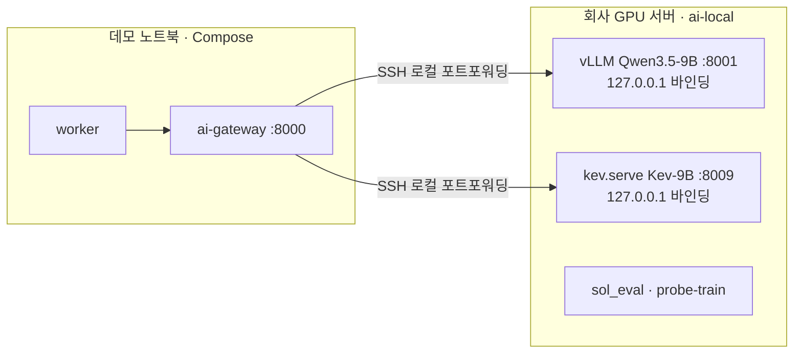

# 10. Docker Compose 배포·실행 프로필

## 원칙
DB·Auth는 Compose 밖의 **Supabase 클라우드 프로젝트**다(개발 환경, [[16-DECISIONS|16 ADR]] ADR-017). Compose는 그 둘레의 서비스만 띄운다: `redis`·`minio`·`qdrant`·`ai-gateway`·`worker`, 그리고 선택으로 `web`. 데모·배포 실행 환경의 최종안(클라우드 그대로 / 로컬 Supabase CLI 대체 / 웹 배포처)은 **미결정**이다(16 미결정 표).

Compose 정의는 하나의 `infra/compose.yaml`이다. 실행 프로필은 Compose `--profile`과 env 묶음(`infra/env/<profile>.env.example` → `infra/.env`)의 조합이다. Redis·Qdrant·MinIO는 named volume. 이미지는 각각 버전(태그 또는 digest)을 고정한다. GPU가 없으면 `demo` 프로필로 구동한다. GPU 호스트는 NVIDIA Container Toolkit 설치 후 `nvidia-smi` 확인.

실행 모드 `SOL_RUN_MODE=live|fixture|mock`([[16-DECISIONS|ADR-020]], [[03-AI-PIPELINE|03 AI 파이프라인]] §3)은 **데이터 출처와 AI 공급자**를 정하고, 프로필은 **어느 서비스를 어디에 띄우고 어떤 env 묶음을 쓰는지**를 정한다. 해커톤 실추론의 모델 런타임(Qwen·Kev)은 노트북 Compose 밖, **회사 GPU 서버**에 있다(아래 "회사 GPU 서버 구성").

## 실행 모드와 프로필

|`SOL_RUN_MODE`|프로필|모델 런타임 위치|공고|추가로 필요한 것|
|---|---|---|---|---|
|`mock`(기본)|`demo`|없음(gateway의 mock adapter)|fixture 20건(`is_demo=true`)|없음. GPU·서비스키 없이 돈다. CI·골든·모델 장애 시 시연|
|`fixture`|`ai-local`|회사 GPU 서버(vLLM Qwen3.5-9B, `kev.serve` Kev-9B)|fixture 20건(`is_demo=true`)|SSH 터널, `KEV_API_KEY`, vLLM 키. 공공 API 장애 시 시연. 한국어 state 평가용 gateway도 이 모드로만 띄운다|
|`live`|`ai-local`|회사 GPU 서버|data.go.kr 실공고(`is_demo=false`)|위 + worker의 서비스키 4개(`G2B_*_SERVICE_KEY`, [[07-DATA-PIPELINE\|07 수집]] §2.2). `KEV_ALLOW_KO_STATE=true`와 함께 쓸 수 없다(gateway 기동 거부)|

- 모드가 `DEMO_MODE`·`AI_PROVIDER`·`KEV_ENABLED`의 기본값을 정한다(`live` → `DEMO_MODE=false`·`AI_PROVIDER=local`·`KEV_ENABLED=true`, `fixture` → `true`·`local`·`true`, `mock` → `true`·`mock`·mock adapter). 직접 준 값이 모드와 모순되면 `pnpm check:env`와 gateway가 기동을 거부한다. 예: `live` + `AI_PROVIDER=mock`, `live` + `AI_FALLBACK_TO_MOCK=true`, `live` + `KEV_ALLOW_KO_STATE=true`.
- 모드 전환은 env를 바꾸고 worker·ai-gateway를 재시작해서 한다. 시연 중 장애 대체 순서는 `live` → `fixture` → `mock`이고 사람이 전환한다. 자동 대체(`AI_FALLBACK_TO_MOCK`)는 기본 `false`이고 `live`에서는 켤 수 없다([[03-AI-PIPELINE|03]] §8).
- 한국어 state 평가(E2, [[21-MODEL-TRAINING|21 모델 학습]])는 회사 GPU 서버에서 `sol_eval`이 `kev.serve`에 직접 붙거나, `SOL_RUN_MODE=fixture` + `KEV_ALLOW_KO_STATE=true`로 띄운 평가용 gateway에서만 한다. 데모용 gateway에는 켜지 않는다.
- 회사 프로필은 모든 모드에서 가상 솔리데오 프로필이다(ADR-019). live 분석은 "실제 공고 × 가상 회사 프로필"이다.

## 실행 프로필 3단
|프로필|대상 환경|AI 동작|추가 서비스|필수 env (요지)|기동 명령|
|---|---|---|---|---|---|
|`demo`|노트북 1대, GPU 없음, Docker Desktop, **인터넷 연결(Supabase 클라우드)**|`AI_PROVIDER=mock`: gateway가 fixture 기반 결정적 응답|없음 (seed는 Compose 서비스가 아니라 스크립트 `pnpm demo:reset`)|공통 env + `SOL_RUN_MODE=mock`, `DEMO_MODE=true`, `AI_PROVIDER=mock`, `KEV_ENABLED=true`(mock adapter가 응답), `AI_HOSTED_APPROVED=false`, `DEMO_SEED_PASSWORD`(seed 전용)|`docker compose -f infra/compose.yaml --profile demo up -d --build`|
|`ai-local`|**노트북**(기본 5개 서비스, gateway 포함) + **회사 GPU 서버**(모델 런타임만). 클라우드 GPU 임대는 비용 승인 뒤만(ADR-010)|Qwen3.5-9B + Kev-9B@v1.0 실제 추론|노트북: 없음. GPU 서버: `kev`, `qwen-runtime`|공통 env + `SOL_RUN_MODE=live` 또는 `fixture`, `AI_PROVIDER=local`, `KEV_ENABLED=true`, `QWEN_BASE_URL`·`KEV_BASE_URL`(터널의 로컬 끝점), `QWEN_MODEL=Qwen/Qwen3.5-9B`, `KEV_MODEL_ID=kev-9b-v1.0`, `KEV_API_KEY`, `AI_FALLBACK_TO_MOCK=false`. `live`면 worker에 서비스키 4개(`G2B_*_SERVICE_KEY`). kev 컨테이너는 `KEV_RUN=jaredpalmer/kev-9b@v1.0`|GPU 서버: `docker compose -f infra/compose.yaml -f infra/compose.gpu.yaml --profile ai-local up -d kev qwen-runtime`. 노트북: SSH 터널 연결 뒤 `docker compose -f infra/compose.yaml up -d --build`(아래 "회사 GPU 서버 구성")|
|`ai-hosted`|GPU 없는 환경에서 실모델이 필요할 때|hosted API 호출. **미검증, 비용 발생, 사용자 승인 필요**|없음|공통 env + `AI_PROVIDER=hosted`, `AI_HOSTED_APPROVED=true`(승인 후만), `HOSTED_API_BASE_URL`, `HOSTED_API_KEY`(placeholder)|`docker compose -f infra/compose.yaml --profile ai-hosted up -d --build`|

- **공통 env**: `NEXT_PUBLIC_SUPABASE_URL`, `NEXT_PUBLIC_SUPABASE_ANON_KEY`(공개 가능, 권한은 RLS가 정함), `SUPABASE_SERVICE_ROLE_KEY`(RLS를 무시하는 비밀. worker·seed 전용), `REDIS_URL`/`REDIS_PASSWORD`, `MINIO_ROOT_USER`/`MINIO_ROOT_PASSWORD`. `SUPABASE_DB_URL`은 마이그레이션 적용(`pnpm db:push`, 클라우드 DB를 바꾸므로 사용자 확인 뒤에만)과 상태 확인(`pnpm db:verify`)에만 쓴다. 자체 인증 서명 비밀이나 DB 컨테이너 비밀번호 변수는 없다(Auth·DB는 Supabase).
- env 전체 표(`SOL_RUN_MODE`, `AI_GATEWAY_URL`, `AI_TIMEOUT_MS`, `KEV_TIMEOUT_MS`, `KEV_QUESTION_SET`, `KEV_MODEL_ID`, `KEV_ALLOW_KO_STATE`, `AI_FALLBACK_TO_MOCK`, `PARSER_*`, `AI_PROMPT_VERSION` 등)는 [[03-AI-PIPELINE|03 AI 파이프라인]] §3이 원천이다. 여기 표는 프로필별로 달라지는 값만 적었다.
- `DEMO_MODE=true`면 공식 API connector를 비활성화하고 `fixtures/`만 읽는다. 적재되는 공고는 `is_demo=true`. `DEMO_MODE`는 `SOL_RUN_MODE`에서 파생된다([[07-DATA-PIPELINE|07 수집]]).
- 프로필 전환은 env 파일 교체 + 프로필 플래그만으로 끝난다. 코드 변경 없음 ([[16-DECISIONS|16 ADR]] ADR-008).
- `ai-hosted`는 사용자 명시 승인 후 `AI_HOSTED_APPROVED=true`로만 켠다 (ADR-010). 승인 플래그 없이 `hosted`를 지정하면 gateway가 기동을 거부한다. CI·테스트에서는 항상 `mock`.
- 노트북에서 `--profile ai-local`을 주면 `kev`·`qwen-runtime`까지 띄우려 한다. 그래서 노트북은 프로필 플래그 없이 기본 서비스만 띄우고 `ai-local` env 묶음을 쓴다. 프로필 이름을 노트북용·GPU 서버용으로 나눌지는 Phase 0에서 정한다(ADR-020 P0-1, [[12-ROADMAP|12 로드맵]]).

### env 파일 위치
세 파일 모두 깃에서 제외한다. 값은 `.env.example`·`infra/env/*.env.example`의 키 이름을 보고 채운다.

|파일|읽는 쪽|담는 값 (요지)|
|---|---|---|
|`infra/.env`|`docker compose -f infra/compose.yaml`의 변수 치환. Compose는 `--project-directory`가 없으면 첫 `-f` 파일의 디렉터리(`infra/`)를 프로젝트 디렉터리로 삼고 거기서 `.env`를 찾는다(https://docs.docker.com/compose/how-tos/environment-variables/variable-interpolation/, 2026-10-16 확인). 컨테이너에 넘기는 값은 `compose.yaml`의 `environment`·`env_file`이 정한다|`worker`: `NEXT_PUBLIC_SUPABASE_URL`, `SUPABASE_SERVICE_ROLE_KEY`, `REDIS_URL`, `MINIO_ROOT_USER`/`MINIO_ROOT_PASSWORD`, `AI_GATEWAY_URL`, `SOL_RUN_MODE`, `DEMO_MODE`, `G2B_BID_NOTICE_SERVICE_KEY`·`G2B_PRE_SPEC_SERVICE_KEY`·`G2B_ORDER_PLAN_SERVICE_KEY`·`G2B_INDUSTRY_MASTER_SERVICE_KEY`(서비스별 서비스키 4개, `live`만 필수, 서버 전용·로그 금지). `redis`·`minio`: 각 비밀번호. `ai-gateway`: `SOL_RUN_MODE`, `AI_*`·`QWEN_*`·`KEV_*`·`PARSER_*`·`HOSTED_*`|
|`web/.env.local`|Next.js `web/`(템플릿 위치)|`NEXT_PUBLIC_SUPABASE_URL`, `NEXT_PUBLIC_SUPABASE_ANON_KEY`, `REDIS_URL`, `MINIO_ROOT_USER`/`MINIO_ROOT_PASSWORD`, `AI_GATEWAY_URL`, `DEMO_MODE`, `API_CURSOR_SECRET`(목록 커서 HMAC 키, 32자 이상, [[05-API-SPEC\|05 API]] §3). **`SUPABASE_SERVICE_ROLE_KEY`와 서비스키 4개(`G2B_*_SERVICE_KEY`)는 넣지 않는다**(요청 처리는 사용자 세션 + RLS, 공공 API 호출은 worker만)|
|루트 `.env.local`|`pnpm db:push`·`pnpm db:verify`(템플릿 `scripts/db-push.sh`·`scripts/db-verify.sh`가 `SUPABASE_DB_URL`을 여기서 읽는다), `pnpm demo:reset`|`SUPABASE_DB_URL`, `NEXT_PUBLIC_SUPABASE_URL`, `SUPABASE_SERVICE_ROLE_KEY`, `DEMO_SEED_PASSWORD`|

- service role 키와 서비스키 4개(`G2B_*_SERVICE_KEY`)는 `NEXT_PUBLIC_` 변수·브라우저 번들·로그에 절대 넣지 않는다([[09-SECURITY|09 보안]]). 서비스키는 worker의 `OfficialApiConnector`만 읽고, 소스마다 registry `serviceKeyEnv`가 가리키는 키 하나만 쓴다([[07-DATA-PIPELINE|07 수집]] §2.2). gateway에도 넘기지 않는다.
- `pnpm check:env`는 세 파일의 placeholder를 세고, 실행 모드와 모순된 값(위 "실행 모드와 프로필")이 있으면 실패한다. `pnpm check:env`·`pnpm demo:reset`은 아직 없다. Phase 0·1에서 만든다([[12-ROADMAP|12 로드맵]]).

### `ai-local` env 예시

`infra/env/ai-local.env.example`의 AI·실행 모드 부분(값은 placeholder, 비밀값을 적지 않는다):

```bash
SOL_RUN_MODE=live                 # live | fixture | mock. live 와 모순되는 값은 기동 거부
DEMO_MODE=false                   # SOL_RUN_MODE 에서 파생(live → false, fixture·mock → true)
AI_PROVIDER=local
KEV_ENABLED=true
AI_FALLBACK_TO_MOCK=false         # live 에서 true 면 기동 거부
KEV_ALLOW_KO_STATE=false          # live 에서 true 면 기동 거부. 평가용 fixture gateway 에서만 true
QWEN_BASE_URL=<터널 로컬 끝점, 예: http://host.docker.internal:8001>
QWEN_MODEL=Qwen/Qwen3.5-9B
KEV_BASE_URL=<터널 로컬 끝점, 예: http://host.docker.internal:8009>
QWEN_API_KEY=<placeholder>
KEV_API_KEY=<placeholder>
KEV_MODEL_ID=kev-9b-v1.0          # services/ai/models/registry.yaml 항목 → jaredpalmer/kev-9b@v1.0
KEV_QUESTION_SET=kev-qs/v0.2
PARSER_PDF=<비교 뒤 결정>
PARSER_HWPX=<비교 뒤 결정>
PARSER_HWP=<비교 뒤 결정>
# data.go.kr 서비스키 — 서비스마다 하나씩(ADR-022). worker 전용, live 에서만 필수. 로그 금지
# 값은 Decoding 키(인코딩 전 원문)
G2B_BID_NOTICE_SERVICE_KEY=<placeholder>       # 입찰공고정보서비스 15129394
G2B_PRE_SPEC_SERVICE_KEY=<placeholder>         # 사전규격정보서비스 15129437
G2B_ORDER_PLAN_SERVICE_KEY=<placeholder>       # 발주계획현황서비스 15129462
G2B_INDUSTRY_MASTER_SERVICE_KEY=<placeholder>  # 업종 및 근거법규 15129467
```

- gateway는 vLLM `--api-key`와 같은 값을 `QWEN_API_KEY`로 보낸다([[03-AI-PIPELINE|03 AI 파이프라인]] §3).
- `PARSER_*` 기본값은 실제 RFP 샘플 비교(03 §10.3) 뒤 정한다.

### seed
seed 적용·재적용은 스크립트 `pnpm demo:reset`이다(Compose 서비스가 아니다). 루트 `.env.local`의 service role 키로 Supabase 프로젝트에 seed를 넣고, 다시 돌려도 같은 상태가 된다(멱등). 마이그레이션은 적용하지 않는다. 스키마 적용은 `pnpm db:push`(사용자 확인 뒤에만)이고, seed 전에 `pnpm db:verify`로 미적용 마이그레이션이 없는지 본다.

적재 내용: 조직 2개(`org-01` 솔리데오, `org-02` 격리 확인용), 계정 5개(Supabase Auth 계정 + `profiles` + `memberships`. `org-01`에 `sol_role` ADMIN/SALES/ANALYST/VIEWER 각 1, 그중 `admin@soltech.invalid`는 `org_role=owner`. `org-02`에 VIEWER 1), 프로필 revision 2, fixture 20건 중 공고 19건 적재 + FX-12 1건 격리(title 누락 → `ingest_errors`). 공고는 공용 데이터라 조직 소유가 없다. 계정 비밀번호는 `DEMO_SEED_PASSWORD`로만 정한다. 템플릿의 `pnpm db:seed`는 로컬 Supabase에서만 쓰는 시험 계정용이라 데모 seed로 쓰지 않는다. seed는 live로 수집한 공고(`is_demo=false`)를 지우지 않는다([[04-DATABASE|04 DB]] §6).

**`live` 모드의 seed**: `pnpm demo:reset`은 실행 모드와 무관하게 데모 조직·계정 5개·가상 회사 프로필·fixture 공고·사전 리뷰를 넣는다. `is_demo=true` 데이터만 지우고 다시 만들므로 live 공고는 그대로다([[04-DATABASE|04 DB]] §6). 목록 기본 필터는 실행 모드를 따르므로 `live` 모드에서는 fixture 공고가 기본 목록에 섞이지 않는다([[05-API-SPEC|05 API]] §3).

> [!warning] 미검증 가정
> - `ai-hosted`: hosted 공급자, 요청·응답 포맷, 가격 모두 미확인. Kev README의 Modal 배포 스크립트도 비용이 든다. 승인(`AI_HOSTED_APPROVED=true`) 전에는 구현·호출하지 않는다. 검증 방법은 [[03-AI-PIPELINE|03 AI 파이프라인]] §5.8.
> - Kev-0.8B의 CPU 실행 가능성은 미검증. 데모는 이것에 의존하지 않는다. 확인 절차는 03 §5.9.
> - Qwen 런타임은 vLLM이다(16 미결정 3번 부분 결정). GPU 메모리 배분은 회사 GPU 모델·VRAM을 확인한 뒤 정한다(아래 "GPU 메모리 배분").
> - worker가 `import "server-only"`인 `web/server` 코드를 쓰려면 `node --conditions=react-server`(또는 같은 효과의 실행 방식)가 필요하다고 본다. Phase 0에서 검증한다([[02-ARCHITECTURE|02 아키텍처]]).

## 회사 GPU 서버 구성 (해커톤 실추론)

해커톤 기간의 실추론(Qwen3.5-9B·Kev-9B)과 평가 실행은 회사 GPU 서버에서 한다([[16-DECISIONS|ADR-020]]). 노트북 worker·gateway가 터널로 연결한다.



- **gateway는 노트북 Compose에 그대로 둔다.** 회사 GPU 서버에는 모델 런타임만 올린다: Qwen은 vLLM(:8001), Kev는 `kev.serve`(:8009). 아키텍처(Worker → gateway → 모델)는 바뀌지 않는다.
- 두 런타임은 GPU 서버의 `127.0.0.1`에만 바인딩하고 외부 포트를 열지 않는다. 컨테이너로 띄우면 컨테이너 안은 `--host 0.0.0.0`, 호스트 포트는 `127.0.0.1:8001`·`127.0.0.1:8009`로만 publish한다.
- 인증: Kev는 `KEV_API_KEY`로 기동해 `Authorization: Bearer`를 요구하게 하고, vLLM은 `--api-key`로 기동한다. 두 키는 GPU 서버와 노트북 `infra/.env`에만 두고 커밋하지 않는다.
- `QWEN_BASE_URL`·`KEV_BASE_URL`은 터널의 로컬 끝점을 가리킨다. 터널 방식(SSH 포워딩, 회사 VPN 등)은 회사망 정책에 맞춘다.
- 평가 하네스(`sol_eval`)와 LoRA 메모리 검증(`probe-train`)은 GPU 서버에서 직접 돌린다([[21-MODEL-TRAINING|21 모델 학습]]).
- 회사 GPU로 보내는 데이터는 실제 공고(공공 데이터, 개인정보 마스킹)와 가상 회사 프로필뿐이다.
- 클라우드 GPU 임대는 비용이 들어 hosted와 같은 사용자 승인 대상이다(ADR-010). 승인 전에는 임대하지 않는다.

연결 예시(스케치, Phase 0 P0-0 ③에서 확인):

```bash
# GPU 서버: 모델 런타임 (127.0.0.1 바인딩. 컨테이너면 compose.gpu.yaml 의 kev·qwen-runtime)
vllm serve Qwen/Qwen3.5-9B --host 127.0.0.1 --port 8001 --api-key <vLLM 키> --gpu-memory-utilization <비율>
KEV_API_KEY=<Kev 키> uv run --extra serve python -m kev.serve --run jaredpalmer/kev-9b@v1.0 --port 8009

# 노트북: GPU 서버의 127.0.0.1:8001·8009 를 노트북 127.0.0.1 로 가져온다
ssh -N -L 8001:127.0.0.1:8001 -L 8009:127.0.0.1:8009 <user>@<gpu-host>

# 노트북: 터널 확인
curl -s -H "Authorization: Bearer <Kev 키>" http://127.0.0.1:8009/v1/models
curl -s -H "Authorization: Bearer <vLLM 키>" http://127.0.0.1:8001/v1/models
```

> [!warning] 미검증 가정
> - 회사망의 터널·외부 접속 허용 여부, GPU 모델·VRAM·공유 여부는 확인하지 않았다(16 미결정 17번). 막히면 사용자에게 보고한다.
> - 노트북의 `ai-gateway` 컨테이너가 호스트(노트북)의 터널 끝점에 닿는 방법(Docker Desktop `host.docker.internal`, 또는 터널을 컨테이너로 띄우기)은 Phase 0에서 확인한다.
> - vLLM 버전의 Qwen3.5-9B 지원과 guided JSON·logprob 동작은 첫 기동에서 확인하고 이미지 태그를 고정한다.

### GPU 메모리 배분

GPU 모델을 확인한 뒤 정한다(16 미결정 3번).
- 48 GB 이상 1장: 두 모델을 함께 올린다. vLLM `--gpu-memory-utilization`으로 Qwen 몫을 제한한다.
- 24 GB급 2장: 모델마다 GPU를 하나씩 쓴다.
- 24 GB 1장: Qwen을 FP8/AWQ 양자화로 올리고 Kev와 메모리를 나눈다. 양자화는 추출 품질에 영향을 줄 수 있어 평가 리포트에 적는다.

Kev-9B 추론 메모리는 모델 카드 21.9 GB, README 약 17 GB로 문서마다 다르다. 첫 기동에서 `nvidia-smi` 최대 점유를 실측해 `docs/evidence/phase-0/external-deps.md`에 기록하고 위 배분을 확정한다.

### 데모 날 위험

`live`·`fixture` 모드는 회사 서버와 터널에 의존한다. 터널이 끊기면 gateway → 모델 연결이 실패해 `QWEN_UNAVAILABLE`·`KEV_UNAVAILABLE` → `PARTIAL`·`RULES_ONLY`로 끝난다([[03-AI-PIPELINE|03]] §8). mock으로 조용히 바뀌지 않는다. 필요하면 사람이 `mock` 모드로 전환한다. 터널 재연결 절차는 아래 기동 절차 4·10번과 D-1 리허설에 넣는다.

## Compose 서비스
|service|이미지|내부 포트|호스트 노출|상태 저장|프로필|
|---|---|---:|---|---|---|
|worker|`web/` 코드로 빌드, 진입점 `web/worker`|-|없음|없음|기본|
|redis|`redis:8.8.3-alpine`|6379|`127.0.0.1:6379` (web을 호스트에서 띄울 때)|redisdata|기본|
|qdrant|`qdrant/qdrant:v1.19.2-unprivileged`|6333|`127.0.0.1:6333` (같은 조건)|qdrantdata|기본|
|minio|`cgr.dev/chainguard/minio@sha256:2136d593beacf4461187035eca949fe49abd589d5079735025c711ca58fee0c8` (비root UID 65532)|9000|`127.0.0.1:9000` (같은 조건)|miniodata|기본|
|ai-gateway|`services/ai/` 빌드|8000|`127.0.0.1:8000` (같은 조건)|model cache (선택)|기본 (`SOL_RUN_MODE`·`AI_PROVIDER`로 동작 결정)|
|web|`web/` 빌드|3000|3000|없음|선택. 기본은 호스트에서 `pnpm -C web start`|
|kev|아래 Kev Dockerfile, `KEV_RUN=jaredpalmer/kev-9b@v1.0`|8009|회사 GPU 서버 `127.0.0.1:8009`만|model cache|`ai-local`(GPU 서버에서만)|
|qwen-runtime|vLLM(이미지 태그 고정은 P0-0), `Qwen/Qwen3.5-9B`|8001|회사 GPU 서버 `127.0.0.1:8001`만|model cache|`ai-local`(GPU 서버에서만)|

- `postgres`·`api`·`seed-demo` 서비스는 없다. DB·Auth는 Supabase, seed는 `pnpm demo:reset`이다.
- MinIO는 Docker Hub `minio/minio`가 404라(2026-10-16 확인) Chainguard 이미지를 digest로 고정한다(비root 65532, 검증됨).
- web을 호스트에서 띄우면 Next 서버가 redis·qdrant·minio·ai-gateway에 닿아야 하므로 이 네 서비스만 `127.0.0.1`에 포트를 연다(외부 인터페이스에는 열지 않는다). Compose `web`을 쓰면 호스트 노출은 필요 없다. 둘 중 무엇을 기본으로 할지는 Phase 0에서 확정한다.
- HTTPS reverse proxy와 웹 배포처는 데모·배포 실행 환경 결정(미결정, ADR-017) 뒤에 정한다.

## 파서 런타임

`POST /parse`의 형식별 어댑터는 실제 RFP 샘플 비교([[03-AI-PIPELINE|03 AI 파이프라인]] §10.3) 뒤 정한다. 후보에 따라 gateway 이미지에 Python 밖 런타임이 들어갈 수 있다.
- Node 20: kordoc(HWP·HWPX·PDF 단일 엔진 후보)
- JVM(Java 11+): hwplib·hwpxlib·opendataloader-pdf
- 이런 후보는 gateway 안의 상주 하위 프로세스로 부른다. 이미지 크기 증가분과 기동 시간을 비교 표에 함께 적고, 선택이 끝나면 이 절과 `services/ai` Dockerfile을 확정한다.
- gateway는 파서가 들어가도 DB·MinIO·외부 네트워크에 접근하지 않는다. AGPL·GPL 후보(pyhwp·PyMuPDF·poppler 등)는 이미지에 넣지 않는다(03 §10.2).

## 데모 당일 기동 절차
전제: D-1에 이미지 빌드·pull, `pnpm -C web build`, 마이그레이션 적용(`pnpm db:push`, 사용자 확인 뒤), 전체 리허설을 끝냈다 ([[12-ROADMAP|12 로드맵]]). 당일에는 스키마를 바꾸지 않는다. 증거는 `docs/evidence/demo-day/YYYYMMDD-HHMM/`에 저장한다([[11-TESTING|11 테스트]]). 어느 실행 모드로 시연할지는 [[19-DEMO-SCENARIO|19 데모 시나리오]]를 따른다. 아래 단계에서 **[live·fixture]** 표시는 `ai-local`일 때만 한다.

> [!warning] 데모 네트워크 의존 (미결정)
> DB·Auth가 Supabase 클라우드 프로젝트라 1~12 모두 인터넷 연결이 필요하다. 연결이 끊기면 로그인·조회·분석 저장이 멈춘다. 대체 경로(로컬 Supabase CLI `pnpm db:start`로 대체, 사전 녹화 영상)는 **미결정**이다([[16-DECISIONS|16 ADR]] 미결정 표). 정해지기 전까지 데모 장소의 네트워크를 미리 확인한다. `live`·`fixture`는 회사 GPU 서버 터널도 필요하다.

1. Docker Desktop 실행, 인터넷 연결 확인. `docker info`가 Server 정보를 출력하면 통과.
2. 실행 모드 확인과 env 준비: 시연 모드를 정하고 env 묶음을 고른다. `mock`은 `cp infra/env/demo.env.example infra/.env`, `live`·`fixture`는 `cp infra/env/ai-local.env.example infra/.env` 후 `SOL_RUN_MODE`를 맞춘다. placeholder를 실제 값으로 교체하고 `web/.env.local`과 루트 `.env.local`도 채운다(위 "env 파일 위치" 표). `pnpm check:env`가 "placeholder 0건"을 출력하고 모드 모순(예: `live` + `AI_FALLBACK_TO_MOCK=true`, `live` + `KEV_ALLOW_KO_STATE=true`)이 0건이면 통과. `infra/.env`의 `SOL_RUN_MODE` 줄을 `run-mode.txt`로 저장.
3. Supabase 프로젝트 접근·마이그레이션 상태 확인: `pnpm db:verify`가 `✓ DB 연결·마이그레이션 N개·RLS 활성화·화면 역할 권한·뷰·함수 확인`을 출력하면 통과. `미적용 마이그레이션: …` 또는 연결 오류면 중단한다(당일에 `pnpm db:push`로 고치지 않는다).
4. 서비스 기동.
   - `mock`: `docker compose -f infra/compose.yaml --profile demo up -d --build`.
   - **[live·fixture]** ① 회사 GPU 서버의 `kev`·`qwen-runtime`이 떠 있는지 확인한다. ② 노트북에서 SSH 터널을 연결한다(`ssh -N -L 8001:127.0.0.1:8001 -L 8009:127.0.0.1:8009 <user>@<gpu-host>`). ③ 터널로 Kev `GET /v1/models`(Bearer)가 `jaredpalmer/kev-9b@v1.0`을, vLLM `GET /v1/models`가 `Qwen/Qwen3.5-9B`를 돌려주면 통과. 응답을 `tunnel-models.json`으로 저장. ④ `docker compose -f infra/compose.yaml up -d --build`(프로필 플래그 없이 기본 서비스만). gateway가 레지스트리 불일치로 기동을 거부하면 중단한다(`runs/smoke`로 대체된 Kev일 수 있다).
   - 공통: `docker compose -f infra/compose.yaml ps`에서 기본 5개 서비스(redis·minio·qdrant·ai-gateway·worker) `healthy`. `ps` 출력을 `compose-ps.txt`로 저장.
5. web 기동: `pnpm -C web start`(:3000). Compose `web`(선택)을 쓰면 4에서 함께 뜨고 `ps`에 `healthy`로 보인다.
6. seed: `pnpm demo:reset` 마지막 줄이 `seed: orgs=2 users=5 profileRevisions=2 people=200 portraits=200 bids=19 quarantined=1 reviews=2 isDemo=true` 형식인지 확인(사전 리뷰 2건은 FX-01, FX-03). 숫자가 다르면 중단. `live`에서 seed를 넣는 방법은 위 seed 절 todo.
7. `curl -s http://localhost:3000/health/ready`: `status` ok, `checks.db`(Supabase)·`checks.redis`·`checks.storage`(MinIO) ok, `checks.ai`가 모드와 맞는지 본다(`mock` → `mock`, `live`·`fixture` → `local`). AI만 불가면 `status` degraded(HTTP 200)로 통과. db·redis·storage 중 하나라도 불가면 503 `status:"unavailable"`이므로 중단. 응답을 `health-ready.json`으로 저장. **[live·fixture]** gateway `GET /health`의 `runMode`가 2번에서 정한 모드이고 `kev.registryMatch=true`인지도 확인해 `gateway-health.json`으로 저장. 응답 형식은 [[05-API-SPEC|05 API]], `checks.ai` 의미는 [[14-OBSERVABILITY|14 관측성]].
8. API 스모크: `org-01` 계정으로 Supabase Auth 비밀번호 로그인을 해 access token을 받는다(`supabase-js` `signInWithPassword` 또는 Auth REST `POST /auth/v1/token?grant_type=password`). `Authorization: Bearer <token>`으로 `GET /api/v1/bids` 19건(`live` 모드는 기본 필터가 `origin=live`라 fixture가 안 보이므로 `origin=demo`로 19건) → `POST /api/v1/bids/:id/analyses` 202 → poll이 5초 안에 `COMPLETED`(실모델 모드의 소요 시간은 리허설 실측값으로 판단). Bearer 요청은 CSRF 헤더 검사 대상이 아니다([[05-API-SPEC|05 API]]).
9. 브라우저(폭 1440px, 줌 100%)에서 `/auth/login` → 머리말 "실행 모드: …"가 2번의 모드와 같은지, 우상단 `AI: mock`(또는 `live`·`fixture`면 `AI: local`, 분석 패널 "AI: local · Qwen3.5-9B · Kev-9B v1.0")과 DEMO 배지 확인 → 목록 19건(`live`는 `origin=demo` 필터), 격리 1건(FX-12)은 관리자 수집 현황에만 표시 → 상세 1건이 자격·점수·근거·Kev 참고 지표 영역까지 렌더. 화면 캡처를 `run-mode-header.png`로 저장.
10. 장애 대체 리허설 (아래 "장애 주입" 절): `docker compose -f infra/compose.yaml stop ai-gateway` → FX-01 재분석 → 상세에 `PARTIAL` 배너, 우상단 `AI: unavailable` → `docker compose -f infra/compose.yaml start ai-gateway` → `ps`에서 ai-gateway `healthy` 확인 → FX-01 재분석 `COMPLETED`. **[live·fixture]** 터널 재연결도 한다: SSH 터널 프로세스를 끊는다 → FX-01 재분석이 `PARTIAL`·`RULES_ONLY`(`QWEN_UNAVAILABLE` 또는 `KEV_UNAVAILABLE`)로 끝나고 mock 결과가 나오지 않는지 확인 → 4번 ②의 명령으로 다시 연결하고 ③으로 확인 → FX-01 재분석 `COMPLETED`. 재연결 소요 시간을 기록한다.
11. 테넌트 격리 리허설: `org-02` VIEWER(`viewer@other.invalid`)로 Supabase Auth 로그인해 받은 access token을 `Authorization: Bearer`로 붙여 `GET /api/v1/bids/{FX-01 id}/qualification-checks` → `404 NOT_FOUND`(RLS가 `org-01` 행을 보여 주지 않는다). 공고 자체(`GET /api/v1/bids/{FX-01 id}`)는 공용이라 200. 404 응답을 `isolation-404.json`으로 저장. 절차는 [[19-DEMO-SCENARIO|19 데모 시나리오]] S7.
12. 리허설로 생긴 리뷰·알림 초기화: `pnpm demo:reset` (멱등, DEMO 데이터 재생성). 브라우저 탭 1개만 남긴다. **[live·fixture]** 터널이 연결된 상태인지 마지막으로 확인한다(4번 ③).

> [!tip] 심사 포인트
> 10번이 "AI가 죽어도 제품이 동작한다"의 증거다. 데모 중 실제로 ai-gateway를 내리고 PARTIAL 배너를 보여 준다. 실모델 모드에서는 터널을 끊어도 mock으로 몰래 바뀌지 않고 실패 유형이 그대로 보인다.

## D-1 리허설 추가 항목 (ADR-020)

위 1~12에 더해 D-1에 한다. 결과는 `docs/evidence/demo-day/rehearsal-log.md`에 날짜·소요 시간·실패 단계와 함께 적는다([[17-CLAUDE-IMPLEMENTATION|17 구현 규칙]]).
- **세 모드 전환**: `live` → `fixture` → `mock` 순서로 env의 `SOL_RUN_MODE`를 바꾸고 worker·ai-gateway를 재시작한다. 모드마다 머리말 "실행 모드", 우상단 `AI: …`, 새로 적재되는 공고의 DEMO 배지, gateway `/health`의 `runMode`를 확인한다. 전환 소요 시간을 기록한다.
- **모순 env 거부**: `live` + `AI_FALLBACK_TO_MOCK=true`, `live` + `KEV_ALLOW_KO_STATE=true`로 `pnpm check:env`와 gateway가 기동을 거부하는지 본다.
- **터널 단절과 재연결**: 기동 절차 10번의 터널 단계를 반복하고 재연결 소요 시간을 잰다. 회사 GPU 서버 쪽 런타임 재시작(예: `kev` 컨테이너 재시작) 뒤 gateway `/health`의 `kev.registryMatch`가 다시 `true`인지도 본다.
- **live 호출 예산**: 리허설의 공공 API 호출 수가 일일 한도(개발계정 서비스당 1,000건/일) 안인지 관리자 수집 화면으로 확인한다([[07-DATA-PIPELINE|07 수집]]).

## 장애 주입 (데모 S6)
데모에서 쓰는 AI 장애 주입은 **(a) ai-gateway 컨테이너 중지** 하나다. [[02-ARCHITECTURE|02 아키텍처]] 장애 원칙 표의 "AI gateway 불가" 행과 같은 경로를 탄다.

|단계|명령|기대 결과|
|---|---|---|
|주입|`docker compose -f infra/compose.yaml stop ai-gateway`|Worker의 `/kev` 호출이 연결 거부로 즉시 실패(재시도 없음). FX-01 재분석이 1~2초 안에 `PARTIAL`, `recommendationBasis=RULES_ONLY`, `reviewFlags`에 `AI_UNAVAILABLE`, 상세 배너 "AI 분석을 사용할 수 없어 규칙 기반 점수와 자격 판정만 표시합니다. (상태: PARTIAL)"([[09-SECURITY\|09 보안]] 원문), 우상단 `AI: unavailable`, `/health/ready` `status: degraded`, `checks.ai: unavailable`|
|복구|`docker compose -f infra/compose.yaml start ai-gateway` → `docker compose -f infra/compose.yaml ps`에서 ai-gateway `healthy`|FX-01 재분석 `COMPLETED`, 우상단 `AI: mock`(실모델 모드는 `AI: local`). 분석 1건으로는 circuit이 열리지 않으므로 대기 시간 없음|

후보 (b) `AI_FAULT_INJECT` env 토글은 컨테이너 재시작이 필요하고 (c) mock adapter의 장애 fixture는 "실제로 꺼졌다"는 인상이 약하다. 둘은 테스트([[11-TESTING|11 테스트]] 골든 시나리오 `G6`)에서만 쓴다. `AI_FAULT_INJECT` 값(`kev_timeout`·`qwen_error`·`qwen_unreachable`·`kev_unreachable`·`gateway_down`)은 [[03-AI-PIPELINE|03 AI 파이프라인]] §3. 실모델 모드의 터널 단절은 장애 주입 장면이 아니라 리허설 항목이다(기동 절차 10번).

## Kev 컨테이너 주의
> [!success] 검증됨 (2026-10-16, https://github.com/jaredpalmer/kev)
> - 소스에서 설치한다. `pip install kev`는 무관한 ORM 패키지다.
> - Python 3.12 또는 3.13 + uv.
> - README quickstart는 `--run jaredpalmer/kev-4b`(태그 없음, 최신 가중치). README "Kev 1.0" 절에 `--run jaredpalmer/kev-4b@v1.0`이 항상 같은 가중치를 로드한다고 명시돼 있다.
> - 기본 바인딩이 127.0.0.1이므로 컨테이너에서는 `--host 0.0.0.0`이 필요하다. `--device cpu|cuda|mps|auto`(기본 `auto`). `KEV_API_KEY`를 주면 `Authorization: Bearer` 요구.
> - 보조 엔드포인트 `GET /v1/models`가 있어 healthcheck와 모델 식별자 기록에 쓴다.
> - 모델 4종: Kev-0.8B (Qwen3.5-0.8B-Base), Kev-4B (Qwen3.5-4B-Base, 권장 시작점), Kev-9B (Qwen3.5-9B-Base), Kev-27B (Qwen3.8-27B, 80GB GPU 필요). 릴리즈 "Kev 1.0": GitHub 태그 `kev-1.0`, Hub 리포 태그 `v1.0`. 라이선스 Apache-2.0.
> - API `POST /v1/systemone` (TypeSafe System One 호환), 질문 타입 `noul` / `choice` / `score`.
> - 모델 카드 `Languages: English`. 영어 외 언어는 잘 동작하지 않는 것으로 명시. 한국어 성능은 미측정 ([[16-DECISIONS|16 ADR]] 미결정 2번, ADR-012).

> [!success] 검증됨 (2026-10-16, https://github.com/jaredpalmer/kev main `1f04cfa`, https://huggingface.co/jaredpalmer/kev-9b)
> - `jaredpalmer/kev-9b@v1.0` = `db029f08`. `@v1`은 더 예전 버전이다.
> - Kev-9B 모델 카드 `language: en`. 서빙 상한 state 65,536 토큰(넘으면 422).
> - Kev-9B 추론 메모리는 모델 카드 21.9 GB, README 약 17 GB로 두 문서가 다르다.

SOL RADAR 컨테이너 entrypoint는 Kev-9B 고정 버전을 쓴다([[16-DECISIONS|ADR-020]]). `@v1`이 아니라 `@v1.0`이다:
`uv run --extra serve python -m kev.serve --run jaredpalmer/kev-9b@v1.0 --port 8009 --host 0.0.0.0`

- **기동 전 sha256 대조**: entrypoint는 `kev.serve`를 띄우기 전에 받은 가중치의 `head.pt`·어댑터 sha256을 레지스트리(`services/ai/models/registry.yaml`, `KEV_MODEL_ID` 항목)의 `weights_sha256`·`head_sha256`과 대조하고, 다르면 기동하지 않는다.
- **gateway의 레지스트리 대조**: gateway는 기동할 때 Kev `GET /v1/models`의 `run`·`base`·`lora`·`temperature`가 레지스트리 `KEV_MODEL_ID` 항목과 같은지 확인하고, 다르면 기동을 거부한다([[03-AI-PIPELINE|03 AI 파이프라인]] §11).
- 두 검사가 필요한 이유: `kev.serve`는 `--run` 경로가 틀리면 오류 없이 `runs/smoke`로 대체한다. 검사가 없으면 엉뚱한 모델의 확률이 Kev-9B 결과처럼 저장된다.

Dockerfile 스케치 (빌드 검증 전):
```dockerfile
FROM python:3.12-slim
RUN apt-get update && apt-get install -y --no-install-recommends git \
 && rm -rf /var/lib/apt/lists/* && pip install --no-cache-dir uv
WORKDIR /opt/kev
RUN git clone --depth 1 --branch kev-1.0 https://github.com/jaredpalmer/kev.git .
RUN uv sync --extra serve
ENV KEV_RUN=jaredpalmer/kev-9b@v1.0
EXPOSE 8009
HEALTHCHECK --interval=30s --timeout=5s --start-period=600s --retries=3 \
  CMD python -c "import urllib.request; urllib.request.urlopen('http://127.0.0.1:8009/v1/models')" || exit 1
# 기동 전 레지스트리 sha256 대조 단계를 CMD 앞에 둔다(스크립트는 구현 때 작성)
CMD ["sh", "-c", "uv run --extra serve python -m kev.serve --run ${KEV_RUN} --port 8009 --host 0.0.0.0"]
```

> [!warning] 미검증 가정
> - CUDA 베이스 이미지가 필요한지(torch wheel에 CUDA 런타임 포함 여부)는 빌드 시 확인.
> - `uv sync --extra serve`가 lockfile 기준으로 재현되는지(`--frozen` 필요 여부) 빌드 시 확인.
> - GitHub 태그 `kev-1.0` 소스가 `kev-9b@v1.0` 가중치와 맞는지, 아니면 main `1f04cfa`를 고정해야 하는지 빌드 시 확인.
> - 첫 기동 시 가중치 다운로드 시간은 미측정. `start-period` 600초는 추정값이며 `ai-local` 첫 기동에서 실측해 조정한다.
> - `KEV_API_KEY`를 켜면 healthcheck의 `/v1/models` 요청에도 `Authorization` 헤더가 필요한지 첫 기동에서 확인한다.
> - Kev-9B VRAM은 문서마다 다르다(21.9 GB vs 약 17 GB). `ai-local` 첫 기동에서 `nvidia-smi` 값을 기록한다.

## 샘플 GPU override 방향
```yaml
services:
  kev:
    profiles: [ai-local]
    ports: ["127.0.0.1:8009:8009"]
    deploy:
      resources:
        reservations:
          devices:
            - driver: nvidia
              count: 1
              capabilities: [gpu]
  qwen-runtime:
    profiles: [ai-local]
    ports: ["127.0.0.1:8001:8001"]
    deploy:
      resources:
        reservations:
          devices:
            - driver: nvidia
              count: 1
              capabilities: [gpu]
```
이것은 배포용 완성 Compose가 아닌 **요구 명세 예시**다. GPU 장수와 배분은 위 "GPU 메모리 배분"을 따른다. 실제 구현에서는 kev container entrypoint/모델 토큰/캐시 경로를 공식 repo 기준으로 구축하고 버전을 pin한다.

## 운영
- Compose 서비스: healthcheck, restart policy, log rotation, 비root 실행(MinIO UID 65532, qdrant `-unprivileged` 태그), 포트는 외부 인터페이스에 열지 않는다, 볼륨(redisdata·qdrantdata·miniodata) 백업 및 복구 리허설. 서비스 시작 시 Supabase·Redis readiness 확인, 무한 재시작 대신 명확한 오류 출력.
- 마이그레이션 선행: 새 마이그레이션은 `supabase/migrations/`에 새 파일로만 더하고, `pnpm db:push`(클라우드 DB를 바꾸므로 사용자 확인 뒤에만)로 적용한 뒤 `pnpm db:verify`로 확인하고 나서 worker·web을 새 코드로 띄운다. 타입 생성물은 `pnpm db:types`.
- DB 백업·복구는 Supabase가 관리한다. 플랜별 백업 주기·보존 기간·PITR 여부는 **미검증**이다. Supabase 대시보드에서 확인해 이 절에 기록한다.
- HTTPS reverse proxy·웹 배포처는 미결정(ADR-017 미결정 표).
- 운영 모델 교체(Kev LoRA 등)는 레지스트리 항목 추가 → 컨테이너 sha256·gateway 대조 통과 → ADR 순서로 한다([[21-MODEL-TRAINING|21 모델 학습]] §5.4).

## 솔리데오 인력·사진 준비 (ADR-019, 구현 예정)

`pnpm demo:reset`은 로그인 5계정과 별도로 `fixtures/people/solideo.people.json`의 가상 인력 200명을 `team_members`에 넣는다. 점수 계산 대상 27명의 직무·등급·스킬·가용성은 같은 직원 ID로 `team_member_scoring` 27행에 넣는다([[16-DECISIONS|ADR-021]]). 부서·직급 카탈로그를 계정보다 먼저 넣고, 2회 실행 후에도 인물 ID·명부 200명·Auth 5계정이 유지돼야 한다. 회사는 솔리데오 고정이며 `org-02`는 격리 시험 전용이다. 이 직원·사진 생성은 공고 SEED 배치의 created 19건과 별도 집계다.

이미지 생성은 앱 기동·seed·CI에서 수행하지 않는다. 미리 imagegen으로 생성·검수한 PNG 200장을 `web/public/demo/people/`에 준비하고, 이름·부서·직급·사진 JSON 4개를 `fixtures/people/`에 둔다. 데모 전에는 manifest READY 200건·파일/해시/성별 연결·이름 원본 제외 검사를 확인한다. 원본 엑셀을 배포 이미지에 넣지 않는다. 최종 seed 로그의 `people=200 portraits=200`는 실제 명부 건수와 READY 파일 검증 결과이며 파일 이름만 200개 있다고 성공 처리하지 않는다. 일반 개발의 미완성 자산은 명시적으로 미완료 표시하고 데모 수용 조건 통과로 보고하지 않는다.

## 관련 문서
- [[02-ARCHITECTURE|02 아키텍처]]
- [[03-AI-PIPELINE|03 AI 파이프라인]] — env 전체 표, 실행 모드, `/parse`·레지스트리 계약
- [[07-DATA-PIPELINE|07 수집 파이프라인]] — `OfficialApiConnector`, 서비스키 4개(`G2B_*_SERVICE_KEY`), 호출 예산
- [[09-SECURITY|09 보안]]
- [[11-TESTING|11 테스트]]
- [[12-ROADMAP|12 로드맵]]
- [[14-OBSERVABILITY|14 관측성]]
- [[16-DECISIONS|16 ADR]]
- [[17-CLAUDE-IMPLEMENTATION|17 구현 규칙]]
- [[19-DEMO-SCENARIO|19 데모 시나리오]]
- [[21-MODEL-TRAINING|21 모델 학습]] — 회사 GPU 서버의 평가·LoRA 메모리 검증, 레지스트리 반입
