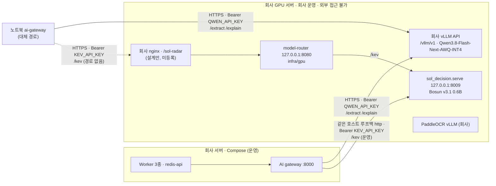

# 10. 배포·실행 프로필

## 운영 구성 (ADR-049)

운영은 Vercel web 하나와 회사 서버의 Compose 프로젝트들로 돈다([[16-DECISIONS|ADR-045·049]]). 구성도는 [[02-ARCHITECTURE|02 아키텍처]] "운영 토폴로지"다.

| 실행 위치 | 맡는 것 |
|---|---|
| Vercel | web 하나(`vercel.json`, 내부 ai 서비스·binding 없음). `SOL_DEPLOYMENT_ROLE=frontend`로 분석·수집 요청을 회사 redis-api에 HTTPS로 넘긴다 |
| Supabase 클라우드 | DB·Auth·Storage(비공개 버킷 `bid-documents`·`bid-parsed`, [[16-DECISIONS\|ADR-048]]) |
| 회사 서버 | 기존 Redis `:6379`, 기존 Nginx `/redis/` → `127.0.0.1:6380` redis-api, AI gateway, Worker 3종(아래 "회사 Compose 프로젝트") |
| 회사 GPU 서버 | 회사 vLLM API(`Qwen3.8-Flash-Next-AWQ-INT4`), model-router + `sol_decision.serve`(Bosun v3.1 0.6B, `:8009`). 아래 "회사 GPU 추론 엔드포인트" |

2026-10-27 운영 상태:

- `https://www.solideos-radar.com/health/ready`가 200이다(`db`·`redis`·`storage` ok, `ai: local`). `ai`는 회사 AI gateway가 보고한 provider 값이다.
- 나라장터 정기 수집은 회사 ingest 전용 Worker의 BullMQ Job Scheduler `g2b-scheduled`다(`pattern "0 */3 * * *"`, `tz "Asia/Seoul"`, `web/server/ingestion/ingest-schedule.ts:9`). 기동 직후 수집은 없다. 실공고는 약 592건이다([[07-DATA-PIPELINE|07 수집]] §2.2).
- 회사 redis-api에는 `SOL_INGEST_MODE=live`가 있다. 수동 수집 판정만 live이고 `SOL_RUN_MODE`는 그대로다. 관리자 [지금 불러오기]는 `GET /api/v1/admin/ingestion/manual-gate`의 gate(사용자 60분·전역 공유 10분·하루 20회)를 거친다([[05-API-SPEC|05]] §2).
- Vercel의 `SOL_DEFAULT_ORIGIN`(`live`·`demo`·`all`)이 화면 기본 출처를 정한다. 값이 없거나 틀리면 실행 모드를 따른다(`live` → `live`, `mock`·`fixture` → `demo`). DEMO 배지는 `?origin=demo`일 때만 뜬다. 분석 단위의 모드·AI 표시는 공고 상세 분석 요약 띠에 있다([[06-UI-UX|06]] §4).
- 운영 DEMO 공고 19건은 그대로다. 그중 16건의 마감을 +15일 옮겼다([실행 기록](evidence/demo-deadline/20261027/prod-run.md)). 운영 DEMO 삭제(실운영 전환 A단계)는 발표 뒤로 미뤘다([[16-DECISIONS|ADR-054]]). 운영 DB에 백업 스키마 `demo_cleanup_20261026`이 있다.
- 실공고 분석은 0건이다. 첨부 텍스트가 없는 live 공고는 `409 ANALYSIS_SOURCE_MISSING`으로 막힌다(`web/server/bids/bids.service.ts:125`). 아래 "첨부 처리 운영 반영"의 회사 반영이 끝나야 풀린다.
- GitHub Actions는 2026-10-24부터 계정 결제 문제로 job이 시작되지 않는다. 검사는 로컬 pre-push 게이트로 한다. CI green을 근거로 쓰지 않는다([[11-TESTING|11 테스트]] §2).

**발표 경로 D1**([[16-DECISIONS|ADR-054]]): 본편은 덱과 녹화 클립이다. 녹화 촬영과 질의응답 라이브는 운영 사이트에서 `?origin=demo`로 운영 DB의 DEMO 데이터를 보인다. 발표 전 `pnpm demo:reset`은 하지 않는다. 당일 확인은 아래 "D1 당일 운영 확인", S5·S6 장애 장면의 녹화는 "대체 경로·녹화용(S5·S6) 기동 절차"다. 날짜는 [[12-ROADMAP|12 로드맵]]이 정본이다.

## 첨부 처리 운영 반영

첨부 다운로드·파서·documents Worker·가입 동의 저장·카카오 live 가드 코드는 main에 있다. 근거: [구현 증거](evidence/attachment-pipeline/20261027-implementation.md), [파서 실표본 확인](evidence/parser/20261027-parser-check.md), [live 가드 검증](evidence/live-guards/20261027.md).

| 단계 | 상태 |
|---|---|
| Vercel web(main `8cfaac31`) | 배포 완료. 분석 준비 판정이 첨부 텍스트를 본다 |
| 운영 DB `20261027000500`(documents 처리 리스 함수 5개)·`000600`(가입 동의 `user_consents`) | 적용 완료([[04-DATABASE\|04 DB]] §7) |
| 버킷 `bid-documents`·`bid-parsed` | 비공개 확인 |
| 회사 반영 | 진행 중. [회사 반영 실행서](plans/2026-10-27-company-rollout-attachments.md)의 D0 읽기 확인을 기다린다 |

회사 반영 순서는 실행서 §2~§9다: D0 읽기 확인 → Git 갱신 → redis-api 재생성 → ingest Worker 재생성 → AI gateway 파서 반영 → Analysis Worker 교체 → Documents Worker 기동 → 확인. **[승인]** 단계는 운영을 바꾸므로 사용자 승인 뒤에 한다.

- gateway 파서 반영이 Documents Worker보다 먼저다. 파서 없는 gateway로 Documents Worker를 띄우면 원본만 받고 파싱은 약 2시간 미루다 `PENDING`으로 남는다. 반영 뒤 gateway `GET /health`의 `parsers`가 `pdfplumber@0.11.10`·`sol-hwpx@1`·`sol-hwp5@1+olefile@0.47`을 보여야 한다.
- Analysis Worker 교체도 Documents Worker보다 먼저다. 옛 Analysis Worker는 첨부 텍스트를 읽지 않고 본문 없는 분석을 만든다. 교체는 덮어쓰기 파일로 SHA 태그 이미지를 만든다(아래 표, 회사 실행서 §8.6).
- 반영 전에 회사 Worker의 `NOTIFY_KAKAO_PROVIDER` 값을 확인한다. live + 빈 값은 카카오 발송 꺼짐이다(아래 "env 파일 위치").
- 되돌리기는 이전 이미지로 다시 띄운다. Documents Worker는 `stop`만 한다. 받은 원본·텍스트·`bid_documents` 상태는 지우지 않는다(회사 실행서 §8.7).

## 회사 Compose 프로젝트

회사 서버에서 사람이 실행한다. 명령·승인 단계의 정본은 [회사 런타임 배포](../infra/company/README.md)와 [회사 반영 실행서](plans/2026-10-27-company-rollout-attachments.md)다.

| 파일 | 프로젝트 | 서비스·이미지 | 진입점·등록 job | 지킬 것 |
|---|---|---|---|---|
| `infra/compose.company.yaml` | `sol-radar-gateway` | `redis-api`(`web/Dockerfile`, `127.0.0.1:6380:3000`), `ai-gateway`(`services/ai/Dockerfile`, 포트 없음), `worker`(전체) | redis-api: `SOL_DEPLOYMENT_ROLE=redis-api`, 허용 7경로. worker: `worker/main.ts` 전체 등록 | 프로젝트 `up` 금지(회사 실행서 §7.11). redis-api만 따로 다시 만든다([격리 배포 실행서](plans/2026-10-27-ingest-source-isolation-deploy.md) 6) |
| `infra/compose.ingest-only.company.yaml` | `sol-radar-ingest` | `ingest-worker`, `sol-radar-ingest-worker:<SHA>` | `worker/ingest-only-main.ts`. ingest만(`g2b-scheduled` + 외부 `<key>-scheduled`). documents 큐에 넣지 않는다(`documents: false`, `ingest-only-main.ts:48`). 정기 창 상한 1440분(`SCHEDULED_WINDOW_CAP_MINUTES`, `ingest-only-main.ts:43`), `--once` 창 상한도 1440분(44행) | `SOL_RUN_MODE=live` 고정. `--check`·`--status`·`--once`·`--unschedule`(회사 실행서 §7) |
| `infra/compose.analysis-only.company.yaml` | `sol-radar-analysis-only` | `analysis-worker`, `sol-radar-ai-worker-worker:latest`(회사 원본) | `worker/analysis-only-main.ts`. analysis 큐 + 멈춘 분석 복구 | 회사가 준 원본 파일이다. `restart: "no"` |
| + `infra/compose.analysis-only.sha.company.yaml` | (위 덮어쓰기) | 이미지 `sol-radar-analysis-worker:<SHA>`, `web/worker/Dockerfile` 빌드, 종료 유예 180초 | 위와 같다 | `latest` 태그를 빌드·태그하지 않는다(회사 실행서 §8.6) |
| `infra/compose.documents-only.company.yaml` | `sol-radar-documents` | `documents-worker`, `sol-radar-documents-worker:<SHA>` | `worker/documents-only-main.ts`. documents 큐 소비자 + 60초 복구 회차 | live가 아니면 exit 1. 전체 Worker와 같은 Redis에서 함께 띄우지 않는다(회사 실행서 §8) |
| `infra/compose.notify-only.company.yaml` | `sol-radar-notify` | `notify-worker`, `sol-radar-notify-worker:<SHA>` | `worker/notify-only-main.ts`. 알림 outbox(인앱·카카오) + 마감 알림. 큐 없음, Redis는 기동 확인용 연결만 | 기동 전이다. live가 아니면 exit 1. 카카오 발송 기본 꺼짐(`NOTIFY_KAKAO_PROVIDER` 빈 값). 전체 Worker와 같은 Supabase에서 함께 띄우지 않는다(회사 실행서 §9) |

- Worker 셋의 `AI_GATEWAY_URL`은 `http://172.20.0.1:8000`이다(`infra/compose.documents-only.company.yaml:28`). redis-api는 `http://ai-gateway:8000`이다(`infra/compose.company.yaml:20`). 둘이 같은 gateway인지는 미확인이다(회사 실행서 §2 D0).
- Documents Worker 처리량은 env `DOCUMENTS_MAX_PER_BID`(기본 3)·`DOCUMENTS_ROUND_MAX_REVISIONS`(10)·`DOCUMENTS_FETCH_INTERVAL_MS`(2000)·`DOCUMENTS_CONCURRENCY`(2, 최대 2)다. 문서 리스는 600초다([[07-DATA-PIPELINE|07]] "documents 큐 소비자 계약").
- notify·deadline 등록은 전체 Worker(`web/worker/main.ts:908-915`)와 notify 전용 Worker(`web/worker/notify-only-main.ts`)에 있다. 회사에서 도는 ingest·analysis·documents 전용 Worker에는 없다(코드 확인). 그래서 notify 전용 Worker를 기동하기 전에는 운영 알림이 처리되지 않는다. 처음 기동하면 쌓인 outbox가 한꺼번에 처리된다. 기동 전 확인은 회사 실행서 §9.1이다([[13-NOTIFICATIONS|13 알림]]).
- 환경 파일은 `infra/.env.redis-api.local`·`.env.ai-gateway.local`·`.env.worker.local`이다. 키 이름은 `infra/env/redis-api.env.example`·`company-ai.env.example`·`company-worker.env.example`·`company.env.example`에 있다(회사 실행서 §2).
- 회사 GPU 서버의 `infra/compose.gpu.yaml`(`sol-radar-gpu`, `model-router`)은 아래 "회사 GPU 추론 엔드포인트"다.

## D1 당일 운영 확인

녹화 촬영과 질의응답 라이브 전에 운영 사이트에서 확인한다. 장면 순서는 [[19-DEMO-SCENARIO|19 데모 시나리오]], 체크리스트는 [[11-TESTING|11 테스트]] §5 "D1 본선"이다.

1. `curl -sS https://www.solideos-radar.com/health/ready`가 200이고 `db`·`redis`·`storage` ok, `ai: local`이다. AI만 불가면 `status: degraded`(200)다. 응답을 증거 폴더에 저장한다.
2. `/dashboard?origin=demo`·`/bids?origin=demo`에 DEMO 배지와 DEMO 공고가 보인다. `/bids`는 11열이고 표 안에서 가로로 스크롤한다.
3. S4 FX-02는 촬영·발표 때만 [재분석]을 누르고 화면 점수로 설명한다. 예상은 10-28~11-02 78 BID, 11-03부터 72 WATCH다(가상 회사 프로필 기준. 공개 자료 프로필 `--apply` 뒤에는 달라진다, [[PROGRESS]] 사용자 결정 대기 6). 운영 기록 66 WATCH(10-24 1건)는 옛 마감 기준 일정 계수(마감까지 영업일 5 미만 → 0.4) 때문으로 본다(추정, [마감 이동 기록](evidence/demo-deadline/20261027/README.md) S4). 골든 72는 mock 시험 기준이다.
4. S-LIVE는 `/bids?origin=live`에서 분석된 실공고 run을 연다. 지금은 실공고 분석이 0건이라(위 "운영 구성" `409 ANALYSIS_SOURCE_MISSING`) 첨부 처리 회사 반영 뒤에만 찍는다. run이 없으면 찍지 않는다([[19-DEMO-SCENARIO|19]] §3.1).
5. 하지 않는 것:
   - 운영 DB에 `pnpm demo:reset`을 돌리지 않는다.
   - 리허설 중에 FX-02를 재분석하지 않는다. 하면 최신 분석이 78 BID가 되어 대시보드 BID 수와 권고 알림이 바뀐다.
   - 실행 모드를 바꾸지 않는다([[19-DEMO-SCENARIO|19]] §5).
6. S5·S6 장애 장면은 녹화 영상으로 보인다. 운영에서 장애를 주입하지 않는다.

## 실행 모드와 프로필

`SOL_RUN_MODE=live|fixture|mock`([[16-DECISIONS|ADR-020]], [[03-AI-PIPELINE|03]] §3)은 데이터 출처와 AI 공급자를 정한다. 프로필은 어떤 env 묶음을 쓸지 정한다(`infra/env/<profile>.env.example`). 프로필 전환은 env 교체와 재기동으로 끝난다([[16-DECISIONS|ADR-008]]). 운영은 `live`다.

| `SOL_RUN_MODE` | 프로필 | 모델 런타임 | 공고 | 더 필요한 것 |
|---|---|---|---|---|
| `mock`(기본) | `demo` | 없음(gateway mock adapter) | fixture 20건(`is_demo=true`) | 없음. GPU·서비스키 없이 돈다. 자동 시험·골든·S5·S6 녹화 |
| `fixture` | `ai-local` | 회사 vLLM API + `sol_decision`(HTTPS, [[16-DECISIONS\|ADR-025·034]]) | fixture 20건 | `QWEN_API_KEY`·`KEV_API_KEY`. 한국어 state 평가용 gateway도 이 모드다 |
| `live` | `ai-local`(운영은 회사 env 파일) | 위와 같다 | data.go.kr 실공고(`is_demo=false`) | 위 + Worker의 서비스키 4개(`G2B_*_SERVICE_KEY`, [[07-DATA-PIPELINE\|07]] §2.2) |

- 모드가 `DEMO_MODE`·`AI_PROVIDER`·`KEV_ENABLED`의 기본값을 정한다(`live` → `false`·`local`·`true`, `fixture` → `true`·`local`·`true`, `mock` → `true`·`mock`·`true`). 원천은 `infra/run-modes.json`이다. `KEV_ENABLED=false`는 세 모드 모두 허용하고 결정 모델 없이 `RULES_ONLY`·`COMPLETED`로 끝난다([[16-DECISIONS|ADR-029]] A5).
- 모순된 값이면 `pnpm check:env`와 gateway가 기동을 거부한다: `live` + `AI_PROVIDER=mock`, `live` + `AI_FALLBACK_TO_MOCK=true`, `live` + `KEV_ALLOW_KO_STATE=true`, 모드와 상관없이 `AI_PROVIDER=hosted` + `KEV_ALLOW_KO_STATE=true`([[16-DECISIONS|ADR-030]] B11).
- 자동 대체 `AI_FALLBACK_TO_MOCK`은 해커톤 동안 만들지 않아 어느 모드든 `true`면 기동을 거부한다. 모드 전환은 사람이 env를 바꾸고 Worker·gateway를 재시작해서 한다([[03-AI-PIPELINE|03]] §8).
- hosted 공급자는 없다. 승인 게이트(`AI_HOSTED_APPROVED`, `infra/run-modes.json`·`pnpm check:env`·gateway 기동 거부)만 있다. `infra/env/`에 hosted 예시 파일은 없다. 비용이 들므로 사용자 승인 전에는 만들거나 부르지 않는다([[16-DECISIONS|ADR-010]]).
- 한국어 state 평가(E2)는 미결정이다([[21-MODEL-TRAINING|21 모델 학습]]). 결정 서버(8009)는 한글 state를 422 `STATE_NOT_ENGLISH`로 거절하고 공유 8009에 `DECISION_ALLOW_KO_STATE`를 켜지 않는다. 데모·운영 gateway에는 `KEV_ALLOW_KO_STATE`를 켜지 않는다.
- 회사 프로필은 모든 모드에서 가상 솔리데오 프로필이다(ADR-019). live 분석은 "실제 공고 × 가상 회사 프로필"이다.

| 프로필 | 대상 | 기동 |
|---|---|---|
| `demo` | 노트북, GPU 없음, Docker Desktop, 인터넷(Supabase) | `docker compose -f infra/compose.yaml up -d --build` |
| `ai-local` | 노트북 Compose 4개 서비스 + 회사 GPU 추론 엔드포인트 | 엔드포인트 확인(아래 G1·G2) 뒤 같은 명령 |
| 운영 | 회사 Compose 프로젝트(위 표) | 회사 실행서 |

### 런타임별 필수 설정

| 실행 위치 | 필수 설정 |
|---|---|
| Vercel web | `NEXT_PUBLIC_SUPABASE_URL`, `NEXT_PUBLIC_SUPABASE_ANON_KEY`, `API_CURSOR_SECRET`(32자 이상), `SOL_RUN_MODE`, 선택 `SOL_DEFAULT_ORIGIN`, `SOL_DEPLOYMENT_ROLE=frontend`, `REDIS_API_BASE_URL=https://acropolissg.com/redis`, `REDIS_API_TOKEN`(32바이트 이상 난수) |
| 회사 redis-api | `SOL_DEPLOYMENT_ROLE=redis-api`, 같은 Supabase URL/anon·실행 모드·cursor secret, 사설 TCP `REDIS_URL`, 같은 `REDIS_API_TOKEN`, `SOL_INGEST_MODE=live`(없으면 `SOL_RUN_MODE`) |
| 회사 Worker | Supabase URL, `SUPABASE_SERVICE_ROLE_KEY`, 사설 TCP `REDIS_URL`, `AI_GATEWAY_URL`, 실행 모드, G2B 서비스키 |
| 공통 Storage 이름 | `SUPABASE_STORAGE_RAW_BUCKET=bid-documents`, `SUPABASE_STORAGE_PARSED_BUCKET=bid-parsed`(기본값) |

- Vercel·redis-api에는 service role·G2B·GPU 키를 넣지 않는다. Vercel에는 `REDIS_URL`도 넣지 않는다. frontend·redis-api는 service role이 있으면 기동을 거부하고, frontend는 `REDIS_URL`이 있으면 거부한다(`web/app/_lib/deployment-role.ts:45-47`).
- 회사 Gateway는 기존 Nginx `/redis/` → loopback 6380과 기존 Redis 6379를 쓴다. 새 Redis를 만들지 않고 Nginx를 고치거나 reload하지 않는다.
- Supabase Auth의 Site URL과 callback 허용 주소는 운영 도메인에 맞춘다([[09-SECURITY|09 보안]]).
- 버킷 점검은 `node --env-file=<Worker env> scripts/ops/ensure-storage-buckets.mjs --inventory`(읽기 전용)다. `--apply --smoke --large`는 비공개 버킷 2개·50MiB 제한·허용 MIME·왕복을 검증한다. 기존 public·소유 불명·한도 불일치 버킷은 고치지 않고 실패한다.

### env 파일 위치

로컬 파일 셋은 깃에서 제외한다. 값은 `.env.example`·`infra/env/*.env.example`의 키 이름을 보고 채운다. 회사 env 파일은 위 "회사 Compose 프로젝트"다.

| 파일 | 읽는 쪽 | 담는 값 (요지) |
|---|---|---|
| `infra/.env` | `docker compose -f infra/compose.yaml`의 변수 치환. 첫 `-f` 파일 폴더(`infra/`)에서 찾는다 | 컨테이너에 넘기는 키는 `compose.yaml`의 `environment`가 정한다. worker: Supabase URL, `SUPABASE_SERVICE_ROLE_KEY`, 실행 모드, 서비스키 4개(`live`만 필수), 선택 env(아래), 카카오 키. Worker의 `REDIS_URL`은 Compose가 `REDIS_PASSWORD`로 만들고 `AI_GATEWAY_URL`은 `http://ai-gateway:8000` 고정이다. ai-gateway: 실행 모드·`AI_PROVIDER`·`AI_HOSTED_APPROVED`·`AI_FALLBACK_TO_MOCK`·`KEV_ENABLED`·`KEV_ALLOW_KO_STATE`·`QWEN_*`·`KEV_*`. 호스트 포트: `REDIS_HOST_PORT`(6380)·`QDRANT_HOST_PORT`(6333)·`AI_GATEWAY_HOST_PORT`(8000) |
| `web/.env.local` | Next.js `web/` | Supabase URL/anon, `REDIS_URL`, `AI_GATEWAY_URL`, `API_CURSOR_SECRET`(없으면 커서 목록 API 503 `{component:"cursor"}`, [[05-API-SPEC\|05]] §3), `SOL_RUN_MODE`(없으면 `mock`, `infra/.env`와 다르면 `pnpm check:env`가 `CONTRADICTS_MODE`), 선택 `SOL_DEFAULT_ORIGIN`·`AI_PROVIDER`·`AI_HOSTED_APPROVED`·`KEV_ENABLED`(gateway에 닿지 못할 때 관리자 AI 상태가 보이는 값). hosted는 gateway와 web 둘 다 `AI_HOSTED_APPROVED=true`여야 한다(아니면 `422 HOSTED_NOT_APPROVED`, [[05-API-SPEC\|05]] §5). service role·서비스키는 넣지 않는다 |
| 루트 `.env.local` | `pnpm db:push`·`pnpm db:verify`·`pnpm demo:reset` | `SUPABASE_DB_URL`, Supabase URL, `SUPABASE_SERVICE_ROLE_KEY`, `DEMO_SEED_PASSWORD` |

- service role 키와 서비스키 4개는 `NEXT_PUBLIC_` 변수·브라우저 번들·로그에 넣지 않는다([[09-SECURITY|09 보안]]). 서비스키는 Worker의 `OfficialApiConnector`만 읽고, 소스마다 registry `serviceKeyEnv`가 가리키는 키 하나만 쓴다([[07-DATA-PIPELINE|07]] §2.2). gateway에도 넘기지 않는다.
- `pnpm check:env`(`scripts/check-env.mjs`)는 세 파일의 placeholder를 세고 모드 모순을 찾는다. `process.env`가 아니라 파일을 읽으므로 셸 env만으로는 검사되지 않는다.
- `G2B_INGEST_INTERVAL_MINUTES`는 더 쓰지 않는다. g2b 정기 수집은 코드에 고정한 KST 3시간 정각 cron이고, Worker는 이 env를 무시하며 "무시함" 한 줄만 남긴다.
- `ANALYSIS_STALE_QUEUED_MS`·`ANALYSIS_STALE_RUNNING_MS`·`ANALYSIS_RECONCILE_INTERVAL_MS`(멈춘 분석 복구, [[03-AI-PIPELINE|03]] §3)는 `compose.yaml`이 worker에 값 없는 키로 넘긴다. 값이 없으면 코드 기본값이다([[16-DECISIONS|ADR-031]] C12(e)·C13).
- `KEV_TIMEOUT_MS`·`AI_TIMEOUT_MS`(기본 `5000`·`60000`)는 ai-gateway와 worker 둘 다에 값 없는 키로 넘긴다. 빈 문자열이면 gateway 설정 검증이 실패한다. 기본값은 gateway `settings.py`와 worker `gateway.model.ts`를 함께 바꾼다([[16-DECISIONS|ADR-033]] E4).
- `NOTIFY_POLL_INTERVAL_MS`(인앱 알림 outbox 처리 간격, 500~60000, 기본 `2000`)는 값이 틀리면 Worker가 키 이름만 알리고 멈춘다([[13-NOTIFICATIONS|13 알림]]).
- 카카오톡 알림(나에게 보내기, [[16-DECISIONS|ADR-038]]) env:
  - Worker: `NOTIFY_KAKAO_PROVIDER`·`KAKAO_REST_API_KEY`·`KAKAO_CLIENT_SECRET`·`KAKAO_TOKEN_ENC_KEY`·`SITE_URL`. 회사 키 이름은 `infra/env/company-worker.env.example:14-18`, 로컬은 `compose.yaml` worker `environment`에 있다.
  - web: `KAKAO_REST_API_KEY`·`KAKAO_CLIENT_SECRET`·`KAKAO_TOKEN_ENC_KEY`·`KAKAO_REDIRECT_URI`·`SITE_URL`(`web/.env.example`). 연결 Route Handler는 `/api/v1/me/kakao-notify/connect`·`callback`·`test`다.
  - `mock`은 외부 호출 없이 보낸 것으로 친다. `memo`는 실발송이고 키 넷이 모두 있어야 하며 `KAKAO_TOKEN_ENC_KEY`는 base64 32바이트(AES-256-GCM)여야 한다. 틀리면 Worker가 Redis 연결 전에 키 이름만 알리고 멈춘다. 그 밖의 값도 기동을 멈춘다.
  - 빈 값은 실행 모드에 따라 다르다. `mock`·`fixture`는 mock이다. `live`면 카카오 발송을 끄고 경고 한 줄(`notify.kakao.disabled`)만 남긴다. 카카오 이벤트는 재시도 뒤 `DEAD`가 되고 발송 기록은 생기지 않는다. live에서 `mock`을 직접 적으면 경고(`notify.kakao.mock_in_live`)를 남긴다. 이 동작은 main에 있고 회사 Worker 반영 전이다([live 가드 검증](evidence/live-guards/20261027.md)).
  - `KAKAO_TOKEN_ENC_KEY`는 web이 암호화하고 Worker가 복호화하므로 두 쪽이 같은 값이다. 바꾸면 모든 연결을 다시 해야 한다. 키·시크릿은 서버 전용이다([[09-SECURITY|09 보안]] "카카오톡 알림").
  - 운영 카카오 연결·발송은 0건이다. 실발송은 사용자가 `memo`로 바꿀 때만 일어난다. 시험은 `mock`이다.

**Phase 0 확정 사항**(정본 [[16-DECISIONS|ADR-024]] 표): placeholder `CHANGE_ME` 금지, Redis 비밀번호 영숫자, 호스트 포트 `127.0.0.1`·redis 기본 6380, Compose 프로젝트 이름 `sol-radar-stack`, 빈 문자열은 미지정.

- gateway 이미지는 `AI_HOST=0.0.0.0`·`SOL_RUN_MODES_FILE=/app/infra/run-modes.json`을 이미지 ENV로 가지고 저장소 루트를 빌드 컨텍스트로 쓴다(`context: ..`).
- `infra/smoke.sh`는 `-p`를 받지 않는다. 격리해 돌리려면 `COMPOSE_PROJECT_NAME`·`COMPOSE_ENV_FILES`를 준다. `REDIS_URL`은 호출한 셸이 준다.
- `pnpm verify`는 `services/ai`·`services/decision`을 프로젝트로 등록해 pytest를 돌리므로 `uv`가 있어야 한다.

### `ai-local` env 예시

`infra/env/ai-local.env.example`의 AI·실행 모드 부분이다(값은 placeholder). served id `Qwen3.8-Flash-Next-AWQ-INT4`는 회사 API 실호출로 확인했다([실연결 증거](evidence/phase-5/qwen-probe-20261021-2343.json)).

```bash
SOL_RUN_MODE=live                 # live | fixture | mock. live 와 모순되는 값은 기동 거부
DEMO_MODE=false                   # SOL_RUN_MODE 에서 파생(live → false, fixture·mock → true)
AI_PROVIDER=local
KEV_ENABLED=true
AI_FALLBACK_TO_MOCK=false         # true 면 기동 거부
KEV_ALLOW_KO_STATE=false          # live 에서 true 면 기동 거부. 평가용 fixture gateway 에서만 true
QWEN_BASE_URL=https://acropolissg.com/vllm/v1   # 회사 vLLM API. 게이트웨이가 끝의 /v1 을 인식해 /chat/completions·/models 를 붙인다
QWEN_MODEL=Qwen3.8-Flash-Next-AWQ-INT4           # 회사 vLLM /v1/models 의 id. 레지스트리 qwen3.8-flash-next 와 대조한다
KEV_BASE_URL=http://127.0.0.1:8009   # 회사 호스트 Bosun(같은 호스트 루프백). 루프백이 아니면 https 만, TLS 검증을 끄지 않는다
QWEN_API_KEY=<placeholder>        # 회사가 제공하는 vLLM API 키
KEV_API_KEY=<placeholder>         # 결정 서버(sol_decision)의 DECISION_API_KEY 와 같은 값
KEV_MODEL_ID=bosun-v3.1-0.6b      # services/ai/models/registry.yaml → Hanno-Labs/bosun-v3.1-0.6b@5e78a37c(KEV_* 이름은 호환 유지, ADR-034)
KEV_QUESTION_SET=kev-qs/v0.2
# data.go.kr 서비스키 — 서비스마다 하나씩(ADR-022). worker 전용, live 에서만 필수. 로그 금지
# 값은 포털의 Encoding 키 그대로. worker 가 decodeURIComponent 로 한 번 디코딩한다(07 §2.2)
G2B_BID_NOTICE_SERVICE_KEY=<placeholder>       # 입찰공고정보서비스 15129394
G2B_PRE_SPEC_SERVICE_KEY=<placeholder>         # 사전규격정보서비스 15129437
G2B_ORDER_PLAN_SERVICE_KEY=<placeholder>       # 발주계획현황서비스 15129462
G2B_INDUSTRY_MASTER_SERVICE_KEY=<placeholder>  # 업종 및 근거법규 15129467
```

- gateway는 `QWEN_API_KEY`·`KEV_API_KEY`를 `Authorization: Bearer`로 보낸다(ADR-025, [[03-AI-PIPELINE|03]] §3).
- `KEV_BASE_URL`은 회사 호스트의 Bosun이다. 운영 회사 Compose gateway(`network_mode: host`)가 이 값으로 붙는다. 설계한 공개 경로 `https://acropolissg.com/sol-radar/kev`는 회사 nginx에 없어 노트북 gateway는 결정 모델에 닿지 않는다(아래 "회사 GPU 추론 엔드포인트").
- `PARSER_PDF`·`PARSER_HWPX`·`PARSER_HWP`는 gateway 선택 env다. 비우면 기본 어댑터(`pdfplumber`·`sol-hwpx`·`sol-hwp5`)가 켜진다. 모르는 값이면 그 형식만 처리하지 않는다([[03-AI-PIPELINE|03]] §10.1).

### seed

seed는 스크립트 `pnpm demo:reset`이다(Compose 서비스가 아니다). 루트 `.env.local`의 service role 키로 넣고 다시 돌려도 같은 상태가 된다(멱등). 마이그레이션은 적용하지 않는다. 스키마는 `pnpm db:push`(사용자 확인 뒤)이고, seed 전에 `pnpm db:verify`로 미적용 마이그레이션이 없는지 본다. **운영 DB에는 돌리지 않는다**(D1, [[16-DECISIONS|ADR-054]]).

- 적재: 조직 2개(`org-01` 솔리데오, `org-02` 격리 확인용), 계정 5개(`org-01`에 ADMIN/SALES/ANALYST/VIEWER 각 1, `admin@admin.com`이 `org_role=owner`, `org-02`에 VIEWER 1), 프로필 revision 2, fixture 20건 중 공고 19건 + FX-12 1건 격리(`ingest_errors`), 사전 리뷰 2건(FX-01 BID·FX-03 NO-BID), 부서·직급 카탈로그, 가상 인력 200명(아래 "솔리데오 인력·사진 준비").
- 추출은 넣지 않는다. 검증된 추출은 기동 절차 14번 `pnpm demo:preanalyze`가 worker → gateway `/extract`로 저장한다([[16-DECISIONS|ADR-031]] C16).
- 계정 비밀번호는 `DEMO_SEED_PASSWORD`로만 정한다. 템플릿 `pnpm db:seed`는 로컬 Supabase 시험 계정용이다.
- `is_demo=true` 데이터만 지우고 다시 만들므로 live 공고는 그대로다([[04-DATABASE|04 DB]] §6). 목록 기본 필터는 `SOL_DEFAULT_ORIGIN`(없으면 실행 모드)을 따른다.

## 회사 GPU 추론 엔드포인트

추출·설명은 회사가 운영하는 vLLM API(`https://acropolissg.com/vllm/v1`, `Qwen3.8-Flash-Next-AWQ-INT4`)다. 결정 모델 Bosun v3.1 0.6B는 우리 `sol_decision.serve`가 GPU 서버 `127.0.0.1:8009`에서 Kev wire 호환으로 제공한다([[16-DECISIONS|ADR-025·034]]). GPU 서버는 외부에서 접근할 수 없어 회사가 `https://acropolissg.com` 아래로 연다(`/vllm`은 회사 vLLM). 우리 모델 라우터용 `/sol-radar` 경로는 설계만 있고 회사 nginx에 등록되지 않았다(2026-10-27 사용자 확인, 공개 `/sol-radar/kev/v1/models`·`/sol-radar/healthz` 404). 운영 회사 Compose gateway는 같은 호스트의 결정 서버에 루프백 `KEV_BASE_URL=http://127.0.0.1:8009`로 붙는다(루프백 http는 gateway URL 검사가 허용한다, `services/ai/src/sol_ai/adapters/local_setup.py`).



- **env 이름**: `QWEN_BASE_URL`·`QWEN_MODEL`·`QWEN_API_KEY`·`KEV_BASE_URL`·`KEV_MODEL_ID`·`KEV_API_KEY`(`KEV_*`는 호환 유지, ADR-034). 값은 위 env 예시다. 호스트가 `acropolissg.com`이라 레지스트리 `allowedHosts`는 그대로다.
- **모델 라우터**(설계. 회사 nginx 등록 전이라 운영은 거치지 않는다): 회사 nginx는 location 하나(`/sol-radar`)만 등록할 수 있어 GPU 서버 안에 경로 분기 nginx를 둔다(`infra/gpu/model-router.conf`, `127.0.0.1:8080`). `/sol-radar/kev/<path>` → `127.0.0.1:8009/<path>`다. `/sol-radar/qwen/*`(`:8001`) 규칙은 남아 있지만 쓰지 않는다. 바깥 nginx가 접두어를 떼도 같은 곳으로 간다. `/sol-radar/healthz`(인증 없음)는 `200 ok`, 그 밖은 404다. 인증은 각 런타임이 하고 라우터 로그에는 `$uri`만 남긴다.
- **회사 GPU 서버에서 띄우는 것**(회사 운영, 인수 문서 `infra/gpu/README.md`): 라우터는 `infra/compose.gpu.yaml`(`name: sol-radar-gpu`, `model-router` = `nginx:1.27-alpine`, `network_mode: host`, Linux)이다. `sol_decision.serve`는 아래 명령으로 호스트에 직접 띄운다. vLLM은 띄우지 않는다.
- **회사 nginx 설정**(등록되지 않았다, 2026-10-27 사용자 확인): `location /sol-radar/ { proxy_pass http://127.0.0.1:8080; }` + `Authorization` 헤더 통과, `proxy_read_timeout 300s`, `client_max_body_size 20m`, `proxy_buffering off`. 전체 블록은 `infra/gpu/README.md`다.
- **운영 책임**: 모델 런타임 기동, GPU 메모리 배분, 패키지 sha256 대조, `nvidia-smi` 실측은 회사가 한다. GPU 배치·메모리 계획·서버 계정은 [[22-FINETUNE-RUNBOOK|22 파인튜닝 실행서]] §3·§4와 `infra/gpu/README.md` "GPU 1 공유"가 정본이다. 우리가 하는 검증은 gateway 기동 때의 레지스트리 대조([[03-AI-PIPELINE|03]] §11)와 지연 실측이다.
- **GPU 1 공유**: `sol_decision`이 쓰는 물리 GPU 1은 전용이 아니고 회사 PaddleOCR vLLM이 상주한다. 우리 절차로 GPU 0·1·2의 어떤 프로세스도 종료·이동하지 않고, GPU 0·2는 쓰지 않는다(ADR-034 10번). 메모리가 모자라면 회사에 보고하고 멈춘다.
- **미확인**: 포트 8080 라우터의 실제 실행(8009 결정 서버는 2026-10-27 회사 호스트에서 실행 중임을 확인했고, gateway `/health`가 `registryMatch: true`였다. [기록](evidence/company-public-profile/20261027/prod-rollout.md)), 회사 vLLM이 어느 GPU에서 어떤 양자화로 도는지, 노트북 `ai-gateway`에서 공개 HTTPS로 나가는 경로(G1, 대체 경로용)는 미확인이다.
- **보안**: TLS 필수(검증을 끄지 않는다), API 키 필수, 키는 서버 env 파일에만 둔다. URL은 문서에 적고 키 값은 적지 않는다. 회사 GPU로 가는 데이터는 실제 공고(공공 데이터, 개인정보 마스킹)와 가상 회사 프로필뿐이다([[09-SECURITY|09 보안]]).
- **평가·학습**(E0~E4, LoRA F1·F2)은 미결정이다. 절차는 [[21-MODEL-TRAINING|21 모델 학습]]·[[22-FINETUNE-RUNBOOK|22]]다. 데모 모델은 공개 Bosun이다. Qwen 파인튜닝은 하지 않는다. 클라우드 GPU 임대는 비용 승인 대상이다(ADR-010).

결정 서버 기동 명령(회사가 실행하는 참고 구성. 키 값은 셸 변수로만):

```bash
export CUDA_DEVICE_ORDER=PCI_BUS_ID CUDA_VISIBLE_DEVICES=1        # 물리 GPU 1 (PaddleOCR 와 공유). 가시성만 제한한다
# .venv-bosun. --package 는 고정 snapshot(리비전 5e78a37c). manifest.json sha256 대조 실패 시 기동 거부, 다운로드 금지
HF_HUB_OFFLINE=1 DECISION_API_KEY="$DECISION_API_KEY" python -m sol_decision.serve --package <snapshot dir> --host 127.0.0.1 --port 8009
docker compose -f infra/compose.gpu.yaml up -d        # model-router (Linux, host 네트워크)
```

연결 확인(G1·G2. 키 값은 env 변수 참조만 쓴다):

```bash
# G1: 라우터 healthz 200 + TLS 유효. -k 금지. 회사 nginx 에 /sol-radar 를 등록한 뒤에만 쓴다(2026-10-27 운영은 404)
curl -sS -o /dev/null -w 'http=%{http_code}\n' https://acropolissg.com/sol-radar/healthz
# G2: 결정 서버 data[0].run == Hanno-Labs/bosun-v3.1-0.6b@5e78a37c, 회사 vLLM data[].id 에 Qwen3.8-Flash-Next-AWQ-INT4
curl -sS --fail -H "Authorization: Bearer $KEV_API_KEY"  "$KEV_BASE_URL/v1/models"
curl -sS --fail -H "Authorization: Bearer $QWEN_API_KEY" "$QWEN_BASE_URL/models"
```

회사 Qwen API는 `services/ai/scripts/probe-qwen-api.py`로도 확인한다(사용자 확인 뒤 손으로만, 호출 예산을 쓴다). ① `GET /v1/models`의 `id` ② guided JSON ③ `--logprobs`면 `prompt_logprobs`를 본다. `--dry-run`은 요청 계획만 낸다. 종료 코드는 0 요청 보냄, 1 전송 실패, 2 키 없음, 3 URL 거부다. 키 값·Authorization 헤더는 출력하지 않는다. 절차는 [B2 런북](plans/2026-10-21-bosun-b2-runbook.md) §8이다(B2는 미결정).

> [!warning] 미검증 가정
> - 운영 `/health/ready`가 `ai: local`이다. 전체 추출·부하 지연, 호출 한도, 회사 vLLM의 리비전·양자화·`prompt_logprobs` 지원은 미측정이다(ADR-034 1·8번). 우리는 `GET /v1/models`의 `id`를 레지스트리 `qwen3.8-flash-next`와 대조만 한다.
> - Bosun 질문당 지연이 `KEV_TIMEOUT_MS` 5000 안인지는 미측정이다(16 미결정 24번). 넘으면 [[16-DECISIONS|ADR-033]] E4 규칙대로 기본값을 함께 바꾼다.
> - 바깥 nginx의 접두어 처리와 Bearer 외 추가 인증 여부는 미확인이다. 다르면 ADR-025를 갱신한다.
> - 어댑터의 `enable_thinking: false`([[03-AI-PIPELINE|03]] §4.3)는 그대로 둔다. 새 모델의 사고 모드 기본값은 미확인이다.
> - 결정 모델을 노트북 CPU로 돌리는 경로는 쓰지 않는다(미결정 8번, [[03-AI-PIPELINE|03]] §5.9). Bosun 0.6B CPU 추론은 미측정이다.

엔드포인트에 닿지 않으면(TLS·인증 실패 포함) `QWEN_UNAVAILABLE`·`KEV_UNAVAILABLE` → `PARTIAL`·`RULES_ONLY`로 끝난다([[03-AI-PIPELINE|03]] §8). mock으로 조용히 바뀌지 않는다.

## 결정 모델 런타임 주의 (Bosun, ADR-034)

`sol_decision.serve`는 회사 GPU 서버 호스트에 직접 뜬다. 결정 서버 컨테이너는 어느 Compose 파일에도 없다. Bosun의 외부 사실(리비전·어댑터·decision token)은 [분석·변경 계획](plans/2026-10-20-bosun-qwen4b-migration-plan.md) §1.1과 [[03-AI-PIPELINE|03]] §5가 정본이다. `kev.serve`·stock vLLM·Hanno `jev-compatible-server`로 Bosun을 띄우지 않는다.

데모·운영 결정 서버는 공개 Bosun v3.1 0.6B 리비전 `5e78a37c8d86860ebac9ef2d5327d6299498498e`로 고정한다([[16-DECISIONS|ADR-034]] 1·9번). 학습본으로 바꾸는 것은 E4에서 Δ 95% CI가 0을 배제하고 사용자가 승인한 뒤에만이다.

- **기동 전 sha256 대조**: `--package`의 `manifest.json` sha256과 파일을 대조한다. 공개본 기준값은 `adapter/adapter_model.safetensors` `961d237bc60a88f133bc723dd3cbf1133f743a7fde673cee96d1171c67b425d5`, `decision_embeddings.safetensors` `88f9e856054f78ac521ba0180052d25720c3786d1db4e80aa7a8ecf39be01188`이다. 레지스트리 `bosun-v3.1-0.6b` 항목의 `lora`·`decision_embeddings_sha256`과 같아야 한다. 다르면 `sol_decision.serve`가 exit 78로 기동을 거부한다(`services/decision/src/sol_decision/package.py`). 절차는 [[22-FINETUNE-RUNBOOK|22]] §2다.
- **gateway 레지스트리 대조**: gateway는 기동 때 결정 서버 `GET /v1/models`의 `run`(`Hanno-Labs/bosun-v3.1-0.6b@5e78a37c`)·`base`(`Qwen/Qwen3-0.6B@c1899de`)·`lora`·`revision`(있으면)을 레지스트리와 대조한다. 다르면 `KEV_MODEL_ID(REGISTRY_MISMATCH)`로 기동을 거부한다([[03-AI-PIPELINE|03]] §11). `POST /v1/systemone`의 `model`은 서버 alias `bosun-v3.1-0.6b`와 같아야 하고 다르면 422다.
- 두 검사가 필요한 이유: 공개본과 학습본 패키지 레이아웃이 같아 `--package` 경로 실수가 가능하다. 검사가 없으면 다른 패키지의 확률이 공개 Bosun 결과처럼 저장된다.
- 리비전 `5e78a37c`와 Hanno 레지스트리 핀 `87cea31`의 `manifest.json` 대조, 첫 기동 로딩 시간·VRAM은 미결정(B2)이다.

## 로컬 Compose 서비스 (대체 경로)

노트북 `infra/compose.yaml`(`sol-radar-stack`)은 4개 서비스다. Compose `profiles`가 없어 어느 프로필이든 같은 서비스가 뜬다. Redis·Qdrant는 named volume이고 이미지는 버전을 고정한다. DB·Auth·Storage는 Supabase 클라우드다.

| service | 이미지 | 내부 포트 | 호스트 노출 | 상태 저장 |
|---|---|---:|---|---|
| worker | `web/` 빌드, 진입점 `web/worker/main.ts`(전체 등록) | - | 없음 | `../fixtures`·`../infra/sources` 읽기 전용 바인드 |
| redis | `redis:8.8.3-alpine` | 6379 | `127.0.0.1:6380`(`REDIS_HOST_PORT`) | redisdata |
| qdrant | `qdrant/qdrant:v1.19.2-unprivileged` | 6333 | `127.0.0.1:6333`(`QDRANT_HOST_PORT`) | qdrantdata |
| ai-gateway | `services/ai/` 빌드 | 8000 | `127.0.0.1:8000`(`AI_GATEWAY_HOST_PORT`) | 없음 |

- web은 Compose에 없다. 호스트에서 `SOL_DEPLOYMENT_ROLE=standalone pnpm -C web start`로 띄운다. 그래서 redis·qdrant·ai-gateway 세 서비스만 `127.0.0.1`에 포트를 연다([[16-DECISIONS|ADR-024]] D1).
- `postgres`·`api`·`seed-demo` 서비스는 없다. 모델 런타임도 어느 Compose 파일에도 없다.
- 로컬 Redis 호스트 포트 6380과 회사 redis-api loopback 6380은 다른 것이다. 섞지 않는다.
- healthcheck: worker는 heartbeat 파일(`WORKER_HEARTBEAT_FILE`, 10초마다 갱신, 30초 이내 판정, [[16-DECISIONS|ADR-024]] D3), ai-gateway는 `GET /health` 200(`start_period: 20s`), qdrant는 bash `/dev/tcp`로 `GET /readyz` 200, redis는 `redis-cli ping`(비밀번호는 `REDISCLI_AUTH`)이다.
- redis 비밀번호는 설정을 stdin으로 넘겨 프로세스 인자·`docker inspect`에 남지 않게 한다. 컨테이너는 `setpriv`로 `redis` 사용자로 내린다. worker CMD는 `node --conditions=react-server --import tsx worker/main.ts`이고 Compose는 `init: true`다.

## 파서 런타임

형식마다 기본 어댑터가 있다(main 병합, 회사 gateway 재빌드 전, [[03-AI-PIPELINE|03]] §10.1·§10.2). 형식별 최종 선택은 실제 RFP 샘플 비교(03 §10.3) 뒤다.

- 의존성은 `services/ai/pyproject.toml`의 pdfplumber·olefile(와 그 의존)뿐이다. Python 밖 런타임은 없다. Dockerfile은 그대로이고 `uv sync --frozen`이 설치하므로 **gateway 이미지를 다시 빌드해야 파서가 들어간다**.
- 어댑터는 요청마다 격리 하위 프로세스(`python -I`, 빈 환경 변수)로 돈다. 동시 2개, 문서당 90초, Linux에서 주소 공간 2 GiB다.
- gateway는 파서가 들어가도 DB·Storage·외부 네트워크에 접근하지 않는다. AGPL·GPL 패키지(pyhwp·PyMuPDF·poppler 등)는 넣지 않는다.

## 대체 경로·녹화용(S5·S6) 기동 절차

로컬 Compose로 S5·S6 장애 장면을 녹화하거나, 운영 사이트를 쓸 수 없을 때 쓰는 경로다([[19-DEMO-SCENARIO|19 데모 시나리오]] §3.2·§5). 발표 본선은 위 "D1 당일 운영 확인"이다.

> [!warning] 운영 Supabase를 가리키지 않는다
> 이 경로는 격리 로컬 Supabase(`pnpm db:start`)만 쓴다. `pnpm demo:reset`은 데모 조직의 조직 소유 행(`score_runs` 포함)을 지우므로 운영 프로젝트에 돌리면 운영 DEMO 분석이 지워진다. 시작 전에 루트 `.env.local`·`web/.env.local`·`infra/.env`가 운영 프로젝트를 가리키지 않는지 본다.

전제: 이미지 빌드·pull, `pnpm -C web build`, 마이그레이션 상태 확인을 미리 끝낸다. 당일에는 스키마를 바꾸지 않는다. 증거는 `docs/evidence/demo-day/YYYYMMDD-HHMM/`에 저장한다([[11-TESTING|11 테스트]]). **[live·fixture]** 표시는 `ai-local`일 때만 한다. `pnpm demo:reset`은 사전 분석을 지우므로(직후 `score_runs` 0건) 마지막 reset 뒤에 사전 분석을 만든다([[16-DECISIONS|ADR-031]] C12(f)).

`mock`은 외부 모델을 부르지 않는다. `live`·`fixture`는 회사 GPU 추론 엔드포인트(HTTPS) 접속이 필요하다(ADR-025).

1. Docker Desktop 실행. `docker info`가 Server 정보를 출력하면 통과.
2. `pnpm db:start`로 격리 로컬 Supabase를 켠다. 마이그레이션 적용과 `web/.env.local` 채우기를 이 명령이 한다. 실패하면 중단한다.
3. env 준비: `mock`은 `cp infra/env/demo.env.example infra/.env`, `live`·`fixture`는 `cp infra/env/ai-local.env.example infra/.env` 후 `SOL_RUN_MODE`를 맞춘다. 루트 `.env.local`도 로컬 Supabase 값으로 채운다. `pnpm check:env`가 placeholder 0건·모드 모순 0건이면 통과. `SOL_RUN_MODE` 줄을 `run-mode.txt`로 저장.
4. 서비스 기동.
   - `mock`: `docker compose -f infra/compose.yaml up -d --build`.
   - **[live·fixture]** ① 회사 측 모델 기동을 확인한다. ② G1 curl(위 "회사 GPU 추론 엔드포인트"). ③ G2 curl 두 개가 기대 id를 돌려주면 통과, 응답을 `endpoint-models.json`으로 저장. ④ `mock`과 같은 명령. gateway가 레지스트리 불일치로 기동을 거부하면 중단한다.
   - 공통: `docker compose -f infra/compose.yaml ps`에서 4개 서비스(redis·qdrant·ai-gateway·worker) `healthy`. 출력을 `compose-ps.txt`로 저장.
5. web 기동: `SOL_DEPLOYMENT_ROLE=standalone pnpm -C web start`(:3000).
6. seed: `pnpm demo:reset` 마지막 줄이 `seed: orgs=2 users=5 profileRevisions=2 people=200 portraits=200 bids=19 quarantined=1 reviews=2 isDemo=true`인지 확인한다. 숫자가 다르면 중단. 사전 분석은 14번에서 만든다.
7. `curl -s http://localhost:3000/health/ready`: `status` ok, `checks.db`·`checks.redis`·`checks.storage` ok, `checks.ai`가 모드와 맞는다(`mock` → `mock`, `live`·`fixture` → `local`). AI만 불가면 `degraded`(200)로 통과. db·redis·storage 중 하나라도 불가면 503이므로 중단. `health-ready.json`으로 저장. **[live·fixture]** gateway `GET /health`의 `runMode`와 `kev.registryMatch=true`도 `gateway-health.json`으로 저장([[05-API-SPEC|05 API]], [[14-OBSERVABILITY|14 관측성]]).
8. API 스모크: `org-01` 계정으로 Supabase Auth 비밀번호 로그인을 해 access token을 받는다. `Authorization: Bearer`로 `GET /api/v1/bids?origin=demo` 19건 → `POST /api/v1/bids/:id/analyses` 202 → poll이 10초 안에 `COMPLETED`(`mock` 기준, [[19-DEMO-SCENARIO|19]] S4). Bearer 요청은 CSRF 헤더 검사 대상이 아니다.
9. 브라우저(1440px, 줌 100%)에서 로그인 → 분석 1건의 요약 띠 "분석 실행 모드: mock"·"AI: mock"(`live`·`fixture`면 "AI: local · Qwen3.8-Flash-Next-AWQ-INT4 · Hanno-Labs/bosun-v3.1-0.6b@5e78a37c")과 `?origin=demo`의 DEMO 배지 확인 → 목록 19건, 격리 1건(FX-12)은 관리자 수집 현황에만 표시 → 상세가 자격·점수·근거·결정 모델 참고 지표까지 렌더. `run-mode-header.png`로 저장.
10. 장애 대체 리허설(아래 "장애 주입"): ai-gateway 중지 → FX-01 재분석 `PARTIAL` → 시작 → `healthy` → 재분석 `COMPLETED`. **[live·fixture]** 엔드포인트 미접속도 한다: `QWEN_BASE_URL`·`KEV_BASE_URL`을 닿지 않는 주소로 바꿔 ai-gateway를 재시작(또는 방화벽으로 `acropolissg.com` 차단) → FX-01 재분석이 `PARTIAL`·`RULES_ONLY`(`QWEN_UNAVAILABLE` 또는 `KEV_UNAVAILABLE`)이고 mock 결과가 아닌지 확인 → 값을 되돌려 재시작하고 G2 curl로 재접속 확인 → `COMPLETED`. 재접속 소요 시간을 기록한다.
11. 테넌트 격리: `org-02` VIEWER(`viewer@other.invalid`) token으로 `GET /api/v1/bids/{FX-01 id}/qualification-checks` → `404 NOT_FOUND`. 공고 자체(`GET /api/v1/bids/{FX-01 id}`)는 공용이라 200. `isolation-404.json`으로 저장([[19-DEMO-SCENARIO|19]] S7).
12. 리허설로 생긴 리뷰·알림·분석 run 초기화: `pnpm demo:reset`. 마지막 줄이 6번과 같은지 본다. 이 뒤 `score_runs`는 0건이다.
13. 모드 복귀: `live`·`fixture`로 리허설했으면 `SOL_RUN_MODE=mock`으로 바꾸고 worker·ai-gateway를 재시작한다. `/health/ready`의 `checks.ai`가 `mock`이면 통과.
14. 사전 분석: `pnpm demo:preanalyze`로 18건(SEED 19건 − FX-02)을 만든다. 18건 모두 `COMPLETED`여야 한다(`mock`·gateway 필수, [[19-DEMO-SCENARIO|19]] §3, [[16-DECISIONS|ADR-030]] B22). 실행은 사용자 확인 뒤다. 그 뒤 `pnpm demo:reset`을 다시 돌렸으면 13·14번을 다시 한다.
15. 녹화 준비: 브라우저 탭 1개만 남긴다. **[live·fixture]** G2 curl로 마지막 확인.

리허설 때 더 하는 것(결과는 `docs/evidence/demo-day/rehearsal-log.md`, [[17-CLAUDE-IMPLEMENTATION|17 구현 규칙]]):

- **모드 전환**: `live` → `fixture` → `mock` 순서로 바꾸고 재시작한다. 모드마다 `checks.ai`·분석 요약 띠·DEMO 배지·gateway `runMode`를 보고 소요 시간을 기록한다.
- **모순 env 거부**: 위 "실행 모드와 프로필"의 네 조합으로 `pnpm check:env`와 gateway가 기동을 거부하는지 본다.
- **live 호출 예산**: 공공 API 호출 수가 일일 한도(개발계정 서비스당 1,000건/일) 안인지 관리자 수집 화면으로 본다([[07-DATA-PIPELINE|07 수집]]).

## 장애 주입 (S6 녹화)

S6에서 쓰는 AI 장애 주입은 대체 경로의 **ai-gateway 컨테이너 중지** 하나다. [[02-ARCHITECTURE|02 아키텍처]] 장애 원칙 표의 "AI gateway 불가" 행과 같은 경로다. 운영에서는 주입하지 않는다.

| 단계 | 명령 | 기대 결과 |
|---|---|---|
| 주입 | `docker compose -f infra/compose.yaml stop ai-gateway` | Worker 호출이 연결 거부로 바로 실패(재시도 없음). FX-01 재분석이 1~2초 안에 `PARTIAL`(화면은 2초 폴링이라 수 초), `recommendationBasis=RULES_ONLY`, `reviewFlags`에 `AI_UNAVAILABLE`, 배너 "AI 분석을 사용할 수 없어 규칙 기반 점수와 자격 판정만 표시합니다. (상태: PARTIAL)"([[09-SECURITY\|09 보안]] 원문), 분석 요약 띠 "· 응답 없음(규칙만)", `/health/ready` `degraded`·`checks.ai: unavailable` |
| 복구 | `docker compose -f infra/compose.yaml start ai-gateway` → `ps`에서 `healthy` | FX-01 재분석 `COMPLETED`, 요약 띠 `AI: mock`. 분석 1건으로는 circuit이 열리지 않아 대기 없음 |

`AI_FAULT_INJECT` env 토글과 mock 장애 fixture는 시험(골든 `G6`)에서만 쓴다. 값(`kev_timeout`·`qwen_error`·`qwen_unreachable`·`kev_unreachable`·`gateway_down`)은 [[03-AI-PIPELINE|03]] §3이다. 실모델 모드의 엔드포인트 미접속은 리허설 항목이다(기동 절차 10번).

> [!tip] 심사 포인트
> "AI가 죽어도 제품이 동작한다"의 증거다. 실모델 모드에서는 엔드포인트에 닿지 않아도 mock으로 몰래 바뀌지 않고 실패 유형이 그대로 보인다.

## 카카오 앱 설정 ([[16-DECISIONS|ADR-038]])

`memo` 실발송을 하려면 사용자가 카카오 디벨로퍼스에서 아래를 한다. 작업 세션은 카카오 API 호출·키 발급·외부 계정 연동을 하지 않는다. 원천은 [설계](plans/2026-10-20-kakao-memo-notify-design.md) §6·§11·§12-6이다.

1. 앱을 하나 만든다. 간편 로그인과 같은 앱이면 카카오 `unlink`가 로그인 연결도 끊으므로 연결 해제에 `unlink`를 부르지 않는다.
2. 카카오 로그인을 활성화한다.
3. Redirect URI에 `<앱 주소>/api/v1/me/kakao-notify/callback`을 등록한다. `KAKAO_REDIRECT_URI`와 같아야 한다([[05-API-SPEC|05 API]] §9).
4. 동의항목에서 "카카오톡 메시지 전송(`talk_message`)"을 선택 동의로 켠다.
5. 플랫폼 웹 도메인에 앱 주소를 등록한다. 메시지 링크 도메인은 여기 등록한 도메인과 같아야 한다.
6. 클라이언트 시크릿을 발급한다. 켜면 토큰 요청에 필수다.
7. 키·시크릿·암호화 키 값은 사용자가 서버 env 파일에 직접 넣는다. 값은 문서·커밋·로그에 쓰지 않는다.

- **S0 수신 시험**(설계 §11, 사용자 몫): 사용자 휴대폰으로 나에게 보내기 한 통을 보내 알림이 울리는지, `talk_message`가 검수 없이 되는지, 피드 모양, 원문 도메인 등록 가능 여부를 본다. 알림이 울리지 않으면 멈추고 사용자에게 묻는다.
- **수동 실발송 1회**(U10): 첨부 처리 운영 반영 뒤 실공고 S-LIVE와 함께 `memo`로 한 건을 보내 휴대폰 수신을 녹화한다([[16-DECISIONS|ADR-054]]). D1이라 `demo:reset`은 하지 않는다. 녹화 뒤 `mock`으로 되돌린다. 절차서는 [S-LIVE·카카오 실행서](evidence/demo-day/20261024-slive-check/20261025-slive-kakao-runbook.md)다.

## Redis HTTPS Gateway (ADR-045)

회사 Redis는 기존 `127.0.0.1:6379`, redis-api host publish는 `127.0.0.1:6380`, 외부 주소는 `https://acropolissg.com/redis/`다. 기존 Nginx가 접두어를 떼므로 upstream은 `/health`와 기존 `/api/v1`이다. 별도 Gateway 프레임워크 없이 같은 Next.js 빌드가 역할을 나눈다(`web/app/_lib/deployment-role.ts:38-55`).

| 런타임 | 역할·설정 | 동작 |
|---|---|---|
| Vercel web | `SOL_DEPLOYMENT_ROLE=frontend`, `REDIS_API_BASE_URL`, `REDIS_API_TOKEN`, 선택 `REDIS_API_TIMEOUT_MS=15000` | 세션·CSRF·업무 조직 검증 후 허용 요청만 HTTPS로 넘긴다. `REDIS_URL`·service role 금지 |
| 회사 redis-api | `SOL_DEPLOYMENT_ROLE=redis-api`, Redis TCP URL, 같은 `REDIS_API_TOKEN`, Supabase URL/anon·cursor secret·실행 모드 | 서비스 토큰 + 사용자 JWT를 검사하고 기존 limiter·멱등·큐/DB를 실행. 허용 밖 화면·API·정적 파일 차단 |
| 로컬 web | `SOL_DEPLOYMENT_ROLE=standalone` | 기존 동작. production 빌드는 역할을 명시해야 한다. Vercel은 `frontend`만 허용한다 |

- **허용 7경로**(`web/app/_lib/redis-api-path.ts:16-25`): `GET /health`, `GET /api/v1/admin/ai/status`, `POST /api/v1/bids/{id}/analyses`, `GET /api/v1/analyses/{id}`, `POST /api/v1/admin/ingestion/runs`, `GET /api/v1/admin/ingestion/runs/{id}`, `GET /api/v1/admin/ingestion/manual-gate`. `/health`만 사용자 JWT 없이 서비스 토큰으로 조회한다. 작업 조회의 정본은 DB·RLS이고 public pollUrl은 Vercel `/api/v1`을 가리킨다.
- **토큰**: `openssl rand -hex 32` 등으로 만든 32바이트 이상 난수다. 헤더는 `X-Sol-Service-Token`, 사용자 인증은 별도 `Authorization: Bearer`다. 이전 토큰은 `REDIS_API_TOKEN_PREVIOUS`로 잠깐 병행한 뒤 폐기한다. 값은 문서·명령 로그·`NEXT_PUBLIC_`에 넣지 않는다.
- **접수 상한**: 16KiB·전체 15초. 네트워크/502/503/504는 같은 멱등 키·본문으로 최대 1회 재시도한다. 인증/권한/409/429는 자동 재시도하지 않는다. HTML·redirect·잘못된 DTO는 안전한 503으로 바꾸고 외부 주소·Cookie·refresh token을 돌려주지 않는다. backend rate limit은 분석 30회/분·수집 5회/분이다.
- **readiness**: 회사 `/health`는 db·redis·storage·ai를 본다(`web/server/health/health.service.ts:55-61`). 인증 전 401, 인증 후 핵심 의존성 장애면 503이다. Vercel readiness·대시보드 AI 요약·관리자 AI 상태는 이 회사 결과를 쓴다. 원격 전송 상한은 5초(backend probe 2초 + 여유)이고 AI만 시간 초과면 200/degraded다.
- Next 설정의 `/account`·`/favicon.ico` 별칭과 trailing slash 정규화는 Proxy보다 먼저 308을 낼 수 있다. 그 목적지에서도 allowlist와 인증이 다시 걸리고, HTTPS client는 redirect를 따라가지 않는다.
- Compose `env_file`은 network 이름의 `${SOL_RADAR_REDIS_NETWORK}` 보간을 대신하지 않는다. 회사 명령은 `--env-file infra/.env.redis-api.local`을 함께 준다(회사 실행서). 에이전트는 이 파일을 읽거나 출력하지 않는다. Redis 6379·HTTP 6380을 인터넷에 열지 않는다.
- 로컬 회귀: `pnpm -C web exec vitest run app/api/v1/redis-gateway-contract.test.ts app/_lib proxy.test.ts`. 빌드 뒤 `pnpm -C web exec node --conditions=react-server --import tsx ../scripts/redis-gateway-local-smoke.mjs`는 Docker 없이 임시 로컬 Redis·가짜 DB/Storage/AI HTTP·실제 Next standalone을 검사하고 자기가 띄운 프로세스만 끝낸다. 회사 6379/6380을 건드리지 않는다.

## 운영

- Compose 서비스: healthcheck, restart policy, log rotation, 비root 실행, 포트는 외부 인터페이스에 열지 않는다, 볼륨(redisdata·qdrantdata) 백업·복구 리허설. 기동 때 Supabase·Redis readiness를 확인하고 무한 재시작 대신 명확한 오류를 낸다.
- 마이그레이션: `supabase/migrations/`에 새 파일로만 더하고, `pnpm db:push`(사용자 확인 뒤)로 적용한 뒤 `pnpm db:verify`로 확인하고 나서 Worker·web을 새 코드로 띄운다. 타입은 `pnpm db:types`.
- `db:push` 전 멱등 키 사전 질의([[16-DECISIONS|ADR-032]] D3): check `score_runs_idempotency_key_org_check`는 `NOT VALID`다. 아래가 0행일 때만 적용한다.
  - `select status, count(*) from public.score_runs where idempotency_key is not null and not starts_with(idempotency_key, org_id::text || ':') group by status;`
  - 상태와 상관없이 본다. FK 두 개(`extraction_id`·`requested_by`)가 `on delete set null`이라 끝난 행도 UPDATE되어 check 위반(23514)이 날 수 있다.
  - 행이 나오면 정리한 뒤 `validate constraint`를 새 마이그레이션으로 둔다. `NOT VALID`여도 새로 쓰는 행은 검사된다.
- 오래 남은 g2b 수집 run 정리(16 미결정 25번, [[07-DATA-PIPELINE|07]] §2.7): `pnpm ops:close-stale-runs -- --env-file <path>`로 대상(30분 이상 `RUNNING`)을 먼저 보고 맞으면 `--apply`를 붙인다. 그 파일의 Supabase URL·service role 키만 읽는다. 인자 앞 `--`를 빼면 Node 24가 `--env-file`을 자기 옵션으로 읽는다. 클라우드 대상 `--apply`는 사용자 확인 뒤에만 한다. 기준은 `--older-than-minutes N`(기본 30, 30 미만 거부)이다.
- DB 백업·복구는 Supabase가 관리한다. 플랜별 주기·보존 기간·PITR 여부는 미검증이다.
- 운영 모델 교체(Bosun 학습본 등)는 레지스트리 항목 추가 → 패키지 sha256 대조(회사)·gateway 대조 통과 → ADR 순서로 하고 사용자 승인 뒤에만 한다([[21-MODEL-TRAINING|21]] §5.4, [[16-DECISIONS|ADR-034]] 9번).
- Vercel 요금·한도는 사용 팀 계약을 확인한다. 업그레이드는 비용 승인 대상이다.

## 솔리데오 인력·사진 준비 (ADR-019·043)

`pnpm demo:reset`은 로그인 5계정과 별도로 `fixtures/people/solideo.people.json`의 가상 인력 200명을 `team_members`에, 200명 전원의 점수 계산 속성을 같은 직원 ID로 `team_member_scoring`에 넣는다(`scripts/people/seed.mjs:113-125`). 기존 사업 투입 7건은 `availability` 창에 접는다. 고정 기간 가용은 95.5 FTE다([[16-DECISIONS|ADR-043]]). 부서·직급 카탈로그를 계정보다 먼저 넣고, 2회 실행 뒤에도 인물 ID·명부 200명·Auth 5계정이 유지돼야 한다. 명부·사진 규칙은 [[07-DATA-PIPELINE|07 수집]] §8, 검사(PPL-01~07)는 [[11-TESTING|11 테스트]]다.

- 이미지 생성은 앱 기동·seed에서 하지 않는다. 사진 200장(`web/public/demo/people/`)은 미리 만들고 검수한 것을 쓴다.
- 데모 전에 `pnpm people:check:release`(원본 대조·READY 200·파일 해시)를 확인한다.
- 원본 엑셀을 배포 이미지에 넣지 않는다.
- seed 로그의 `people=200 portraits=200`은 실제 명부 건수와 READY 파일 검증 결과다. 파일 이름만 200개 있다고 성공 처리하지 않는다.

## 관련 문서

- [[02-ARCHITECTURE|02 아키텍처]] — 운영 토폴로지·장애 원칙
- [[03-AI-PIPELINE|03 AI 파이프라인]] — env 전체 표, 실행 모드, `/parse`·레지스트리 계약
- [[07-DATA-PIPELINE|07 수집 파이프라인]] — `OfficialApiConnector`, 서비스키 4개, documents 큐 계약, 호출 예산
- [[09-SECURITY|09 보안]]
- [[11-TESTING|11 테스트]] — D1 본선·대체 경로 체크리스트
- [[12-ROADMAP|12 로드맵]] — 일정
- [[13-NOTIFICATIONS|13 알림]] — 인앱 알림(`NOTIFY_POLL_INTERVAL_MS`), 카카오톡 추천 공고(`NOTIFY_KAKAO_PROVIDER`)
- [[14-OBSERVABILITY|14 관측성]]
- [[16-DECISIONS|16 ADR]] — ADR-045·048·049·054
- [[17-CLAUDE-IMPLEMENTATION|17 구현 규칙]]
- [[19-DEMO-SCENARIO|19 데모 시나리오]]
- [[21-MODEL-TRAINING|21 모델 학습]] · [[22-FINETUNE-RUNBOOK|22 파인튜닝 실행서]] — 평가·학습 절차, GPU 1 공유
- [회사 런타임 배포](../infra/company/README.md) · [회사 반영 실행서](plans/2026-10-27-company-rollout-attachments.md) · [격리 배포 실행서](plans/2026-10-27-ingest-source-isolation-deploy.md)
- [카카오 나에게 보내기 설계](plans/2026-10-20-kakao-memo-notify-design.md) — 카카오 앱 설정(§6)·S0 수신 시험(§11)
- [분석·변경 계획](plans/2026-10-20-bosun-qwen4b-migration-plan.md) — ADR-034 외부 사실(§1)·env(§5)
