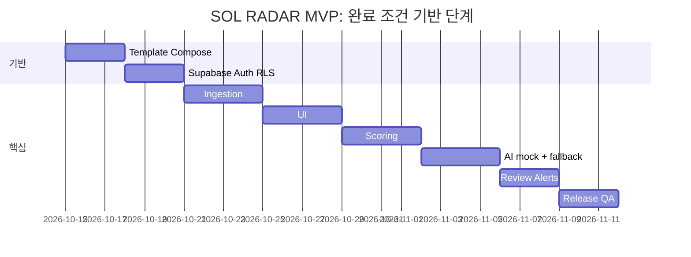

# 12. 구현 순서와 해커톤 컷

> [!todo]
> 해커톤 마감일·발표일·공식 심사 기준은 미확정. 확정되면 여기와 [[18-HACKATHON|18 해커톤]]에 기록하고 아래 간트를 마감일에서 역산한다.

## 순차 실행 (Claude Code 기준)
|Phase|작업|종료 조건|해커톤 컷|
|---|---|---|---|
|0|템플릿 정리(Supabase·`web/` 유지, 견본 도메인 `memos`·`tasks` 등 정리 범위 결정), `infra/compose.yaml`(redis·minio·qdrant·ai-gateway·worker), `web/worker` 진입점, AI gateway 골격, `/health/live`·`/health/ready`, Supabase 클라우드 프로젝트 연결·env, `pnpm check:env`, CI(`verify.config.json`), `demo` 프로필 기동|Compose 서비스(redis/minio/qdrant/ai-gateway/worker) healthy + web `/health/ready` green + Supabase 프로젝트 연결(`checks.db` ok)|데모 필수|
|1|`supabase/migrations`로 SOL RADAR 스키마([[04-DATABASE\|04 DB]])·RLS·`memberships.sol_role`, 정책 시험, seed(`pnpm demo:reset`), Supabase Auth 연결·RBAC, 솔리데오 부서·직급 카탈로그·가상 인력 200명 seed(ADR-019)|회사 격리 RLS 정책 시험(`pnpm test:db`) 통과, seed 20건(19건 적재 + `FX-12` 격리 1건) 멱등|데모 필수|
|2|공고 connector + fixture + 정규화 + revision|재실행 멱등 + 변경 감지 테스트|데모 필수|
|3|Next.js 대시보드/검색/상세·가입 부서/직급 필수 선택·간편 가입 정보 보완·가상 정장 사진 200장 연결 (1440 기준)|fixture 실제 API로 화면 E2E, PPL-01~06|데모 필수|
|4|기업 프로필·필수 자격·규칙 점수|골든셋 일치, 근거 저장, worked example 3건 일치|데모 필수|
|5|AI gateway: mock adapter, 장애 대체, Kev 어댑터|mock/실모델 switch, PARTIAL 경로|mock·장애 대체는 데모 필수, 실모델은 있으면 좋음|
|6|최종 권고 + 영업 리뷰 + 인앱 알림|엔드투엔드 검토 완료|데모 필수|
|7|보안·성능·로그·배포|릴리즈 체크리스트 PASS|`.env.example`·healthcheck·DEMO 배지·evidence는 데모 필수, 나머지 이후|
|8 (P1)|카카오톡/경쟁사/인력배치|공식 데이터 및 외부 승인 확보 후|해커톤 이후|

## 해커톤 컷
|구분|포함|이유|
|---|---|---|
|데모 필수|Phase 0~4 전부(ADR-019 솔리데오 고정·가상 명부 200명·서로 다른 정장 사진 200장·필수 가입 정보 포함). Phase 5 중 AI gateway mock adapter(`AI_PROVIDER=mock`)·장애 대체(`PARTIAL`)·Kev 보조 의견 UI 영역. Phase 6 중 사람 최종 결정 기록·인앱 알림(outbox). Phase 7 중 `.env.example`·`pnpm check:env`·healthcheck·DEMO 배지·`docs/evidence/` 수집|[[19-DEMO-SCENARIO\|19 데모 시나리오]]의 8장면이 전부 여기서 나온다|
|있으면 좋음|Phase 5 `ai-local` 프로필로 Kev-4B 실제 호출 1회 로그 또는 영상. Qdrant 의미 검색. 관리자 수집 현황 화면([[14-OBSERVABILITY\|14 관측성]] 지표 5개). Playwright 전체 E2E 녹화. 공고 revision diff 화면. 간편 로그인 제공자 설정(구글·카카오·네이버, ADR-018)은 이 칸에서도 맨 마지막으로, 다른 기능을 모두 끝낸 뒤 한다|"진짜 동작하나" 질문에 추가 증거. 데모 필수가 전부 녹색일 때만 착수|
|해커톤 이후|Phase 5 `ai-hosted`. Phase 7 운영 심화(nginx TLS, 백업·복구 리허설, Sentry/Grafana). Phase 8 P1 전부(카카오 실발송, 경쟁사 통계, 인력 배치). P2|외부 승인·비용·GPU 의존|

규칙: 데모 필수 항목이 하나라도 빨간불이면 "있으면 좋음"에 손대지 않는다. 범위를 더 줄여야 하면 선택지를 보고하고 사용자가 결정한다 ([[17-CLAUDE-IMPLEMENTATION|17 구현 규칙]]).

## 데모 D-2 ~ D-day
|시점|할 일|
|---|---|
|D-2|기능 freeze. fixture·seed 고정. 전체 테스트 green. `docs/evidence/` 갱신|
|D-1|데모 노트북에서 [[10-DEPLOYMENT\|10 배포]] 기동 절차 1~12 리허설 2회 (재부팅 1회 포함). 이미지 빌드·pull 완료 확인. 개발 DB·Auth가 Supabase 클라우드 프로젝트라 데모 장소의 인터넷 연결을 확인한다. 네트워크 없는 대체 경로(로컬 Supabase CLI `pnpm db:start`, 사전 녹화 영상)는 미결정([[16-DECISIONS\|16 ADR]])|
|D-day|기동 절차 1~12. 리허설 후 `pnpm demo:reset`(seed 재실행, 멱등)으로 초기화. 발표 스크립트는 [[18-HACKATHON\|18 해커톤]]|

위 간트 날짜는 **일정 산정 예시**로 약속된 실제 마감이 아니다. 각 Phase 중간에 작업을 끊고 커밋하며 [[PROGRESS]]에 완료·남은 일·검증 결과를 기록한다.

## P1/P2 우선순위
P1: 변경 알림(카카오 계약 승인), 경쟁사 공개 낙찰 통계, 가용 인력·중복 배치. P2: 발주 예측/확률 모델/ERP, 성능 검증 후 순차 릴리즈. 모두 해커톤 이후.

## 관련 문서
- [[01-PRD|01 PRD]]
- [[10-DEPLOYMENT|10 배포]]
- [[11-TESTING|11 테스트]]
- [[16-DECISIONS|16 ADR]] — ADR-017(Next.js + Supabase), 데모 실행 환경 미결정
- [[17-CLAUDE-IMPLEMENTATION|17 구현 규칙]]
- [[18-HACKATHON|18 해커톤]]
- [[PROGRESS]]
