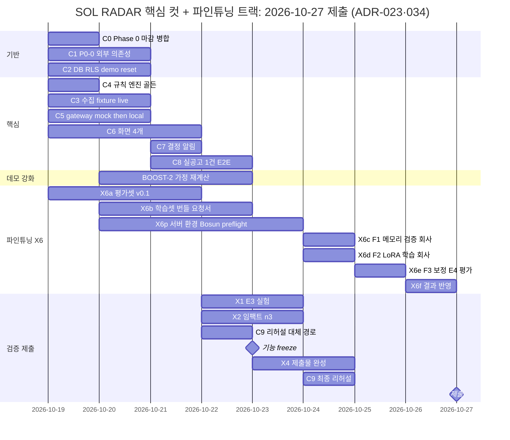

# 12. 구현 순서와 해커톤 컷

> [!note] 마감·배점과 일정
> 제출 마감(2026-10-27)·공식 배점과 그 배점이 정하는 우선순위는 [[18-HACKATHON|18 해커톤]] 머리 콜아웃과 §4가 정본이다. 아래 간트는 2026-10-19 ADR-027로 2일 당긴 일정이다. ADR-027은 2026-10-20 폐기됐고, 일정(Critical Path 단축·freeze 10-23·리허설 10-24·freeze 예외)은 [[16-DECISIONS|ADR-034]] 17번으로 유지한다(2026-10-20 사용자 결정).

[[16-DECISIONS|ADR-020]]으로 해커톤 MVP의 목표가 "fixture 20건 + mock AI"에서 **실제 나라장터 공고를 대상으로 끝까지 동작하는 MVP**로 바뀌었다(사용자 원문: "해커톤 시연용 가짜 AI가 아니라, 실제 공공입찰 데이터를 대상으로 끝까지 동작하는 SOL RADAR MVP"). 실수집·실추론·평가 트랙(P0-0~P0-11)은 별도 트랙이 아니라 아래 Phase 0~7 안에 들어간다. fixture 경로를 다 만든 뒤 live를 얹는 것이 아니라 같은 인터페이스(`BidSourceConnector`·`AttachmentFetcher`·`DocumentParser`·`ModelClient`)로 둘을 함께 만든다. 시험과 CI는 `SOL_RUN_MODE=mock`으로 돈다.

## 순차 실행 (Claude Code 기준)

어느 작업이 해커톤 어느 컷에 드는지는 아래 "해커톤 컷" 절의 표와 Critical Path 표가 정본이다.

|Phase|작업|종료 조건|
|---|---|---|
|0|템플릿 정리(Supabase·`web/` 유지, 견본 도메인 `memos`·`tasks` 등 정리 범위 결정), `infra/compose.yaml`(redis·minio·qdrant·ai-gateway·worker), `web/worker` 진입점, AI gateway 골격, `/health/live`·`/health/ready`, Supabase 클라우드 프로젝트 연결·env, `pnpm check:env`, CI(`verify.config.json`), `demo` 프로필 기동. 실행 모드 `SOL_RUN_MODE`(`live`·`fixture`·`mock`)와 `pnpm check:env` 모드 모순 검사(P0-1), 서비스키 4개(`G2B_*_SERVICE_KEY`) 자리(서버 전용, [[16-DECISIONS\|ADR-022]]), 회사 GPU 추론 엔드포인트에 HTTPS로 붙는 `ai-local` 연결 방식([[16-DECISIONS\|ADR-025]]). 서비스키·회사 엔드포인트가 준비되는 대로 P0-0 외부 의존성 조기 점검. 템플릿 `tasks`는 지우지 않고 입찰 프로젝트 체크리스트로 재사용한다|Compose 서비스(redis/minio/qdrant/ai-gateway/worker) healthy + web `/health/ready` green + Supabase 프로젝트 연결(`checks.db` ok). 모드 모순 env 기동 거부 시험 통과. `docs/evidence/phase-0/external-deps.md`에 P0-0 항목별 결과(막힌 항목은 사용자 보고)|
|1|`supabase/migrations`로 SOL RADAR 스키마([[04-DATABASE\|04 DB]])·RLS·`memberships.sol_role`, 정책 시험, seed(`pnpm demo:reset`), Supabase Auth 연결·RBAC, 솔리데오 부서·직급 카탈로그·가상 인력 200명 seed(ADR-019). ADR-020 저장 변경(실행 모드·출처 기록, 첨부 다운로드·파싱 상태, `requirement_assessments`·`bid_structured_requirements`·`eval_runs`)을 첫 SOL 마이그레이션에 포함(04 표 정의를 먼저 고친다). ADR-021 저장 변경: `departments` 계층(`parent_id`·`kind`), `team_members`(운영)·`team_member_scoring`(점수) 분리, 가입 시 개인 조직 생성 중단, 구성원 관리 정책을 `sol_role=ADMIN` 기준으로|회사 격리 RLS 정책 시험(`pnpm test:db`) 통과, 새 표마다 정책 시험, seed 20건(19건 적재 + `FX-12` 격리 1건) 멱등|
|2|공고 Connector 인터페이스 + `FixtureConnector` + `OfficialApiConnector`(나라장터 입찰공고 용역 중 정보화사업, 면허제한·참가가능지역·e발주 첨부 조회, P0-2) + 정규화 + revision. documents job·첨부 다운로드·`/parse`(PDF·HWPX·HWP, P0-3). 사전규격·발주계획 수집과 단계 연결(P0-8)|재실행 멱등 + 변경 감지 테스트. 서비스키·첨부 다운로드가 되면 live 수집 `ingest_runs` 요약과 실공고 형식별 파싱 성공률|
|3|Next.js 대시보드/검색/상세·가입 부서/직급 필수 선택·간편 가입 정보 보완·가상 정장 사진 200장 연결 (1440 기준). 실행 모드·출처 배지, 공고 목록 `origin` 필터, "가상 회사 프로필로 분석" 배지. 앱 셸(사이드바 정보 구조·조직 주소 없는 경로·서버 조직 결정), 설정(개인·조직 탭), 조직·인력 조회(200명 조직도·명부·상세, 사진 연결 자리), 데이터 수집 관리(`/admin/ingestion`), 대시보드 카드 5개([[16-DECISIONS\|ADR-021]])|fixture 실제 API로 화면 E2E, PPL-01~06, NAV-01~NAV-09([[11-TESTING\|11 테스트]] §9)|
|4|기업 프로필·필수 자격·규칙 점수. 규칙은 API 구조화 필드 우선 + 업종 코드 사전 + 3값·사유 코드(P0-5), SOL Score v0.1(P0-7의 점수 부분)|골든셋 일치(`mock` 모드), 근거 저장, worked example 3건 일치, 정보 부족 ≠ 미충족 단위 시험|
|5|AI gateway: mock adapter(CI용, 먼저) → 장애 대체(`PARTIAL`) → Qwen3.8-Flash-Next(회사 운영 vLLM API) `/extract` local + `translations`(P0-4) → Bosun v3.1 0.6B `kev-qs/v0.2` 참고 지표·`stateTrace`·레지스트리 검증(P0-6) → `/explain`(P0-7)|mock/실모델 switch, PARTIAL 경로, 실패 유형 구분, 인용 검증 통과율·실공고 1건 E2E 로그, 결정 모델 응답 원문 저장·규칙 불변 시험|
|6|최종 권고 + 영업 리뷰 + 인앱 알림|엔드투엔드 검토 완료|
|7|보안·성능·로그·배포. 세 모드 기동 리허설, 엔드포인트 재접속 확인 리허설|릴리즈 체크리스트 PASS|
|평가 트랙|평가셋 v0.1(P0-9), 평가 하네스와 E0·E1'·E2 리포트(P0-10), 학습셋 번들 내보내기와 LoRA 메모리 검증 스크립트·절차(P0-11). 평가셋 라벨은 10-19부터, 학습셋 번들은 Phase 5 local이 동작한 뒤. Bosun LoRA 학습(F1·F2·F3)은 회사 GPU 서버의 물리 GPU 1(A40 46,068 MiB, PaddleOCR과 공유)에서 회사 측 실행(X6, [[16-DECISIONS\|ADR-034]]. 서버 환경 확인 2026-10-20, `sol_decision`·F1 미완)|[[21-MODEL-TRAINING\|21 모델 학습]] §7 수용 기준|
|8 (P1)|카카오 알림톡 운영 전환(해커톤은 "나에게 보내기"로 대체, [[16-DECISIONS\|ADR-038]])/경쟁사/인력배치|공식 데이터 및 외부 승인 확보 후|

## 해커톤 우선순위 (P0)

해커톤 제출 마감일은 2026-10-27이다. 아래 순서가 곧 잘라낼 순서다. 시간이 모자라도 범위를 임의로 줄이지 않고 선택지를 보고한다([[17-CLAUDE-IMPLEMENTATION|17 구현 규칙]]). `E0`~`E2`는 [[21-MODEL-TRAINING|21 모델 학습]]의 평가 비교 대상이며 데모 장면 번호(`S0`~`S7`)와 다르다.

|순서|항목|Phase|완료 기준|
|---|---|---|---|
|P0-0|**외부 의존성 조기 점검.** ① data.go.kr 오퍼레이션별 실제 응답 3건 저장·필드 확인 ② 공고 3건의 첨부 실제 다운로드(로그인·세션 필요 여부) ③ 회사 GPU 추론 엔드포인트([[16-DECISIONS\|ADR-025]]) G1 HTTPS 접속(TLS·인증) → G2 Qwen·Bosun `GET /v1/models`·레지스트리 대조 → G3 지연 실측 → G4 vLLM guided JSON → G5 회사 제공 GPU 정보 기록 → G6 차단 시 `PARTIAL`([[11-TESTING\|11 테스트]] §3.3 ③) ④ 실제 RFP 샘플로 파서 후보 비교 시작|서비스키·회사 엔드포인트(경로·인증 방식 전달, 모델 기동 완료 통보)가 준비되는 즉시. 그동안 다른 항목은 인터페이스로 진행|`docs/evidence/phase-0/external-deps.md`에 항목별 결과. 막힌 항목은 즉시 사용자 보고([[11-TESTING\|11 테스트]] §3.3)|
|P0-1|실행 모드 3종 + 출처·모드 기록 + 모드 모순 기동 거부|0 (기록 필드는 1)|모순 env 기동 거부 시험, 세 모드 기동 로그. 골든은 Phase 4에서 고정된 뒤 `mock` 모드로만 단언|
|P0-2|서비스키 발급(사용자 작업) → 실제 응답 3건 저장·registry 검증 → 입찰공고 용역 수집(정보화사업) + 면허제한·참가지역·e발주 첨부 조회 + 첨부 다운로드 가능성 확인|2|`ingest_runs` 요약, 공고 목록에 live 공고 노출|
|P0-3|첨부 다운로드 + `/parse`(PDF·HWPX·HWP) + 미지원 표시|2|실공고 30건 형식별 파싱 성공률 증거|
|P0-4|Qwen3.8-Flash-Next(회사 운영 vLLM API) 실추출(`/extract` local) + `translations`|5|인용 검증 통과율 증거, 실공고 1건 E2E 로그|
|P0-5|규칙: API 구조화 필드 우선 + 업종 코드 사전 + 3값·사유 코드|4|단위 시험(정보 부족 ≠ 미충족)|
|P0-6|Bosun v3.1 0.6B(`sol_decision`) `kev-qs/v0.2` 실추론(en) + 참고 지표·플래그 + `stateTrace` + 레지스트리 검증|5|결정 모델 응답 원문·trace 저장, 규칙 불변 시험|
|P0-7|SOL Score v0.1 + `/explain` + 대시보드(모드·출처 배지, 결정 모델 참고 패널, 근거 서랍)|3 (화면)·4 (점수)·5 (`/explain`)|1440·1280 스크린샷|
|P0-8|사전규격·발주계획 수집과 단계 연결|2|StageTimeline에 실데이터|
|P0-9|평가셋 v0.1: test 20·dev 10 사업, 가상 기업 원형 6개, 라벨 검수(추출 정답 20건, 의미 대응 라벨 150건 이상)|X6|manifest·라벨 검증 통과|
|P0-10|평가 하네스 + E0·E1'·E2 리포트(한국어/영어 비교 포함)|평가 트랙|`docs/evidence/eval/` 리포트|
|P0-11|학습셋 번들 내보내기 + 메모리 검증 스크립트·절차|X6|train 1,000 레코드 이상, 번들 sha256, 학습 요청서. F1·F2·F3 실행은 GPU 서버 셸이 필요해 회사 측(X6, [[16-DECISIONS\|ADR-034]])|

**순서 규칙** ([[16-DECISIONS|ADR-020]], 2026-10-16)
- **작업 순서는 Phase 순서**(위 Phase 표)다. 의존 관계 때문에 P0-5(Phase 4)·P0-8(Phase 2)이 P0-4·P0-6(Phase 5)보다 먼저 끝날 수 있다.
- **P0 번호는 우선순위**다. 시간이 모자라면 큰 번호부터 잘라낼 후보로 보고하고 사용자가 정한다([[17-CLAUDE-IMPLEMENTATION|17 구현 규칙]]).
- P0-0은 서비스키·회사 GPU 추론 엔드포인트가 준비되는 즉시 한다. 그 전에는 인터페이스(`BidSourceConnector`·`AttachmentFetcher`·`DocumentParser`·`ModelClient`)와 fixture·mock으로 다른 Phase를 진행한다. P0-0 항목이 막히면 즉시 보고한다.
- P0 번호와 Critical Path C-ID의 대응은 아래 Critical Path 표의 "Phase / P0" 열이다. P0-8은 확장 컷(ADR-023), P0-9·P0-11은 X6(ADR-034)이다. P0-10 하네스는 X1·X6이 같이 쓴다.

## 해커톤 컷 (ADR-023, 2026-10-19)

[[16-DECISIONS|ADR-023]]으로 컷을 3단 + 이후로 다시 정했다. ADR-020·021의 설계는 그대로이고 우선순위와 데모 노출 범위만 바뀐다. 이전 2단 표(데모 필수 / 있으면 좋음)는 이 표로 대체한다.

|구분|포함|이유|
|---|---|---|
|**핵심 컷**(데모 필수)|장면: S2 대시보드, S3 FX-01 충족·근거·94 / FX-03 NO-BID·결정 모델 상충, S4 FX-02 분석·72·사람 결정·알림, **S-LIVE 실제 공고 1건 AI 분석 결과**, S6 `PARTIAL`, S7 격리 404. 기능: Phase 0 마감(Compose·gateway 골격·health 병합), Phase 1(공고·프로필·분석·검토·알림·감사 표, RLS, `sol_role`, `pnpm demo:reset`), Phase 2 중 `FixtureConnector`·정규화·revision·격리·documents job·`OfficialApiConnector`(P0-2·P0-3 live 1건), Phase 4 전부(P0-5·P0-7 점수), Phase 5 중 `/extract`·`/kev`·`/explain`·`/parse`(검증 형식만)·mock adapter·`PARTIAL`·`local` 어댑터(P0-4·P0-6, 1건 실추론), Phase 6 결정 기록·인앱 알림 2종, Phase 3 중 앱 셸 최소(메뉴 3개·Topbar 지표)·`/dashboard`·`/bids`·`/bids/[id]`·`/notifications`, Phase 7 중 `check:env`·healthcheck·DEMO 배지·증거·세 모드 기동·대체 경로 리허설. 평가 중 **E3 대조 실험(축소 규모)**. 인력 200·27명·20 FTE는 점수 입력으로만 쓴다. 아래 Critical Path C0~C9·X1~X4|마감 2026-10-27, 배점 실용성 30 + 완성도 25. "이 입찰에 들어가야 하는가"가 끝까지 도는 것이 먼저다|
|**파인튜닝 트랙 X6**(핵심 컷과 나란히, [[16-DECISIONS\|ADR-034]])|평가셋 v0.1(test 20·dev 10, P0-9), 학습셋 번들 내보내기·학습 요청서(P0-11), Bosun LoRA F1·F2·F3(회사 측 실행), E4 = Bosun+LoRA를 E1'(공개 Bosun zero-shot)과 같은 test 분할에서 짝 부트스트랩 95% CI로 비교. 데모·S-LIVE 모델은 공개 Bosun v3.1 0.6B 그대로|사용자 결정(2026-10-19). 우리 쪽 산출물(평가셋·번들·요청서·E4 하네스)은 완료 조건이다. 회사 측 학습 결과는 받으면 E4로 보고하고, 못 받으면 "회사 측 미실행"으로 적는다. 핵심 컷 green 판정은 학습 결과를 기다리지 않는다. 작업자가 겹치면 핵심 컷이 먼저다|
|**데모 강화 컷**(핵심 컷과 나란히, [[16-DECISIONS\|ADR-037]])|BOOST-2 가정 재계산: 공고 상세의 미보유 필수 자격에 "보유 가정" 스위치 → 저장된 입력 스냅샷으로 점수·권고·자격 판정을 다시 계산해 원래 → 가정 띠로 보인다(저장 없음, 결정 모델 재호출 없음). 데모는 S3 `FX-03` 스위치 1회(NO-BID → WATCH, 68 그대로). BOOST-1 실공고 선별 깔때기는 2026-10-20 게이트 결과로 뺐다|사용자 판단(2026-10-20): 데모용으로도 기능이 약하다. 조건 4개: ① 작업자가 겹치면 핵심 컷 먼저 ② 핵심 컷 코드 경로·계약을 바꾸지 않는 추가형 ③ 10-23 freeze까지 green이 아니면 데모에서 빼고 이전 시나리오로 ④ 확률·승률 표시 금지(ADR-007). 핵심 컷 green 판정은 이 컷을 기다리지 않는다|
|**확장 컷**(핵심 컷 전부 green 뒤, 이 순서)|**카카오톡 추천 공고 알림**(나에게 보내기, [[16-DECISIONS\|ADR-038]]. 아래 Critical Path KAKAO 행) → S5 변경 감지(FX-06·07·09·10 LIVE 배치, revision diff, `BID_CHANGED`) → `feat/people-read` 병합과 `/people`·`/org-chart` 메뉴 노출 → `/admin/ingestion` 화면 → 설정 조직 탭 → ADR-021 앱 셸 나머지(N1 전체)·대시보드 카드 5개 완성 → P0-8 사전규격·발주계획 단계 연결 → E0·E2·E3 전체 평가셋(test 20) 리포트 → `/admin/ai/eval-runs`|핵심 컷을 해치지 않는 범위에서 "진짜 동작하나"의 추가 증거. 이미 구현된 코드는 보존한다. 카카오는 맨 앞이고(ADR-038. 2026-10-20 추천안 확정, 2026-10-21 사용자 채택), 핵심 컷과 같은 파일(`web/server/notifications`·`finish_score_run`·알림 목록 조회)을 고치므로 핵심 컷 병합 뒤 착수해 10-23 freeze 전에 끝낸다. 못 끝내면 해커톤에서 기능을 빼고 문서·ADR만 남긴다|
|**P1**(ADR-021 P1, 변경 없음)|관심 공고 → 분석 결과 비교 → 입찰 프로젝트(대시보드 다섯 번째 카드 교체 포함) → 인력 배치 시뮬레이션 → 조직·인력 ADMIN 편집. 그 뒤: 계약과정통합공개로 사업 묶기, Qdrant 의미 검색, Playwright 전체 E2E 녹화, 공고 revision diff 화면, 간편 로그인 제공자 설정(맨 마지막)|착수 게이트: **핵심 컷 + 확장 컷 전부 green**(11 §4·§5, 골든 G1~G10, `pnpm verify`). 그 전에는 시작하지 않는다|
|해커톤 이후|API·worker NestJS 전환([[16-DECISIONS\|ADR-028]]. 화면은 Next.js, DB·Auth는 Supabase 그대로). Bosun LoRA 운영 반영(레지스트리 서빙 항목·데모 모델 교체, [[21-MODEL-TRAINING\|21 모델 학습]] §4.4 판단과 ADR. 해커톤 학습·E4 비교는 X6). τ·온도 정식 보정. `sol-v0.2.x`의 결정 모델 반영 검토. Qwen 파인튜닝(2026-10-20 사용자 결정으로 하지 않음. 재검토는 별도 ADR). 낙찰·계약 수집. zip·스캔 PDF·혁신장터 RFP. Phase 5 `ai-hosted`. Phase 7 운영 심화(nginx TLS, 백업·복구 리허설, Sentry/Grafana). Phase 8 P1 전부(카카오 알림톡 운영 전환: 사업자·비즈니스 채널·딜러사·템플릿 검수, [[16-DECISIONS\|ADR-038]]. 경쟁사 통계, 인력 배치 저장·배정 확정). `/ops` 분리, 직원 편집. P2([[01-PRD\|01 PRD]] FR-12 발주 예측·승률 모델, 검증 데이터와 백테스트 뒤 노출). ADR-021 후속: 수주 전략·시장 분석, 입찰 일정, 개인 알림 수신 설정, ANALYST 검토 의견, 멀티 조직 지원(조직 전환 UI 포함)|외부 승인·비용·GPU 의존. 운영 반영은 초기 목표 지표 미달만으로 정하지 않고, 오류 분석에서 모델 판단 오류가 주된 원인일 때 사람이 정한다. 해커톤 X6 학습은 사용자 결정에 따른 비교 실험이다(ADR-034)|

규칙: 핵심 컷 항목이 하나라도 빨간불이면 확장 컷에 손대지 않는다. 핵심 컷과 확장 컷이 모두 녹색이기 전에는 P1에 손대지 않는다. 범위를 더 줄여야 하면 선택지를 보고하고 사용자가 결정한다 ([[17-CLAUDE-IMPLEMENTATION|17 구현 규칙]]). 예외: 데모 강화 컷([[16-DECISIONS|ADR-037]])은 핵심 컷이 빨간불이어도 위 표의 조건 4개 안에서 나란히 진행한다. 확장 컷 맨 앞 카카오톡 추천 공고([[16-DECISIONS|ADR-038]])도 예외다. 핵심 컷이 green이 아니어도, 그것이 고치는 핵심 컷 코드(C5 `finish_score_run`·C7 outbox·인앱 알림)가 main에 들어간 뒤 나란히 진행한다. 작업자가 겹치면 핵심 컷이 먼저다.

### Critical Path (ADR-023, 2026-10-19 승인 · 일정 ADR-034 17번)

작업자 3~4명(에이전트) 병렬 전제. 상세(난이도·실패 위험·증거·테스트 기준)는 [수상 전략 보고](plans/2026-10-18-hackathon-award-plan.md) §4. 그 문서의 일정은 ADR-027(폐기)로 2일 당긴 일정으로 대체했고, 이 일정은 [[16-DECISIONS|ADR-034]] 17번으로 유지한다. X6 단계별 일정은 ADR-034 12번과 [[23-WEEKEND-FINETUNE|23 주말 파인튜닝]] §1이다. [ADR-027 변경안](plans/2026-10-19-finetune-schedule-pull.md) §3.2는 Kev-9B 기준 이력이다.

|ID|작업|Phase / P0|선행|일정|
|---|---|---|---|---|
|C0|Phase 0 마감: `phase0/infra` 통합 기동(`docker compose -f infra/compose.yaml up -d`) → 증거 → main 병합|0 / P0-1|없음|10-19|
|C1|P0-0: ① API 4종 실제 GET(마스킹 저장) ② 첨부 3건 다운로드 ③ 회사 GPU 추론 엔드포인트([[16-DECISIONS\|ADR-025]]): G1 HTTPS 접속(TLS·인증) → G2 Qwen·Bosun `GET /v1/models`·레지스트리 대조 → G3 지연 실측(결정 모델 state 약 500·6,000토큰 두 가지로 24문항 묶음 10회 p50·p95, Qwen 추출 1회, [[03-AI-PIPELINE\|03]] §5.9) → G4 vLLM guided JSON → G5 회사 제공 GPU 정보가 있으면 기록 → G6 엔드포인트 차단 시 `PARTIAL` ④ 파서 후보 비교 시작. 체크리스트 `docs/evidence/phase-0/external-deps.md`|0 / P0-0|사용자: `infra/.env` 서비스키 4개. 회사: P2 엔드포인트 경로·인증 방식 전달, P3 모델 기동 완료 통보|10-19~20|
|C2|Phase 1 DB·RLS·`sol_role`(`feat/people-read`의 `20261018000001` 위에)·`pnpm demo:reset`(people seed 흡수)|1|C0|10-19~20|
|C3|Phase 2 수집: `FixtureConnector`·정규화·revision·격리·ingest job, documents job, `OfficialApiConnector`·`G2bAttachmentFetcher`|2 / P0-2·P0-3|C2, C1 ①|10-19~20|
|C4|Phase 4 규칙 엔진(순수 함수)·골든 94/72/68·27명 입력|4 / P0-5·P0-7|없음(C2와 병렬)|10-19|
|C5|Phase 5 gateway `/extract`·`/kev`·`/explain`·`/parse` mock → worker extract·analysis·`PARTIAL` → `local` 어댑터|5 / P0-4·P0-6|C0·C4, local은 C1 ③|10-19~20|
|C6|Phase 3 화면: 앱 셸 최소·`/dashboard`·`/bids`·`/bids/[id]`·`/notifications`, Route Handler 10개(9개 + 알림 읽음 처리 `PATCH /notifications/:id/read`, [[16-DECISIONS\|ADR-029]] A6 D8)|3 / P0-7|C2|10-19~21|
|C7|Phase 6: 결정 기록 트리거·audit·outbox·인앱 알림 2종|6|C2·C6|10-21|
|C8|S-LIVE: 실공고 1건 `live` E2E, 실행 로그·녹화|5 / P0-4·P0-6|C1·C3·C5·C6|10-21~22|
|C9|리허설·대체 경로 6종·세 모드 전환·로컬 Supabase CLI 전환·체크리스트|7|C6·C7|10-22, 10-24|
|X1|E3 대조 실험(축소 규모). 입력·설계는 C4·C5와 병렬로 준비. X6 E4 기준선 E1'(공개 Bosun zero-shot, test 20)은 B3(10-22~23)에서 재고, 10-25 서버 안 오프라인 채점(`sol_eval.bosun_score`, main `1b68f9b`. 실모델 경로는 미검증)에서 E4와 같이 잰다(ADR-034 7번·12번)|평가|C5 local, C1 ③|설계 10-19~, 실행 10-22~23|
|X2|임팩트 예비 실험 n=3|—|C8|10-22~23|
|X3|경쟁 서비스 비교(공개 페이지)|—|없음|완료(10-19)|
|X4|제출물: 슬라이드·3분 영상·기술 자료. 구조는 지금부터 병렬, 완성은 C8·X1·X2 뒤|—|구조: 없음 / 완성: C8·X1·X2|구조 10-19~, 완성 10-23~24, E4 반영 10-26|
|X5|확장 컷(위 표 순서. 맨 앞 카카오는 아래 KAKAO 행)|—|핵심 컷 green|10-23 이후|
|X6|Bosun LoRA 파인튜닝 트랙([[16-DECISIONS\|ADR-034]]. ADR-027 폐기): X6a 평가셋 v0.1(P0-9) → X6b 학습셋 번들·학습 요청서(P0-11) ‖ **X6p 회사 GPU 서버 준비**(10-20 **완료**: 전용 경로·venv `.venv-bosun`·torch 2.8.0+cu128·CUDA·bf16·Bosun LoRA CPU 2-step 확인(사용자 보고). 10-21~23 **미완**: `sol_decision` 서버·모델 다운로드·sha256·`infra/gpu/bosun-preflight.sh`(main `1b68f9b`) 통과. 서버 기동은 보안 후속(`fix/decision-hardening`) main 병합과 사용자 승인 뒤) → X6c F1 smoke(회사, **10-24 토**, `bosun-f1.sh`(main `1b68f9b`)) → X6d F2 Bosun LoRA 학습(회사, **10-24 토**. 시간은 F1 실측으로 재추정, 미확정) → X6e F3 보정·서버 안 오프라인 E4·E1' 채점(`sol_eval.bosun_score`(main `1b68f9b`), **10-25 일**) → X6f 제출물 반영(10-26). 모든 학습·채점은 물리 GPU 1(PaddleOCR과 공유). 데모 모델은 공개 Bosun v3.1 0.6B 그대로. Qwen 학습 일정은 없다. 실행 절차는 [[22-FINETUNE-RUNBOOK\|22 파인튜닝 실행서]], 주말 계획은 [[23-WEEKEND-FINETUNE\|23]]|평가 / P0-9·P0-11|X6c 는 X6b 번들 + X6p preflight 통과. C3 live·첨부(10-22 까지 안 되면 갈래 ① 구조화 필드만), C5 `local`·C1 ③(갈래 ② 일 때만), 회사 실행|10-19~26(학습은 10-24~25 주말, ADR-034)|
|BOOST-2|데모 강화 컷 가정 재계산: Task 1 순수 함수 `whatIf` → Task 2 `POST /api/v1/analyses/{id}/what-if` → Task 3 화면 디자인 스펙 → Task 4 상세 스위치·띠 → Task 5 E2E·증거. Task 6 기술 보유 가정은 10-22까지 Task 1~5가 green일 때만. 계획 [BOOST-2 계획](plans/2026-10-20-boost2-what-if-plan.md). 2026-10-21 main 병합 `d48c7a2`|데모 강화 ([[16-DECISIONS\|ADR-037]])|C4 규칙 엔진, C5 분석 run의 `input_snapshot`, C6 상세 화면|10-20~22. 10-23 freeze까지 green이 아니면 데모에서 뺀다|
|KAKAO|확장 컷 맨 앞 카카오톡 추천 공고 알림(나에게 보내기): Task 0 카카오 S0 수신 시험(사용자, 코드보다 먼저) → Task 1 DB(`kakao_notify_links`·RPC 4개·`BID_RECOMMENDED` outbox) → Task 2·3 도메인 `web/server/kakao-notify`(토큰 암호화·피드·카카오 API·발송 수단 `mock`·`memo`) → Task 4 알림 소비자 → Task 5 worker 연결·env → Task 6 Route Handler `/me/kakao-notify` → Task 7 개인 설정 "카카오톡 알림"·인앱 목록 필터 → Task 8 전체 검증·수동 실발송 1회 녹화. [카카오 설계](plans/2026-10-20-kakao-memo-notify-design.md)·[카카오 계획](plans/2026-10-20-kakao-memo-notify-plan.md). 2026-10-21 구현 중 `feat/kakao-notify`(Task 1 `d327894`, Task 2·3 `ced705f`, Task 4·5 `52adabb`, main 병합 전. 보강은 진행 중)|6 / 확장 컷 ([[16-DECISIONS\|ADR-038]])|핵심 컷 병합(C5 `finish_score_run`·C7 outbox·인앱 알림). 사용자: 카카오 앱 설정·서버 env 키·S0 수신 시험|10-21~23. 10-23 freeze까지 못 끝내면 해커톤에서 기능을 빼고 문서·ADR만 남긴다|

C3 수집의 저장과 하위 job([[16-DECISIONS|ADR-030]] B18): revision 저장은 RPC `ingest_save_revision`(마이그레이션 `20261019000009`)으로 원자적으로 하고, 하위 job은 outbox와 `documents` 큐만 만든다. **새 공고 자동 분석은 핵심 컷에 없다**. live 일정 수집 주기는 기본 30분이고 env로 바꾼다([[07-DATA-PIPELINE|07 수집]] §2).

병렬 순서: 10-19 C0‖C1‖C2‖C3‖C4 보고‖C5‖C6‖X4 구조‖X6a → 10-20 C1 ③‖C2‖C3‖C5‖C6‖X6a·X6b‖X6p 서버 환경 확인(완료), 저녁 외부 의존성 컷 → 10-21 C6‖C7‖C8‖X6a·X6b‖X6p `sol_decision`·Bosun preflight 1차 → 10-22 C8‖C9 1차‖X1‖X2‖X6b 번들 마감·회사 전달 → 10-23 X1‖X2‖X4 완성‖X6p 모델 다운로드·preflight 전부 통과, 기능 freeze → 10-24 C9 최종 리허설‖X4 완성‖X6c·X6d(회사, 주말, GPU 1) → 10-25 X6e(서버 안 오프라인 E4·E1' 채점) → 10-26 X6f·제출물 마감·예비 → 10-27 제출.

데모 강화 컷 BOOST-2([[16-DECISIONS|ADR-037]])는 10-20~22에 위 줄과 나란히 하고, 작업자가 겹치면 핵심 컷이 먼저다.

확장 컷 맨 앞 KAKAO([[16-DECISIONS|ADR-038]])는 핵심 컷 병합 뒤 10-21~23에 위 줄과 나란히 하고 10-23 기능 freeze 전에 끝낸다. 카카오 S0 수신 시험(사용자)이 먼저다. 작업자가 겹치면 핵심 컷이 먼저고, freeze까지 못 끝내면 해커톤에서 기능을 빼고 문서·ADR만 남긴다.

**외부 의존성 컷 규칙**(10-20 저녁, C1 결과 기준. ADR-027으로 하루 당겼고 ADR-034 17번으로 유지한다. 이 시점은 외부 의존성 컷을 정하는 기준이고 핵심 기능 개발은 계속한다):

|C1 결과|S-LIVE 장면|
|---|---|
|API 정상·GPU 정상|실제 공고·실제 추론 경로 유지|
|API 정상·GPU 불가|실제 공고에 규칙 기반 `PARTIAL` 결과|
|API 불가·GPU 정상|검증된 fixture 기반 실제 추론 시연|
|API 불가·GPU 불가|fixture·mock 시연과 사전 확보한 실제 검증 증거만|

"GPU 정상"은 C1 ③의 G2(`GET /v1/models`·레지스트리 대조)·G3(지연 실측) 통과다([[16-DECISIONS|ADR-025]]). 어느 경우든 실행 모드와 출처를 화면에 표시한다. 실시간 추론을 못 했으면 녹화·fixture 결과를 live라고 표시하지 않는다.

**S0 `live` 전환 비용**(C8 실측 2026-10-20, [증거](evidence/demo-day/20261020-1434/run-modes.md)): `live` worker는 기동 즉시 첫 일정 run(마지막 성공 창 끝 ~ 지금, 없으면 24시간)을 돌고 30분마다 반복한다. 24시간 창 하나가 정보화 공고 86건, 공공 API 호출 266회(목록 5 + 보조 조회 87 × 3)였다. 데모 당일 S0에서 `live`로 바꾸면 첫 run이 약 260회를 쓴다. 개발계정 한도(서비스당 1,000건/일)를 쓰는 다른 작업(평가셋 녹음 등)과 같은 날 겹치지 않게 잡는다([[07-DATA-PIPELINE|07 수집]] §2.2 호출 예산, [[16-DECISIONS|ADR-035]] F10).

## freeze ~ D-day
|시점|할 일|
|---|---|
|freeze (10-23)|기능 freeze. fixture·seed 고정. 모델 레지스트리(`services/ai/models/registry.yaml`)·질문 세트·state 템플릿 버전 고정(데모 서빙 항목 `bosun-v3.1-0.6b`·`qwen3.8-flash-next`(main `1b68f9b`) 기준, `kev-9b-v1.0`·`qwen3.5-27b`·`qwen3.5-9b`는 `retired` 보존. E4 학습본 항목(기록용) 추가는 예외이고 데모 gateway 설정은 바꾸지 않는다, ADR-034). 전체 테스트 green. `docs/evidence/` 갱신. 공공 API 오늘 호출량 확인(개발계정 서비스당 1,000건/일). 데모 강화 컷 BOOST-2 green 판정: 아니면 데모에서 빼고 S3를 이전 절차로 한다([[16-DECISIONS\|ADR-037]] ③)|
|최종 리허설 (10-24)|데모 노트북에서 [[10-DEPLOYMENT\|10 배포]] 기동 절차 1~15 리허설 2회 (재부팅 1회 포함). 로컬 Supabase CLI 전환 리허설([[19-DEMO-SCENARIO\|19 데모 시나리오]] §5 대체 경로). 이미지 빌드·pull 완료 확인. 개발 DB·Auth가 Supabase 클라우드 프로젝트라 데모 장소의 인터넷 연결을 확인한다. 세 모드(`live`·`fixture`·`mock`) 기동 리허설 각 1회(모드 전환은 env 변경 + worker·ai-gateway 재시작). 회사 GPU 추론 엔드포인트 미접속 → `PARTIAL`·`RULES_ONLY` → 재접속 확인(`GET /v1/models`) 리허설, 재접속 확인 소요 시간 기록. live 리허설 호출 수가 일일 한도 안인지 확인. 학습은 물리 GPU 1 만 쓴다. GPU 1 에 있는 우리 추론 런타임은 `sol_decision` Bosun(8009)뿐이고 학습과 공존하는 것이 기본 계획이다. 우리 절차로 8009 를 내리지 않는다. F1 에서 메모리 합계가 넘치면 멈추고 회사에 보고한 뒤 사람이 정한다. 리허설과 학습 시간대(X6c·X6d, 토 09:00~)가 겹치면 그때 사람이 정한다([[10-DEPLOYMENT\|10]] GPU 절 "추론 런타임과의 관계"·[[23-WEEKEND-FINETUNE\|23]] §1·§2.4)|
|10-25~26|X6e F3 보정·회사 서버 안 채점·우리 오프라인 E4 평가(10-25), X6f 제출물 반영(10-26), 예비일. freeze 뒤라 앱 기능을 더하지 않고 리허설에서 나온 결함만 고친다. 고쳤으면 기동 절차 1~15를 한 번 다시 돈다|
|D-day (제출 10-27, 발표일 미입력)|기동 절차 1~15. 엔드포인트 접속(`GET /v1/models`)과 `GET /api/v1/admin/ai/status`(Qwen healthy, Bosun `registryMatch`) 확인. 시연 모드는 [[19-DEMO-SCENARIO\|19 데모 시나리오]] §2.1(기본 `mock`), 장애 대체 순서는 `live` → `fixture` → `mock`. 리허설 후 `pnpm demo:reset`(seed 재실행, 멱등)으로 초기화. 발표 스크립트는 [[18-HACKATHON\|18 해커톤]]|

위 간트는 ADR-023 Critical Path를 ADR-027(폐기)로 2일 당긴 일정이고, 이 일정은 ADR-034 17번으로 유지한다(모델·도구도 ADR-034의 Bosun 기준). C1 결과로 10-20 저녁에 한 번 재조정한다. X3 경쟁 비교와 X4 제출물 구조는 10-19부터 병렬이다. 각 작업 중간에 커밋하며 [[PROGRESS]]에 완료·남은 일·검증 결과를 기록한다.

## 관련 문서
- [[01-PRD|01 PRD]] — FR별 P0·P1·P2
- [[10-DEPLOYMENT|10 배포]]
- [[11-TESTING|11 테스트]]
- [[16-DECISIONS|16 ADR]] — ADR-017(Next.js + Supabase), ADR-020(실데이터 MVP·P0 순서), ADR-023(3단 컷·대체 경로), ADR-027(파인튜닝 X6·일정 2일 당김, 폐기), ADR-034(결정 모델 Bosun·추출 Qwen3.8-Flash-Next), ADR-037(데모 강화 컷)
- [[17-CLAUDE-IMPLEMENTATION|17 구현 규칙]]
- [[18-HACKATHON|18 해커톤]]
- [[19-DEMO-SCENARIO|19 데모 시나리오]]
- [[21-MODEL-TRAINING|21 모델 학습]]
- [[22-FINETUNE-RUNBOOK|22 파인튜닝 실행서]] — X6 실행 절차
- [[PROGRESS]]
