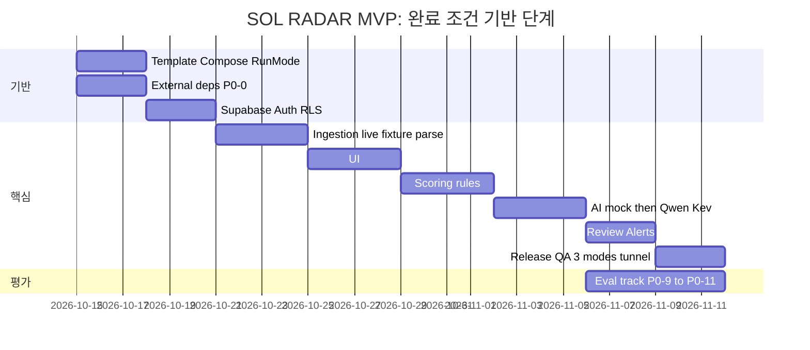

# 12. 구현 순서와 해커톤 컷

> [!todo]
> 해커톤 마감일·발표일·공식 심사 기준은 미확정. 확정되면 여기와 [[18-HACKATHON|18 해커톤]]에 기록하고 아래 간트를 마감일에서 역산한다.

[[16-DECISIONS|ADR-020]]으로 해커톤 MVP의 목표가 "fixture 20건 + mock AI"에서 **실제 나라장터 공고를 대상으로 끝까지 동작하는 MVP**로 바뀌었다(사용자 원문: "해커톤 시연용 가짜 AI가 아니라, 실제 공공입찰 데이터를 대상으로 끝까지 동작하는 SOL RADAR MVP"). 실수집·실추론·평가 트랙(P0-0~P0-11)은 별도 트랙이 아니라 아래 Phase 0~7 안에 들어간다. fixture 경로를 다 만든 뒤 live를 얹는 것이 아니라 같은 인터페이스(`BidSourceConnector`·`AttachmentFetcher`·`DocumentParser`·`ModelClient`)로 둘을 함께 만든다. 시험과 CI는 `SOL_RUN_MODE=mock`으로 돈다.

## 순차 실행 (Claude Code 기준)
|Phase|작업|종료 조건|해커톤 컷|
|---|---|---|---|
|0|템플릿 정리(Supabase·`web/` 유지, 견본 도메인 `memos`·`tasks` 등 정리 범위 결정), `infra/compose.yaml`(redis·minio·qdrant·ai-gateway·worker), `web/worker` 진입점, AI gateway 골격, `/health/live`·`/health/ready`, Supabase 클라우드 프로젝트 연결·env, `pnpm check:env`, CI(`verify.config.json`), `demo` 프로필 기동. 실행 모드 `SOL_RUN_MODE`(`live`·`fixture`·`mock`)와 `pnpm check:env` 모드 모순 검사(P0-1), `G2B_SERVICE_KEY` 자리(서버 전용), 회사 GPU 서버 `ai-local` 연결 방식(터널). 서비스키·회사 GPU가 준비되는 대로 P0-0 외부 의존성 조기 점검|Compose 서비스(redis/minio/qdrant/ai-gateway/worker) healthy + web `/health/ready` green + Supabase 프로젝트 연결(`checks.db` ok). 모드 모순 env 기동 거부 시험 통과. `docs/evidence/phase-0/external-deps.md`에 P0-0 항목별 결과(막힌 항목은 사용자 보고)|데모 필수|
|1|`supabase/migrations`로 SOL RADAR 스키마([[04-DATABASE\|04 DB]])·RLS·`memberships.sol_role`, 정책 시험, seed(`pnpm demo:reset`), Supabase Auth 연결·RBAC, 솔리데오 부서·직급 카탈로그·가상 인력 200명 seed(ADR-019). ADR-020 저장 변경(실행 모드·출처 기록, 첨부 다운로드·파싱 상태, `requirement_assessments`·`bid_structured_requirements`·`eval_runs`)을 첫 SOL 마이그레이션에 포함(04 표 정의를 먼저 고친다)|회사 격리 RLS 정책 시험(`pnpm test:db`) 통과, 새 표마다 정책 시험, seed 20건(19건 적재 + `FX-12` 격리 1건) 멱등|데모 필수|
|2|공고 Connector 인터페이스 + `FixtureConnector` + `OfficialApiConnector`(나라장터 입찰공고 용역 중 정보화사업, 면허제한·참가가능지역·e발주 첨부 조회, P0-2) + 정규화 + revision. documents job·첨부 다운로드·`/parse`(PDF·HWPX·HWP, P0-3). 사전규격·발주계획 수집과 단계 연결(P0-8)|재실행 멱등 + 변경 감지 테스트. 서비스키·첨부 다운로드가 되면 live 수집 `ingest_runs` 요약과 실공고 형식별 파싱 성공률|데모 필수|
|3|Next.js 대시보드/검색/상세·가입 부서/직급 필수 선택·간편 가입 정보 보완·가상 정장 사진 200장 연결 (1440 기준). 실행 모드·출처 배지, 공고 목록 `origin` 필터, "가상 회사 프로필로 분석" 배지|fixture 실제 API로 화면 E2E, PPL-01~06|데모 필수|
|4|기업 프로필·필수 자격·규칙 점수. 규칙은 API 구조화 필드 우선 + 업종 코드 사전 + 3값·사유 코드(P0-5), SOL Score v0.1(P0-7의 점수 부분)|골든셋 일치(`mock` 모드), 근거 저장, worked example 3건 일치, 정보 부족 ≠ 미충족 단위 시험|데모 필수|
|5|AI gateway: mock adapter(CI용, 먼저) → 장애 대체(`PARTIAL`) → Qwen3.5-9B `/extract` local + `translations`(P0-4) → Kev-9B@v1.0 `kev-qs/v0.2` 참고 지표·`stateTrace`·레지스트리 검증(P0-6) → `/explain`(P0-7)|mock/실모델 switch, PARTIAL 경로, 실패 유형 구분, 인용 검증 통과율·실공고 1건 E2E 로그, Kev 응답 원문 저장·규칙 불변 시험|데모 필수(실추론 포함)|
|6|최종 권고 + 영업 리뷰 + 인앱 알림|엔드투엔드 검토 완료|데모 필수|
|7|보안·성능·로그·배포. 세 모드 기동 리허설, 터널 재연결 리허설|릴리즈 체크리스트 PASS|`.env.example`·healthcheck·DEMO 배지·evidence·세 모드 리허설은 데모 필수, 나머지 이후|
|평가 트랙|평가셋 v0.1(P0-9), 평가 하네스와 E0·E1·E2 리포트(P0-10), 학습셋 번들 내보내기와 LoRA 메모리 검증 스크립트·절차(P0-11). Phase 5 실추론이 동작한 뒤 시작해 Phase 6·7과 나란히 진행|[[21-MODEL-TRAINING\|21 모델 학습]] §7 수용 기준|데모 필수|
|8 (P1)|카카오톡/경쟁사/인력배치|공식 데이터 및 외부 승인 확보 후|해커톤 이후|

## 해커톤 우선순위 (P0)

해커톤 마감일은 아직 정해지지 않았다. 아래 순서가 곧 잘라낼 순서다. 시간이 모자라도 범위를 임의로 줄이지 않고 선택지를 보고한다([[17-CLAUDE-IMPLEMENTATION|17 구현 규칙]]). `E0`~`E2`는 [[21-MODEL-TRAINING|21 모델 학습]]의 평가 비교 대상이며 데모 장면 번호(`S0`~`S7`)와 다르다.

|순서|항목|Phase|완료 기준|
|---|---|---|---|
|P0-0|**외부 의존성 조기 점검.** ① data.go.kr 오퍼레이션별 실제 응답 3건 저장·필드 확인 ② 공고 3건의 첨부 실제 다운로드(로그인·세션 필요 여부) ③ 회사 GPU 터널 + vLLM·`kev.serve` 기동, `/v1/models`, VRAM 기록 ④ 실제 RFP 샘플로 파서 후보 비교 시작|서비스키·회사 GPU가 준비되는 즉시. 그동안 다른 항목은 인터페이스로 진행|`docs/evidence/phase-0/external-deps.md`에 항목별 결과. 막힌 항목은 즉시 사용자 보고([[11-TESTING\|11 테스트]] §3.3)|
|P0-1|실행 모드 3종 + 출처·모드 기록 + 모드 모순 기동 거부|0 (기록 필드는 1)|모순 env 기동 거부 시험, 세 모드 기동 로그. 골든은 Phase 4에서 고정된 뒤 `mock` 모드로만 단언|
|P0-2|서비스키 발급(사용자 작업) → 실제 응답 3건 저장·registry 검증 → 입찰공고 용역 수집(정보화사업) + 면허제한·참가지역·e발주 첨부 조회 + 첨부 다운로드 가능성 확인|2|`ingest_runs` 요약, 공고 목록에 live 공고 노출|
|P0-3|첨부 다운로드 + `/parse`(PDF·HWPX·HWP) + 미지원 표시|2|실공고 30건 형식별 파싱 성공률 증거|
|P0-4|Qwen3.5-9B 실추출(`/extract` local) + `translations`|5|인용 검증 통과율 증거, 실공고 1건 E2E 로그|
|P0-5|규칙: API 구조화 필드 우선 + 업종 코드 사전 + 3값·사유 코드|4|단위 시험(정보 부족 ≠ 미충족)|
|P0-6|Kev-9B@v1.0 `kev-qs/v0.2` 실추론(en) + 참고 지표·플래그 + `stateTrace` + 레지스트리 검증|5|Kev 응답 원문·trace 저장, 규칙 불변 시험|
|P0-7|SOL Score v0.1 + `/explain` + 대시보드(모드·출처 배지, Kev 참고 패널, 근거 서랍)|3 (화면)·4 (점수)·5 (`/explain`)|1440·1280 스크린샷|
|P0-8|사전규격·발주계획 수집과 단계 연결|2|StageTimeline에 실데이터|
|P0-9|평가셋 v0.1: test 20·dev 10 사업, 가상 기업 원형 6개, 라벨 검수(추출 정답 20건, 의미 대응 라벨 150건 이상)|평가 트랙|manifest·라벨 검증 통과|
|P0-10|평가 하네스 + E0·E1·E2 리포트(한국어/영어 비교 포함)|평가 트랙|`docs/evidence/eval/` 리포트|
|P0-11|학습셋 번들 내보내기 + 메모리 검증 스크립트·절차|평가 트랙|번들 sha256, 절차 문서. 실행은 회사 GPU 접근 시|

**순서 규칙** ([[16-DECISIONS|ADR-020]], 2026-10-16 메인 세션 정리)
- **작업 순서는 Phase 순서**(위 Phase 표)다. 의존 관계 때문에 P0-5(Phase 4)·P0-8(Phase 2)이 P0-4·P0-6(Phase 5)보다 먼저 끝날 수 있다.
- **P0 번호는 우선순위**다. 시간이 모자라면 큰 번호부터 잘라낼 후보로 보고하고 사용자가 정한다([[17-CLAUDE-IMPLEMENTATION|17 구현 규칙]]).
- P0-0은 서비스키·회사 GPU가 준비되는 즉시 한다. 그 전에는 인터페이스(`BidSourceConnector`·`AttachmentFetcher`·`DocumentParser`·`ModelClient`)와 fixture·mock으로 다른 Phase를 진행한다. P0-0 항목이 막히면 즉시 보고한다.
- "데모 필수가 전부 green이기 전에는 있으면 좋음에 착수하지 않는다"(17)는 그대로다.

## 해커톤 컷
|구분|포함|이유|
|---|---|---|
|데모 필수|Phase 0~4 전부(ADR-019 솔리데오 고정·가상 명부 200명·서로 다른 정장 사진 200장·필수 가입 정보 포함). P0-0~P0-11 전부: live 실수집(나라장터 Open API, 첨부 다운로드·파싱), 실추론(회사 GPU 서버의 Qwen3.5-9B·Kev-9B@v1.0, 노트북 worker가 터널로 연결), 평가 트랙. Phase 5 전부(mock adapter(`AI_PROVIDER=mock`)·장애 대체(`PARTIAL`)·Qwen 실추출·Kev `kev-qs/v0.2` 참고 지표 UI 영역·`/explain`). Phase 6 중 사람 최종 결정 기록·인앱 알림(outbox). Phase 7 중 `.env.example`·`pnpm check:env`·healthcheck·DEMO 배지·`docs/evidence/` 수집·세 모드 기동 리허설|ADR-020 사용자 결정. [[19-DEMO-SCENARIO\|19 데모 시나리오]]의 장면도 전부 여기서 나온다. fixture 20건과 mock은 CI·골든·장애 대체 경로로 유지한다|
|있으면 좋음|E3 대조군(Qwen 프롬프트 분류, "Kev가 꼭 필요한가"를 판단). `/admin/ai/eval-runs` 화면. 계약과정통합공개로 사업 묶기 보강. Qdrant 의미 검색. 관리자 수집 현황 화면([[14-OBSERVABILITY\|14 관측성]] 지표 5개). Playwright 전체 E2E 녹화. 공고 revision diff 화면. 간편 로그인 제공자 설정(구글·카카오·네이버, ADR-018)은 이 칸에서도 맨 마지막으로, 다른 기능을 모두 끝낸 뒤 한다|"진짜 동작하나" 질문에 추가 증거. 데모 필수가 전부 녹색일 때만 착수|
|해커톤 이후|Kev-9B LoRA: F1 메모리 검증 실행(회사 GPU에 접근하면 해커톤 중에도 하지만 완료 조건 아님)·F2 학습·F3 보정·반입([[21-MODEL-TRAINING\|21 모델 학습]] §5). τ·온도 정식 보정. `sol-v0.2.x`의 Kev 반영 검토. Qwen 파인튜닝. 낙찰·계약 수집. zip·스캔 PDF·혁신장터 RFP. Phase 5 `ai-hosted`. Phase 7 운영 심화(nginx TLS, 백업·복구 리허설, Sentry/Grafana). Phase 8 P1 전부(카카오 실발송, 경쟁사 통계, 인력 배치). P2|외부 승인·비용·GPU 의존. 파인튜닝은 초기 목표 지표 미달만으로 시작하지 않고, 오류 분석에서 모델 판단 오류가 주된 원인일 때 사람이 정한다|

규칙: 데모 필수 항목이 하나라도 빨간불이면 "있으면 좋음"에 손대지 않는다. 범위를 더 줄여야 하면 선택지를 보고하고 사용자가 결정한다 ([[17-CLAUDE-IMPLEMENTATION|17 구현 규칙]]).

## 데모 D-2 ~ D-day
|시점|할 일|
|---|---|
|D-2|기능 freeze. fixture·seed 고정. 모델 레지스트리(`services/ai/models/registry.yaml`)·질문 세트·state 템플릿 버전 고정. 전체 테스트 green. `docs/evidence/` 갱신. 공공 API 오늘 호출량 확인(개발계정 서비스당 1,000건/일)|
|D-1|데모 노트북에서 [[10-DEPLOYMENT\|10 배포]] 기동 절차 1~12 리허설 2회 (재부팅 1회 포함). 이미지 빌드·pull 완료 확인. 개발 DB·Auth가 Supabase 클라우드 프로젝트라 데모 장소의 인터넷 연결을 확인한다. 네트워크 없는 대체 경로(로컬 Supabase CLI `pnpm db:start`, 사전 녹화 영상)는 미결정([[16-DECISIONS\|16 ADR]]). 세 모드(`live`·`fixture`·`mock`) 기동 리허설 각 1회(모드 전환은 env 변경 + worker·ai-gateway 재시작). 회사 GPU 서버 터널 단절 → `PARTIAL`·`RULES_ONLY` → 재연결 리허설, 재연결 소요 시간 기록. live 리허설 호출 수가 일일 한도 안인지 확인|
|D-day|기동 절차 1~12. 터널 연결과 `GET /api/v1/admin/ai/status`(Qwen healthy, Kev `registryMatch`) 확인. 시연 모드는 [[19-DEMO-SCENARIO\|19 데모 시나리오]] §2.1(기본 `mock`), 장애 대체 순서는 `live` → `fixture` → `mock`. 리허설 후 `pnpm demo:reset`(seed 재실행, 멱등)으로 초기화. 발표 스크립트는 [[18-HACKATHON\|18 해커톤]]|

위 간트 날짜는 **일정 산정 예시**로 약속된 실제 마감이 아니다. P0-0 막대는 서비스키·회사 GPU가 준비되는 시점에 따라 움직인다. 각 Phase 중간에 작업을 끊고 커밋하며 [[PROGRESS]]에 완료·남은 일·검증 결과를 기록한다.

## P1/P2 우선순위
P1: 변경 알림(카카오 계약 승인), 경쟁사 공개 낙찰 통계, 가용 인력·중복 배치. P2: 발주 예측/확률 모델/ERP, 성능 검증 후 순차 릴리즈. 모두 해커톤 이후. 모델 학습 후속(Kev LoRA, Qwen 파인튜닝, Kev 점수 반영 검토)은 [[21-MODEL-TRAINING|21 모델 학습]]의 절차를 따른다.

## 관련 문서
- [[01-PRD|01 PRD]]
- [[10-DEPLOYMENT|10 배포]]
- [[11-TESTING|11 테스트]]
- [[16-DECISIONS|16 ADR]] — ADR-017(Next.js + Supabase), ADR-020(실데이터 MVP·P0 순서), 데모 실행 환경 미결정
- [[17-CLAUDE-IMPLEMENTATION|17 구현 규칙]]
- [[18-HACKATHON|18 해커톤]]
- [[19-DEMO-SCENARIO|19 데모 시나리오]]
- [[21-MODEL-TRAINING|21 모델 학습]]
- [[PROGRESS]]
