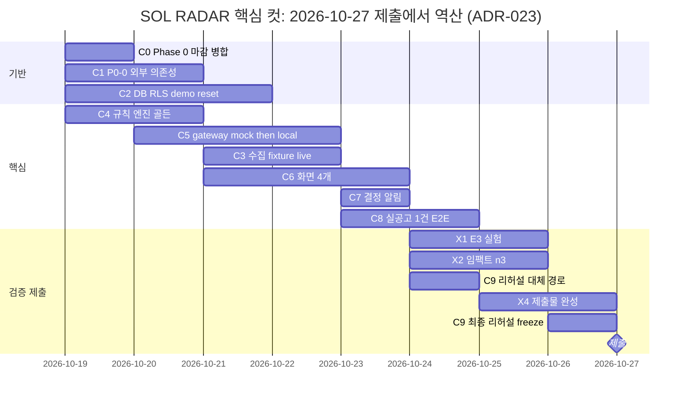

# 12. 구현 순서와 해커톤 컷

> [!success] 확정됨 (2026-10-18, 사용자 입력)
> 제출 마감일 **2026-10-27**. 공식 심사 기준은 실용성 30 · 사업적 창의성 25 · 완성도 25 · 확장 가능성 20([[18-HACKATHON|18 해커톤]] §4). 발표일·발표 시간은 미입력이다. 실용성과 완성도가 55점이라 `live` 실수집과 S2~S7 완결을 가장 앞에 둔다. 아래 간트는 아직 역산 전이다.

[[16-DECISIONS|ADR-020]]으로 해커톤 MVP의 목표가 "fixture 20건 + mock AI"에서 **실제 나라장터 공고를 대상으로 끝까지 동작하는 MVP**로 바뀌었다(사용자 원문: "해커톤 시연용 가짜 AI가 아니라, 실제 공공입찰 데이터를 대상으로 끝까지 동작하는 SOL RADAR MVP"). 실수집·실추론·평가 트랙(P0-0~P0-11)은 별도 트랙이 아니라 아래 Phase 0~7 안에 들어간다. fixture 경로를 다 만든 뒤 live를 얹는 것이 아니라 같은 인터페이스(`BidSourceConnector`·`AttachmentFetcher`·`DocumentParser`·`ModelClient`)로 둘을 함께 만든다. 시험과 CI는 `SOL_RUN_MODE=mock`으로 돈다.

## 순차 실행 (Claude Code 기준)
|Phase|작업|종료 조건|해커톤 컷|
|---|---|---|---|
|0|템플릿 정리(Supabase·`web/` 유지, 견본 도메인 `memos`·`tasks` 등 정리 범위 결정), `infra/compose.yaml`(redis·minio·qdrant·ai-gateway·worker), `web/worker` 진입점, AI gateway 골격, `/health/live`·`/health/ready`, Supabase 클라우드 프로젝트 연결·env, `pnpm check:env`, CI(`verify.config.json`), `demo` 프로필 기동. 실행 모드 `SOL_RUN_MODE`(`live`·`fixture`·`mock`)와 `pnpm check:env` 모드 모순 검사(P0-1), 서비스키 4개(`G2B_*_SERVICE_KEY`) 자리(서버 전용, [[16-DECISIONS\|ADR-022]]), 회사 GPU 추론 엔드포인트에 HTTPS로 붙는 `ai-local` 연결 방식([[16-DECISIONS\|ADR-025]]). 서비스키·회사 엔드포인트가 준비되는 대로 P0-0 외부 의존성 조기 점검. 템플릿 `tasks`는 지우지 않고 입찰 프로젝트 체크리스트로 재사용한다. 템플릿 운영자 화면 `/admin`은 Phase 3 앱 셸에서 `/ops`로 옮긴다([[16-DECISIONS\|ADR-021]])|Compose 서비스(redis/minio/qdrant/ai-gateway/worker) healthy + web `/health/ready` green + Supabase 프로젝트 연결(`checks.db` ok). 모드 모순 env 기동 거부 시험 통과. `docs/evidence/phase-0/external-deps.md`에 P0-0 항목별 결과(막힌 항목은 사용자 보고)|데모 필수|
|1|`supabase/migrations`로 SOL RADAR 스키마([[04-DATABASE\|04 DB]])·RLS·`memberships.sol_role`, 정책 시험, seed(`pnpm demo:reset`), Supabase Auth 연결·RBAC, 솔리데오 부서·직급 카탈로그·가상 인력 200명 seed(ADR-019). ADR-020 저장 변경(실행 모드·출처 기록, 첨부 다운로드·파싱 상태, `requirement_assessments`·`bid_structured_requirements`·`eval_runs`)을 첫 SOL 마이그레이션에 포함(04 표 정의를 먼저 고친다). ADR-021 저장 변경: `departments` 계층(`parent_id`·`kind`), `team_members`(운영)·`team_member_scoring`(점수) 분리, 가입 시 개인 조직 생성 중단, 구성원 관리 정책을 `sol_role=ADMIN` 기준으로|회사 격리 RLS 정책 시험(`pnpm test:db`) 통과, 새 표마다 정책 시험, seed 20건(19건 적재 + `FX-12` 격리 1건) 멱등|데모 필수|
|2|공고 Connector 인터페이스 + `FixtureConnector` + `OfficialApiConnector`(나라장터 입찰공고 용역 중 정보화사업, 면허제한·참가가능지역·e발주 첨부 조회, P0-2) + 정규화 + revision. documents job·첨부 다운로드·`/parse`(PDF·HWPX·HWP, P0-3). 사전규격·발주계획 수집과 단계 연결(P0-8)|재실행 멱등 + 변경 감지 테스트. 서비스키·첨부 다운로드가 되면 live 수집 `ingest_runs` 요약과 실공고 형식별 파싱 성공률|데모 필수|
|3|Next.js 대시보드/검색/상세·가입 부서/직급 필수 선택·간편 가입 정보 보완·가상 정장 사진 200장 연결 (1440 기준). 실행 모드·출처 배지, 공고 목록 `origin` 필터, "가상 회사 프로필로 분석" 배지. 앱 셸(사이드바 정보 구조·조직 주소 없는 경로·서버 조직 결정·`/ops` 분리), 설정(개인·조직 탭), 조직·인력 조회(200명 조직도·명부·상세, 사진 연결 자리), 데이터 수집 관리(`/admin/ingestion`), 대시보드 카드 5개([[16-DECISIONS\|ADR-021]])|fixture 실제 API로 화면 E2E, PPL-01~06, NAV-01~NAV-09([[11-TESTING\|11 테스트]] §9)|데모 필수|
|4|기업 프로필·필수 자격·규칙 점수. 규칙은 API 구조화 필드 우선 + 업종 코드 사전 + 3값·사유 코드(P0-5), SOL Score v0.1(P0-7의 점수 부분)|골든셋 일치(`mock` 모드), 근거 저장, worked example 3건 일치, 정보 부족 ≠ 미충족 단위 시험|데모 필수|
|5|AI gateway: mock adapter(CI용, 먼저) → 장애 대체(`PARTIAL`) → Qwen3.5-9B `/extract` local + `translations`(P0-4) → Kev-9B@v1.0 `kev-qs/v0.2` 참고 지표·`stateTrace`·레지스트리 검증(P0-6) → `/explain`(P0-7)|mock/실모델 switch, PARTIAL 경로, 실패 유형 구분, 인용 검증 통과율·실공고 1건 E2E 로그, Kev 응답 원문 저장·규칙 불변 시험|데모 필수(실추론 포함)|
|6|최종 권고 + 영업 리뷰 + 인앱 알림|엔드투엔드 검토 완료|데모 필수|
|7|보안·성능·로그·배포. 세 모드 기동 리허설, 엔드포인트 재접속 확인 리허설|릴리즈 체크리스트 PASS|`.env.example`·healthcheck·DEMO 배지·evidence·세 모드 리허설은 데모 필수, 나머지 이후|
|평가 트랙|평가셋 v0.1(P0-9), 평가 하네스와 E0·E1·E2 리포트(P0-10), 학습셋 번들 내보내기와 LoRA 메모리 검증 스크립트·절차(P0-11). Phase 5 실추론이 동작한 뒤 시작해 Phase 6·7과 나란히 진행|[[21-MODEL-TRAINING\|21 모델 학습]] §7 수용 기준|데모 필수|
|8 (P1)|카카오톡/경쟁사/인력배치|공식 데이터 및 외부 승인 확보 후|해커톤 이후|

## 해커톤 우선순위 (P0)

해커톤 제출 마감일은 2026-10-27이다. 아래 순서가 곧 잘라낼 순서다. 시간이 모자라도 범위를 임의로 줄이지 않고 선택지를 보고한다([[17-CLAUDE-IMPLEMENTATION|17 구현 규칙]]). `E0`~`E2`는 [[21-MODEL-TRAINING|21 모델 학습]]의 평가 비교 대상이며 데모 장면 번호(`S0`~`S7`)와 다르다.

|순서|항목|Phase|완료 기준|
|---|---|---|---|
|P0-0|**외부 의존성 조기 점검.** ① data.go.kr 오퍼레이션별 실제 응답 3건 저장·필드 확인 ② 공고 3건의 첨부 실제 다운로드(로그인·세션 필요 여부) ③ 회사 GPU 추론 엔드포인트([[16-DECISIONS\|ADR-025]]) G1 HTTPS 접속(TLS·인증) → G2 Qwen·Kev `GET /v1/models`·레지스트리 대조 → G3 지연 실측 → G4 vLLM guided JSON → G5 회사 제공 GPU 정보 기록 → G6 차단 시 `PARTIAL`([[11-TESTING\|11 테스트]] §3.3 ③) ④ 실제 RFP 샘플로 파서 후보 비교 시작|서비스키·회사 엔드포인트(경로·인증 방식 전달, 모델 기동 완료 통보)가 준비되는 즉시. 그동안 다른 항목은 인터페이스로 진행|`docs/evidence/phase-0/external-deps.md`에 항목별 결과. 막힌 항목은 즉시 사용자 보고([[11-TESTING\|11 테스트]] §3.3)|
|P0-1|실행 모드 3종 + 출처·모드 기록 + 모드 모순 기동 거부|0 (기록 필드는 1)|모순 env 기동 거부 시험, 세 모드 기동 로그. 골든은 Phase 4에서 고정된 뒤 `mock` 모드로만 단언|
|P0-2|서비스키 발급(사용자 작업) → 실제 응답 3건 저장·registry 검증 → 입찰공고 용역 수집(정보화사업) + 면허제한·참가지역·e발주 첨부 조회 + 첨부 다운로드 가능성 확인|2|`ingest_runs` 요약, 공고 목록에 live 공고 노출|
|P0-3|첨부 다운로드 + `/parse`(PDF·HWPX·HWP) + 미지원 표시|2|실공고 30건 형식별 파싱 성공률 증거|
|P0-4|Qwen3.5-9B 실추출(`/extract` local) + `translations`|5|인용 검증 통과율 증거, 실공고 1건 E2E 로그|
|P0-5|규칙: API 구조화 필드 우선 + 업종 코드 사전 + 3값·사유 코드|4|단위 시험(정보 부족 ≠ 미충족)|
|P0-6|Kev-9B@v1.0 `kev-qs/v0.2` 실추론(en) + 참고 지표·플래그 + `stateTrace` + 레지스트리 검증|5|Kev 응답 원문·trace 저장, 규칙 불변 시험|
|P0-7|SOL Score v0.1 + `/explain` + 대시보드(모드·출처 배지, Kev 참고 패널, 근거 서랍)|3 (화면)·4 (점수)·5 (`/explain`)|1440·1280 스크린샷|
|P0-8|사전규격·발주계획 수집과 단계 연결|2|StageTimeline에 실데이터|
|P0-9|평가셋 v0.1: test 20·dev 10 사업, 가상 기업 원형 6개, 라벨 검수(추출 정답 20건, 의미 대응 라벨 150건 이상)|평가 트랙|manifest·라벨 검증 통과|
|P0-10|평가 하네스 + E0·E1·E2 리포트(한국어/영어 비교 포함)|평가 트랙|`docs/evidence/eval/` 리포트|
|P0-11|학습셋 번들 내보내기 + 메모리 검증 스크립트·절차|평가 트랙|번들 sha256, 절차 문서. 실행은 GPU 서버 셸이 필요해 회사 측 실행 요청 사항|

**순서 규칙** ([[16-DECISIONS|ADR-020]], 2026-10-16 메인 세션 정리)
- **작업 순서는 Phase 순서**(위 Phase 표)다. 의존 관계 때문에 P0-5(Phase 4)·P0-8(Phase 2)이 P0-4·P0-6(Phase 5)보다 먼저 끝날 수 있다.
- **P0 번호는 우선순위**다. 시간이 모자라면 큰 번호부터 잘라낼 후보로 보고하고 사용자가 정한다([[17-CLAUDE-IMPLEMENTATION|17 구현 규칙]]).
- P0-0은 서비스키·회사 GPU 추론 엔드포인트가 준비되는 즉시 한다. 그 전에는 인터페이스(`BidSourceConnector`·`AttachmentFetcher`·`DocumentParser`·`ModelClient`)와 fixture·mock으로 다른 Phase를 진행한다. P0-0 항목이 막히면 즉시 보고한다.
- 착수 게이트는 ADR-023의 3단이다: 핵심 컷 green 전 확장 컷 금지, 핵심 + 확장 green 전 P1 금지(17).
- P0 번호와 Critical Path C-ID의 대응은 위 Critical Path 표의 "Phase / P0" 열이다. P0-8·P0-9~P0-11은 확장 컷으로 옮겼다(ADR-023).

## 해커톤 컷 (ADR-023, 2026-10-19)

[[16-DECISIONS|ADR-023]]으로 컷을 3단 + 이후로 다시 정했다. ADR-020·021의 설계는 그대로이고 우선순위와 데모 노출 범위만 바뀐다. 이전 2단 표(데모 필수 / 있으면 좋음)는 이 표로 대체한다.

|구분|포함|이유|
|---|---|---|
|**핵심 컷**(데모 필수)|장면: S2 대시보드, S3 FX-01 충족·근거·94 / FX-03 NO-BID·Kev 상충, S4 FX-02 분석·72·사람 결정·알림, **S-LIVE 실제 공고 1건 AI 분석 결과**, S6 `PARTIAL`, S7 격리 404. 기능: Phase 0 마감(Compose·gateway 골격·health 병합), Phase 1(공고·프로필·분석·검토·알림·감사 표, RLS, `sol_role`, `pnpm demo:reset`), Phase 2 중 `FixtureConnector`·정규화·revision·격리·documents job·`OfficialApiConnector`(P0-2·P0-3 live 1건), Phase 4 전부(P0-5·P0-7 점수), Phase 5 중 `/extract`·`/kev`·`/explain`·`/parse`(검증 형식만)·mock adapter·`PARTIAL`·`local` 어댑터(P0-4·P0-6, 1건 실추론), Phase 6 결정 기록·인앱 알림 2종, Phase 3 중 앱 셸 최소(메뉴 3개·Topbar 지표)·`/dashboard`·`/bids`·`/bids/[id]`·`/notifications`, Phase 7 중 `check:env`·healthcheck·DEMO 배지·증거·세 모드 기동·대체 경로 리허설. 평가 중 **E3 대조 실험(축소 규모)**. 인력 200·27명·20 FTE는 점수 입력으로만 쓴다. 아래 Critical Path C0~C9·X1~X4|마감 2026-10-27, 배점 실용성 30 + 완성도 25. "이 입찰에 들어가야 하는가"가 끝까지 도는 것이 먼저다|
|**확장 컷**(핵심 컷 전부 green 뒤, 이 순서)|S5 변경 감지(FX-06·07·09·10 LIVE 배치, revision diff, `BID_CHANGED`) → `feat/people-read` 병합과 `/people`·`/org-chart` 메뉴 노출 → `/admin/ingestion` 화면 → 설정 조직 탭 → ADR-021 앱 셸 나머지(N1 전체)·대시보드 카드 5개 완성 → P0-8 사전규격·발주계획 단계 연결 → 전체 평가셋(test 20·dev 10)·E0·E1·E2 전체 리포트·P0-11 학습셋 내보내기 → `/admin/ai/eval-runs`|핵심 컷을 해치지 않는 범위에서 "진짜 동작하나"의 추가 증거. 이미 구현된 코드는 보존한다|
|**P1**(ADR-021 P1, 변경 없음)|관심 공고 → 분석 결과 비교 → 입찰 프로젝트(대시보드 다섯 번째 카드 교체 포함) → 인력 배치 시뮬레이션 → 조직·인력 ADMIN 편집. 그 뒤: 계약과정통합공개로 사업 묶기, Qdrant 의미 검색, Playwright 전체 E2E 녹화, 공고 revision diff 화면, 간편 로그인 제공자 설정(맨 마지막)|착수 게이트: **핵심 컷 + 확장 컷 전부 green**(11 §4·§5, 골든 G1~G10, `pnpm verify`). 그 전에는 시작하지 않는다|
|해커톤 이후|Kev-9B LoRA: F1 메모리 검증 실행(GPU 서버 셸이 필요해 회사 측 실행 요청 사항. 회사가 해커톤 중에 돌려 주면 기록하지만 완료 조건 아님)·F2 학습·F3 보정·반입([[21-MODEL-TRAINING\|21 모델 학습]] §5). τ·온도 정식 보정. `sol-v0.2.x`의 Kev 반영 검토. Qwen 파인튜닝. 낙찰·계약 수집. zip·스캔 PDF·혁신장터 RFP. Phase 5 `ai-hosted`. Phase 7 운영 심화(nginx TLS, 백업·복구 리허설, Sentry/Grafana). Phase 8 P1 전부(카카오 실발송, 경쟁사 통계, 인력 배치 저장·배정 확정). `/ops` 분리, 직원 편집. P2. ADR-021 후속: 수주 전략·시장 분석, 입찰 일정, 개인 알림 수신 설정, ANALYST 검토 의견, 멀티 조직 지원(조직 전환 UI 포함)|외부 승인·비용·GPU 의존. 파인튜닝은 초기 목표 지표 미달만으로 시작하지 않고, 오류 분석에서 모델 판단 오류가 주된 원인일 때 사람이 정한다|

규칙: 핵심 컷 항목이 하나라도 빨간불이면 확장 컷에 손대지 않는다. 핵심 컷과 확장 컷이 모두 녹색이기 전에는 P1에 손대지 않는다. 범위를 더 줄여야 하면 선택지를 보고하고 사용자가 결정한다 ([[17-CLAUDE-IMPLEMENTATION|17 구현 규칙]]).

### Critical Path (ADR-023, 2026-10-19 승인)

작업자 3~4명(에이전트) 병렬 전제. 상세(난이도·실패 위험·증거·테스트 기준)는 [수상 전략 보고](plans/2026-10-18-hackathon-award-plan.md) §4.

|ID|작업|Phase / P0|선행|일정|
|---|---|---|---|---|
|C0|Phase 0 마감: `phase0/infra` 통합 기동(`--profile demo`) → 증거 → main 병합|0 / P0-1|없음|10-19|
|C1|P0-0: ① API 4종 실제 GET(마스킹 저장) ② 첨부 3건 다운로드 ③ 회사 GPU 추론 엔드포인트([[16-DECISIONS\|ADR-025]]): G1 HTTPS 접속(TLS·인증) → G2 Qwen·Kev `GET /v1/models`·레지스트리 대조 → G3 지연 실측(Kev state 약 500토큰 10회 p50·p95, Qwen 추출 1회) → G4 vLLM guided JSON → G5 회사 제공 GPU 정보가 있으면 기록 → G6 엔드포인트 차단 시 `PARTIAL` ④ 파서 후보 비교 시작. 체크리스트 `docs/evidence/phase-0/external-deps.md`|0 / P0-0|사용자: `infra/.env` 서비스키 4개. 회사: P2 엔드포인트 경로·인증 방식 전달, P3 모델 기동 완료 통보|10-19~20|
|C2|Phase 1 DB·RLS·`sol_role`(`feat/people-read`의 `20261018000001` 위에)·`pnpm demo:reset`(people seed 흡수)|1|C0|10-19~21|
|C3|Phase 2 수집: `FixtureConnector`·정규화·revision·격리·ingest job, documents job, `OfficialApiConnector`·`G2bAttachmentFetcher`|2 / P0-2·P0-3|C2, C1 ①|10-21~22|
|C4|Phase 4 규칙 엔진(순수 함수)·골든 94/72/68·27명 입력|4 / P0-5·P0-7|없음(C2와 병렬)|10-19~20|
|C5|Phase 5 gateway `/extract`·`/kev`·`/explain`·`/parse` mock → worker extract·analysis·`PARTIAL` → `local` 어댑터|5 / P0-4·P0-6|C0·C4, local은 C1 ③|10-20~22|
|C6|Phase 3 화면: 앱 셸 최소·`/dashboard`·`/bids`·`/bids/[id]`·`/notifications`, Route Handler 9개|3 / P0-7|C2|10-21~23|
|C7|Phase 6: 결정 기록 트리거·audit·outbox·인앱 알림 2종|6|C2·C6|10-23|
|C8|S-LIVE: 실공고 1건 `live` E2E, 실행 로그·녹화|5 / P0-4·P0-6|C1·C3·C5·C6|10-23~24|
|C9|리허설·대체 경로 6종·세 모드 전환·로컬 Supabase CLI 전환·체크리스트|7|C6·C7|10-24, 10-26|
|X1|E3 대조 실험(축소 규모). 입력·설계는 C4·C5와 병렬로 준비|평가|C5 local, C1 ③|설계 10-19~, 실행 10-24~25|
|X2|임팩트 예비 실험 n=3|—|C8|10-24~25|
|X3|경쟁 서비스 비교(공개 페이지)|—|없음|10-19|
|X4|제출물: 슬라이드·3분 영상·기술 자료. 구조는 지금부터 병렬, 완성은 C8·X1·X2 뒤|—|구조: 없음 / 완성: C8·X1·X2|구조 10-19~, 완성 10-25~26|
|X5|확장 컷(위 표 순서)|—|핵심 컷 green|10-25 이후|

병렬 순서: 10-19 C0‖C1‖C4‖X3‖X4 구조 → 10-20 C2‖C4‖C5‖C1 → 10-21 C2‖C3‖C5‖C6 → 10-22 C3‖C5‖C6 → 10-23 C6‖C7‖C8 → 10-24 C8‖C9‖X1‖X2 → 10-25 X4‖X1 → 10-26 C9·freeze·증거 → 10-27 제출.

**10-21 컷 규칙**(저녁, C1 결과 기준. 이 시점은 외부 의존성 컷을 정하는 기준이고 핵심 기능 개발은 계속한다):

|C1 결과|S-LIVE 장면|
|---|---|
|API 정상·GPU 정상|실제 공고·실제 추론 경로 유지|
|API 정상·GPU 불가|실제 공고에 규칙 기반 `PARTIAL` 결과|
|API 불가·GPU 정상|검증된 fixture 기반 실제 추론 시연|
|API 불가·GPU 불가|fixture·mock 시연과 사전 확보한 실제 검증 증거만|

"GPU 정상"은 C1 ③의 G2(`GET /v1/models`·레지스트리 대조)·G3(지연 실측) 통과다([[16-DECISIONS|ADR-025]]). 어느 경우든 실행 모드와 출처를 화면에 표시한다. 실시간 추론을 못 했으면 녹화·fixture 결과를 live라고 표시하지 않는다.

## 데모 D-2 ~ D-day
|시점|할 일|
|---|---|
|D-2 (10-25)|기능 freeze. fixture·seed 고정. 모델 레지스트리(`services/ai/models/registry.yaml`)·질문 세트·state 템플릿 버전 고정. 전체 테스트 green. `docs/evidence/` 갱신. 공공 API 오늘 호출량 확인(개발계정 서비스당 1,000건/일)|
|D-1 (10-26)|데모 노트북에서 [[10-DEPLOYMENT\|10 배포]] 기동 절차 1~12 리허설 2회 (재부팅 1회 포함). 로컬 Supabase CLI 전환 리허설([[19-DEMO-SCENARIO\|19 데모 시나리오]] §5 대체 경로). 이미지 빌드·pull 완료 확인. 개발 DB·Auth가 Supabase 클라우드 프로젝트라 데모 장소의 인터넷 연결을 확인한다. 네트워크 없는 대체 경로(로컬 Supabase CLI `pnpm db:start`, 사전 녹화 영상)는 미결정([[16-DECISIONS\|16 ADR]]). 세 모드(`live`·`fixture`·`mock`) 기동 리허설 각 1회(모드 전환은 env 변경 + worker·ai-gateway 재시작). 회사 GPU 추론 엔드포인트 미접속 → `PARTIAL`·`RULES_ONLY` → 재접속 확인(`GET /v1/models`) 리허설, 재접속 확인 소요 시간 기록. live 리허설 호출 수가 일일 한도 안인지 확인|
|D-day (제출 10-27, 발표일 미입력)|기동 절차 1~12. 엔드포인트 접속(`GET /v1/models`)과 `GET /api/v1/admin/ai/status`(Qwen healthy, Kev `registryMatch`) 확인. 시연 모드는 [[19-DEMO-SCENARIO\|19 데모 시나리오]] §2.1(기본 `mock`), 장애 대체 순서는 `live` → `fixture` → `mock`. 리허설 후 `pnpm demo:reset`(seed 재실행, 멱등)으로 초기화. 발표 스크립트는 [[18-HACKATHON\|18 해커톤]]|

위 간트는 ADR-023 Critical Path의 제안 일정이다. C1 결과로 10-21 저녁에 한 번 재조정한다. X3 경쟁 비교와 X4 제출물 구조는 10-19부터 병렬이다. 각 작업 중간에 커밋하며 [[PROGRESS]]에 완료·남은 일·검증 결과를 기록한다.

## P1/P2 우선순위
P1: 변경 알림(카카오 계약 승인), 경쟁사 공개 낙찰 통계, 가용 인력·중복 배치. P2: 발주 예측/확률 모델/ERP, 성능 검증 후 순차 릴리즈. 모두 해커톤 이후. 모델 학습 후속(Kev LoRA, Qwen 파인튜닝, Kev 점수 반영 검토)은 [[21-MODEL-TRAINING|21 모델 학습]]의 절차를 따른다.

## 관련 문서
- [[01-PRD|01 PRD]]
- [[10-DEPLOYMENT|10 배포]]
- [[11-TESTING|11 테스트]]
- [[16-DECISIONS|16 ADR]] — ADR-017(Next.js + Supabase), ADR-020(실데이터 MVP·P0 순서), 데모 실행 환경 미결정
- [[17-CLAUDE-IMPLEMENTATION|17 구현 규칙]]
- [[18-HACKATHON|18 해커톤]]
- [[19-DEMO-SCENARIO|19 데모 시나리오]]
- [[21-MODEL-TRAINING|21 모델 학습]]
- [[PROGRESS]]
