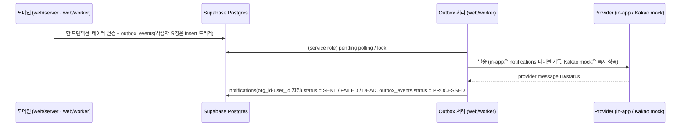

# 13. 알림 설계

> [!tip] 해커톤 범위
> 해커톤에서는 **in-app 알림만 실제 발송**한다. Kakao 알림톡은 `NOTIFY_KAKAO_PROVIDER=mock`인 mock provider로 outbox 상태 전이만 시연하는 설계다. **미구현**: mock provider와 이 env가 코드에 없다(채널 값 `KAKAO`만 스키마에 있다). 외부 호출은 없다. 실발송은 비즈메시지 계약·템플릿 승인 후다 ([[16-DECISIONS|16 ADR]] ADR-006, 미결정 5번).

## 이벤트와 전달
|이벤트|발생 시점|수신자|채널 (P0)|해커톤 구현 (C7, main `841b064`)|
|---|---|---|---|---|
|`BID_CREATED`|신규 공고 적재|조직의 SALES, ANALYST (`memberships.sol_role`)|in-app|outbox만 쌓는다(`ingest_save_revision`). 조직별 알림 펼치기는 S5·확장 컷이라 `PENDING`으로 둔다|
|`BID_CHANGED`|revision 생성 (마감·금액·정정·취소)|해당 공고 담당자 + 검토 참여자|in-app|위와 같다|
|`DEADLINE_APPROACHING`|마감 D-3, D-1 09:00 KST (초기값)|담당자 + 관심 등록자(P1, [[16-DECISIONS\|ADR-021]])|in-app|만드는 곳이 없다|
|`ANALYSIS_COMPLETE`|score_run `COMPLETED` 또는 `PARTIAL`|분석 요청자|in-app|알림 보냄(아래 "인앱 알림 2종"). `FAILED`는 알리지 않는다|
|`REVIEW_ASSIGNED`|담당자 배정|배정 대상|in-app|알림 보냄(아래 "인앱 알림 2종")|

발송 수단: in-app(P0), Kakao 알림톡(P1 설계. mock provider도 미구현, 실발송은 승인과 동의 필요), 이메일은 확장 예정. 아래 시퀀스의 Kakao mock 경로는 설계다.

## 핵심 규칙
- 두 단계 멱등성 ([[04-DATABASE|04 DB]] §3.6):
  - `outbox_events.idempotency_key` = `source + noticeId + revision + eventType` (UNIQUE). 같은 변경이 두 번 수집돼도 이벤트는 하나. 사용자 요청에서 생기는 두 종은 `<reviewId>:<assigneeId>:REVIEW_ASSIGNED`, `<scoreRunId>:<requestedBy>:ANALYSIS_COMPLETE`다(아래 "인앱 알림 2종").
  - `notifications.idempotency_key` = `outboxEventId + userId + channel` (UNIQUE). 같은 이벤트가 같은 사용자·채널에 두 번 전달되지 않는다.
- 마감 임박 수신자(P1, [[16-DECISIONS|ADR-021]]): 공고 담당자와 관심 등록자의 합집합이고 사용자 ID로 중복을 없앤다. idempotency 키는 `bidId + userId + DEADLINE_APPROACHING + D-n`이다. 담당자이면서 관심 등록자인 사람도 한 번만 받는다.
- 상태 전이: `outbox_events.status` `PENDING → PROCESSED`, 실패 시 재시도 후 `FAILED → DEAD`. `notifications.status` `PENDING → SENT`, 실패 시 `FAILED → DEAD`(DLQ). 읽음은 `read_at`. 채널 값은 `IN_APP`, `KAKAO`. ENUM 원천은 04 §4.
- 트랜잭션 경계: Supabase 클라이언트(PostgREST)는 요청 하나를 트랜잭션 하나로 처리한다. 그래서 데이터 변경과 `outbox_events` 기록을 한 트랜잭션에 묶는다([[04-DATABASE|04 DB]] §1). 사용자 요청에서 생기는 이벤트(검토 배정 → `REVIEW_ASSIGNED`)는 `bid_reviews` insert 트리거(`log_bid_review_audit`, `security definer`)로 구현했다(마이그레이션 `20261019000007`). 이 트리거는 감사(`REVIEW_DECIDE`)와, 담당자가 있을 때 outbox 1건을 같은 트랜잭션에 쓴다. 같은 키가 다시 오면 outbox는 한 건만 남는다. 호출자의 `org_id`·`sol_role`(ADMIN·SALES)은 `bid_reviews` insert 정책이 확인한다(마이그레이션 `20261019000005`).
- 발송·상태 전이는 `web/worker`가 service role로 한다. service role은 RLS를 거치지 않으므로 `notifications` 행을 만들 때 `org_id`·`user_id`를 직접 지정하고, 수신자가 그 `org_id`의 구성원(`memberships`)인지 확인한다. 공고 이벤트(`outbox_events.org_id` null)는 조직별로 fan-out하고 각 알림 행에 받는 조직의 `org_id`를 넣는다. 테넌트 혼입 방지 시험은 `web/worker/*.test.ts`와 `scripts/database.test.mjs`에 둔다([[11-TESTING|11 테스트]]).
- RLS:
  - `notifications`: 로그인 사용자는 자기 알림만 읽는다(`user_id = auth.uid()` 그리고 `org_id in (select public.my_org_ids())`). 화면에서 바꿀 수 있는 것은 읽음(`read_at`)뿐이다. 생성·삭제·상태 전이는 worker(service role)만 한다.
  - `outbox_events`: 화면 역할(anon·authenticated)에 열지 않는다(권한·정책 0, 마이그레이션 `20261019000006`). 쓰기는 위 트리거와 worker만 한다. 관리자 지표(적체·중복)를 어떻게 보여 줄지는 [[14-OBSERVABILITY|14 관측성]].
  - 정책 시험은 `scripts/database.test.mjs`(`pnpm test:db`, PGlite)에 더한다.
- 알림 동의·수신 거부·민감 시간대 정책은 채널별 설정. in-app은 동의 불필요.
- 카카오톡 알림톡은 승인된 정보성 템플릿에 허용 변수만 채운다. AI 자유 서술은 상세 웹 화면에서만 제공한다.
- 재전송 시 provider idempotency 지원 여부 확인.
- 데모 수용 기준: 골든 시나리오 `G2`가 [[11-TESTING|11 테스트]]에서 green. 해커톤에서는 공고 알림 펼치기가 없으므로 G2를 **이벤트 단위**(마감일 변경 → `BID_CHANGED` outbox 정확히 1건, 다시 수집해도 1건)와 **알림 단계 멱등**(같은 outbox 이벤트를 다시·동시에 처리해도 알림 1건)으로 본다([[16-DECISIONS|ADR-033]] E3).
- 열린 리다이렉트 방지: `notifications.payload.link`는 앱 안 경로만 쓴다. 이를 위해 알림 목록 서비스(서버)가 앱 안 경로만 내려 보내고, 그 밖의 값이면 `/bids/{bidId}`로 바꾼다([[05-API-SPEC|05 API]] §4.6, [[09-SECURITY|09 보안]], [[16-DECISIONS|ADR-030]] B23).

## 인앱 알림 2종 (C7, [[16-DECISIONS|ADR-033]] E3)

해커톤에서 실제로 알림 행을 만드는 것은 `REVIEW_ASSIGNED`·`ANALYSIS_COMPLETE` 두 종이다(main `841b064`, 브랜치 커밋 `812cf37`·`04d9e9b`, 마이그레이션 `20261019000016`·`20261019000017`). 공고 이벤트(`BID_*`)의 조직별 펼치기는 S5·확장 컷이라 하지 않고, 그 outbox 행은 `PENDING`으로 둔다.

- **outbox를 쓰는 곳**
  - `REVIEW_ASSIGNED`: `bid_reviews` insert 트리거(`20261019000007`)가 담당자가 있을 때 쓴다. 자기 자신을 담당으로 지정해도 알린다.
  - `ANALYSIS_COMPLETE`: `finish_score_run`(`20261019000016`)이 마감과 같은 트랜잭션에서 run의 `requested_by`가 있을 때만 쓴다. 키 `<scoreRunId>:<requestedBy>:ANALYSIS_COMPLETE`, `aggregate_type` `score_run`, payload `{scoreRunId, bidId, orgId, requestedBy, status}`. 사전 분석 run(`requested_by` null)은 쓰지 않는다.
- **알림 행**: `channel=IN_APP`, `status=SENT`, `sent_at`=처리 시각. 키 `<outboxEventId>:<userId>:IN_APP`(UNIQUE, 같은 키면 무시). payload는 `{bidId, title, message, link}`이고 `title`은 공고명([[16-DECISIONS|ADR-029]] A6 D29 ①), `link`는 `/bids/<bidId>`다.
- **문구**
  - `REVIEW_ASSIGNED`: "결정 담당으로 지정되었습니다."
  - `ANALYSIS_COMPLETE` + `COMPLETED`: "분석이 끝났습니다."
  - `ANALYSIS_COMPLETE` + `PARTIAL`: "AI 없이 규칙만으로 분석했습니다. 결과를 확인해 주세요."
  - `FAILED`는 알림이 없다. 상세 화면의 polling이 실패를 알린다.
- **수신자 확인**: 그 조직의 멤버에게만 보낸다. 수신자가 멤버가 아니거나, 공고가 없거나, 정지 계정(`profiles.status`가 `active`가 아님)이면 알림 0건으로 outbox를 `PROCESSED`로 닫는다(로그 결과는 각각 `SKIPPED_NOT_MEMBER`·`SKIPPED_NO_BID`·`SKIPPED_INACTIVE`). 행의 `org_id`와 payload의 `orgId`가 다르면 다른 조직 혼입으로 보고 아래 payload 오류로 다룬다.
- **소비자**: worker 안의 주기 처리다(`web/worker/notify-outbox.ts`, Redis를 쓰지 않는다). 기동 때 한 번, 그 뒤 `NOTIFY_POLL_INTERVAL_MS`(500~60000, 기본 2000)마다 두 종의 `PENDING`과 재시도 시각이 된 `FAILED`를 (`created_at`, `id`) 순으로 50건까지 읽어 하나씩 처리한다. 조회는 부분 인덱스 `outbox_events_notify_due_idx`(`20261019000017`)를 탄다. outbox 상태 갱신은 읽은 상태 그대로일 때만 바꾼다(compare-and-set).
- **실패**: 저장 실패는 5·10·20·40초 뒤 다시 하고, 5번째 실패면 `DEAD`다. payload 오류(종류·조직·형식이 틀림)는 다시 해도 같으므로 바로 `DEAD`다. 회차 전체가 실패하면(DB 장애 등) 다음 회차를 `min(간격 × 2^연속 실패 수, 60초)` 뒤로 미룬다.
- **로그**: 이벤트마다 JSON 한 줄(`outboxEventId`·종류·결과·시도 수·오류 이름). 수신자·조직·공고명·문구는 싣지 않는다([[14-OBSERVABILITY|14 관측성]]).
- **시험**: `web/server/notifications/outbox.service.test.ts`·`outbox-dedupe.test.ts`(G2), `outbox.model.test.ts`·`outbox.repo.test.ts`, `web/worker/notify-outbox.test.ts`. 증거 `docs/evidence/phase-6/test-notifications.txt`.

## 관련 문서
- [[01-PRD|01 PRD]]
- [[04-DATABASE|04 DB]]
- [[05-API-SPEC|05 API]]
- [[09-SECURITY|09 보안]]
- [[11-TESTING|11 테스트]]
- [[14-OBSERVABILITY|14 관측성]]
- [[16-DECISIONS|16 ADR]]
