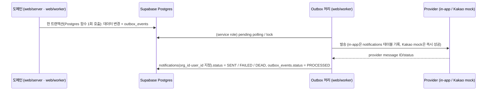

# 13. 알림 설계

> [!tip] 해커톤 범위
> 해커톤에서는 **in-app 알림만 실제 발송**한다. Kakao 알림톡은 `NOTIFY_KAKAO_PROVIDER=mock`인 mock provider로 outbox 상태 전이만 시연하고 외부 호출은 없다. 실발송은 비즈메시지 계약·템플릿 승인 후다 ([[16-DECISIONS|16 ADR]] ADR-006, 미결정 5번).

## 이벤트와 전달
|이벤트|발생 시점|수신자|채널 (P0)|
|---|---|---|---|
|`BID_CREATED`|신규 공고 적재|조직의 SALES, ANALYST (`memberships.sol_role`)|in-app|
|`BID_CHANGED`|revision 생성 (마감·금액·정정·취소)|해당 공고 담당자 + 검토 참여자|in-app|
|`DEADLINE_APPROACHING`|마감 D-3, D-1 09:00 KST (초기값)|담당자|in-app|
|`ANALYSIS_COMPLETE`|score_run `COMPLETED` 또는 `PARTIAL`|분석 요청자|in-app|
|`REVIEW_ASSIGNED`|담당자 배정|배정 대상|in-app|

발송 수단: in-app(P0), Kakao 알림톡(P1, 승인과 동의 필요, 해커톤은 mock), 이메일은 확장 예정.

## 핵심 규칙
- 두 단계 멱등성 ([[04-DATABASE|04 DB]] §3.6):
  - `outbox_events.idempotency_key` = `source + noticeId + revision + eventType` (UNIQUE). 같은 변경이 두 번 수집돼도 이벤트는 하나.
  - `notifications.idempotency_key` = `outboxEventId + userId + channel` (UNIQUE). 같은 이벤트가 같은 사용자·채널에 두 번 전달되지 않는다.
- 상태 전이: `outbox_events.status` `PENDING → PROCESSED`, 실패 시 재시도 후 `FAILED → DEAD`. `notifications.status` `PENDING → SENT`, 실패 시 `FAILED → DEAD`(DLQ). 읽음은 `read_at`. 채널 값은 `IN_APP`, `KAKAO`. ENUM 원천은 04 §4.
- 트랜잭션 경계: Supabase 클라이언트(PostgREST)는 요청 하나를 트랜잭션 하나로 처리한다. 그래서 데이터 변경과 `outbox_events` 기록은 `supabase/migrations/`에 둔 Postgres 함수 하나로 묶어 한 번에 부른다. 사용자 요청에서 생기는 이벤트(검토 배정 → `REVIEW_ASSIGNED`)의 함수는 호출자의 `org_id`·`sol_role`을 함수 안에서 확인한다. 함수 설계는 Phase 1에서 정한다.
- 발송·상태 전이는 `web/worker`가 service role로 한다. service role은 RLS를 거치지 않으므로 `notifications` 행을 만들 때 `org_id`·`user_id`를 직접 지정하고, 수신자가 그 `org_id`의 구성원(`memberships`)인지 확인한다. 공고 이벤트(`outbox_events.org_id` null)는 조직별로 fan-out하고 각 알림 행에 받는 조직의 `org_id`를 넣는다. 테넌트 혼입 방지 시험은 `web/worker/*.test.ts`와 `scripts/database.test.mjs`에 둔다([[11-TESTING|11 테스트]]).
- RLS:
  - `notifications`: 로그인 사용자는 자기 알림만 읽는다(`user_id = auth.uid()` 그리고 `org_id in (select public.my_org_ids())`). 화면에서 바꿀 수 있는 것은 읽음(`read_at`)뿐이다. 생성·삭제·상태 전이는 worker(service role)만 한다.
  - `outbox_events`: 화면 역할(anon·authenticated)에 열지 않는다. 쓰기는 위 Postgres 함수와 worker만 한다. 관리자 지표(적체·중복)를 어떻게 보여 줄지는 [[14-OBSERVABILITY|14 관측성]].
  - 정책 시험은 `scripts/database.test.mjs`(`pnpm test:db`, PGlite)에 더한다.
- 알림 동의·수신 거부·민감 시간대 정책은 채널별 설정. in-app은 동의 불필요.
- 카카오톡 알림톡은 승인된 정보성 템플릿에 허용 변수만 채운다. AI 자유 서술은 상세 웹 화면에서만 제공한다.
- 재전송 시 provider idempotency 지원 여부 확인. 실제 업체 API 계약·템플릿 승인 전 mock provider만 활성화.
- 데모 수용 기준: 골든 시나리오 `G2`(마감일 변경 → 알림 1건, 중복 0건)가 [[11-TESTING|11 테스트]]에서 green.

## 관련 문서
- [[01-PRD|01 PRD]]
- [[04-DATABASE|04 DB]]
- [[05-API-SPEC|05 API]]
- [[09-SECURITY|09 보안]]
- [[11-TESTING|11 테스트]]
- [[14-OBSERVABILITY|14 관측성]]
- [[16-DECISIONS|16 ADR]]
