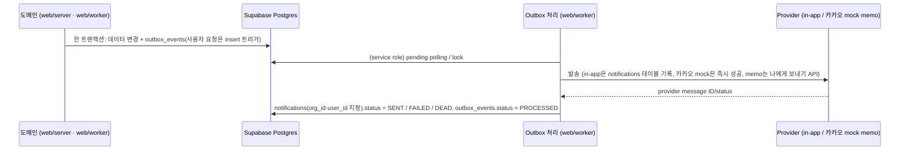

# 13. 알림 설계

> [!tip] 해커톤 범위
> 인앱 알림은 실제로 발송한다. 카카오톡은 개인 설정에서 켠 사용자에게 추천 공고(BID·WATCH 권고)를 카카오 **"나에게 보내기"**(카카오톡 메시지 API, 사업자 불필요)로 보낸다([[16-DECISIONS|ADR-038]]). 발송 수단은 `NOTIFY_KAKAO_PROVIDER`로 고른다. `mock`은 외부 호출 없이 즉시 성공하고 `memo`는 나에게 보내기 실발송이다. 시험·CI는 `mock`이다. main `8cfaac31`에 DB·도메인·발송 수단·Worker 연결·API·설정 화면이 있고, 운영 DB에는 `20261023000700`~`000704`가 적용됐다. 2026-10-27 운영 카카오 연결·발송은 0건이다. 나에게 보내기는 시연용이고 운영 경로는 카카오 알림톡(비즈메시지)이다. 사업자·딜러사·템플릿 승인 뒤이며 미결정 5번이다.
> 실제 공고 수신 녹화는 첨부 처리의 회사 반영과 실공고 S-LIVE 분석 뒤에 한다([[16-DECISIONS|ADR-054]]). 발표는 D1이라 `demo:reset`은 하지 않는다.

> [!warning] 운영 알림 처리 위험 (미확인)
> 회사 Worker는 ingest-only·analysis-only·documents-only다([[10-DEPLOYMENT|10 배포]]). 알림 소비자(`notifyWorkerRegistration`)와 마감 알림(`deadlineWorkerRegistration`)은 전체 Worker 진입점 `web/worker/main.ts:857-914`에만 등록된다. `analysis-only-main.ts`는 분석만 돌리고, 전체 Worker를 같은 Redis에 함께 띄우지 않는다는 제약이 compose 주석에 있다. 그래서 운영에서 인앱·카카오·마감 알림을 처리하는 프로세스가 있는지는 확인하지 못했다(회사 서버는 조회하지 않았다). 있다고도 없다고도 단정하지 않는다. 발표 전에 사용자가 확인할 항목이다. 용어는 [[20-GLOSSARY|20 용어집]] "운영 알림 처리 위험"이다.

## 이벤트와 전달
|이벤트|발생 시점|수신자|채널|구현|
|---|---|---|---|---|
|`BID_CREATED`|신규 공고 적재|조직의 SALES, ANALYST|in-app|outbox만 쌓는다(`ingest_save_revision`). 조직별 발송(팬아웃)은 구현 없음. 행은 `PENDING`으로 남는다|
|`BID_CHANGED`|revision 생성 (마감·금액·정정·취소)|해당 공고 담당자 + 검토 참여자|in-app|위와 같다|
|`DEADLINE_APPROACHING`|마감 D-3, D-1 09:00 KST|담당자 + 관심 등록자([[16-DECISIONS\|ADR-021]])|in-app|main `546a997d`, 운영 DB 적용(`20261022000110`). Worker 주기 작업이 `send_deadline_reminders(p_now)`로 직접 삽입. 운영 발송은 위 위험 참고|
|`ANALYSIS_COMPLETE`|score_run `COMPLETED` 또는 `PARTIAL`|분석 요청자|in-app|구현됨(아래 "인앱 알림 2종"). `FAILED`는 알리지 않는다|
|`REVIEW_ASSIGNED`|담당자 배정|배정 대상|in-app|구현됨(아래 "인앱 알림 2종")|
|`BID_RECOMMENDED`|사람이 요청한 분석이 `COMPLETED`·`PARTIAL`로 끝나고 권고가 BID·WATCH(조직·공고마다 처음 한 번)|그 조직 구성원 중 카카오톡 알림을 켜고 연결이 정상인 활성 계정|카카오톡|구현됨. `finish_score_run`이 outbox를 쓰고(`20261023000701`) Worker가 펼쳐 보낸다(아래 "카카오톡 추천 공고")|
|`KAKAO_TEST`|개인 설정의 `[시험 메시지 보내기]` (RPC `request_kakao_notify_test()`)|본인|카카오톡|구현됨(`20261023000700`). 알림 행은 만들지 않고 결과는 `kakao_notify_links.last_result`|
|`KAKAO_EXPIRED`|카카오 연결이 `EXPIRED`로 바뀌는 순간 한 번(outbox 이벤트가 아니라 Worker가 쓰는 알림 종류)|본인|in-app|구현됨. 링크 `/settings`|

`BID_*` 조직별 발송은 S5 변경 감지가 병합된 뒤에도 구현이 없다(`web/server/notifications/outbox.model.ts`의 `NOTIFY_EVENT_TYPES`에 `BID_*`가 없다. 미결정 30-4, [[16-DECISIONS|16]]). 채널은 in-app, 카카오톡 나에게 보내기(ADR-038), 카카오 알림톡(운영 전환 경로, 계약·템플릿 승인과 동의 필요, 미결정 5번)이다. 메일 알림은 코드에 없다(아래 이메일 절).

## 핵심 규칙
- 두 단계 멱등성 ([[04-DATABASE|04 DB]] §3.6):
  - `outbox_events.idempotency_key` = `source + noticeId + revision + eventType` (UNIQUE). 같은 변경이 두 번 수집돼도 이벤트는 하나. 사용자 요청에서 생기는 두 종은 `<reviewId>:<assigneeId>:REVIEW_ASSIGNED`, `<scoreRunId>:<requestedBy>:ANALYSIS_COMPLETE`다(아래 "인앱 알림 2종").
  - `notifications.idempotency_key` = `outboxEventId + userId + channel` (UNIQUE). 같은 이벤트가 같은 사용자·채널에 두 번 전달되지 않는다.
- 마감 임박 수신자(P1, [[16-DECISIONS|ADR-021]]): 공고 담당자와 관심 등록자의 합집합이고 사용자 ID로 중복을 없앤다. idempotency 키는 `bidId + userId + DEADLINE_APPROACHING + D-n`이다. 담당자이면서 관심 등록자인 사람도 한 번만 받는다.
- 상태 전이: `outbox_events.status` `PENDING → PROCESSED`, 실패 시 재시도 후 `FAILED → DEAD`. `notifications.status` `PENDING → SENT`, 실패 시 `FAILED → DEAD`(DLQ). 읽음은 `read_at`. 채널 값은 `IN_APP`, `KAKAO`다(`notifications_channel_check`, `20261019000006`). 적용 값의 원천은 04 §4와 실제 마이그레이션이다.
- 트랜잭션 경계: Supabase 클라이언트(PostgREST)는 요청 하나를 트랜잭션 하나로 처리한다. 그래서 데이터 변경과 `outbox_events` 기록을 한 트랜잭션에 묶는다([[04-DATABASE|04 DB]] §1). 검토 배정(`REVIEW_ASSIGNED`)은 `bid_reviews` insert 트리거(`log_bid_review_audit`, `20261019000007`)가 감사와 outbox 1건을 같은 트랜잭션에 쓴다. 호출자의 `org_id`·`sol_role`은 `bid_reviews` insert 정책이 확인한다(`20261019000005`).
- 발송·상태 전이는 `web/worker`가 service role로 한다. service role은 RLS를 거치지 않으므로 `notifications` 행을 만들 때 `org_id`·`user_id`를 직접 지정하고, 수신자가 그 `org_id`의 구성원(`memberships`)인지 확인한다. 테넌트 혼입 방지 시험은 `web/worker/*.test.ts`와 `scripts/database.test.mjs`에 둔다([[11-TESTING|11 테스트]]).
- RLS:
  - `notifications`: 로그인 사용자는 자기 알림만 읽는다(`user_id = auth.uid()` 그리고 `org_id in (select public.my_org_ids())`). 화면에서 바꿀 수 있는 것은 읽음(`read_at`)뿐이다. 생성·삭제·상태 전이는 worker(service role)만 한다.
  - `outbox_events`: 화면 역할(anon·authenticated)에 열지 않는다(권한·정책 0, 마이그레이션 `20261019000006`). 쓰기는 위 트리거와 worker만 한다. 관리자 지표(적체·중복)를 어떻게 보여 줄지는 [[14-OBSERVABILITY|14 관측성]].
  - 정책 시험은 `scripts/database.test.mjs`(`pnpm test:db`, PGlite)에 더한다.
- 알림 동의·수신 거부·민감 시간대 정책은 채널별 설정. in-app은 동의 불필요.
- 카카오톡에는 AI 자유 서술(`explanation`, Qwen 출력)을 싣지 않는다. 나에게 보내기의 사유 한 줄은 규칙 결과에서만 만든다. 운영 경로인 알림톡은 승인된 정보성 템플릿에 허용 변수만 채운다. AI 자유 서술은 상세 웹 화면에서만 제공한다.
- 수용 기준: 골든 시나리오 `G2`가 [[11-TESTING|11 테스트]]에서 green. 공고 알림 펼치기가 없으므로 G2를 **이벤트 단위**(마감일 변경 → `BID_CHANGED` outbox 정확히 1건, 다시 수집해도 1건)와 **알림 단계 멱등**(같은 outbox 이벤트를 다시·동시에 처리해도 알림 1건)으로 본다([[16-DECISIONS|ADR-033]] E3).
- 열린 리다이렉트 방지: `notifications.payload.link`는 앱 안 경로만 쓴다. 이를 위해 알림 목록 서비스(서버)가 앱 안 경로만 내려 보내고, 그 밖의 값이면 `/bids/{bidId}`로 바꾼다([[05-API-SPEC|05 API]] §4.6, [[09-SECURITY|09 보안]], [[16-DECISIONS|ADR-030]] B23).

## N3 마감 알림

`worker/deadline-reminders.ts`가 기본 5분마다 service role 전용 `send_deadline_reminders(p_now)`를 호출한다. KST D-3·D-1의 09:00 이후 당일에만 최신 담당자와 관심 등록자의 합집합으로 인앱 알림을 직접 만든다. 같은 사용자는 한 건이며 `bidId:userId:DEADLINE_APPROACHING:D-n` 고유 키로 재호출 중복을 막는다. 놓친 D-3을 D-2에 뒤늦게 보내지 않는다. 이 경로는 outbox 소비자와 분리돼 있고 화면 역할은 함수를 실행할 수 없다.

## 인앱 알림 2종 ([[16-DECISIONS|ADR-033]] E3)

알림 행을 만드는 인앱 이벤트는 `REVIEW_ASSIGNED`·`ANALYSIS_COMPLETE` 두 종이다(마이그레이션 `20261019000016`·`20261019000017`).

- **outbox를 쓰는 곳**
  - `REVIEW_ASSIGNED`: `bid_reviews` insert 트리거(`20261019000007`)가 담당자가 있을 때 쓴다. 자기 자신을 담당으로 지정해도 알린다.
  - `ANALYSIS_COMPLETE`: `finish_score_run`(`20261019000016`)이 마감과 같은 트랜잭션에서 run의 `requested_by`가 있을 때만 쓴다. 키 `<scoreRunId>:<requestedBy>:ANALYSIS_COMPLETE`, `aggregate_type` `score_run`, payload `{scoreRunId, bidId, orgId, requestedBy, status}`. 사전 분석 run(`requested_by` null)은 쓰지 않는다.
- **알림 행**: `channel=IN_APP`, `status=SENT`, `sent_at`=처리 시각. 키 `<outboxEventId>:<userId>:IN_APP`(UNIQUE, 같은 키면 무시). payload는 `{bidId, title, message, link}`이고 `title`은 공고명([[16-DECISIONS|ADR-029]] A6 D29 ①), `link`는 `/bids/<bidId>`다.
- **문구**
  - `REVIEW_ASSIGNED`: "결정 담당으로 지정되었습니다."
  - `ANALYSIS_COMPLETE` + `COMPLETED`: "분석이 끝났습니다."
  - `ANALYSIS_COMPLETE` + `PARTIAL`: "AI 없이 규칙만으로 분석했습니다. 결과를 확인해 주세요."
  - `FAILED`는 알림이 없다. 상세 화면의 polling이 실패를 알린다.
- **수신자 확인**: 그 조직의 멤버에게만 보낸다. 수신자가 멤버가 아니거나, 공고가 없거나, 정지 계정(`profiles.status`가 `active`가 아님)이면 알림 0건으로 outbox를 `PROCESSED`로 닫는다(로그 결과는 각각 `SKIPPED_NOT_MEMBER`·`SKIPPED_NO_BID`·`SKIPPED_INACTIVE`). 행의 `org_id`와 payload의 `orgId`가 다르면 다른 조직 혼입으로 보고 아래 payload 오류로 다룬다.
- **소비자**: Worker 안의 주기 처리다(`web/worker/notify-outbox.ts`, Redis를 쓰지 않는다). 기동 때 한 번, 그 뒤 `NOTIFY_POLL_INTERVAL_MS`(500~60000, 기본 2000)마다 인앱 두 종과 카카오 두 종(`NOTIFY_EVENT_TYPES`)의 `PENDING`과 재시도 시각이 된 `FAILED`를 (`created_at`, `id`) 순으로 50건까지 읽어 하나씩 처리한다. 조회는 부분 인덱스 `outbox_events_notify_due_idx`(`20261023000701`)를 탄다. outbox 상태 갱신은 읽은 상태 그대로일 때만 바꾼다(compare-and-set).
- **실패**: 저장 실패는 5·10·20·40초 뒤 다시 하고, 5번째 실패면 `DEAD`다. payload 오류(종류·조직·형식이 틀림)는 다시 해도 같으므로 바로 `DEAD`다. 회차 전체가 실패하면(DB 장애 등) 다음 회차를 `min(간격 × 2^연속 실패 수, 60초)` 뒤로 미룬다.
- **로그**: 이벤트마다 JSON 한 줄(`outboxEventId`·종류·결과·시도 수·오류 이름). 수신자·조직·공고명·문구는 싣지 않는다([[14-OBSERVABILITY|14 관측성]]).
- **현재 시험**: `web/server/notifications/outbox-dedupe.test.ts`(알림 멱등)와 `web/worker/notify-outbox.test.ts`(live 가드)가 있다. DB 역할·감사·outbox 핵심 경계는 `scripts/database.test.mjs`를 따른다. 현재 자동 검증 범위는 [[11-TESTING|11]] 현재 MVP 목록을 따른다.

## 카카오톡 추천 공고 (나에게 보내기, [[16-DECISIONS|ADR-038]])

개인 설정에서 켠 사용자에게 추천 공고를 본인 카카오톡 "나와의 채팅"으로 보낸다. 설계는 [카카오 알림 설계](plans/2026-10-20-kakao-memo-notify-design.md) §5·§6·§8이다. 구현은 main `73eac5a8`이다.

- **언제**: `finish_score_run`이 사람이 요청한 run(`requested_by` 있음)을 `COMPLETED`·`PARTIAL`로 마감하고 권고가 BID·WATCH면, 같은 트랜잭션에서 outbox `BID_RECOMMENDED` 1건을 쓴다(`20261023000701`). 키 `<orgId>:<bidId>:BID_RECOMMENDED`라 조직·공고마다 처음 한 번만 생기고, 다시 분석해도 늘지 않는다. `aggregate_type` `score_run`, payload `{scoreRunId, bidId, orgId, recommendation, status}`. 데모 사전 분석(`requested_by` null)·NO_BID·FAILED는 쓰지 않는다.
- **누구에게**: 그 조직 구성원 가운데 카카오톡 알림을 켰고(`enabled`) 연결이 `CONNECTED`이며 활성 계정(`profiles.status = 'active'`)인 사람 전원이다. 역할은 가리지 않고 분석 요청자도 받는다. 받는 사람은 보낼 때 다시 고른다(그 사이 끄거나 연결을 해제하면 보내지 않는다). 사람마다 알림 행 1개(`channel=KAKAO`, `type=BID_RECOMMENDED`, 키 `<outboxEventId>:<userId>:KAKAO`)다. 같은 공고를 이미 받은 사람은 다른 조직의 이벤트라도 건너뛴다. `SENT`와 결과 불분명 `DEAD`(`TIMEOUT_UNKNOWN`)를 받은 것으로 보고(최대 한 번), 분명히 못 보낸 `DEAD`는 받은 것으로 보지 않는다. 받는 사람이 0명이면 알림 0건으로 outbox를 `PROCESSED`로 닫는다. 이 이벤트로 인앱 알림은 만들지 않는다.
- **메시지**: 피드형 한 통이다. 제목은 공고명, 설명은 `BID 권고 · <사유 한 줄>`(PARTIAL이면 뒤에 ` · AI 없이 규칙만으로 분석`), 항목은 발주처·마감·추정금액·점수, 버튼은 [분석 보기]·[공고 원문]이다. 사유 한 줄은 규칙 결과에서만 만들고 AI 자유 서술은 싣지 않는다. 여러 건이면 건마다 따로 보내고, 한 사람에게 1초에 1통을 넘지 않는다.
- **발송 수단**: `NOTIFY_KAKAO_PROVIDER` — `mock`(외부 호출 없이 즉시 성공)·`memo`(`POST https://kapi.kakao.com/v2/api/talk/memo/default/send`). 시험·CI는 `mock`이고, 실발송은 사용자가 env를 `memo`로 바꿀 때만 일어난다([[10-DEPLOYMENT|10 배포]]). 녹화 때만 `memo`로 바꾸고 녹화 뒤 `mock`으로 되돌린다.
- **live에서 발송 수단이 비었을 때**(main `8cfaac31`, 근거 [live 가드 검증](evidence/live-guards/20261027.md)): `SOL_RUN_MODE=live`에서 값이 비면 mock이 아니라 발송을 끈다.
  - live + 빈 값: 카카오 발송을 끈다(`disabled`). Worker는 그대로 기동하고 경고 한 줄(`notify.kakao.disabled`)을 남긴다. 카카오 이벤트(`BID_RECOMMENDED`·`KAKAO_TEST`)는 `KAKAO_CHANNEL_NOT_CONFIGURED`로 5·10·20·40초 뒤 다시 하고 다섯 번째에 `DEAD`가 된다. `kakao_send_claims`·KAKAO 알림 행·`kakao_notify_links.last_result`가 생기지 않는다. 인앱 알림은 영향이 없다.
  - live + `mock` 명시: 받아들이고 경고 한 줄(`notify.kakao.mock_in_live`)을 남긴다.
  - `mock`·`fixture` 모드: 빈 값은 `mock`이다.
  - 경고에는 키 이름만 싣고 값은 싣지 않는다.
- **실패와 만료**: 액세스 토큰이 5분 안에 만료되면 먼저 갱신한다. 카카오가 토큰 오류를 돌려주면 한 번 갱신하고 한 번 다시 보낸다. 갱신도 실패하면(리프레시 만료·동의 철회) 연결을 `EXPIRED`로 바꾸고 그 행은 `DEAD`다. 바뀌는 순간 한 번 인앱 알림 `KAKAO_EXPIRED`(키 `<outboxEventId>:<userId>:KAKAO_EXPIRED:IN_APP`, 링크 `/settings`, 문구 "카카오 연결이 만료되어 카카오톡 알림을 보내지 못하고 있습니다. 설정에서 다시 연결해 주세요.")를 보낸다. 분명한 실패(연결 실패·5xx·429)는 5·10·20·40초 간격으로 다시 하고 5번째면 `DEAD`다. 결과가 불분명한 실패(요청을 보낸 뒤 시간 초과)는 다시 보내지 않고 `DEAD`(`TIMEOUT_UNKNOWN`)로 닫는다. 재시도는 outbox 이벤트 단위다. 다음 회차는 아직 `SENT`·`DEAD`가 아닌 사람에게만 보내고, 5번째 실패로 이벤트를 `DEAD`로 닫을 때 남은 `PENDING`·`FAILED` 행도 `DEAD`로 닫는다. 만료 인앱 알림은 만료를 알게 한 이벤트의 조직·공고에 붙는다.
- **시험 메시지**: 개인 설정의 [시험 메시지 보내기]는 RPC `request_kakao_notify_test()`로 outbox `KAKAO_TEST`(`org_id` null, 키 `<userId>:<UTC 분>:KAKAO_TEST`, 1분에 한 번)를 넣는다. worker가 고정 문구 한 통을 본인에게 보내고 결과를 `kakao_notify_links.last_result`에 적는다. 알림 행은 만들지 않는다. 정지 계정이면 보내지 않는다. 시험에서 만료를 알게 되어도 인앱 알림은 만들지 않는다(설정 칸이 만료를 보인다).
- **연결**: Supabase 간편 로그인과 따로 카카오 OAuth(`scope=talk_message`)를 받는다. 토큰은 웹 서버가 암호화해 RPC로 본인 행(`kakao_notify_links`, [[04-DATABASE|04 DB]])에 저장하고 worker만 복호화한다. 화면은 [[06-UI-UX|06 UI]] 개인 설정 "카카오톡 알림", API는 [[05-API-SPEC|05 API]] `/me/kakao-notify`, 비밀값·토큰 보관은 [[09-SECURITY|09 보안]].
- **인앱 목록**: 인앱 알림 목록과 안 읽음 수는 `channel = 'IN_APP'`만 센다.
- **로그**: 이벤트마다 JSON 한 줄인 규칙은 그대로다. 토큰·메시지 본문·공고명·카카오 사용자 ID는 싣지 않는다.

## 이메일 알림 (ADR-041)

메일 알림은 해커톤 범위 밖이고 코드에 없다(`notifications_channel_check`가 `IN_APP`·`KAKAO`만 허용하고 알림용 메일 발송 코드가 없다. SMTP는 초대 메일 `web/server/organization/organization.mail.ts`만 쓴다). 설계는 [[16-DECISIONS|ADR-041]]과 [[10-DEPLOYMENT|10 배포]] 이메일 절이다. 데모·제출물에서 메일 알림을 주장하지 않는다.

## 관련 문서
- [[01-PRD|01 PRD]]
- [[04-DATABASE|04 DB]]
- [[05-API-SPEC|05 API]]
- [[06-UI-UX|06 UI]]
- [[09-SECURITY|09 보안]]
- [[10-DEPLOYMENT|10 배포]]
- [[11-TESTING|11 테스트]]
- [[14-OBSERVABILITY|14 관측성]]
- [[16-DECISIONS|16 ADR]]
