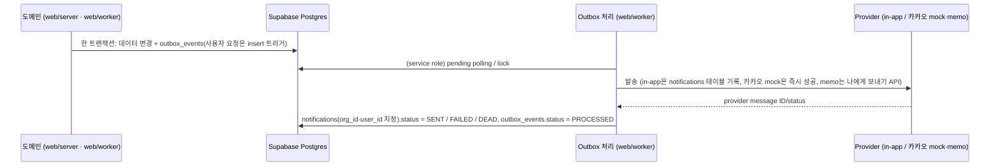

# 13. 알림 설계

## 2026-10-22 카카오 통합 상태

개인 연결·켬/끔·해제·시험 및 추천 outbox 소비자를 통합한다. 신규 SQL은 `20261023000700`~`00704`이며 구 브랜치의 번호/“아직” 서술은 아래 설계 이력이다. `NOTIFY_KAKAO_PROVIDER=mock`이 기본이며 실제 카카오 발송/운영 DB 적용은 이번에 실행하지 않는다. OFF/연결 상태는 송신 직전에도 재확인한다.

**2026-10-24 상태**: 카카오는 2026-10-22 main에 병합됐다(`73eac5a8`). 운영 DB에는 `20261023000700`~`000704`를 2026-10-24 적용했다. 2026-10-24 사용자 결정("카카오 수신 시험은 오늘 못 해, mock으로 둬")으로 해커톤 발송 수단은 `mock`으로 두고, S0 수신 시험·`memo` 실발송·휴대폰 수신 녹화는 하지 않는다. 실발송과 휴대폰 수신은 확인하지 않았다([[16-DECISIONS|ADR-038]] 2026-10-24 개정). 메일 알림(ADR-041)은 같은 날 해커톤에서 뺐다(아래 이메일 절).

추천 메시지는 같은 사용자·공고, 시험 메시지는 같은 outbox 이벤트에 대해 전송 전에 Worker 전용 durable claim을 기록한다. 송신 뒤 상태 저장 실패/프로세스 중단은 결과 불명으로 닫아 자동 중복 전송을 막는다. 외부 API와 DB 사이의 단일 트랜잭션은 없으므로 claim 후 송신 전 중단 시 한 통이 누락될 수 있다. 기존 최대1회 정책을 우선하며 실제 전달 성공과 결과 불명을 구분한다. 구현·회귀·원본 대응은 [통합 기록](evidence/committed-integrations/integration.md)을 따른다.

> [!tip] 해커톤 범위
> 해커톤에서 in-app 알림은 실제로 발송한다. 카카오톡은 개인 설정에서 켠 사용자에게 추천 공고(BID·WATCH 권고)를 카카오 **"나에게 보내기"**(카카오톡 메시지 API, 사업자 불필요)로 보낸다([[16-DECISIONS|16 ADR]] ADR-038, ADR-006 해커톤 조항 개정). 발송 수단은 `NOTIFY_KAKAO_PROVIDER`로 고른다: `mock`(기본, 외부 호출 없이 즉시 성공)·`memo`(나에게 보내기 실발송). 시험·CI는 `mock`이다. **main 병합**(2026-10-22, `73eac5a8`): DB·도메인·`mock`·`memo` 발송 수단·worker 연결·API·설정 화면이 main에 있다. 2026-10-24 사용자 결정("카카오 수신 시험은 오늘 못 해, mock으로 둬")으로 해커톤에서는 `mock`으로 두고 실발송·휴대폰 수신 녹화는 하지 않는다. 실제 휴대폰 수신(S0)은 확인하지 않았다. 나에게 보내기는 해커톤 시연용이다. 운영은 카카오 알림톡(비즈메시지)이고 비즈니스 채널(사업자)·딜러사·템플릿 승인 뒤다(미결정 5번). 아래 "카카오톡 추천 공고" 절.

## 이벤트와 전달
|이벤트|발생 시점|수신자|채널 (P0)|해커톤 구현 (C7, main `841b064`)|
|---|---|---|---|---|
|`BID_CREATED`|신규 공고 적재|조직의 SALES, ANALYST (`memberships.sol_role`)|in-app|outbox만 쌓는다(`ingest_save_revision`). 조직별 알림 펼치기는 S5·확장 컷이라 `PENDING`으로 둔다|
|`BID_CHANGED`|revision 생성 (마감·금액·정정·취소)|해당 공고 담당자 + 검토 참여자|in-app|위와 같다|
|`DEADLINE_APPROACHING`|마감 D-3, D-1 09:00 KST (초기값)|담당자 + 관심 등록자(P1, [[16-DECISIONS\|ADR-021]])|in-app|N3 로컬 통합: worker 주기 작업 → `send_deadline_reminders(p_now)` 직접 삽입|
|`ANALYSIS_COMPLETE`|score_run `COMPLETED` 또는 `PARTIAL`|분석 요청자|in-app|알림 보냄(아래 "인앱 알림 2종"). `FAILED`는 알리지 않는다|
|`REVIEW_ASSIGNED`|담당자 배정|배정 대상|in-app|알림 보냄(아래 "인앱 알림 2종")|
|`BID_RECOMMENDED`|사람이 요청한 분석이 `COMPLETED`·`PARTIAL`로 끝나고 권고가 BID·WATCH(조직·공고마다 처음 한 번)|그 조직 구성원 중 카카오톡 알림을 켜고 연결이 정상인 활성 계정|카카오톡(나에게 보내기)|main 병합(2026-10-22): `finish_score_run`이 outbox를 쓰고(`20261023000701`) worker가 펼쳐 보낸다(아래 "카카오톡 추천 공고"). 해커톤 발송 수단은 `mock`|
|`KAKAO_TEST`|개인 설정의 [시험 메시지 보내기](RPC `request_kakao_notify_test()`)|본인|카카오톡(나에게 보내기)|main 병합: RPC·outbox(`20261023000700`). 알림 행은 만들지 않고 결과는 `kakao_notify_links.last_result`|
|`KAKAO_EXPIRED`|카카오 연결이 `EXPIRED`로 바뀌는 순간 한 번(outbox 이벤트가 아니라 worker가 쓰는 알림 종류)|본인|in-app|main 병합. 링크 `/settings`|

발송 수단: in-app(P0), 카카오톡 나에게 보내기(ADR-038. `NOTIFY_KAKAO_PROVIDER=mock|memo`, main 병합, 해커톤은 `mock`), 카카오 알림톡(운영 전환 경로. 비즈메시지 계약·템플릿 승인과 동의 필요, 미결정 5번). 이메일(ADR-041)은 2026-10-24 사용자 결정으로 해커톤에서 뺐고 구현이 없다(아래 이메일 절). 아래 시퀀스의 카카오 경로는 main에 있고, 해커톤에서는 `mock` 발송 수단만 쓴다.

## 핵심 규칙
- 두 단계 멱등성 ([[04-DATABASE|04 DB]] §3.6):
  - `outbox_events.idempotency_key` = `source + noticeId + revision + eventType` (UNIQUE). 같은 변경이 두 번 수집돼도 이벤트는 하나. 사용자 요청에서 생기는 두 종은 `<reviewId>:<assigneeId>:REVIEW_ASSIGNED`, `<scoreRunId>:<requestedBy>:ANALYSIS_COMPLETE`다(아래 "인앱 알림 2종").
  - `notifications.idempotency_key` = `outboxEventId + userId + channel` (UNIQUE). 같은 이벤트가 같은 사용자·채널에 두 번 전달되지 않는다.
- 마감 임박 수신자(P1, [[16-DECISIONS|ADR-021]]): 공고 담당자와 관심 등록자의 합집합이고 사용자 ID로 중복을 없앤다. idempotency 키는 `bidId + userId + DEADLINE_APPROACHING + D-n`이다. 담당자이면서 관심 등록자인 사람도 한 번만 받는다.
- 상태 전이: `outbox_events.status` `PENDING → PROCESSED`, 실패 시 재시도 후 `FAILED → DEAD`. `notifications.status` `PENDING → SENT`, 실패 시 `FAILED → DEAD`(DLQ). 읽음은 `read_at`. 현재 main 채널 값은 `IN_APP`, `KAKAO`다. `EMAIL`은 ADR-041 설계 값이며 2026-10-24 해커톤에서 뺐다(마이그레이션·구현 없음). 적용 값의 원천은 04 §4와 실제 마이그레이션이다.
- 트랜잭션 경계: Supabase 클라이언트(PostgREST)는 요청 하나를 트랜잭션 하나로 처리한다. 그래서 데이터 변경과 `outbox_events` 기록을 한 트랜잭션에 묶는다([[04-DATABASE|04 DB]] §1). 사용자 요청에서 생기는 이벤트(검토 배정 → `REVIEW_ASSIGNED`)는 `bid_reviews` insert 트리거(`log_bid_review_audit`, `security definer`)로 구현했다(마이그레이션 `20261019000007`). 이 트리거는 감사(`REVIEW_DECIDE`)와, 담당자가 있을 때 outbox 1건을 같은 트랜잭션에 쓴다. 같은 키가 다시 오면 outbox는 한 건만 남는다. 호출자의 `org_id`·`sol_role`(ADMIN·SALES)은 `bid_reviews` insert 정책이 확인한다(마이그레이션 `20261019000005`).
- 발송·상태 전이는 `web/worker`가 service role로 한다. service role은 RLS를 거치지 않으므로 `notifications` 행을 만들 때 `org_id`·`user_id`를 직접 지정하고, 수신자가 그 `org_id`의 구성원(`memberships`)인지 확인한다. 공고 이벤트(`outbox_events.org_id` null)는 조직별로 fan-out하고 각 알림 행에 받는 조직의 `org_id`를 넣는다. 테넌트 혼입 방지 시험은 `web/worker/*.test.ts`와 `scripts/database.test.mjs`에 둔다([[11-TESTING|11 테스트]]).
- RLS:
  - `notifications`: 로그인 사용자는 자기 알림만 읽는다(`user_id = auth.uid()` 그리고 `org_id in (select public.my_org_ids())`). 화면에서 바꿀 수 있는 것은 읽음(`read_at`)뿐이다. 생성·삭제·상태 전이는 worker(service role)만 한다.
  - `outbox_events`: 화면 역할(anon·authenticated)에 열지 않는다(권한·정책 0, 마이그레이션 `20261019000006`). 쓰기는 위 트리거와 worker만 한다. 관리자 지표(적체·중복)를 어떻게 보여 줄지는 [[14-OBSERVABILITY|14 관측성]].
  - 정책 시험은 `scripts/database.test.mjs`(`pnpm test:db`, PGlite)에 더한다.
- 알림 동의·수신 거부·민감 시간대 정책은 채널별 설정. in-app은 동의 불필요.
- 카카오톡에는 AI 자유 서술(`explanation`, Qwen 출력)을 싣지 않는다. 나에게 보내기의 사유 한 줄은 규칙 결과에서만 만든다. 운영 경로인 알림톡은 승인된 정보성 템플릿에 허용 변수만 채운다. AI 자유 서술은 상세 웹 화면에서만 제공한다.
- 재전송 시 provider idempotency 지원 여부 확인.
- 데모 수용 기준: 골든 시나리오 `G2`가 [[11-TESTING|11 테스트]]에서 green. 해커톤에서는 공고 알림 펼치기가 없으므로 G2를 **이벤트 단위**(마감일 변경 → `BID_CHANGED` outbox 정확히 1건, 다시 수집해도 1건)와 **알림 단계 멱등**(같은 outbox 이벤트를 다시·동시에 처리해도 알림 1건)으로 본다([[16-DECISIONS|ADR-033]] E3).
- 열린 리다이렉트 방지: `notifications.payload.link`는 앱 안 경로만 쓴다. 이를 위해 알림 목록 서비스(서버)가 앱 안 경로만 내려 보내고, 그 밖의 값이면 `/bids/{bidId}`로 바꾼다([[05-API-SPEC|05 API]] §4.6, [[09-SECURITY|09 보안]], [[16-DECISIONS|ADR-030]] B23).

## N3 마감 알림 (2026-10-22 로컬 통합)

`worker/deadline-reminders.ts`가 기본 5분마다 service role 전용 `send_deadline_reminders(p_now)`를 호출한다. KST D-3·D-1의 09:00 이후 당일에만 최신 담당자와 관심 등록자의 합집합으로 인앱 알림을 직접 만든다. 같은 사용자는 한 건이며 `bidId:userId:DEADLINE_APPROACHING:D-n` 고유 키로 재호출 중복을 막는다. 놓친 D-3을 D-2에 뒤늦게 보내지 않는다. 이 경로는 기존 C7 outbox 소비자와 분리된 마감 일정 경로이며 화면 역할은 함수를 실행할 수 없다. 기존 두 알림 종류는 아래와 같다. 클라우드 적용·운영 발송 여부는 [[PROGRESS]]를 따른다.

## 인앱 알림 2종 (C7, [[16-DECISIONS|ADR-033]] E3)

해커톤에서 실제로 알림 행을 만드는 것은 `REVIEW_ASSIGNED`·`ANALYSIS_COMPLETE` 두 종이다(main `841b064`, 브랜치 커밋 `812cf37`·`04d9e9b`, 마이그레이션 `20261019000016`·`20261019000017`). 공고 이벤트(`BID_*`)의 조직별 펼치기는 S5·확장 컷이라 하지 않고, 그 outbox 행은 `PENDING`으로 둔다.

- **outbox를 쓰는 곳**
  - `REVIEW_ASSIGNED`: `bid_reviews` insert 트리거(`20261019000007`)가 담당자가 있을 때 쓴다. 자기 자신을 담당으로 지정해도 알린다.
  - `ANALYSIS_COMPLETE`: `finish_score_run`(`20261019000016`)이 마감과 같은 트랜잭션에서 run의 `requested_by`가 있을 때만 쓴다. 키 `<scoreRunId>:<requestedBy>:ANALYSIS_COMPLETE`, `aggregate_type` `score_run`, payload `{scoreRunId, bidId, orgId, requestedBy, status}`. 사전 분석 run(`requested_by` null)은 쓰지 않는다.
- **알림 행**: `channel=IN_APP`, `status=SENT`, `sent_at`=처리 시각. 키 `<outboxEventId>:<userId>:IN_APP`(UNIQUE, 같은 키면 무시). payload는 `{bidId, title, message, link}`이고 `title`은 공고명([[16-DECISIONS|ADR-029]] A6 D29 ①), `link`는 `/bids/<bidId>`다.
- **문구**
  - `REVIEW_ASSIGNED`: "결정 담당으로 지정되었습니다."
  - `ANALYSIS_COMPLETE` + `COMPLETED`: "분석이 끝났습니다."
  - `ANALYSIS_COMPLETE` + `PARTIAL`: "AI 없이 규칙만으로 분석했습니다. 결과를 확인해 주세요."
  - `FAILED`는 알림이 없다. 상세 화면의 polling이 실패를 알린다.
- **수신자 확인**: 그 조직의 멤버에게만 보낸다. 수신자가 멤버가 아니거나, 공고가 없거나, 정지 계정(`profiles.status`가 `active`가 아님)이면 알림 0건으로 outbox를 `PROCESSED`로 닫는다(로그 결과는 각각 `SKIPPED_NOT_MEMBER`·`SKIPPED_NO_BID`·`SKIPPED_INACTIVE`). 행의 `org_id`와 payload의 `orgId`가 다르면 다른 조직 혼입으로 보고 아래 payload 오류로 다룬다.
- **소비자**: worker 안의 주기 처리다(`web/worker/notify-outbox.ts`, Redis를 쓰지 않는다). 기동 때 한 번, 그 뒤 `NOTIFY_POLL_INTERVAL_MS`(500~60000, 기본 2000)마다 두 종의 `PENDING`과 재시도 시각이 된 `FAILED`를 (`created_at`, `id`) 순으로 50건까지 읽어 하나씩 처리한다. 조회는 부분 인덱스 `outbox_events_notify_due_idx`(`20261019000017`)를 탄다. outbox 상태 갱신은 읽은 상태 그대로일 때만 바꾼다(compare-and-set).
- **실패**: 저장 실패는 5·10·20·40초 뒤 다시 하고, 5번째 실패면 `DEAD`다. payload 오류(종류·조직·형식이 틀림)는 다시 해도 같으므로 바로 `DEAD`다. 회차 전체가 실패하면(DB 장애 등) 다음 회차를 `min(간격 × 2^연속 실패 수, 60초)` 뒤로 미룬다.
- **로그**: 이벤트마다 JSON 한 줄(`outboxEventId`·종류·결과·시도 수·오류 이름). 수신자·조직·공고명·문구는 싣지 않는다([[14-OBSERVABILITY|14 관측성]]).
- **현재 시험**: `web/server/notifications/outbox-dedupe.test.ts`가 남아 있는 알림 멱등 시험이다. DB 역할·감사·outbox 핵심 경계는 `scripts/database.test.mjs`를 따른다. 나머지 outbox service/model/repo·worker 개별 시험은 ADR-046으로 삭제됐고, `docs/evidence/phase-6/test-notifications.txt`는 축소 전 실행 이력이다. 현재 자동 검증 범위는 [[11-TESTING|11]] 현재 MVP 목록을 따른다. 삭제 시험을 복구하거나 지금 전수 회귀가 보장된다고 쓰지 않는다.

## 카카오톡 추천 공고 (나에게 보내기, [[16-DECISIONS|ADR-038]])

개인 설정에서 켠 사용자에게 추천 공고를 본인 카카오톡 "나와의 채팅"으로 보낸다. 설계는 [카카오 알림 설계](plans/2026-10-20-kakao-memo-notify-design.md) §5·§6·§8이고, 구현은 2026-10-22 main에 병합됐다(`73eac5a8`). 나에게 보내기는 해커톤 시연용이다. 카카오는 서비스가 사용자에게 보내는 자동 안내에 알림톡을 안내하므로 운영 전환은 알림톡이다.

- **언제**: `finish_score_run`이 사람이 요청한 run(`requested_by` 있음)을 `COMPLETED`·`PARTIAL`로 마감하고 권고가 BID·WATCH면, 같은 트랜잭션에서 outbox `BID_RECOMMENDED` 1건을 쓴다(마이그레이션 `20261021000002`). 키 `<orgId>:<bidId>:BID_RECOMMENDED`라 조직·공고마다 처음 한 번만 생기고, 다시 분석해도 늘지 않는다. `aggregate_type` `score_run`, payload `{scoreRunId, bidId, orgId, recommendation, status}`. 데모 사전 분석(`requested_by` null)·NO_BID·FAILED는 쓰지 않는다(`demo:reset` 마다 사전 분석 결과가 다시 쏟아지지 않게).
- **누구에게**: 그 조직 구성원 가운데 카카오톡 알림을 켰고(`enabled`) 연결이 `CONNECTED`이며 활성 계정(`profiles.status = 'active'`)인 사람 전원이다. 역할은 가리지 않고 분석 요청자도 받는다. 받는 사람은 보낼 때 다시 고른다(그 사이 끄거나 연결을 해제하면 보내지 않는다). 사람마다 알림 행 1개(`channel=KAKAO`, `type=BID_RECOMMENDED`, 키 `<outboxEventId>:<userId>:KAKAO`)다. 같은 공고를 이미 받은 사람은 다른 조직의 이벤트라도 건너뛴다. `SENT`와 결과 불분명 `DEAD`(`TIMEOUT_UNKNOWN`)를 받은 것으로 보고(최대 한 번), 분명히 못 보낸 `DEAD`는 받은 것으로 보지 않는다. 받는 사람이 0명이면 알림 0건으로 outbox를 `PROCESSED`로 닫는다. 이 이벤트로 인앱 알림은 만들지 않는다.
- **메시지**: 피드형 한 통이다. 제목은 공고명, 설명은 `BID 권고 · <사유 한 줄>`(PARTIAL이면 뒤에 ` · AI 없이 규칙만으로 분석`), 항목은 발주처·마감·추정금액·점수, 버튼은 [분석 보기]·[공고 원문]이다. 사유 한 줄은 규칙 결과에서만 만들고 AI 자유 서술은 싣지 않는다. 여러 건이면 건마다 따로 보내고, 한 사람에게 1초에 1통을 넘지 않는다.
- **발송 수단**: `NOTIFY_KAKAO_PROVIDER` — `mock`(기본, 외부 호출 없이 즉시 성공)·`memo`(`POST https://kapi.kakao.com/v2/api/talk/memo/default/send`). 시험·CI는 `mock`이고, 실발송은 사용자가 env를 `memo`로 바꿀 때만 일어난다([[10-DEPLOYMENT|10 배포]]). 2026-10-24 사용자 결정("카카오 수신 시험은 오늘 못 해, mock으로 둬")으로 해커톤에서는 `memo`로 바꾸지 않는다.
- **실패와 만료**: 액세스 토큰이 5분 안에 만료되면 먼저 갱신한다. 카카오가 토큰 오류를 돌려주면 한 번 갱신하고 한 번 다시 보낸다. 갱신도 실패하면(리프레시 만료·동의 철회) 연결을 `EXPIRED`로 바꾸고 그 행은 `DEAD`다. 바뀌는 순간 한 번 인앱 알림 `KAKAO_EXPIRED`(키 `<outboxEventId>:<userId>:KAKAO_EXPIRED:IN_APP`, 링크 `/settings`, 문구 "카카오 연결이 만료되어 카카오톡 알림을 보내지 못하고 있습니다. 설정에서 다시 연결해 주세요.")를 보낸다. 분명한 실패(연결 실패·5xx·429)는 5·10·20·40초 간격으로 다시 하고 5번째면 `DEAD`다. 결과가 불분명한 실패(요청을 보낸 뒤 시간 초과)는 다시 보내지 않고 `DEAD`(`TIMEOUT_UNKNOWN`)로 닫는다. 재시도는 outbox 이벤트 단위다. 다음 회차는 아직 `SENT`·`DEAD`가 아닌 사람에게만 보내고, 5번째 실패로 이벤트를 `DEAD`로 닫을 때 남은 `PENDING`·`FAILED` 행도 `DEAD`로 닫는다. 만료 인앱 알림은 만료를 알게 한 이벤트의 조직·공고에 붙는다.
- **시험 메시지**: 개인 설정의 [시험 메시지 보내기]는 RPC `request_kakao_notify_test()`로 outbox `KAKAO_TEST`(`org_id` null, 키 `<userId>:<UTC 분>:KAKAO_TEST`, 1분에 한 번)를 넣는다. worker가 고정 문구 한 통을 본인에게 보내고 결과를 `kakao_notify_links.last_result`에 적는다. 알림 행은 만들지 않는다. 정지 계정이면 보내지 않는다. 시험에서 만료를 알게 되어도 인앱 알림은 만들지 않는다(설정 칸이 만료를 보인다).
- **연결**: Supabase 간편 로그인과 따로 카카오 OAuth(`scope=talk_message`)를 받는다. 토큰은 웹 서버가 암호화해 RPC로 본인 행(`kakao_notify_links`, [[04-DATABASE|04 DB]])에 저장하고 worker만 복호화한다. 카카오 `unlink`는 부르지 않는다(같은 앱을 간편 로그인에 쓰면 로그인 연결도 끊긴다). 화면은 [[06-UI-UX|06 UI]] 개인 설정 "카카오톡 알림", API는 [[05-API-SPEC|05 API]] `/me/kakao-notify`, 비밀값·토큰 보관은 [[09-SECURITY|09 보안]].
- **인앱 목록**: 인앱 알림 목록과 안 읽음 수는 `channel = 'IN_APP'`만 센다(카카오 행이 안 읽음 수를 부풀리지 않게. main 구현, `web/server/bids/notification.supabase.ts`).
- **로그**: 이벤트마다 JSON 한 줄인 규칙은 그대로다. 토큰·메시지 본문·공고명·카카오 사용자 ID는 싣지 않는다.
- **구현 상태(2026-10-21)**: `feat/kakao-notify`에 DB(`d327894`, 마이그레이션 `20261021000001`·`20261021000002`)와 도메인(`ced705f`, `web/server/kakao-notify`)을 커밋했다. 알림 소비자(`web/server/notifications/kakao.*`)와 worker 연결·env(`web/worker/notify-outbox.ts`, `compose.yaml` worker 키 다섯 개)는 `52adabb`로 커밋했다. Route Handler·설정 화면·인앱 목록 필터는 구현 중이고, 보강 커밋도 진행 중이다. 카카오 S0 수신 시험(실제 휴대폰 수신, 알림 울림, `talk_message` 검수 필요 여부, 설계 §11)은 사용자 몫이고 아직이다. 알림이 울리지 않으면 멈추고 사용자가 정한다. 10-24 22:00 freeze 전에 끝내지 못하면 해커톤에서는 기능을 빼고 문서·ADR만 남긴다.
- **구현 상태(2026-10-24)**: 위 커밋은 2026-10-22 main에 병합됐고(`73eac5a8`), 마이그레이션은 `20261023000700`~`000704`로 번호를 바꿔 2026-10-24 운영 DB에 적용했다. 2026-10-24 사용자 결정("카카오 수신 시험은 오늘 못 해, mock으로 둬")으로 S0 수신 시험은 하지 않는다. 발송 수단은 `mock`으로 두고 실발송·휴대폰 수신 녹화 장면은 뺀다. 실발송·휴대폰 수신·알림 울림은 확인하지 않았다.

## 이메일 추천 공고 알림 (ADR-041, 2026-10-24 해커톤 제외)

> [!warning] 2026-10-24 개정 — 해커톤에서 뺐다
> 사용자 결정(2026-10-24)으로 메일 알림은 해커톤에서 뺐다([[16-DECISIONS|ADR-041]] 개정 기록). 구현 커밋·마이그레이션이 없고 해커톤 동안 만들지 않는다. 데모·제출물에서 메일 알림을 주장하지 않는다. 아래는 2026-10-21 승인 설계 기록이다.

2026-10-21 사용자 승인으로 해커톤 확장 컷에 포함됐었다(2026-10-24 제외). 당시 계획은 카카오 뒤 같은 작업자가 구현하며 기존 인앱·카카오 실패 처리를 막지 않는다. 승인된 범위는 다음과 같고, 현재 DB·API·발송 성공을 뜻하지 않는다.

- **조건·수신자:** 사람이 요청한 분석에서 BID·WATCH 권고가 처음 나온 공고마다, 개인 설정에서 켠 사용자의 로그인 이메일로 한 통을 보낸다. 기본 OFF다. 별도 수신 주소 입력·묶음 발송·공고 변경·마감 임박·부처 지원사업 메일은 제외한다.
- **내용:** 공고명·권고·발주처·마감·추정금액·점수·분석 보기 링크. 제목은 `[SOL RADAR] <권고> · <공고명>`이고 텍스트·이스케이프한 HTML 본문을 쓴다. AI 자유 서술은 넣지 않는다.
- **채널·멱등성:** 승인 설계는 `EMAIL`, 키 `<outboxEventId>:<userId>:EMAIL`이다. 적용된 채널·정책은 [[04-DATABASE|04]]와 실제 마이그레이션을 따른다.
- **발송·실패:** `NOTIFY_EMAIL_PROVIDER=mock|smtp`, 기본 `mock`. 사용자 선택은 데모용 Gmail 앱 비밀번호·기존 SMTP 재사용이다. 시험·로컬은 외부 실발송 없이 mock 또는 Mailpit으로 확인한다. smtp 설정 누락은 보내지 않고 원인을 남긴다. timeout 10초, 기존 outbox 재시도·DEAD 규칙을 따른다.
- **보안·완료:** SMTP 비밀값은 서버 env에만 두고 받는 주소·본문을 로그에 넣지 않는다. `.invalid` 데모 이메일의 실제 수신을 주장하지 않는다. 기능·수신 검증 후만 완료로 기록하며 10-24 22:00 freeze까지 green이 아니면 데모에서 뺀다(ADR-042). 웹훅은 만들지 않는다.

## 관련 문서
- [[01-PRD|01 PRD]]
- [[04-DATABASE|04 DB]]
- [[05-API-SPEC|05 API]]
- [[06-UI-UX|06 UI]]
- [[09-SECURITY|09 보안]]
- [[10-DEPLOYMENT|10 배포]]
- [[11-TESTING|11 테스트]]
- [[14-OBSERVABILITY|14 관측성]]
- [[16-DECISIONS|16 ADR]]
