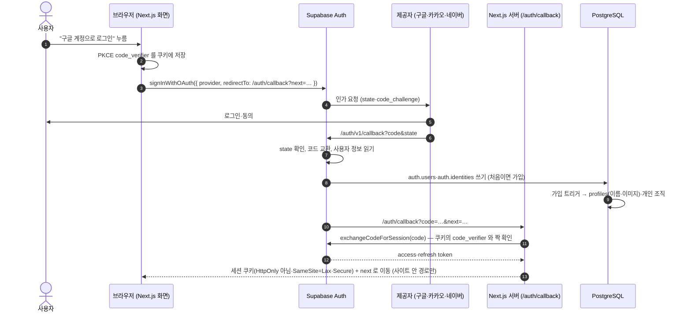
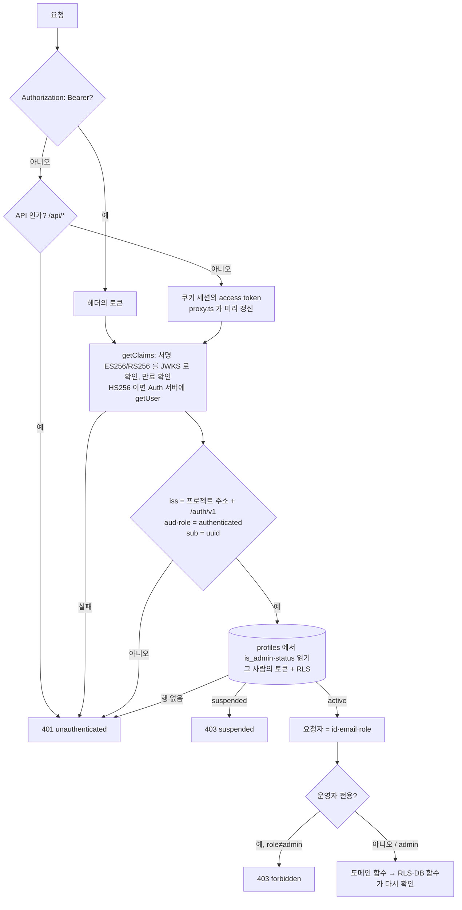
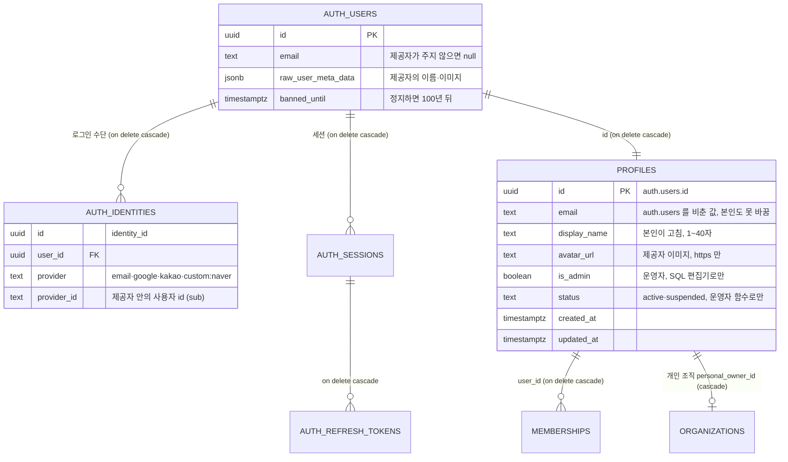
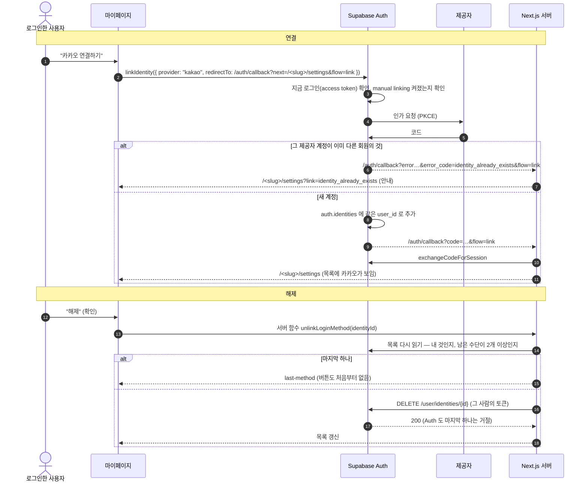

# 인증 구조

구글·카카오·네이버 간편 로그인, 이메일 로그인, 회원 관리(정지·탈퇴·계정 연결)가 어떻게 나뉘어 있는지 적은 문서입니다.
설정은 [SUPABASE-SETUP.md](SUPABASE-SETUP.md)·[OAUTH-PROVIDERS.md](OAUTH-PROVIDERS.md), API 는 [AUTH-API.md](AUTH-API.md),
보안 결정은 [AUTH-SECURITY.md](AUTH-SECURITY.md), 시험은 [AUTH-TESTING.md](AUTH-TESTING.md) 에 있습니다. 스펙은 `polaris/specs/done/social-auth-and-account.md`.

## 한 줄 요약

로그인·토큰·세션·연결된 로그인 수단은 **Supabase Auth** 가 전부 맡고, 이 저장소는 그 토큰을 **검증만** 합니다.
따로 JWT 를 만들거나 세션을 저장하지 않습니다. 회원 상태와 권한은 `public.profiles` 에 두고 **DB 정책(RLS)과 DB 함수**가 지킵니다.

## 누가 무엇을 하나

| 자리 | 하는 일 | 코드 |
|---|---|---|
| Supabase Auth | OAuth(구글·카카오·네이버), PKCE·state, access·refresh token 발급과 갱신, 세션, 연결된 로그인 수단(`auth.identities`), 로그인 차단(`banned_until`), 요청 수 제한 | 대시보드 설정 |
| Next.js 화면 | 로그인 버튼, `/auth/callback`(코드 → 세션), 쿠키 세션 갱신(`proxy.ts`), 마이페이지·관리자 화면 | `web/app/auth/`·`web/app/(app)/[slug]/settings/`·`web/app/admin/` |
| Next.js 서버 | 토큰 검증, 요청자 판정(`authenticate`), 회원 API(`/api/*`), 서버 함수 | `web/server/supabase/`·`web/server/auth/`·`web/server/profile/`·`web/server/admin/`·`web/app/api/` |
| PostgreSQL | `profiles`(표시 이름·이미지·운영자·상태), RLS, 정지·탈퇴 함수 | `supabase/migrations/` |

요청서의 NestJS 역할(JWT 검증·가드·사용자 API)은 Next.js 서버 계층이 맡습니다. NestJS·Docker Compose 는 두지 않습니다(스펙의 비목표).

| 요청서의 장치 | 이 저장소 |
|---|---|
| `SupabaseAuthGuard` + `CurrentUser` | `requireUser()` (`web/app/api/_lib/http.ts`) → `authenticate("bearer")` (`@/server/auth`) |
| `RolesGuard` + `Roles("ADMIN")` | `requireAdmin()` — 역할은 DB 의 `profiles.is_admin` |
| `Public` | 문지기로 감싸지 않은 핸들러(`GET /api/auth/providers`) |
| 화면(쿠키) 쪽 문지기 | `requireWorkspace()`·관리자 틀(`web/app/admin/layout.tsx`)·`getMyProfile()` 의 상태 |

## 1. 간편 로그인 흐름

- 제공자 이름: 구글 `google`·카카오 `kakao`(Supabase 기본 제공자), 네이버 `custom:naver`(사용자 정의 **OIDC** 제공자). 이유는 [OAUTH-PROVIDERS.md](OAUTH-PROVIDERS.md#네이버).
- 처음 들어온 사람은 같은 버튼으로 가입됩니다. 실패하면 `/auth/login?link=oauth-failed`, 정지된 계정이면 `?link=suspended` 로 안내합니다.
- 쿠키는 `@supabase/ssr` 이 관리합니다. 브라우저 클라이언트가 같은 쿠키를 읽어야 해서 HttpOnly 가 아닙니다([AUTH-SECURITY.md](AUTH-SECURITY.md#쿠키)).

## 2. 서버의 토큰 검증

- 검증 코드: `web/server/supabase/client.ts` 의 `getAuthContext()`, 규칙은 `web/server/supabase/claims.ts`.
- 모든 도메인의 "로그인한 사람"(`currentUserId`)이 같은 검증을 거칩니다. 화면·API 가 보낸 `userId`·`role` 은 어디에서도 읽지 않습니다.
- 데이터 통로는 늘 anon 키 + 그 사람의 토큰이라 RLS 가 그 사람 기준으로 걸립니다. `service_role` 키는 쓰지 않습니다.

## 3. auth.users 와 public.profiles

- 인증 사용자의 원본은 `auth.users` 하나입니다. 별도 users 표는 없고, 소셜 계정 표도 만들지 않았습니다(`auth.identities` 를 그대로 씁니다).
- `role` 열은 없습니다. DB 의 기준은 `is_admin` 이고, API·화면이 `role: "admin" | "user"` 로 바꿔 보입니다.
- 탈퇴는 즉시 삭제라 `deleted` 상태·`deleted_at` 이 없습니다.

## 4. 로그인 수단 연결·해제

- 연결은 Supabase 의 수동 연결(manual linking)입니다. 지금 로그인한 사람에게만 붙고, 소유권은 그 제공자에 실제로 로그인하는 것으로 확인됩니다.
- **같은 이메일의 자동 연결**: Supabase Auth 는 이메일이 *확인된* 새 로그인 수단을 같은 이메일의 기존 회원에 자동으로 붙입니다(Supabase 의 기본 동작이고 대시보드에 끄는 설정이 없습니다).
  이 저장소의 코드는 이메일로 계정을 합치지 않습니다. 이메일을 주지 않거나 확인되지 않은 제공자는 자동으로 붙지 않고 새 회원이 됩니다.

## 5. 정지와 탈퇴

| | 정지 (운영자) | 탈퇴 (본인) |
|---|---|---|
| 함수 | `admin_set_user_status(target, 'suspended')` | `delete_my_account()` |
| DB | `profiles.status`, `auth.users.banned_until`, `auth.sessions` 삭제 | `auth.users` 삭제 → 연쇄 삭제 |
| 새 로그인·토큰 갱신 | Supabase Auth 가 거절(`user_banned`) | 계정이 없음 |
| 이미 받은 access token (≤ 1시간) | 서버가 403, 정책 도우미가 조직 데이터를 닫음 | 프로필이 없어 서버가 401 |
| 거절 | 자기 자신·다른 운영자 | 다른 멤버가 있는 팀의 유일한 owner(`sole_owner`), 정지된 회원(`suspended`) |

## 코드 지도

| 파일 | 내용 |
|---|---|
| `web/lib/auth-providers.ts` | 켜 둔 제공자(`NEXT_PUBLIC_AUTH_*`)와 Supabase 제공자 이름 |
| `web/app/auth/social-sign-in.tsx` | 로그인 버튼 |
| `web/app/auth/callback/route.ts` → `@/server/auth` `completeOAuthSignIn` | 코드 교환, 실패 안내, open redirect 방지 |
| `web/proxy.ts` → `@/server/supabase` `refreshSession` | 화면 요청마다 세션 갱신 |
| `web/server/supabase/client.ts`·`claims.ts` | 데이터 통로, 토큰 검증 |
| `web/server/auth/` | 요청자 판정, 로그인 수단 목록·해제, 모든 기기 로그아웃 |
| `web/server/profile/` | 내 프로필, 표시 이름, 탈퇴 |
| `web/server/admin/` | 사용자 목록, 정지·해제 |
| `web/app/api/` | 회원 API ([AUTH-API.md](AUTH-API.md)) |
| `supabase/migrations/20261015000001_account_status_and_deletion.sql` | 상태·이미지·정지·탈퇴 |
