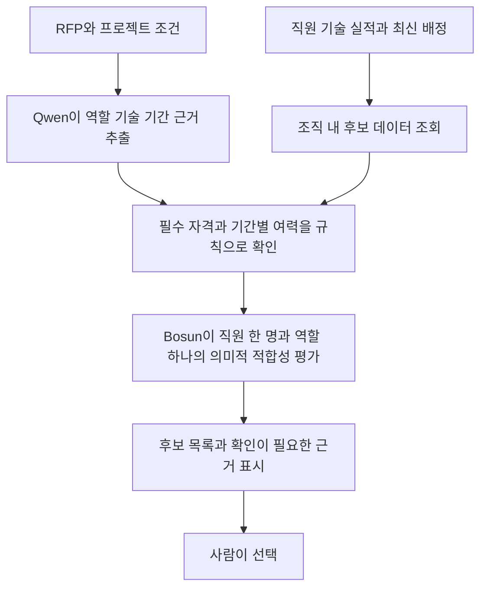

# Bosun 파인튜닝과 인력 배치 조사 및 GPT 전달 자료

Bosun v3.1 0.6B의 **공개 LoRA를 이어 학습**하고, Qwen은 회사 vLLM API를 추출·번역·설명에 재사용한다. 인력 배치에는 직원 한 명과 프로젝트 역할 하나의 적합성을 Bosun으로 분류하고, 기간 충돌·투입률·필수 자격은 규칙으로 검사하는 구성을 권한다. 직원 명부를 모델에 암기시키는 학습보다, 근거가 주어졌을 때 적합성을 판단하는 학습이 목적에 맞는다.

최초 조사 기준은 2026-10-21 저장소 HEAD `086ac1e`이며, 같은 날 사용자 요청으로 가상 직원200명 전체 속성과 점수 검증 확대(ADR-043)를 반영했다. §1~4의 현재 상태는 문서와 코드를 대조한 결과이고, §5의 인력 배치 AI는 추가 설계 제안이다. 회사 GPU 학습·서빙과 인증된 Qwen 추론은 실행하지 않았다. 마지막 §8의 요청문과 이 파일을 GPT에 함께 전달하면 된다.

## 1. 먼저 읽을 문서와 구현

| 자료 | 확인할 내용 |
|---|---|
| [[21-MODEL-TRAINING]] | 학습 목적, 라벨, 사업 단위 분할, 평가, 운영 반영 기준 |
| [[22-FINETUNE-RUNBOOK]] | 고정 모델 리비전, 회사 GPU 환경, 학습·보정·반입 명령 |
| [[23-WEEKEND-FINETUNE]] | 회사 실행 순서, 데이터의 두 갈래, 10-24~25 학습 계획 |
| [[03-AI-PIPELINE]] §5 | 질문 세트, 영어 state, Bosun 확률과 기존 `KEV_*`·`/kev` 호환 계약 |
| [[15-DATA-CONTRACTS]] | 추출 근거, 입력 스냅샷, 학습 레코드 계약 |
| [[16-DECISIONS]] ADR-034·042 | Bosun 전환, Qwen API 재사용, 현재 일정과 인력 시뮬레이션 범위 |
| [[04-DATABASE]] §3.5, [[05-API-SPEC]] §4.7 | 직원·계산용 속성·배정 테이블과 조회 계약 |
| [학습기 설명](../services/decision/docs/TRAINING.md) | 이미 구현된 명령·인자·저장 형식 |
| [평가 도구 설명](../services/ai/eval/README.md) | 데이터 생성·export·누수 검사·오프라인 채점·비교 |

`docs/SOL_RADAR_BOSUN_QWEN4B_MIGRATION_BRIEF.md`에는 Qwen 4B 학습과 새 환경변수 이름을 검토하던 이전 요청이 있다. 현행 정본은 ADR-034와 21~23이다. **Qwen 4B 학습, Kev 학습 도구, 임의의 `BOSUN_*` 이관을 현재 결정으로 읽으면 안 된다.**

## 2. 모델 역할과 Qwen API 확인 결과

| 구성 | 현재 책임 | 이번 학습 |
|---|---|---|
| 회사 Qwen API | 공고·RFP 요구사항 JSON 추출, 원문 인용, 영어 번역, 근거 기반 설명 | 학습하지 않음 |
| Bosun v3.1 0.6B | 요구사항별 충족 분류, 기술·실적 적합성, 수행 리스크의 참고 분포 | 공개 LoRA 이어 학습 |
| 규칙·SOL Score | 명시 조건 판정, 가용 FTE 계산, 결정론적 점수 | 모델 가중치 학습 대상 아님 |
| 인력 배치 AI 제안 | 직원과 역할의 의미적 적합성 평가 | 별도 데이터·질문·평가 계약 필요 |

### Qwen 이름은 실제 응답으로 확정한다

사용자 요청에는 **Qwen 3.5-Flash-Next 128B**, 현재 [레지스트리](../services/ai/models/registry.yaml)에는 **`Qwen/Qwen3.8-Flash-Next`**가 적혀 있다. 공식 Qwen3.8-Flash-Next 카드의 LM 규모 표기는 125B·활성 6B이며 별도 n-gram/MTP 파라미터도 있다. 따라서 “128B”라는 호칭만으로 배포 모델을 식별할 수 없다. [공식 모델 카드](https://huggingface.co/Qwen/Qwen3.8-Flash-Next)

2026-10-21에 `GET https://acropolissg.com/vllm/v1/models`를 인증 없이 조회한 결과는 **HTTP 401**, 본문은 `{"error":"Unauthorized"}`였다. 주소 응답과 인증 필요는 확인했지만 모델 ID·크기·양자화·추론 정상 여부는 확인하지 못했다.

회사에서 키를 안전하게 환경변수로 전달한 뒤 다음 조회를 수행한다. 키 값을 GPT 대화·보고서·로그에 붙이지 않는다.

```bash
# QWEN_API_KEY는 회사가 별도로 제공한 값을 안전하게 설정한 상태여야 한다.
curl --fail --silent --show-error \
  -H "Authorization: Bearer $QWEN_API_KEY" \
  https://acropolissg.com/vllm/v1/models
```

응답 `data[].id`를 확인하고 `QWEN_MODEL` 및 레지스트리 `run`을 대조한다. 여러 모델이면 사용할 ID를 지정한다. 모델이 실제로 다르면 배포 구성을 확인한 뒤 정본과 레지스트리를 함께 정정해야 한다. 임의로 3.5 또는 3.8이라고 바꾸지 않는다.

연결 시 추가로 확인할 것은 JSON Schema 출력, reasoning/content 구분, 타임아웃·동시 요청 한도, 입력·출력 토큰 한도, E3 비교용 logprobs다. 최신 vLLM은 `response_format`의 JSON Schema와 `structured_outputs`를 지원하지만 **회사 버전의 지원 여부는 별도 확인**한다. 과거 `guided_json` 필드는 v0.12.0에서 제거됐다. [vLLM 공식 문서](https://docs.vllm.ai/en/latest/features/structured_outputs/)

## 3. Bosun은 어떻게 학습해야 하나

### 3.1 정확한 모델과 학습 방식

대상은 `Hanno-Labs/bosun-v3.1-0.6b`다. v3.1은 Qwen3-0.6B 기반의 선택지 분류 모델로, `choice`·`score`·`noul` 질문에 분포를 반환한다. 커스텀 로더와 decision token 계약이 필요하다. 예전 Bosun-XS의 Qwen3-Reranker 기반 yes/no 방식과 구분한다. [Bosun 공식 모델 카드](https://huggingface.co/Hanno-Labs/bosun-v3.1-0.6b)

저장소에서 고정한 값은 다음과 같다. 실제 서버에서는 받은 파일의 SHA-256을 대조해야 한다.

| 항목 | 값 |
|---|---|
| Bosun 리비전 | `5e78a37c8d86860ebac9ef2d5327d6299498498e` |
| 백본 | `Qwen/Qwen3-0.6B` |
| 백본 리비전 | `c1899de289a04d12100db370d81485cdf75e47ca` |
| 학습할 파라미터 | 기존 LoRA 392개 텐서, 10,092,544개 파라미터 |
| LoRA 구성 | r=16, alpha=32, dropout=0.05, 28층의 attention·MLP 7개 투영 모듈 |
| 동결 | 백본, tokenizer, decision token 입력·출력 임베딩 |
| 손실 | 후보 슬롯 logits에 대한 cross-entropy 또는 soft-target cross-entropy |
| 서빙·학습 일치 | 동일 `render_decision_prompt`, chat template, 후보→슬롯 매핑 |

이 값은 [레지스트리](../services/ai/models/registry.yaml), [파라미터 검사 코드](../services/decision/src/sol_decision/trainer/params.py), [[22-FINETUNE-RUNBOOK]] §2·4를 근거로 한다. 새 LoRA를 얹어 원래 어댑터를 대체하거나, 답변 문장을 생성하는 일반 SFT로 바꾸지 않는다.

학습은 `model.predict()`가 아니라 gradient가 흐르는 `decision_logits()` 경로를 쓴다. 공개 어댑터를 로드한 뒤 학습할 LoRA만 명시적으로 활성화해야 한다. 일반 PEFT도 `from_pretrained`의 `is_trainable` 기본값이 `False`다. 저장소의 `freeze_for_lora`가 이 처리를 한다. [PEFT 공식 문서](https://huggingface.co/docs/peft/main/en/package_reference/peft_model)

### 3.2 이미 있는 코드

| 경로 | 구현된 역할 |
|---|---|
| `services/decision/src/sol_decision/train.py` | AdamW 학습, accumulation, bf16, 길이 필터, 패키지 저장·재로딩 |
| `services/decision/src/sol_decision/trainer/` | 레코드 검증, 슬롯 프롬프트, 손실, 배치, 파라미터 동결, 체크포인트, 보정 |
| `services/decision/src/sol_decision/parity.py` | 추론 확률과 학습 경로 확률의 동일성 검사 |
| `services/ai/eval/sol_eval/` | 평가 데이터 생성·export·누수 검사·Bosun 채점·짝 비교 |
| `infra/gpu/bosun-preflight.sh` | GPU 매핑·메모리·환경·모델·데이터 사전 검사 |
| `infra/gpu/bosun-f1.sh` | 20-step smoke와 GPU 메모리 기록 |

따라서 GPT에는 **새 학습 프레임워크를 처음부터 만들기보다 이 코드에 맞는 데이터와 실행 절차를 준비**하도록 요청하는 것이 좋다. 학습기 존재와 회사 GPU 학습 성공은 구분해야 한다. 문서의 CPU 2-step·6행 smoke 보고로 모델 품질 향상을 주장할 수 없다.

### 3.3 입찰 판단용 데이터

정본 계획은 실제 나라장터 공고·RFP × 가상 기업 6개 원형의 변형이다. 질문마다 한 레코드를 만들고 아래 라벨을 쓴다.

- `SATISFIED`: 요구와 회사의 충족 근거가 있다.
- `NOT_SATISFIED`: 명시적 미보유·수치 미달 같은 부정 근거가 있다.
- `NEEDS_REVIEW`: 자료 부족·상충·의미 대응 불명확 등으로 판단을 확정할 수 없다.

필드나 증빙을 지웠을 때 정답은 `NEEDS_REVIEW`다. 목록에 기술이 없다는 사실은 목록 완결성이 확인됐을 때만 미보유 근거가 된다. 동의어·유사 실적·기술 적합성은 사람이 검수해야 한다.

`CONSTRUCTED`·`HUMAN`·`RULE_SILVER` 출처를 보존한다. 실버 라벨은 train에만 넣고 test 정답으로 쓰지 않는다. Qwen 또는 GPT의 초안은 사람 검수 전 `HUMAN`이 아니다. Qwen을 교사로 쓰더라도 API가 제공하지 않은 확률을 자기보고 “확신도”로 대체해 soft label로 만들지 않는다.

정본 최소 규모는 **train 질문 1,000행 이상, dev 10사업, test 20사업**이다. 1,000행은 독립 사업 1,000건을 뜻하지 않는다. 같은 사업의 변형·재공고·RFP는 같은 분할에 넣는다. fixture `FX-01`~`FX-20`은 회귀 검증용으로 분리한다. 회사 원형 하나는 test 전용으로 둔다.

### 3.4 현재 데이터 빌더의 중요한 한계

현재 `build_branch1.py`는 녹음된 **구조화 API 필드**로 데이터를 만든다. 코드에서 `requiredSkills`·`pastPerformance`·`staffing`은 `UNKNOWN`이며 첨부를 읽지 않았다고 표시한다. 이 결과만 학습해서 RFP 기술·직원 배치 능력이 생겼다고 주장할 수 없다. [빌더 코드](../services/ai/eval/sol_eval/build_branch1.py)

추가로 필요한 데이터는 파싱된 RFP의 인력·기술 요구, Qwen의 검증된 추출·번역, 직원별 증빙, 사람이 확정한 의미 판단 정답이다. 가상 기업 원형 JSON에도 직원별 이력과 가용 일정이 갖춰져 있지는 않다. [기업 원형 설명](../fixtures/eval/README.md)

기존 export는 `kev-qs/v0.2`의 질문만 처리한다. 임의의 `staff.*` qid를 넣으면 현행 질문·라벨 검증과 export를 그대로 통과하지 못한다. 학습기 자체가 JSONL을 읽는 것과 데이터·서빙 전체가 지원하는 것은 별개다.

누수 검사에도 차이가 있다. 설계는 유사 RFP 본문 MinHash/Jaccard ≥0.8 클러스터 병합을 요구하지만, 현행 도구는 state의 5단어 shingle Jaccard를 기본 0.9로 검사하며 유사성은 기본 경고다. `leakage` PASS를 RFP 본문 중복 제거까지 끝났다는 뜻으로 읽지 않는다. [현재 검사 코드](../services/ai/eval/sol_eval/leakage.py)

## 4. 회사 GPU 실행 준비와 평가

### 4.1 환경 전제

[[22-FINETUNE-RUNBOOK]]의 회사 환경 기록은 A40 46,068 MiB 3장 중 **물리 GPU 1 한 장**, PaddleOCR와 공유다. GPU 0·2는 다른 서비스가 사용한다. 현재 점유·허용 시간대는 회사에서 다시 확인한다. 기존 기록의 학습 VRAM 6~10GB와 서빙 1.5~3GB는 추정이며 실측값이 아니다.

기존 `.venv-bosun`과 torch `2.8.0+cu128`을 보존한다. `uv sync --frozen --extra model`은 현재 lock의 다른 torch 버전을 설치할 수 있으므로 회사 venv에 그대로 실행하지 않는다. 설치 절차는 [[22-FINETUNE-RUNBOOK]] §3.2와 [학습기 설명](../services/decision/docs/TRAINING.md)을 따른다. 평가 패키지까지 같은 환경에 설치돼야 한다.

아래는 **서버 실행 준비용 예시**다. 회사 공유 사용 조건이 충족되고 실제 학습을 진행하기로 한 실행자가 승인 변수를 설정한다. 지금 조사 과정에서는 GPU 명령을 실행하지 않았다.

```bash
export SOL_WORK=/data/www/ai_workspace/sol-radar
export SOL_REPO="$SOL_WORK/sol-radar"
export HF_HOME="$SOL_WORK/hf"
export HF_HUB_OFFLINE=1
export CUDA_DEVICE_ORDER=PCI_BUS_ID
export CUDA_VISIBLE_DEVICES=1

PY="$SOL_WORK/.venv-bosun/bin/python"
snap="$HF_HOME/hub/models--Hanno-Labs--bosun-v3.1-0.6b/snapshots/5e78a37c8d86860ebac9ef2d5327d6299498498e"
D="$SOL_WORK/sol-dataset-v0.1/bosun"
R="$SOL_WORK/runs"
cd "$SOL_REPO"

# venv 실행파일을 우선 사용한다. 모델·백본 캐시와 데이터 번들이 있어야 한다.
export PATH="$SOL_WORK/.venv-bosun/bin:$PATH"

# 1. 사전 검사와 학습·추론 동일성
SOL_GPU_SHARE_APPROVED=1 bash infra/gpu/bosun-preflight.sh
"$PY" -m sol_decision.parity \
  --package "$snap" --data "$D/train.en.jsonl" \
  --n 8 --device cuda --bf16

# 2. 20-step smoke. 부족한 데이터·길이 필터로 20 step 미달이면 합격 처리하지 않는다.
SOL_GPU_SHARE_APPROVED=1 SOL_TRAIN_APPROVED=1 \
  bash infra/gpu/bosun-f1.sh --max-steps 20 --batch 1 --accum 8

# 3. F1 성공 뒤 첫 비교 실험. 아래 하이퍼파라미터는 확정 최적값이 아니다.
"$PY" -m sol_decision.train \
  --package "$snap" --data "$D/train.en.jsonl" \
  --out "$R/bosun-sol-lora-v0.1" \
  --device cuda --bf16 --seed 0 --lr 1e-4 --epochs 1 \
  --batch 1 --accum 8 --grad-checkpointing --verify-reload

# 4. 같은 test에서 공개본과 학습본 비교
"$PY" -m sol_eval bosun_score \
  --package "$snap" --data "$D/test.en.jsonl" \
  --seeds 0-5 --out "$R/e1p-test"
"$PY" -m sol_eval bosun_score \
  --package "$R/bosun-sol-lora-v0.1" --data "$D/test.en.jsonl" \
  --seeds 0-5 --out "$R/e4-test"
"$PY" -m sol_eval compare \
  --candidate "$R/e4-test" --reference "$R/e1p-test" \
  --out "$R/e4-vs-e1p"
```

F1 실측 뒤 batch를 정한다. 1e-4·1 epoch는 현행 CLI의 출발값이다. 더 작은 lr이나 여러 epoch를 실험하더라도 dev로 고르고 test로 조정하지 않는다. 소요 시간은 F1 step 시간과 `ceil(행 수 / (batch × accum)) × epochs`로 추정한다. 실행할 때 동시 서비스가 포함된 GPU 전체 피크와 torch 피크를 따로 기록한다.

### 4.2 평가와 저장

비교 대상은 E0 규칙, E1' 공개 Bosun, E2 한국어 입력, E3 회사 Qwen, E4 학습한 Bosun이다. E2는 현행 Bosun export의 영어 한정과 비교 시 데이터 해시 제약에 대응해야 하므로, 모든 비교가 지금 같은 CLI로 실행되는 것은 아니다. E3는 API의 logprobs 지원도 확인한다.

입찰 분류의 현행 목표는 Macro-F1 ≥0.80, 정보 부족→미충족 혼동률 ≤5%, dev 온도 보정 후 ECE ≤0.08이다. 공개본과 비교할 때는 **같은 사업 클러스터를 짝지은 bootstrap 95% CI**를 낸다. loss 감소만으로 채택하지 않는다. 운영 교체는 별도 판단이며, 모델은 규칙 판정을 뒤집지 않고 SOL Score에도 더하지 않는다.

공개본과 학습본으로 dev를 각각 채점하고 `sol_decision.trainer.calibrate`로 온도를 맞춘다. 현행 구현에서 온도 보정 결과는 기록용이며, 파일을 만들었다고 운영 추론에 적용되지는 않는다.

저장할 때는 LoRA와 함께 원래 tokenizer, decision embeddings, loader 코드, `serving.json`, `config.json`, manifest와 SHA-256을 포함한 **Bosun 패키지 전체**를 보존한다. 저장 뒤 재로딩과 parity를 확인한다. 현행 방침은 `sol_decision.serve`와 기존 `/kev` 계약을 쓰는 것이다. 일반 vLLM 텍스트 생성 엔드포인트에 그대로 올리는 방식과 구분한다.

## 5. 조직도 직원을 프로젝트에 추천하는 추가 설계

### 5.1 기존 데이터로 할 수 있는 것

현행 [인력 fixture](../fixtures/people/solideo.people.json)는 가상 직원200명 전원의 role·grade·skills·availability·certifications·pastProjects를 포함한다. 같은 날 사용자 요청으로 기존27명에서200명으로 확장했으며, capabilitySource=SYNTHETIC·버전·가상 증거 참조를 보존한다. 조직도 소속·직위로 실제 능력을 추론한 것이 아니라 가상 프로필을 생성한 데이터다.

`team_members`는 명부, `team_member_scoring`은 기술·등급·가용성, `assignments`는 기간·투입률을 가진 별도 표다. 조회는 같은 조직의 RLS 안에서 한다. 얼굴 사진·성별·이름은 적합성 판단에 필요하지 않아 모델 입력에서 뺀다. 실직원을 다룰 때는 식별자도 모델 입력에서 빼고 앱 안에서 후보와 연결한다.

현재 [`availableFte`](../web/server/scoring/scoring.model.ts)는 기간 전체에서 보장되는 여력을 계산하는 순수 함수이며, 직원 교대까지 포함한 최적 배치를 풀지는 않는다. 2026-12-01 이상 2027-07-01 미만의 fixture를 같은 산식으로 집계하면 총102.5 FTE에서 기존 배정7건을 차감해95.5 FTE가 된다.

가용성은 fixture에서 배정 전 총량이며, seed·클라우드 보강 마이그레이션은 기존 가상 배정7건을 availability에 한 번 접는다. DB의 assignments에는 별도 데모 배정2건이 들어가므로 학습 입력을 DB에서 만들 때 기존7건을 다시 차감하지 않는다.

[[01-PRD]] FR-20의 저장 없는 규칙 매칭 시뮬레이션은 ADR-043으로 후보 범위를200명 전체로 확대했다. AI 적합성 평가와 배치 확정·저장은 추가 구현 범위다. 점수 회귀도200명 전체로 검증하며 FX-01/02/03은94/72/68, FX-15는 가용 인력 증가로68이다.

### 5.2 추천 처리 순서



**Bosun이 맡을 질문**은 “이 직원의 증거로 이 역할의 기술·경험 요건을 충족한다고 볼 수 있는가”다. 직원×역할 조합을 짧은 state로 독립 평가하면 기존3값 분류와 연결하기 쉽다. 모든 후보가 부적합하거나 자료가 부족하면 추천자 없음·확인 필요를 반환할 수 있어야 한다.

기간별 총투입량, 동시 중복 배정, 인원 수, 필수 자격 같은 강제 조건은 모델 점수가 높아도 완화하지 않는다. 확인된 부적합과 정보 부족을 구분하고, 정보가 부족한 후보는 확인 대기로 둔다. 가용성은 매번 조회하고, 재직·소속·배정 변경 때마다 재학습이 필요한 구조를 피한다.

향후 여러 사업의 배치안을 함께 만들 때는 Bosun 적합값을 참고 가중치로 쓰는 별도 제약 최적화를 검토할 수 있다. OR-Tools 공식 예제에는 할당 문제와 직원 스케줄링이 있다. 이번 적용은 추가 설계 제안이며 현재 SOL Score 함수를 교체하는 결정이 아니다. FTE는 시간 구간마다 검증하고, 정수 솔버에서는 예를 들어 백분율 단위로 변환한다. 해가 없으면 충족할 수 없는 조건을 반환한다. [할당 문제](https://developers.google.com/optimization/assignment/assignment_example), [직원 스케줄링](https://developers.google.com/optimization/scheduling/employee_scheduling)

### 5.3 필요한 학습 데이터

직원마다 기술·수준·마지막 사용 시점, 담당 역할·기간, 관련 실적, 자격·유효기간, 증거 참조, 프로필 완결성을 준비한다. 프로젝트 쪽에는 역할, 필수·우대 기술, 필요FTE, 기간, 필수 자격과 요구 원문 인용이 필요하다. 현행 `skills: string[]`만으로는 경력·수준·실적을 입증하기 부족하다.

처음에는 **기술·역할·실적 충족3값**을 학습한다. 0~4 의미적 적합성 점수는 사람이 등급 기준과 정답을 마련한 뒤 추가한다. 기간 중복이나 FTE 계산을 교사 모델의 추측 라벨에 맡기지 않는다.

| 대조 사례 | 변경과 정답 |
|---|---|
| 명확한 충족 | 필수 기술·역할의 실적 증거가 있다 → `SATISFIED` |
| 명확한 미충족 | 조건 미달을 보여 주는 증거가 있다 → `NOT_SATISFIED` |
| 정보 없음 | 이력·자격 증거가 빠졌다 → `NEEDS_REVIEW` |
| 이름은 비슷하지만 다름 | Java와 JavaScript 등. 실제 요구와 증거로 판정 |
| 연관 기술 경험 | Spring MVC 경험이 Spring Boot 요구를 얼마나 충족하는지 등 → 사람이 판정 |
| 기간상 배정 불가 | 기술 적합성과 별개로 규칙이 배정 불가 판정 |
| 여러 역할에 같은 사람 | 개별 적합성이 높아도 총투입률 상한 초과 → 배치안 불가 |

초기 추가 실험은 다양한 가상 직원×역할 데이터1,000~3,000문항으로 시작하는 안을 제안한다. 기존 명세의 확정 수치는 아니다. 단순한 말바꾸기로 행 수를 늘리기보다 서로 다른 사업·기술·누락 조건과 사람의 gold를 우선한다. 가상 직원200명의 합성 실적만으로 실제 직원 배치 성능을 입증했다고 주장하지 않는다.

### 5.4 추가 레코드 예시

아래는 **인력 데이터 계약을 설계하기 위한 예시**이며 현재 `sol_eval export`에서 지원하지 않는다. `rowId`와 `stateHash`는 예시값으로 실제 사용 시 정의한 문자열의 SHA-256을 만든다. `qid`·`questionSet`·`stateTemplate`도 추가 제안이다. 실직원 정보는 포함하지 않는다.

```json
{
  "rowId": "example-row-only",
  "itemId": "synthetic-project-01:synthetic-person-01:backend",
  "clusterId": "synthetic-project-01",
  "split": "train",
  "qid": "staff.roleRequirements.status",
  "questionType": "choice",
  "instructions": "Assess whether the person's documented experience satisfies the role requirements. Missing evidence is NEEDS_REVIEW, not NOT_SATISFIED. Do not infer skills from identity or job title.",
  "candidates": [
    {"id": "SATISFIED", "label": "SATISFIED", "description": "Evidence establishes all assessed requirements."},
    {"id": "NOT_SATISFIED", "label": "NOT_SATISFIED", "description": "Evidence establishes an assessed requirement is unmet."},
    {"id": "NEEDS_REVIEW", "label": "NEEDS_REVIEW", "description": "Evidence is missing, conflicting, or ambiguous."}
  ],
  "state": "ROLE\n- Backend developer; required skill: Spring Boot.\n- requirement evidence R1: backend development using Spring Boot.\nPERSON\n- documented skills: Java.\n- Spring Boot experience: unknown; profile completeness: incomplete.\n- profile evidence P1: Java experience recorded; Spring Boot history not recorded.\nAssess technical evidence only. Capacity is checked separately by rules.",
  "stateHash": "example-hash-only",
  "stateTemplate": "staff.en.v0.1",
  "questionSet": "staff-qs/v0.1",
  "gold": {"candidateId": "NEEDS_REVIEW", "probabilities": [0, 0, 1]},
  "labelSource": "CONSTRUCTED",
  "reason": "COMPANY_EVIDENCE_MISSING"
}
```

실제 학습용으로는 `personEvidence`·`roleEvidence` 같은 증거 스키마도 정의한다. 현행 `noticeEvidence`·`companyEvidence`에 의미가 다른 값을 억지로 넣지 않는다. 후보 배열 순서대로 gold 분포를 놓고, 학습 시 모델의 candidate→slot 대응에 맞춰 재배열한다. 임의의 채팅 `messages` 형식으로 바꾸면 이 학습기와 호환되지 않는다.

### 5.5 검증과 모델 분리

입찰용과 인력용은 처음에는 공개 Bosun을 공통 출발점으로 하는 **별도 학습 패키지**로 비교하는 안을 권한다. 같은 LoRA에 섞어 학습하는 것은 입찰 회귀와 인력 개선을 측정한 뒤 검토한다. 이름·부서·사진을 외우거나 직원ID 자체를 예측 후보로 고정해 학습하지 않는다.

평가에서는 사업 분할과 함께 직원 프로필·모든 변형을 같은 분할로 묶는다. 필요하면 처음 보는 직원·처음 보는 사업·미래 기간을 별도 평가로 나눈다. 사업×직원 조합을 단순히 행 단위로 나누면 양쪽 실체가 누수될 수 있다. 양쪽 모두 처음 보는 평가는 연결 성분이나 명시적 holdout 집합으로 구성한다.

비교 대상은 규칙만, 공개 Bosun, 회사 Qwen, 인력 LoRA의4종이다. 분류 Macro-F1, `NEEDS_REVIEW` 재현율, ECE, 근거 없는 충족 판정을 잰다. 초기에는 충족·확인 필요 후보를 구분해 표시한다. 여러 충족 후보의 순위가 필요하면 사람이 정의한 적합성 등급과 집계 기준을 추가한 뒤 Precision/Recall@k, 담당자 평가 기반 nDCG를 잰다. 분류 확률을 다른 직원 사이에서 바로 비교할 수 있는 업무 성과 확률로 해석하지 않는다. 여러 타당한 배치를 허용하고 과거 배치 하나만 유일한 정답으로 삼지 않는다. 최종 배치안을 만들 때는 강제 제약 위반0건을 필수로 한다.

## 6. GPT에 전달할 자료 묶음

GPT에는 이 파일과21·22·23을 첨부한다. 코드도 전달할 수 있으면 `services/decision/docs/TRAINING.md`, `train.py`, `trainer/`, `services/ai/eval/README.md`, `sol_eval/bosun_records.py`, `services/ai/kev/question-sets/v0.2.json`을 더한다. 인력 추가에는 `web/server/scoring/scoring.model.ts`와 데이터 **스키마**를 첨부한다.

실데이터는 회사 GPU 환경에서 보관하고 GPT에는 가상 예시·익명화한 형식을 전달한다. GPT에 요청할 산출물은 학습 데이터 생성·검증 코드, 서버 명령, 평가 계획과 리뷰다. GPU 학습 자체는 회사 서버 실행 환경에서 한다.

## 7. 실행 전에 확정할 항목

1. 회사 Qwen의 실제 `/models` ID, API 인증, JSON Schema·logprobs 지원.
2. GPU 1의 현재 공유 조건·메모리 여유, `.venv-bosun`의 Python·의존 패키지. 기존 기록과 다르면 최신 값을 반영한다.
3. 입찰용 train/dev/test 실파일·건수·분포·출처·해시. 문서의 목표를 완성된 데이터로 착각하지 않는다.
4. 인력 대상은 가상200명 전원으로 확정됐다. 부서·직위 배치 자체가 목적이면 프로젝트 역할 추천과 별도 작업으로 재정의한다.
5. availability와 assignment 차감 방식, 기준 시각, 기간 끝점. 회사 DB·seed·fixture 사이에서 이중 차감하지 않는다.
6. 인력용 질문·state·증거·라벨·평가 계약. 기존 export 지원과 조회 시뮬레이션에서 배치 저장으로 넓힐지 여부.

## 8. GPT에 붙여 넣을 요청문

```text
첨부한 SOL RADAR 조사서와 기존 문서21·22·23을 근거로 회사 GPU에서 Bosun v3.1 0.6B를 추가 학습할 준비를 해 줘. 조사서의 확인된 사실·미확인 항목·추가 제안을 구분해 줘. 첨부하지 않은 코드를 읽은 것처럼 말하지 마.

목적은 두 가지야.
A. 공공 입찰 요구사항과 기업 증거의 충족3값 분류를 개선한다.
B. 프로젝트 역할·기술·경험 요건에 대한 직원 후보의 적합성을 평가한다. 기간·FTE·자격의 명시 조건은 규칙이 검증하고 사람이 후보를 고른다.

전제:
- 대상은 Hanno-Labs/bosun-v3.1-0.6b@5e78a37c8d86860ebac9ef2d5327d6299498498e.
- Qwen/Qwen3-0.6B@c1899de289a04d12100db370d81485cdf75e47ca를 백본으로 쓰는 기존 Bosun 패키지에서 공개 LoRA 392개 텐서·10,092,544개 파라미터만 이어 학습한다. decision embeddings·tokenizer·backbone은 동결한다.
- 기존 sol_decision.train·parity·sol_eval을 재사용한다. 일반 채팅 SFT, Kev 도구, 구형 Bosun-XS와 혼동하지 않는다.
- Qwen은 https://acropolissg.com/vllm/v1 회사 API를 쓰고 파인튜닝하지 않는다. 사용자 호칭은3.5-Flash-Next 128B지만 repo는 Qwen/Qwen3.8-Flash-Next다. 미인증 /models는401이었다. ID는 인증한 응답으로 확정하고 추측하지 않는다.
- 기존 GPU 기록은 A40 물리 GPU 1을 PaddleOCR와 공유한다. GPU 0·2와 기존 프로세스를 변경하지 않는다. 현재 상태는 회사에서 확인한다.
- 기존 .venv-bosun과 torch 2.8.0+cu128을 유지한다. uv sync로 다른 torch를 설치하지 않는다.
- 학습은 영어 state가 기본이다. 한국어 학습은 기존 서버·export 호환성을 확인해 별도 계획으로 다룬다.
- 입찰용 기존 목표는 train 질문1,000행 이상, dev 10사업, test 20사업이다. 현재 API 구조화 필드만 쓰는 빌더로는 RFP 기술·직원 이력 데이터가 부족하다.
- 가상 직원200명 전원의 기술·자격증·개인실적·가용성이 생성됐다(SYNTHETIC, synthetic-people/v1). 점수 검증도200명 전체 입력이다. 이름·성별·사진·직위로 실제 능력을 추측하지 않는다. 최신 배정은 추론할 때 조회한다.
- 모르면 NEEDS_REVIEW이며 NOT_SATISFIED가 아니다. HUMAN은 사람이 확정한 라벨에만 쓴다. 교사 LLM의 자기보고 confidence를 보정된 확률로 취급하지 않는다.
- 인력용 qid/state/증거 계약은 추가 설계이고 기존 sol_eval export는 지원하지 않는다. 먼저 프로젝트 역할 후보 추천을 다룬다.
- fixture 가용성은 배정 전 총량이고 DB availability에는 기존7건을 이미 접었다. DB 학습 입력에서 이7건을 다시 차감하지 않는다.
- 규칙과 SOL Score를 유지한다. 분류 분포를 성공확률·수주확률이라고 부르지 않는다.

다음 순서로 구체적인 산출물을 만들어 줘.
1. 기존 기능과 추가가 필요한 기능, 입력 데이터 부족, 확인할 서버 정보를 표로 만든다.
2. A와 B를 별도 데이터·평가로 설계하고 JSON Schema, 정상·정보부족·명시적 부적합·혼동하기 쉬운 기술의 JSONL 예시를 만든다. 예시와 실제 학습 데이터를 구분한다.
3. 데이터 검증기를 준비한다. 필수 필드, 후보 순서와 gold, 확률 합, 증거 참조, 라벨 출처, 중복·모순, 사업·직원·변형 단위 분할, 길이, SHA-256을 검증한다. 인력용 기존 export 확장 지점을 찾는다.
4. 기존 학습 코드를 수정해야 하면 최소 변경을 제안한다. 공개 LoRA trainable 확인, 정확한 candidate_to_slot, padding, 학습·추론 parity, 저장·재로딩을 포함한다.
5. 회사 서버의 preflight→parity→20-step smoke→본 학습→dev 평가·온도 보정→test 비교 명령을 전제 변수와 함께 낸다. 추천 lr·epoch는 가설로 두고 dev로 고른다. GPU 메모리·학습 시간은 실측으로 판단한다.
6. 규칙만·공개 Bosun·회사 Qwen·LoRA 비교를 설계한다. 분류 Macro-F1·정보부족 혼동·ECE, 사업 단위 CI, 인력 후보 타당성, 강제 제약 위반과 입찰 태스크 회귀를 측정한다.
7. 출력 패키지, manifest, 환경 기록, 학습 loss, GPU 메모리, 평가 결과, 롤백 자료 목록을 낸다. 회사 GPU 실측 전에는 성능 향상·VRAM 적합·소요 시간을 단정하지 않는다.

처음에 부족한 정보를 우선순위로 보여 주고, 정보가 없어도 만들 수 있는 스키마·검증기·가상 예시는 먼저 진행해 줘. 비밀키나 실명 직원 데이터를 채팅으로 요구하지 마.
```

## 관련 문서

- [[00-README|문서 인덱스]]
- [[21-MODEL-TRAINING|모델 학습 설계]]
- [[22-FINETUNE-RUNBOOK|회사GPU 실행 절차]]
- [[23-WEEKEND-FINETUNE|주말 학습 계획]]
- [[03-AI-PIPELINE|AI 처리와 질문 계약]]
- [[08-SCORING|규칙과 인력 여력 계산]]
- [[16-DECISIONS|모델과 업무 범위 결정 기록]]
