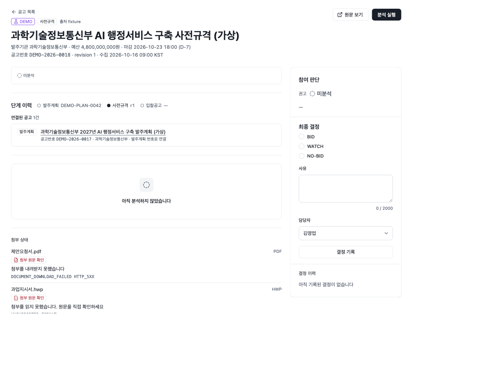
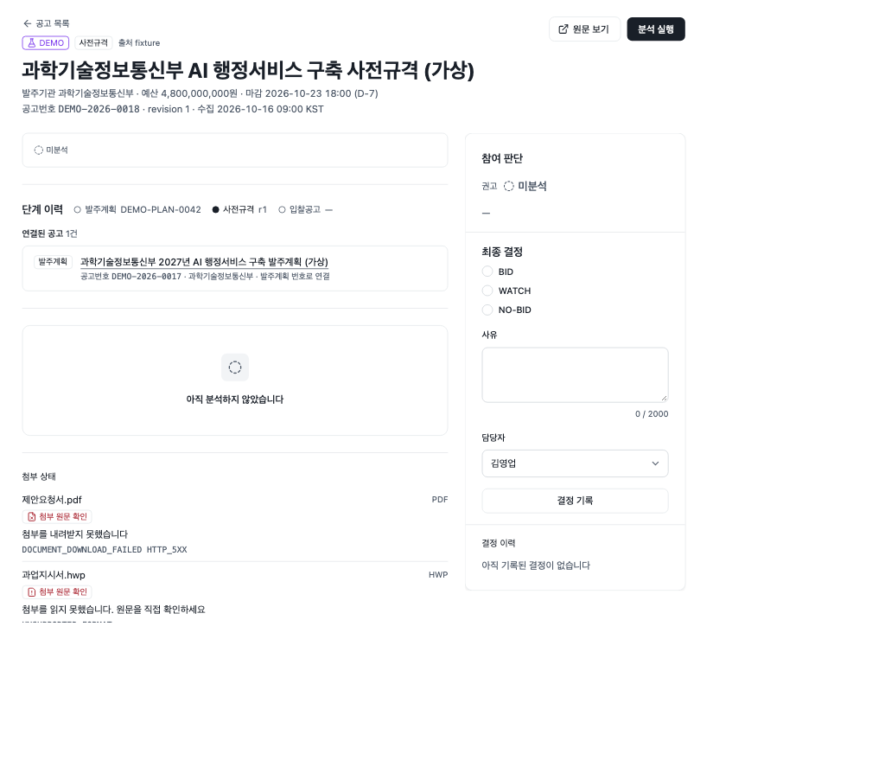
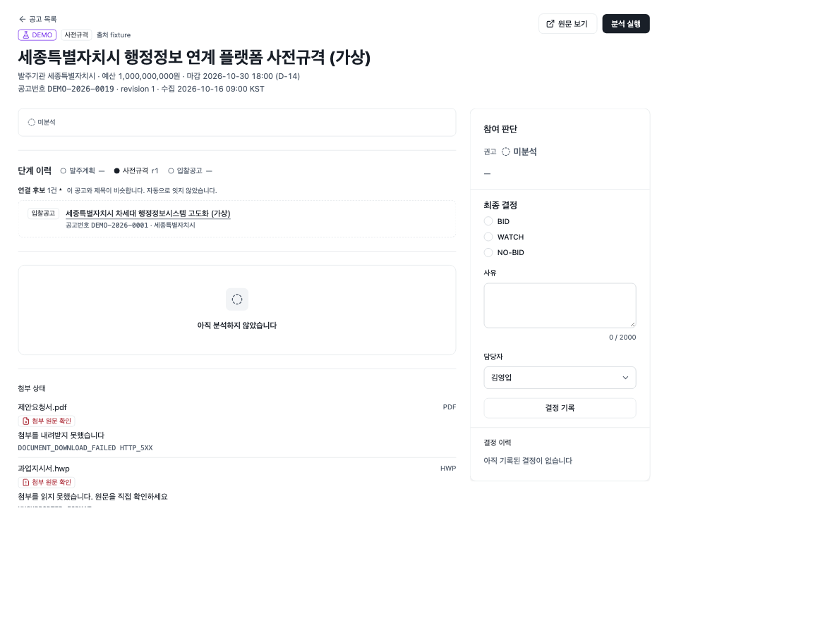
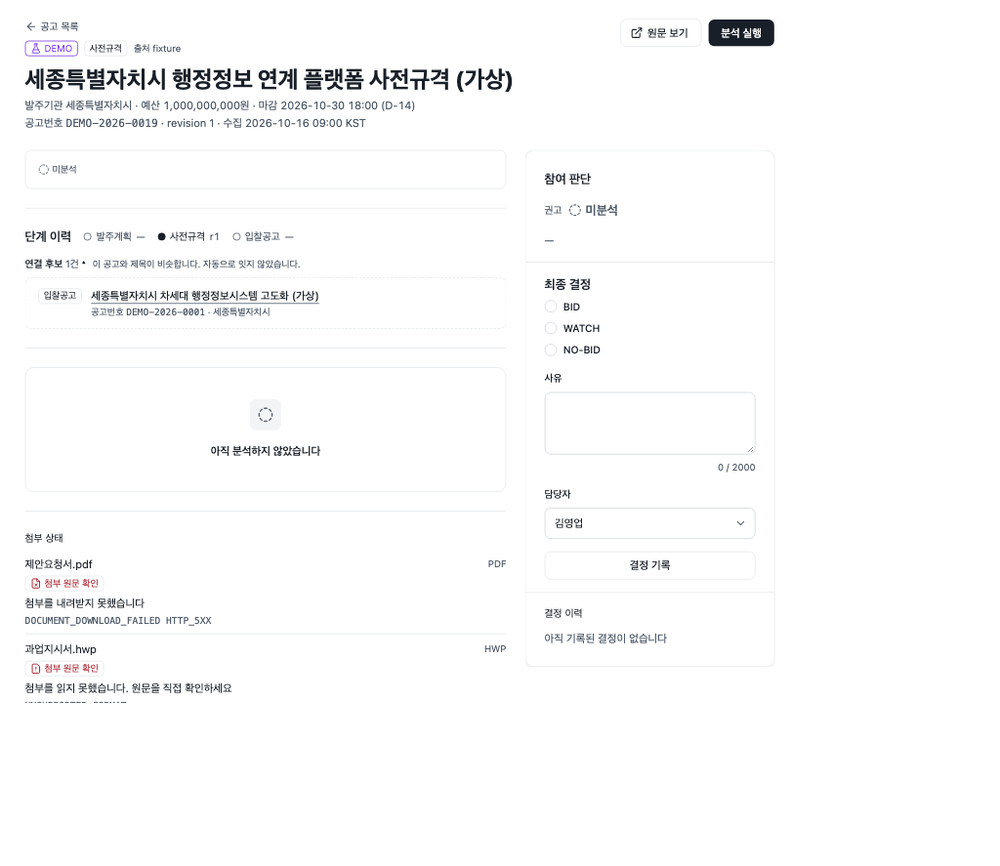
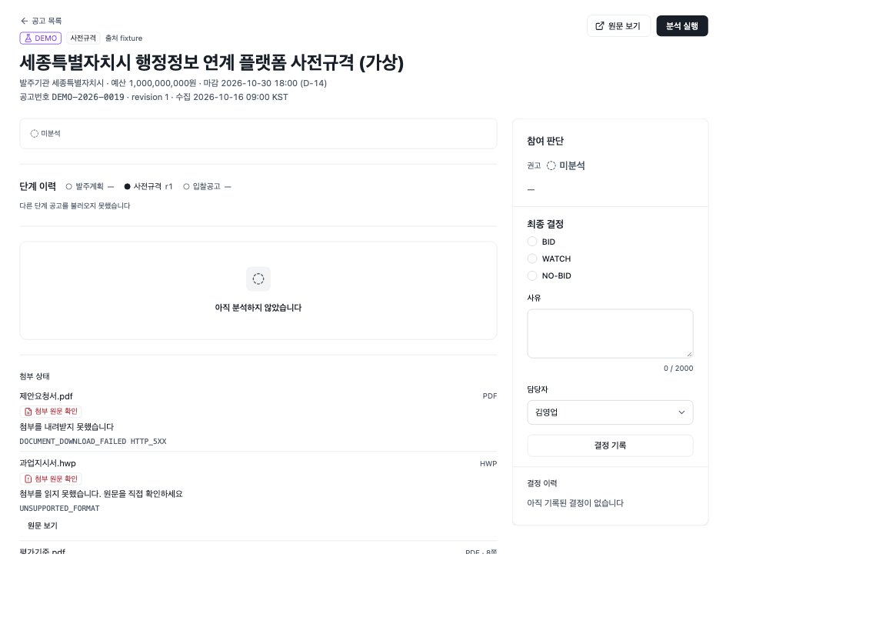
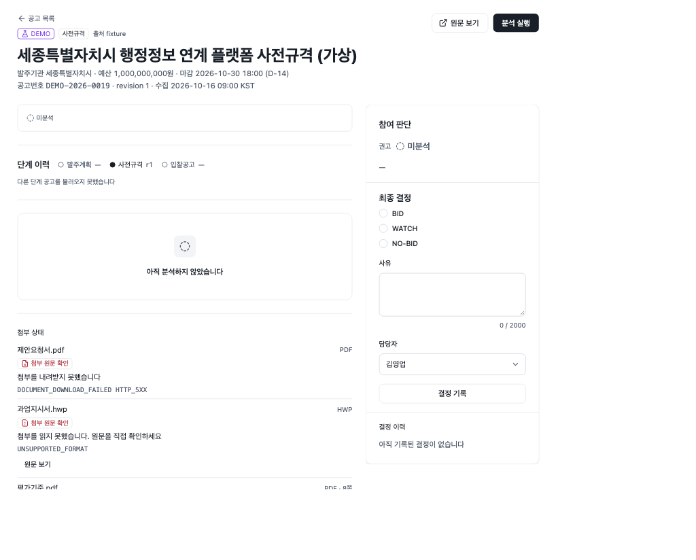

# P0-8 사전규격·발주계획 단계 연결 검증

브랜치 `feat/p08-prespec-plan`(worktree `sol-radar-worktrees/p08-prespec`, base main `4e62170`). 계획은 [P0-8 계획](../../plans/2026-10-21-p08-prespec-plan.md), 화면 스펙은 [단계 연결 UI 스펙](../../plans/2026-10-21-p08-stage-links-ui-spec.md)이다. 12 승인 범위: Task 1·2(먼저), Task 3(여유 있을 때). Task 4(live 연결)는 freeze 뒤 기본 꺼짐이라 하지 않았다.

## 무엇을 만들었나

- **Task 1 단계 연결 계산**(`web/server/bids/stage-links.*`): 공고 상세를 열 때 같은 사업의 다른 단계(발주계획·사전규격·입찰공고)를 읽을 때 계산한다. 새 표·마이그레이션은 없다.
  - 확정 연결: 같은 `plan_ref`, 지금 공고의 `pre_spec_ref` 가 가리키는 사전규격, 지금 사전규격을 가리키는 공고.
  - 후보: 단계가 다른 최근 공고 300건 안에서 `linkStages`(Dice ≥ 0.5) 최대 3건. `CANCELLED` 는 후보에서 뺀다.
  - 같은 `is_demo` 끼리만 잇는다. 식별자는 `.eq` 로만 넘기고 `or=(…)` 문자열을 만들지 않는다.
  - `GET /bids/:id` 계약은 그대로다.
- **Task 2 화면**(`web/components/bids/stage-links.tsx`): 공고 상세의 단계 타임라인 아래 새 `StageLinks`. 확정 연결은 제목 링크, 후보는 `
` 로 접는다. 유사도 숫자는 보이지 않는다. 읽기 실패면 그 칸만 오류 문구를 보이고 상세는 그대로 연다(`bid_detail_stage_links_failed` 로그).
- **Task 3 정규화**(`web/server/ingestion/normalize-g2b-pre-spec.ts`·`normalize-g2b-order-plan.ts`·`g2b-stage-*`): 나라장터 사전규격·발주계획 응답 한 행을 `NormalizedBidDraft` 로 바꾼다. 사전규격 원문 주소는 허용 목록 안 첫 `specDocFileUrl`, 없으면 격리. 정보화 사업 필터는 `swBizObjYn='Y'`. live 수집 연결은 하지 않았다(정규화까지).

## 시험

| 시험 | 결과 |
|---|---|
| `pnpm -C web exec vitest run server/bids/stage-links.service.test.ts server/bids/stage-links.supabase.test.ts` | 25 passed |
| `pnpm -C web exec vitest run server/ingestion/g2b-stage.test.ts` | 16 passed |
| `pnpm -C web exec vitest run --project browser components/bids/stage-links.browser.test.tsx "app/(app)/(work)/bids/[id]/stage-links-detail.browser.test.tsx"` | 30 passed |
| 변형 확인 | `is_demo` 거르기 제거 → 실패, 기관 우선순위 뒤집기 → 실패, 화면 시험 변형 7개 → 모두 실패 |

## 스크린샷 (브라우저 시험, 1440·1280)

| 상태 | 1440 | 1280 |
|---|---|---|
| FX-18(사전규격) 연결 |  |  |
| FX-19(입찰공고) 연결 |  |  |
| 단계 연결 읽기 실패 |  |  |

## 하지 않은 것

- 실제 앱(격리 스택)에서 공고 상세를 연 확인은 하지 않았다. 3e 병합 전 확인으로 넘긴다.
- Task 4(live 수집에 사전규격·발주계획 연결)는 freeze 뒤 기본 꺼짐이라 하지 않았다. 공공 API 실호출도 하지 않았다.
- FX-17 단계 이력의 `사전규격 —` 표시, 06 §9 반영, 화면 문구 확정은 열린 질문이다(UI 스펙 §11).

## 관련 문서

- [[PROGRESS|진행 상황]]
- [[07-DATA-PIPELINE|07 수집]]
- [[06-UI-UX|06 UI]]
