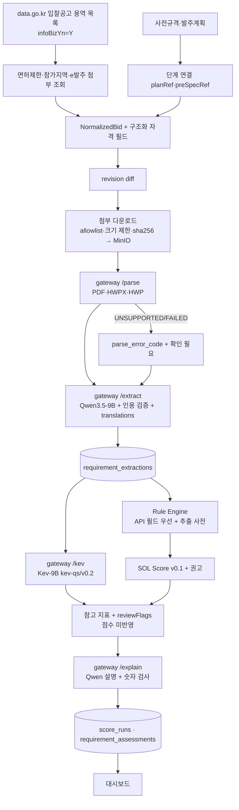
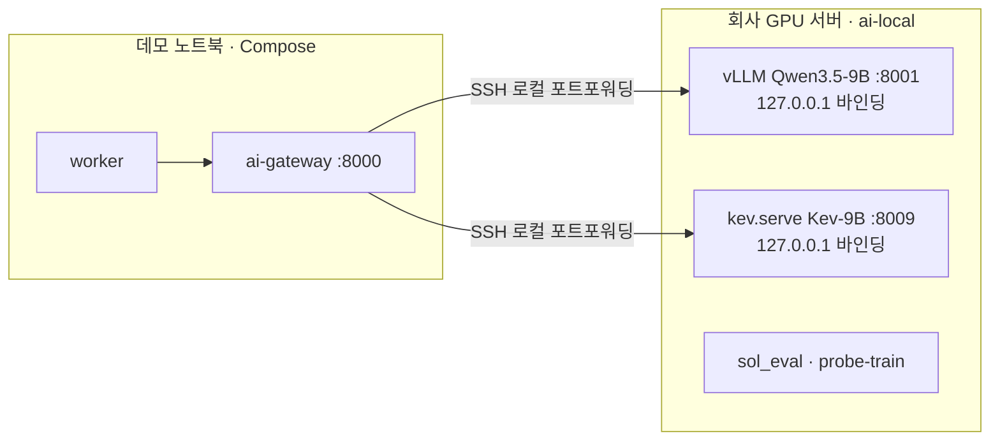

# 설계: 실데이터 AI 파이프라인 v0.2와 Kev-9B 파인튜닝 전략

> [!success] 승인됨 (2026-10-16)
> 사용자가 전체 방향을 승인했고, 보완 요청(U13~U15)을 반영했다. 사용자 대화에서 정한 것은 "사용자 결정 U1~U15", 메인 세션이 정한 기본값은 "메인 세션 결정 M1~M23"에 적었다. 정본 문서 반영 범위는 §20 이고, 정본에는 [[16-DECISIONS|ADR-020]]으로 들어간다. 정본과 이 문서가 다르면 정본이 우선한다.

## 1. 의도와 이유

SOL RADAR 의 최종 목표는 해커톤용 가짜 AI 가 아니다. **실제 나라장터 공고를 대상으로 끝까지 동작하는 MVP** 다(사용자 원문: "해커톤 시연용 가짜 AI가 아니라, 실제 공공입찰 데이터를 대상으로 끝까지 동작하는 SOL RADAR MVP").

사용자가 장기적으로 원하는 것은 **공공 SI·AX 입찰 분석에 특화된 경량 의사결정 지원 모델**이다. 공고문·RFP 와 기업 역량을 비교해서 참여 적합성을 빠르고 일관되게 판단하고, 판단마다 근거를 남긴다.

파인튜닝은 회사 GPU 에서만 할 수 있다. 그래서 이 저장소는 다음을 맡는다.
1. 실데이터로 도는 파이프라인
2. 베이스라인 측정
3. 평가셋과 평가 하네스
4. 학습셋 내보내기

LoRA 학습은 평가로 필요성이 확인된 뒤 회사 GPU 에서 한다.

지금 정본 문서는 "fixture 20건 + mock AI" 를 해커톤 기본으로 삼는다(ADR-008, 07, 12). Kev 는 공고 단위 질문 4개에만 답하고, 파인튜닝·평가 체계는 없다. 이 문서는 그 공백과 충돌을 정리하고 새 기준을 정한다.

## 2. 목표 · 비목표 · 반목표

**목표 (해커톤 MVP)**
- 나라장터 공식 Open API 로 실제 입찰공고(용역·정보화사업)를 수집한다. 사전규격·발주계획을 잇는다.
- 실제 공고문과 RFP 첨부를 내려받아 파싱한다. 처리할 수 없는 형식은 명확한 오류와 `확인 필요` 로 표시한다.
- Qwen3.5-9B 로 요구사항을 구조화해 추출한다. 규칙 엔진이 명시 조건을 검증한다. Kev-9B 로 적합성·리스크를 분석한다. 결정론적 SOL Score 를 계산하고 근거를 설명한다. 결과는 Next.js 대시보드에서 본다.
- 세 실행 모드(`live`·`fixture`·`mock`)를 지원하고, 데이터 출처와 분석 모드를 기록한다.
- Kev-9B 베이스라인 추론과 한국어/영어 입력 비교를 한다. 평가셋·평가 하네스와 회사 GPU 용 학습셋 내보내기를 만든다.

**비목표 (해커톤 완료 조건 아님)**
- Kev-9B LoRA 학습 실행과 성능 개선(후속 단계).
- Qwen 파인튜닝. 추출·설명 평가가 목표에 못 미칠 때 따로 검토한다.
- SOL Score 에 Kev 결과를 가중치로 반영하는 것. 평가셋으로 신뢰성을 검증한 뒤 정한다.
- 모든 공고 형식과 예외의 지원(zip 첨부, 스캔 PDF OCR, 혁신장터 RFP 등).
- 낙찰·계약 데이터의 수집과 활용.

**반목표 (기술적으로 동작해도 실패로 본다)**
- Kev 확률을 충족 확률·낙찰 확률·수주확률로 보이게 하는 표현.
- 정보 부족을 `미충족` 으로 판정하는 것. 정보가 없으면 언제나 `확인 필요` 다.
- 근거 위치를 추적할 수 없는 AI 판단이 화면이나 점수 근거에 들어가는 것.
- 운영 데이터와 데모 데이터가 섞여 구분되지 않는 것.
- 실제 낙찰 결과를 학습 목표로 쓰는 것(승률 예측은 범위 밖, 01 PRD).
- 학습과 서빙에서 state 를 다른 코드로 만들어 생기는 불일치(train/serve skew).

## 3. 제약

- 스택은 ADR-017 그대로다: Next.js(`web/`), Supabase, Redis/BullMQ, MinIO, Qdrant, Python AI gateway(`services/ai`), Docker Compose. 새 서버·ORM 은 들이지 않는다.
- Kev 는 텍스트를 생성하지 않고 질문별 확률만 돌려준다. 질문 타입은 `noul`·`choice`·`score` 다.
- Kev-9B 모델 카드는 `language: en` 이고, 영어가 아닌 입력은 사용 범위 밖이다.
  - 9B 학습 state 최대: 7,552 토큰. 검증된 길이: 8,192 토큰. 서빙 상한: 65,536 토큰(넘으면 422).
  - 출처: Kev 저장소 main `1f04cfa`, `docs/model-cards/kev-9b.md`.
- Kev 저장소의 학습 방식(`kev/train.py`)
  - 지원: LoRA(기본 `--lora 16`)와 full FT(`--full_ft 1`).
  - **QLoRA·bitsandbytes 는 없다.**
  - CPU 오프로딩은 full FT 의 optimizer master 에만 있고 LoRA 경로에는 없다.
- 공식 Kev-9B 학습 기록은 H200 1장, 2.6시간, 최대 74.1 GB 다(`weights_dtype fp32`). 추론 메모리는 모델 카드 21.9 GB, README 약 17 GB 로 두 문서가 다르다.
- 나라장터 Open API(data.go.kr)
  - 무료이고 개발·운영 계정 모두 자동승인이다.
  - 개발계정 호출 한도는 서비스마다 1,000 이다. 사용자정보·개방표준은 10,000 이다.
  - 응답에 담당자 이름·전화·이메일(개인정보)이 있다.
  - 첨부 원문(공고문·제안요청서)의 저작권·재배포 조건은 미확인이다.
- 유료 hosted 모델 API 는 사용자 승인 전 호출하지 않는다(ADR-010). 클라우드 GPU 임대도 비용이 들므로 같은 승인을 받는다(M17).
- 범위 외: 결제·모바일·자동 투찰·승률 예측(ADR-007).

## 4. 사용자 결정 (2026-10-16 대화)

| ID | 결정 |
|---|---|
| U1 | 모델 역할 분리. Qwen3.5-9B = 요구사항 구조화 추출·기술/실적 정보 해석·근거 기반 설명. Kev-9B = 기술 적합성·실적 연관성·수행 리스크의 분류와 확률 평가. Rule Engine = 참가 자격·실적 금액·인력 수·자격증·마감일 같은 명시 조건 검증. SOL Score Engine = 별도 산식 |
| U2 | Kev 확률을 충족 확률·낙찰 확률로 해석하지 않게 한다 |
| U3 | 학습·평가 데이터는 공고·RFP 와 가상 기업(프로필·기술·실적·인력)을 함께 구성한다. 같은 공고라도 기업에 따라 판단이 달라지는 사례를 넣는다. 라벨은 `충족 / 미충족 / 확인 필요` 이고, 정보 부족과 실제 미충족을 반드시 구분한다. 모든 AI 판단은 공고 원문과 기업 증빙의 근거 위치를 추적할 수 있어야 한다 |
| U4 | 파인튜닝 우선 후보는 Kev 다(`kev.train`, `kev.benchmark`, `--init_from`). 먼저 Kev-9B 를 그대로 쓴 베이스라인을 평가한다. Qwen 파인튜닝은 추출·근거 생성이 부족할 때 따로 검토한다 |
| U5 | 평가 지표: 분류 정확도·Macro-F1, Brier·ECE, 충족/미충족/확인 필요 구분 정확도, 인용 정확도, 반복·표현 변경 일관성, 한국어/영어 입력 성능 차이, 지연·GPU 메모리·비용. 학습/평가는 사업 단위로 분할한다 |
| U6 | 해커톤 MVP 부터 실제 나라장터 API 수집과 실제 AI 추론이 동작한다. 지원 가능한 공고로 E2E 를 먼저 완성하고, 처리할 수 없는 형식은 오류·확인 필요로 표시한다 |
| U7 | fixture 20건과 `AI_PROVIDER=mock` 은 유지한다. 실행 모드는 `live`(실제 API + 실제 AI), `fixture`(저장 공고 + 실제 AI), `mock`(저장 공고 + Mock AI). 데이터 출처와 분석 모드를 기록한다 |
| U8 | Kev-9B LoRA 학습은 해커톤 완료 조건이 아니다. 해커톤 범위: 베이스라인 추론, 한국어/영어 비교, 평가셋, 평가·비교 파이프라인, 학습셋 내보내기. 회사 GPU 가 80GB급이라고 전제하지 않는다. 배치·시퀀스 길이·체크포인팅·오프로딩을 따져 보유 장비에서 학습할 수 있는지 검증한다 |
| U9 | Kev 확률을 SOL Score 에 직접 가산하지 않는다. 규칙 엔진의 자격 판정이 우선이다. Qwen·Kev 결과는 구조화된 근거 데이터로 보관하고, Kev 는 별도 참고 지표와 리스크 플래그로 표시한다. 가중치 반영은 평가셋으로 검증한 뒤 정한다 |
| U10 | 실제 낙찰 결과는 초기 학습 목표에 쓰지 않는다. SOL Score 는 입찰 참여 적합도다. 회사 GPU 학습 환경과 운영 환경은 분리하되, 데이터셋·평가 코드·모델 버전·추론 인터페이스는 호환되게 한다 |
| U11 | 해커톤 기간의 실추론(Qwen3.5-9B·Kev-9B)과 평가 실행은 회사 GPU 서버에서 한다. 노트북 worker 가 터널로 연결한다(§22.1) |
| U12 | 평가셋 규모를 test 20·dev 10 사업으로 줄인다. 사람 검수는 추출 정답 20건과 의미 대응 라벨 150건 이상이다(§13.5) |
| U13 | HWP 를 olefile 직접 구현으로 확정하지 않는다. 형식별 파서 인터페이스를 두고, 오픈소스 후보의 라이선스와 추출 품질(본문·표·금액·자격 조건·요구사항 누락)을 실제 RFP 샘플로 검증한 뒤 정한다. 파싱 실패 시 AI 가 누락 내용을 추측해 분석하지 않는다. 파인튜닝 목표 지표(0.80·5%·0.08)는 초기 목표로 두고, 미달만으로 자동 착수하지 않는다. 오류 분석으로 파싱·프롬프트·번역·규칙 문제를 먼저 가르고, 모델 판단 오류가 주된 원인일 때 진행한다. 작은 평가셋은 신뢰구간과 사례별 오류 분석을 함께 낸다 |
| U14 | 실제 공공 API 응답과 첨부 다운로드 가능 여부를 구현 초기에 먼저 검증한다. 서비스키·회사 GPU 가 없어도 개발할 수 있게 인터페이스를 나눈다. API 실패·첨부 다운로드 불가·파싱 실패·모델 서버 미접속을 각각 구분해 처리하고, mock 으로 자동 대체할 때는 반드시 명시한다 |
| U15 | M19·M5·M6·M11·M13 승인. 한국어 운영 사용은 평가 결과를 보고 다시 검토한다. 이번 작업과 무관한 파일(`web/components/landing/*` 등)은 고치지 않는다 |

## 5. 역할 분리

| 구성요소 | 맡는 일 | 입력 | 출력 | 최종 결정 권한 |
|---|---|---|---|---|
| 나라장터 Connector | 공고·사전규격·발주계획·면허제한·첨부 목록 수집 | data.go.kr Open API | `NormalizedBid` + 구조화 자격 필드 | 없음 |
| 문서 파서 (`/parse`) | 첨부 바이트 → 텍스트·페이지 | PDF·HWPX·HWP 바이트 | 텍스트, 페이지 오프셋, 오류 코드 | 없음 |
| Qwen3.5-9B (`/extract`) | 요구사항 구조화 추출, 자유 텍스트 값의 영어 표기 | 본문 + 첨부 chunk | `RequirementExtraction` + `translations` | 없음. 값마다 state·인용 |
| Rule Engine | 명시 조건 검증(업종·면허, 지역, 금액, 인력 수, 자격증, 마감) | API 구조화 필드 > 추출값, 회사 프로필 | 항목별 `충족/미충족/확인 필요` + 사유 코드 + 양쪽 근거 | **있음** (자격 판정) |
| Kev-9B (`/kev`) | 비정형 요구사항의 충족 분류, 기술 적합성, 실적 연관성, 수행 리스크 | state(§10) | 질문별 확률 | 없음. 참고 지표·`reviewFlags` 만 |
| SOL Score Engine | v0.1 결정론 점수, BID/WATCH/NO-BID 권고 | 규칙 결과 + 추출 + 프로필 | 점수 분해, 권고 | **있음** (권고까지). Kev 확률은 입력이 아니다(U9) |
| Qwen3.5-9B (`/explain`) | 규칙 결과·점수·인용·Kev 참고 지표를 한국어로 설명 | 위 결과 | 2~4문장 | 없음. 입력 밖 숫자가 나오면 폐기하고 템플릿으로 대체 |
| 사람 | 최종 참여 결정 | 화면 | `bid_reviews` | **최종** |

같은 조건을 API 구조화 필드와 Qwen 추출이 둘 다 주면 **API 구조화 필드가 우선**이다. 예: 면허제한 `lcnsLmtNm`, 참가가능지역 `prtcptPsblRgnNm`, 금액 `presmptPrce`·`asignBdgtAmt`, 마감 `bidClseDt`. 두 값이 다르면 그 필드를 `CONFLICTED` 로 둔다. 03 §4.4 7단계 "메타데이터 대조" 를 확장한 것이다.

## 6. 실행 모드와 출처 기록

새 env `SOL_RUN_MODE=live|fixture|mock`. 기본은 `mock` 이다(CI·테스트·골든은 지금처럼 mock).

| 모드 | 공고 Connector | AI | `KEV_ENABLED` | 새로 적재되는 공고의 `is_demo` | 용도 |
|---|---|---|---|---|---|
| `live` | `OfficialApiConnector`(data.go.kr) | `AI_PROVIDER=local` (Qwen3.5-9B + Kev-9B) | `true` | `false` | 실운영·실데이터 시연 |
| `fixture` | `FixtureConnector`(fixture 20건) | `AI_PROVIDER=local` | `true` | `true` | 공공 API 장애 시 시연. 실모델은 그대로 |
| `mock` | `FixtureConnector` | `AI_PROVIDER=mock` | mock adapter | `true` | 모델 장애 시 시연, CI, 골든 |

- `SOL_RUN_MODE` 가 `DEMO_MODE`·`AI_PROVIDER`·`KEV_ENABLED` 의 기본값을 정한다. 값을 직접 줬는데 모드와 모순되면 `pnpm check:env` 와 gateway 가 기동을 거부한다. 예: `live` 인데 `AI_PROVIDER=mock`. 조용히 바꾸지 않는다.
- live 공고와 fixture 공고는 같은 DB 에 함께 있을 수 있다. 공고는 `source`(`g2b-bid-notice`·`g2b-pre-spec`·`g2b-order-plan`·`fixture`)와 `is_demo` 로 구분한다.
- 분석 하나하나에 그때의 모드를 남긴다.
  - `score_runs.run_mode`(`LIVE`·`FIXTURE`·`MOCK`), `ai_provider`, `qwen_model`, `kev_model`, `question_set_version`
  - `requirement_extractions.provider`·`model_name`
  - `ingest_runs.run_mode`·`source`
- 화면 표시
  - 머리말에 "실행 모드: live|fixture|mock"
  - 공고에 `DEMO` 배지(`is_demo=true`)
  - 분석 패널에 "AI: local · Qwen3.5-9B · Kev-9B v1.0" 또는 "AI: mock"
  - 공고 목록 필터 `origin=live|demo|all`
- 골든 수치(94/72/68)는 mock 모드에서만 단언한다. fixture 모드의 실모델 추출은 mock 추출과 다를 수 있어 골든 대상이 아니다.
- 모드 전환은 env 를 바꾸고 worker·gateway 를 재시작해서 한다. 시연 중 장애 대체 순서는 `live` → `fixture` → `mock` 이다.
- **회사 프로필은 모든 모드에서 가상 솔리데오 프로필**이다(M19). ADR-019 는 솔리데오의 직원·자격·실적·재무를 가상 데모 설정으로 정했다. 09 는 Supabase 클라우드에 실제 회사 자료를 넣지 않는다고 정했다. 그래서 live 모드의 분석은 "실제 공고 × 가상 회사 프로필" 이다.
  - `company_profiles.is_demo=true` 로 표시한다.
  - 분석 화면에 "가상 회사 프로필로 분석" 배지를 붙인다. 실제 회사의 판단처럼 보이지 않게 하려는 것이다.
  - 실제 회사 자료를 쓰려면 별도 결정(ADR)과 09 개정이 먼저 필요하다.

## 7. 파이프라인 v0.2 (해커톤 MVP)



worker job 순서:
1. **ingest** (source `g2b`): 목록 조회 → 정보화사업 필터 → 공고별 보조 조회(면허제한·참가가능지역·e발주 첨부) → 정규화 → revision diff.
2. **documents**: 새 revision 의 첨부를 다운로드하고 `/parse` 를 부른다. 텍스트는 MinIO 에 쓰고 `bid_documents` 에 상태를 기록한다.
3. **extract**: `/extract`(재사용 키는 지금과 같은 `(revision_id, model_name, prompt_hash)`).
4. **analysis**: 규칙 → `/kev` → 플래그 병합 → 점수·권고 → `/explain` → 저장. 03 §2.1 순서에 `/explain` 을 더한다.

job 은 따로 재시도할 수 있게 나눈다. 앞 단계가 실패해도 다음 단계는 가진 정보로 진행한다. 예: 첨부가 실패하면 본문만으로 추출하고 경고를 단다(지금 원칙과 같다).

**외부 의존성은 인터페이스로 떼어 낸다** (U14). 서비스키나 회사 GPU 접속이 아직 없어도 나머지 개발을 진행할 수 있게 하려는 것이다.

| 인터페이스 | 구현체 | 키·GPU 없이 개발하는 법 |
|---|---|---|
| `BidSourceConnector` (07 Connector) | `OfficialApiConnector`, `FixtureConnector`, `RecordedApiConnector`(저장한 실제 응답 재생) | 공식 참고문서의 응답 예시로 계약 시험을 만든다(문서 예시라고 표시). 키를 받으면 실제 응답 3건으로 바꾼다 |
| `AttachmentFetcher` | `G2bAttachmentFetcher`, `FixtureAttachmentFetcher` | fixture 첨부(PDF·HWPX·HWP 샘플)로 개발 |
| `DocumentParser` (§9) | 형식별 어댑터 | 공개 샘플·fixture 문서 |
| `ModelClient` (gateway 안 Qwen·Kev 어댑터) | `mock`, `local` | mock 과 wire 계약 시험. GPU 접속 뒤 `local` 연결 |

### 7.1 실패 유형별 처리 (U14)

실패는 유형마다 따로 기록하고 따로 보여 준다. 한 유형의 실패를 다른 유형으로 뭉뚱그리지 않는다.

| 유형 | 감지 지점 | 기록 | 결과 | 화면 |
|---|---|---|---|---|
| 공공 API 실패 | Connector(HTTP 오류, `resultCode` 비정상, 에러코드 22 일일 한도, timeout) | `ingest_runs.status`·`ingest_errors`(오류 코드·`resultCode`) | 그 창의 수집 중단. 기존 공고는 그대로 | 관리자 수집 화면 "공공 API 오류: {코드}" |
| 첨부 다운로드 불가 | `AttachmentFetcher`(인증 요구, 4xx·5xx, allowlist 밖 리다이렉트, 크기 초과) | `bid_documents.download_status=FAILED` + 사유 | 본문으로만 추출. 첨부에 의존하는 항목은 `NEEDS_REVIEW`(`PARSE_UNSUPPORTED`) | `DOCUMENT_DOWNLOAD_FAILED` 배지, "첨부 원문 확인" |
| 파싱 실패·부분 파싱 | `/parse`(`UNSUPPORTED`·`FAILED`·`PARTIAL`) | `bid_documents.parse_status`·`parse_error_code`·품질 신호 | 위와 같다 | `PARSE_UNSUPPORTED` 배지 |
| 모델 서버 미접속 | gateway → Qwen·Kev(연결 거부, timeout, 레지스트리 불일치) | `QWEN_UNAVAILABLE`·`KEV_UNAVAILABLE` 를 따로 기록 | Qwen 불가: 캐시된 추출, 없으면 모든 필드 `UNKNOWN` → `PARTIAL`. Kev 불가: `kev.enabled=false` → `RULES_ONLY` | "AI 분석 불가 → 규칙만"(03 §8 문구) |
| gateway 미접속 | worker → gateway | `AI_UNAVAILABLE` | 지금(03 §8)과 같다 | 같다 |

- **실패한 단계의 내용을 AI 가 추측해 채우지 않는다** (U13).
  - Qwen 에는 파싱된 텍스트만 들어간다. "첨부가 있었다" 는 사실로 내용을 추정하게 하는 지시를 프롬프트에 넣지 않는다.
  - 근거가 파싱 텍스트에 없는 값은 인용 검증(15 §5)에서 걸려 `UNKNOWN` 이 된다.
  - Kev state 에는 "RFP attachment could not be read; requirements may be incomplete" 라는 사실 한 줄만 넣는다. 읽지 못한 문서의 요구사항으로 Kev 질문을 만들지 않는다.
  - `/explain` 은 파싱 실패를 문장에 반드시 밝힌다.
- **mock 으로 자동 대체하지 않는 것이 기본이다.** 데이터 출처(live → fixture)도 AI(local → mock)도 자동으로 바꾸지 않는다. 모델이 안 되면 위 표처럼 `PARTIAL`·`RULES_ONLY` 로 끝낸다.
- 시연 편의를 위해 env `AI_FALLBACK_TO_MOCK=true` 로 자동 대체를 켤 수 있다. 기본은 `false` 이고 `live` 모드에서는 켤 수 없다(기동 거부). 켜진 상태에서 실제로 대체가 일어나면 다음을 남긴다.
  - 그 run 의 `ai_provider=MOCK`, `fallback_reason`(`QWEN_UNAVAILABLE` 등), `reviewFlags += MOCK_FALLBACK`
  - 화면 배너 "모델 서버에 연결하지 못해 Mock 결과를 표시합니다. (실제 모델 결과 아님)"

**지원 범위와 처리할 수 없는 경우** (U6)

| 경우 | 처리 | 표시 |
|---|---|---|
| 정보화사업이 아닌 공고(`infoBizYn≠Y`) | 수집 단계에서 제외 | — |
| 첨부 다운로드 실패(인증 요구·4xx·5xx·timeout) | `download_status=FAILED`, 본문으로만 추출 | `DOCUMENT_DOWNLOAD_FAILED`, 관련 자격 `확인 필요` |
| PDF(텍스트 레이어 있음)·HWPX·HWP 5.0 | 파싱 | — |
| 스캔 PDF(텍스트 없음)·zip·xlsx·암호 문서·기타 | `parse_status=UNSUPPORTED` | `PARSE_UNSUPPORTED`, "첨부 원문 확인" 배지 |
| 50 MB 초과 | 다운로드하지 않음(`download_error_code=TOO_LARGE`) | `DOCUMENT_DOWNLOAD_FAILED` |
| 첨부 없음 | 본문만 | FX-04 경로 |

## 8. 공공 API 수집 설계

> [!success] 검증됨 (2026-10-16, data.go.kr 서비스 페이지 Swagger·참고문서)
> 아래 서비스 ID·기본 URL·오퍼레이션·필드 이름은 각 서비스 페이지의 명세에서 확인했다. 서비스키로 실제 응답을 받아 본 것은 아니다. 실제 응답 3건을 저장하고 필드 매핑을 확인하는 일은 구현 첫 단계다(§16 P0-2).

### 8.1 사용할 서비스

| 단계 | 서비스 (ID) | 기본 URL | 쓰는 오퍼레이션 | 해커톤 |
|---|---|---|---|---|
| `NOTICE` | 입찰공고정보서비스 (15129394) | `http://apis.data.go.kr/1230000/ad/BidPublicInfoService` | `getBidPblancListInfoServc`(용역 목록), `getBidPblancListInfoChgHstryServc`(변경이력), `getBidPblancListInfoLicenseLimit`(면허제한), `getBidPblancListInfoPrtcptPsblRgn`(참가가능지역), `getBidPblancListInfoEorderAtchFileInfo`(e발주 첨부·제안요청서) | P0 |
| `PRE_SPEC` | 사전규격정보서비스 (15129437) | `/1230000/ao/HrcspSsstndrdInfoService` | `getPublicPrcureThngInfoServc`(용역), `getPublicPrcureThngInfoServcPPSSrch`(`swBizObjYn` 필터) | P0 (순서 8) |
| `PLAN` | 발주계획현황서비스 (15129462) | `/1230000/ao/OrderPlanSttusService` | `getOrderPlanSttusListServc` | P0 (순서 8) |
| 코드 마스터 | 업종 및 근거법규 (15129467) | `/1230000/ao/IndstrytyBaseLawrgltInfoService` | `getIndstrytyBaseLawrgltInfoList`(전체 업종 코드·명·근거법) | P0 (한 번 받아 사전으로 저장) |
| 단계 연결 보조 | 계약과정통합공개 (15129459) | — | `getCntrctProcssIntgOpenServc` | 후속 (평가셋 사업 묶기에 선택 사용) |
| 후속 | 낙찰정보 (15129397), 계약정보 (15129427), 사용자정보 (15129466) | — | — | 해커톤 밖. 낙찰은 학습 목표 아님(U10) |

### 8.2 요청 규칙

- 공통 파라미터: `serviceKey`(env `G2B_SERVICE_KEY`, 서버 전용·로그 금지), `type=json`, `pageNo`, `numOfRows=100`.
- 공고 목록 조회
  - 신규: `inqryDiv=1`(등록일시)
  - 정정·취소: `inqryDiv=3`(변경일시)
  - 기간: `inqryBgnDt`·`inqryEndDt`(`YYYYMMDDHHMM`)
- 일정 실행은 BullMQ repeatable job 이다(기존 07 §2). 기본 창은 직전 성공 체크포인트 ~ 지금이고 요청은 1일 단위로 나눠 보낸다. 수동 실행 창은 최대 7일이다. `stages` 를 생략하면 세 단계 모두이고, 실제 적용값은 `ingest_runs.params` 에 남긴다.
- 정보화사업 필터는 응답의 `infoBizYn='Y'` 로 클라이언트 쪽에서 거른다. 요청 파라미터로 거를 수 있는지는 미확인이다.
- 보조 조회(면허제한·참가가능지역·e발주 첨부)는 `bidNtceNo`+`bidNtceOrd` 로 공고마다 1회씩, 새 revision 일 때만 부른다.
- 호출 예산은 Redis 카운터 `quota:{serviceId}:{YYYYMMDD}`(KST)로 센다.
  - 한도의 90% 에 닿으면 보조 조회를 멈춘다. 그 공고는 `확인 필요`(정보 부족)로 남긴다.
  - 에러코드 22(일일 허용량 초과)를 받으면 그날 수집을 멈춘다.
- 용량 추정(가정): 목록 1회당 100건, 정보화 공고 1건당 보조 조회 3회. 그러면 개발계정 1,000건/일로 하루 약 300건의 정보화 공고를 처리할 수 있다. 부족하면 운영계정으로 올린다(자동승인).
- 07 §2 의 timeout 15 s, 지수 backoff, `Retry-After` 존중을 그대로 쓴다. 초당 30 tps(참고문서)를 넘지 않는다.

### 8.3 정규화 매핑 (요지)

| `NormalizedBid` / 추가 필드 | 입찰공고 응답 필드 |
|---|---|
| `noticeId`, `amendmentNo` | `bidNtceNo`, `bidNtceOrd` |
| `title` | `bidNtceNm` |
| `agency` | `dminsttNm`(수요기관). 공고기관 `ntceInsttNm` 은 `rawPayload` 에 둔다 |
| `budgetKrw` | `asignBdgtAmt` 가 있으면 그 값, 없으면 `presmptPrce`. 어느 값을 썼는지는 `normalizationNotes` 에 적는다 |
| `deadlineAt` | `bidClseDt` (KST → UTC) |
| `sourceUrl` | `bidNtceDtlUrl` (없으면 `bidNtceUrl`) |
| 상태·정정 | `ntceKindNm`(등록·변경·취소·재공고), `chgNtceRsn`, `reNtceYn`, `befBidBbancNo` |
| `planRef` | `orderPlanUntyNo` |
| `preSpecRef` (추가) | `bfSpecRgstNo` |
| 첨부 | `ntceSpecDocUrl1~10` + `ntceSpecFileNm1~10`, e발주 첨부 오퍼레이션 결과 |
| 구조화 자격 (추가) | 면허제한 `lcnsLmtNm`, `permsnIndstrytyList`, 참가가능지역 `prtcptPsblRgnNm`, `indstrytyLmtYn`, `bidPrtcptLmtYn`, `rgnDutyJntcontrctRt` |
| 계약 방식 | `cntrctCnclsMthdNm`, `sucsfbidMthdNm` |

- 개인정보: 담당자 필드(이름·전화·이메일)는 `NormalizedBid` 에 넣지 않는다. `rawPayload` 원본은 사설 MinIO 에만 보관한다. 데이터셋 내보내기와 모델 입력에서는 뺀다(§13.6).
- 사전규격의 `bidNtceNoList`, 발주계획의 `bidNtceNoList` 로 단계를 잇는다. 식별자로 이어지지 않는 연결은 지금처럼 "연결 후보" 로만 표시한다(07 §4).

### 8.4 첨부 다운로드

- 허용 호스트는 `www.g2b.go.kr`(https)뿐이다. 경로는 공식 문서 예시의 `/pn/` 아래 다운로드 엔드포인트다.
- 리다이렉트는 같은 allowlist 안에서만 따른다. DNS 를 다시 확인하고 사설 IP 는 거부한다. timeout 30 s, 최대 50 MB 다(09 SSRF 표).
- 저장 키는 `raw/bids/{bidId}/{revisionId}/{sha256}.{ext}` 다. 형식은 확장자가 아니라 내용(매직 바이트)으로 판단한다.

> [!warning] 미검증 가정
> g2b 첨부 다운로드에 로그인·세션이 필요한지 확인하지 않았다. 나라장터 이용약관상 자동 다운로드 제한도 미확인이다. 구현 첫 단계(P0-2)에서 공고 3건의 첨부를 실제로 받아 본다. 막히면 첨부 없이 공고 본문·API 필드만으로 진행하고 `DOCUMENT_DOWNLOAD_FAILED` 를 표시한다. 이 경우 사용자에게 보고한다(RFP 파싱이 MVP 의 핵심이기 때문이다).

## 9. 문서 파싱 (`POST /parse`)

파서는 **형식별 어댑터 인터페이스**로 두고, 어떤 라이브러리를 쓸지는 실제 RFP 샘플 비교로 정한다(U13). 특정 구현을 미리 확정하지 않는다.

### 9.1 인터페이스

```ts
interface ParseResult {
  status: "PARSED" | "PARTIAL" | "UNSUPPORTED" | "FAILED";
  format: "PDF" | "HWPX" | "HWP" | "UNKNOWN";   // 매직 바이트로 판정
  parserId: string;                              // 예: "pdfplumber@0.11.10"
  text: string;                                  // 블록을 순서대로 직렬화한 평문. 인용 오프셋의 기준
  pages: { page: number; charOffset: number }[]; // 페이지 개념이 없는 형식은 빈 배열
  blocks: (
    | { kind: "paragraph"; charStart: number; charEnd: number }
    | { kind: "table"; charStart: number; charEnd: number; rows: number; cols: number;
        cells: { r: number; c: number; rowSpan: number; colSpan: number; charStart: number; charEnd: number }[] }
  )[];
  quality: ParseQuality;                         // §9.4
  errorCode: "UNSUPPORTED_FORMAT" | "NO_TEXT_LAYER" | "ENCRYPTED" | "DISTRIBUTION_PROTECTED"
           | "TOO_LARGE" | "CORRUPTED" | "PARSER_ERROR" | null;
  warnings: string[];
}
```

- 표는 행마다 한 줄로 쓰고 셀 사이에 ` | ` 를 넣어 `text` 에 직렬화한다. 셀마다 `charStart/charEnd` 를 남겨서 표 안 문장도 인용 검증(15 §5)을 그대로 통과할 수 있게 한다.
- 어댑터는 `services/ai/parsers/{pdf,hwpx,hwp}/` 아래 후보마다 하나씩 둔다. 형식마다 사용할 어댑터는 env `PARSER_PDF`·`PARSER_HWPX`·`PARSER_HWP` 로 고른다. 기본값은 §9.3 비교가 끝난 뒤 정한다.
- Python 밖 런타임이 필요한 후보는 gateway 안에서 상주 하위 프로세스로 부른다(Node·JVM). 이미지 크기와 기동 시간은 비교 표에 함께 적는다. gateway 는 지금처럼 DB·MinIO 에 접근하지 않는다.

### 9.2 후보 (2026-10-16 조사)

> [!success] 검증됨 (2026-10-16, 각 프로젝트의 LICENSE 파일·PyPI·npm·crates.io)
> 아래 라이선스·최근 릴리스는 각 저장소와 패키지 페이지에서 확인했다. 추출 품질은 아직 재지 않았다(§9.3 에서 잰다).

| 형식 | 1순위 후보 | 2순위 후보 | 메모 |
|---|---|---|---|
| HWP 5.0 | kordoc (MIT, Node 20+, v4.22.2) | rhwp-python (MIT, PyO3, v0.8.1. 상류 rhwp 는 v0.8.7) | JVM 을 허용하면 hwplib(Apache-2.0)도 후보. unhwp(MIT, Rust, 표→CSV)는 보조 후보 |
| HWPX | python-hwpx (Apache-2.0, 순수 Python, 6.8.0) | kordoc | hwpxlib(Apache-2.0, Java)도 가능 |
| PDF | pdfplumber (MIT, 0.11.10) | opendataloader-pdf (Apache-2.0, Java 11+) | 복잡한 표가 많으면 Docling(MIT, torch 필요)을 추가로 비교 |

- 세 형식을 엔진 하나로 묶고 싶으면 kordoc 이 단일 후보다. 이 경우 gateway 이미지에 Node 20 이 들어간다.
- **쓰지 않는 것**
  - pyhwp·PyMuPDF(AGPL-3.0): 네트워크 서비스로 제공하면 서비스 전체 소스 공개 의무가 생긴다.
  - H2Orestart(GPL-3.0)·poppler(GPL): 이미지 배포 시 의무 발생. 별도 프로세스 호출이 의무를 피하는지 법률 검토 전이다.
  - camelot 의 `ghostscript` extra(Ghostscript AGPL)
  - marker 모델 가중치(수정 OpenRAIL-M, 상업 이용 제한)
  - pyhwpx(Windows·한/글 COM 필요)
  - LibreOffice 내장 hwpfilter(HWP 3.0 까지만)
  - hwp.js(작성자 기준 커버리지 약 20%)
- **배포용(보호) HWP 는 복호화하지 않는다** (M22). 일부 후보(kordoc·rhwp·pyhwp·hwplib)는 배포용 문서를 풀 수 있다. 하지만 작성자가 건 보호를 푸는 것이 저작권법상 기술적 보호조치 해제에 해당하는지 확인하지 않았다. 법무 확인 전에는 `UNSUPPORTED`(`DISTRIBUTION_PROTECTED`)로 처리한다. 열기 암호 문서도 `ENCRYPTED` 다.
- 스캔 PDF(텍스트 레이어 없음)는 OCR 을 하지 않고 `NO_TEXT_LAYER` 로 둔다. zip·xlsx 는 `UNSUPPORTED_FORMAT` 이다(후속).

### 9.3 실제 RFP 샘플 비교 (P0-0 ④ → P0-3)

1. **샘플**: live 공고 첨부에서 형식마다 10건 이상 고른다(HWP·HWPX·PDF 각각).
   - 표가 많은 문서(요구사항 총괄표, 평가표, 금액표)와 자격 조항이 긴 문서를 일부러 넣는다.
   - 같은 RFP 가 HWP 와 PDF 로 함께 올라온 공고가 있으면 짝으로 넣어 형식 간 결과를 맞대 본다.
2. **기준표(사람 작성)**: 문서마다 아래를 직접 적는다.
   - 표 개수, 표마다 셀 3개의 위치와 내용
   - 문서에 나오는 금액 문자열 전부
   - 참가자격 조항 문장 전부
   - 요구사항 고유번호 목록(예: 요구사항 총괄표의 `SFR-001` 같은 번호)
   - 쪽수
3. **지표** (어댑터마다)
   - 본문 재현율: 기준 문단이 `text` 에 들어 있는 비율
   - 표 검출 재현율, 표본 셀 정확도
   - 금액 재현율
   - 자격 조항 재현율
   - 요구사항 번호 재현율과 **누락 건수**
   - 실패율, 문서당 처리 시간, 메모리, 이미지 크기 증가분
4. **결정 규칙**
   - 형식마다 자격 조항 재현율과 요구사항 번호 재현율이 가장 높은 어댑터를 고른다. 같으면 표본 셀 정확도, 그다음 런타임 단순성(Python 안 > 하위 프로세스)으로 정한다.
   - 그 형식을 "지원" 으로 표시하는 조건: 샘플에서 자격 조항 누락 0건, 요구사항 번호 재현율 0.95 이상.
   - 조건을 못 넘은 형식은 파싱은 하되 언제나 `PARTIAL` 로 표시한다. 그 형식의 첨부에 의존하는 항목은 `NEEDS_REVIEW`(`PARSE_UNSUPPORTED`)다.
5. **기록**: 결과 표는 `docs/evidence/phase-0/parser-benchmark.md` 에 둔다. 형식별 선택은 16 미결정 4번·20번에 기록한다. 실제 RFP 원문은 증거에 넣지 않고 지표와 문서 id 만 넣는다.

### 9.4 운영 중 부분 파싱 감지

파싱이 "성공" 해도 내용이 빠졌을 수 있다. 문서마다 아래 품질 신호를 계산해 `parse_quality` 에 저장한다.

| 신호 | `PARTIAL` 판정 (초기값, §9.3 결과로 조정) |
|---|---|
| 쪽당 글자 수 | 중앙값이 200자 미만 |
| 대체 문자(`�`) 비율 | 1% 초과 |
| 요구사항 번호 연속성 | `SFR-001`~`SFR-020` 처럼 같은 접두어 번호에 빈 번호가 있음 |
| 표 캡션 대비 표 수 | 본문에 "<표" 캡션이 있는데 검출 표가 0개 |
| 빈 셀 비율 | 표의 빈 셀이 50% 초과 |

- `PARTIAL` 인 문서는 화면에 "일부만 읽음" 배지를 붙인다. 그 문서에서 나온 값은 인용이 검증되면 쓰되, 그 문서가 다뤄야 할 항목 중 근거가 없는 것은 `NEEDS_REVIEW`(`PARSE_UNSUPPORTED`)로 둔다.
- 파싱 실패·부분 파싱의 빈자리를 AI 가 추측으로 채우지 않는다(§7.1).

### 9.5 수용 기준

- 세 형식 모두 §9.3 비교표가 있고, 형식별 선택과 "지원/PARTIAL" 표시가 정해져 있다.
- 실제 공고 30건 이상 첨부의 형식별 `PARSED`·`PARTIAL`·`UNSUPPORTED`·`FAILED` 비율이 증거로 남는다.
- 배포용·암호·스캔 문서가 각각 정해진 `errorCode` 로 끝나고, 분석 화면에 사유가 보인다.

## 10. Kev 연동 v0.2

### 10.1 질문 세트 `kev-qs/v0.2`

v0.1(03 §5.5)의 4질문은 그대로 두고, 아래 질문을 더한다. mock 모드와 데모 S3("규칙이 Kev를 이긴다")는 v0.1 `recommendation` 을 계속 쓴다(M5).

| qid | type | 단위 | 선택지 / 기준 | 대상 |
|---|---|---|---|---|
| `req.{itemId}.status` | `choice` | 요구사항 항목 | `SATISFIED` / `NOT_SATISFIED` / `NEEDS_REVIEW` | Kev 담당 항목(아래) |
| `techFit` | `score` | 공고 | `Very poor`~`Very good` 5등급 | 기술 스택 전체의 의미적 적합성 |
| `perfRelevance` | `score` | 공고 | 5등급 | 가장 관련 깊은 수행 실적과의 연관성 |
| `risk.schedule` | `noul` | 공고 | 일정·기간이 회사 가용 상황에 비해 촉박한가 | 수행 리스크 |
| `risk.staffing` | `noul` | 공고 | 요구 인력·등급을 회사가 충원하기 어려운가 | 수행 리스크 |
| `risk.scale` | `noul` | 공고 | 사업 규모가 회사 수행 경험을 크게 넘는가 | 수행 리스크 |
| `risk.techGap` | `noul` | 공고 | 핵심 기술 중 회사 경험이 없는 것이 있는가 | 부족 역량 |
| `risk.scopeAmbiguity` | `noul` | 공고 | 범위·조건이 모호하거나 상충하는가 | v0.1 `needsHumanReview` 의 후속 |
| `mandatoryRisk`, `recommendation`, `needsHumanReview`, `fit` | v0.1 그대로 | 공고 | 03 §5.5 | 연속성·데모 |

**Kev 담당 항목** (`itemId`)
- `requiredSkills[i]`: 기술별
- `pastPerformance[i]`: 실적 요구의 "분야·유사성" 판단. 금액·건수·기간은 규칙 담당
- `staffing[i]`: 역할·등급의 의미 대응. 인원 수는 규칙 담당
- `qualifications[i]` 중 사전 코드가 없는 것(`code=null`)

사전 코드가 있는 자격, API 구조화 필드, 숫자 조건은 규칙만 판정한다. 같은 항목에 Kev 질문을 붙이더라도 평가용 비교 지표로만 쓴다.

- `instructions`·`criteria` 원문(영어)은 `services/ai/kev/question-sets/v0.2.json` 에 둔다. 한국어 평가용 번역본은 `v0.2.ko.json` 에 둔다.
- 요청 하나에 질문이 많으면 24개씩 나눠 보낸다(state 는 같다). state 는 6,000 토큰 이내로 한다(검증된 길이 8,192 안).

### 10.2 state 구성과 언어

- 구조는 하나이고 언어만 둘이다: `services/ai/kev/state-templates/{en,ko}.v0.2.txt`.
  - 줄 순서·항목 id·숫자는 두 언어가 같다. 그래서 한국어/영어 비교가 언어 효과만 잰다.
- `en`(운영 기본): 고정 라벨은 템플릿으로 쓴다. 자유 텍스트 값은 `/extract` 가 돌려준 `translations` 를 쓴다. 대상은 실적 설명, 인력 조건, 사전 밖 자격명, 기술명 중 영문 표기가 없는 것이다.
  - 번역은 Qwen 이 용어집(`services/ai/kev/glossary.ko-en.yaml`)을 보고 한다.
  - 원문의 숫자 토큰이 번역에 그대로 있지 않으면 그 값은 번역하지 않고 `(untranslated)` 로 표시한다.
- `ko`(평가 전용): 같은 템플릿의 한국어판에 원문 값을 넣는다. gateway env `KEV_ALLOW_KO_STATE=true` 일 때만 받고, 운영 모드에서는 거부한다(M6).
- 규칙 결과(자격 판정·점수·권고)는 지금처럼 state 에 넣지 않는다.

### 10.3 근거 추적 (U3)

Kev 는 인용을 만들지 못한다. 그래서 **state 를 만들 때 줄마다 출처를 기록**한다.

```ts
interface KevStateTrace {
  stateHash: string;                       // sha256(state 텍스트)
  template: "en.v0.2" | "ko.v0.2";
  lines: {
    lineNo: number;
    text: string;
    noticeEvidence: EvidenceRef[];         // 15 §2. 추출 필드의 검증된 인용
    companyEvidence: CompanyEvidenceRef[];
    itemIds: string[];                     // 이 줄이 다루는 요구사항 항목
  }[];
}
interface CompanyEvidenceRef {               // 새 타입 (15 에 추가)
  profileRevision: number;
  kind: "LICENSE" | "INDUSTRY_CODE" | "TECHNOLOGY" | "PROJECT" | "STAFF" | "FINANCIAL";
  recordKey: string;                       // 예: "licenses[2]", "past_projects[0]"
  documentId: string | null;               // 회사 증빙 파일(MinIO)이 있으면
  quotedText: string | null;
}
```

- 화면에서 Kev 질문 결과를 누르면 그 질문의 `itemIds` 를 다룬 state 줄이 열린다. 각 줄의 공고 인용과 회사 증빙도 함께 보인다.
- `KevStateTrace` 는 `score_runs.kev_output` 에 Kev 응답 원문과 함께 저장한다.
- 근거가 하나도 없는 줄(예: `(unknown)`)은 state 에 들어가도 된다. 그 줄만으로 나온 판단은 `NEEDS_REVIEW` 쪽 근거로만 표시한다.

### 10.4 표시와 플래그 (U2·U9)

- Kev 결과는 화면의 "모델 참고 지표 (점수 미반영)" 영역에만 보인다. 질문별 분포 막대, 리스크 목록, 항목별 분류가 들어간다.
- 고지 문구를 넓힌다: "Kev 확률은 선택지에 대한 모델 분포이며 충족 확률·수주확률이 아닙니다." `KevAssist.disclaimer` 로 내려 준다.
- 보정 상태를 표시한다: `UNCALIBRATED` (기본) / `CALIBRATED`(데이터셋 버전 표기).
- 새 플래그(규칙·점수·권고를 바꾸지 않는다)
  - `KEV_REQUIREMENT_DISAGREEMENT`: 규칙이 `SATISFIED` 인데 Kev `P(NOT_SATISFIED) ≥ τ`. 또는 그 반대.
  - `KEV_DELIVERY_RISK`: `risk.* ≥ τ`. 어떤 리스크인지는 상세 JSON 에 둔다.
  - `PARSE_UNSUPPORTED`, `DOCUMENT_DOWNLOAD_FAILED`: 파싱·다운로드 경로.
- 임계값 τ 는 처음에 0.70 이고 "미보정" 으로 표시한다. 베이스라인 평가 뒤 dev 분할로 다시 정한다. 값은 `services/ai/kev/thresholds.v0.x.json` 에 버전으로 둔다.
- 17 의 절대 규칙("Kev 출력은 `review_flags` 추가에만")은 유지한다. "참고 지표 표시" 를 허용 범위에 명시해서 넓힌다.

## 11. 판정 라벨 체계

규칙 판정, Kev 질문, 평가셋 라벨이 같은 3값을 쓴다.

| 값 (화면) | 조건 |
|---|---|
| `SATISFIED` (충족) | 공고 요구가 근거와 함께 `KNOWN` 이고, 회사 쪽에 이를 충족하는 기록이 있다 |
| `NOT_SATISFIED` (미충족) | 공고 요구가 근거와 함께 `KNOWN` 이고, 회사 쪽에 **명시적 부정 근거**가 있다. 예: `NOT_HELD` 로 기록된 면허, 요구치보다 작은 실적 금액·인원 수, 기술 목록이 `complete=true` 인데 그 기술이 없음 |
| `NEEDS_REVIEW` (확인 필요) | 위 둘이 아닌 모든 경우. 사유 코드를 붙인다 |

`NEEDS_REVIEW` 사유 코드:

| 코드 | 뜻 |
|---|---|
| `NOTICE_INFO_MISSING` | 공고에서 요구를 꺼내지 못함(`UNKNOWN`, 첨부 미파싱 포함) |
| `NOTICE_CONFLICTED` | 공고 안의 값이 상충함(`CONFLICTED`) |
| `COMPANY_EVIDENCE_MISSING` | 회사 프로필에 해당 정보·증빙이 없음 |
| `AMBIGUOUS_MATCH` | 의미 대응이 불확실함(규칙 사전 밖, Kev 판단 필요) |
| `PARSE_UNSUPPORTED` | 첨부를 읽지 못함 |
| `STAGE_NOT_APPLICABLE` | 발주계획 단계라 자격 요건이 아직 없음(지금 `NOT_APPLICABLE`) |

- 원칙: **미충족에는 양쪽 근거가 필요하다.** 정보가 없다는 사실만으로는 미충족이 될 수 없다.
- 회사 프로필에 명시적 부정을 기록할 수 있어야 한다.
  - 면허·인증: `status: HELD | NOT_HELD`
  - 기술 목록: `complete: boolean`
  - 05 `CompanyProfile`·04 `company_profiles` 를 고친다.
- 지금 쓰는 `NOT_APPLICABLE` 은 `NEEDS_REVIEW` + `STAGE_NOT_APPLICABLE` 로 옮길지 저장 값으로 남길지 구현자가 정한다(§20). 결정 경로에서 둘을 같게 다루는 것(08 §5.1)은 바뀌지 않는다.

## 12. SOL Score 와 Kev

- SOL Score 는 `sol-v0.1.0` 그대로다(08). Kev 확률은 점수 입력이 아니다(U9).
- `requirement_assessments`(새 표, §15)에 항목별로 저장한다: 규칙 판정·사유·양쪽 근거와 Kev 분포·라벨·플래그.
- 나중에 Kev 를 점수에 반영하려면 다음 순서를 밟는다.
  1. 평가셋 test 분할에서 신뢰성 기준을 통과한다(기준은 사용자가 정한다. §14.5 에 제안값).
  2. 새 알고리즘 버전 `sol-v0.2.x` 를 만든다. 기존 `score_runs` 는 덮어쓰지 않는다.
  3. ADR 로 결정한다.
- 이 순서 전에는 Kev 를 점수에 넣는 코드 경로를 만들지 않는다.

## 13. 데이터셋 설계

### 13.1 구성

| 구성 | 출처 | 저장 |
|---|---|---|
| 공고·RFP | live 수집 공고(`is_demo=false`, 정보화사업, 첨부 파싱 성공) | Supabase + MinIO. 저장소에는 넣지 않는다 |
| 가상 기업 | 직접 설계한 원형 6개 + 항목별 변형 | `fixtures/eval/companies/*.json` (가상이라 커밋) |
| 라벨 | 구성 라벨 + 사람 라벨 + 규칙 실버 라벨 | 데이터셋 번들(MinIO). 사람 라벨 원본은 `datasets/labels/`(gitignore) |
| fixture 20건 | 회귀 확인용 | 평가 통계에서 뺀다 |

### 13.2 가상 기업 원형 (M10)

1. 대형 공공 SI
2. 중견 공공 SI(솔리데오와 비슷)
3. AI·RAG 전문 스타트업
4. 유지보수 전문
5. 데이터 플랫폼 전문
6. 실적 없는 신생

원형마다 기술(숙련도 포함), 업종 코드, 면허·인증(`HELD`/`NOT_HELD`), 수행 실적(분야·금액·완료일·증빙), 인력(역할·등급·가용 FTE), 재무·수행 상한을 가진다. 실제 회사 이름·실적은 쓰지 않는다.

### 13.3 대조 사례 만들기 (같은 공고 · 다른 기업)

공고의 요구사항 항목마다 원형 기업을 고쳐서 변형을 만든다. 변형마다 라벨이 구성으로 정해진다.

| 변형 | 바꾸는 것 | 라벨 (`label_source=CONSTRUCTED`) |
|---|---|---|
| 충족 | 해당 기술·면허·실적·인력 기록과 증빙 추가 | `SATISFIED` |
| 명시적 미충족 | `NOT_HELD`, 요구치 미만 수치, `complete=true` 목록에서 기술 제거 | `NOT_SATISFIED` |
| 정보 부족(회사) | 해당 필드나 증빙 삭제, `complete=false` | `NEEDS_REVIEW` / `COMPANY_EVIDENCE_MISSING` |
| 정보 부족(공고) | 추출이 `UNKNOWN`·`CONFLICTED` 인 항목 | `NEEDS_REVIEW` / `NOTICE_*` |

- 동의어·상위개념 대응은 구성으로 정답을 확정할 수 없다. 예: "MSA 기반 클라우드 네이티브" ↔ "Spring Cloud + Kubernetes". 이런 항목은 **사람 라벨**(`HUMAN`)로 정한다.
- `techFit`·`perfRelevance`·`risk.*` 도 사람 라벨이다. 규칙 엔진으로 계산되는 명시 조건은 `RULE_SILVER` 로 학습셋에만 넣는다.

### 13.4 라벨링 절차 (M11)

1. 데이터셋 빌더가 항목·변형을 만든다. 규칙 판정과 Qwen 추출로 초안 라벨을 채운다.
2. 사람이 JSONL 라벨 파일을 검수한다. 해커톤에는 라벨링 화면을 만들지 않는다. 형식은 §13.7 이고, 검증 스크립트가 형식·값 집합·근거 존재를 검사한다.
3. 추출 정답(gold `RequirementExtraction`)도 같은 방식이다. Qwen 초안을 사람이 고치고, 인용은 기존 인용 검증기를 통과해야 한다.
4. 사람 라벨은 라벨러 id·시각·도구 버전을 남긴다. test 분할의 10% 는 두 번째 사람이 다시 라벨링해 일치도(Cohen κ)를 잰다. 두 번째 사람이 없으면 이 지표가 빠졌다고 적는다.
5. 초안을 누가 만들었는지 `draftedBy`(`RULE`·`QWEN`·`CLAUDE`·`NONE`)로 남긴다. 사람이 검수해 확정한 것만 `labelSource=HUMAN` 이다.
   - Qwen 추출을 평가할 gold 를 Qwen 초안에서 시작하면 정답이 초안에 끌려갈 수 있다(앵커링).
   - 그래서 test 추출 gold 중 5건 이상은 초안 없이(`draftedBy=NONE`) 만든다. 이 5건과 나머지의 Qwen 점수 차이를 함께 보고한다.

### 13.5 규모 (해커톤 목표, 가정)

| 분할 | 사업 수 | 비고 |
|---|---:|---|
| test | 20 | 추출 정답 20건 사람 검수(약 7~13시간). 항목 라벨은 사업당 원형 4개 × 항목 약 8개(약 640건). 대부분 구성 라벨이라 검수가 필요 없다. 사람 라벨 의미 대응 항목은 150건 이상(약 3시간) |
| dev | 10 | 임계값 τ·온도 보정용 |
| train | 나머지 전부 | 해커톤에는 내보내기만 한다. 후속 학습 전까지 1,000 레코드 이상으로 늘린다 |

- 규모는 사용자가 정했다(U12). 표본이 작아서 신뢰구간이 넓다. 리포트에는 지표마다 부트스트랩 95% 신뢰구간과 표본 수를 함께 적는다.
- 해커톤 뒤 test 를 40 사업 이상으로 늘린 다음에 파인튜닝 착수(§14.5)를 판단하는 것이 바람직하다.

### 13.6 분할과 누수 방지 (U5)

- **사업 단위 분할**: `bidNtceNo`·`bfSpecRgstNo`·`orderPlanUntyNo`·`befBidBbancNo`(재공고의 이전 공고)를 union-find 로 묶어 사업 클러스터를 만든다. `hash(clusterId)` 로 train/dev/test 를 정한다.
- **유사 문서 병합**: 서로 다른 클러스터인데 RFP 본문 MinHash Jaccard 가 0.8 이상이면 같은 클러스터로 합친다. 예: 같은 기관의 연례 유지보수 사업.
- **기업 일반화 확인**: 원형 하나(예: 5번)는 train 에서 빼고 test 에만 둔다. "처음 보는 기업" 하위 지표로 따로 보고한다.
- **개인정보 마스킹**: 내보내기 전에 본문·첨부 텍스트의 전화·이메일 패턴을 같은 길이의 마스킹 문자로 바꾼다. 길이를 지켜서 인용 오프셋이 그대로 맞게 한다. 담당자 필드는 처음부터 넣지 않는다.

### 13.7 형식과 내보내기 (U10)

정본 형식은 `EvalItem` 하나다. 내보내기는 이것을 변환한다.

```ts
interface EvalItem {
  itemId: string;                          // "{clusterId}:{revisionId}:{companyVariantId}"
  split: "train" | "dev" | "test";
  clusterId: string;
  bid: { source: string; noticeId: string; amendmentNo: string; revisionId: string };
  extraction: RequirementExtraction;       // gold(test·dev) 또는 Qwen 출력(train)
  company: CompanyProfileSnapshot;         // 가상 기업 변형
  labels: {
    qid: string;                           // kev-qs/v0.2 의 qid
    label: string;                         // choice 선택지 / "true"|"false" / score 등급 index
    reason?: string;                       // NEEDS_REVIEW 사유 코드
    target?: Record<string, number>;       // 소프트 라벨(선택)
    labelSource: "CONSTRUCTED" | "HUMAN" | "RULE_SILVER";
    noticeEvidence: EvidenceRef[];
    companyEvidence: CompanyEvidenceRef[];
  }[];
}
```

- **Kev JSONL** (`kev.train --data`·`kev.benchmark --data` 와 같은 형식): 한 줄에 `{"state": …, "questions": {qid: {"type","instructions","criteria","label","target"?}}}`. state 는 서빙과 **같은 코드**(`services/ai/kev` 의 state 빌더)로 만든다. `en`·`ko` 두 벌을 낸다.
- **Qwen SFT JSONL** (후속 Qwen 파인튜닝용): 시스템 프롬프트 `req-extract/v0.1` + user 메시지 + gold JSON.
- **번들**: `sol-dataset-{version}.tar` 하나에 아래를 담는다.
  - `manifest.json`: 데이터셋 버전, git commit, 질문 세트·state 템플릿·라벨 스키마·마스킹 버전, 분할별·라벨별·출처별 개수, 파일별 sha256
  - 분할별 JSONL
  - `MODEL_TRAINING.md` (§15 절차)
- 빌더는 두 단계다(M12).
  1. Node 스크립트(`pnpm dataset:build`, service role, seed 스크립트와 같은 지위)가 Supabase·MinIO 에서 `EvalItem` 을 만든다.
  2. Python(`services/ai`, DB 접근 없음)이 Kev/Qwen 형식으로 바꾼다.

## 14. 평가 체계 (U5)

### 14.1 하네스

- 위치는 `services/ai/eval/`(Python, `uv run python -m sol_eval …`)이다. 모델이 있는 곳(GPU 호스트)이나 gateway URL 에 붙여 돌린다.
- 결과는 `report.json`·`report.md` 로 남긴다. 숫자만 `docs/evidence/eval/` 에 요약해 둔다. 실제 RFP 원문은 증거 폴더에 넣지 않는다.
- Kev 지표는 `kev.benchmark --data` 를 감싸서 낸다. 체크포인트 비교는 `kev.compare --candidate --reference` 로 한다(같은 데이터 해시끼리 짝지은 부트스트랩).

### 14.2 비교 대상

| ID | 시스템 | 해커톤 |
|---|---|---|
| E0 | 규칙만 (Kev 없음) | 필수 |
| E1 | Kev-9B@v1.0, `en` state | 필수 |
| E2 | Kev-9B@v1.0, `ko` state | 필수 |
| E3 | Qwen3.5-9B 프롬프트 분류(같은 질문, 선택지 토큰 logprob 으로 분포) | 선택. "Kev 가 꼭 필요한가" 를 판단하는 대조군 |
| E4 | Kev-9B + LoRA (`en`/`ko`) | 후속 |

### 14.3 지표

| 영역 | 지표 | 정의 |
|---|---|---|
| 추출 (Qwen) | 필드 state 정확도 | gold 와 `state` 일치 비율 |
| | 값 일치 | 스칼라는 정규화 정확 일치, 배열은 집합 F1 |
| | 필수 항목 재현율 | gold 의 `mandatory=true` 자격·실적·인력 중 찾아낸 비율("긴 공고문에서 놓치지 않는가") |
| | 인용 정확도 | 출력 인용 중 15 §5 검증(EXACT·NORMALIZED·FUZZY) 통과 비율. 가드 전 근거 없는 `KNOWN` 비율도 따로 |
| 분류 (규칙·Kev) | Accuracy, Macro-F1 | 3값 기준. 항목 종류(기술·실적·인력·자격)별로도 |
| | 정보부족-미충족 혼동률 | 정답 `NEEDS_REVIEW` → 예측 `NOT_SATISFIED`, 그리고 반대 방향. 둘을 따로 보고 |
| | 사유 코드 정확도 | `NEEDS_REVIEW` 정답 중 사유까지 맞힌 비율(규칙 쪽) |
| 보정 | Brier, ECE, NLL | `kev.benchmark` 지표. 보정 전과 후 |
| | 선택적 정확도 | 확률 상위 구간만 골랐을 때의 정확도(coverage–risk) |
| 일관성 | 반복 일치 | 같은 요청 5회. Kev 는 분포 최대 편차, Qwen 추출은 필드 일치율 |
| | 선택지 순서 | `/v1/systemone/permute` `n_perm=6` 의 `argmax_stable` 비율과 `spread` |
| | 표현 변경 | state 줄 순서 섞기 + 용어집 동의어 치환 뒤 argmax 가 바뀐 비율 |
| 언어 | 한국어/영어 차이 | E1 과 E2 의 항목 id 짝 비교. ΔMacro-F1·ΔBrier·ΔECE 와 부트스트랩 95% 신뢰구간(하네스 자체 구현. `kev.compare` 는 같은 데이터 해시만 비교한다) |
| 성능 | 지연 | 요청당 p50·p95 (Kev, Qwen 추출, 공고 1건 E2E) |
| | GPU 메모리 | 최대 점유(nvidia-smi 샘플링 또는 `torch.cuda.max_memory_allocated`) |
| | 처리량·비용 | 시간당 공고 수. 1,000건당 비용 = GPU 시간 단가(입력값) × 시간 |

### 14.4 기준선 수용 기준 (해커톤)

- E0·E1·E2 의 리포트가 test 분할로 나온다. 지표 표 전체를 채우고, 채우지 못한 칸은 이유를 적는다.
- 같은 데이터셋 버전·commit 으로 다시 돌리면 Kev 지표가 같다(Kev 추론은 결정적이라고 가정한다. 다르면 그 사실을 보고한다).

### 14.5 초기 목표 지표와 파인튜닝 착수 판단 (U13)

**초기 목표 지표** (test 분할, Kev 담당 항목 기준)
- Macro-F1 ≥ 0.80
- 정보부족→미충족 혼동률 ≤ 5%
- 보정 후 ECE ≤ 0.08

**미달해도 자동으로 파인튜닝하지 않는다.** 먼저 오류 분석으로 원인 단계를 가른다. 모델 자체의 판단 오류가 주된 원인일 때만 LoRA 를 진행한다.

**오류 분석 절차**
1. test·dev 의 오답 항목마다 `stateTrace`(§10.3)와 단계별 중간 산출물을 따라가서 원인 단계 하나를 붙인다.

| 원인 코드 | 판정 기준 | 고칠 곳 |
|---|---|---|
| `PARSE` | 근거 문장이 파싱 텍스트에 없거나 깨졌다(표 누락, 셀 순서 뒤섞임 등) | 파서(§9) |
| `EXTRACTION` | 파싱 텍스트에는 있는데 Qwen 추출 값·state 가 틀렸다 | 프롬프트·스키마·Qwen |
| `TRANSLATION` | 추출은 맞는데 영어 state 의 값이 원문과 다르다 | 용어집·번역 |
| `STATE` | 템플릿이 정보를 빠뜨렸거나 잘랐다(토큰 상한 등) | state 템플릿 |
| `RULE` | 규칙 엔진·사전·코드 매핑이 틀렸다 | 규칙·사전 |
| `LABEL` | 라벨 자체가 틀렸다 | 라벨 수정 후 재평가 |
| `MODEL` | 위가 모두 정상인데 Kev 의 판단이 틀렸다 | 파인튜닝 후보 |

2. 오류 분석 결과는 `error-analysis.jsonl` 에 남긴다. 필드: `itemId`, `qid`, 정답, 예측, 원인 코드, 근거 메모, 분석자. 리포트에는 원인 코드별 건수와 비율, 대표 사례를 적는다.
3. `MODEL` 이 아닌 원인을 먼저 고치고 다시 평가한다.
4. 아래가 모두 해당할 때 LoRA 를 진행한다.
   - 다시 평가해도 목표 지표에 미달한다.
   - 남은 오류에서 `MODEL` 이 가장 큰 비중이다(제안: 절반 이상).
   - 그 오류 유형을 학습 데이터로 보완할 수 있다(같은 유형의 train 레코드가 있거나 만들 수 있다).
5. 결정은 사람이 한다. 리포트와 오류 분석을 근거로 ADR 에 기록한다.

**작은 평가셋에서 지키는 것**: test 20 사업(U12)은 표본이 작다.
- 모든 지표에 부트스트랩 95% 신뢰구간과 표본 수를 함께 적는다.
- 목표 미달 판단은 점추정이 아니라 신뢰구간을 보고 한다. 신뢰구간이 목표를 걸치면 "판단 보류" 로 둔다.
- 사례별 오류 분석을 반드시 함께 낸다.

SOL Score 반영 기준(§12)도 같은 지표와 오류 분석으로 따로 정한다.

## 15. 파인튜닝 전략 (후속 단계, 회사 GPU)

### 15.1 순서

1. **F0 (해커톤)**: 베이스라인(E0·E1·E2), 평가셋, 학습셋 번들, 메모리 검증 스크립트. 검증 실행은 회사 GPU 에 접근할 수 있을 때 한다.
2. **F1 메모리 검증**: 아래 §15.2 를 회사 GPU 에서 실행하고 `docs/evidence/kev-train-feasibility.md` 에 기록한다.
3. **F2 학습**: §14.5 의 오류 분석으로 `MODEL` 원인이 주된 것으로 확인되고, 사람이 결정했을 때만 한다.
4. **F3 보정·평가·반입**: 온도 보정 → `kev.benchmark` → `kev.compare` → 레지스트리 등록 → gateway 검증 → 운영 모델 교체(ADR).

### 15.2 보유 GPU 에서의 LoRA 메모리 검증 (U8)

80 GB 를 전제하지 않는다. `--max_steps 20` 짧은 실행을 설정 격자로 돌린다. 각 실행에서 최대 메모리, step 시간, OOM 여부를 표로 남긴다.

`--init_from jaredpalmer/kev-9b@v1.0` 으로 이어서 학습하면 체크포인트와 같아야 하는 값이 있다(`kev/checkpoint.py` `COMPAT_FIELDS`).
- 고정되는 값: `--base Qwen/Qwen3.5-9B-Base`(기본값이 `Qwen/Qwen3-0.6B-Base` 라서 **반드시 지정**), `--lora 16`, `--head_dim 256`, `option_isolation`, `special_embeddings`, `weights=lora`
- 조절할 수 있는 값은 아래 표다.

| 순서 | 조절 | 기대 효과 | 근거 |
|---|---|---|---|
| 1 | `--weights_dtype bf16` | 고정 backbone 이 fp32 약 36 GB → bf16 약 18 GB (추정). 공식 9B 학습은 fp32 였다 | `train.py` 도움말 "bf16 halves memory" |
| 2 | `--dtype bf16` | autocast forward(CUDA 전용) | `train.py` |
| 3 | `--checkpointing 1` | 활성값 메모리 감소, 속도 저하 | `train.py` |
| 4 | `--batch 1 --accum 8` | micro-batch 최소화, 유효 배치 유지 | 공식 9B 는 batch 2 · accum 4 |
| 5 | `--max_state` 1024 → 2048 → 4096 → 7552 | 시퀀스 길이에 비례해 활성값 증가. 우리 state 상한은 6,000 토큰 | `model.py` |
| 6 | `--row_budget N` | 한 pass 의 패딩 토큰 상한 | `train.py` |

- **CPU 오프로딩**: Kev 의 LoRA 경로에는 없다. full FT optimizer 에만 있다(`kev/full_ft.py`). 그래서 격자 끝에서도 OOM 이면 아래 대안을 이 순서로 검토하고 사용자에게 보고한다.
  - a. state 축약(질문을 나눠 state 를 줄인다)
  - b. `--init_from` 없이 새 LoRA(`--lora_targets attn|qv`, 낮은 rank). 공개 Kev 의 학습 성과를 잃으니 E1 과 비교한다.
  - c. Kev-4B(`--init_from jaredpalmer/kev-4b@v1.0`, `--base Qwen/Qwen3.5-4B-Base`)
  - d. 클라우드 GPU 임대(비용, 사용자 승인)
  - e. Kev 소스를 고쳐 오프로딩이나 QLoRA 를 넣는다(저장소 포크와 유지보수 부담. 마지막 수단)
- 결과 표는 GPU 모델·VRAM × 설정 → 최대 GB, s/step, OOM 이다. 학습 가능한 최대 `max_state` 를 기록한다.

### 15.3 학습 명령 (F2 예시, 메모리 검증 결과로 값 확정)

```bash
uv run python -m kev.train \
  --base Qwen/Qwen3.5-9B-Base \
  --init_from jaredpalmer/kev-9b@v1.0 \
  --data train.en.jsonl \
  --lr 2e-5 --epochs 2 \
  --weights_dtype bf16 --dtype bf16 --checkpointing 1 \
  --batch 1 --accum 8 --max_state 4096 \
  --perm_kl 0.1 \
  --out runs/kev-9b-sol-v0.1 --seed 0
```

- `--perm_kl` 은 선택지 순서 불변성을 위한 손실이다. 일관성 지표가 나쁠 때 켠다.
- 공개 레시피의 suite 를 쓸 수 있으면 `--replay N` 으로 일반 능력이 잊히는 것을 막는다(가용성 미확인).
- 보정: `scripts/calibrate_checkpoint.py` 로 dev 분할에서 온도를 맞춘다. 학습 분포와 같은 행은 거부하므로 dev 는 학습에서 빠져 있어야 한다.

### 15.4 반입과 모델 레지스트리

- 회사 GPU 에서 돌려받는 것
  - 체크포인트 폴더(어댑터 + `head.pt` + `training_config.json`)
  - `kev.benchmark` 리포트
  - `sol_eval` 리포트
  - `MODEL_CARD.md`(데이터셋 버전·commit·하이퍼파라미터·지표)
- 데이터셋 원문은 돌려받지 않는다.
- 레지스트리는 `services/ai/models/registry.yaml` 이다(git 관리, 가중치 제외). 항목 필드:
  - `id`(예: `kev-9b-sol-lora-v0.1`), `run`(로컬 경로 또는 비공개 Hub `repo@rev`)
  - `base`, `base_revision`, `init_from`, `lora`
  - `weights_sha256`, `head_sha256`(체크포인트 provenance), `temperature`
  - `dataset`(버전·sha256), `questionSet`, `stateTemplate`, `reports`
- **서빙 검증** (M14)
  - Kev 컨테이너 entrypoint 가 기동 전에 `head.pt`·어댑터의 sha256 을 레지스트리와 대조한다.
  - gateway 는 기동할 때 Kev `GET /v1/models` 의 `run`·`base`·`lora`·`temperature` 가 레지스트리 `KEV_MODEL_ID` 항목과 같은지 확인하고, 다르면 기동을 거부한다.
  - `kev.serve` 는 경로가 틀리면 오류 없이 `runs/smoke` 로 대체하기 때문에 이 검사가 필요하다.
- **호환성**: 학습셋 state 와 서빙 state 를 같은 코드·같은 템플릿 버전으로 만든다. 레지스트리 항목의 `questionSet`·`stateTemplate` 이 gateway 설정과 다르면 기동을 거부한다.

### 15.5 Qwen 파인튜닝 (조건부)

- 추출 평가(§14.3 추출 행)가 목표에 못 미칠 때만 검토한다. 목표치는 베이스라인을 본 뒤 사용자가 정한다.
- 이미 내보낸 Qwen SFT JSONL 을 쓴다. 학습 도구는 그때 정한다(Kev 도구는 Qwen 생성 학습용이 아니다).

## 16. 엔드포인트 설계

### 16.1 바깥으로 부르는 공공 API (worker 의 `OfficialApiConnector`)

§8.1 표의 오퍼레이션을 쓴다. 어디서도 엔드포인트를 지어내지 않는다. `infra/sources/registry.yaml` 에 서비스마다 등록한다.

| registry `key` | 서비스 | 오퍼레이션 | 호출 시점 |
|---|---|---|---|
| `g2b-bid-notice` | 15129394 | `getBidPblancListInfoServc`, `getBidPblancListInfoChgHstryServc` | 일정 실행·수동 실행 |
| `g2b-bid-license-limit` | 15129394 | `getBidPblancListInfoLicenseLimit` | 새 revision 마다 |
| `g2b-bid-region` | 15129394 | `getBidPblancListInfoPrtcptPsblRgn` | 새 revision 마다 |
| `g2b-bid-eorder-attach` | 15129394 | `getBidPblancListInfoEorderAtchFileInfo` | 새 revision 마다 |
| `g2b-pre-spec` | 15129437 | `getPublicPrcureThngInfoServc` | 일정 실행 |
| `g2b-order-plan` | 15129462 | `getOrderPlanSttusListServc` | 하루 1회 |
| `g2b-industry-master` | 15129467 | `getIndstrytyBaseLawrgltInfoList` | 수동(사전 갱신) |
| `g2b-attachment` | g2b 다운로드 | §8.4 URL | documents job |

### 16.2 `/api/v1` 변경·추가 (Next.js Route Handler)

| Method | Path | 권한 | 변경 | 요청 → 응답 |
|---|---|---|---|---|
| POST | `/admin/ingestion/runs` | `ADMIN` | 본문 확장 | `{"source":"g2b"\|"fixture","batch"?:"seed"\|"live","window"?:{"from","to"},"stages"?:["NOTICE","PRE_SPEC","PLAN"]}` → `202 IngestionRun`. `batch` 는 fixture 전용이고 `window`(최대 7일)는 g2b 전용이다. 실행 모드와 맞지 않는 `source` 는 `409 RUN_MODE_MISMATCH` |
| GET | `/admin/sources` | `ADMIN` | 새로 | `SourceStatus[]`: `key`, `approvalStatus`, `quotaUsedToday`, `quotaLimit`, `lastSuccessAt`, `lastErrorCode`, `lastVerifiedAt` |
| GET | `/bids` | 기존 | 쿼리·응답 확장 | `origin=live\|demo\|all`(기본: `live` 모드 `live`, `fixture`·`mock` 모드 `demo`), 항목에 `origin`·`isDemo`·`documentsStatus` |
| GET | `/bids/:id` | 기존 | 응답 확장 | `documents[]` 에 `format`·`downloadStatus`·`parseStatus`·`parseErrorCode`. `stageLinks{planRef, preSpecRef}`, `structuredQualifications`(API 면허제한·지역) |
| GET | `/analyses/:id` | 기존 | 응답 확장 | `runMode`, `requirementAssessments[]`(규칙 판정·사유·양쪽 근거·Kev 분포·플래그), `kev` v0.2(`questionSetVersion`, `scores{techFit, perfRelevance}`, `risks[]`, `calibration`, `stateTrace`), `explanation` |
| GET | `/bids/:id/qualification-checks` | 기존 | 응답 확장 | 항목마다 `reasonCode`, `companyEvidence`, `basis: "API_FIELD"\|"EXTRACTION"` |
| GET | `/admin/ai/status` | `ADMIN` | 응답 확장 | `runMode`, `qwen{model, runtime, healthy}`, `kev{modelId, run, base, lora, temperature, registryMatch}`, `questionSetVersion`, `parsers[]` |
| GET | `/admin/ai/models` | `ADMIN` | 새로 | 레지스트리 항목 목록과 현재 활성 항목(gateway `/health` 에서 읽음) |
| GET | `/admin/ai/eval-runs` | `ADMIN` | 새로 (해커톤 선택) | `Page<EvalRunSummary>`: 데이터셋 버전, 시스템 id, 분할, 핵심 지표, 시각 |
| GET | `/admin/ai/eval-runs/:id` | `ADMIN` | 새로 (해커톤 선택) | `EvalRunReport`(§14.3 지표 표 전체) |

- 데이터셋 빌드·내보내기와 평가 실행은 운영자가 CLI 로 한다(§16.4). 웹에서 시작하는 엔드포인트는 해커톤에 두지 않는다(M13).
- 평가 결과는 `pnpm eval:publish` 가 `eval_runs` 표에 올린다. 웹은 읽기만 한다.

### 16.3 AI gateway 내부 (Compose 내부망 전용)

| Method | Path | 상태 | 계약 |
|---|---|---|---|
| POST | `/parse` | 새로 | 요청: 바이트 본문 + `X-File-Name`·`Content-Type`·`X-Request-Id`. 응답: §9. 50 MB 상한. 네트워크·MinIO 접근 없음 |
| POST | `/extract` | 확장 | 03 §2.1 그대로. 응답 `payload` 에 `translations: Record<fieldPath, string>`(영어 표기, 숫자 보존 검사 통과분만)를 더한다. `requirement_extractions.translations` 에 저장 |
| POST | `/kev` | 확장 | 요청에 `questionSetVersion: "kev-qs/v0.1"\|"kev-qs/v0.2"`, `stateLanguage: "en"\|"ko"`(ko 는 `KEV_ALLOW_KO_STATE=true` 일 때만, 아니면 `422 KO_STATE_NOT_ALLOWED`)를 더한다. 응답에 `KevAssist` v0.2 + `stateTrace` + `stateHash` 를 더한다 |
| POST | `/explain` | 새로 | 입력: 규칙 판정·점수 분해·인용·Kev 참고 요약. 출력: `{text, usedNumbers, fallback: boolean}`. 입력에 없는 숫자가 있으면 템플릿 문장으로 대체한다(03 §6) |
| GET | `/health` | 확장 | `runMode`, `qwen{model, promptHash}`, `kev{modelId, registryMatch}`, `questionSets[]`, `parsers[]` |

### 16.4 운영자 CLI

| 명령 | 위치 | 하는 일 |
|---|---|---|
| `pnpm dataset:build --version sol-eval/v0.1` | 루트 스크립트 (service role) | live 공고·추출·가상 기업 → `EvalItem` + 분할 + 마스킹 → MinIO |
| `uv run python -m sol_eval.export --version … --out sol-dataset-v0.1.tar` | `services/ai` | `EvalItem` → Kev JSONL(en·ko)·Qwen SFT JSONL·manifest |
| `uv run python -m sol_eval.labels check <file>` | `services/ai` | 사람 라벨 파일 검증 |
| `uv run python -m sol_eval.run --system E1 --split test --kev-url … --gateway-url …` | `services/ai` | 평가 실행 → `report.json`·`report.md` |
| `uv run python -m sol_eval.probe-train …` | `services/ai` (회사 GPU) | §15.2 메모리 격자 실행 → 결과 표 |
| `pnpm eval:publish <report.json>` | 루트 스크립트 | 요약을 `eval_runs` 에 저장 |

## 17. 저장 변경 (새 마이그레이션, append-only)

| 표 | 변경 |
|---|---|
| `bid_notices` | `pre_spec_ref` text 추가(`plan_ref` 는 기존 규칙). `source` 값 집합에 `g2b-*` 추가 |
| `bid_documents` | `format`, `download_status`(`PENDING`·`OK`·`FAILED`), `download_error_code`, `parse_status`(`PENDING`·`PARSED`·`PARTIAL`·`UNSUPPORTED`·`FAILED`, 다운로드 전·실패면 NULL), `parse_error_code`, `parser_id`(어댑터·버전), `parse_quality` JSONB(§9 품질 신호) |
| `bid_structured_requirements` (새, 공용) | API 면허제한·업종·참가가능지역·지역의무공동도급 행. `revision_id` FK. `authenticated` 읽기, worker 쓰기 |
| `requirement_extractions` | `translations` JSONB |
| `company_profiles` | `industry_codes` JSONB, `licenses[].status`, `technologies_complete` boolean (JSONB 내부 필드는 zod 로 검증) |
| `score_runs` | `run_mode`(`LIVE`·`FIXTURE`·`MOCK`), `kev_calibration`, `fallback_reason`(mock 자동 대체가 일어났을 때만, §7.1) |
| `requirement_assessments` (새, 조직별) | `score_run_id`·`org_id` 복합 FK, `item_id`, `item_kind`, `rule_status`, `rule_reason`, `basis`, `notice_evidence`·`company_evidence` JSONB, `kev_distribution` JSONB, `kev_label`, `flags` text[]. RLS `org_id in (select public.my_org_ids())` |
| `qualification_checks` | `reason_code`, `company_evidence` JSONB, `basis` |
| `ingest_runs` | `run_mode`, `source`(`fixture`·`g2b`), `params`(실제 적용한 `window`·`stages`), `quota_used` |
| `eval_runs` (새, 플랫폼) | 데이터셋 버전·sha256, 시스템 id, 분할, 지표 JSONB, commit, 생성 시각. 읽기 `ADMIN`, 쓰기 service role |
| check 제약 | `review_flag` 에 `KEV_REQUIREMENT_DISAGREEMENT`·`KEV_DELIVERY_RISK`·`PARSE_UNSUPPORTED`·`DOCUMENT_DOWNLOAD_FAILED`·`QWEN_UNAVAILABLE`·`KEV_UNAVAILABLE`·`MOCK_FALLBACK` 추가 |

새 표마다 RLS 정책 시험을 `scripts/database.test.mjs` 에 더한다(17 절대 규칙).

SOL RADAR 표의 마이그레이션은 아직 하나도 없다(PROGRESS Phase 1 미완료). 그래서 위 변경은 "기존 표 수정" 이 아니다. Phase 1 의 첫 SOL 마이그레이션에 처음부터 넣는다. 04 의 표 정의를 먼저 고친 뒤 마이그레이션을 쓴다.

## 18. 해커톤 우선순위

저장소에는 아직 `services/ai`·`web/worker`·fixture·골든이 없다(PROGRESS Phase 0~7 전부 미완료). 그래서 P0 항목은 별도 트랙이 아니라 **기존 Phase 0~7 안에 넣는다**(M20). fixture 경로를 먼저 다 만들고 나서 live 를 얹는 것이 아니다. 같은 인터페이스로 둘을 함께 만든다. 다만 시험과 CI 는 fixture·mock 으로 돈다.

| Phase (12) | 들어가는 P0 항목 |
|---|---|
| Phase 0 인프라 | P0-1 의 env·`pnpm check:env` 모순 검사, `G2B_SERVICE_KEY` 자리, GPU 호스트 `ai-local` 프로필 연결 방식 |
| Phase 1 DB | §17 변경을 첫 SOL 마이그레이션에 포함 |
| Phase 2 수집 | Connector 인터페이스 + `FixtureConnector` + `OfficialApiConnector`(P0-2), documents job·`/parse`(P0-3), 사전규격·발주계획(P0-8) |
| Phase 3 UI | 모드·출처 배지, 공고 목록 `origin` 필터 |
| Phase 4 규칙·점수 | P0-5, P0-7 의 점수 부분 |
| Phase 5 AI | mock adapter(CI 용, 먼저) → Qwen `/extract`(P0-4) → Kev v0.2(P0-6) → `/explain` |
| Phase 6 검토·알림 | 변경 없음 |
| Phase 7 QA | 세 모드 기동 리허설 |
| 평가 트랙 | P0-9~P0-11. Phase 5 의 실추론이 동작한 뒤 시작해서 Phase 6·7 과 나란히 진행한다 |

해커톤 마감일은 아직 정해지지 않았다(PROGRESS·18 §4). 아래 순서가 곧 잘라낼 순서다. 시간이 모자라도 범위를 임의로 줄이지 않고 선택지를 보고한다(17).

데모 필수(P0) 항목은 아래와 같다. 작업 순서는 위 Phase 표를 따르고, P0 번호는 우선순위(시간이 모자랄 때 큰 번호부터 잘라낼 후보)다. 데모 필수가 전부 green 이기 전에는 "있으면 좋음" 에 착수하지 않는다(17 해커톤 모드).

| 순서 | 항목 | 완료 기준 |
|---|---|---|
| P0-0 | **외부 의존성 조기 점검** (U14). 서비스키·회사 GPU 가 준비되는 대로 바로 한다. 그동안 다른 항목은 인터페이스(§7)로 진행한다. ① data.go.kr 오퍼레이션별 실제 응답 3건 저장·필드 확인 ② 공고 3건의 첨부 실제 다운로드(로그인·세션 필요 여부) ③ 회사 GPU 터널 + vLLM·`kev.serve` 기동, `/v1/models`, VRAM 기록 ④ 실제 RFP 샘플로 파서 후보 비교 시작(§9) | `docs/evidence/phase-0/external-deps.md` 에 항목별 결과. 막힌 항목은 즉시 사용자 보고 |
| P0-1 | 실행 모드 3종 + 출처·모드 기록 + 모드 모순 기동 거부 | 모순 env 기동 거부 시험, 세 모드 기동 로그. 골든은 Phase 4 에서 고정된 뒤 mock 모드로만 단언 |
| P0-2 | 서비스키 발급(사용자 작업) → 실제 응답 3건 저장·registry 검증 → 입찰공고 용역 수집(정보화사업) + 면허제한·참가지역·e발주 첨부 조회 + **첨부 다운로드 가능성 확인** | `ingest_runs` 요약, 공고 목록에 live 공고 노출 |
| P0-3 | 첨부 다운로드 + `/parse`(PDF·HWPX·HWP) + 미지원 표시 | 실공고 30건 형식별 파싱 성공률 증거 |
| P0-4 | Qwen3.5-9B 실추출(`/extract` local) + `translations` | 인용 검증 통과율 증거, 실공고 1건 E2E 로그 |
| P0-5 | 규칙: API 구조화 필드 우선 + 업종 코드 사전 + 3값·사유 코드 | 단위 시험(정보 부족 ≠ 미충족) |
| P0-6 | Kev-9B@v1.0 `kev-qs/v0.2` 실추론(en) + 참고 지표·플래그 + `stateTrace` + 레지스트리 검증 | Kev 응답 원문·trace 저장, 규칙 불변 시험 |
| P0-7 | SOL Score v0.1 + `/explain` + 대시보드(모드·출처 배지, Kev 참고 패널, 근거 서랍) | 1440·1280 스크린샷 |
| P0-8 | 사전규격·발주계획 수집과 단계 연결 | StageTimeline 에 실데이터 |
| P0-9 | 평가셋 v0.1(test 20·dev 10 사업, 가상 기업 6, 라벨 검수) | manifest·라벨 검증 통과 |
| P0-10 | 평가 하네스 + E0·E1·E2 리포트(한국어/영어 비교 포함) | `docs/evidence/eval/` 리포트 |
| P0-11 | 학습셋 번들 내보내기 + 메모리 검증 스크립트·절차 | 번들 sha256, 절차 문서. 실행은 회사 GPU 접근 시 |

- 있으면 좋음: E3 대조군, `/admin/ai/eval-runs` 화면, 계약과정통합공개로 사업 묶기 보강.
- 해커톤 이후: LoRA 학습(F1~F3), τ·온도 정식 보정, `sol-v0.2` 의 Kev 반영 검토, Qwen 파인튜닝, 낙찰·계약 수집, zip·스캔 PDF, 혁신장터 RFP.
- 데모 시나리오(19)는 fixture 장면(S2·S3·S5·S6·S7)을 유지한다. S4(라이브 분석)를 live 모드의 실공고로 바꾸는 안은 정본 반영 때 19 에서 정한다(§20).

## 19. 기존 문서와의 충돌 14건과 해결

| # | 충돌 | 해결 | 고칠 정본 |
|---|---|---|---|
| 1 | 해커톤 = fixture + mock, 실 API 는 미결정 1 이후 (07·12·ADR-008·18 §7) | U6·U7. 세 실행 모드, live 가 해커톤 MVP 기본 목표. mock 은 CI·골든·대체 경로로 유지. ADR-008 개정, 새 ADR-020(실데이터 MVP) | 07, 10, 12, 16, 18, 19, 00 |
| 2 | Kev 는 `reviewFlags` 만, `fit` 점수 미합산 (ADR-004·08 §5.3) | U9. 점수 입력 아님은 유지. "참고 지표 표시" 를 명시적으로 허용. 반영은 평가 후 `sol-v0.2` + ADR | 03, 08, 16, 17 |
| 3 | Kev 질문 4종, 공고 단위 (03 §5.5) | `kev-qs/v0.2`(§10.1). v0.1 은 mock·데모용으로 유지 | 03, 05, 07(mock Kev fixture 형식) |
| 4 | Kev 입력은 영어 템플릿만 (ADR-012, 17 절대 규칙) | 운영은 영어 유지. 평가에서만 한국어 state 허용(`KEV_ALLOW_KO_STATE`). 같은 구조의 두 언어 템플릿 | 03, 16(ADR-012 개정), 17 |
| 5 | 기본 Kev-4B (03 §5.2·10) | Kev-9B@v1.0 기본(`db029f08`). 추론 메모리 17~22 GB(문서마다 다름). `@v1` 과 `@v1.0` 을 헷갈리지 않도록 명시 | 03, 10, 00 |
| 6 | (없음) QLoRA 기대 | Kev 저장소는 LoRA·full FT 만 지원. LoRA 로 계획하고 QLoRA·오프로딩은 소스 수정이 필요한 마지막 대안(§15.2) | 21(새) |
| 7 | `EvidenceRef` 는 추출 필드만 (15) | `CompanyEvidenceRef` 신설, `KevStateTrace`(§10.3) | 15, 03, 05 |
| 8 | 자격 3값만, 사유 없음 (08 §5.1) | 같은 3값 + 사유 코드, 미충족은 양쪽 근거 필수, 프로필에 명시적 부정 기록(§11) | 08, 04, 05, 15 |
| 9 | 가상 fixture 만 (07) | 실공고 데이터셋 + 가상 기업 6원형 + 대조 변형(§13). 개인정보 마스킹, 첨부 저작권은 미확인 표시 | 07, 09, 21(새) |
| 10 | HWP 파서 미정 (미결정 4) | 형식별 `DocumentParser` 인터페이스 + 후보(라이선스 확인) + 실제 RFP 샘플 비교로 형식마다 결정(§9). AGPL·GPL 배제, 배포용 문서 복호화 안 함. 미결정 4는 "진행", 결정 기록은 비교 뒤 | 03, 07, 16 |
| 11 | 결정론 골든만, ML 지표 없음 (11) | 평가 체계(§14). 골든은 mock 모드 회귀로 유지 | 11, 21(새) |
| 12 | `/v1/models` 로 모델 기록 (03 §5.3) | 레지스트리 + sha256 + 기동 검증(§15.4). `runs/smoke` 대체 위험 명시 | 03, 10 |
| 13 | 수집 소스는 fixture 만, 데이터셋·평가 API 없음 (05·15 §8) | §16 엔드포인트, registry 항목 8개(§16.1) | 05, 15 |
| 14 | 파인튜닝·데이터셋·평가 문서 없음 | 새 정본 `21-MODEL-TRAINING.md`(데이터셋·평가·파인튜닝) + 00 인덱스·읽는 순서 갱신 | 21(새), 00, 20(용어) |

## 20. 정본 반영 범위와 구현자에게 맡기는 것

**정본 반영** (이 문서 승인 뒤, `docs-keeper` 규약대로 frontmatter·위키링크·관련 문서 절 유지)
- 고칠 문서: 00, 03, 04, 05, 07, 08, 09, 10, 11, 12, 15, 16, 17, 18, 19, 20, PROGRESS
- 새 문서: 21

**구현자에게 맡기는 것** (만들 결과는 바뀌지 않는 세부)
- 파서 어댑터의 하위 프로세스 운영 방식(상주 워커 수, 재시작 정책)
- `NOT_APPLICABLE` 저장 값을 유지할지 `NEEDS_REVIEW`+사유로 옮길지(결정 경로 동작은 같다)
- 질문 24개 분할의 정확한 묶음 방식
- 대시보드 Kev 참고 패널의 시각 표현(`web-designer` 디자인 스펙을 따른다)
- `infoBizYn` 외 보조 필터(키워드)를 쓸지
- 데모 S4 를 live 실공고로 바꿀지(19 반영 때 정한다)

## 21. 메인 세션 결정 (사용자 확인 대상)

| ID | 결정 | 이유 |
|---|---|---|
| M1 | `SOL_RUN_MODE` 하나로 세 모드를 고르고, 모순된 env 는 기동 거부 | 조용한 대체 금지 원칙(ADR-010 과 같은 방식) |
| M2 | API 구조화 필드가 Qwen 추출보다 우선, 다르면 `CONFLICTED` | 명시 조건은 결정론으로(U1). 03 §4.4 7단계 확장 |
| M3 | (U13 으로 대체) 형식별 파서 인터페이스, 후보는 MIT·Apache·BSD 만, 실제 RFP 비교로 결정 | 사용자 결정. AGPL·GPL 은 서비스 제공·이미지 배포 시 의무 |
| M4 | 정보화사업(`infoBizYn=Y`) 용역 공고만 수집 | 대상 고객(SI·AX)과 호출 예산 |
| M5 | `kev-qs/v0.1` 유지 + v0.2 추가 | mock·골든·데모 S3 회귀 보호 |
| M6 | 한국어 state 는 평가 전용 플래그로만 | ADR-012 의 근거(모델 카드 영어 전용)가 아직 유효 |
| M7 | 영어 state 의 자유 텍스트는 `/extract` 가 함께 번역(숫자 보존 검사) | revision 단위 1회, 재사용 키 공유 |
| M8 | 미충족에는 양쪽 근거 필수, 프로필에 명시적 부정 필드 | U3 "정보 부족과 실제 미충족 구분" 을 데이터 구조로 강제 |
| M9 | τ=0.70 "미보정" 시작, dev 분할로 재설정 | 근거 없는 임계값을 확정값처럼 쓰지 않는다 |
| M10 | 가상 기업 원형 6개, 원형 1개는 test 전용 | 기업 일반화 측정 |
| M11 | 해커톤에는 라벨링 화면 없이 JSONL + 검증 CLI | 범위 통제. 라벨 품질은 검증 스크립트로 강제 |
| M12 | 데이터셋 빌더는 Node(DB) → Python(변환, DB 없음) 두 단계 | gateway 쪽 Python 은 DB 를 모른다는 원칙 유지, state 빌더 단일화 |
| M13 | 데이터셋·평가 실행은 CLI, 웹은 결과 읽기만 | 해커톤 범위 통제 |
| M14 | 모델 레지스트리(git) + sha256 + 기동 검증 | `kev.serve` 의 조용한 `runs/smoke` 대체 차단 |
| M15 | (U12 로 대체) 평가 규모 test 20 · dev 10 사업, 사람 라벨 의미 항목 150건 이상 | 사용자 결정 |
| M16 | 새 정본 문서는 21 하나(데이터셋·평가·파인튜닝) | vault 번호 체계 유지, 링크 최소 |
| M17 | 클라우드 GPU 임대도 ADR-010 승인 대상 | 비용 발생 |
| M18 | 낙찰·계약 API 는 해커톤에 부르지 않음 | U10, 호출 예산 |
| M19 | live 모드도 회사 프로필은 가상 솔리데오(`is_demo=true`), 화면에 "가상 회사 프로필" 배지 | ADR-019·09: 실제 회사 자료를 클라우드에 넣지 않는다 |
| M20 | P0 항목을 기존 Phase 0~7 에 넣고, fixture·live Connector 를 같은 인터페이스로 함께 만든다 | 아직 구현이 없어 두 번 만들 이유가 없다. CI 는 fixture·mock |
| M21 | 라벨 `draftedBy` 기록, test 추출 gold 5건 이상은 초안 없이 작성 | Qwen 초안 앵커링이 평가를 부풀리는 것을 측정·차단 |
| M22 | 배포용(보호) HWP 는 복호화하지 않고 `DISTRIBUTION_PROTECTED` | 기술적 보호조치 해제의 법적 허용 여부 미확인 |
| M23 | mock 자동 대체는 기본 금지, `AI_FALLBACK_TO_MOCK=true`(live 금지)일 때만 `MOCK_FALLBACK` 과 배너로 명시 | U14 "자동 대체 시 명시" + 조용한 대체 금지 원칙 |

## 22. 미확인 · 위험

| 항목 | 상태 | 대응 |
|---|---|---|
| 해커톤 기간 실추론 GPU 위치 | 결정 (U11) | 회사 GPU 서버. 아래 §22.1 |
| 회사망에서 터널·외부 접속을 허용하는지, GPU 모델·VRAM·공유 여부 | 미확인 | Phase 0 에서 확인. 막히면 사용자 보고 |
| g2b 첨부 자동 다운로드 가능 여부 | 미확인 | P0-2 에서 먼저 확인. 막히면 사용자 보고 |
| 첨부 원문 저작권·재배포·학습 사용 | 미확인 | 내부 분석·사내 학습만. 외부 공개·배포 전 법무 확인 |
| 조회 기간 상한(API 07 오류 범위) | 미확인 | 일정 실행은 직전 성공 체크포인트 ~ 지금을 1일 단위로 나눠 조회, 수동 창 최대 7일로 시작해 실측 |
| 면허제한 여러 행의 AND/OR 의미 | 미확인 | 실제 응답으로 확인 전에는 여러 행이면 `NEEDS_REVIEW`(`AMBIGUOUS_MATCH`) |
| 소프트웨어사업자 등 업종코드 실제 값 | 미확인 | 업종 마스터(15129467)를 받아 사전 생성 |
| Kev-9B 추론 메모리 17 vs 21.9 GB | 문서 불일치 | 첫 기동에서 실측 기록 |
| 9B LoRA 의 bf16 backbone 메모리 절감 효과 | 추정 | §15.2 격자로 실측 |
| Kev 의 한국어 성능 | 미측정 | E2 로 측정 |
| 파서 후보의 실제 RFP 추출 품질(표·금액·자격·요구사항 누락) | 미측정 | §9.3 비교 |
| 배포용 HWP 복호화의 법적 허용 여부 | 미확인 | 법무 확인 전에는 복호화하지 않음(M22) |

### 22.1 실추론 배치 (U11: 회사 GPU 서버)



- **gateway 는 노트북 Compose 에 그대로 둔다.** 회사 GPU 서버에는 모델 런타임만 올린다: Qwen 은 vLLM(guided JSON·logprob 지원), Kev 는 `kev.serve`. 아키텍처(Worker → gateway → 모델)는 바뀌지 않는다.
- `QWEN_BASE_URL`·`KEV_BASE_URL` 은 터널의 로컬 끝점을 가리킨다. 모델 런타임은 GPU 서버의 `127.0.0.1` 에만 바인딩하고 외부 포트를 열지 않는다. `KEV_API_KEY` 와 vLLM `--api-key` 를 설정한다. 터널 방식(SSH 포워딩, 회사 VPN 등)은 회사망 정책에 맞춘다.
- 이 구성으로 미결정 3번(Qwen 런타임)은 vLLM 으로 닫힌다. GPU 메모리 배분은 GPU 모델을 확인한 뒤 정한다.
  - 48 GB 이상 1장: 두 모델을 함께 올린다(vLLM `--gpu-memory-utilization` 으로 Qwen 몫을 제한).
  - 24 GB급 2장: 모델마다 GPU 를 하나씩 쓴다.
  - 24 GB 1장: Qwen 을 FP8/AWQ 양자화로 올리고 Kev 와 메모리를 나눈다. 양자화는 추출 품질에 영향을 줄 수 있어 평가 리포트에 적는다.
- 평가 하네스(`sol_eval`)와 LoRA 메모리 검증(§15.2)은 GPU 서버에서 직접 돌린다.
- 회사 GPU 로 보내는 데이터는 실제 공고(공공 데이터, 개인정보 마스킹)와 가상 회사 프로필뿐이다.
- **데모 날 위험**: live·fixture 모드는 회사 서버와 터널에 의존한다. 터널이 끊기면 gateway 가 `QWEN_UNAVAILABLE`·`KEV_UNAVAILABLE` 를 따로 기록하고 `PARTIAL`·`RULES_ONLY` 로 끝낸다(§7.1). 필요하면 `mock` 모드로 전환한다(§6). D-1 리허설에 터널 재연결 절차를 넣는다(10 기동 절차).

## 관련 문서

- [[03-AI-PIPELINE|03 AI 파이프라인]] — 지금의 Qwen·Kev 계약
- [[07-DATA-PIPELINE|07 수집 파이프라인]] — Connector·정규화·fixture
- [[08-SCORING|08 점수]] — SOL Score v0.1, 결정 정책
- [[11-TESTING|11 테스트]] — 골든 시나리오
- [[15-DATA-CONTRACTS|15 데이터 계약]] — `EvidenceRef`, 인용 검증, 소스 registry
- [[16-DECISIONS|16 ADR]] — ADR-004·008·010·012, 미결정 1·2·4
- [[17-CLAUDE-IMPLEMENTATION|17 구현 규칙]] — 절대 규칙
