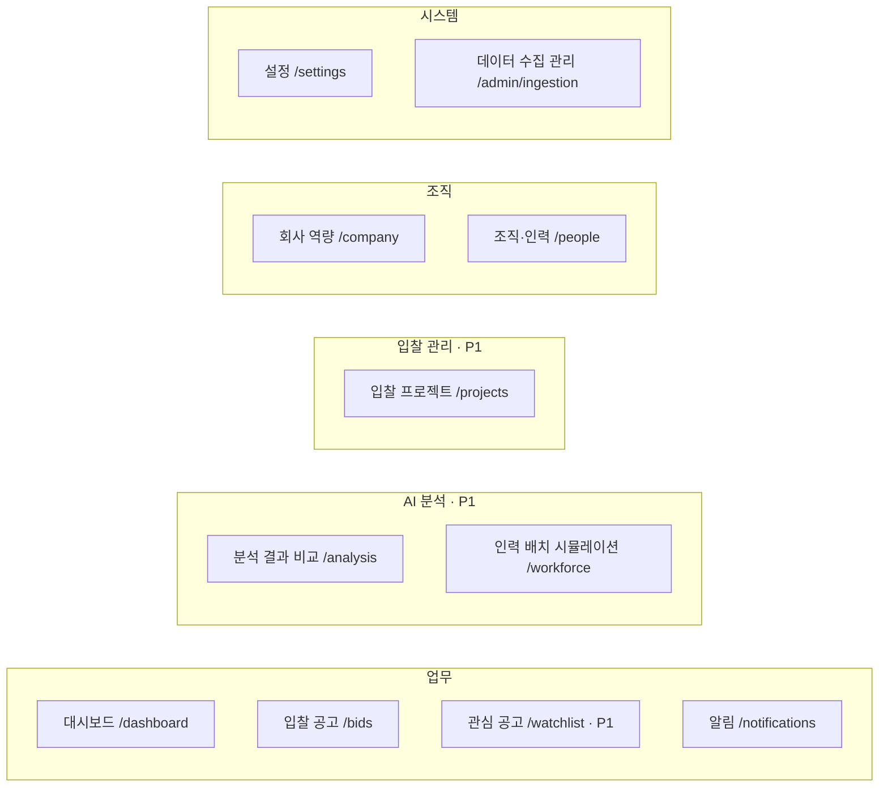
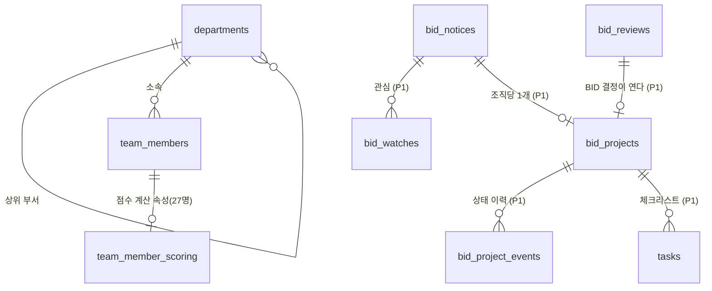
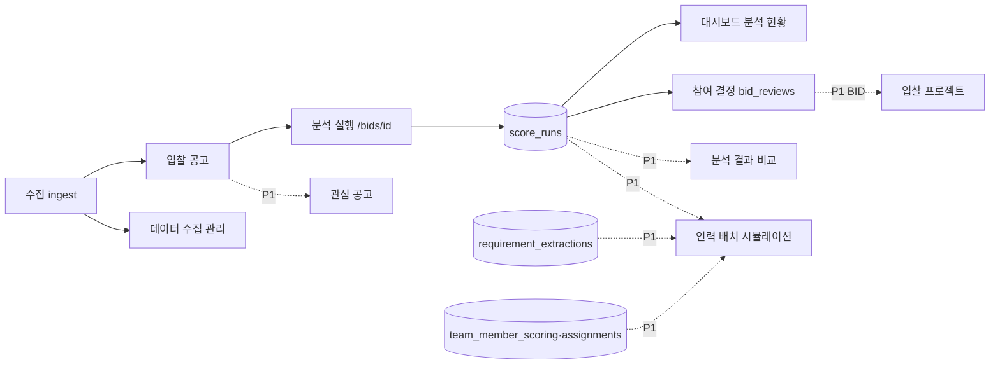

# 설계: 사이드바 정보 구조와 입찰 업무 확장

> [!success] 최종 확정 (2026-10-16, 4차)
> 사용자가 D1~D12·M1~M15(1차), 남은 확인 1~4·M18·M19(2차), M20~M22·본부/그룹 처리(3차), M23·부록 A·B와 최종 설계(4차)를 승인했다. 이 문서가 최종 확정 설계다. 중대한 설계 충돌이나 구현 불가능한 사항이 없는 한 추가 의사결정 요청 없이 이 문서를 기준으로 진행한다. 확정 뒤 새 요구사항은 이 문서를 고쳐 쓰지 않고 §8에 따로 기록하고 영향을 검토한다. M16·M17·M21·M22와 부서 계층 규칙은 사용자 보완 조건대로 반영했다(§2.1·§2.5·§4·§5·§6). 이 문서의 범위는 **설계와 정본 변경 계획까지**다. 정본 문서(`00`~`21`)·소스 코드·DB 마이그레이션·`PROGRESS.md`는 고치지 않았다. 정본 동기화는 사용자가 ADR-020 세션의 작업 완료와 커밋 해시를 확인한 뒤 **별도로 승인하면** 부록 B대로 시작한다(§7). 정본과 이 문서가 다르면 정본이 우선한다.

## 0. 입력과 범위

- 입력 1: [[SIDEBAR-PLAN]] — 공고 탐색 → AI 적합도 분석 → 인력 배치 검토 → 수주 전략 → 참여 결정 → 입찰 프로젝트 관리로 넓히는 계획서.
- 입력 2: 사용자 대화(2026-10-16)
  - 5분 데모는 심사위원과 영업 담당자가 함께 본다.
  - 가상 직원 200명을 관리하고 조직도에서 보고 싶다.
  - 문서끼리, 문서와 코드가 어긋나는 곳을 고친다.
  - 1·2차 승인(§5).
- 최우선 원칙(사용자): 해커톤 데모 필수 기능, 골든 점수 94/72/68, AI 파이프라인, 공식 API 연동, RBAC 설계를 훼손하지 않는다. ADR-020 작업과 충돌하지 않는다.

## 1. 현황 분석

### 1.1 구현된 것과 설계만 있는 것

| 구분 | 상태 | 근거 |
|---|---|---|
| SOL 도메인(공고·수집·점수·분석·검토·알림·회사 프로필) | **설계만 있음**. 코드 0 | `web/server/`에는 템플릿 도메인(`activity`·`admin`·`auth`·`csp`·`organization`·`profile`·`shared`·`supabase`·`task`)만 있다 |
| DB | 템플릿 마이그레이션 8개(조직·초대·tasks·계정 상태·팀 설정). SOL 표 0 | `supabase/migrations/` |
| 사이드바 | 템플릿 그대로: 대시보드·작업·설정. 경로 `/[slug]/…`, 조직 전환기, 받은 초대 | `web/components/app-shell.tsx:49-53` |
| 가상 직원 200명 | 설계 승인(ADR-019), 정본 JSON·사진 아직 없음. 이 저장소에 `fixtures/people/` 없음 | [[PROGRESS]] ADR-019 절 |
| 진행 단계 | Phase 0~7 전부 미완 | [[PROGRESS]] |

계획서 §3의 "현재 메뉴"(대시보드·공고·회사 역량·알림·관리자)는 [[06-UI-UX|06 UI]] §2·§4의 **설계**다. 구현된 메뉴가 아니다.

### 1.2 계획서 전제와 정본이 다른 곳 — 정본을 따른다

계획서 스스로 "정본과 다르면 임의로 바꾸지 마라"(§2)고 했으므로 아래는 정본대로 처리한다.

| 계획서 | 정본 | 처리 |
|---|---|---|
| Backend NestJS, "NestJS API에서 권한 검사" | [[16-DECISIONS|ADR-017]]: Next.js Route Handler `/api/v1` + `web/server/<도메인>` + Supabase RLS. NestJS·ORM 폐기 | 권한은 Route Handler 가드(`sol_role`)와 RLS 두 겹으로 검사한다 |
| PostgreSQL | Supabase Postgres, 마이그레이션은 새 파일로만, 새 표는 바로 RLS | 정본 |
| 반응형 레이아웃 | [[16-DECISIONS|ADR-007]]: 데스크톱 1280~1920만, 1280 미만 breakpoint 금지 | 정본. 화면 확인은 1440·1280 |
| B2B SaaS | 결제·구독·요금 화면 금지(ADR-007) | 정본 |
| GO / NO-GO | 시스템 권고 `BID`·`WATCH`·`NO_BID`(`score_runs.recommendation`), 사람 결정 `bid_reviews.decision`([[20-GLOSSARY|용어집]]) | 새 용어를 만들지 않는다. 화면 문구는 "참여 결정", 값은 BID·WATCH·NO-BID |
| "분석 신뢰도" | [[09-SECURITY|09 보안]]: 충족·낙찰·수주 확률 표현 금지 | 신뢰도 숫자를 만들지 않는다. 실행 모드·데이터 출처·`missingFactors`·`reviewFlags`·인용 검증 결과·Kev 보정 상태를 보여 준다 |
| 분석 요소 6번 "기타 입찰 리스크" | [[08-SCORING|08 점수]]: SOL Score는 5요소(`sol-v0.1.0`) 고정 | 점수에 넣지 않는다. Kev `risk.*`(참고 지표)와 `reviewFlags`로만 표시한다 |
| 권한 없으면 403 | 09: 역할 부족은 403, **다른 조직 자원은 404** | 정본 |

### 1.3 정본끼리·정본과 코드가 어긋난 곳

| ID | 어긋남 | 해결 |
|---|---|---|
| A1 | 06·05는 조직 주소 없는 `/dashboard`, 코드는 `/[slug]/dashboard`(ADR 미결정 11) | D10, §2.9 |
| A2 | 관리자 화면: 06은 `/admin/ingestion` 하나, 05에는 관리자 API 8개 | §2.1 "시스템" 묶음 |
| A3 | 구성원 관리 화면 명세 없음. 템플릿에는 `[slug]/settings/members` | `/settings` 조직 탭(N2) |
| A4 | 개인 설정 위치 없음 | `/settings` 개인 탭(N2) |
| A5 | "관리자" 이중 의미: 템플릿 `/admin` = 서비스 운영자(`profiles.is_admin`), SOL ADMIN = 업무 역할(`memberships.sol_role`) | M3·M19, §2.8 |
| A6 | 구성원 관리 권한: 템플릿 RLS `org_role=owner`, 05 `sol_role=ADMIN`(ADR 미결정 12) | D11 |
| A7 | 마감 임박: 06 §5.3 "72시간", 05 `deadlineWithin7Days`·19 S2 "7일", 13 알림 D-3·D-1 | M4(7일) |
| A8 | 12는 관리자 수집 현황 화면을 "있으면 좋음"에 두는데 06이 명세하고 19 S2·S5가 쓴다 | 2차 확인 4: 데모 필수(N8) |
| A9 | 사이드바 코드가 템플릿 그대로. "작업(tasks)" 메뉴는 설계에 없음 | M11 |
| A10 | 12 Phase 3(데모 필수)에 "가상 정장 사진 200장 연결"이 있는데 06에 사진을 보여 줄 화면이 없다 | 2차 확인 3: 조직·인력 조회 데모 필수(N4a) |

### 1.4 계획서 신규 기능과 정본 범위의 충돌

| 계획서 기능 | 정본 | 결정 |
|---|---|---|
| 신규 P0 4개(관심 공고·분석 비교·인력 시뮬레이션·입찰 프로젝트) | 12 해커톤 컷 "데모 필수"에 없다. 17·12: 데모 필수가 초록불이기 전에 다른 일 금지 | D1, 2차 확인 1 |
| `/workforce` 추천 인력·배치 | 01 FR-11 P1, 05 "인력 배정 API P1", ADR-019 "인력 자동 배정·추천은 범위 밖" | D2 |
| `/projects` 8상태 | 사람 결정은 `bid_reviews` 한 곳. 앞 4상태가 기존 표와 겹친다 | D3 |
| `/projects` 낙찰·미낙찰 결과 | 01 해커톤 제외 "낙찰·계약 데이터 수집", 15 "결과 라벨은 별도 표", 21 "낙찰 결과는 학습 목표 아님" | D4 |
| `/projects` ANALYST 분석 의견 | 01 FR-13 P1 | M6 |
| `/intelligence`·`/calendar` | 01 해커톤 제외, 07 낙찰·계약 API 후속, 일정 필드 미확인 | D5 |
| 관심 공고 ADMIN "전체 관리" | 개인 행동 정보 노출 | D6 |
| 관심 공고 마감 알림 | 13 `DEADLINE_APPROACHING` 수신자는 담당자뿐 | D7 |
| 설정 "관심 사업 분야·공고 추천 조건" | `/company` 선호 설정이 점수 요소 `strategicPreference`의 입력 | M7 |

## 2. 최종 구조

### 2.1 사이드바

묶음 이름은 한국어로 쓴다(M1). **사이드바에는 구현과 검증이 끝난 메뉴만 보인다**(M22). 해커톤 데모 때는 이 조건을 채운 메뉴만 보이며, 계획대로라면 "업무·조직·시스템" 세 묶음이다. "AI 분석"·"입찰 관리" 묶음은 P1 기능이 조건을 채울 때 나타난다.

**메뉴 노출 조건(M22, 3차 승인).** 페이지나 컴포넌트가 있다는 것만으로는 노출하지 않는다. 아래 다섯 가지를 모두 채운 메뉴만 메뉴 정의(코드 한 곳의 배열)에서 출시(`released`)로 표시한다. 표시를 바꾸는 일은 사람이 코드 리뷰로 한다.
1. 페이지와 핵심 기능 구현 완료
2. 필요한 API 연동 완료
3. 권한 검사 적용(서버 가드 + RLS)
4. 관련 시험 통과
5. 그 기능의 완료 기준(§3) 충족

**메뉴 노출과 라우트 접근은 따로 관리한다.**
- 메뉴 노출은 출시 표시만 본다. 화면 편의일 뿐 권한이 아니다.
- 라우트 접근은 서버가 요청마다 로그인·현재 조직·역할을 검사한다. 메뉴가 보이든 숨든 같다.
- 출시 전 화면·API는 서버가 404로 막는다. 메뉴를 숨긴 것에 기대지 않는다. 메뉴 미노출만으로 접근 제어가 끝났다고 보지 않는다.

**응답 구분 (4차 승인).** 서버는 아래 순서로 검사하고 실패마다 다른 응답을 준다.

| 순서 | 검사 | 실패 시 |
|---|---|---|
| 1 | 인증(로그인 세션·Bearer) | 기존 인증 정책 그대로: 화면은 로그인 안내, `/api/v1`은 `401`(05). 출시 여부를 알려 주지 않는다 |
| 2 | 계정 상태(가입 정보 보완 ADR-019, 현재 조직 §2.9) | 기존 정책 그대로: 보완 화면, 초대 안내, `403 UNSUPPORTED_ACCOUNT_STATE` |
| 3 | 출시 여부 | 미출시 경로: `404` |
| 4 | 역할(`sol_role`) | 출시된 경로에 권한 없음: `403` |
| 5 | 자원 소유(RLS) | 다른 조직 자원: `404`(09 기존 정책) |

예외는 템플릿 서비스 운영자 화면 `/ops`다. 운영자가 아니면 역할 부족이어도 `404`다(운영자 화면이 있는지 알리지 않는 템플릿 정책, §2.8).

| 묶음 | 메뉴 | 경로 | 보이는 사람 | 범위 |
|---|---|---|---|---|
| 업무 | 대시보드 | `/dashboard` | 전원 | 데모 필수(정본) |
| 업무 | 입찰 공고 | `/bids`, `/bids/[id]` | 전원 | 데모 필수(정본) |
| 업무 | 관심 공고 | `/watchlist` | 전원(본인 것) | P1 |
| 업무 | 알림 | `/notifications` | 전원(본인 것) | 데모 필수(정본). "조직" 묶음에서 옮김(M2) |
| AI 분석 | 분석 결과 비교 | `/analysis` | 전원 | P1 |
| AI 분석 | 인력 배치 시뮬레이션 | `/workforce` | 전원 | P1 |
| 입찰 관리 | 입찰 프로젝트 | `/projects`, `/projects/[id]` | 전원 | P1 |
| 조직 | 회사 역량 | `/company` | 전원 | 데모 필수(정본) |
| 조직 | 조직·인력 | `/people` | 전원(편집은 ADMIN) | 조회 데모 필수(N4a), 편집 P1(N4b) |
| 시스템 | 설정 | `/settings` | 전원(조직 탭은 ADMIN) | 데모 필수(N2) |
| 시스템 | 데이터 수집 관리 | `/admin/ingestion` | ADMIN만 | 데모 필수(N8) |

- 해커톤 이후 기능(수주 전략·시장 분석 `/intelligence`, 입찰 일정 `/calendar`)은 만들 때까지 메뉴도 두지 않는다(D5).
- 위쪽 막대 사용자 메뉴: 설정 바로가기, 서비스 운영(`/ops`, `profiles.is_admin`만), 로그아웃(M3).
- 메뉴 숨김은 화면 편의일 뿐이다. 권한은 서버 가드와 RLS가 강제한다(09).
- 위쪽 막대 구성(실행 모드·AI 모드·신선도·알림 벨)은 06 §4(ADR-020 반영본) 그대로다.

### 2.2 메뉴별 책임 — 중복을 막는 경계

| 화면 | 맡는 일 | 맡지 않는 일 | 읽는 데이터 |
|---|---|---|---|
| `/bids` | 공고 탐색·필터·정렬. P1 이후 행마다 관심 토글(★) | 분석 결과 비교 | `bid_notices`, 최신 `score_runs` |
| `/bids/[id]` | **개별 공고**의 분석 실행·결과 상세, 참여 결정 패널(`bid_reviews`). P1 이후 관심 토글, BID 결정 뒤 "입찰 프로젝트 만들기" | 여러 공고 비교 | 06 §5.5·§6 그대로 |
| `/watchlist` (P1) | 내 관심 공고만 미리 거른 공고 표. `/bids`와 같은 `BidTable`·`BidFilters`, `GET /bids?watched=me`. 공고 복제 없음 | 별도 필터·표 구현 | `bid_watches` + `/bids` |
| `/analysis` (P1) | 조직의 모든 공고에 대한 분석 이력(상태·실패 사유·실행 모드·`reviewFlags`·알고리즘 버전), 2~4건 SOL Score 요소·자격 판정 비교 | 분석 실행(실행은 `/bids/[id]`에서만) | `score_runs`, `score_factors`, `qualification_checks` |
| `/workforce` (P1) | 공고별 필요 인력·요구 기술(추출)과 점수 계산 대상 27명 매칭, 가용률, 부족 역량, 외부 협력 필요, 여러 공고 기간 충돌. 저장 없음 | 점수 계산(08 `staffAvailability` 그대로 호출), 후보 저장(해커톤 이후) | `requirement_extractions`, `team_member_scoring`, `assignments` |
| `/people` | 조회(데모 필수): 200명 조직도(본부 → 그룹 → 팀, 부서마다 표시 인원은 §2.5 인원수 규칙), 명부 표, 이름·부서·직급/직책 검색·필터, 개인 상세(사진·부서·직급/직책, 점수 계산 대상이면 직무·등급·스킬), 27명/200명 구분. 편집(P1): ADMIN 추가·이동·퇴사 | 공고 매칭 | `departments`, `job_titles`, `team_members`, `team_member_scoring` |
| `/projects` (P1) | 참여 확정(BID 결정) 이후 업무: 담당자, 체크리스트, 제출 마감, 상태, 결과 기록, 관련 분석·결정 링크. 보드 첫 열 "검토 대기"만 기존 표에서 계산(M14) | 참여 결정 자체(`bid_reviews`가 정본) | `bid_projects`, `bid_project_events`, `tasks`, `bid_reviews` |
| `/company` | 06 §5.6 그대로. "인력" 탭은 27명·가용 20 FTE 요약과 `/people?scoring=1` 링크(M5) | 직원 명부 관리 | `company_profiles` |
| `/settings` | 개인 탭: 이름·부서/직급 신고 정보(ADR-019 보완 흐름), 비밀번호·로그인 수단, 계정 삭제(템플릿 재사용). 조직 탭(ADMIN): 구성원·초대·업무 역할 변경 | 회사 선호(`/company`), 개인 알림 수신 설정(해커톤 이후) | `profiles`, `memberships`, `invitations` |
| `/admin/ingestion` | 06 §5.8 + 2차 확인 4 항목: 수집 작업 상태, 최근 실행 내역, 성공·실패·부분 성공, 데이터 출처, 실행 모드(live·fixture·mock), 오류·실패 원인, 마지막 수집 시각, 수동 수집 | 수집 로직(07) | `ingest_runs`, `ingest_errors`, 05 `/admin/sources` |

### 2.3 대시보드 카드 (M4, 2차 확인 2)

카드 정의는 코드 한 곳(카드 슬롯 배열)에 둔다. 다섯 번째 슬롯은 해커톤에 "분석 현황"이고, N6(입찰 프로젝트)가 들어오면 같은 슬롯을 "진행 중 입찰 프로젝트"로 바꾼다. 바꿀 때는 슬롯 정의 한 줄과 DTO 필드 하나만 바뀐다.

| 슬롯 | 카드 | 계산 | 계획서 KPI 대응 |
|---|---|---|---|
| 1 | BID 권고 | 공고별 최신 분석의 `recommendation=BID` 수(08 §5.2) | 고적합도 공고 |
| 2 | 검토 대기 | 분석은 끝났지만 사람 결정이 없는 공고 수(`reviews.pending`) | 참여 검토 중 |
| 3 | 마감 임박 | 마감 7일 이내(A7 통일) | 마감 임박 공고 |
| 4 | 수집 | 마지막 수집 시각 + "적재 N · 격리 N"(06 그대로) | 신규 입찰 공고 |
| 5 | 분석 현황 (해커톤) | 완료·부분·실패 건수. 아래 집계 규칙 | 분석 완료 공고 |
| 5 | 진행 중 입찰 프로젝트 (N6 이후) | `bid_projects.status`가 종료가 아닌 수 | 진행 중 입찰 프로젝트 |

**분석 현황 집계 규칙**
- 조직의 **공고별 최신 `score_runs` 1건**(가장 최근 `created_at`)만 센다. 같은 공고를 여러 번 분석해도(재분석·`force`) 한 번만 센다. `force=false` 중복 요청은 새 행을 만들지 않는다(05 §7).
- 그 1건의 `status`가 `COMPLETED`면 완료, `PARTIAL`이면 부분(규칙만), `FAILED`면 실패다. `QUEUED`·`RUNNING`은 세지 않는다.
- 대시보드 `origin` 필터(05, ADR-020)를 그대로 따른다.
- 분석이 하나도 없으면 0을 보이고 빈 상태 문구 "아직 분석한 공고가 없습니다"를 단다. 임의 값은 쓰지 않는다.

19 S2가 보여야 할 것(실행 모드, DEMO 배지, `AI: mock`, 마감 임박 FX-14, 격리 1건 FX-12)은 그대로 보인다.

### 2.4 권한 매트릭스

| 기능 | VIEWER | ANALYST | SALES | ADMIN | 범위·비고 |
|---|---|---|---|---|---|
| 공고 조회 | O | O | O | O | 데모 필수(정본) |
| 분석 실행 | — | O | O | O | 데모 필수(정본) |
| 참여 결정 기록(`bid_reviews`) | — | — | O | O | 데모 필수(정본) |
| 회사 역량 | 조회 | 조회 | 조회 | 편집 | 데모 필수(정본) |
| 조직·인력 조회 | O | O | O | O | 데모 필수(N4a) |
| 설정 — 개인 | 본인 | 본인 | 본인 | 본인 | 데모 필수(N2) |
| 설정 — 조직(구성원·초대·역할) | — | — | — | O | 데모 필수(N2), D11 |
| 데이터 수집 관리 | 403 | 403 | 403 | O | 데모 필수(N8) |
| 관심 공고 | 본인 | 본인 | 본인 | 본인 | P1. 공고별 관심 인원 수만 조직에 공개(D6) |
| 분석 결과·이력·비교 | O | O | O | O | P1 |
| 입찰 프로젝트·체크리스트 | 조회 | 조회 | 생성·관리 | 생성·관리 | P1. 체크리스트 쓰기도 SALES·ADMIN(M13). ANALYST 의견은 해커톤 이후(FR-13) |
| 입찰 프로젝트 결과 기록 | — | — | O | O | P1(D4) |
| 인력 배치 시뮬레이션 | O | O | O | O | P1. 저장 없는 계산(M8) |
| 조직·인력 편집 | — | — | — | O | P1(N4b) |

- 다른 조직 자원은 404로 통일한다(09).
- 서비스 운영자(`profiles.is_admin`)는 위 표와 별개다(§2.8).
- 감사 기록(`audit_logs`) 대상: 참여 결정, 업무 역할 변경, 입찰 프로젝트 상태·결과 변경, 인력 편집, 회사 프로필 revision.
- 인력 정보는 가상 데이터라도 이름·부서·직급/직책·사진·직무·등급·스킬·가용성만 보인다. 연락처 칸은 없다(ADR-019).

### 2.5 데이터 모델 (새 마이그레이션, 해커톤과 P1을 나눈다)

**해커톤(데모 필수, Phase 1 첫 SOL 마이그레이션에 포함)**

| 표 | 내용 | 제약·RLS |
|---|---|---|
| `departments` (04 설계, 열 추가) | `parent_id` nullable 자기 참조(같은 org 복합 FK), `kind` nullable(`DIVISION`·`GROUP`·`TEAM`), `target_count` nullable | D9·3차 승인. 본부·그룹은 `target_count` 없음이 정상(오류 아님), 팀은 `target_count`를 지정할 수 있다. 04의 `target_count >= 1` CHECK는 팀(또는 `kind` 없음)에만 건다. 가입 선택 목록과 200명 배분 검사는 팀만 대상이다. 직원 소속(`team_members.department_id`)은 팀이다. 순환 참조·존재하지 않는 `parent_id`·자기 참조·깊이 3 초과는 seed 전 데이터 검증에서 오류로 잡는다. 상위 없는 부서는 화면에서 "상위 미지정"(M18). 기존 부서 ID와 직원 연결은 그대로. 읽기 조직 전원, 쓰기 seed만 |
| `team_members` (04 설계, 운영 정보만) | `person_code`, `name`, `gender`, `department_id`, `job_title_id`, `portrait_path`, `is_demo`, `created_at`, `updated_at` | 읽기 조직 전원, 쓰기 seed만(해커톤). 점수 계산 속성은 이 표에 두지 않는다 |
| `team_member_scoring` (신규, 04 `team_members`에서 분리) | `member_id` PK·FK, `org_id`, `role`, `grade`, `skills` JSONB, `availability` JSONB, `created_at` | D8 조건 "운영 정보와 점수 계산 속성 분리". 행이 있는 27명이 점수 계산 대상(`scoringEligible`). 읽기 조직 전원, 쓰기 seed(service role)만. 화면 역할에 쓰기 권한을 영영 주지 않는다. 점수(08 `staffAvailability`)와 `/workforce`는 이 표를 읽는다 |
| 템플릿 개인 조직 생성 | 가입 트리거의 개인 조직 생성 중단 | D10. 이미 있는 개인 조직은 지우지 않는다 |
| 템플릿 구성원·초대 정책 | `org_role=owner` 기준 정책을 `sol_role='ADMIN'` 기준으로 바꾼다 | D11. 정책 시험 갱신 |

분리를 Phase 1부터 하는 이유(M21, 3차 승인): 04의 `team_members`가 아직 구현 전이라 지금 나누면 데이터 이전이 없다. 명부 JSON(`solideo.people.json`)은 한 파일 그대로 두고 seed가 두 표로 나눠 넣는다.
- **같은 직원 식별자로 잇는다.** `team_member_scoring.member_id` = `team_members.id`(같은 org 복합 FK). 정본 JSON의 `personId`(`SOL-P0001`~`SOL-P0200`)는 `team_members.person_code`이고, seed의 UUID 매핑이 두 표에 같은 값을 쓴다. 재실행해도 ID가 바뀌지 않는다(ADR-019).
- **평가용 고정 입력과 운영 DB를 나눈다.** 골든 시험은 정본 JSON의 27명과 고정 `team.asOf`를 입력으로 쓰고 DB를 읽지 않는다. 운영 DB는 화면과 새 분석이 읽는다.
- **퇴사 뒤에도 과거 분석은 그대로다.** 퇴사 처리(P1)는 `team_members`만 바꾸고 `team_member_scoring` 행은 지우지 않는다. 이미 저장된 `score_runs`는 입력 스냅샷이라 바뀌지 않는다.

**부서 인원수 규칙 (3차 승인)**
- 팀의 표시 인원은 그 팀 소속 직원 수다.
- 본부·그룹의 표시 인원은 하위(자손) 팀 소속 직원의 **서로 다른 직원 ID 수**다. 한 직원은 한 팀에만 속하고 한 팀의 상위는 하나라 중복이 생기지 않지만, 계산은 직원 ID로 중복을 없애고 한다. 상위 부서 표에 인원 합계를 따로 저장하지 않는다.
- 상위가 없는 팀의 인원은 "상위 미지정" 묶음에만 센다.
- 표시 인원은 재직 기준이다. P1 퇴사 기능이 생기면 퇴사(`LEFT`) 직원은 표시 인원에서 빠진다(M23).
- 팀의 `target_count`와 실제 인원이 다르면 오류가 아니라 **검증 결과에 차이로 보인다.** 데이터 검증 보고와 seed 검사 로그에 팀별 "목표·실제·차이" 표를 남긴다. 정본 JSON을 처음 만들 때는 차이가 0이어야 한다(PPL-01 배분 알고리즘 일치, 기존 규칙). P1 운영 편집 뒤의 차이는 정상이며 같은 검사로 확인한다.

**P1(있으면 좋음, 착수 조건 §3)**

| 표 | 내용 | 제약·RLS |
|---|---|---|
| `team_members.employment_status` (열 추가) | `ACTIVE`·`LEFT`, 기본 `ACTIVE` | N4b. ADMIN 쓰기 정책(추가·부서/직급 이동·퇴사 처리), 변경마다 `audit_logs` |
| `bid_watches` (신규) | `org_id`, `user_id`, `bid_id`, `created_at` | PK(`org_id`,`user_id`,`bid_id`). 본인 행만 읽기·쓰기. 공고별 관심 인원 수는 집계 함수로만 공개(D6) |
| `bid_projects` (신규) | `id`, `org_id`, `bid_id`, `opened_by_review_id` FK `bid_reviews`, `status`(`PREPARING`·`SUBMITTED`·`AWAITING_RESULT`·`CLOSED`), `owner_id`(로그인 계정, D12), `submission_due_override` nullable, `result` nullable, `result_note`, `result_recorded_at`, `closed_at`, `created_by`, `created_at`, `updated_at` | UNIQUE(`org_id`,`bid_id`). 여는 결정은 `decision=BID`(DB 함수 검사). 마감은 공고 값을 읽고 덮어쓸 때만 override(복제 금지). 읽기 조직 전원, 쓰기 SALES·ADMIN. 수명 규칙 M12 |
| `bid_project_events` (신규) | `id`, `org_id`, `bid_project_id`, `actor_id`, `from_status`, `to_status`, `note`, `created_at` | 추가만. 읽기 조직 전원, 쓰기는 상태를 바꾸는 DB 함수만. 같은 함수가 `audit_logs`도 쓴다(M9) |
| `tasks` (템플릿, 열 추가) | `bid_project_id` nullable, (`bid_project_id`,`org_id`) → `bid_projects(id, org_id)` 복합 FK | 체크리스트 = 프로젝트에 묶인 작업(M11). 템플릿 정책은 구성원 누구나 쓰게 열려 있다(`20261014000004_tasks_and_activity.sql`). `bid_project_id`가 있는 행은 새 제한 정책으로 SALES·ADMIN만 쓴다(M13). 담당자는 로그인 계정(D12) |

- 추적성: 프로젝트 → 여는 결정(`bid_reviews`) → 그 결정의 `score_run_id` → `input_snapshot_hash`. 결정 당시 데이터 버전과 근거를 따라갈 수 있다(계획서 §8).
- 낙찰·미낙찰 결과는 `bid_projects.result`에만 둔다. 점수·Kev·평가셋·학습셋에 넣지 않는다(15·21, D4).
- 골든 보호 → M16(§4).
- 알림 중복 방지(D7): `DEADLINE_APPROACHING` 수신자는 공고 담당자와 관심 등록자의 합집합이다. 사용자 ID로 중복을 없애고, idempotency 키는 `bidId + userId + DEADLINE_APPROACHING + D-n`이다. 13의 "동일 이벤트·수신자·채널 unique"를 그대로 쓰므로 담당자이면서 관심 등록자인 사람도 한 번만 받는다.

### 2.6 API (Route Handler `/api/v1`)

| 메서드 | 경로 | 권한 | 범위 | 내용 |
|---|---|---|---|---|
| GET | `/departments` | 조직 전원 | 데모 필수 | 조직도 트리. 상위 없는 부서는 `parentId:null`. 부서마다 `memberCount`(§2.5 인원수 규칙)와 `targetCount`(팀만, 본부·그룹은 null) |
| GET | `/team-members` | 조직 전원 | 데모 필수 | 명부. `?q&departmentId&jobTitleId&scoring&cursor`. 응답은 사진 경로(없으면 null), 점수 계산 대상 여부 |
| GET | `/team-members/:id` | 조직 전원 | 데모 필수 | 개인 상세. 점수 계산 대상이면 직무·등급·스킬·가용성 |
| GET | `/dashboard/summary` | 정본 | 데모 필수 | `analyses.latestByStatus` 추가(§2.3) |
| GET | `/admin/ingestion/runs`, `/admin/ingestion/runs/:id`, `/admin/sources` | `ADMIN` | 데모 필수 | 정본(05, ADR-020) 그대로. 화면 N8이 쓴다 |
| PUT·DELETE | `/bids/:id/watch` | auth(본인) | P1 | 관심 등록·해제. 멱등 |
| GET | `/bids?watched=me` | 정본 | P1 | 기존 목록 API에 쿼리 하나 |
| GET | `/analyses` | 정본 읽기 | P1 | 조직 분석 이력. `?bidId&status&recommendation&runMode&cursor`. 비교는 `GET /analyses/:id` 최대 4번(M10) |
| GET | `/workforce/simulation` | auth | P1 | `?bidIds=` 1~3건. 저장 없음 |
| POST·PATCH | `/team-members`, `/team-members/:id` | `ADMIN` | P1 | 운영 정보 편집(N4b). 점수 속성은 받지 않는다 |
| GET·POST | `/projects` | 조회 전원 / 생성 `ADMIN, SALES` | P1 | 생성은 `reviewId`(BID 결정) 필수 |
| GET·PATCH | `/projects/:id` | 조회 전원 / 변경 `ADMIN, SALES` | P1 | 상태·담당자·마감 덮어쓰기 |
| POST | `/projects/:id/result` | `ADMIN, SALES` | P1 | 결과 기록(D4) |

- 모든 요청에서 조직은 서버가 정한다. 요청의 본문·쿼리·헤더로 조직 ID를 받지 않는다(M17, §2.9).
- 체크리스트는 템플릿 작업 기능(server action)에 `bidProjectId`를 더해 쓴다. 구성원 관리는 05 `/admin/users`를 쓴다.
- 서비스 운영자 API는 `/api/v1` 밖의 템플릿 API이고 `/api/ops/*`로 옮긴다(§2.8).
- 모든 새 Route Handler·zod 스키마·마이그레이션에 시험을 더한다(17).

### 2.7 AI 파이프라인 연계

새 모델 호출은 없다. 모두 저장된 결과를 읽는다. ADR-020 파이프라인(수집·첨부·파싱·Qwen·Kev·점수)의 코드 경로를 바꾸지 않는다.

- 대시보드 분석 현황과 `/analysis`: `score_runs`와 하위 표만 읽는다. Kev 분포는 06 §8 문구와 고지를 그대로 쓴다.
- `/workforce`: 규칙 계산이다. 추출의 필요 인력·요구 기술과 `team_member_scoring`(27명)·`assignments`를 맞춘다. 200명 전체를 후보·점수 계산 대상으로 넓히지 않는다(D2 조건). 화면에 "점수 계산 대상 27명 중 후보"라고 범위를 밝힌다. 가용 FTE는 `web/server/scoring`의 `staffAvailability`와 같은 함수다. 필요 인력이 `UNKNOWN`이면 "확인 필요". "가상 인력" DEMO 배지.
- `/projects`: AI가 결정을 만들지 않는다. 사람이 BID로 결정한 공고에서만 열린다.

### 2.8 `/ops` 분리와 영향 (M3·M19)

| 구분 | 서비스 운영자 | 조직 ADMIN |
|---|---|---|
| 근거 | `profiles.is_admin`(템플릿, 화면 역할이 바꾸지 못함, `protect_is_admin` 트리거) | `memberships.sol_role='ADMIN'`(현재 조직 안에서만) |
| 화면 | `/ops` (템플릿 `/admin` 이전) | `/admin/ingestion`, `/settings` 조직 탭 |
| API | `/api/ops/users/[id]/status` (템플릿 `/api/admin/users/[id]/status` 이전) | `/api/v1/admin/*` (05) |
| 서버 도메인 | `web/server/ops` (템플릿 `web/server/admin` 이름 변경) | SOL 도메인(`ingestion`·`organization` 등) |
| 서로의 관계 | 운영자라도 멤버가 아닌 조직의 데이터는 RLS로 못 본다. 조직 화면에 들어오지 않는다 | 조직 ADMIN이라도 `/ops`는 404다(운영자 화면이 있는지 알리지 않는다) |

영향 범위(구현 N1에서 고친다. 지금은 고치지 않는다):
- 화면: `web/app/admin/{layout,page,actions,user-list,user-query,loading}` → `web/app/ops/`. `user-query.ts`·`user-list.tsx`의 `"/admin"` 하드코딩.
- API: `web/app/api/admin/users/[id]/status/route.ts`·`route.test.ts` → `web/app/api/ops/...`. CSRF·운영자 확인 로직은 그대로 옮긴다.
- 도메인: `web/server/admin/*` → `web/server/ops/*`, `@/server/admin`을 부르는 곳. `web/lodestar.config.ts`는 `server/*/**` 와일드카드라 고칠 필요가 없다(편집 금지 파일이다).
- DB 이름(`profiles.is_admin`, `admin_set_user_status`, `protect_is_admin`)은 바꾸지 않는다.
- 링크: `web/components/app-shell.tsx:320`, `web/server/profile/profile.model.ts:15` 주석.
- 시험: `web/e2e-auth/admin.spec.ts`(404 단언 포함), `web/e2e-auth/admin-status.write.spec.ts`, `web/e2e/responsive.spec.ts:24`, `web/server/admin/*.test.ts`. 새 시험: 비운영자·조직 ADMIN 모두 `/ops` 404, 옛 `/admin`(하위 경로 없음)은 `/admin/ingestion`으로 보내고 ADMIN이 아니면 403.
- 지침: `.claude/agents/e2e-admin.md`·`qa-admin.md`, `.claude/skills/architecture/SKILL.md:113`, `scripts/db-seed.mjs` 주석. `docs/boilerplate/` 인증 문서 5개(`AUTH-ARCHITECTURE`·`AUTH-API`·`AUTH-TESTING`·`SUPABASE-SETUP`·`database`)는 `docs/boilerplate/README.md` 분류 규칙을 확인한 뒤 고친다.

### 2.9 조직 주소 없는 경로와 격리 (D10·M17)

- 현재 조직은 **서버만** 정한다. 클라이언트가 조직을 고르거나 바꿀 길이 없다.
  - Route Handler·Server Action·서버 컴포넌트는 요청의 본문·쿼리·헤더·쿠키에서 조직 ID를 받지 않는다. zod 스키마에 조직 ID 필드를 두지 않는다.
  - 쓰기의 `org_id`는 서버가 세션 사용자의 멤버십에서 채운다. RLS(`org_id in (select public.my_org_ids())`, WITH CHECK 포함)가 다시 검사한다.
- 업무 조직(`organizations.personal_owner_id is null`) 멤버십 수로 정한다.
  - 0개: 조직 초대 안내 화면(받은 초대 목록 링크). 업무 화면·업무 API는 열지 않는다.
  - 1개: 그 조직으로 들어간다.
  - 2개 이상: "지원되지 않는 계정 상태입니다. 관리자에게 문의하세요" 화면. 업무 API는 `403 UNSUPPORTED_ACCOUNT_STATE`. 해커톤 MVP는 단일 업무 조직만 지원한다.
- 멀티 조직 지원을 위한 조직 전환 UI는 새로 만들지 않는다. 템플릿 조직 전환기와 `/teams/new`는 사이드바·사용자 메뉴에서 뺀다. 템플릿 코드·시험(`org-switcher.spec.ts` 등) 처리는 N1 계획에서 파일별로 정한다.
- 경로에서 조직이 빠져도 데이터 격리는 그대로다. RLS와 `sol_role` 가드는 바뀌지 않는다. 다른 조직 자원은 404다. S7 격리 장면(`org-02` 토큰 → 404)은 그대로 성립한다.
- 가입 시 개인 조직 생성은 새 마이그레이션으로 멈춘다. 이미 만들어진 개인 조직은 지우지 않는다.

## 3. 범위 3단과 우선순위

### 3.1 해커톤 데모 필수 — Phase 0~7과 이번에 승인된 필수 화면

| ID | 기능 | 우선순위 | 선행 조건 | 완료 기준 |
|---|---|---|---|---|
| 정본 | Phase 0~7(12 로드맵, P0-0~P0-11, 평가 트랙) | 최우선. 12의 Phase·P0 순서 그대로 | 12 | 11 §4 Phase 수용 기준, §5 데모 체크리스트, 골든 G1~G10 |
| N1 | 앱 셸: 사이드바 묶음(구현된 메뉴만), 조직 주소 없는 경로·서버 조직 결정, 사용자 메뉴, `/ops` 분리, "작업" 메뉴 제거 | Phase 3 첫 작업 | Phase 1(멤버십·`sol_role`·RLS, 개인 조직 생성 중단·구성원 정책 마이그레이션) | 역할 4개별 메뉴 노출 E2E, 메뉴 노출 조건(M22)과 라우트 접근 분리 시험(미인증은 기존 인증 정책, 출시 전 경로 404, 출시 경로에 권한 없는 역할 403, §2.1 순서), 멤버십 0/1/2+ 시험, 클라이언트가 보낸 조직 ID가 무시·거부되는 시험, `/ops` 404(비운영자·조직 ADMIN), 템플릿 운영자 정지 기능 회귀 없음, 1440·1280 스크린샷, axe 위반 0 |
| N2 | 설정: 개인 탭(이름·부서/직급 신고 정보, 비밀번호·로그인 수단, 계정 삭제), 조직 탭(구성원·초대·`sol_role` 변경, ADMIN) | N1 다음 | N1, D11 정책 | 비ADMIN 조직 탭 403·RLS 거부, 역할 변경 감사 기록, 템플릿 설정 기능 회귀 없음, ADR-019 가입 정보 보완 흐름(PPL-05·06)과 충돌 없음 |
| N8 | 데이터 수집 관리 `/admin/ingestion` | Phase 2 수집 직후 | Phase 2(`ingest_runs`·`ingest_errors`), 05 `/admin/ingestion/runs`·`/admin/sources` | ADMIN 외 403(서버 가드 + RLS), 2차 확인 4 항목 7개 표시, 기록이 없는 항목은 빈 상태(임의 값 없음), `RUN_MODE_MISMATCH`·실패 유형 구분 표시, FX-12 격리 1건·FX-20 재시도(11 체크리스트), 14 관리자 지표 5개 |
| N9 | 대시보드 카드 5개(분석 현황 포함), 마감 임박 7일 | 대시보드 구현 때(P0-7) | Phase 4~5 `score_runs` | 공고별 최신 1건 집계(같은 공고 `force` 재분석 뒤에도 이중 집계 없음 시험), 슬롯 정의 한 곳, S2 기대값 |
| N4a | 조직·인력 조회: 200명 조직도(본부 → 그룹 → 팀), 명부, 이름·부서·직급 검색·필터, 개인 상세, 사진 200장, 27명/200명 구분 | Phase 3 화면 중 대시보드·공고 다음 | ADR-019 명부·사진(PPL-01~04), Phase 1 seed(`departments` 계층, `team_member_scoring` 분리), 부록 A 반영 | 200명·27명 수 일치, 3단 트리, 본부·그룹 표시 인원 = 하위 팀 실제 인원 합(중복 없음), 본부·그룹 `targetCount` 없음이 오류로 나오지 않음, 상위 부서 없음 → "상위 미지정"·사진 없음 → 이니셜 대체에서 오류 없음, 검색·필터 URL 동기화, 연락처 없음, "가상 인물" DEMO 표시, 다른 조직 0행, 1440·1280, axe 위반 0 |

### 3.2 P1 — 12 "있으면 좋음" 최상단

**착수 조건(2차 확인 1, 3차 확정)**: Phase 0~7과 이번에 더한 데모 필수 기능(N1·N2·N4a·N8·N9)이 모두 완료되고 핵심 시험이 통과해야 한다. 이 조건을 만족하기 전에는 P1을 시작하지 않는다. 핵심 시험은 11 §4 Phase 0~7 수용 기준, 11 §5 데모 체크리스트 리허설, 골든 G1~G10, `pnpm verify` 초록불이다. P1 작업 때문에 공고 수집·AI 분석·SOL Score·Kev·공식 API 연동 작업을 미루거나 줄이지 않는다. 기존 "있으면 좋음" 항목(E3 대조군, `/admin/ai/eval-runs` 화면 등)은 아래 다섯 개 다음에 둔다.

| 순서 | ID | 기능 | 선행 조건 | 완료 기준 |
|---|---|---|---|---|
| P1-1 | N3 | 관심 공고(`/watchlist`, ★ 토글, 마감 알림 D7) | 착수 조건, `/bids` | RLS(본인만·다른 조직 0행), 멱등 토글, 관심 인원 수 집계만 공개, 알림 중복 0(담당자 겸 관심 등록자 1건) |
| P1-2 | N5 | 분석 결과 비교(`/analysis`) | 착수 조건, Phase 4~5 | 이력 필터, 비교 4건, PARTIAL·FAILED 표시, 확률·신뢰도 숫자 없음 |
| P1-3 | N6 | 입찰 프로젝트(`/projects`) + 대시보드 슬롯 5 교체 | 착수 조건, Phase 6, D3·D4·D12 | BID 결정 없이 생성 거부, M12 수명 규칙, 상태 이력(`bid_project_events`)·감사 기록, 체크리스트 쓰기 권한(M13) 정책 시험, 결과가 점수·Kev에 쓰이지 않음 |
| P1-4 | N7 | 인력 배치 시뮬레이션(`/workforce`) | 착수 조건, N4a, Phase 4 | 단일 공고 가용 FTE가 그 공고 최신 `score_runs` 스냅샷과 같음(M15), 기간 충돌 1건(seed `assignments`) 탐지, 후보는 27명 안에서만, 저장 없음 |
| P1-5 | N4b | 조직·인력 ADMIN 편집(추가·부서/직급 이동·퇴사) | 착수 조건, N4a | ADMIN만(다른 역할 403·RLS 거부), 감사 기록, **회귀 시험**: 운영 편집 뒤 골든 시험 94/72/68 그대로, 기존 `score_runs` 불변(M16) |

순서는 M20(3차 승인으로 확정)이다: 작고 독립적인 것 → 기존 데이터를 읽는 것 → 새 업무 표 → 다른 P1에 기대는 것 → 데모 가치가 가장 낮은 편집.

### 3.3 해커톤 이후

| 기능 | 이유 |
|---|---|
| 수주 전략·시장 분석(`/intelligence`) | 낙찰·계약 API는 07 후속, FR-10 P1·FR-12 P2. 수주 확률 표현 금지(09) |
| 입찰 일정(`/calendar`) | 일정 필드 미확인(07). 해커톤에는 대시보드 마감 임박으로 대신한다 |
| 개인 알림 수신 설정 | 13 해커톤 범위는 인앱만 |
| ANALYST 검토 의견(FR-13) | 01 P1 |
| 인력 후보 저장·배정 확정 | 05 "인력 배정 API P1", FR-11 |
| 멀티 조직 지원 | D10. 조직 전환 UI를 만들지 않는다 |
| 정본의 기존 "해커톤 이후" 항목 | 12 그대로(카카오 실발송, Kev LoRA 등) |

## 4. 메인 세션 결정

| ID | 결정 | 상태 |
|---|---|---|
| M1 | 사이드바 묶음 이름을 한국어로(업무·AI 분석·입찰 관리·조직·시스템) | 승인 |
| M2 | 알림을 "업무" 묶음으로 | 승인 |
| M3 | 템플릿 서비스 운영자 화면 `/admin` → `/ops`, 사용자 메뉴에서만 진입 | 승인(조건: 권한 분리·영향 검토 → §2.8) |
| M4 | 마감 임박 7일, 대시보드 카드 5개. 다섯 번째는 해커톤 "분석 현황", N6 이후 "진행 중 입찰 프로젝트" | 승인(2차 확인 2) |
| M5 | `/company` 인력 탭은 27명·20 FTE 요약 + `/people` 링크 | 승인 |
| M6 | ANALYST 의견은 해커톤 이후 | 승인 |
| M7 | 개인별 "공고 추천 조건" 없음. 회사 선호는 `/company` | 승인 |
| M8 | 인력 시뮬레이션은 전원 사용, 저장 없음 | 승인 |
| M9 | 프로젝트 상태 이력은 `bid_project_events`(조직 전원 읽기) + `audit_logs` | 승인 |
| M10 | 분석 비교 전용 API 없음 | 승인 |
| M11 | 템플릿 tasks는 지우지 않고 체크리스트로 재사용, 사이드바 "작업" 메뉴만 제거 | 승인 |
| M12 | 프로젝트 수명: ① 열린 뒤 BID가 아닌 결정이 새로 들어오면 자동 종료하지 않고 경고, 상태 전진 차단, 종료는 사람이 ② 공고 정정 시 "공고 정정됨" 배지 + 최신 revision 링크, `opened_by_review_id`는 이력 ③ 종료된 프로젝트는 새 BID 결정이 있으면 SALES·ADMIN이 다시 연다 | 승인 |
| M13 | 프로젝트에 묶인 체크리스트 쓰기는 SALES·ADMIN만 | 승인 |
| M14 | 프로젝트 보드 열: 검토 대기 → 제안 준비 → 제출 완료 → 결과 확인 → 종료. "관심"·"분석 중" 열 없음 | 승인 |
| M15 | 시뮬레이션 기준 시각: 단일 공고 가용 FTE는 최신 분석 스냅샷 값, 여러 공고 충돌은 현재 배정으로 다시 계산하고 기준 시각 표시 | 승인 |
| M16 | **골든 보호는 데이터 분리로 한다. 퇴사 처리를 영구히 막지 않는다.** ① 점수 계산 속성은 `team_member_scoring`(seed 전용)에 두고, 운영 정보(`team_members`)와 나눈다 ② 골든 시험(G1~G10·PPL-07)은 DB 상태가 아니라 고정 입력(정본 JSON의 27명 + 고정 `team.asOf`)으로 순수 함수를 계산한다(08 점수는 DB·시각에 기대지 않는 순수 함수) ③ 저장된 `score_runs`는 입력 스냅샷이라 운영 편집 뒤에도 그대로다 ④ 데모 DB는 `pnpm demo:reset`이 seed로 되돌리고, 리허설 체크에 "점수 계산 대상 27명 재직" 확인을 더한다 ⑤ 운영에서 퇴사한 사람은 다음 분석부터 가용 인력에서 빠진다. 계산식이 아니라 입력이 바뀌는 것이라 `sol-v0.1.0` 그대로다. 판단: 정본 구조(순수 함수 점수·입력 스냅샷·멱등 seed)를 그대로 쓰므로 과도한 변경이 아니다. 그래서 임시 퇴사 차단은 두지 않는다. 평가 결과가 달라지는 문제가 생기면 먼저 원인을 분석하고 시험·데이터 분리 구조를 고친다. 퇴사 제한은 사용자의 별도 명시 승인 없이 도입하지 않는다(§6 TD-1) | 개정(2·3차 사용자 보완 반영) |
| M17 | 현재 조직은 서버만 정한다. 조직 ID를 요청에서 받지 않는다. 업무 멤버십 0개 초대 안내 / 1개 진입 / 2개 이상 "지원되지 않는 계정 상태"(`403 UNSUPPORTED_ACCOUNT_STATE`). 조직 전환 UI 없음, RLS·API 격리 유지(§2.9) | 개정(사용자 보완 반영) |
| M18 | 상위 부서가 없는 부서는 "상위 미지정" 묶음으로 표시 | 승인 |
| M19 | 운영자 API도 `/api/ops/*`, 서버 도메인 `ops`. DB 객체 이름은 그대로 | 승인 |
| M20 | P1 순서: 관심 공고(N3) → 분석 결과 비교(N5) → 입찰 프로젝트(N6) → 인력 배치 시뮬레이션(N7) → 직원 편집(N4b). 착수 조건은 §3.2 | 승인(3차) |
| M21 | `team_members`(운영)와 `team_member_scoring`(점수)를 Phase 1 첫 SOL 마이그레이션부터 분리하고 같은 직원 식별자로 잇는다(§2.5) | 승인(3차) |
| M22 | 사이드바에는 구현과 검증이 끝난 메뉴만 보인다. 노출 조건 5개, 메뉴 노출과 라우트 접근의 분리, 응답 구분(미인증 = 기존 인증 정책, 미출시 = 404, 출시 경로 권한 없음 = 403)은 §2.1 | 승인(3차 조건 반영, 4차 응답 구분 반영) |
| M23 | 부서 표시 인원은 재직 기준. P1 퇴사 기능이 생기면 퇴사 직원은 표시 인원에서 빠진다 | 새로 정함(3차 부서 인원수 규칙을 구체화) |

## 5. 사용자 결정

**1차 (D1~D12)**

| ID | 결정 | 사용자 조건 |
|---|---|---|
| D1 | 정본 Phase 0~7 최우선. 사이드바 정리·설정은 데모 필수. 신규 4개는 P1 | 데모 필수 완성 전 P1 착수 금지 |
| D2 | 추천 인력은 규칙 매칭 후보, 최종 선택은 사람 | 27명과 200명 구분, 200명으로 넓히지 않음, 후보 저장은 해커톤 이후 |
| D3 | 프로젝트는 BID 결정 뒤 생성, 저장 상태 4개 | — |
| D4 | 낙찰 결과 수동 기록 | SOL Score·Kev·모델 학습에 쓰지 않음 |
| D5 | 수주 전략·시장 분석, 입찰 일정은 해커톤 이후 | 구현 전 사이드바 비노출 |
| D6 | 관심 공고는 ADMIN 포함 본인 것만, 조직에는 관심 인원 수만 | — |
| D7 | 관심 등록자에게 D-3·D-1 알림 | 기존 알림과 중복 발송 금지 |
| D8 | ADMIN 직원 추가·이동·퇴사 | 운영 정보·점수 속성 분리, 회귀 시험 |
| D9 | 조직도 본부 → 그룹 → 팀 | 하위 호환, 상위 없어도 오류 없음 |
| D10 | 조직 주소 없는 경로, 조직 전환 UI·개인 조직 생성 없음 | DB·API 격리 유지 |
| D11 | 구성원 관리 = `sol_role=ADMIN` | — |
| D12 | 프로젝트·체크리스트 담당자는 로그인 계정 | 200명은 시뮬레이션 후보로만 |

**2차 (남은 확인 1~4)**

| 번호 | 결정 | 사용자 조건 |
|---|---|---|
| 1 | 신규 기능은 12 "있으면 좋음" 최상단 | 데모 필수 완료·핵심 시험 통과 뒤에만 착수. 핵심 기능 완성도 저하 금지 |
| 2 | 다섯 번째 카드 "분석 현황"(완료·부분·실패) | 실제 실행 결과 기준, 중복 실행 이중 집계 금지, 나중에 "진행 중 입찰 프로젝트"로 교체 가능한 구조 |
| 3 | 조직·인력 조회를 Phase 3 데모 필수로 | 사진·상위 부서 누락에도 정상 작동. 편집은 P1 |
| 4 | `/admin/ingestion` 데모 필수 | 기록 없는 항목은 빈 상태, ADMIN 외 서버 권한 거부 |

**3차 (M20~M22·본부/그룹 처리)**

| 항목 | 결정 | 사용자 조건 |
|---|---|---|
| M20 | P1 순서 확정 | 착수 조건(데모 필수 완료, 11 §4·§5, G1~G10, `pnpm verify`) 충족 전 P1 시작 금지 |
| M21 | 두 표 분리 확정 | 같은 직원 식별자로 연결, 평가용 고정 입력과 운영 DB 구분, 골든 94/72/68 유지, 퇴사 뒤 과거 분석 불변 |
| M22 | 구현 완료 메뉴만 노출 | 노출 조건 5개, 메뉴 숨김과 라우트 접근 분리 관리, 서버 권한 검사 유지 |
| 부서 계층 | 본부·그룹 `targetCount` 없음, 팀만 지정 | 가입 목록·200명 배분 검사는 팀만, 상위 인원 = 하위 팀 실제 인원 합(중복 없음), `targetCount` 없는 본부·그룹은 오류 아님, 팀 목표·실제 차이를 검증 결과에서 확인, 부서 ID·직원 연결 유지, 순환·없는 `parentId`는 검증 오류 |
| M16·TD-1 | 네 가지 보호 유지 | 임시 퇴사 제한 자동 활성화 금지, 문제 시 원인 분석·구조 수정 먼저, 퇴사 제한은 별도 명시 승인 |

## 6. 알려진 제약과 기술 부채

- **TD-1 (보류, 자동 활성화 금지)**: 골든 점수나 기존 평가 결과가 운영 편집(P1) 때문에 달라지는 문제가 생기면, 먼저 원인을 분석하고 시험·데이터 분리 구조(M16 ①~④)를 고친다. "점수 계산 대상 27명 퇴사 처리 임시 제한"은 그래도 해결되지 않을 때 사용자에게 제안만 한다. **사용자의 별도 명시 승인 없이 도입하지 않는다.**
- 해커톤 마감일이 정해지지 않았다(12·18). 컷 위치는 마감일이 나오면 다시 본다.
- 가상 명부 JSON·사진은 다른 작업에서 생성 중이다. 부록 A의 전달 사항이 반영돼야 N4a를 완료할 수 있다.
- 공공 API의 질의 기한·발표 일정 필드는 확인되지 않았다(07).
- 정본 문서는 다른 세션의 ADR-020 반영 작업이 진행 중이다. 동기화는 §7의 게이트를 지난 뒤에 한다.

## 7. 정본 동기화 방법

### 7.1 커밋 안 된 정본 변경의 정체 (2026-10-16 17:24 기준)

- 변경 파일: 정본 19개(`00`~`12`·`15`~`20`, `13`·`14` 제외) + `PROGRESS.md`. 새 파일 `21-MODEL-TRAINING.md`·`plans/2026-10-16-ai-pipeline-finetune-design.md`. 합계 +2,103 / −481줄.
- 내용: **ADR-020(실데이터 MVP·AI 파이프라인 v0.2) 정본 반영**이다. [실데이터 AI 파이프라인 설계](2026-10-16-ai-pipeline-finetune-design.md) §20의 "고칠 문서" 목록과 파일이 일치한다.
- 분석 당시 진행 중이었다. 06 §6·§8은 분석 도중에도 바뀌었다. 웹 랜딩 파일 3개도 바뀌었다.
- 이 세션이 바꾼 것: `PROGRESS.md` 작업 로그 1행(1차 설계 때), 이 설계 문서. `SIDEBAR-PLAN.md`는 사용자 파일이라 손대지 않았다.
- 의미 충돌은 없다(ADR-020 = 수집·AI·실행 모드, 이 설계 = 메뉴·업무 화면·권한). 겹치는 것은 같은 파일의 같은 표·문단이다.

### 7.2 동기화 게이트와 순서

1. **게이트(사용자 확인).** 사용자가 ADR-020 작업 세션에서 작업 완료와 커밋을 직접 확인하고, 그 커밋 해시와 함께 알려 준다. 파일 수정 시각이나 `git status`로 판단하지 않는다.
2. **재대조.** ADR-020 커밋 뒤의 최신 정본을 기준으로 부록 B의 위치·문장을 다시 대조하고, 달라진 곳을 사용자에게 보고한다.
3. **별도 승인.** 사용자가 정본 동기화(ADR-021)를 명시적으로 승인한다.
4. **금지.** ADR-020 변경을 되돌리거나(`git restore`·`git reset`·`git clean` 등), 대신 커밋하거나, 다른 브랜치로 옮기지 않는다. 다른 세션에 메시지를 보내지 않는다.
5. **기준점.** 확인받은 커밋 해시를 이 문서 §7과 [[PROGRESS]]에 적는다. 그 사이 정본이 더 바뀌었으면 부록 B의 위치를 다시 맞춘다.
6. **적용.** 부록 B 순서대로 한 파일씩 적용한다. 부록 B의 "덧붙임"은 기존 문장을 지우지 않는다. "교체"는 부록 B가 지목한 문장만 바꾼다.
7. **파일마다 diff 확인.** 삭제된 줄이 부록 B가 지목한 문장인지 본다. 그 밖의 ADR-020 줄이 사라졌으면 그 파일 작업을 되돌린다(이 세션이 그 자리에서 쓴 것만).
8. **교차 검사**(`docs-keeper` 규약): frontmatter `updated`, 위키링크, 값 집합·표 개수, ADR 번호(021 미사용 재확인), 시험 ID 중복, 숫자(94/72/68, 27명·20 FTE, 7일, 카드 5개).
9. **커밋은 사용자가 요청할 때만**, 이 설계 범위 파일만 지정해 스테이징한다.

### 7.3 정본 결정을 바꾸는 곳 (ADR-021에 "개정"으로 적는다)

- ADR-019 "인력 자동 배정·추천은 범위 밖" → 사람이 고르는 "규칙 매칭 후보" 표시만 허용(P1), 저장은 해커톤 이후.
- ADR-019·04의 `team_members` 한 표 구조 → `team_members`(운영)와 `team_member_scoring`(점수) 두 표. 정본 밖이지만 같은 내용을 담은 [솔리데오 인력 스펙](../../polaris/specs/planned/2026-10-16-solideo-people-signup.md) §8도 고친다.
- ADR-018 남은 것 "개인 조직 생성 유지 여부"와 미결정 11·12 → D10·D11로 종결.
- 12 해커톤 컷: 관리자 수집 현황 화면 "있으면 좋음" → 데모 필수(A8). 조직·인력 조회를 Phase 3에 명시(A10).
- 06 §5.3 마감 임박 72시간 → 7일(A7).
- 09 RBAC 표의 조직 역할(`org_role`) 설명 "초대·구성원 관리" → 구성원 관리는 `sol_role=ADMIN`(D11).

## 8. 확정 이후 변경 기록

확정(2026-10-16, 4차) 뒤 생긴 요구사항은 위 본문을 고쳐 쓰지 않고 여기에 한 행씩 쌓는다. 행마다 영향(바뀌는 절·부록 B 항목·정본 문서·시험)을 적고, 중대한 설계 충돌이나 구현 불가능이 있을 때만 사용자 결정을 요청한다.

| 날짜 | 변경 | 출처 | 영향 | 상태 |
|---|---|---|---|---|
| 2026-10-16 | 응답 구분: 미인증 = 기존 인증 정책, 미출시 = 404, 출시 경로 권한 없음 = 403 | 4차 승인 | §2.1, M22, §3.1 N1, 부록 B.2·B.3·B.8(NAV-09) | 반영함 |
| 2026-10-16 | 동기화 기준점 `22b788e`(ADR-020 커밋). 사용자가 정본 동기화를 승인했다. 사전 검토에서 물은 결정 1~4는 추천안대로 적용한다: ① G1에 실행 모드 칸을 함께 넣는다 ② 17이 12의 없는 "결정 필요" 콜아웃을 가리키는 문제는 ADR-021 범위 밖으로 둔다 ③ 동기화를 커밋할 때 이 문서와 [[SIDEBAR-PLAN]]을 함께 넣는다 ④ 아래 G1~G18을 먼저 적고 적용한다(G18은 적용 뒤 교차 검사에서 찾아 같은 절차로 더했다) | 사용자 승인 | §7.2 1~3·5번. §7 본문은 고치지 않고 기준점을 이 행과 [[PROGRESS]]에 적는다 | 반영함 |
| 2026-10-16 | G1. 06 §4 Topbar 그림의 "조직명 ▾"를 "솔리데오"로 바꾼다(▾ 없음, D10). ADR-020이 빠뜨린 `실행 모드: mock` 칸을 함께 넣는다 | 사전 검토 | B.3 보완 | 반영함 |
| 2026-10-16 | G2. 06 §6 와이어프레임: Topbar의 "세종특별자치시 ▾"를 "솔리데오"로 바꾸고 실행 모드 칸을 넣는다. 사이드바 열(옛 "관리자")을 §4와 같은 메뉴로 바꾼다 | 사전 검토 | B.3 보완 | 반영함 |
| 2026-10-16 | G3. 04 §7 8번 "tasks는 SOL RADAR가 쓰지 않는다. 지운다면 Phase 1에"를 "tasks는 지우지 않고 입찰 프로젝트 체크리스트로 재사용"으로 바꾼다(M11) | 사전 검토 | B.5 보완 | 반영함 |
| 2026-10-16 | G4. 04 §3.1 역할 표 `memberships.org_role`의 쓰임 "조직 관리(초대·구성원 관리)"를 "템플릿 호환용, 구성원 관리는 `sol_role=ADMIN`"으로 바꾼다(D11) | 사전 검토 | B.5 보완 | 반영함 |
| 2026-10-16 | G5. 04 §3.1 "Phase 1에서 정할 것" 콜아웃의 1·2번에 "결정됨(ADR-021)"을 단다. 3·4번은 그대로 둔다 | 사전 검토 | B.5 보완 | 반영함 |
| 2026-10-16 | G6. 19 "솔리데오 직원·사진 준비 체크" 첫 줄의 "최소 1명·총 200명"을 팀 항목 기준으로 바꾸고, 본부·그룹은 `targetCount`가 없다는 것을 덧붙인다 | 사전 검토 | B.9 보완 | 반영함 |
| 2026-10-16 | G7. 20 `scoringEligible` 정의는 유지한다. "DB에서는 `team_member_scoring` 행이 있는지로 정하고, 가용 인력 입력은 재직자만(ADR-021 P1)"을 덧붙인다(M16 ⑤) | 사전 검토 | B.12 보완 | 반영함 |
| 2026-10-16 | G8. 10 "솔리데오 인력·사진 준비"에 "점수 계산 속성 27행은 `team_member_scoring`"을 덧붙인다(M21). B.18의 "10은 바꾸지 않는다"를 이 한 문장만큼 정정한다 | 사전 검토 | B.18 정정 | 반영함 |
| 2026-10-16 | G9. polaris 스펙 §3의 "인력 자동 배정·추천은 범위 밖"은 유지한다. "사람이 고르는 규칙 매칭 후보 표시는 ADR-021 P1에서 허용, 저장은 해커톤 이후"를 덧붙인다(§7.3) | 사전 검토 | B.17 보완 | 반영함 |
| 2026-10-16 | G10. B.1·B.8의 "NAV-01~NAV-08"을 "NAV-01~NAV-09"로 적용한다. 4차에서 NAV-09를 더한 뒤 두 곳이 갱신되지 않았다. 같은 이유로 B.2 ADR 행의 "사용자 승인 2회"는 "사용자 승인 4차"로 적는다 | 재대조 | B.1·B.2·B.8 | 반영함 |
| 2026-10-16 | G11. 16 ADR-018·ADR-019 행의 상태 칸에 "(ADR-021로 개정: …)"을 달고, ADR-018 구현 결과와 ADR-019 상세의 "미결정 11번" 문장 뒤에 결정을 덧붙인다. ADR-020이 ADR-004·008·012를 표시한 방식과 같다 | 재대조 | B.2 보완 | 반영함 |
| 2026-10-16 | G12. 06 §5.3 로딩 칸의 "카드 4개"를 "카드 5개"로 바꾸고, 빈 상태 칸에 분석 0건 문구를 덧붙인다(§2.3) | 재대조 | B.3 보완 | 반영함 |
| 2026-10-16 | G13. D10·D11이 닿지 않은 문장을 고친다: 05 §1 "미결정 — 현재 조직을 고르는 방법"과 §2 "미결정 — 구성원 관리 권한의 기준" 콜아웃에 결정을 단다. 05 §1 권한 행과 20 `org_role` 행의 "조직 관리용" 설명, 09 허용 역할 표의 "05 §2 미결정"을 바꾼다. 05 §5 `404 NOT_FOUND`에 미출시 경로를 덧붙인다(§2.1 응답 구분) | 재대조 | B.4·B.7·B.12 보완 | 반영함 |
| 2026-10-16 | G14. 04 §2 ERD에 `departments` 자기 참조와 `team_members` → `team_member_scoring` 관계를 덧붙인다 | 재대조 | B.5 보완 | 반영함 |
| 2026-10-16 | G15. 12 Phase 0 행에 덧붙이는 문구에서 `/ops` 이전 시점을 "Phase 3 앱 셸"로 밝힌다(§2.8·§3.1 N1과 맞춤) | 재대조 | B.1 문구 | 반영함 |
| 2026-10-16 | G16. Codex b3ef worktree 커밋 `5ece7c0`(main 미병합)이 07 §8 끝, 11 §8, PROGRESS ADR-019 절, polaris 스펙 §5를 고쳤다. 이 동기화가 새 병합 충돌을 만들지 않도록 덧붙임 위치를 고르고, 파일마다 `git merge-file`로 3자 병합(기준 `f6700e1`)을 확인한다. PROGRESS 작업 로그 끝의 충돌은 동기화 전부터 있다 | 재대조 | B.8·B.14·B.16·B.17 위치 | 반영함 |
| 2026-10-16 | G17. b3ef의 `supabase/migrations/20261016000001_solideo_people_signup.sql`은 동기화 전 04를 구현했다: `team_members` 한 표에 점수 속성(`scoring_eligible`·`role`·`grade`·`skills`·`availability`), `departments.target_count not null check (>= 1)`, `parent_id`·`kind` 없음, 가입 트리거의 개인 조직 생성 유지. 동기화 뒤 정본(M21·D9·D10)과 다르다. 이미 있는 마이그레이션은 고치지 않고 새 마이그레이션으로 맞춘다. 부록 A처럼 사용자가 그 세션에 전달한다. 이 세션은 그 파일을 고치지 않는다 | b3ef 대조 | §2.5, N1·N4a 선행 조건 | 사용자 전달 필요 |
| 2026-10-16 | G18. 16 ADR-017 구현 결과의 "`tasks`는 쓰지 않는다"와 "`org_role`은 초대·구성원 관리에만 쓴다" 뒤에 ADR-021 결정(M11·D11)을 덧붙인다. 17의 "견본 도메인 중 정리할 범위를 정한다"는 범위 결정 절차라 그대로 둔다(B.18) | 교차 검사 | B.2 보완 | 반영함 |
| 2026-10-16 | G19. 05 §4.7 `TeamMemberDetail.scoring` 구조(`role`·`grade`·`skills`·`availability`)는 그대로 쓴다. 확인 결과: 필드 이름이 `team_member_scoring` 열, SOL Score 입력 스냅샷 `team.members`(15·03, 인력 이름·성별·사진 제외), 명부 fixture 점수 계산 대상 27명의 키와 같다. 노출은 §2.4대로 조직 구성원 전원 읽기(RLS로 다른 조직 0행), 연락처 없음, 쓰기는 seed만. 주석의 참조만 "08 team 입력"에서 "`AnalysisInput.team.members`(15)·`TeamAvailability`(08 §3.3)"로 바로잡는다 | 사용자 확인 요청 | B.4 문구 | 반영함 |

## 부록 A. 명부 생성 작업에 전달할 요구사항

**최종 사양(4차 확정).** 아래 13개를 사용자가 명부 생성 세션에 전달하고, 그 세션이 적용한다. 이 세션은 그 세션의 파일을 직접 고치지 않는다.

> **대상**: `fixtures/people/solideo.departments.json`(및 그 검증 시험·생성 스크립트)
> **근거**: SOL RADAR 사이드바 설계 D9·M18·D8([설계](docs/plans/2026-10-16-sidebar-ia-design.md))
>
> 1. 각 부서 항목에 **선택 필드** `parentId`(상위 부서 `id` 또는 `null`)와 `kind`(`"DIVISION"`·`"GROUP"`·`"TEAM"` 또는 생략)를 더한다. 기존 필드(`id`·`name`·`sourceCount`·`targetCount`·익명 원본 셀 범위)와 기존 부서 `id`는 그대로 둔다.
> 2. 계층은 본부(`DIVISION`) → 그룹(`GROUP`) → 팀(`TEAM`)이다. 그룹이 없는 본부 아래 팀은 `parentId`가 본부를 가리켜도 된다. 깊이는 3 이하다.
> 3. 상위 본부·그룹도 `departments` 항목으로 넣는다. **본부·그룹은 `targetCount`가 없다**(생략 또는 `null`). 이것은 데이터 오류가 아니다. **팀은 `targetCount`를 지정한다.**
> 4. 가입 선택 목록(`GET /signup-options`)과 200명 배분 검사(합계 200·팀별 최소 1명·배분 알고리즘 일치)는 **팀만** 대상으로 한다(`kind`가 `"TEAM"`이거나 생략된 항목). 이 때문에 기존 검사·가입 목록이 바뀌어야 하면 그 내용을 알려 달라.
> 5. 직원의 `departmentId`는 **팀만** 가리킨다(배분이 팀 단위다). 본부·그룹 직속으로 둬야 할 것 같은 인원이 있으면 상위 부서를 지어내지 말고 검증 보고에 남긴 뒤 알려 달라.
> 6. 본부·그룹의 인원 합계를 JSON에 따로 적지 않는다. 화면이 하위 팀 실제 인원을 직원 ID 기준으로 합산한다(중복 집계 방지).
> 7. 원본 조직도에서 상위를 확정할 수 없거나, 같은 팀명 합산(스펙 §5) 때문에 한 팀이 **서로 다른 상위 아래에 나타나면** 상위를 지어내지 않는다. `parentId: null`로 두고 검증 보고에 그 팀 ID와 사유를 남긴다. `parentId`가 `null`이거나 `kind`가 없는 항목은 실패가 아니다(화면에서 "상위 미지정"으로 보인다).
> 8. **검증 오류로 잡을 것**: 존재하지 않는 `parentId`, 자기 자신을 가리키는 `parentId`, 순환, 깊이 3 초과, 팀이 아닌 부서를 가리키는 직원 `departmentId`.
> 9. **검증 보고에 남길 것**: 팀별 "목표(`targetCount`)·실제 인원·차이" 표. 정본 JSON을 처음 만들 때는 차이가 0이어야 한다(PPL-01 배분 알고리즘 일치, 기존 규칙). 상위 미지정 팀 목록과 사유도 남긴다.
> 10. 기존 부서 `id`와 `solideo.people.json`의 `departmentId` 연결, 직원 `personId`를 바꾸지 않는다. 직원 200명·남녀 100/100·배분 결과가 그대로여야 한다.
> 11. `schemaVersion`은 하위 호환 증가로 올린다. 새 필드가 없는 이전 JSON도 읽을 수 있어야 한다.
> 12. 점수 계산 대상 27명(`scoringEligible`)과 그 속성(직무·등급·스킬·가용성), 가용 20 FTE, 골든 94/72/68에 영향을 주지 않는다. 명부 JSON은 한 파일 그대로 두며, DB에서는 seed가 `team_members`(운영)와 `team_member_scoring`(점수) 두 표로 나눠 넣는다. 두 표는 같은 직원 식별자(`personId` → 같은 UUID)로 잇는다.
> 13. 원본 이름·연락처·대응표를 JSON·로그·검증 보고에 남기지 않는 기존 규칙(ADR-019)을 그대로 지킨다.

## 부록 B. 정본 파일별 변경안 (게이트 통과 뒤 적용)

위치는 절 제목으로 가리킨다(줄 번호는 ADR-020 반영 뒤 바뀐다). 동작은 **덧붙임**(기존 문장 유지)과 **교체**(지목한 문장만) 두 가지다. 적용 순서는 B.1부터다.

### B.1 [[12-ROADMAP]]

- **Phase 표 0행 범위 칸, 덧붙임**: "템플릿 `tasks`는 지우지 않고 입찰 프로젝트 체크리스트로 재사용한다(ADR-021). 템플릿 운영자 화면 `/admin`은 `/ops`로 옮긴다."
- **Phase 표 1행 범위 칸, 덧붙임**: "ADR-021 저장 변경: `departments` 계층(`parent_id`·`kind`), `team_members`(운영)·`team_member_scoring`(점수) 분리, 가입 시 개인 조직 생성 중단, 구성원 관리 정책을 `sol_role=ADMIN` 기준으로."
- **Phase 표 3행 범위 칸, 덧붙임**: "앱 셸(사이드바 정보 구조·조직 주소 없는 경로·서버 조직 결정·`/ops` 분리), 설정(개인·조직 탭), 조직·인력 조회(200명 조직도·명부·상세, 사진 연결 자리), 데이터 수집 관리(`/admin/ingestion`), 대시보드 카드 5개(ADR-021)". **완료 기준 칸, 덧붙임**: "NAV-01~NAV-08([[11-TESTING]] §9)".
- **해커톤 컷 "데모 필수" 셀, 덧붙임**: "ADR-021 데모 필수 화면: 앱 셸·설정·조직·인력 조회·데이터 수집 관리·대시보드 카드 5개(다섯 번째 '분석 현황')."
- **"있으면 좋음" 셀, 맨 앞에 덧붙임**: "**ADR-021 P1(이 칸 최상단, 순서대로)**: 관심 공고 → 분석 결과 비교 → 입찰 프로젝트(대시보드 다섯 번째 카드 교체 포함) → 인력 배치 시뮬레이션 → 조직·인력 ADMIN 편집. 착수 조건: Phase 0~7과 ADR-021 데모 필수 화면(앱 셸·설정·조직·인력 조회·데이터 수집 관리·대시보드 카드 5개) 전부 완료 + 핵심 시험 통과([[11-TESTING]] §4 수용 기준, §5 데모 체크리스트 리허설, 골든 G1~G10, `pnpm verify`). 이 조건을 만족하기 전에는 시작하지 않는다. 이 작업 때문에 공고 수집·AI 분석·SOL Score·Kev·공식 API 연동을 미루거나 줄이지 않는다."
- **같은 셀, 교체**: "관리자 수집 현황 화면([[14-OBSERVABILITY\|14 관측성]] 지표 5개). " 문구를 지운다(데모 필수로 옮김).
- **"해커톤 이후" 셀, 덧붙임**: "ADR-021 후속: 수주 전략·시장 분석, 입찰 일정, 개인 알림 수신 설정, ANALYST 검토 의견, 인력 후보 저장·배정 확정, 멀티 조직 지원(조직 전환 UI 포함)."

### B.2 [[16-DECISIONS]]

- **ADR 표, 덧붙임(ADR-020 행 아래)**: `|ADR-021|사이드바 정보 구조와 입찰 업무 확장: 데모 필수 화면(앱 셸·설정·조직·인력 조회·데이터 수집 관리·대시보드 카드 5개)과 P1(관심 공고·분석 결과 비교·입찰 프로젝트·인력 배치 시뮬레이션·조직·인력 편집), 조직 주소 없는 경로, 서비스 운영자 /ops 분리|채택 (설계 승인, 구현 전)|2026-10-16|사용자 승인 2회. 상세는 아래 ADR-021·[설계](plans/2026-10-16-sidebar-ia-design.md)|`
- **미결정 표 11행, 교체(상태·근거 칸)**: 상태 "결정 (ADR-021)", 날짜 2026-10-16, 근거 "조직 주소 없는 경로. 서버가 현재 조직을 정한다(업무 멤버십 0개 안내 / 1개 진입 / 2개 이상 지원 안 함). 조직 전환 UI 없음. 가입 시 개인 조직 생성 중단, 기존 개인 조직은 보존."
- **미결정 표 12행, 교체(상태·근거 칸)**: 상태 "결정 (ADR-021)", 근거 "구성원 관리는 `sol_role=ADMIN`. 템플릿 owner 기준 정책을 새 마이그레이션으로 바꾼다."
- **미결정 표 13행 근거 칸, 교체**: "남은 것: 개인 조직 생성 유지 여부(11번)" → "개인 조직 생성은 ADR-021로 중단".
- **새 절 "ADR-021 상세 — 사이드바 정보 구조와 입찰 업무 확장", 덧붙임(ADR-020 상세 아래)**:
  - 사이드바: 업무(대시보드·입찰 공고·관심 공고·알림) / AI 분석(분석 결과 비교·인력 배치 시뮬레이션) / 입찰 관리(입찰 프로젝트) / 조직(회사 역량·조직·인력) / 시스템(설정·데이터 수집 관리). 구현과 검증이 끝난 메뉴만 보인다(노출 조건 5개: 핵심 기능·API 연동·권한 검사·시험 통과·완료 기준). 메뉴 노출과 라우트 접근은 따로 관리하며 서버 권한 검사는 메뉴와 무관하게 항상 한다. 응답: 미인증은 기존 인증 정책, 미출시 경로 404, 출시 경로에 권한 없음 403, 다른 조직 자원 404. 메뉴 미노출을 접근 제어로 보지 않는다.
  - 범위 3단: 데모 필수 = Phase 0~7 + 앱 셸·설정·조직·인력 조회·`/admin/ingestion`·대시보드 카드 5개. P1(12 "있으면 좋음" 최상단, 데모 필수 완료·핵심 시험 통과 뒤) = 관심 공고 → 분석 결과 비교 → 입찰 프로젝트 → 인력 배치 시뮬레이션 → 조직·인력 편집. 해커톤 이후 = 수주 전략·시장 분석, 입찰 일정 등.
  - 결정 경계: `/bids/[id]` = 개별 공고 분석·결정, `/analysis` = 여러 공고 비교·이력, `/projects` = BID 결정 이후 업무. 사람 결정의 정본은 `bid_reviews`다. GO/NO-GO 용어를 만들지 않는다.
  - 입찰 프로젝트: BID 결정이 있어야 생성, 저장 상태 4개, 결정이 바뀌면 경고만(자동 종료 없음), 이력 `bid_project_events`, 결과는 수동 기록이고 점수·Kev·학습에 쓰지 않는다. 담당자는 로그인 계정.
  - 부서 계층: 본부 → 그룹 → 팀. 본부·그룹은 `targetCount` 없음(오류 아님), 팀만 `targetCount`. 가입 목록·200명 배분 검사는 팀만. 상위 표시 인원 = 하위 팀 실제 인원(재직, 직원 ID 중복 제거) 합. 팀 목표·실제 차이는 검증 결과에 보인다. 순환·없는 `parentId`는 검증 오류.
  - 인력: `team_members`(운영)와 `team_member_scoring`(점수, seed 전용) 분리, 같은 직원 식별자로 연결. 시뮬레이션 후보는 점수 계산 대상 27명 안에서만, 사람이 고르고 저장하지 않는다. 골든은 고정 입력 순수 함수 시험·입력 스냅샷·멱등 seed로 지킨다. 퇴사 처리 임시 제한은 두지 않으며, 도입하려면 사용자의 별도 명시 승인이 필요하다.
  - 조직: 서버가 현재 조직을 정하고 요청의 조직 ID를 받지 않는다. 멀티 조직 미지원. RLS·`sol_role` 가드·404 정책 그대로.
  - 서비스 운영자: `/ops`·`/api/ops/*`·`web/server/ops`. 조직 ADMIN(`/admin/*`·`/api/v1/admin/*`)과 서로 접근 불가.
  - 개정한 결정: ADR-019(후보 표시 허용, 인력 표 분리), ADR-018(개인 조직 생성 중단). 종결한 미결정: 11·12.

### B.3 [[06-UI-UX]]

- **§2 화면 구조 mermaid, 교체**: §2.1의 묶음 구조로 바꾼다. P1 화면은 점선으로 그린다.
- **§4 레이아웃 그리드 ASCII의 사이드바 열, 교체**: "대시보드 / 공고 / 회사 역량 / 알림 / 관리자" → "대시보드 / 입찰 공고 / 알림 / 회사 역량 / 조직·인력 / 설정 / 데이터 수집 관리(ADMIN)". 위쪽 막대 줄은 바꾸지 않는다.
- **§4 목록, 덧붙임(사이드바 줄 바로 아래)**: "사이드바 묶음은 업무·AI 분석·입찰 관리·조직·시스템이다. 구현과 검증이 끝난 메뉴만 보인다(노출 조건 5개는 [[16-DECISIONS|ADR-021]]). 메뉴 숨김은 권한이 아니며, 서버가 라우트마다 권한을 따로 검사한다. 미인증은 기존 인증 정책, 미출시 경로 404, 출시 경로에 권한 없음 403이다. 해커톤에는 조건을 채운 업무·조직·시스템 메뉴가 보인다. 사용자 메뉴: 설정, 서비스 운영(`/ops`, 운영자만), 로그아웃([[16-DECISIONS|ADR-021]])."
- **§5.3 `/dashboard` 섹션 칸, 교체**: "① 요약 카드 4개(한 줄)… " 문장을 "① 요약 카드 5개(한 줄): BID 권고, 검토 대기, 마감 임박(7일), 수집 카드(…기존 문구 유지…), 분석 현황(공고별 최신 분석 1건 기준 완료·부분·실패 건수, 중복 실행 이중 집계 없음). 다섯 번째 슬롯은 입찰 프로젝트(P1)가 들어오면 '진행 중 입찰 프로젝트'로 바꾼다"로. 같은 표의 "마감 임박(72시간)"은 "마감 임박(7일)"로.
- **§5.6 `/company` 섹션 칸, 덧붙임**: "인력 탭은 점수 계산 대상 27명·가용 20 FTE 요약과 `/people?scoring=1` 링크다."
- **§5.8 `/admin/ingestion`, 덧붙임**: 섹션 칸에 "각 실행의 데이터 출처(`source`)·실행 모드(`run_mode`), 마지막 수집 시각", 빈 상태 칸에 "기록이 없는 항목은 빈 상태로 두고 임의 값을 보이지 않는다", 권한 칸에 "서버 가드 + RLS로 거부(메뉴 숨김만으로 막지 않는다)".
- **새 §5.9 `/people`, 덧붙임**: 섹션(조직도 3단·명부 표·검색·필터·개인 상세 서랍, 부서마다 표시 인원 = 하위 팀 재직 인원 합(중복 없음), 본부·그룹은 목표 인원 칸 없음), 주요 액션(행 클릭 → 상세, 필터 URL 동기화), 빈 상태("등록된 인력이 없습니다" — seed 전), 누락 처리(상위 없는 부서 "상위 미지정", 사진 없음 이니셜 대체), 표시(점수 계산 대상 배지, "가상 인물" DEMO 배지, 연락처 없음), 권한(조회 전원, 편집 ADMIN은 P1).
- **새 §5.10 `/settings`, 덧붙임**: 개인 탭·조직 탭(ADMIN, 비ADMIN 403) 표.
- **새 §5.11 "현재 조직과 계정 상태", 덧붙임**: 업무 멤버십 0개 초대 안내 / 2개 이상 "지원되지 않는 계정 상태" 화면 문구.
- **새 §5.12 "P1 화면(ADR-021)", 덧붙임**: `/watchlist`·`/analysis`·`/projects`·`/workforce`를 한 표로, 상세는 설계 문서 §2.2를 가리킨다. 구현 전에는 메뉴에 없다.
- **§9 컴포넌트 표, 덧붙임**: `OrgChart`(`/people`, 3단 트리·상위 미지정 묶음), `PersonDrawer`(개인 상세), `DashboardCardSlots`(카드 슬롯 정의 한 곳).
- **§12 스크린샷 상태명 표, 덧붙임**: `loaded`에 `people`·`settings`, `empty`에 `admin-ingestion`(실행 이력 0건), `forbidden`에 `settings-org`(VIEWER)·`ops`(조직 ADMIN).

### B.4 [[05-API-SPEC]]

- **§1 규칙 표, 덧붙임**: "현재 조직: 서버가 세션 사용자의 업무 멤버십으로 정한다. 요청 본문·쿼리·헤더로 조직 ID를 받지 않는다. 업무 멤버십이 2개 이상이면 `403 UNSUPPORTED_ACCOUNT_STATE`([[16-DECISIONS|ADR-021]])."
- **§2 엔드포인트 표, 덧붙임**: §2.6의 데모 필수 행(`/departments`, `/team-members`, `/team-members/:id`)과 P1 행(행 끝에 "P1, ADR-021" 표시). `/bids` 행 설명 끝에 "P1: `watched=me`"를 덧붙인다(ADR-020의 `origin` 문구 유지).
- **§2 끝 "범위 밖" 문장, 교체**: "인력 배정 API(P1)" → "인력 배치 저장·배정 확정 API(해커톤 이후). 인력 배치 시뮬레이션 조회(`GET /workforce/simulation`)는 P1".
- **§3 쿼리 표, 덧붙임(P1)**: `watched` | `me` | — | 본인 관심 공고만.
- **§4.2 인증·사용자 `Me`, 덧붙임**: `accountState: "READY" | "NO_ORG" | "MULTIPLE_ORGS"` 같은 상태 필드(이름은 구현 때 zod 모델과 맞춘다).
- **§4.6 `DashboardSummary`, 덧붙임**: `analyses.latestByStatus: { completed: number; partial: number; failed: number }` — 공고별 최신 `score_runs` 1건 기준, `QUEUED`·`RUNNING` 제외.
- **새 §4.7 인력 DTO, 덧붙임**: `Department { id; name; kind: "DIVISION"|"GROUP"|"TEAM"|null; parentId: string|null; targetCount: number|null /* 팀만 */; memberCount: number /* 하위 팀 재직 인원 합, 직원 ID 중복 제거 */ }`, `TeamMemberListItem { id; personCode; name; departmentId; jobTitleId; portraitUrl: string|null; scoringEligible: boolean; isDemo: true }`, `TeamMemberDetail`(점수 계산 대상이면 `role`·`grade`·`skills`·`availability`). 연락처 필드 없음.
- **§8 솔리데오 가입 정보 계약, 덧붙임**: "`GET /signup-options`의 부서 목록은 팀(`kind`가 `TEAM`이거나 없음)만 돌려준다. 본부·그룹은 조직도 표시용이다."
- **§5 오류 코드 표, 덧붙임**: `403 UNSUPPORTED_ACCOUNT_STATE`. P1: `409 PROJECT_REQUIRES_BID_DECISION`, `409 LATEST_DECISION_NOT_BID`.
- **서비스 운영자 API 각주, 덧붙임**: "템플릿 운영자 API는 `/api/v1` 밖의 `/api/ops/users/:id/status`이고 `profiles.is_admin`만 부른다. 조직 ADMIN의 `/api/v1/admin/*`와 다르다."

### B.5 [[04-DATABASE]]

- **§3.1 템플릿 표, 덧붙임**: `memberships`·`invitations` 행 RLS 칸에 "구성원 관리 정책은 `sol_role='ADMIN'` 기준(ADR-021)". 가입 트리거 설명에 "개인 조직 생성 중단, 기존 개인 조직 보존". `tasks`(P1) 행: `bid_project_id` 열, 제한 정책.
- **§3.5 부서·직급·인력, 교체·덧붙임**: `departments` 행에 `parent_id`·`kind`, `target_count` nullable과 "`target_count >= 1`은 팀에만" 제약, "직원 소속(`department_id`)은 팀만", 순환·없는 `parent_id`는 seed 전 검증 오류. `team_member_scoring.member_id` = `team_members.id`(복합 FK)로 잇는다는 문장. `team_members` 행을 운영 정보 열만 남기고, `team_member_scoring` 행을 새로 둔다(§2.5 표). 설명 문단의 "`team_members.role`은 직무…" 문장을 "`team_member_scoring.role`은 직무…"로 바꾼다. P1: `employment_status`, ADMIN 쓰기 정책.
- **새 §3.8 입찰 업무(P1, ADR-021), 덧붙임**: `bid_watches`, `bid_projects`, `bid_project_events`.
- **§4 값 집합, 덧붙임**: `department_kind`(DIVISION·GROUP·TEAM). P1: `employment_status`, `bid_project_status`, `bid_project_result`(WON·LOST·CANCELLED·NOT_SUBMITTED). §5 CHECK 문장의 값 집합 개수를 다시 센다.
- **§5 인덱스·제약, 덧붙임**: 복합 FK 대상에 `team_member_scoring(member_id, org_id)`·`bid_projects(id, org_id)`, `departments` 자기 참조, `bid_watches(org_id, bid_id)` 인덱스(관심 인원 수 집계).
- **§6 seed 범위, 덧붙임**: `team_member_scoring` 27행. `departments`에 상위 본부·그룹 행 포함(배분 대상은 팀만).
- **§7 migration 순서, 덧붙임**: Phase 1 첫 SOL 마이그레이션에 ADR-021 해커톤 변경(§2.5 해커톤 표), P1 마이그레이션은 따로(§2.5 P1 표).

### B.6 [[01-PRD]]

- **범위 표 "포함 (해커톤)" 행, 덧붙임**: "조직·인력 조회(200명 조직도·명부), 데이터 수집 관리 화면, 사이드바 정보 구조와 설정([[16-DECISIONS|ADR-021]])."
- **사용자 및 권한, 교체**: "초대·구성원 관리 같은 조직 관리 권한(`org_role` owner·member)과 구분한다" → "구성원 관리 권한은 `sol_role=ADMIN`이다(ADR-021). `org_role`은 템플릿 호환용으로 남는다." ADMIN 설명에 "서비스 운영자(`profiles.is_admin`, `/ops`)와 다르다".
- **핵심 요구사항 표, 덧붙임**: FR-16 조직·인력 조회(P0 해커톤), FR-17 관심 공고, FR-18 분석 결과 비교, FR-19 입찰 프로젝트, FR-20 인력 배치 시뮬레이션(후보 표시, 저장은 FR-11), FR-21 조직·인력 편집. FR-17~21의 MVP 칸은 "P1(있으면 좋음 최상단, ADR-021)"로 적어 PRD의 기존 P1(해커톤 이후)과 구분한다.

### B.7 [[09-SECURITY]]

- **RBAC 역할 표 "조직 역할" 행, 교체**: 설명 "초대·구성원 관리 같은 조직 관리만" → "템플릿 호환용. 구성원 관리는 업무 역할 `ADMIN`(ADR-021)".
- **같은 표 "서비스 운영자" 행, 덧붙임**: "화면 `/ops`, API `/api/ops/*`. 조직 ADMIN 화면(`/admin/*`)에 들어오지 않고, 조직 ADMIN도 `/ops`는 404".
- **허용 역할 표, 덧붙임**: 조직·인력 조회(전원), 설정 조직 탭(ADMIN), 데이터 수집 관리(ADMIN, 기존 행 유지). P1 행은 §2.4대로.
- **인증 절, 덧붙임**: "현재 조직은 서버가 정하고 요청의 조직 ID를 믿지 않는다. 업무 멤버십 2개 이상은 지원하지 않는다(`403 UNSUPPORTED_ACCOUNT_STATE`)."
- **감사 가능성 절, 덧붙임**: 업무 역할 변경, 입찰 프로젝트 상태·결과(P1), 인력 편집(P1).
- **솔리데오 명부 절, 덧붙임**: "점수 계산 속성은 `team_member_scoring`(seed 전용)에 있고 화면 역할은 쓰지 못한다."

### B.8 [[11-TESTING]]

- **§4 수용 기준 Phase 3 행, 덧붙임**: "NAV-01~NAV-08".
- **새 §9 "사이드바·업무 확장 수용 기준 (ADR-021)", 덧붙임**:
  - NAV-01 역할 4개별 사이드바 노출과 URL 직접 접근 거부(403·404)
  - NAV-02 `/ops`: 비운영자·조직 ADMIN 404, 운영자 정지 기능 회귀
  - NAV-03 현재 조직: 업무 멤버십 0/1/2+, 요청의 조직 ID 무시·거부, S7 격리 404 유지
  - NAV-04 조직·인력 조회: 200명·27명, 3단 트리, 본부·그룹 표시 인원 = 하위 팀 실제 인원 합(중복 없음), 본부·그룹 `targetCount` 없음 정상, 상위 없음·사진 없음 정상, 검색·필터, 다른 조직 0행
  - NAV-05 데이터 수집 관리: ADMIN 외 403, 빈 상태, 출처·실행 모드 표시
  - NAV-06 대시보드 분석 현황: 공고별 최신 1건 집계, `force` 재분석 뒤 이중 집계 없음
  - NAV-07 설정 조직 탭: 비ADMIN 403·RLS 거부, 역할 변경 감사 기록
  - NAV-08 템플릿 설정·가입 정보 보완(PPL-05·06) 회귀 없음
  - NAV-09 메뉴 노출과 라우트 접근 분리: 미인증 요청은 출시 여부와 관계없이 기존 인증 정책(화면 로그인 안내, API `401`), 로그인 사용자의 미출시 경로 직접 접근 404, 출시 경로라도 권한 없는 역할 403, 메뉴에 없는 출시 경로도 서버 권한 검사가 적용됨, 메뉴 정의의 출시 표시만으로 메뉴가 바뀜
- **§8 PPL 표, 덧붙임**: PPL-01 확장 — 부서 계층 검증(순환·없는 `parentId`·자기 참조·깊이 3 초과·팀이 아닌 직원 소속은 실패, 본부·그룹 `targetCount` 없음은 통과), 팀별 목표·실제·차이 보고(정본 JSON에서는 차이 0). PPL-07 확장 — `team_member_scoring` 분리 뒤 골든 94/72/68, 운영 편집 뒤 기존 `score_runs` 불변.
  - P1: NAV-P1-01 관심 공고 RLS·멱등·알림 중복 0, NAV-P1-02 프로젝트 생성 조건·수명 규칙(M12)·체크리스트 정책(M13), NAV-P1-03 시뮬레이션 = 스냅샷(M15)·27명 한정, NAV-P1-04 운영 편집 뒤 골든 94/72/68·기존 `score_runs` 불변(M16)
- **§5 데모 체크리스트 S0, 덧붙임**: "점수 계산 대상 27명이 모두 재직(`ACTIVE`)인지 확인(P1 편집 기능이 생긴 뒤)".
- **§6 증거, 덧붙임**: `phase-3/e2e/` 스크린샷에 `people`·`settings`·`admin-ingestion`·`ops`(forbidden).

### B.9 [[19-DEMO-SCENARIO]]

- **S2 2번 "보여야 하는 것", 교체(카드 부분만)**: "카드: BID 후보 수, 검토 대기, 마감 임박 7일(FX-14 포함), 최근 변경" → "카드 5개: BID 권고, 검토 대기, 마감 임박 7일(FX-14 포함), 수집(격리 1건 FX-12), 분석 현황(완료·부분·실패). 최근 변경 목록". "실행 모드: mock" 등 ADR-020 문구는 그대로 둔다. 분석 현황 기대값은 seed 기준으로 Phase 3에서 [[11-TESTING]] 체크리스트에 고정한다(지금 숫자를 정하지 않는다).
- **S2 뒤, 선택 장면 덧붙임**: "(선택, 시간이 남을 때 15초) 사이드바 → 조직·인력: 200명 조직도와 '점수 계산 대상' 27명 배지. 말할 것: '사진과 사람은 모두 가상이고, 점수 계산에는 이 27명만 쓴다.'" 기존 시각표는 바꾸지 않는다.
- **솔리데오 직원·사진 준비 체크, 덧붙임**: "`/people`에서 사진 200장이 보이고 누락 0건".

### B.10 [[13-NOTIFICATIONS]] (ADR-020 변경 없음)

- **이벤트 표 `DEADLINE_APPROACHING` 행 수신자, 덧붙임**: "+ 관심 등록자(P1, ADR-021)".
- **핵심 규칙, 덧붙임**: "수신자는 담당자와 관심 등록자의 합집합이고 사용자 ID로 중복을 없앤다. idempotency 키 `bidId + userId + DEADLINE_APPROACHING + D-n`."

### B.11 [[02-ARCHITECTURE]]

- **monorepo 절(서버 도메인 목록), 덧붙임**: `people`(데모 필수), `ops`(템플릿 `admin` 이름 변경), P1 `watchlist`·`projects`·`workforce`.
- **솔리데오 인력·가입 카탈로그 절, 덧붙임**: "인력은 `team_members`(운영)와 `team_member_scoring`(점수)로 나눈다(ADR-021)."

### B.12 [[20-GLOSSARY]]

- **덧붙임(새 절 "사이드바·업무 확장 용어 (ADR-021)")**: 서비스 운영자 vs 조직 ADMIN, 현재 조직, 조직·인력, 점수 계산 대상 인력(27명), 분석 현황 카드, 관심 공고, 입찰 프로젝트, 체크리스트.

### B.13 [[08-SCORING]]

- **§6.1 프로필 표 "인력" 행, 교체(표 이름만)**: "(`team_members`)" → "(`team_members` + `team_member_scoring`)". 수치(200명·27명·20 FTE)와 가중치는 그대로다.
- **§3.3 `staffAvailability` 주석, 덧붙임**: "`team_member_scoring` 행이 있는 인력만 전달. P1 이후 재직 상태가 `LEFT`인 인력은 입력에서 빠진다(계산식 변화 아님, `sol-v0.1.0` 유지)."

### B.14 [[07-DATA-PIPELINE]]

- **§8 솔리데오 가상 직원 fixture, 덧붙임**: `solideo.departments.json`의 선택 필드 `parentId`·`kind`, 본부·그룹 `targetCount` 없음, 가입 목록·배분 검사는 팀만, 직원 소속은 팀만, 검증 오류와 팀별 목표·실제·차이 보고(부록 A 요약). "명부 JSON은 한 파일이고 seed가 `team_members`·`team_member_scoring` 두 표로 나눠 넣는다."

### B.15 [[14-OBSERVABILITY]] (ADR-020 변경 없음)

- **데모 관리자 화면 지표 절, 덧붙임**: "이 화면은 `/admin/ingestion`이고 ADR-021로 데모 필수다."

### B.16 [[PROGRESS]]

- **새 절 "사이드바·업무 확장 (ADR-021)", 덧붙임**: 설계 승인 체크, 정본 반영 체크(동기화 뒤), 데모 필수 N1·N2·N4a·N8·N9, P1 N3·N5·N6·N7·N4b 체크 항목.
- **작업 로그, 덧붙임**: 동기화 행(기준 커밋 해시 포함).

### B.17 정본 밖 — [솔리데오 인력 스펙](../../polaris/specs/planned/2026-10-16-solideo-people-signup.md)

- **§8, 교체**: `team_members`에 직무·기술등급을 두는 문장을 `team_member_scoring` 분리로 바꾼다. "기존 인력 배정 API/화면은 P1" 문장 뒤에 "조회 화면(`/people`)은 데모 필수(ADR-021)"를 덧붙인다. §4 부서 정본 행에 `parentId`·`kind`(선택), 본부·그룹 `targetCount` 없음을 덧붙이고, §5 배분 알고리즘이 팀만 대상이라는 문장을 덧붙인다. §10 완료 기준 1행에 부서 계층 검증과 팀별 목표·실제·차이 보고를 덧붙인다.

### B.18 바꾸지 않는 정본

03·10·15·17·18·21과 00은 바꾸지 않는다. 17의 "데모 필수가 green이기 전에는 있으면 좋음 착수 금지" 규칙이 P1 착수 조건을 이미 강제한다.

## 관련 문서

- [[SIDEBAR-PLAN]] — 사용자 계획서(입력)
- [[06-UI-UX|06 UI]] — 현재 화면 설계
- [[05-API-SPEC|05 API]] — 현재 API 계약
- [[04-DATABASE|04 DB]] — 표·RLS
- [[08-SCORING|08 점수]] — SOL Score·결정 정책(바꾸지 않음)
- [[09-SECURITY|09 보안]] — 권한·고지 문구
- [[11-TESTING|11 테스트]] — 수용 기준
- [[12-ROADMAP|12 로드맵]] — 해커톤 컷
- [[13-NOTIFICATIONS|13 알림]] — 알림 유형
- [[16-DECISIONS|16 ADR]] — ADR-007·017·018·019·020, 미결정 11·12
- [실데이터 AI 파이프라인 설계](2026-10-16-ai-pipeline-finetune-design.md) — ADR-020, 커밋 안 된 정본 변경의 출처
- [[PROGRESS]] — 진행 상황
