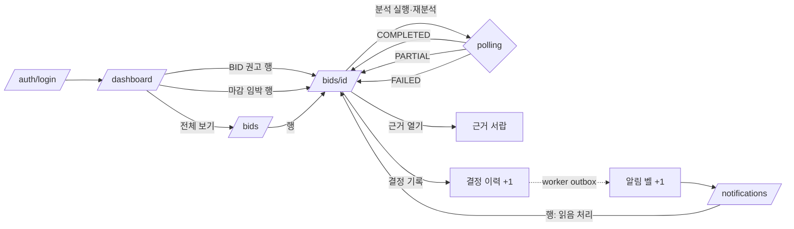

# 디자인 스펙: C6 Phase 3 화면

ADR-023 핵심 컷의 화면 범위 "앱 셸 최소(메뉴 3개·Topbar 지표 4개·DEMO 배지) · `/dashboard` · `/bids` · `/bids/[id]` · `/notifications`, Route Handler 9개"([[12-ROADMAP|12 로드맵]] C6 행, [수상 전략 계획](2026-10-18-hackathon-award-plan.md) §2.2·§4 C6)를 구현자가 추측 없이 옮길 수 있게 고정한다. 이 문서는 **초안**이며 사용자 승인 뒤 구현한다. 코드·정본·설정은 바꾸지 않는다. 화면 문구는 모두 초안이고 확정은 사용자 몫이다. 단, [[09-SECURITY|09 보안]] "모델 한계 고지 문구"에서 온 문장은 바꾸지 않는다(아래에서 `09 고정`으로 표시).

**상태: 구현 완료(2026-10-20).** 이 스펙대로 구현해 main `4ae09f9`(브랜치 `c6/screens` @ `1a9c43e`)에 병합했다. 구현하며 달라진 점 네 가지는 사용자가 수용했다([[16-DECISIONS|ADR-033]] E9). 본문의 해당 자리를 고쳤고, 목록은 §14다. 위 "초안"·"사용자 승인 뒤 구현" 문장은 작성 당시의 상태다.

> [!warning] 미검증 가정
> 이 스펙은 코드와 문서를 읽고 썼다. 브라우저·dev 서버는 띄우지 않았으므로 1440·1280 실측 폭은 계산값이다. C4 규칙 엔진 타입(`web/server/scoring/analysis-result.model.ts`·`analysis-input.model.ts`)은 다른 세션이 쓰는 미커밋 파일이라 이름이 바뀔 수 있다. 바뀌면 §7 매핑 표만 고친다.

## 0. 범위

| 넣는다 (핵심 컷) | 넣지 않는다 |
|---|---|
| 앱 셸: 사이드바 메뉴 3개(대시보드·입찰 공고·알림), Topbar 지표 4개(실행 모드·AI·수집 신선도·알림 벨)와 `DEMO` 배지 | 사이드바 트리·묶음·맨 아래 고정 칸(N1 전체, 확장 컷). `/people`·`/org-chart`·`/admin/ingestion`·`/company`·설정 조직 탭·`/ops` |
| `/dashboard`: 요약 카드 5개, BID 권고 표, 마감 임박 표 | 대시보드 다섯 번째 카드의 입찰 프로젝트 교체(P1) |
| `/bids`: 핵심 필터 6개, 표, 커서 "더 보기" | 발주기관·예산·마감 기간·점수 하한·상태·분석 여부 필터(확장) |
| `/bids/[id]`: 상단 요약·분석 요약 띠·단계 이력·필수자격·점수 분해·Kev 참고 지표·근거 인용·근거 서랍·결정 패널·PARTIAL·MOCK 대체 배너·분석 실행과 polling | revision diff 화면(S5, 확장), `KevStateTrace` 서랍(확장), 검토 의견(P1) |
| `/notifications`: 목록, 전체/안 읽음, 읽음 처리 후 이동 | 유형 필터·모두 읽음(정본에 API 없음, §9 D7), 카카오(범위 외) |

범위 외 확인: 결제·구독·요금 화면, 1280px 미만 레이아웃·모바일, 승률·낙찰 확률 예측, 자동 투찰은 이 스펙의 어느 화면·문구·버튼에도 없다. "확률"이라는 낱말은 Kev 영역에서 09 고정 문구("…충족 확률·수주확률이 아닙니다")로만 나온다(G4: "수주 확률"이 "아님" 없이 단독 등장 0회).

## 1. 기준

참고한 정본과 코드다. 경로는 저장소 기준이다.

| 무엇 | 근거 |
|---|---|
| 화면·상태·와이어프레임·컴포넌트 이름 | `docs/06-UI-UX.md` §1·§3.2·§4·§5.1·§5.3~§5.5·§5.7·§6~§12 |
| 응답 형태·권한·오류 코드 | `docs/05-API-SPEC.md` §1·§2·§3·§4.3·§4.5·§4.6·§5 |
| 데모 장면에서 보여야 할 것 | `docs/19-DEMO-SCENARIO.md` §2·§2.1·§4(S2~S7·S-LIVE), `docs/11-TESTING.md` §5 #5~#16, `docs/18-HACKATHON.md` §6·§7 |
| 점수·자격·결정·Kev 처리 | `docs/08-SCORING.md` §2·§4·§5.1~§5.4·§6 |
| 출처·모드 표시, Kev 표시와 플래그 | `docs/03-AI-PIPELINE.md` §3·§3.3·§5.7·§5.13 |
| 알림 이벤트·수신자 | `docs/13-NOTIFICATIONS.md` |
| 404·RBAC·고지 문구 원문 | `docs/09-SECURITY.md` 권한 표·조직 격리·모델 한계 고지 문구 |
| 범위 3단·S-LIVE 조회 방식 | `docs/16-DECISIONS.md` ADR-007·ADR-020·ADR-021·ADR-023 |
| 셸 구조 참고 | `docs/plans/2026-10-16-sidebar-ia-design.md` §2.1·§2.9·§3.1, `docs/plans/2026-10-18-org-chart-sidebar-design.md` §3·§4 |
| 토큰·부품·틀 | `design/tokens.json`, `.claude/skills/design-system`, `web/components/ui/*`, `web/components/app-shell.tsx`·`app-page.tsx`·`stat-card.tsx`, 견본 `web/app/(app)/[slug]/dashboard/`·`tasks/` |
| 규칙 엔진 출력 필드 | `web/server/scoring/analysis-result.model.ts`·`analysis-input.model.ts`(C4, 미커밋, 읽기만) |
| 병합 보류 브랜치 | `feat/people-read`(`/Users/leegwanghui/.codex/worktrees/5b0c/sol-radar`, HEAD `f579a2a`)의 `web/components/app-shell.tsx`·`app-page.tsx`·`web/app/api/v1/_lib/http.ts`·`web/server/organization/business-access.*`·`web/app/_lib/people-read-layout.tsx` |

현재 main의 사실(코드 확인):
- 화면은 `web/app/(app)/[slug]/` 아래(조직 주소 있음)이고 `web/app/(app)/dashboard/page.tsx`는 `/[slug]/dashboard`(템플릿 대시보드)로 보내는 옛 주소 리다이렉트다.
- `/health/live`·`/health/ready`는 이미 있다(`web/app/health/*/route.ts`). `/health/ready` 본문은 `{status, checks:{db,redis,storage,ai}}`이고 **실행 모드 값이 없다**. web은 `SOL_RUN_MODE`를 읽지 않는다.
- `web/app/api/v1/_lib/http.ts`(오류 봉투·CSRF·인증 가드)가 있다. `FORBIDDEN`·`INVALID_CURSOR` 코드는 아직 없다.
- `sol_role`을 읽는 서버 함수는 main에 없다(브랜치의 `getMyBusinessAccess`에 있다).
- 없는 부품: badge, radio-group, checkbox, popover. 있는 부품: button·input·textarea·label·field·card·dialog·dropdown-menu(checkbox·radio 항목 포함)·select·separator·skeleton·sonner·sidebar·sheet·tooltip·avatar·table.
- 사이드바는 `collapsible="offcanvas"`(접으면 통째로 숨는다), 폭 256px(`16rem`).
- 1280px 미만 안내("데스크톱 화면에서 이용하세요")는 아직 없다.

## 2. 흐름



데모 장면별 경로:

| 장면 | 경로 | 이 스펙에서 받치는 곳 |
|---|---|---|
| S2 | `/dashboard` | §5.2 카드 5개, Topbar 지표 4개 + `DEMO`, BID 권고 표(FX-01 94·FX-18 82·FX-06 78), 마감 임박 표(FX-14 D-2), 수집 카드 "격리 1" |
| S3 | `/bids` 단계 `입찰공고`·정렬 `점수 높은 순` → FX-01 → 근거 서랍 → 결정 필터 `NO-BID` → FX-03 | §5.3 필터·표, §5.4 필수자격·점수 분해 94(24.0/25.0/20.0/15.0/10.0)·Kev 71/24/5·근거 서랍, FX-03 `미충족`·점수 68 "참고"·`규칙 우선` 배지와 문장 |
| S4 | FX-02(`미분석`) → [분석 실행] → 대기 중 → 분석 중 → 완료 72 → 결정 WATCH + 사유 + 담당자 → [결정 기록] | §5.4 분석 실행·polling·점수 분해 72(15.0/18.3/14.0/15.0/10.0)·Kev 36/52/12·"사람 검토 권장"·결정 패널·결정 이력, Topbar 벨 |
| S-LIVE | `/bids` 출처 `전체`(`?origin=all`) → 실제 공고(`DEMO` 없음, 출처 "나라장터") | §5.3 출처 필터·출처 열, §5.4 분석 요약 띠 "분석 실행 모드: live"·모델 식별자·"가상 회사 프로필로 분석"·Kev v0.2(`미보정`)·첨부 실패 배지 |
| S6 | `docker compose stop ai-gateway` → Topbar `AI: unavailable` → FX-01 [재분석] → `부분 완료 (규칙만)` | §4 AI 지표 즉시 갱신, §5.4 PARTIAL 배너(09 고정)·`RULES_ONLY`·`AI_UNAVAILABLE`·Kev "사용 불가"·분석 이력에 이전 run 보존 |
| S7 | 터미널 `curl`(org-02 토큰) | 화면 없음. Route Handler #5 `404`·#2 `200`(§6). org-02 사용자가 화면으로 FX-01을 열면 공고는 보이고 분석·자격·결정은 비어 보인다(§5.4 "다른 조직 분석 없음" 상태) |

## 3. 공통 규칙

### 3.1 경로와 틀

**결정 필요(D1)**. 추천안: 조직 주소 없는 경로 `/dashboard`·`/bids`·`/bids/[id]`·`/notifications`(ADR-021, 19·11의 주소와 같다)를 새 경로 묶음 `web/app/(app)/(work)/`에 두고, 그 묶음의 `layout.tsx`가 현재 업무 조직을 서버에서 정해 `AppShell`을 그린다(브랜치의 `PeopleReadLayout`과 같은 방식: `getCurrentOrganization` → `getMyWorkspace(slug)`). 그러려면 main의 `web/app/(app)/dashboard/page.tsx`(옛 주소 리다이렉트)를 지워야 한다(경로가 겹친다). 이 파일은 이번 작업이 만든 것이 아니라 삭제 전 사용자 확인이 필요하다.

- 화면마다 `requireWork()`(새 함수, `requireCurrentOrganization` + `sol_role` 읽기)로 다시 확인한다. 틀은 화면 실행을 막지 못한다(design-system 웹 틀 규칙).
- 업무 멤버십 0개·2개 이상 → 기존 `organizationStatePath`로 보낸다. 가입 정보 미완료 → `/auth/complete-profile`. 로그인 전 → `/auth/login`.
- 로그인·초대 수락·가입 보완 뒤 첫 화면은 모두 `/dashboard`다(구현 `bc15b75`, §14 (d)).
- 본문은 `AppPage`로 감싼다. 표가 넓은 `/dashboard`·`/bids`·`/bids/[id]`는 단 폭을 넓힌다(`max-w-5xl` 1024px → 06 §4 "Content max 1440" 이므로 `max-w-360`). 방법은 브랜치가 더한 `contentClassName` prop과 **같은 이름·같은 시그니처**로 한다(§8 충돌 지점 2).

### 3.2 화면 폭

사이드바 256px·`AppPage` 안쪽 여백 32px(`lg:px-8`) 기준 본문 폭:

| 화면 폭 | 사이드바 펼침 | 사이드바 접음(offcanvas) |
|---|---|---|
| 1440px | 1120px | 1376px |
| 1280px | 960px | 1216px |

1280px·사이드바 펼침(960px)이 가장 좁은 경우이고 모든 화면은 여기서 가로로 넘치지 않아야 한다. 1920px 이상은 단 폭 1440px에 가두고 가운데 정렬한다. 1280px 미만은 가로 스크롤을 허용하고 Topbar 바로 아래에 한 줄 안내 "데스크톱 화면에서 이용하세요"(warning 글자, `TriangleAlertIcon`)를 띄운다(06 §1, 결정 필요 D25). 칸 수는 `@container` 단 폭 변형으로 정한다.

### 3.3 상태 표기 — 아이콘 + 글자 + 색

06 §3.2를 `design/tokens.json`에 맞춘 표다. 색만으로 뜻을 전하지 않는다. 상태 색(`success`·`warning`·`destructive`·`demo`)은 tokens.json 주석대로 **글자·아이콘·테두리에만** 쓰고 흰 바탕(`background`·`card`) 위에 둔다. 연한 바탕 채움(06의 `-soft`)은 토큰이 없어 쓰지 않는다(D15).

| 상태 | 글자 | 아이콘 (lucide-react 1.54.0) | 색 토큰 |
|---|---|---|---|
| 권고 BID | `BID` | `CircleArrowUpIcon` | `text-success` |
| 권고 WATCH | `WATCH` | `EyeIcon` | `text-warning` |
| 권고 NO_BID | `NO-BID` | `OctagonXIcon` | `text-destructive` |
| 자격 SATISFIED | `충족` | `CircleCheckIcon` | `text-success` |
| 자격 NEEDS_REVIEW | `확인 필요` | `CircleHelpIcon` | `text-warning` |
| 자격 NOT_SATISFIED | `미충족` | `CircleXIcon` | `text-destructive` |
| 자격 확인 필요 + `STAGE_NOT_APPLICABLE` | `해당 없음` | `CircleMinusIcon` | `text-muted-foreground` |
| 분석 없음 | `미분석` | `CircleDashedIcon` | `text-muted-foreground` |
| 분석 QUEUED / RUNNING | `대기 중` / `분석 중` | `LoaderCircleIcon`(회전) | `text-muted-foreground` (06의 info, D15) |
| 분석 COMPLETED | `완료` | `CheckIcon` | `text-success` |
| 분석 PARTIAL | `부분 완료 (규칙만)`, 표 칸에서는 `부분 완료` | `TriangleAlertIcon` | `text-warning` |
| 분석 FAILED | `실패` | `OctagonAlertIcon` | `text-destructive` |
| 공고 CANCELLED | `취소됨` | `BanIcon` | `text-muted-foreground` |
| 가상 데이터 | `DEMO` | `FlaskConicalIcon` | `text-demo` + `border-demo` |
| Kev 의견 상이 | `규칙 우선` | `ShieldCheckIcon` | `text-warning` |
| 사람 결정 없음 | `미결정` | (없음) | `text-muted-foreground` |

배지 모양(새 부품 제안 `StatusBadge`, §10.4 부품 1): 높이 20px, `rounded-sm`(4px, 06 배지 4), 안쪽 여백 `px-1.5`, `type-caption`, 아이콘 14px, `border` + 흰 바탕. 줄 안의 상태(표 칸·체크리스트 행)는 테두리 없이 아이콘 + 글자만 쓴다.

### 3.4 숫자·시각

- 금액: 서버가 준 KRW 정수 문자열을 `Intl.NumberFormat('ko-KR')`로. 상세는 전체 금액 `1,200,000,000원`. 목록·대시보드 표는 폭 때문에 `Intl.NumberFormat('ko-KR', { notation: 'compact', maximumFractionDigits: 1 })` → `12억`·`21.6억`, 전체 금액은 `title`과 스크린리더 글자로 함께 준다(D19). `null`은 `—` + 스크린리더 "미공개".
- 마감: `D-21`(서울 날짜 기준, 서버에서 계산해 하이드레이션 차이를 없앤다) + 날짜 `11. 6.`. 지난 마감은 `마감`(muted). 상세는 `2026-11-06 18:00 (D-21)`.
- 시각: KST로 표시하고 툴팁·`<time dateTime>`에 UTC 원값(06 §11). 상대 시각 `12분 전`은 Topbar·알림에만.
- 점수: 정수(`94`), 요소 점수는 소수 1자리(`24.0 / 30`). 모든 숫자 열 `tabular-nums`, 오른쪽 정렬.
- Kev 선택지 분포는 정수 퍼센트(`71%`), noul 신호(`mandatoryRisk`·`needsHumanReview`)는 소수 2자리 + 기준(`0.85 · 기준 0.70`).

### 3.5 공통 상태

| 상태 | 언제 | 보이는 것 | 사용자가 할 수 있는 것 |
|---|---|---|---|
| 로딩 | 서버 컴포넌트가 읽는 중(`loading.tsx`) | 레이아웃과 같은 모양의 `Skeleton`. 스피너 단독 금지. `role="status"` + 스크린리더 "…불러오는 중" | 기다림. 사이드바·Topbar는 그대로 쓸 수 있다 |
| 오류 | 화면 데이터 읽기 실패(`error.tsx`) | 제목 "불러오지 못했습니다", 서버가 준 `error.message`만, 오류 식별자(Route Handler 응답이면 `requestId`, 서버 컴포넌트 오류면 Next `digest` — D-오류), [다시 시도](`reset()`) | 다시 시도, 사이드바로 이동 |
| 없음(404) | 없는 공고 ID, 잘못된 UUID | 앱 틀 안 `not-found.tsx`: 제목 "공고를 찾을 수 없습니다", 설명 "주소가 맞는지 확인하세요.", [공고 목록으로](outline 링크) | 목록으로 이동 |
| 권한 없음(동작) | 역할이 허용 목록에 없는 버튼 | 버튼은 숨기지 않고 비활성 + 바로 아래 도움말 글자(§5.4). 서버는 `403 FORBIDDEN`으로 다시 막는다 | 읽기만 |
| 계정 상태 | 업무 멤버십 0·2+, 가입 정보 미완료, 정지 | 기존 안내 화면으로 보낸다(이 스펙에서 새로 그리지 않는다) | 안내 화면의 동작 |
| 신선도 경고 | 마지막 수집 성공이 60분 초과 | Topbar 수집 지표가 warning(§4) | — |

## 4. 앱 셸 (최소)

목적: 어느 화면에서든 "지금 무슨 모드이고, 데이터가 가상인지, AI가 살아 있는지, 수집이 최신인지, 내게 알림이 왔는지"를 보이게 한다(S2·S6·S-LIVE, 19 §6 리허설 "머리말 실행 모드와 AI 표시가 모든 화면에").

### 4.1 레이아웃

```text
1440px, 사이드바 펼침
┌─ Sidebar 256 ─────┬─ Topbar (min-h-12, sticky, border-b) ───────────────────────────────────────────────┐
│ [솔] 솔리데오      │ [≡] │ 입찰 공고           [DEMO] │ 실행 모드: mock │ AI: mock │ 수집 12분 전 │ [🔔 2] │
│ (받은 초대 N)      ├──────────────────────────────────────────────────────────────────────────────────────┤
│ ▣ 대시보드         │ main#main-content (AppPage)                                                         │
│ ▤ 입찰 공고  ←활성 │                                                                                      │
│ ◻ 알림        [2]  │                                                                                      │
│                    │                                                                                      │
│ ─────────────      │                                                                                      │
│ (사용자 메뉴)       │                                                                                      │
└────────────────────┴──────────────────────────────────────────────────────────────────────────────────────┘
```

- 사이드바: 템플릿 `Sidebar` 그대로(폭 256px, 06 §4의 240px와 다르다 — D15). 머리(`SidebarHeader`)는 지금처럼 조직 표시 `솔리데오`(전환 메뉴 없음, ADR-021)와 받은 초대 줄. 몸통 `nav aria-label="주요 메뉴"`에 `NAV` 3줄. 바닥은 템플릿 사용자 메뉴(설정 → 템플릿 `/{slug}/settings`, 운영자만 "관리자", 로그아웃). 06 §4는 사용자 메뉴를 Topbar에 그렸지만 06 §4.1·조직도 설계 §4.1이 "사이드바 바닥에 사용자 메뉴가 있으면"을 전제하므로 템플릿 위치를 유지한다.
- `NAV`(06 §4.1 아이콘): 대시보드 `/dashboard` `LayoutDashboardIcon` · 입찰 공고 `/bids` `FileTextIcon` · 알림 `/notifications` `BellIcon`. `/bids/[id]`에서는 "입찰 공고"가 활성(`aria-current="page"`). 알림 메뉴 오른쪽 `SidebarMenuBadge`에 안 읽은 수(0이면 숨김, 스크린리더 "건"). 템플릿의 "작업"·"설정" 메뉴는 `NAV`에서 뺀다(메뉴 3개). 템플릿 경로 `/{slug}/tasks`·`/{slug}/dashboard` 자체는 이번에 건드리지 않는다(D30).
- Topbar 왼쪽: `SidebarTrigger` · 세로 구분선 · 현재 화면 이름(`type-label`, 템플릿 그대로). `NAV` 밖의 템플릿 화면(`/{slug}/settings` "설정"·`/{slug}/tasks` "작업"·`/{slug}/dashboard` "대시보드")도 이름을 보인다. 이름을 모르면 막대에서 조직 이름까지 사라지기 때문이다(구현 `1a9c43e`, §14).
- Topbar 오른쪽(순서 고정, 06 §4): `DemoBadge`(fixture·mock일 때) → `RunModeIndicator` → `AiModeIndicator` → `DataFreshnessIndicator` → `NotificationBell`. 지표 사이는 세로 `Separator`. 글자 `type-label`.
  - `DEMO` 배지 위치는 06의 "로고 바로 옆"과 다르다. 템플릿 사이드바는 접으면 통째로 숨어서 로고 옆 배지가 사라진다. 그래서 실행 모드 바로 앞에 둔다(D3).
- 1280px Topbar 폭 1024px 안에서 오른쪽 묶음은 약 480px, 왼쪽은 약 200px라 한 줄에 든다.

### 4.2 지표 4개 + DEMO 배지

| 요소 | 보이는 것 | 데이터 출처 | 갱신 |
|---|---|---|---|
| `DemoBadge` | `DEMO`(`FlaskConicalIcon`, `text-demo`, `border-demo`). 실행 모드가 `fixture`·`mock`일 때만. 초점·hover 시 툴팁 09 고정 "이 데이터는 데모용 가상 공고입니다. 실제 입찰 공고가 아닙니다." | 실행 모드(아래) | 서버 렌더 1회 |
| `RunModeIndicator` | 09 고정 형식 `실행 모드: live` · `fixture` · `mock`. `live`는 `text-muted-foreground` 라벨 + `text-foreground` 값, `fixture`·`mock`은 값이 `text-warning`. 아이콘 `ServerIcon` | **정본에 없음**: 06 §8은 "`/health/ready`의 실행 모드 값"이라 하지만 05 `/health/ready` 본문에 실행 모드가 없다. 추천: web 서버가 env `SOL_RUN_MODE`를 읽어(기본 `mock`) 틀에 넘긴다. 실행 모드는 재시작해야 바뀌므로 서버 렌더 값이면 충분하다(D2) | 서버 렌더 |
| `AiModeIndicator` | `AI: mock` · `local` · `hosted` · `unavailable` 네 값만(06 §4). `unavailable`은 `text-destructive` + `OctagonAlertIcon` + 툴팁 "AI gateway에 연결할 수 없습니다", 나머지는 `CpuIcon` + 중립. 첫 응답 전 `AI: 확인 중`(`Skeleton` 폭 64px) | `GET /health/ready` `checks.ai`(main에 있음) | 30초 polling(06). 추가 제안: 창이 초점을 얻을 때, 그리고 분석 polling이 `PARTIAL`·`FAILED`로 끝날 때 바로 한 번 더 읽는다 — S6에서 11 #13 "1~2초 안에 Topbar `AI: unavailable`"을 맞추려면 30초 주기만으로는 늦을 수 있다(D4) |
| `DataFreshnessIndicator` | 정상 `수집 12분 전`(`ClockIcon`, 중립). 성공 후 60분 초과 `수집 지연 · 2시간 전`(warning). 마지막 수집 `FAILED` `수집 실패 · 3분 전`(destructive). 기록 없음 `수집 기록 없음`(muted). 툴팁에 절대 시각(KST·UTC)과 "적재 N · 격리 N". 06 §8의 "수집 실패 시 관리자 링크"는 `/admin/ingestion`이 확장 컷이라 핵심 컷에서 링크를 두지 않는다 | `DashboardSummary.dataFreshness.lastIngestAt`·`lastIngestStatus`·`lastIngestSummary` | 서버 렌더 초깃값 + 30초 polling(`GET /api/v1/dashboard/summary`, D5) |
| `NotificationBell` | 아이콘 버튼 `BellIcon`, `aria-label="알림, 안 읽음 2건"`. 안 읽음이 있으면 오른쪽 위에 숫자 배지(`bg-primary text-primary-foreground`. 알림 수는 위험 상태가 아니라서 `destructive`를 쓰지 않는다), 10 이상은 `9+`. 누르면 `DropdownMenu`(폭 360px, `rounded-lg`): 최근 5건(유형 아이콘·제목·공고명·상대 시각·안 읽음 점), 바닥 링크 "모두 보기" → `/notifications`. 0건이면 "알림이 없습니다" | 수: `DashboardSummary.unreadNotifications`(Page에 총수가 없다). 목록: `GET /api/v1/notifications?limit=5`(열 때 읽기) | 수는 위 30초 polling과 같은 요청. 결정 기록 성공 직후 한 번, 5초 뒤 한 번 더 읽는다(알림은 worker outbox를 거쳐 늦게 생긴다, D5) |

모든 지표는 `aria-live`를 두지 않는다(30초마다 읽어 주면 시끄럽다). AI가 `unavailable`로 바뀔 때만 숨은 `role="status"` 한 곳에서 "AI 연결이 끊겼습니다"를 한 번 읽는다.

### 4.3 상태표 — 셸

| 상태 | 언제 | 보이는 것 | 사용자가 할 수 있는 것 |
|---|---|---|---|
| 정상(mock) | `SOL_RUN_MODE=mock`, gateway 정상 | `DEMO` · `실행 모드: mock`(warning) · `AI: mock` · `수집 N분 전` · 벨 | 메뉴 이동, 벨 열기 |
| 정상(live) | `SOL_RUN_MODE=live` | `DEMO` 없음 · `실행 모드: live`(중립) · `AI: local` | 같음 |
| AI 끊김 | `/health/ready` `checks.ai=unavailable`(S6) | `AI: unavailable`(destructive, 아이콘, 툴팁) | 같음. 분석은 `PARTIAL`로 끝난다 |
| health 실패 | `/health/ready` 503 또는 네트워크 오류 | AI 지표는 마지막 값 유지 + 툴팁 "상태를 확인하지 못했습니다" | 같음 |
| 수집 지연·실패·없음 | §4.2 | §4.2 | 같음 |
| summary 실패 | `/dashboard/summary` 오류 | 수집 지표·벨 수는 마지막 값 유지(처음이면 `—`), 툴팁 "상태를 확인하지 못했습니다" | 벨을 열면 목록은 따로 읽는다 |
| 1280px 미만 | 창 폭 < 1280 | §3.2 안내 한 줄 + 가로 스크롤 | — |

## 5. 화면별 명세

### 5.1 공통 부품 맵

| 06 §9 이름 | 쓰는 곳 | 만드는 부품(제안 파일) | 바탕 부품 |
|---|---|---|---|
| `DemoBadge` | Topbar, 목록·대시보드 행, 상세 제목 앞 | `web/components/bids/status-badge.tsx` | Tooltip(Topbar·상세만) |
| `StatusBadge`(권고·자격·분석·결정·플래그) | 전부 | 같은 파일 | 없음(새 부품, §10.4 부품 1) |
| `BidFilters` | `/bids` | `web/components/bids/bid-filters.tsx` | input, select, button(ghost) |
| `BidTable` | `/bids`, 대시보드 2개 표 | `web/components/bids/bid-table.tsx` | table |
| `AnalysisStatus` | 목록 칸, 상세 분석 띠 | `web/components/bids/analysis-status.tsx` | 없음 |
| `StageTimeline` | 상세 | `web/components/bids/stage-timeline.tsx` | 없음 |
| `QualificationChecklist` | 상세 | `web/components/bids/qualification-checklist.tsx` | card, button(link) |
| `ScoreFactors` | 상세 | `web/components/bids/score-factors.tsx` | card, tooltip |
| `ScoreGauge` | 상세 결정 패널 | `web/components/bids/score-gauge.tsx` | 없음 |
| `KevOpinion` | 상세 | `web/components/bids/kev-opinion.tsx` | card |
| `EvidenceDrawer` | 상세 | `web/components/bids/evidence-drawer.tsx` | sheet |
| `DecisionPanel` | 상세 오른쪽 레일 | `web/components/bids/decision-panel.tsx` | card, field, textarea, select, button, 라디오(§10.4 부품 2) |
| `AiUnavailableBanner`·MOCK 대체 배너 | 상세, 대시보드 | `web/components/bids/analysis-banner.tsx` | 없음 |
| `AiModeIndicator`·`RunModeIndicator`·`DataFreshnessIndicator`·`NotificationBell` | Topbar | `web/components/topbar-status.tsx`(app-shell.tsx와 분리, §8) | tooltip, dropdown-menu, separator |
| 라벨·서식 | 전부 | `web/components/bids/labels.ts`·`format.ts` | — |
| `StatCard` | 대시보드 | 기존 `web/components/stat-card.tsx` 재사용 | card |

부품은 props만 받고 데이터를 읽지 않는다(`stat-card.tsx` 원칙). 두 번 이상 쓰는 것만 부품으로 뺀다.

### 5.2 `/dashboard`

**목적**: 첫 화면에서 실행 모드·데이터 성격을 밝히고, 오늘 볼 공고(BID 권고·검토 대기·마감 임박)와 수집·분석이 돌았는지를 한 번에 보인다(S2, 실용성).

**정보 위계**: ① h1 "대시보드" + 설명 → ② (AI 불가면) 배너 → ③ 요약 카드 5개 → ④ BID 권고 표 · 마감 임박 표 → ⑤ 최근 변경(D9).

**레이아웃**

```text
1440px (본문 1120)                                               1280px (본문 960)
대시보드                                                          (같은 구성, 카드 5칸 유지 — 칸 폭 약 179px)
실행 모드와 수집 현황, 검토가 필요한 공고를 봅니다.               표 두 개는 위아래로 쌓는다(§14 (a), 아래 그림의 나란히 배치는 작성 당시)
[AI 불가 배너 — 조건부]
┌BID 권고──┐┌검토 대기─┐┌마감 임박 7일┐┌수집────────┐┌분석 현황──┐
│ 3        ││ 16       ││ 4           ││ 12분 전     ││ 18        │
│          ││          ││             ││ 적재 19·격리 1││ 부분 0·실패 0│
└──────────┘└──────────┘└─────────────┘└────────────┘└───────────┘
┌ BID 권고 (점수 높은 순) ──── 전체 보기 ┐ ┌ 마감 임박 (7일) ─── 전체 보기 ┐
│ DEMO 세종… 차세대 행정정보…   94 BID  │ │ DEMO 광주… AI 행정 비서   D-2 WATCH │
│ …                                      │ │ …                                    │
└────────────────────────────────────────┘ └──────────────────────────────────────┘
```

- 카드 줄: `@container` + `grid grid-cols-3 gap-4 @4xl:grid-cols-5`(본문 960·1120 모두 5칸). 카드는 `StatCard`(`size="sm"`, 값 `type-title tabular-nums`). 카드 자체는 링크가 아니다(`StatCard` 변경을 피한다). 이동은 표의 "전체 보기"가 맡는다.
- 표 줄: 표 두 개를 **위아래로** 쌓는다(BID 권고 위, 마감 임박 아래). 처음 스펙은 `@4xl:grid-cols-[minmax(0,3fr)_minmax(0,2fr)]`로 나란히였지만, 대시보드 글자 +3px([[16-DECISIONS|ADR-030]] B25)에서 마감 표의 고정 열(출처·마감·권고·결정)만 약 408px라 1280(본문 960)에서 제목 칸이 거의 남지 않고 1280 넘침 금지를 지킬 수 없다(§14 (a), `web/app/(app)/(work)/dashboard/dashboard-view.tsx` 주석). 각 표는 `Card` 안 `Table className="table-fixed"`, 최대 5행.

**구성 요소와 데이터**

| 요소 | 보이는 것 | 데이터(서버 컴포넌트가 서비스 직접 호출, 같은 형태의 Route Handler) |
|---|---|---|
| 카드 1 "BID 권고" | 건수 | `DashboardSummary.analyses.byRecommendation.BID` — 공고별 최신 1건 기준이어야 S6 뒤 이중 집계가 없다(정본 모호, D10) |
| 카드 2 "검토 대기" | 건수 | `DashboardSummary.reviews.pending` — "검토 대기"의 정의가 정본에 없다(D11) |
| 카드 3 "마감 임박 (7일)" | 건수 | `DashboardSummary.bids.deadlineWithin7Days` |
| 카드 4 "수집" | 값 `12분 전`(상대), 힌트 `적재 19 · 격리 1`, 상태가 `FAILED`면 값 `실패`(destructive) | `dataFreshness.lastIngestAt`·`lastIngestStatus`·`lastIngestSummary.created`·`.quarantined` |
| 카드 5 "분석 현황" | 값 = 완료 건수, 힌트 `부분 N · 실패 N` | `analyses.latestByStatus.completed`·`.partial`·`.failed` |
| 표 "BID 권고" | 열: 출처(DEMO) · 제목(1줄 말줄임, 링크) · 발주기관(@lg 이상) · SOL Score · 권고. 오른쪽 위 "전체 보기" → `/bids?recommendation=BID&sort=score:desc` | `GET /bids` 서비스, `recommendation=BID&sort=score:desc&limit=5`(현재 실행 모드의 기본 `origin`) |
| 표 "마감 임박" | 열: 출처 · 제목(링크) · 마감(D-n) · 권고 · 결정. "전체 보기" → `/bids?sort=deadlineAt:asc` | `GET /bids` 서비스, `deadlineFrom=지금&deadlineTo=+7일&sort=deadlineAt:asc&limit=5`. `DashboardSummary.upcoming`은 `isDemo`가 없어 행 `DEMO` 칩을 못 붙이므로 쓰지 않는다 |
| 최근 변경 | **정본에 없음**: 06 §5.3 ④·19 S2·11 #6이 요구하지만 `DashboardSummary`에 필드가 없다. D9 결정 전에는 그리지 않는다 | — |
| AI 불가 배너 | §5.4.6과 같은 부품. `/health/ready`가 `degraded`일 때(06 §8) | Topbar와 같은 클라이언트 상태(zustand 한 곳, 06 §11) |

**상태표 — `/dashboard`**

| 상태 | 언제 | 보이는 것 | 사용자가 할 수 있는 것 |
|---|---|---|---|
| 로딩 | 서버 읽기 중 | 카드 5개 + 표 2개 skeleton(템플릿 `dashboard/loading.tsx` 모양, `motion-reduce:animate-none`) | — |
| 정상(S2 mock) | seed + 사전 분석 18건 | 카드 BID 3 · 검토 대기(값은 D11) · 마감 임박(FX-14 포함) · 수집 `적재 19 · 격리 1` · 분석 완료 18 · 부분 0 · 실패 0. BID 표 FX-01 94·FX-18 82·FX-06 78 | 행 → 상세, 전체 보기 → 목록 |
| 공고 0건 | `bids.total=0` | 카드는 0, 표 자리에 빈 상태 하나: `InboxIcon` + "아직 수집된 공고가 없습니다" + (ADMIN) "관리자에게 수집을 요청하세요"(06의 [수집 실행]은 `/admin/ingestion`이 확장 컷이라 버튼을 두지 않는다) | — |
| 권고 0건 | BID 권고 없음 | BID 표 자리 "BID 권고 공고가 없습니다" | 전체 보기 |
| 분석 0건 | 분석 없음 | 분석 현황 카드 값 0, 힌트 "아직 분석한 공고가 없습니다" | — |
| 마감 임박 0건 | 7일 안 마감 없음 | 표 자리 "7일 안에 마감되는 공고가 없습니다" | — |
| AI 불가 | `/health/ready` `degraded` | 카드 위 warning 배너(09 고정 문구, §5.4.6) | — |
| S6 뒤 | FX-01 PARTIAL run 추가 | 분석 현황 완료 17 · 부분 1(19 S2 주석) | — |
| 오류 | 서비스 실패 | §3.5 오류 | 다시 시도 |

### 5.3 `/bids`

**목적**: 공고 수십 건을 훑어 거르고, 점수·권고·분석·결정 상태를 한 줄로 비교해 상세로 들어간다(S3·S-LIVE).

**정보 위계**: ① h1 "입찰 공고" + 설명(SOL Score 면책 한 줄) → ② 필터 막대 → ③ 결과 줄 → ④ 표 → ⑤ 더 보기.

**레이아웃**

```text
1280px, 사이드바 펼침 (본문 960)
입찰 공고
SOL Score는 내부 적합도이며 낙찰 확률이 아닙니다. 최종 참여 결정은 사람이 합니다.
[🔍 제목·기관·공고번호 (240)] [단계 ▾][권고 ▾][결정 ▾][출처 ▾][정렬 ▾]   [필터 초기화]   ← 넘치면 2줄
공고 19건 표시
┌출처┬단계──┬제목(가변, 2줄)──────┬발주기관──┬예산─┬마감─┬SOL Score┬권고───┬분석 상태┬최종 결정┐
│DEMO│입찰공고│세종특별자치시 차세대…│세종특별…  │ 12억│D-21 │      94 │▲ BID  │✓ 완료    │▲ BID    │
└────┴──────┴─────────────────────┴──────────┴─────┴─────┴─────────┴───────┴─────────┴─────────┘
                                         [더 보기]
```

- 표는 `table-fixed` + 열 폭 고정(셀 안쪽 여백 포함): 출처 64 · 단계 72 · 제목 가변 · 발주기관 120 · 예산 80 · 마감 72 · SOL Score 80 · 권고 88 · 분석 상태 96 · 최종 결정 88(합 760px). 1280px 사이드바 펼침에서 제목 열은 200px, 1440px에서 360px. **가로 스크롤 없이 10열이 모두 보인다**(06 §4, 11 #7). 머리 줄 40px, 행 높이 최소 44px(제목 2줄이면 늘어난다), 숫자 열 오른쪽 정렬, 홀짝 바탕 없음·hover만 `bg-muted/50`.
- 필터 막대는 `flex flex-wrap gap-3`. 1280px에서 두 줄이 될 수 있고 정상이다.

**필터(핵심 컷 6개, 06 §5.4의 나머지는 확장)**: 값은 URL 쿼리가 정본이다(공유 가능, store에 두지 않는다, 06 §11). 기본값은 URL에 적지 않는다(템플릿 `task-query.ts` 원칙). 필터를 바꾸면 커서를 버리고 처음부터 읽는다(05 §3).

| 필터 | 부품 | 값(화면 → 쿼리) | 장면 |
|---|---|---|---|
| 검색어 | `Input`(40px, `SearchIcon` 앞), Enter로 적용 | `q`(1~100자) | — |
| 단계 | `Select` | 전체 / 발주계획 `PLAN` / 사전규격 `PRE_SPEC` / 입찰공고 `NOTICE` → `stage` | S3 "단계 입찰공고" |
| 권고 | `Select` | 전체 / BID / WATCH / NO-BID → `recommendation` | 대시보드 "전체 보기" |
| 결정 | `Select` | 전체 / BID / WATCH / NO-BID / 미결정 `NONE` → `decision` | S3 "결정 NO-BID" |
| 출처 | `Select` | 데모 공고 `demo` / 실제 공고 `live` / 전체 `all` → `origin`. 기본은 실행 모드를 따른다(`mock`·`fixture` → `demo`, `live` → `live`). 기본 항목 옆에 "(기본)" | S-LIVE `?origin=all` |
| 정렬 | `Select` | 최근 공고 순 `publishedAt:desc`(기본) / 점수 높은 순 `score:desc` / 마감 빠른 순 `deadlineAt:asc` → `sort` | S3 "점수 내림차순" |
| 필터 초기화 | `Button variant="ghost" size="sm"` + `FilterXIcon` | 기본값과 다를 때만 보인다 | — |

단일 선택 `Select`로 한다(API는 반복 값을 받지만 핵심 컷 화면은 하나씩). 각 `Select` 앞에 보이는 라벨(`type-label`) 또는 `aria-label`을 단다.

**열과 데이터** (`BidListItem`, 05 §4.3)

| 열 | 보이는 것 | 필드 |
|---|---|---|
| 출처 | `isDemo=true` → `DEMO` 칩(툴팁 없음, 초점 안 받음). `false` → `나라장터`(`type-caption text-muted-foreground`) | `isDemo`, `origin` |
| 단계 | 발주계획·사전규격·입찰공고(`type-label`). 취소 공고면 아래 줄 `취소됨` | `stage`, `status` |
| 제목 | 링크(`/bids/{id}`), 2줄 말줄임, `title`에 전체. 첨부 실패가 있으면 제목 뒤 `FileWarningIcon` 14px(warning) + 스크린리더 "첨부 원문 확인 필요" | `title`, `documentsStatus.downloadFailed`·`.failed`·`.unsupported`·`.partial` |
| 발주기관 | 1줄 말줄임, `title`에 전체. `null`이면 `—` | `agency` |
| 예산 | §3.4 줄인 표기 | `budgetKrw` |
| 마감 | `D-n` + 날짜 2줄 | `deadlineAt` |
| SOL Score | 정수. 분석 없음·점수 없음이면 `—` | `latestAnalysis.solScore` |
| 권고 | 아이콘 + 글자. 분석 없으면 `미분석`(muted) | `latestAnalysis.recommendation` |
| 분석 상태 | §3.3 분석 상태(표 칸 짧은 글자) | `latestAnalysis.status`(없으면 미분석) |
| 최종 결정 | 아이콘 + 글자, 없으면 `미결정`(muted) | `latestReview.decision` |

표 위 숨은 설명(`aria-describedby`): "DEMO 표시는 데모용 가상 공고입니다. 실제 입찰 공고가 아닙니다." — 행마다 툴팁을 두면 탭 정지가 많아져 표 단위로 한 번 읽힌다.

**상태표 — `/bids`**

| 상태 | 언제 | 보이는 것 | 사용자가 할 수 있는 것 |
|---|---|---|---|
| 로딩(첫 진입) | 서버 읽기 중 | 필터 막대 + 표 10행 skeleton | — |
| 필터 변경 중 | URL 바뀌고 서버가 다시 읽는 동안 | 표만 `opacity-60` + `aria-busy="true"`(템플릿 `task-list` 방식). 필터 막대는 그대로, 초점은 고른 컨트롤에 남는다 | 다른 필터 계속 변경 |
| 정상 | 1건 이상 | 결과 줄 "공고 N건 표시"(`role="status"`), 표 | 행 열기, 정렬·필터, 더 보기 |
| 더 보기 | `pageInfo.hasNext=true` | 표 아래 [더 보기](`outline`). 누르면 `GET /api/v1/bids?…&cursor=` 결과를 아래에 붙이고 버튼은 "불러오는 중…" 비활성 | 더 보기 |
| 더 보기 실패 | 커서 요청 오류(`400 INVALID_CURSOR` 포함) | 버튼 자리 "더 불러오지 못했습니다 · [다시 시도]", `INVALID_CURSOR`면 "목록이 바뀌었습니다 · [처음부터 보기]" | 다시 시도 |
| 필터 결과 0건 | 조건에 맞는 공고 없음 | 표 자리 `SearchIcon` + "조건에 맞는 공고가 없습니다" + [필터 초기화] | 초기화 |
| 전체 0건 | 필터 없이 0건 | 대시보드 "아직 수집된 공고가 없습니다"와 같은 빈 상태 | — |
| live·demo 섞임 | `origin=all` | 출처 열이 `DEMO`·`나라장터`로 갈린다(S-LIVE) | — |
| 오류 | 서비스 실패 | §3.5 | 다시 시도 |

### 5.4 `/bids/[id]` (상세)

**목적**: 한 공고에 대해 "들어가야 하는가"를 근거와 함께 판단하고 사람이 결정을 기록한다. 핵심 흐름(분석 → SOL Score → 판단 근거 → BID/WATCH/NO-BID 의사결정)이 전부 이 화면에서 끝난다(S3·S4·S-LIVE·S6, 실용성 30·창의성 25).

**정보 위계**(06 §6 순서 고정): ① 상단 요약 → ② 분석 요약 띠(+배너) → ③ 단계 이력 → ④ 필수자격 체크리스트 → ⑤ SOL Score 분해 → ⑥ Kev 참고 지표 → ⑦ 근거 인용. 오른쪽 레일: 결정 패널(권고·점수·사람 검토 권장·결정 폼·결정 이력).

**레이아웃**

```text
1440px, 사이드바 펼침 (본문 1120: 주 영역 776 + 간격 24 + 레일 320)
← 공고 목록
[DEMO] [입찰공고]  출처 fixture
세종특별자치시 차세대 행정정보시스템 고도화 (가상)                       ← h1 type-title, 줄바꿈 허용
발주기관 세종특별자치시 · 예산 1,200,000,000원 · 마감 2026-11-06 18:00 (D-21)
공고번호 DEMO-2026-0001 · revision 1 · 수집 2026-10-16 09:12 KST
                                              [원문 보기 ↗](outline)  [재분석](outline)
┌ 분석 요약 띠 ─────────────────────────────────────────────┐ ┌ 결정 패널 (sticky) ───────┐
│ ✓ 완료 2026-10-16 09:15 · 분석 실행 모드: mock · AI: mock │ │ 권고  ▲ BID               │
│ [가상 회사 프로필로 분석] · 알고리즘 sol-v0.1.0 · 프로필 rev 2│ │ SOL Score  94 / 100       │
│ 분석 이력 2건 ▾                                            │ │ ████████████████████░     │
└───────────────────────────────────────────────────────────┘ │ SOL Score는 내부 적합도…  │
[PARTIAL 배너 / MOCK 대체 배너 — 조건부]                        │ ───────────────────────── │
■ 단계 이력   ○ 발주계획 —   ○ 사전규격 —   ● 입찰공고 r1      │ 최종 결정                  │
■ 필수자격 (3건 · 모두 충족)                                    │ (●) BID ( ) WATCH ( )NO-BID│
  ✓ 충족  소프트웨어사업자 신고   필수 · AI 추출   근거 p.3 ›    │ 사유 [                   ] │
  ✓ 충족  직접생산확인증명        필수 · AI 추출   근거 p.3 ›    │ 담당자 [김영업 ▾]          │
  ✓ 충족  중소기업 제한경쟁       필수 · AI 추출   근거 p.2 ›    │ [결정 기록](default)       │
■ SOL Score 분해                                               │ ───────────────────────── │
  분석 설명 문단                                                │ 결정 이력                  │
  기술 스택 적합   ████████░░  24.0 / 30                        │ BID · 김영업(SALES) · …   │
  … 5행 · 합계 94.0                                             └────────────────────────────┘
■ Kev 참고 지표  모델 참고 지표 (점수 미반영)
■ 근거 인용 (3건 · 원문 대조 검증 통과)
```

- 본문 `grid gap-6 grid-cols-[minmax(0,1fr)_320px]`. 1280px 사이드바 펼침에서 주 영역 616px. 1280px 미만 레이아웃은 만들지 않는다.
- 레일은 `aside aria-labelledby="decision-title"`, `sticky top-18`(Topbar 48 + 24). 레일이 화면보다 길면 `max-h-[calc(100dvh-5.5rem)] overflow-y-auto`로 레일 안에서 스크롤한다.
- 19 §6 리허설 "1440px에서 상단 요약·자격·점수가 스크롤 없이 보이는지": 점수(레일 맨 위)와 상단 요약·분석 띠·단계 이력(한 줄)·자격 3행은 1440×900에서 첫 화면 안에 든다(계산값, 구현 뒤 실측).

#### 5.4.1 상단 요약

| 요소 | 보이는 것 | 데이터(`BidDetail`) |
|---|---|---|
| 뒤로 | `← 공고 목록`(링크, 문장형 링크 초점 규칙). 목록에서 왔으면 그 쿼리를 보존해 돌아간다(`history.back` 아님, 링크 `href`를 `/bids?…`로) | 이전 목록 쿼리(없으면 `/bids`) |
| 배지 줄 | `DEMO`(`isDemo`일 때, 툴팁 09 고정) · 단계 · `취소됨`(취소일 때) · 출처 `type-caption`: demo는 `출처 fixture`, live는 `출처 나라장터 입찰공고 (g2b-bid-notice)` | `isDemo`, `stage`, `status`, `source` |
| 제목 | `h1 type-title`, 말줄임 없이 줄바꿈(`wrap-anywhere`) | `title` |
| 요약 줄 1 | 발주기관 · 예산(전체 금액) · 마감(날짜 시각 + D-n) | `agency`, `budgetKrw`, `deadlineAt` |
| 요약 줄 2 | 공고번호 · revision · 수집 시각(KST, 툴팁 UTC) | `noticeId`, `latestRevision`, `lastSyncedAt` |
| [원문 보기] | `outline` 링크 버튼, 새 탭(`target="_blank" rel="noopener noreferrer"`), `ExternalLinkIcon`, 이름 "원문 보기 (새 탭)" | `sourceUrl` |
| [분석 실행] / [재분석] | 분석 없음 → `분석 실행`(**default**, 이때 결정 기록 버튼은 outline). 분석 있음 → `재분석`(outline, `RefreshCwIcon`). 단, 점수가 있는 run 없이 최신 run이 `FAILED`뿐이면 `재분석`이 **default**다(§14 (c)). 권한·취소 상태는 §5.4.10 | — |

#### 5.4.2 분석 요약 띠와 분석 실행

분석 결과의 출처를 한 줄로 밝힌다(03 §3.3, 06 §7 "분석 결과에는 항상 createdAt·algorithmVersion·프로필 revision·Kev 모델 식별자").

| 요소 | 보이는 것 | 데이터(`AnalysisResult`, 05 §4.5) |
|---|---|---|
| 상태 | `AnalysisStatus`(§3.3) + 끝난 시각 | `status`, `finishedAt`(없으면 `queuedAt`) |
| 분석 실행 모드 | `분석 실행 모드: mock` · `fixture` · `live`. Topbar의 "실행 모드"(앱의 지금 모드)와 구분하려고 "분석"을 붙인다. S-LIVE에서는 Topbar `실행 모드: mock`과 이 줄 `분석 실행 모드: live`가 함께 보이는 것이 정상이다(ADR-023) | `runMode` |
| AI | `provider=mock` → `AI: mock`. 그 밖 → `AI: local · {model.qwen.name} · {model.kev.model}`. 모델 이름은 받은 식별자 그대로(예 `Qwen/Qwen3.5-9B`·`jaredpalmer/kev-9b@v1.0`). 19의 "Qwen3.5-9B · Kev-9B v1.0" 같은 표시 이름 대응표는 정본에 없어 만들지 않는다(D12) | `model.provider`, `model.qwen.name`, `model.kev.model` |
| 가상 회사 프로필 배지 | 09 고정 `가상 회사 프로필로 분석`(테두리 배지, `text-foreground`, 아이콘 `FlaskConicalIcon` 없이 — `demo` 색은 DEMO 전용이다). 툴팁 06 §8 "실제 공고를 가상 솔리데오 프로필과 대조한 결과입니다". live 공고(`isDemo=false`)면 배지 옆에 `실제 공고 × 가상 회사 프로필`(caption) | 항상(모든 모드) |
| 알고리즘·프로필 | `알고리즘 sol-v0.1.0 · 프로필 rev 2` | `model.algorithmVersion`, `profileRevision` |
| 분석 이력 | `분석 이력 N건 ▾`(N ≥ 2일 때). 펼치면 시각 · 상태 · 점수 · 권고 · 분석 실행 모드 목록(최신 위). 지난 run을 화면에 다시 그리는 전환은 없다(목록만) | `GET /bids/:id/analyses`(서비스) |

**분석 실행 흐름**(06 §7):
1. 누르면 `POST /api/v1/bids/{id}/analyses`, 헤더 `X-Requested-With: sol-radar`, `Idempotency-Key`(클릭마다 새 UUID, 같은 클릭의 재시도는 같은 키). 본문: [분석 실행] `{force:false}`, [재분석] `{force:true}`(S6).
2. `202` → 버튼 비활성 + "분석 요청 중…" → `pollUrl`을 2초 간격 60초, 그 뒤 5초 간격 최대 5분 읽는다. 상태 전이는 `role="status" aria-live="polite"` 한 곳에서 "분석 대기 중", "분석 중", "분석이 끝났습니다. SOL Score 72, 권고 WATCH"로 읽는다.
3. polling 중 ④~⑦ 구역과 레일 상단은 skeleton + 띠에 `AnalysisStatus`(대기 중·분석 중). 상단 요약은 그대로.
4. 종료 상태(`COMPLETED`·`PARTIAL`·`FAILED`)에서 멈추고 `router.refresh()`로 서버가 다시 그린다. `PARTIAL`·`FAILED`면 Topbar AI 지표를 바로 다시 읽는다(D4).
5. `deduplicated:true`면 polling 없이 새로 그리고 토스트 "같은 입력으로 끝난 분석을 보여 줍니다".

#### 5.4.3 단계 이력 (`StageTimeline`)

한 줄 구역. `○ 발주계획 {planRef 또는 —} · ○ 사전규격 {preSpecRef 또는 —} · ● 입찰공고 r{latestRevision}`. 지금 단계는 채운 원(`foreground`), 나머지는 빈 원(`muted-foreground`). 데이터 `stage`, `stageLinks.planRef`·`preSpecRef`, `revisions.length`. 단계 연결(P0-8)·revision 클릭 diff(S5)·연결 후보(FX-19)는 확장 컷이라 핵심 컷에서는 누를 수 없는 글자다(`동작하지 않는 버튼` 금지).

#### 5.4.4 필수자격 체크리스트 (`QualificationChecklist`)

구역 제목 `h2 type-heading` "필수자격" + 요약 `(N건 · 모두 충족)` / `(N건 · 미충족 1)` / `(N건 · 확인 필요 2)`. 행은 `divide-y divide-border` 목록(표가 아니라 목록 — 행마다 근거 버튼이 여럿일 수 있다).

| 행 요소 | 보이는 것 | 필드 (05 `QualificationCheck` = C4 `QualificationCheck`) |
|---|---|---|
| 판정 | §3.3 자격 아이콘 + 글자. `NEEDS_REVIEW`이면서 `reasonCode=STAGE_NOT_APPLICABLE`이면 `해당 없음`(D28) | `outcome`, `reasonCode` |
| 이름 | `requirementName`(`type-body text-foreground`) | `requirementName` |
| 꼬리표 | `필수`(mandatory일 때) · 값 출처 `공고 API 필드`(`API_FIELD`) / `AI 추출`(`EXTRACTION`) | `mandatory`, `basis` |
| 사유 | `reason` 한 줄(`type-label text-muted-foreground`). `NEEDS_REVIEW`이면 사유 코드 라벨을 앞에 붙인다(아래 표) | `reason`, `reasonCode` |
| 회사 쪽 근거 | `회사: {label}` 목록(쉼표) | `profileEvidence[].label` (C4 `type`에 `INDUSTRY_CODE`가 있다 — 05에는 없다, D16) |
| 공고 근거 | 근거마다 `근거 p.{page}`(문서 근거) / `근거 API {apiField}`(API 근거) 작은 링크 버튼(`variant="link" size="sm"`). 누르면 근거 서랍 | `evidence[]`(`page`·`apiField`·`kind`) |
| 근거 없음 | `NEEDS_REVIEW`이고 `evidence`가 비면 행 아래 09 고정 "근거를 확인할 수 없어 INSUFFICIENT_DATA로 표시합니다. 이 항목은 점수에 반영하지 않았습니다."(FX-04) | `evidence.length=0` |

`NEEDS_REVIEW` 사유 코드 라벨(초안): `NOTICE_INFO_MISSING` 공고에서 요구를 찾지 못함 · `NOTICE_CONFLICTED` 공고 값이 서로 다름 · `COMPANY_EVIDENCE_MISSING` 회사 증빙 없음 · `AMBIGUOUS_MATCH` 대응 불확실 · `PARSE_UNSUPPORTED` 첨부를 읽지 못함 · `STAGE_NOT_APPLICABLE` 발주계획 단계(자격 요건 없음). 코드는 라벨 뒤 `type-caption`로 함께 보인다(심사·디버깅용).

FX-03(S3): `✕ 미충족 정보통신공사업 등록 · 필수 · 사유 "프로필에 등록 없음" · 회사: 정보통신공사업(보유하지 않음)`. 구역 요약 `(N건 · 미충족 1)`.

#### 5.4.5 SOL Score 분해 (`ScoreFactors`)

구역 제목 "SOL Score 분해". 위에 `분석 설명`(`AnalysisResult.explanation`, `type-body`, 최대 4줄 + 펼치기). 그 아래 요소 5행(순서 고정: 점수표 08 §2 순):

| 요소 키 | 라벨 |
|---|---|
| `skillMatch` | 기술 스택 적합 |
| `pastPerformance` | 유사 수행 실적 |
| `staffAvailability` | 인력 가용성 |
| `scaleFit` | 규모 적합성 |
| `strategicPreference` | 전략적 선호 |

| 행 요소 | 보이는 것 | 필드 (05 `scoreBreakdown[]` ← C4 `factors[]`) |
|---|---|---|
| 라벨 | 위 표 | `factor` |
| 막대 | 트랙 `bg-muted` 높이 8px `rounded-full`, 채움 `bg-brand`(차트 = brand). `role="meter"` `aria-valuemin=0` `aria-valuemax={maxPoints}` `aria-valuenow={points}` `aria-valuetext="24.0점 / 30점"` | `points`, `maxPoints` |
| 숫자 | `24.0 / 30`(tabular, 오른쪽) | `points`, `maxPoints` |
| 메모 | `note`가 있으면 아래 줄 caption(예 "마감 촉박 일정 계수 0.7") | `note` |
| missing | 채움 `bg-muted-foreground/40`(회색) + `미확인` 배지(`CircleHelpIcon`, muted) + 사유 글자(툴팁만이 아니라 보이는 글자, 아래 라벨) | `missing`, C4 `missingReason`(05 DTO에는 사유 필드가 없다, D16) |
| 규모 상한 초과 | `scaleFit` 행에 warning 배지 `수행 상한 초과`(FX-15) | `reviewFlags`에 `SCALE_LIMIT_EXCEEDED` |

missing 사유 라벨(초안, C4 `MissingReason`): `NO_REQUIREMENTS_EXTRACTED` 공고에서 요구기술을 찾지 못함 · `PROFILE_TECHNOLOGIES_EMPTY` 회사 기술 목록 없음 · `BID_DOMAIN_UNKNOWN` 사업 분야 미확인 · `PROFILE_PROJECTS_EMPTY` 회사 실적 없음 · `REQUIRED_FTE_UNKNOWN` 필요 인력 미확인 · `TEAM_EMPTY` 점수 계산 대상 인력 없음 · `BUDGET_UNKNOWN` 예산 미공개 · `PREFERENCES_NOT_SET` 선호 설정 없음.

바닥 줄: `합계 72.3 → SOL Score 72 (반올림)` · `알고리즘 sol-v0.1.0 · 프로필 rev 2`(`type-caption`). 합계는 받은 `points`의 합이다(지어낸 수치 아님).

FX-03처럼 필수자격 미충족으로 NO-BID면 구역 제목 옆에 `참고 점수` 꼬리표와 설명 "필수자격 미충족으로 권고에 쓰지 않은 점수입니다"(11 #9 "점수 68 참고 표시").

#### 5.4.6 배너 (분석 요약 띠 바로 아래)

모양: 흰 바탕 `Card`가 아니라 `border` 1px(`border-warning` 또는 `border-destructive`) + `rounded-lg` + 안쪽 16px, 왼쪽 아이콘 16px(상태 색), 글자는 `text-foreground`(대비 유지), `role="status"`(폴링으로 새로 생기면 읽힌다). 바탕 채움 없음.

| 배너 | 조건 | 문구 | 오른쪽 |
|---|---|---|---|
| AI 불가 (`AiUnavailableBanner`) | `status=PARTIAL` | 09 고정 "AI 분석을 사용할 수 없어 규칙 기반 점수와 자격 판정만 표시합니다. (상태: PARTIAL)" | `recommendationBasis: RULES_ONLY` · `errorCode`(예 `AI_UNAVAILABLE`) — 코드 글꼴 `font-mono type-caption` |
| Mock 대체 | `reviewFlags`에 `MOCK_FALLBACK`(`fallbackReason` 있음) | 09 고정 "모델 서버에 연결하지 못해 Mock 결과를 표시합니다. (실제 모델 결과 아님)", destructive | `fallbackReason` |
| Kev 의견 상이 | `MODEL_RULE_DISAGREEMENT` | 배너가 아니라 Kev 구역 안(§5.4.7) + 레일 "사람 검토 권장" | — |
| 분석 실패 | `status=FAILED` | "분석에 실패했습니다." + `errorCode`, destructive | [재분석](권한 있을 때) |
| 지연 | polling 5분 초과 | "분석이 지연되고 있습니다." warning | [새로고침] |
| 취소 공고 | `status=CANCELLED` | "이 공고는 취소되었습니다. 기존 분석·결정 기록은 보존됩니다", 중립(`border-border`) | — |

Qwen 불가와 Kev 불가는 문구가 다르다(06 §6): Qwen 불가(→ PARTIAL)는 위 AI 불가 배너, Kev만 불가는 배너 없이 Kev 구역 "사용 불가" + 그 아래 사유 문장 "Kev 응답을 받지 못했거나 응답을 쓸 수 없습니다.". `KEV_UNAVAILABLE`은 Kev 미접속과 Kev 응답 형식 오류를 함께 뜻하므로 "서버 미접속"이라 쓰지 않는다(ADR-031 C6·ADR-032 D9). 상태 줄에 같은 말을 되풀이하지 않는다(e8 Ruling 11).

#### 5.4.7 Kev 참고 지표 (`KevOpinion`)

이름 규칙(D13): 구역 제목 `h2` "Kev 참고 지표"(06 §8 고정), 바로 아래 꼬리 글자 "모델 참고 지표 (점수 미반영)"(03·05·08·09가 쓰는 영역 이름). 두 문자열이 다 보인다. 구역 테두리는 다른 구역과 같고 색을 더하지 않는다(보조 신호를 시각적으로 높이지 않는다).

**v0.1 (mock, S3·S4)** — `kev.questionSetVersion="kev-qs/v0.1"`

| 요소 | 보이는 것 | 필드 (05 `kev` = C4 `KevAssist`) |
|---|---|---|
| 분포 제목 | 고정 "모델 선택지 신뢰 분포 (충족·수주 확률 아님)" | — |
| 분포 막대 3행 | BID / WATCH / NO-BID 각 행: 라벨 · 막대(트랙 `bg-muted`, 채움 `bg-muted-foreground` — 규칙 점수 막대 `brand`와 구분되는 회색) · `71%`. `role="meter"`, `aria-valuetext="BID 선택지 71%"` | `probabilities` |
| Kev 선택지 | `Kev 선택지: BID`(아이콘 없음, 글자만 — 권고 배지와 헷갈리지 않게) | `suggestedOption` |
| 규칙과의 관계 | 같으면 `규칙 권고와 같음`(muted). 다르면 `규칙 우선` 배지(warning, `ShieldCheckIcon`) + 문장 "Kev는 {suggestedOption}을 제시했지만 {규칙 사유}로 규칙 판정이 우선합니다". FX-03은 06 고정 "Kev는 BID를 제시했지만 필수자격 미충족으로 규칙 판정이 우선합니다" | `reviewFlags`의 `MODEL_RULE_DISAGREEMENT`, 결정 경로 |
| 신호 2개 | `필수자격 위험 신호 0.85 · 기준 0.70 이상`(넘으면 warning 글자) · `사람 검토 필요 신호 0.74 · 기준 0.70 이상` | `mandatoryRisk`, `needsHumanReview` |
| 적합도 의견 | `적합도 의견 4/5`(08 §5.3: wire index + 1) | `fit.score` |
| 고지 3줄 | 09 고정 Kev 블록 3줄 그대로. 셋째 줄 치환: `모델: {kev.model} · 질문 세트: {kev.questionSetVersion} · 공급자: {kev.provider}`(둘 다 생략 금지, 06 §8) | `model`, `questionSetVersion`, `provider` |
| 고지 문장 | `disclaimer` 문자열 그대로(API가 내려 준 값) | `disclaimer` |

**v0.2 (live·fixture, S-LIVE)** — 위에 더해 아래를 보인다. 06 §6이 "시각 표현은 web-designer 디자인 스펙으로 정한다"고 맡긴 부분이다.

| 요소 | 보이는 것 | 필드 |
|---|---|---|
| 보정 상태 | 꼬리표 `미보정 · 기준 τ 0.70`(`UNCALIBRATED`) / `보정됨 · {datasetVersion}`(`CALIBRATED`), 중립 테두리 배지 | `calibration.status`·`threshold`·`datasetVersion` |
| 점수 의견 2개 | `기술 적합 의견 n/5` · `실적 연관 의견 n/5`. "SOL Score에 더하지 않음" caption | `scores.techFit`·`perfRelevance` |
| 수행 리스크 | 목록 5행: 라벨(일정·인력·규모·기술 격차·범위 모호 — `risk.schedule`·`staffing`·`scale`·`techGap`·`scopeAmbiguity`, 라벨 초안) · 회색 막대 · 소수 2자리. `overThreshold`면 행 끝 `기준 이상`(warning) | `risks[]` |
| 항목별 분포 | 접힌 `details` "항목별 분포 N건 ▾". 펼치면 표: 항목(추출 경로로 찾은 문구) · 규칙 판정(§3.3) · Kev 분포 `충족 n% · 미충족 n% · 확인 필요 n%` · `항목 판정 상이`(warning, `KEV_REQUIREMENT_DISAGREEMENT`) | `requirementAssessments[]`의 `itemId`·`ruleStatus`·`kev.distribution`·`flags`, 문구는 `BidDetail.extraction`에서 `itemId` 경로로 |
| state 추적 | 확장 컷(`KevStateTrace` 서랍). 핵심 컷에는 두지 않는다 | — |

C4 타입은 v0.2 필드(`scores`·`risks`·`calibration`·`stateTrace`)를 `null` 리터럴로 둔다. v0.2 화면은 05 §4.5 `KevAssistV02Fields`를 기준으로 짜고, C5가 타입을 넓힌 뒤 묶는다(D16).

**Kev 구역 상태**

| 상태 | 언제 | 보이는 것 | 할 수 있는 것 |
|---|---|---|---|
| v0.1 정상 | mock | 위 v0.1 | — |
| v0.2 정상 | live·fixture | v0.1 + v0.2 | 항목별 분포 펼치기 |
| Kev 사용 불가(미접속·응답 형식 오류) | `kev.enabled=false` + `KEV_UNAVAILABLE` | "사용 불가" + 사유 "Kev 응답을 받지 못했거나 응답을 쓸 수 없습니다." + `recommendationBasis: RULES_ONLY` + 고지 3줄 대신 "Kev 없이 규칙만으로 판정했습니다." | — |
| AI 불가 | `PARTIAL` + `AI_UNAVAILABLE` | "사용 불가" (S6) | — |
| Kev 꺼짐 | `kev.enabled=false`, 플래그 없음 | "사용 안 함" | — |
| 분석 없음 | 미분석 | 구역 자체를 그리지 않는다(빈 구역 대신 ⑤~⑦을 한 빈 상태로 묶는다, §5.4.11) | 분석 실행 |

#### 5.4.8 근거 인용과 근거 서랍 (`EvidenceDrawer`)

구역 제목 "근거 인용" + `(N건 · 원문 대조 검증 통과)`(`AnalysisResult.evidence`는 `match != FAILED`만 담는다). 행: 인용문 앞부분 1줄 말줄임 `"요구기술: Java, Spring Boot…"` · 위치 `p.4` 또는 `API {apiField}` · [열기](`variant="link" size="sm"`).

그 아래 **첨부 상태** 소구역: 첨부마다 이름 · 형식 · 상태. 실패는 09 고정 배지로 보인다. 첨부 다운로드 링크는 내려받기 라우트가 생길 때까지 그리지 않는다(죽은 링크가 되므로, §14).

| 첨부 상태 | 배지(09 고정) | 덧붙이는 글자(보이는 글자, 06 §6 "다른 배지") |
|---|---|---|
| `downloadStatus=FAILED` | `첨부 원문 확인`(destructive, `FileXIcon`) | "첨부를 내려받지 못했습니다" + `DOCUMENT_DOWNLOAD_FAILED` + `downloadErrorCode` |
| `parseStatus=UNSUPPORTED`·`FAILED` | `첨부 원문 확인`(destructive, `FileWarningIcon`) | "첨부를 읽지 못했습니다. 원문을 직접 확인하세요" + `parseErrorCode` + [원문 보기](sourceUrl) |
| `parseStatus=PARTIAL` | `일부만 읽음`(warning) | "근거 없는 항목은 확인 필요로 남습니다" |
| `PARSED` | 없음(이름·형식·쪽수만) | — |

**근거 서랍**: `Sheet side="right"`, 폭 480px, 높이 화면 안 + 안쪽 스크롤, 초점 가두기·`Esc` 닫기·닫으면 연 버튼으로 초점 복귀(Base UI 기본). 여러 클라이언트 부품이 열기 상태를 함께 쓰므로 열림과 고른 근거는 zustand store 하나(06 §11).

| 요소 | 보이는 것 | 필드(`EvidenceRef`) |
|---|---|---|
| 제목 | "근거" + 어떤 항목의 근거인지(자격 이름 또는 요소 라벨) | 호출자가 넘긴 문맥 |
| 인용 | `blockquote` 왼쪽 2px `border-border` 선, `type-body text-foreground`, 전체 `quotedText` | `quotedText` |
| 위치 | 문서 근거 `{문서 이름} · p.{page} · 문자 {charStart}–{charEnd}` / API 근거 `공고 API 필드 {apiField} ({apiSource})` | `documentId`, `page`, `charStart`, `charEnd`, `kind`, `apiField`, `apiSource` |
| 대조 | `원문 대조: 정확히 일치`(`EXACT`) · `정규화 후 일치`(`NORMALIZED`) · `유사 일치`(`FUZZY`) | `match` |
| 원문 하이라이트 | 문서가 본문(`documentId=null`)이고 `BidDetail.content`에 그 범위가 있으면 앞뒤 200자와 함께 보이고 인용 부분을 `<mark>`(`bg-muted text-foreground underline decoration-brand decoration-2`)로. **첨부 문서 원문 텍스트를 주는 API는 정본에 없다** — 첨부 근거는 인용과 위치만 보인다(D23) | `content` |
| 수집 시각 | `수집 2026-10-16 10:00 KST` | `fetchedAt` |
| [원문 보기] | 공고 원문 새 탭(`sourceUrl`). 첨부 내려받기(`/bids/:id/documents/:docId/download`)는 9개 목록에 없어 핵심 컷에서 쓰지 않는다(D24) | `BidDetail.sourceUrl` |

#### 5.4.9 결정 패널 (`DecisionPanel`, 오른쪽 레일)

`Card`(24px 안쪽), 구역은 `Separator`로 나눈다. 이 화면의 **default 버튼은 하나**: 점수가 있는 분석이 있으면 [결정 기록], 없으면 상단 [분석 실행] 또는 (최신 run이 `FAILED`뿐이면) [재분석](§5.4.1, §14 (c)).

| 순서 | 요소 | 보이는 것 | 필드 |
|---|---|---|---|
| 1 | 제목 | `h2 id="decision-title"` "참여 판단" | — |
| 2 | 권고 | `권고` 라벨 + §3.3 권고 아이콘·글자(`type-heading`). `recommendationBasis`를 caption로(`규칙 + Kev 참고` / `규칙만`) | `recommendation`, `recommendationBasis` |
| 3 | SOL Score (`ScoreGauge`) | `94`(`type-title tabular-nums`, D14) + `/ 100`(`type-label muted`) + 막대(`bg-brand`, `role="meter"`). FX-03은 숫자 옆 `참고` 꼬리표 | `solScore` |
| 4 | 면책 | `AnalysisResult.disclaimer` 그대로 "SOL Score는 내부 적합도이며 낙찰 확률이 아닙니다. 최종 참여 결정은 사람이 합니다."(`type-caption muted`) | `disclaimer` |
| 5 | 사람 검토 권장 | 조건이 하나라도 있으면 warning 테두리 상자 "사람 검토 권장" + 이유 배지 목록(아래 플래그 라벨). 조건: `MODEL_RULE_DISAGREEMENT`·`KEV_MANDATORY_RISK`·`KEV_NEEDS_REVIEW`·`KEV_REQUIREMENT_DISAGREEMENT`·`INJECTION_SUSPECTED`, 또는 자격 종합 `NEEDS_REVIEW`. FX-02 = `KEV_NEEDS_REVIEW`(11 #11) | `reviewFlags`, `qualification.status` |
| 6 | 기타 플래그 | 위에 안 든 플래그는 작은 배지 줄(중립) | `reviewFlags` |
| 7 | 최종 결정 폼 | `FieldSet` + `FieldLegend` "최종 결정". 선택 3개(BID / WATCH / NO-BID) 라디오 — 06 와이어프레임대로 시스템 권고를 미리 고른다(D21). 사유 `Textarea`(최소 80px, 10~2000자, 글자 수 `n / 2000`). 담당자 `Select`(기본 = 나, D6). [결정 기록](default, 전체 폭) | `ReviewInput.decision`·`reason`·`assigneeUserId`·`scoreRunId`(= 최신 분석 id) |
| 8 | 결정 이력 | `h3` "결정 이력". 최신 위: `{결정 아이콘·글자} · {reviewer.name}({reviewer.role}) · {decidedAt}` / 사유(3줄 말줄임 + 펼치기) / `담당 {assignee.name}` / 권고와 다르면 `권고와 다름`(중립 배지). 맨 위 줄은 "마지막 결정: BID · 김영업 · 시각"(11 #8·#11) | `Review[]` |

플래그 라벨(초안, 05 `ReviewFlag` 17개 전부): `MODEL_RULE_DISAGREEMENT` 규칙 우선(Kev 의견 상이) · `KEV_MANDATORY_RISK` Kev 필수자격 위험 신호 · `KEV_NEEDS_REVIEW` Kev 사람 검토 신호 · `KEV_REQUIREMENT_DISAGREEMENT` 항목 판정 상이(Kev) · `KEV_DELIVERY_RISK` 수행 리스크 신호(Kev) · `CITATION_FAILED` 인용 대조 실패 · `EXTRACTION_FAILED` 추출 실패 · `EXTRACTION_LOW_CONFIDENCE` 추출 신뢰 낮음 · `AI_UNAVAILABLE` AI 사용 불가 · `QWEN_UNAVAILABLE` Qwen 서버 미접속 · `KEV_UNAVAILABLE` Kev 사용 불가 · `MOCK_FALLBACK` Mock 대체 결과 · `PARSE_UNSUPPORTED` 첨부 원문 확인 · `DOCUMENT_DOWNLOAD_FAILED` 첨부 원문 확인(내려받기 실패) · `INSUFFICIENT_DATA` 근거 부족 · `INJECTION_SUSPECTED` 문서 지시문 의심 · `SCALE_LIMIT_EXCEEDED` 수행 상한 초과. 배지 옆에 코드를 `type-caption font-mono`로 함께 둔다.

**결정 기록 흐름**: `POST /api/v1/bids/{id}/reviews`(`X-Requested-With`) → `201` → 토스트 "결정을 기록했습니다" → `router.refresh()`(결정 이력·목록의 최종 결정 갱신) → 벨 수 즉시 + 5초 뒤 다시 읽기. 폼은 react-hook-form + zod(서버와 같은 스키마, 06 §11).

| 오류 | 보이는 것 |
|---|---|
| `400 VALIDATION_ERROR` | 칸 아래 오류(사유 "사유를 10자 이상 적어 주세요"), `aria-invalid`, 첫 오류 칸으로 초점 |
| `404`(담당자가 조직 밖) | 담당자 칸 오류 "이 조직 구성원이 아닙니다" |
| `403 FORBIDDEN` | 폼 위 오류 "이 역할로는 결정을 기록할 수 없습니다" |
| `429`·`5xx`·네트워크 | 폼 위 오류 "결정을 저장하지 못했습니다" + `error.code` + `requestId`(19 §5 S4 저장 실패: 그대로 보여 준다) + 입력 유지 |

#### 5.4.10 권한·공고 상태별 동작 (UI 요구 / 서버 요구 분리)

| 역할(`sol_role`) | [분석 실행·재분석] | 결정 폼 | 서버 요구 |
|---|---|---|---|
| ADMIN, SALES | 활성 | 활성 | `POST analyses` 허용, `POST reviews` 허용 |
| ANALYST | 활성 | 읽기 전용: 라디오·사유·담당자·버튼 비활성 + 폼 위 글자 "결정은 ADMIN·SALES 역할만 기록할 수 있습니다"(06 원문 "SALES 이상만…"은 09의 "순서 관계가 아니다"와 어긋나 바꾼 초안, D22) | `POST reviews` → `403 FORBIDDEN` |
| VIEWER | 비활성 + 버튼 아래 글자 "분석 요청은 ADMIN·SALES·ANALYST 역할만 할 수 있습니다" | ANALYST와 같다 | `POST analyses`·`POST reviews` → `403` |

비활성 버튼은 초점을 받지 않으므로 이유는 툴팁이 아니라 **보이는 글자**로 둔다(06 §5.6 "비활성 + 툴팁"을 접근성 때문에 바꾼 것). "안 보이게"가 아니라 "못 하게"는 서버(Route Handler 역할 검사 + RLS)가 맡는다.

| 공고·분석 상태 | 분석 버튼 | 결정 폼 |
|---|---|---|
| 취소(`CANCELLED`, FX-08 — S5 확장 컷 데이터) | 비활성 + 배너(§5.4.6) | 비활성 |
| polling 중 | 비활성 "분석 중…" | 활성(지난 분석 기준) — 단 `scoreRunId`는 직전 완료 run |
| 미분석 | [분석 실행] default | outline [결정 기록], `scoreRunId` 없이 저장 가능(05 `scoreRunId?`) |
| 최신 run이 `FAILED`뿐(점수 있는 run 없음) | [재분석] default(§14 (c)) | outline [결정 기록] |

#### 5.4.11 상태표 — `/bids/[id]`

| 상태 | 언제 | 보이는 것 | 사용자가 할 수 있는 것 |
|---|---|---|---|
| 로딩 | 서버 읽기 중 | 상단 요약·레일·구역 skeleton | — |
| 정상 BID (S3 FX-01) | `COMPLETED`, BID | 자격 3건 충족, 94 분해, Kev 71/24/5 + `규칙 권고와 같음` + 고지, 근거 3건, "마지막 결정: BID"(seed) | 근거 열기, 재분석, 결정 기록 |
| 규칙 우선 (S3 FX-03) | `NO_BID` + `MODEL_RULE_DISAGREEMENT` | 미충족 1건, 68 `참고 점수`, Kev BID 55% + `규칙 우선` + 06 고정 문장, 레일 "사람 검토 권장", "마지막 결정: NO-BID" | 같음 |
| 미분석 (S4 FX-02 전) | `latestAnalysis=null` | ④는 체크리스트 대신 빈 상태 `CircleDashedIcon` "아직 분석하지 않았습니다". 빈 상태 안에는 버튼을 따로 두지 않는다. default는 상단 [분석 실행] 하나다(§14 (b)). ⑤~⑦은 그리지 않는다. 레일: 권고 `미분석`, 점수 `—`, 결정 폼(outline 버튼) | 분석 실행 |
| polling (S4) | `QUEUED`·`RUNNING` | 띠 `대기 중`·`분석 중`(회전 아이콘), ④~⑦·레일 위 skeleton, live 영역 안내 | 기다림 |
| 완료 WATCH (S4 FX-02) | `COMPLETED`, WATCH, `KEV_NEEDS_REVIEW` | 72 분해 15.0/18.3/14.0/15.0/10.0, Kev 36/52/12, 레일 "사람 검토 권장" | 결정 기록 |
| 결정 저장됨 | `POST reviews` 201 | 토스트, 결정 이력 +1, "마지막 결정: WATCH · 김영업 · 시각" | — |
| PARTIAL (S6) | `PARTIAL`, `RULES_ONLY`, `AI_UNAVAILABLE` | AI 불가 배너(09 고정) + 코드, 자격·점수 그대로(94), Kev "사용 불가", 분석 이력 2건 | 재분석 |
| FAILED | `FAILED` | 실패 배너 + `errorCode`, ④~⑦은 빈 상태 "분석 결과가 없습니다". 점수 있는 이전 run이 없으면 상단 [재분석]이 default(§14 (c)) | 재분석 |
| 지연 | polling 5분 초과 | 지연 배너 | 새로고침 |
| Mock 대체 | `MOCK_FALLBACK` | destructive 배너(09 고정) + `fallbackReason` | — |
| 근거 없음 (FX-04) | 자격 `NEEDS_REVIEW`, 인용 0 | 자격 행 아래 09 고정 INSUFFICIENT_DATA 문구, 권고 WATCH | — |
| 첨부 실패 (FX-05·S-LIVE) | `documents[]` 실패 | §5.4.8 배지·글자·원문 링크, 관련 자격 `확인 필요`(`PARSE_UNSUPPORTED`) | 원문 보기 |
| missing (FX-11) | `missing=true` 요소 | 회색 막대 + `미확인` + 사유 글자 | — |
| 규모 상한 (FX-15) | `SCALE_LIMIT_EXCEEDED` | `scaleFit` 행 `수행 상한 초과` | — |
| live 공고 (S-LIVE) | `isDemo=false`, `runMode=live` | `DEMO` 없음, 출처 나라장터, `분석 실행 모드: live`, `AI: local · …`, `가상 회사 프로필로 분석` + `실제 공고 × 가상 회사 프로필`, Kev v0.2 `미보정` | 항목별 분포 펼치기, 근거 열기 |
| 다른 조직 분석 없음 (S7·11 #16) | org-02 사용자가 FX-01을 연다(공고는 공용) | 상단 요약·단계·첨부 상태는 보이고 분석·자격·결정은 "아직 분석하지 않았습니다" 상태(그 조직의 분석이 없으므로). 다른 조직 결과가 있다는 사실은 드러나지 않는다 | (org-02 VIEWER라) 읽기만 |
| 없는 공고 | 404 | `not-found.tsx`(§3.5) | 목록으로 |
| 취소 | `CANCELLED` | 배지 + 배너 + 버튼 비활성 | 원문 보기 |
| 권한 없는 역할 | ANALYST·VIEWER | §5.4.10 | 읽기 |
| 오류 | 서비스 실패 | §3.5 | 다시 시도 |
| 긴 텍스트 | 제목 100자+, 사유 2000자 | h1 줄바꿈, 이력 사유 3줄 + 펼치기, 인용 서랍 안 스크롤 | — |

### 5.5 `/notifications`

**목적**: 내게 온 알림(S4 `REVIEW_ASSIGNED`, `ANALYSIS_COMPLETE`)을 보고 해당 공고로 간다.

**레이아웃**: `AppPage` 기본 폭(`max-w-5xl`). h1 "알림", 설명 "결정 담당으로 지정되거나 분석이 끝나면 여기에 표시됩니다."(초안). 그 아래 링크 줄 `전체 · 안 읽음`(설정 `SettingsNav` 모양: `border-b` 아래 지금 것에만 2px `foreground` 밑줄, `aria-current="page"`, 쿼리 `?unread=1`). 그 아래 `Card` 안 `ul divide-y divide-border` 목록.

| 행 요소 | 보이는 것 | 필드(`Notification`) |
|---|---|---|
| 안 읽음 점 | 8px 점 `bg-brand`(선택 표시 용도) + 스크린리더 "안 읽음". 읽은 행은 점 없음, 글자 굵기 그대로(굵기만으로 뜻을 전하지 않는다) | `readAt` |
| 유형 | 아이콘(초안): `REVIEW_ASSIGNED` `UserCheckIcon` 결정 담당 지정 · `ANALYSIS_COMPLETE` `CircleCheckIcon` 분석 완료 · `BID_CHANGED` `FilePenIcon` 공고 변경 · `BID_CREATED` `FilePlusIcon` 새 공고 · `DEADLINE_APPROACHING` `CalendarClockIcon` 마감 임박. 라벨 글자 `type-label` | `type` |
| 공고명 | `payload.title`(1줄 말줄임) — `payload.title`이 알림 제목인지 공고명인지 정본이 정하지 않았다(D29) | `payload.title` |
| 내용 | `payload.message`(2줄 말줄임) | `payload.message` |
| 시각 | 상대 시각 + `<time>` 절대 | `createdAt` |

행 전체가 링크다. 누르면 안 읽은 것만 `PATCH /api/v1/notifications/{id}/read`(`keepalive`) 후 `payload.link`로 이동한다. `payload.link`는 `/`로 시작하는 앱 안 경로만 따른다(그 밖이면 `/bids/{payload.bidId}`로) — 열린 리다이렉트를 막는다.

**상태표 — `/notifications`**

| 상태 | 언제 | 보이는 것 | 사용자가 할 수 있는 것 |
|---|---|---|---|
| 로딩 | 서버 읽기 중 | 링크 줄 + 행 6개 skeleton | — |
| 정상 | 1건 이상 | 목록(최신 위) | 행 열기, 전체/안 읽음 |
| 더 보기 | `hasNext` | [더 보기](outline) → `GET /api/v1/notifications?cursor=` | 더 보기 |
| 빈 | 0건 | `BellIcon` + 06 원문 "알림이 없습니다. 공고가 바뀌면 여기에 표시됩니다" | — |
| 안 읽음 0 | `?unread=1` 0건 | "안 읽은 알림이 없습니다" + 링크 "전체 보기" | 전체로 |
| 읽음 처리 실패 | PATCH 오류 | 이동은 그대로 하고 토스트 "읽음으로 표시하지 못했습니다"(이동을 막지 않는다) | — |
| 오류 | 서비스 실패 | §3.5 | 다시 시도 |
| 남의 알림 | — | RLS로 0행. 화면에 드러나지 않는다(PATCH는 404) | — |

## 6. 데이터 출처 — Route Handler 9개

화면의 첫 그리기는 **서버 컴포넌트가 `@/server/<도메인>` 서비스를 직접 부른다**(06 §11, 사용자 세션 + RLS). Route Handler는 같은 서비스를 감싼 얇은 층이고, 클라이언트 polling·변경 요청·더 보기·외부 시연(S7 curl)·계약 시험이 쓴다. 표의 9개는 [수상 전략 계획](2026-10-18-hackathon-award-plan.md) §2.2 6번 목록이고 형태·권한은 05 §2가 정본이다.

| # | 메서드·경로 | 응답 요약(05) | 권한(`sol_role` 허용 목록) | 화면에서 쓰는 곳 |
|---|---|---|---|---|
| 1 | `GET /api/v1/bids` | `Page<BidListItem>`, 쿼리 05 §3(`origin` 기본은 실행 모드) | ADMIN, SALES, ANALYST, VIEWER | `/bids` 더 보기(첫 쪽은 서비스), 대시보드 표 2개(서비스) |
| 2 | `GET /api/v1/bids/:id` | `BidDetail`(최신 revision·추출·최신 분석·검토·첨부 상태·단계 연결) | 같음 | 상세(서비스). S7 대조 `200` |
| 3 | `GET·POST /api/v1/bids/:id/analyses` | GET `Page<AnalysisResult>` / POST `AnalysisRequest` → `202 AnalysisAccepted`(`Idempotency-Key`, `409 ANALYSIS_IN_PROGRESS`·`IDEMPOTENCY_KEY_REUSED`, `429`) | GET 4역할 / POST ADMIN, SALES, ANALYST | 분석 이력, [분석 실행]·[재분석] |
| 4 | `GET /api/v1/analyses/:id` | `AnalysisResult` | 4역할 | polling(`pollUrl`). 다른 조직 run `404`(11 #16) |
| 5 | `GET /api/v1/bids/:id/qualification-checks` | `QualificationCheck[]` | 4역할 | 화면은 서비스로 읽는다. **S7 curl 대상**(org-02 → `404`) |
| 6 | `GET·POST /api/v1/bids/:id/reviews` | GET `Review[]` / POST `ReviewInput` → `201 Review` | GET 4역할 / POST ADMIN, SALES | 결정 이력, [결정 기록] |
| 7 | `GET /api/v1/dashboard/summary` | `DashboardSummary`(`?origin`) | 4역할 | 대시보드 카드(서비스), Topbar 수집 지표·벨 수 30초 polling |
| 8 | `GET /api/v1/notifications` | `Page<Notification>`(`?unreadOnly&cursor&limit`) | auth(본인) | 벨 드롭다운 5건, `/notifications` 더 보기 |
| 9 | `GET /health/live`, `GET /health/ready` | `{status}` / `{status, checks:{db,redis,storage,ai}}` | public | Topbar AI 지표, 대시보드 AI 불가 배너. **main에 이미 있다** |

9개 밖이지만 화면에 필요한 것:

| 필요 | 정본 | 제안 |
|---|---|---|
| 알림 읽음 처리 | 05 §2 `PATCH /notifications/:id/read` 있음, 9개 목록에는 없음 | 10번째 Route Handler로 더한다(추천) / Server Action(D8) |
| 모두 읽음 | **정본에 없음** | 핵심 컷에서 뺀다(추천)(D7) |
| 알림 유형 필터 | **정본에 없음**(`?type` 없음) | 핵심 컷에서 뺀다(D7) |
| 실행 모드 값 | **정본에 없음**(`/health/ready`에 없음) | web 서버가 env `SOL_RUN_MODE`를 읽는다(D2) |
| 비관리자의 구성원 목록(담당자 고르기) | **정본에 없음**(`GET /admin/users`는 ADMIN만) | 서버 컴포넌트가 기존 `getMembersPage`(organization 도메인)로 읽는다(D6) |
| 대시보드 최근 변경 | **정본에 없음** | D9 |
| 현재 사용자·역할 | 05 `GET /me` 있음 | 화면은 서버 함수(`sol_role` 읽기)로 충분. 핵심 컷 Route Handler로 만들지 않는다 |
| 첨부 내려받기 | 05 `GET /bids/:id/documents/:docId/download` 있음, 9개에 없음 | 핵심 컷은 `sourceUrl`만(D24) |
| 첨부 원문 텍스트(하이라이트) | **정본에 없음** | 인용·위치만(D23) |

## 7. 화면 요소 ↔ 05 DTO ↔ C4 필드

화면은 05 DTO를 받는다. 05 DTO의 분석 부분은 C4 규칙 엔진 출력(`AnalysisResult`, `schemaVersion "analysis-result/v0.1"`)을 파이프라인(C5)이 저장·변환해 만든다. 이름이 다른 곳(D16):

| 화면 요소 | 05 DTO 필드 | C4 필드(실제 이름) | 차이 |
|---|---|---|---|
| SOL Score | `solScore: number \| null` | `score: number` | 이름 |
| 점수 분해 | `scoreBreakdown: ScoreFactor[]` | `factors: ScoreFactor[]` | 이름. C4 `ScoreFactor`에는 `missingReason`이 더 있고 `normalized`가 null이 아니다 |
| missing 사유 | `missingFactors: FactorKey[]` | `missingFactors: { factor; reason: MissingReason }[]` | 모양. 화면은 사유가 필요하다 |
| 자격 종합·행 | `qualification.status`, `qualification.checks[]` | `qualificationStatus`, `qualificationChecks[]` | 묶음 구조. C4 행에는 `checkedAt`이 없다 |
| 회사 쪽 근거 라벨 | `profileEvidence[].type`: LICENSE·PAST_PROJECT·TECHNOLOGY·FINANCIAL | `ProfileEvidence.type`에 `INDUSTRY_CODE` 추가 | FX-03 정보통신공사업이 `INDUSTRY_CODE`다 |
| 플래그 | `ReviewFlag` 17개 | 규칙 엔진이 내는 9개 | 나머지 8개는 파이프라인이 더한다. 라벨 표는 17개 전부 |
| 분석 상태 | `QUEUED·RUNNING·COMPLETED·PARTIAL·FAILED` | `COMPLETED·PARTIAL` | 대기·실행·실패는 파이프라인 상태 |
| Kev | `kev`(v0.2 필드 객체 또는 null) | `KevAssist`(v0.2 필드는 `null` 리터럴 타입, `provider`가 null 가능) | v0.2 화면은 05 기준 |
| 출처 | `runMode`, `model{provider,qwen,kev,algorithmVersion}`, `fallbackReason`, `queuedAt…` | 없음(`algorithmVersion`·`inputSnapshotHash`만) | 파이프라인이 붙인다 |
| 권고·근거·면책 | `recommendation`, `recommendationBasis`, `reviewFlags`, `explanation`, `evidence`, `disclaimer` | 같은 이름(`evidence`는 행 단위만) | 분석 단위 `evidence`(검증 통과 인용 모음)는 파이프라인이 모은다 |
| 고지 문자열 | `KevAssist.disclaimer`, `AnalysisResult.disclaimer` | `KEV_DISCLAIMER`, `SOL_SCORE_DISCLAIMER` 상수 | 같은 문장 |
| 상태 라벨 | 06 §7 `PROCESSING`, `NOT_ANALYZED` | — | 05는 `RUNNING`, 분석 없음은 `latestAnalysis=null`이다. 화면 글자는 `분석 중`·`미분석` |

## 8. `feat/people-read`와 충돌할 지점

브랜치는 병합 보류다(ADR-023: 핵심 컷 green 뒤). C6가 같은 파일을 고치면 병합 때 부딪힌다.

| 파일 | 브랜치가 바꾼 것 | C6가 바꿀 것 | 충돌 정도와 줄이는 법 |
|---|---|---|---|
| `web/components/app-shell.tsx` | `NAV`에 `people` 추가(작업·설정 유지), `href` 계산에 `people → /people` 특례, `Sidebar`에 `role="complementary" aria-label="앱 사이드바"`, `SidebarFooter`에 구분선 + "조직도"(`/org-chart`), `AppTopBar`의 `screen` 찾기에 `/org-chart`·`/people` 특례 | `NAV`를 3줄(조직 주소 없는 경로)로 교체, `href` 계산 단순화(모두 조직 주소 없음), `AppTopBar` 오른쪽에 지표 묶음, 알림 메뉴 배지 | **높음**(`NAV`·`href`·`screen` 같은 줄). 줄이는 법: ① 지표는 새 파일 `web/components/topbar-status.tsx`에 두고 `AppTopBar`에는 한 줄(`<TopbarStatus … />`)만 넣는다 ② `Sidebar` 속성 줄과 `SidebarFooter`는 건드리지 않는다 ③ 병합 때 `NAV`는 "C6 3줄 + `people`"로, `screen` 찾기는 C6 방식에 `/org-chart`만 더한다 |
| `web/components/app-page.tsx` | `contentClassName?: string` prop 추가(`cn`) | 넓은 단 폭이 필요하다 | **중간**. 같은 이름·같은 구현으로 더하거나 브랜치의 이 변경을 먼저 가져온다(D20) |
| `web/app/api/v1/_lib/http.ts` | `ApiErrorCode`에 `FORBIDDEN`·`UNSUPPORTED_ACCOUNT_STATE`·`INVALID_CURSOR` 추가, `peopleResponse` 추가 | `FORBIDDEN`·`INVALID_CURSOR`·`ANALYSIS_IN_PROGRESS`·`IDEMPOTENCY_KEY_REUSED`·`RATE_LIMITED` 등 추가, 공고·분석 결과 → 응답 함수 | **중간**(같은 union). 브랜치의 세 코드를 같은 순서로 먼저 넣고 C6 코드는 그 뒤에 붙인다, 또는 브랜치 변경을 먼저 가져온다(D20) |
| `web/server/organization/`(`business-access.*`, `index.ts`) | `getMyBusinessAccess()`·`solRoleSchema`·`SolRole` | 화면 권한(분석·결정 버튼)에 `sol_role`이 필요하다 | **중간**. 같은 기능을 따로 만들면 병합 때 둘이 된다. C2가 브랜치 마이그레이션 `20261018000001` 위에 쌓으므로(12 C2) 이 서비스도 함께 가져오는 것을 추천(D20) |
| 조직 주소 없는 틀 | `web/app/_lib/people-read-layout.tsx`(인력 화면 전용 틀), `web/app/(app)/people/layout.tsx`·`org-chart/layout.tsx` | `web/app/(app)/(work)/layout.tsx`(업무 화면 공용 틀) | **낮음**(파일이 다르다). 병합 뒤 `/people`·`/org-chart`를 `(work)` 묶음으로 옮기면 틀이 하나가 된다(확장 컷에서) |
| `web/lib/database.types.ts` | `sol_role` 열 3줄 | C2 마이그레이션 뒤 재생성 | 생성물이라 다시 만들면 된다 |
| `docs/05-API-SPEC.md` | 인력 API 절 수정 | (이 스펙은 정본을 고치지 않는다) | — |

## 9. 접근성 체크 항목

- 제목: 화면마다 `h1` 하나(`type-title`), 구역 `h2`(`type-heading`), 레일 안 소구역 `h3`. 상세 구역 순서 = 06 §6 순서 = 초점 순서.
- 랜드마크: Topbar `header`, 사이드바 `nav aria-label="주요 메뉴"`, 본문 `main#main-content`(건너뛰기 링크 대상, `AppPage`), 결정 레일 `aside aria-labelledby`. 서랍은 `role="dialog"` + 제목 연결.
- 키보드: 건너뛰기 링크 → Topbar(트리거 → DEMO 배지(초점 가능, 툴팁) → 벨) → 본문. `/bids` 필터 `Tab` 순서 = 보이는 순서. 표는 제목 링크가 초점을 받고 `Enter`로 연다(06 §10 "행 Enter로 열기"를 링크로 충족). 서랍·드롭다운은 초점 가두기 + `Esc` + 닫으면 연 요소로 복귀.
- 초점 표시: 버튼·입력은 부품 기본 `focus-visible:ring-3 ring-ring/50`, 문장형 링크(뒤로·근거 열기·전체 보기)는 `outline-none focus-visible:ring-3 focus-visible:ring-ring/50`, 사이드바 안은 `ring-sidebar-ring`. `ring` = `brand`(#1B64DA).
- 입력 라벨: 검색 `aria-label="공고 검색"`, 각 `Select` 앞 보이는 라벨, 결정 폼은 `FieldSet`/`FieldLegend`, 사유 `Field` + 글자 수 `aria-describedby`, 오류는 `aria-invalid` + 오류 글자 연결.
- 상태 알림: 분석 전이·필터 결과 수·배너 등장은 `role="status"`(polite). 실패만 토스트 + 폼 위 오류 글자. 30초 polling 지표는 읽지 않는다.
- 상태는 아이콘 + 글자 + 색(§3.3). 아이콘은 `aria-hidden`, 글자가 이름이다. 아이콘만 있는 버튼(트리거·벨)에는 `aria-label`.
- 막대: 점수·요소·Kev 분포·리스크 막대는 `role="meter"` + `aria-valuenow`·`min`·`max`·`aria-valuetext`(06 §10).
- 대비(WCAG AA 4.5:1): 상태 글자는 흰 바탕 위에서만 쓴다(tokens.json 주석). 표 hover 바탕 `bg-muted/50` 위의 `text-warning`은 대비가 경계라 axe로 확인한다. `muted-foreground`(#4E5968)는 흰 바탕·`muted` 바탕 모두 통과.
- 움직임: `prefers-reduced-motion`이면 skeleton 깜박임 끔(`motion-reduce:animate-none`), 회전 아이콘만 남긴다(06 §3.3).
- 언어: `html[lang="ko"]`, `aria-label`은 한국어.
- 검사: Playwright + axe 위반 0(06 §10, 11 Phase 3), 1440·1280 두 폭, 1280에서 가로 넘침 0.

## 10. 토큰·부품 매핑

### 10.1 색 (`design/tokens.json`만, 새 색 없음)

| 06 §3.1 토큰 | 쓰는 토큰 | 비고 |
|---|---|---|
| `--color-bg` #F7F8FA | `background` #FFFFFF | 06은 회색 바탕, design-system은 "바탕은 흰색, 구역은 가는 선" — tokens.json을 따른다(D15) |
| `--color-surface` | `card` | 카드 `border` + `shadow-xs` |
| `--color-border` | `border` | 표 `divide-border` |
| `--color-text`·`text-muted` | `foreground`·`muted-foreground` | — |
| `--color-brand` | 주 버튼은 `primary`(남색), 링크·초점·막대·선택 점은 `brand`·`ring` | design-system 방향 4·5번 |
| `--color-brand-soft` | 없음 → 선택 행 표시 없음, hover `bg-muted/50`, 사이드바 활성은 `sidebar-accent` | D15 |
| `--color-success`·`warning` | `success`·`warning` | 글자·아이콘·테두리만 |
| `--color-danger` #B91C1C | `destructive` #A51926 | 값이 다르다. tokens.json을 따른다 |
| `--color-info` | 없음 → `muted-foreground` + 회전 아이콘 | D15 |
| `--color-neutral` | `muted-foreground` | — |
| `--color-demo` | `demo` | DEMO 배지 전용 |
| `-soft` 변형 | 없음 → 바탕 채움을 쓰지 않는다 | D15 |
| 차트 둘째 계열 | `chart-2`는 이번에 쓰지 않는다 | Kev 막대는 회색으로 보조 신호임을 드러낸다 |

### 10.2 글자 (앱 틀 눈금만: `title`·`heading`·`body`·`label`·`caption`)

| 쓰임 | 클래스 | 06 §3.3과 다른 점 |
|---|---|---|
| 화면 제목 h1 | `type-title` 30/36 | 06은 24/32 600 |
| 구역 제목 h2 | `type-heading` 16/24 | 06은 18/28 |
| 본문·표 칸 | `type-body` 14/22 | 06은 14/20 |
| 표 머리·라벨·메뉴·Topbar | `type-label` 13/20 | — |
| 날짜·배지·코드 | `type-caption` 12/16 | — |
| 큰 점수(94) | `type-title` + `tabular-nums` | 06은 36/40 700. 새 눈금을 만들지 않는다(D14) |
| 식별자·코드(`AI_UNAVAILABLE`, 공고번호) | `font-mono` + `type-caption` | 06 "식별자·금액은 ui-monospace" 중 금액은 `tabular-nums` 본문 글꼴로(가독성) |

간격은 Tailwind 눈금: 구역 사이 `gap-6`(24), 카드 안 24/16(`size="sm"`), 표 칸 부품 기본, 필터 `gap-3`.

### 10.3 부품

| 쓰임 | 부품 |
|---|---|
| 카드·구역 | `card`(`StatCard`는 `size="sm"`) |
| 표 | `table`(`table-fixed`, 머리 40px) |
| 필터 | `input`, `select`(40px, 작은 것 `size="sm"`), `button` ghost |
| 버튼 | `button` default 1개/화면, outline·ghost·link, 링크 버튼은 `cn(buttonVariants(...))` |
| 서랍 | `sheet` right 480px |
| 드롭다운(벨) | `dropdown-menu` |
| 툴팁 | `tooltip`(DEMO·AI·신선도·보조 설명만. 필수 정보는 보이는 글자로) |
| 폼 | `field`·`textarea`·`select` + react-hook-form + zod |
| 로딩 | `skeleton` |
| 알림 | `sonner` `toast()` |
| 구분선 | `separator` |

### 10.4 새로 필요한 것 (제안 — 승인 필요)

| # | 무엇 | 왜 | 안 |
|---|---|---|---|
| 부품 1 | `StatusBadge`(+ `DemoBadge`) | 권고·자격·분석·결정·플래그·DEMO가 4화면에서 반복된다(두 번 이상 규칙 충족) | 추천: `shadcn add badge` 대신 `web/components/bids/status-badge.tsx` 자체 부품(알약 모양·색 바탕이 필요 없고 §3.3 모양만). 대안: `shadcn add badge` 후 토큰 클래스로 고쳐 쓰기 |
| 부품 2 | 결정 선택 라디오 3개 | 결정 패널 | 추천: `pnpm dlx shadcn@latest add radio-group`(Base UI, 화살표 키 이동 내장) 후 design-system 다섯 가지 확인. 대안: 네이티브 `input type="radio"` + `field` 모양 |
| 부품 3 | `contentClassName`(`AppPage`) | 넓은 단 폭 | 브랜치와 같은 API(§8) |
| 토큰 | 없음 | 큰 점수용 눈금·`-soft`·`info`는 만들지 않고 기존 토큰으로 매핑(§10.1·§10.2) | 원하면 D14·D15에서 따로 승인 |

## 11. 구현 단계 제안

파일 단위. 앞 단계가 끝나야 다음으로 가며 단계마다 `/verify`. 화면 코드는 `frontend-developer`, 서버·Route Handler는 `backend-developer`, 시험·QA는 다른 에이전트(AGENTS.md 표준 흐름).

**C2 병합 전 — fixture·mock으로 할 수 있는 것**

| 단계 | 파일 | 완료 기준 |
|---|---|---|
| A0 결정 반영 | (코드 없음) §12 D1·D2·D20 결정, `web/app/(app)/dashboard/page.tsx` 삭제 승인 | 사용자 답 |
| A1 라벨·서식 | `web/components/bids/labels.ts`(권고·자격·분석·플래그·사유·missing·요소·단계·알림 유형 라벨), `format.ts`(금액·D-n·KST·상대 시각) + `*.test.ts` | Vitest: 17개 플래그·8개 missing 사유 라벨 누락 0, "수주 확률" 단독 문자열 0 |
| A2 표시 부품 | `status-badge.tsx`, `analysis-status.tsx`, `score-gauge.tsx`, `score-factors.tsx`, `qualification-checklist.tsx`, `kev-opinion.tsx`, `analysis-banner.tsx`, `stage-timeline.tsx`, `evidence-drawer.tsx`, `bid-table.tsx`, `bid-filters.tsx`, `decision-panel.tsx` + `*.browser.test.tsx` | props는 C4 `analyze()`를 FX-01·02·03 골든 입력(`web/server/scoring/test-support.ts`·`fixtures/goldens`)에 돌린 값을 05 DTO 모양으로 바꾼 시험 데이터. 94·72·68 분해 숫자 일치, `role="meter"` 값, 1280 넘침 0 |
| A3 셸 | `web/components/app-shell.tsx`(`NAV` 3줄, `AppTopBar`에 한 줄), `web/components/topbar-status.tsx`, 실행 모드 읽기 함수(D2, `web/server/health`에 `getRunMode()` 제안) | AI 지표는 실제 `/health/ready`로 동작. 수집·벨은 props 상태(빈·지연·실패)를 브라우저 시험 |
| A4 서버 계약 | `web/server/bids/`·`analysis/`·`review/`·`notification/`·`dashboard/`의 `*.model.ts`(05 zod DTO) + 주입식 `service`(가짜 repo로 시험), `web/app/api/v1/…/route.ts` 9개(+ D8) | Route Handler 계약 시험: 상태 코드·오류 봉투·CSRF·역할 403·다른 조직 404(가짜 repo)·`Idempotency-Key` |
| A5 틀·화면 뼈대 | `web/app/(app)/(work)/layout.tsx`, `work.ts`, 화면별 `page.tsx`·`loading.tsx`·`error.tsx`·`not-found.tsx` | 서비스가 DB 없음이면 오류 상태로 그려진다. 로딩·오류·404 화면 브라우저 확인 |

**C2 병합 뒤 (표·RLS·`demo:reset`)**

| 단계 | 파일 | 완료 기준 |
|---|---|---|
| B1 repo 연결 | 각 도메인 `*.repo.ts`(Supabase 사용자 세션) | 서비스 시험 + `pnpm test:db` 정책 시험(다른 조직 0행) |
| B2 화면 연결 | A5 화면에 실제 서비스 | `demo:reset` 뒤 S2·S3 화면값(11 #6~#9) |
| B3 E2E | `web/e2e-auth/demo-badge.spec.ts`, `run-mode-badge.spec.ts`, `no-evidence.spec.ts`, 목록→상세→결정 흐름 | G8·V2-02(화면)·G4 화면 부분, 1440·1280 스크린샷 `phase-3/e2e/*.png`(06 §12 이름), axe 0 |

**C5·C7·C8 뒤**

| 단계 | 의존 | 완료 기준 |
|---|---|---|
| C-분석 | C5(analysis job·PARTIAL) | S4 polling 10초 안 완료(11 #10), S6 PARTIAL 배너·`partial-analysis.spec.ts`(G6 화면) |
| C-알림 | C7(outbox·인앱 2종) | S4 벨 `REVIEW_ASSIGNED` 1건(11 #11), `/notifications` 이동·읽음 |
| C-라이브 | C8(live run 1건) | S-LIVE 11 #11a 화면값, Kev v0.2 표시 |

## 12. 정본과 어긋나거나 모호한 점 (결정은 사람 몫)

번호 순으로 고를 것을 추천안 먼저 적는다.

| # | 무엇 | 근거 | 추천 / 대안 |
|---|---|---|---|
| D1 | 화면 경로: 조직 주소 없음 vs `/[slug]/…` | ADR-021·19·11은 `/dashboard`·`/bids`. main은 `/[slug]/` 구조이고 `/dashboard`는 옛 주소 리다이렉트 | ① `(app)/(work)/` 묶음 + 옛 리다이렉트 파일 삭제(사용자 확인 필요) ② `/[slug]/bids` 등에 두고 조직 없는 주소는 리다이렉트(19·11 주소와 어긋남) |
| D2 | 실행 모드 값 출처 | 06 §8 "`/health/ready` 실행 모드 값" ↔ 05 `/health/ready`에 없음. web은 `SOL_RUN_MODE`를 안 읽는다. `origin` 기본값(05 §3)도 web이 모드를 알아야 한다 | ① web 서버 env `SOL_RUN_MODE`(web env 예시·`check:env`에 등록) ② `/health/ready` 본문에 `runMode` 추가(05 개정) |
| D3 | DEMO 배지 위치 | 06 §4 "로고 바로 옆" ↔ 템플릿 사이드바는 접으면 숨는다 | ① Topbar 실행 모드 바로 앞 ② 사이드바 머리(접으면 안 보임) |
| D4 | AI 지표 갱신 | 06 30초 ↔ 11 #13 "1~2초 안에 `AI: unavailable`" | ① 30초 + 초점·분석 종료 시 즉시 ② 10초 주기 ③ 30초만(시연 중 최대 30초 늦음) |
| D5 | 벨 수·S4 알림 | 수는 `DashboardSummary.unreadNotifications`에만 있다. `REVIEW_ASSIGNED`는 담당자에게만 가므로 S4 발표 계정(sales)이 받으려면 **자기 자신을 담당자로** 지정해야 한다. 분석 요청자에게 `ANALYSIS_COMPLETE`도 오므로 벨은 2건이 될 수 있다(19 S4 "1건") | ① 담당자 = 발표자, 벨 기대값을 "`REVIEW_ASSIGNED` 포함"으로 ② 다른 계정 지정 후 그 계정 화면 전환 |
| D6 | 담당자 목록 | 비관리자용 구성원 API가 정본에 없다 | ① 서버 컴포넌트가 `getMembersPage`로 읽기 ② 본인만 지정 |
| D7 | 알림 "모두 읽음"·유형 필터 | 06 §5.7에 있으나 05에 API 없음 | ① 핵심 컷에서 뺀다 ② 05에 엔드포인트 추가 |
| D8 | 읽음 처리 | 05에 `PATCH /notifications/:id/read` 있으나 "9개" 목록에 없음 | ① 10번째로 추가 ② Server Action |
| D9 | 대시보드 "최근 변경" | 06 §5.3 ④·19 S2·11 #6 ↔ `DashboardSummary`에 필드 없음 | ① `DashboardSummary.recentChanges`(공고·revision·`changedFields`·시각) 추가(05 개정) ② 핵심 컷에서 빼고 19·11 기대값 수정 ③ 알림 `BID_CHANGED`로 대체(내 알림만이라 비추천) |
| D10 | "BID 권고" 집계 기준 | 05 `analyses.byRecommendation`의 기준 미정. `latestByStatus`만 "공고별 최신 1건"이라 명시 | ① 공고별 최신 1건 ② 모든 run(S6 뒤 이중 집계) |
| D11 | "검토 대기" 정의 | `reviews.pending` 정의가 정본에 없다 | ① "최신 분석이 있고 사람 결정이 없는 공고 수" ② "`NEEDS_REVIEW`·사람 검토 권장 플래그가 있는데 결정 없는 공고 수" |
| D12 | 분석 출처 표기 | 19·18·11 "`run_mode: LIVE`", "AI: local · Qwen3.5-9B · Kev-9B v1.0" ↔ 05는 소문자 `runMode`, 모델은 원 식별자. 표시 이름 대응표 없음 | ① "분석 실행 모드: live" + 원 식별자, 19·11 문구를 맞춘다 ② 문자 그대로 "run_mode: LIVE" + 표시 이름 대응표 신설 |
| D13 | Kev 구역 이름 | 06 §8 "Kev 참고 지표" ↔ 03·05·08·09 "모델 참고 지표 (점수 미반영)" | ① 제목 + 꼬리 글자로 둘 다 ② 한쪽으로 통일(정본 수정) |
| D14 | 큰 점수 글자 | 06 36/40 700 ↔ tokens에 없음 | ① `type-title` ② 새 눈금 추가(승인) |
| D15 | 06 §3 토큰 표 ↔ tokens.json | 바탕 #F7F8FA vs 흰색, danger 값 다름, `info`·`neutral`·`-soft`·`brand-soft` 없음, 사이드바 240 vs 256, 제목 24 vs 30 | ① tokens.json·design-system을 따르고 06 §3을 tokens.json 기준으로 고친다(06 §3 "대응은 Phase 3에서 정한다") ② 06 값대로 토큰 추가 |
| D16 | C4 ↔ 05 이름·모양 | §7 표: `score`/`solScore`, `factors`/`scoreBreakdown`, `missingFactors` 모양, `INDUSTRY_CODE`, `checkedAt`, v0.2 Kev 타입 | ① API DTO는 05 이름, `missingFactors`는 C4 모양(`{factor,reason}`)으로 05 개정, `INDUSTRY_CODE` 05에 추가 ② 05를 C4 이름으로 전면 개정 |
| D17 | 분석 상태 이름 | 06 §7 `PROCESSING`·`NOT_ANALYZED` ↔ 05 `RUNNING`·`latestAnalysis=null` | ① 05 값을 쓰고 06 §7을 고친다 |
| D18 | S7 화면 증거 | 06 §12 `forbidden: bid-detail(org-02)` ↔ 09·11 #16 공고는 공용이라 `200`, 화면은 "공고는 보이되 점수·자격·검토 없음" | ① 06 §12의 그 행을 "org-02 상세: 분석 없음 상태(`loaded`)" + API 404 캡처로 ② 그대로 둠(재현 불가) |
| D19 | 목록 표 폭 | 1280px에서 10열 무스크롤(06 §4) | ① 예산 줄인 표기(`12억`) + 고정 폭(§5.3) ② 전체 금액(제목 열이 더 좁아짐) |
| D20 | 브랜치 공용 변경 | §8: `http.ts` 코드, `getMyBusinessAccess`, `AppPage.contentClassName` | ① C6 전에 그 세 가지만 브랜치에서 가져온다(cherry-pick, 부분 병합) ② C6가 같은 API로 따로 만들고 병합 때 정리 |
| D21 | 결정 라디오 기본값 | 06 와이어프레임은 권고를 미리 고름 | ① 권고 미리 선택(06) ② 미선택으로 사람이 고르게 |
| D22 | 읽기 전용 문구 | 06 "SALES 이상만" ↔ 09 "순서 관계가 아니다" | ① "ADMIN·SALES 역할만" ② 06 원문 |
| D23 | 근거 원문 하이라이트 | 06 §9 "원문 하이라이트" ↔ 첨부 텍스트 API 없음 | ① 본문 근거만 하이라이트, 첨부는 인용·위치 ② 첨부 텍스트 API 추가 |
| D24 | 첨부 원문 열기 | 내려받기 Route Handler가 9개 밖 | ① 핵심 컷은 `sourceUrl` ② 10·11번째로 추가 |
| D25 | 1280 미만 안내 | 06 §1에 있으나 구현 없음 | ① 셸에 한 줄 안내 ② 확장 컷으로 미룸 |
| D-오류 | 오류 화면 `requestId` | 06 §5.1 ↔ 서버 컴포넌트 오류는 `digest`만 있다 | ① Route Handler 오류는 `requestId`, 화면 오류는 `digest`를 "오류 ID"로 |
| D28 | 발주계획 자격 | 06 `NOT_APPLICABLE` "해당 없음" ↔ C4 `NEEDS_REVIEW` + `STAGE_NOT_APPLICABLE` | ① 사유 코드로 "해당 없음" 표시(§3.3) |
| D29 | 알림 `payload.title` | 알림 제목인지 공고명인지 미정 | ① 공고명으로 보고 유형 라벨을 제목으로 |
| D30 | 템플릿 화면 | 메뉴 3개만 → "작업" 메뉴 제거. `/{slug}/tasks`·`/{slug}/dashboard`는 주소로 열린다(ADR-021 "미출시 경로 404"와 어긋남) | ① 이번엔 두고 N1(확장 컷)에서 정리 ② C6에서 404로 |

## 13. 사용자가 정해야 할 것 (요약)

> [!note] 결정됨 (2026-10-19)
> 사용자가 D1~D30을 모두 추천안(①)대로 승인했다. D1의 옛 리다이렉트 파일 삭제와 D20의 브랜치 공용 변경 가져오기도 여기에 들어간다. 구현 순서는 [C6 A단계 구현 계획](2026-10-19-c6-screens-plan.md)을 따른다.

1. 경로 방식과 옛 리다이렉트 파일 삭제(D1).
2. 실행 모드를 web이 env로 읽을지(D2).
3. 브랜치 공용 변경 세 가지를 먼저 가져올지(D20).
4. 정본에 없는 데이터 처리: 최근 변경(D9), 모두 읽음·유형 필터(D7), 읽음 처리 10번째 handler(D8), 담당자 목록(D6).
5. 집계·정의: BID 권고 기준(D10), 검토 대기(D11).
6. 표기: 분석 출처 문구(D12), Kev 구역 이름(D13), 큰 점수 글자(D14), 06 §3 토큰 표 정리(D15).
7. C4 ↔ 05 계약 정리(D16) — C5·C2 작업자와 함께.
8. S4 담당자 지정과 벨 기대값(D5), S7 화면 증거(D18).
9. 새 부품 2개(상태 배지, 라디오 그룹) 승인(§10.4).

## 14. 구현 결과와 스펙 차이 (2026-10-20, [[16-DECISIONS|ADR-033]] E9)

C6은 main `4ae09f9`(브랜치 `c6/screens` @ `1a9c43e`)에 병합됐다. 증거는 `docs/evidence/phase-3/`(`c6-b-test-report.txt`, `axe-report.json`, `isolation-404.json`, `e2e/*.png` 22장)다. 구현이 이 스펙과 다른 점 네 가지를 사용자가 수용했다(2026-10-20).

| # | 스펙 | 구현 | 이유 |
|---|---|---|---|
|(a)|대시보드 BID 권고 표·마감 임박 표를 `@4xl`부터 3fr:2fr로 나란히(§5.2)|위아래로 쌓는다|대시보드 글자 +3px([[16-DECISIONS\|ADR-030]] B25)에서 마감 표 고정 열만 약 408px라 나란히 두면 1280에서 제목 칸이 거의 0이다. 1280 넘침 금지를 지킨다|
|(b)|미분석 빈 상태 안에 [분석 실행](default)(§5.4.11)|빈 상태 안에 버튼을 따로 두지 않는다|화면의 default 버튼은 하나라는 규칙(§5.4.9). 상단의 [분석 실행]이 그 버튼이다|
|(c)|분석이 있으면 [재분석]은 outline(§5.4.1)|최신 run이 `FAILED`뿐이면(점수 있는 run 없음) 상단 [재분석]이 default|결정할 결과가 없으므로 다음 행동은 재분석이다. default 버튼은 여전히 하나다|
|(d)|가입 보완·조직 상태 화면 뒤 기본 이동은 템플릿 `/{slug}/dashboard`였다(스펙에 따로 적지 않음)|로그인·초대 수락·가입 보완 뒤 첫 화면을 모두 업무 `/dashboard`로(`bc15b75`). 템플릿 경로 자체는 남긴다(D30)|첫 화면을 하나로 통일한다([[06-UI-UX\|06]] §5.2)|

그 밖에 구현에서 정한 것:
- `KEV_UNAVAILABLE`의 Kev 구역은 상태 줄 "사용 불가"와 그 아래 사유 "Kev 응답을 받지 못했거나 응답을 쓸 수 없습니다."로 보인다(§5.4.7, `web/components/bids/kev-opinion.tsx`).
- 상단바는 `NAV` 밖 템플릿 화면(설정·작업·템플릿 대시보드)의 이름도 보인다(§4.1, `1a9c43e`).
- 첨부 다운로드 링크는 내려받기 라우트가 생길 때까지 숨긴다(§5.4.8).

## 관련 문서

- [[06-UI-UX|06 UI]] — 화면·토큰·상태 정본
- [[05-API-SPEC|05 API]] — Route Handler·DTO·오류 코드
- [[08-SCORING|08 SOL Score]] — 점수·자격·결정·Kev 처리
- [[03-AI-PIPELINE|03 AI 파이프라인]] — 출처·모드 표시, Kev 표시와 플래그
- [[09-SECURITY|09 보안]] — 404·RBAC·고지 문구 원문
- [[13-NOTIFICATIONS|13 알림]] — 알림 이벤트·수신자
- [[11-TESTING|11 테스트]] — Phase 3 수용 기준·데모 체크리스트
- [[19-DEMO-SCENARIO|19 데모 시나리오]] — S2~S7·S-LIVE 클릭 경로
- [[18-HACKATHON|18 해커톤]] — 데모 시간표·정직성 표
- [[16-DECISIONS|16 ADR]] — ADR-007·020·021·023
- [[12-ROADMAP|12 로드맵]] — C6 행·Critical Path
- [수상 전략 계획](2026-10-18-hackathon-award-plan.md) §2.2·§4
- [사이드바 정보 구조 설계](2026-10-16-sidebar-ia-design.md)
- [조직도 설계](2026-10-18-org-chart-sidebar-design.md)
