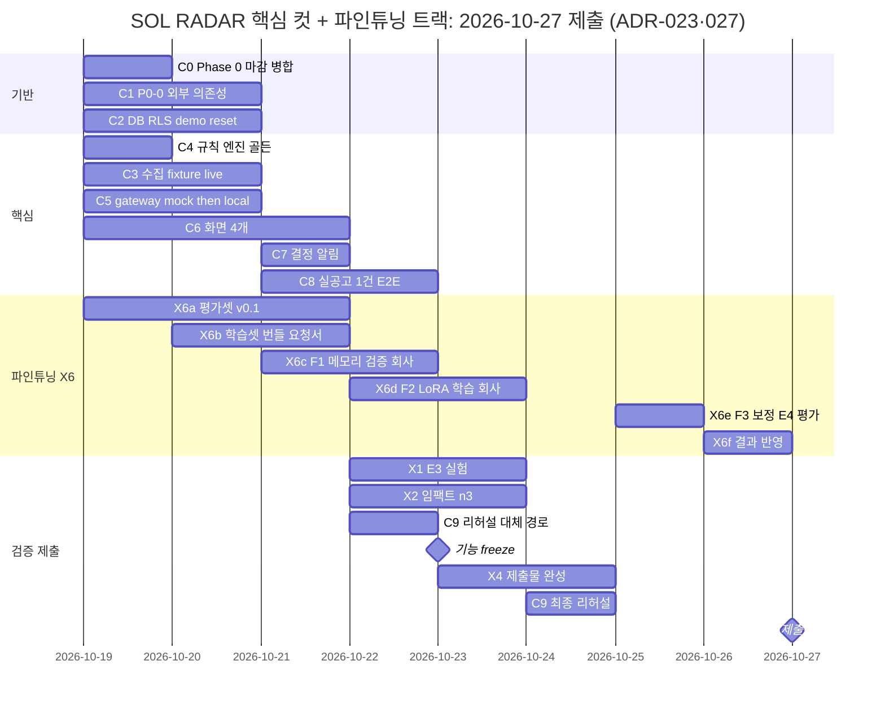

# Kev-9B LoRA 해커톤 파인튜닝과 일정 2일 당김 — 정본 변경안 (ADR-027)

사용자 결정(2026-10-19, 원문: "파인튜닝도 해야해서 일정 이틀씩 당겨야 해")을 정본에 넣기 위한 변경안이다. **이 문서는 정본·코드·DB를 바꾸지 않는다.**

> [!warning] 반영 조건
> 2026-10-19 10:58 기준으로 다른 세션이 정본 25개(ADR-025 회사 GPU 추론 엔드포인트 반영)를 커밋하지 않은 채 고치고 있었다. 그 작업은 main `cd6acea`(ADR-025·026 정본)·`0aa3be9`(C1 증거)·`820e04d`(`infra/gpu` 라우터)로 커밋됐다(조정 세션 보고, git log로 확인). 사용자가 이 해시를 확인하고 반영을 승인하면 §5 교체안을 적용한다. §5의 "찾을 문장"과 줄 번호는 10:58 작업 트리 기준이다. 적용할 때 `cd6acea` 이후 원문과 다시 대조한다.

> [!note] ADR 번호 (2026-10-19 정정)
> 처음에는 ADR-026으로 적었다. 그런데 ADR-026은 "팀 만들기는 서비스 운영자만"(사용자 결정, `cd6acea`, 마이그레이션 `20261019000008`)으로 이미 쓰였다. 그래서 이 변경안은 **ADR-027**을 쓴다.

## 1. 결정

### 1.1 사용자 결정 (2026-10-19)

| ID | 결정 |
|---|---|
| U1 | 해커톤 안에서 **Kev-9B LoRA만** 파인튜닝한다. Qwen 파인튜닝은 범위 밖 그대로다. 평가셋 v0.1(P0-9)과 학습셋 번들(P0-11)을 확장 컷에서 올린다 |
| U2 | 결과는 **비교 결과로 제출**한다. E4(Kev-9B+LoRA)를 E1(Kev-9B@v1.0)과 비교한 수치를 낸다. 데모·S-LIVE 모델은 Kev-9B@v1.0 그대로다. 목표에 못 미치거나 회사가 학습을 실행하지 못하면 v1.0을 유지하고 그 사실을 적는다. 핵심 컷 green 판정은 학습 결과를 기다리지 않는다 |
| U3 | 학습 실행은 [[16-DECISIONS\|ADR-025]]대로 회사가 한다(GPU 서버 셸 필요). 우리는 평가셋·학습셋·학습 요청서·평가를 맡는다 |
| U4 | 일정은 Critical Path 각 작업을 2일씩 당긴다. 오늘(10-19) 이전으로는 당기지 않는다. 제출 10-27은 그대로다 |
| U5 | 정본 반영은 다른 세션이 커밋한 뒤에 한다(위 콜아웃) |
| U6 | E4 평가용 LoRA run은 **평가 전용 `kev.serve`를 하나 더 띄워** 서빙한다. 위치는 회사 GPU 서버 `127.0.0.1:8010`, 경로는 라우터 `/sol-radar/kev-lora/`다. 데모 경로 `/kev`(v1.0)는 그대로 둔다(§4.2 D1 ①) |
| U7 | X6a 사람 라벨은 **사용자가 직접** 한다(§4.2 D2) |
| U8 | 컷 규칙 이름은 **"외부 의존성 컷 규칙"**으로 바꾼다(§4.2 D3 ①, M1 확정) |

### 1.2 메인 세션 결정 (M1은 U8로 확정. 나머지는 반영 전에 확인)

| ID | 결정 | 이유 |
|---|---|---|
| M1 | "10-21 컷 규칙"을 날짜 없는 이름 **"외부 의존성 컷 규칙"**으로 바꾸고, 판단 시점은 10-20 저녁으로 적는다 | 일정이 또 바뀌어도 이름을 고칠 필요가 없다. C1 ③이 회사 응답을 기다리는 중이라 2일(10-19 저녁)은 못 당기고 1일만 당긴다 |
| M2 | 파인튜닝 트랙 ID는 **X6**, 단계는 X6a~X6f다. 21의 F0~F3 단계 번호는 그대로 쓴다 | X는 Critical Path 밖의 평가·제출 작업 계열이다. F 번호와 섞지 않는다 |
| M3 | E4는 `en` state만 한다. `ko` LoRA는 후속이다 | 21 §5.3 학습 명령이 `train.en.jsonl`이고 운영 state가 영어다. 학습을 한 번만 돌릴 시간밖에 없다 |
| M4 | E1을 test 20 사업으로 돌리는 것은 X1 실행(10-22~23) 때 같이 한다 | E4는 같은 test 분할의 E1과 짝 비교해야 한다. GPU 추론 구간을 한 번에 모은다 |
| M5 | 10-23 freeze 뒤에도 **E4 평가 전용** 레지스트리 항목은 더할 수 있다. 데모 서빙 항목(`kev-9b-v1.0`)과 데모 gateway 설정은 바꾸지 않는다 | E4 평가가 10-25라 freeze보다 늦다. 데모 경로는 그대로 둔다 |
| M6 | F2 학습 시간대 기본안은 10-22~23이다(추론과 다른 GPU에서). 같은 GPU를 써야 하면 10-23 밤~10-24 오전으로 옮긴다 | 추론이 필요한 구간(C8 10-21~22, X1·E1 10-22~23, C9 리허설 10-22·10-24)과 겹치지 않게 한다 |

## 2. ADR-027 (16에 넣을 행과 상세)

### 2.1 결정 표 행 (ADR-026 행 다음)

```text
|ADR-027|Kev-9B LoRA 파인튜닝을 해커톤 안에서 비교 실험으로 하고(X6), 핵심 컷 일정을 2일 당긴다. 평가셋 v0.1(P0-9)·학습셋 번들(P0-11)을 확장 컷에서 X6로 올린다. F1·F2·F3은 회사가 실행하고(ADR-025), E4를 E1과 같은 test 분할에서 비교한다. 데모·S-LIVE 모델은 Kev-9B@v1.0 그대로, Qwen 파인튜닝은 범위 밖 그대로. Critical Path 각 작업 −2일(10-19 이전으로는 못 당김), 외부 의존성 컷 10-21 → 10-20 저녁, 기능 freeze 10-25 → 10-23, 최종 리허설 10-26 → 10-24, 제출 10-27 그대로|채택 (2026-10-19 사용자 결정, 구현 전)|2026-10-19|사용자 원문: "파인튜닝도 해야해서 일정 이틀씩 당겨야 해". 선택: Kev-9B LoRA만, 결과는 비교로 제출(목표 미달·회사 미실행이면 v1.0 유지). E4 서빙은 평가 전용 `kev.serve` + `/sol-radar/kev-lora/`, 사람 라벨은 사용자가 직접. [변경안](plans/2026-10-19-finetune-schedule-pull.md)|
```

### 2.2 상세 절 (ADR-026 상세 다음, `## 관련 문서` 앞)

```markdown
## ADR-027 상세 — Kev-9B LoRA 해커톤 파인튜닝과 일정 2일 당김

상태는 **채택**이다(사용자 결정 2026-10-19). E4 서빙 경로(10번)와 라벨 담당(11번)도 같은 날 사용자가 정했다. 근거와 교체안은 [변경안](plans/2026-10-19-finetune-schedule-pull.md)에 있다. ADR-023의 3단 컷(핵심·확장·P1)과 ADR-025의 실행 책임은 그대로 둔다. 이 ADR은 파인튜닝 트랙 X6를 더하고 일정을 당긴다.

1. **범위**: Kev-9B@v1.0에서 이어 학습하는 LoRA(`--init_from jaredpalmer/kev-9b@v1.0`, `en` state)만 한다. 순서는 X6a 평가셋 v0.1(test 20·dev 10 사업, P0-9) → X6b 학습셋 번들(train 1,000 레코드 이상)·학습 요청서(P0-11) → X6c F1 메모리 검증 → X6d F2 학습 → X6e F3 dev 온도 보정과 E4 평가 → X6f 제출물 반영. Qwen 파인튜닝과 `ko` LoRA는 후속이다.
2. **위상**: E4 비교 결과를 제출한다. 데모·S-LIVE 모델과 레지스트리 서빙 항목은 Kev-9B@v1.0 그대로다. 우리 쪽 산출물(평가셋·번들·요청서·E4 하네스)은 완료 조건이다. 회사의 학습 결과는 받으면 E4로 보고하고, 못 받으면 받지 못한 단계와 이유를 적는다. 결과 수치에는 통과 기준을 두지 않는다. E4가 E1보다 낫다고 말하려면 Δ의 95% CI가 0을 포함하지 않아야 한다.
3. **21 §4.4와의 관계**: X6의 학습은 사용자 결정으로 하는 비교 실험이다. 그래서 §4.4의 착수 조건(목표 미달, `MODEL` 원인 비중, 학습 데이터로 보완 가능)을 기다리지 않는다. 운영 반영(레지스트리 서빙 항목 교체, 데모 모델 교체, SOL Score 반영)은 §4.4와 별도 ADR을 그대로 따른다. 학습셋에는 test·dev 클러스터를 넣지 않는다(누수 0건).
4. **실행 위치**: ADR-025 §3·§6 그대로다. F1·F2·F3 실행과 GPU 배분은 회사가 한다. 우리는 번들·명령·요청서를 넘기고 노트북에서 평가한다. 회사 GPU로 가는 데이터의 경계(공공 공고는 개인정보 마스킹, 회사는 가상 기업만)도 그대로다. 클라우드 GPU 임대는 ADR-010대로 사용자 승인 전에는 하지 않는다.
5. **일정**: [[12-ROADMAP|12 로드맵]] Critical Path 표가 정본이다. 10-19 이전으로는 당기지 않는다. C1 ③은 회사 응답을 기다리므로 그대로 두고, 외부 의존성 컷 판단만 10-21 저녁에서 10-20 저녁으로 하루 당긴다. 이름도 날짜 없는 "외부 의존성 컷 규칙"으로 바꾼다.
6. **게이트**: X6는 ADR-023 3단 게이트의 확장 컷이 아니다. 핵심 컷과 나란히 돌고, 작업자가 겹치면 핵심 컷이 먼저다. 핵심 컷 green 판정은 X6 결과를 기다리지 않는다.
7. **freeze 예외**: 10-23 freeze 뒤에도 E4 평가 전용 레지스트리 항목은 더할 수 있다. 데모 gateway 설정과 `kev-9b-v1.0` 항목은 바꾸지 않는다.
8. **대체되는 문서**: [수상 전략 계획](plans/2026-10-18-hackathon-award-plan.md)의 §4 일정과 §6 "Kev LoRA" 줄은 이 ADR로 대체한다. 승인된 그 문서는 고치지 않는다.
9. **미결정**: 22번을 더한다(회사 GPU의 학습 실행 가능 여부·시간대·동시 점유·평가 전용 `kev.serve` 추가 기동).
10. **E4 서빙**: 회사 GPU 서버에 LoRA run을 띄운 평가 전용 `kev.serve`를 하나 더 둔다(`127.0.0.1:8010`). 모델 라우터에 `/sol-radar/kev-lora/<path>` → `127.0.0.1:8010/<path>` 경로를 더한다(`infra/gpu/model-router.conf`). 데모 gateway의 `KEV_BASE_URL`(`/kev`, v1.0)과 레지스트리 서빙 항목은 바꾸지 않는다. `sol_eval`만 `--kev-url https://acropolissg.com/sol-radar/kev-lora`로 붙는다. 인증은 `/kev`와 같은 `KEV_API_KEY` Bearer다. `kev.serve`는 `--run` 경로가 틀리면 오류 없이 `runs/smoke`로 대체한다. 그래서 `sol_eval`도 실행 전에 `GET /v1/models`를 레지스트리의 평가 전용 항목(예: `kev-9b-sol-lora-v0.1`)과 대조하고, 다르면 실행하지 않는다. 평가가 끝나면 회사가 이 인스턴스를 내려도 된다. GPU 메모리가 9B 하나만큼 더 든다.
11. **라벨 담당**: X6a 사람 라벨(test 20 추출 정답, 의미 대응 150건 이상)은 사용자가 직접 한다. 두 번째 라벨러가 없으면 Cohen κ가 빠졌다고 리포트에 적는다.

> [!warning] 미검증 가정 (2026-10-19)
> - 회사가 해커톤 안에 F1·F2·F3을 실행할 수 있는지, 어느 시간대에 할 수 있는지 확인하지 않았다.
> - 회사 GPU 사양을 확인하지 않았다. [C1 절차](plans/2026-10-19-c1-external-deps-procedure.md)의 "A40×2"도 가정이다.
> - 학습과 추론을 동시에 돌릴 수 있는지 확인하지 않았다.
> - 9B LoRA 메모리는 21 §5.2 추정치다. 학습 시간은 공식 기준 H200 1장 2.6시간이고, 회사 GPU에서는 재지 않았다.
> - train 1,000 레코드 확보는 live 수집·첨부 파싱(C3)과 Qwen 추출(C5 `local`, C1 ③)이 되는 것을 전제로 한다.
```

### 2.3 미결정 표 행 (21번 다음)

```text
|22|회사 GPU에서 Kev-9B LoRA 학습(F1·F2·F3) 실행 가능 여부·시간대·추론과 동시 점유·평가 전용 `kev.serve`(`127.0.0.1:8010`) 추가 기동|미검증|2026-10-19|ADR-027. C1 P2·P3 요청과 함께 회사에 묻는다. 답이 오기 전 X6c~X6e 일정은 가정이다. E4 서빙 방식은 결정됐다(ADR-027 10번). 남은 것은 회사가 메모리와 시간대를 확보할 수 있는지다|
```

## 3. 새 일정

### 3.1 Critical Path (12 표의 "일정" 열)

| ID | 작업 | 현재 | 변경 | 비고 |
|---|---|---|---|---|
| C0 | Phase 0 마감 | 10-19 | 10-19 | 오늘이라 그대로. Phase 0 보고서만 남음 |
| C1 | P0-0 외부 의존성 | 10-19~20 | 10-19~20 | ③은 회사 응답 대기라 못 당긴다 |
| 컷 판단 | 외부 의존성 컷 규칙 | 10-21 저녁 | **10-20 저녁** | −1일(M1) |
| C2 | DB·RLS·`demo:reset` | 10-19~21 | 10-19~20 | 시작이 오늘이라 −1일. 1단계는 worktree에서 끝났다 |
| C3 | 수집(fixture·live·첨부·`/parse`) | 10-21~22 | 10-19~20 | `c3/ingestion-core` worktree에서 이미 진행 중. X6a의 입력이다 |
| C4 | 규칙 엔진·골든 | 10-19~20 | 10-19 | `e22de09` 병합. 보고만 남음 |
| C5 | gateway mock → worker → `local` | 10-20~22 | 10-19~20 | 3일 → 2일. 가장 빡빡하다(§4.3) |
| C6 | 화면 4개 + Route Handler 9개 | 10-21~23 | 10-19~21 | 디자인 스펙·계획 있음(`c6/screens`) |
| C7 | 결정 기록·인앱 알림 | 10-23 | 10-21 | |
| C8 | S-LIVE 실공고 1건 | 10-23~24 | 10-21~22 | |
| C9 | 리허설·대체 경로 | 10-24, 10-26 | 10-22, 10-24 | |
| X1 | E3 대조 실험 | 실행 10-24~25 | 실행 10-22~23 | E1 test 20 실행 포함(M4) |
| X2 | 임팩트 n=3 | 10-24~25 | 10-22~23 | |
| X3 | 경쟁 비교 | 10-19 | 완료 | |
| X4 | 제출물 | 완성 10-25~26 | 완성 10-23~24, E4 반영 10-26 | 구조는 10-19부터 |
| X5 | 확장 컷 | 10-25 이후 | 10-23 이후 | 핵심 컷 green 뒤 |
| **X6** | **Kev-9B LoRA 파인튜닝 트랙(새로)** | — | 10-19~26 | §3.2 |
| freeze | 기능 freeze | 10-25 | **10-23** | |
| 리허설 | 최종 리허설(재부팅 포함 2회) | 10-26 | **10-24** | |
| 예비 | X6e·X6f·제출물 마감 | — | 10-25~26 | freeze 뒤라 앱 기능은 더하지 않는다 |
| 제출 | | 10-27 | 10-27 | 그대로 |

### 3.2 X6 파인튜닝 트랙

| 단계 | 작업 | 담당 | 일정 | 선행 | 증거 |
|---|---|---|---|---|---|
| X6a | 평가셋 v0.1(P0-9): test 20·dev 10 사업, 원형 6개. 추출 정답 20건(5건 이상은 `draftedBy=NONE`), 의미 대응 라벨 150건 이상, 사업 단위 분할 | 우리(빌더·검증 CLI) + 사용자(사람 라벨, U7) | 10-19~21 | C3 live 수집·첨부 파싱(30 사업 이상) | manifest, `sol_eval.labels check` 통과, 클러스터 교차 0건 |
| X6b | 학습셋 번들(P0-11): train 1,000 레코드 이상(`CONSTRUCTED`·`RULE_SILVER`, test·dev 클러스터 제외), Kev JSONL `en`, 보정용 dev JSONL, sha256, `probe-train` 스크립트. 학습 요청서(F1 격자, F2 명령, F3 보정, 돌려받을 것, 데이터 경계)를 써서 회사에 넘긴다 | 우리 | 10-20~21. 회사 전달 10-21 | X6a 분할, C5 `local`(train state는 Qwen 출력, 21 §3.7), C1 ③ | 번들 sha256, 요청서 |
| X6c | F1 메모리 검증(21 §5.2 격자, `--max_steps 20`) | 회사 | 10-21~22 | X6b 전달 | `docs/evidence/kev-train-feasibility.md` |
| X6d | F2 LoRA 학습(21 §5.3, 값은 F1 결과로 확정) | 회사 | 기본 10-22~23. 같은 GPU면 10-23 밤~10-24 오전(M6) | X6c | 체크포인트 폴더, `training_config.json` |
| X6e | F3 dev 온도 보정 → 평가 전용 `kev.serve`(`/sol-radar/kev-lora/`, U6) 기동 → 레지스트리 평가 전용 항목 대조 → E4 평가(test 20, E1과 짝 부트스트랩) | 보정·서빙은 회사, 평가는 우리 | 10-25 | X6d, E1 test 20(X1 때) | `docs/evidence/eval/` E4 리포트, 레지스트리 평가 전용 항목 |
| X6f | 결과 반영: `experiment-tables.md` (c), 18 §7·§8 13번, `limitations.md`, 슬라이드 9장 | 우리 | 10-26 | X6e | |

GPU 점유: 추론이 필요한 구간은 C1 ③(10-19~20), C8(10-21~22), X1·E1(10-22~23), C9(10-22·10-24), D-day다. 학습 구간은 F1(10-21~22, 짧음)과 F2다. 동시에 돌릴 수 있는지는 회사에 묻는다(§4.1).

### 3.3 병렬 순서 (12의 "병렬 순서" 줄)

```text
병렬 순서: 10-19 C0‖C1‖C2‖C3‖C4 보고‖C5‖C6‖X4 구조‖X6a → 10-20 C1 ③‖C2‖C3‖C5‖C6‖X6a·X6b, 저녁 외부 의존성 컷 → 10-21 C6‖C7‖C8‖X6a·X6b(회사 전달)‖X6c → 10-22 C8‖C9 1차‖X1‖X2‖X6c·X6d → 10-23 X1‖X2‖X4 완성‖X6d, 기능 freeze → 10-24 C9 최종 리허설‖X4 완성 → 10-25 X6e → 10-26 X6f·제출물 마감·예비 → 10-27 제출.
```

### 3.4 간트 (12의 mermaid 블록 전체 교체)



## 4. 위험과 요청할 것

### 4.1 회사에 요청할 것 (C1 P2·P3 요청과 함께 보낸다)

1. 해커톤 안에 F1·F2·F3을 실행할 수 있는지, 언제 할 수 있는지.
2. 학습과 추론(vLLM Qwen, `kev.serve` v1.0)을 동시에 돌릴 수 있는지. GPU 수와 VRAM도 함께 묻는다.
3. E4 평가 기간(X6e)에 평가 전용 `kev.serve`(LoRA run, `127.0.0.1:8010`)를 하나 더 띄울 수 있는지(GPU 메모리 9B 하나 분량)와 라우터 설정 교체(§5.9).
4. 돌려받을 것은 21 §5.4 그대로다: 체크포인트 폴더, `kev.benchmark` 리포트, `MODEL_CARD.md`. 데이터셋 원문은 돌려받지 않는다.

### 4.2 결정 (2026-10-19 사용자, 원문: "1번은 추천대로 2번은 내가 직접 3번은 추천대로")

**D1. E4 평가용 LoRA run 서빙 경로 → ① 채택(U6)**
1. **(채택)** 평가 전용 `kev.serve`를 `127.0.0.1:8010`에 하나 더 띄운다. `infra/gpu/model-router.conf`에 `/sol-radar/kev-lora/` 경로를 더한다(§5.9). 데모 경로 `/kev`가 v1.0 그대로라 레지스트리 대조와 리허설이 깨지지 않는다. GPU 메모리가 9B 하나만큼 더 든다.
2. (기각) E4를 평가하는 동안만 `/kev`를 LoRA run으로 바꿨다가 되돌린다. 그동안 데모와 리허설을 못 한다.
3. (기각) 체크포인트를 받아 노트북에서 `kev.serve`를 띄운다. 노트북에서 9B 추론이 되는지 확인하지 않았다.

**D2. 사람 라벨 담당 → 사용자 직접(U7)**: 21 §3.5 추정으로 test 20의 추출 정답이 약 7~13시간, 의미 대응 150건이 약 3시간이다. 일정은 10-19~21이다. 두 번째 라벨러(Cohen κ)가 없으면 리포트에 그 지표가 빠졌다고 적는다.

**D3. 컷 규칙 이름 → ① 채택(U8)**: "외부 의존성 컷 규칙"으로 바꾼다. 날짜만 바꾸는 ②는 기각했다.

### 4.3 일정 위험

- C5는 3일에서 2일로 줄었다. C3·C6은 C2(10-20 종료) 앞에서 시작한다. 그래서 병합되지 않은 C2 마이그레이션 위에서 작업하고, C2가 바뀌면 다시 고쳐야 한다.
- X6b의 train state는 Qwen 출력이라 C1 ③(회사 엔드포인트)이 필요하다. ③이 10-21까지 안 되면 X6 일정이 그만큼 밀린다. 10-24 안에 F2가 시작되지 않으면 E4는 "회사 측 미실행"으로 적는다(U2).
- X6a 사람 라벨(사용자 직접, 약 10~16시간)과 핵심 컷의 사용자 확인 작업이 10-19~21에 겹친다. 라벨이 늦으면 X6b의 분할(test·dev 클러스터 제외)도 늦어진다.
- 평가 전용 `kev.serve`가 들어갈 GPU 메모리가 없으면 D1 ②(기간 한정 교체)로 바꿀지 다시 정해야 한다.
- test 20은 표본이 작아 CI가 넓다. E4의 개선은 CI가 0을 포함하지 않을 때만 말한다.

## 5. 정본 교체안

### 5.0 공통: 컷 규칙 이름 (M1, U8로 확정)

아래 문장을 바꾼다. `docs/evidence/`와 승인된 계획 문서(`plans/2026-10-18-hackathon-award-plan.md` 등)는 기록이라 고치지 않는다.

| 찾을 문장 | 바꿀 문장 |
|---|---|
| `10-21 컷 규칙` | `외부 의존성 컷 규칙` |
| `10-21 컷 결과`·`10-21 컷 결정` | `외부 의존성 컷 결과`·`외부 의존성 컷 결정` |
| 판단 시점을 뜻하는 `10-21 저녁` | `10-20 저녁` |
| `**10-21 컷 규칙**(저녁, C1 결과 기준.` | `**외부 의존성 컷 규칙**(10-20 저녁, C1 결과 기준. ADR-027으로 하루 당겼다.` |

찾기: `grep -rn "10-21" docs --include='*.md' | grep -v "docs/evidence/" | grep -v "plans/2026-10-1[0-8]"`. 10:58 기준 위치는 01(113), 03(624), 11(190), 12(컷 규칙 머리·"GPU 정상" 문단·간트 설명), 16(176·226), 17(48), 18(131·161), 19(83·156·207), PROGRESS(28), submission의 limitations(13·54·56)·README(37)·slides-outline(25·29·35)·video-storyboard(27·46)이다.

### 5.1 [[12-ROADMAP|12 로드맵]]

1. 머리 콜아웃의 `아래 간트는 아직 역산 전이다.` → `아래 간트는 ADR-027(2026-10-19)으로 2일 당긴 일정이다.`
2. Phase 표 "평가 트랙" 행의 `Phase 5 실추론이 동작한 뒤 시작해 Phase 6·7과 나란히 진행` → `평가셋 라벨은 10-19부터, 학습셋 번들은 Phase 5 local이 동작한 뒤. Kev-9B LoRA 학습(F1·F2·F3)은 회사 측 실행(X6, [[16-DECISIONS\|ADR-027]])`
3. P0 표 P0-11 행: Phase 열 `평가 트랙` → `X6`. 완료 기준 열 `번들 sha256, 절차 문서. 실행은 GPU 서버 셸이 필요해 회사 측 실행 요청 사항` → `train 1,000 레코드 이상, 번들 sha256, 학습 요청서. F1·F2·F3 실행은 GPU 서버 셸이 필요해 회사 측(X6, [[16-DECISIONS\|ADR-027]])`. P0-9 행 Phase 열도 `X6`.
4. 순서 규칙 마지막 줄의 `P0-8·P0-9~P0-11은 확장 컷으로 옮겼다(ADR-023).` → `P0-8은 확장 컷(ADR-023), P0-9·P0-11은 X6(ADR-027)이다. P0-10 하네스는 X1·X6이 같이 쓴다.`
5. 해커톤 컷 표: 핵심 컷 행과 확장 컷 행 사이에 아래 행을 넣는다.

   ```text
   |**파인튜닝 트랙 X6**(핵심 컷과 나란히, [[16-DECISIONS\|ADR-027]])|평가셋 v0.1(test 20·dev 10, P0-9), 학습셋 번들 내보내기·학습 요청서(P0-11), Kev-9B LoRA F1·F2·F3(회사 측 실행), E4 = Kev-9B+LoRA를 E1과 같은 test 분할에서 짝 부트스트랩 95% CI로 비교. 데모·S-LIVE 모델은 Kev-9B@v1.0 그대로|사용자 결정(2026-10-19). 우리 쪽 산출물(평가셋·번들·요청서·E4 하네스)은 완료 조건이다. 회사 측 학습 결과는 받으면 E4로 보고하고, 못 받으면 "회사 측 미실행"으로 적는다. 핵심 컷 green 판정은 학습 결과를 기다리지 않는다. 작업자가 겹치면 핵심 컷이 먼저다|
   ```

6. 확장 컷 행의 `→ 전체 평가셋(test 20·dev 10)·E0·E1·E2 전체 리포트·P0-11 학습셋 내보내기 →` → `→ E0·E2·E3 전체 평가셋(test 20) 리포트 →`
7. 해커톤 이후 행의 `Kev-9B LoRA: F1 메모리 검증 실행(GPU 서버 셸이 필요해 회사 측 실행 요청 사항. 회사가 해커톤 중에 돌려 주면 기록하지만 완료 조건 아님)·F2 학습·F3 보정·반입([[21-MODEL-TRAINING\|21 모델 학습]] §5).` → `Kev-9B LoRA 운영 반영(레지스트리 서빙 항목·데모 모델 교체, [[21-MODEL-TRAINING\|21 모델 학습]] §4.4 판단과 ADR. 해커톤 학습·E4 비교는 X6).` 같은 행 이유 열의 `파인튜닝은 초기 목표 지표 미달만으로 시작하지 않고,` → `운영 반영은 초기 목표 지표 미달만으로 정하지 않고,`. 그 문장 끝에 `해커톤 X6 학습은 사용자 결정에 따른 비교 실험이다(ADR-027).`를 덧붙인다.
8. Critical Path 표: "일정" 열을 §3.1 "변경" 열로 바꾼다. X5 행 다음에 아래 행을 넣는다.

   ```text
   |X6|Kev-9B LoRA 파인튜닝 트랙([[16-DECISIONS\|ADR-027]]): X6a 평가셋 v0.1(P0-9) → X6b 학습셋 번들·학습 요청서(P0-11) → X6c F1(회사) → X6d F2(회사) → X6e F3 보정·E4 평가 → X6f 제출물 반영. 데모 모델은 Kev-9B@v1.0 그대로|평가 / P0-9·P0-11|C3 live·첨부, C5 `local`, C1 ③, 회사 실행|10-19~26|
   ```

9. "병렬 순서" 줄은 §3.3으로 바꾼다.
10. 컷 규칙 머리는 §5.0 넷째 행대로 바꾼다.
11. `## 데모 D-2 ~ D-day` → `## freeze ~ D-day`로 바꾸고 표 행을 다음처럼 바꾼다.
    - `D-2 (10-25)` → `freeze (10-23)`: 기존 내용 그대로 두고 `모델 레지스트리 ... 버전 고정` 뒤에 `(데모 서빙 항목 kev-9b-v1.0 기준. E4 평가 전용 LoRA 항목 추가는 예외이고 데모 gateway 설정은 바꾸지 않는다, ADR-027)`를 붙인다.
    - `D-1 (10-26)` → `최종 리허설 (10-24)`: 내용은 그대로 둔다.
    - 새 행 `10-25~26`: `X6e F3 보정·E4 평가, X6f 제출물 반영, 예비일. freeze 뒤라 앱 기능을 더하지 않고 리허설에서 나온 결함만 고친다. 고쳤으면 기동 절차 1~12를 한 번 다시 돈다`
    - `D-day` 행은 그대로 둔다.
12. 간트는 §3.4로 바꾼다. 아래 설명의 `위 간트는 ADR-023 Critical Path의 제안 일정이다. C1 결과로 10-21 저녁에 한 번 재조정한다.` → `위 간트는 ADR-023 Critical Path를 ADR-027으로 2일 당긴 일정이다. C1 결과로 10-20 저녁에 한 번 재조정한다.`

### 5.2 [[16-DECISIONS|16 ADR]]

1. 결정 표에 §2.1 행, 상세에 §2.2 절, 미결정 표에 §2.3 행을 넣는다. 관련 문서 절에 `[[12-ROADMAP|12 로드맵]]`이 없으면 더한다.
2. ADR-020 행 상태 열 끝에 `ADR-027으로 Kev-9B LoRA 학습·E4 비교는 해커톤 X6.`를 덧붙인다.
3. ADR-020 상세 "평가·파인튜닝" 줄의 `Kev-9B LoRA는 해커톤 완료 조건이 아니다.` → `Kev-9B LoRA 운영 반영은 해커톤 완료 조건이 아니다(학습·E4 비교 실험은 ADR-027 X6).`
4. ADR-023 상세 컷 규칙 줄(176)은 §5.0대로 바꾼다.
5. ADR-025 상세 6번 끝의 `(해커톤 완료 조건이 아닌 것은 그대로)` → `(해커톤에는 ADR-027 X6로 F1·F2·F3을 회사에 요청한다)`. 7번의 `10-21 컷 규칙(ADR-023)` → `외부 의존성 컷 규칙(ADR-023·027)`.

### 5.3 [[21-MODEL-TRAINING|21 모델 학습]]

1. 머리 tip 콜아웃 끝에 덧붙인다: `해커톤에는 사용자 결정으로 Kev-9B LoRA 를 비교 실험(E4)으로 먼저 돌린다. 데모 모델은 v1.0 그대로이고, 운영 반영은 위 판단을 그대로 따른다([[16-DECISIONS|ADR-027]]).`
2. §1 표의 F1·F2·F3 행을 바꾼다.

   ```text
   | F1 | 회사 GPU 에서 LoRA 메모리 검증 실행(GPU 서버 셸이 필요해 회사 측 실행, [[16-DECISIONS\|ADR-025]]) | X6c(회사 측 실행, [[16-DECISIONS\|ADR-027]]). 결과를 받으면 기록 |
   | F2 | Kev-9B LoRA 학습(`en`) | X6d(회사 측 실행, ADR-027). 비교 실험이라 §4.4 착수 조건을 기다리지 않는다 |
   | F3 | 온도 보정·평가·반입·운영 모델 교체 | 보정·E4 평가는 X6e. 반입·운영 모델 교체는 후속이고 §4.4 판단과 ADR 을 거친다 |
   ```

3. §3.5 표 train 행 `| train | 나머지 전부 | 해커톤에는 내보내기만. 학습 전 1,000 레코드 이상으로 늘린다 |` → `| train | 나머지 전부 | X6b 에서 1,000 레코드 이상으로 내보내 F2 에 쓴다(ADR-027). test·dev 클러스터는 뺀다 |`. 축소판 행 끝의 `위 test 20·dev 10 은 확장 컷` → `위 test 20·dev 10 은 X6a(ADR-027)`.
4. §3.5 표 아래 문단 `표본이 작아서 신뢰구간이 넓다. 해커톤 뒤 test 를 40 사업 이상으로 늘린 다음에 파인튜닝 착수(§4.4)를 판단하는 것이 바람직하다.` → `표본이 작아서 신뢰구간이 넓다. 해커톤 X6 의 E4 는 test 20 으로 하는 비교 실험이다. 운영 반영(§4.4)은 해커톤 뒤 test 를 40 사업 이상으로 늘린 다음에 판단하는 것이 바람직하다.`
5. §4.2 E4 행을 바꾼다.

   ```text
   찾을 문장: | E4 | Kev-9B + LoRA(`en`/`ko`) | 후속 |
   바꿀 문장: | E4 | Kev-9B + LoRA(`en`) | X6e(ADR-027). E1 과 같은 test 분할·데이터셋 버전에서 짝 부트스트랩 95% CI 로 비교. `ko` 는 후속 |
   ```

6. §4.4 절차 5번 다음에 콜아웃을 넣는다.

   ```markdown
   > [!note] 해커톤 예외 (ADR-027, 2026-10-19)
   > 해커톤 X6 의 Kev-9B LoRA 학습은 사용자 결정으로 하는 E4 비교 실험이다. 그래서 위 4번 조건을 기다리지 않는다. 운영 반영(레지스트리 서빙 항목·데모 모델 교체, SOL Score 반영)은 위 절차와 ADR 을 그대로 따른다. E4 가 E1 보다 낫다고 말하려면 Δ 의 95% CI 가 0 을 포함하지 않아야 한다.
   ```

7. §5 제목 `## 5. 파인튜닝 (후속, 회사 GPU)` → `## 5. 파인튜닝 (회사 GPU. 해커톤 X6 비교 실험 + 후속 운영 반영)`.
8. §5.5 첫 줄 끝에 덧붙인다: `해커톤 X6 의 학습 요청서(F1 격자·F2 명령·F3 보정·돌려받을 것·데이터 경계)는 X6b 에서 만들어 회사에 넘긴다.`
9. §7 제목 `## 7. 수용 기준 (해커톤 F0)` → `## 7. 수용 기준 (해커톤 F0·X6)`. 첫 줄 `데이터셋 v0.1:` → `데이터셋 v0.1(X6a):`. 내보내기 줄을 바꾸고 마지막 줄을 더한다.

   ```text
   내보내기 줄 바꿀 문장:
   - 내보내기(X6b): train 1,000 레코드 이상, 번들 sha256 기록, Kev JSONL 이 `kev.benchmark --data` 로 읽힌다(회사 측 실행에서 확인), 학습 요청서가 회사에 전달됐다.

   더할 줄:
   - 파인튜닝(X6c~X6e): 회사 측 실행 결과를 받으면 `kev-train-feasibility.md`·체크포인트 메타데이터·E4 리포트(E1 대비 Δ·95% CI)를 남긴다. 받지 못하면 받지 못한 단계와 이유를 리포트에 적는다. 결과 수치의 통과 기준은 없고, 데모 모델 교체를 뜻하지 않는다.
   ```

10. §8 표에 두 행을 더한다: `| 회사 GPU 의 LoRA 학습 실행 가능 여부·시간대·추론과 동시 점유 | 미확인 | 회사에 요청(ADR-027, 16 미결정 22) |`, `| 9B LoRA 학습 소요 시간(공식 H200 1장 2.6시간) | 회사 GPU 미측정 | X6d |`.

### 5.4 [[17-CLAUDE-IMPLEMENTATION|17 구현 규칙]]

1. 우선순위 머리 `### 우선순위 (ADR-023, 2026-10-19)` → `### 우선순위 (ADR-023·027, 2026-10-19)`. 4번은 §5.0대로 바꾼다.
2. 우선순위 끝에 8번을 더한다: `8. 파인튜닝 트랙 X6(ADR-027)는 핵심 컷과 나란히 돈다. 작업자가 겹치면 핵심 컷이 먼저다. 학습(F1·F2·F3)은 회사가 실행하고, 우리는 평가셋·학습셋 번들·학습 요청서·E4 평가를 맡는다. 데모 앱과 레지스트리 서빙 항목(kev-9b-v1.0)은 바꾸지 않는다.`
3. 순차 11번의 `파인튜닝은 하지 않는다(해커톤 범위 밖).` → `Kev-9B LoRA 는 X6(ADR-027)로 회사에 학습·보정을 요청하고 E4 로 비교한다. 데모·S-LIVE 모델은 Kev-9B@v1.0 그대로이고, Qwen 파인튜닝은 하지 않는다.`

### 5.5 [[18-HACKATHON|18 해커톤]]

1. §7 "모델 평가" 행의 `E0(규칙만)·E1(Kev-9B 영어)·E2(Kev-9B 한국어)를 비교한다` → `E0(규칙만)·E1(Kev-9B 영어)·E2(Kev-9B 한국어)·E4(Kev-9B+LoRA, X6)를 비교한다`
2. §7 "파인튜닝" 행 전체를 바꾼다.

   ```text
   | 파인튜닝 | **Kev-9B LoRA 비교 실험(X6)** | 회사 GPU 에서 회사가 학습·보정하고 E4 로 v1.0 과 비교한다([[16-DECISIONS]] ADR-027). 데모·S-LIVE 는 Kev-9B@v1.0 이다. 결과를 못 받으면 "회사 측 미실행"으로 적는다. Qwen 파인튜닝은 하지 않는다 |
   ```

3. §8 12번의 `평가셋 확대(test 40 사업 이상) → 오류 분석에서 모델 판단 오류가 주된 원인이면 회사 GPU에서 Kev-9B LoRA →` → `평가셋 확대(test 40 사업 이상) → 해커톤 E4 결과와 오류 분석으로 Kev-9B LoRA 운영 반영 판단 →`
4. §8 13번 전체를 바꾼다.

   ```text
   13. **"파인튜닝했나?"** Kev-9B 에 LoRA 를 학습해 E4 로 v1.0(E1)과 같은 test 분할에서 비교했다([[16-DECISIONS]] ADR-027). 학습·보정은 회사가 회사 GPU 에서 돌렸고, 우리는 평가셋·학습셋·학습 요청서·평가를 맡았다. 결과는 Δ 와 95% 신뢰구간으로만 말하고, 구간이 0 을 포함하면 "차이 없음"이라고 한다. 데모는 v1.0 을 쓴다. 운영 모델 교체는 오류 분석과 ADR 을 거친 뒤다. Qwen 파인튜닝은 하지 않았다. 회사 측 학습이 마감 안에 끝나지 않았으면 "학습셋과 절차를 넘겼고 결과는 아직 없다"고 답한다 ([[21-MODEL-TRAINING]] §4.4·§5).
   ```

5. 131·161은 §5.0대로 바꾼다.

### 5.6 나머지 정본

| 문서 | 찾을 문장 | 바꿀 문장 |
|---|---|---|
| [[01-PRD]] 28 | `Kev-9B LoRA 학습 실행(후속, [[21-MODEL-TRAINING\|21 모델 학습]])` | `Kev-9B LoRA 운영 반영(데모·운영 모델 교체. 학습·E4 비교는 X6, [[16-DECISIONS\|ADR-027]])` |
| [[01-PRD]] 73 | `Kev-9B LoRA 학습은 후속([[21-MODEL-TRAINING\|21 모델 학습]])` | `Kev-9B LoRA 학습·E4 비교는 X6(회사 측 학습, [[16-DECISIONS\|ADR-027]]), 운영 반영은 후속([[21-MODEL-TRAINING\|21 모델 학습]])` |
| [[01-PRD]] 131 | `(ADR-023 X2, 2026-10-24~25 예정)` | `(ADR-023 X2, 2026-10-22~23 예정, ADR-027)` |
| [[03-AI-PIPELINE]] 610, [[10-DEPLOYMENT]] 144, [[09-SECURITY]] 222 | 아래 코드 블록 | 아래 코드 블록 |
| [[11-TESTING]] 149 | `전체 평가셋(test 20·dev 10 사업)은 확장 컷이다.` | `전체 평가셋(test 20·dev 10 사업)은 X6(ADR-027)에서 만들어 E1·E4 비교에 쓴다.` |
| [[11-TESTING]] 151 | `오류 분석으로 원인 단계를 가른 뒤 사람이 정한다.` | 뒤에 덧붙임: `해커톤 X6 의 Kev-9B LoRA 는 사용자 결정으로 하는 E4 비교 실험이고(ADR-027), 운영 반영은 이 절차를 그대로 따른다.` |
| [[11-TESTING]] 168 | `NAV-01~NAV-09, S5(G2 변경 감지 화면), P0-8, 전체 평가셋·P0-11은 확장 컷이다` | `NAV-01~NAV-09, S5(G2 변경 감지 화면), P0-8은 확장 컷이다. 전체 평가셋·P0-11·E4는 X6(ADR-027)이고 핵심 컷 통과 조건에 들어가지 않는다` |
| [[11-TESTING]] 261 | `Kev-9B LoRA 학습은 완료 조건이 아니다.` | `Kev-9B LoRA 는 X6(ADR-027)이다. 우리 쪽 산출물(평가셋·학습셋 번들·학습 요청서·E4 하네스)은 완료 조건이다. 회사 측 학습 결과는 받으면 E4 로 보고하고, 받지 못하면 미실행으로 적는다.` |
| [[19-DEMO-SCENARIO]] 83·156·207 | §5.0 | §5.0 |
| [[20-GLOSSARY]] 188 | `E4 Kev-9B+LoRA(후속)` | `E4 Kev-9B+LoRA(해커톤 X6 비교 실험, ADR-027)` |

```text
03 610 · 10 144
찾을 문장: LoRA 메모리 검증(`probe-train`)은 GPU 서버 셸이 필요하므로 회사 측 실행 요청 사항으로 남긴다(해커톤 완료 조건 아님, [[21-MODEL-TRAINING|21 모델 학습]]).
바꿀 문장: LoRA 메모리 검증(`probe-train`)·학습(F2)·온도 보정은 GPU 서버 셸이 필요하므로 회사가 실행한다. 해커톤에는 X6로 요청하고 결과는 E4 비교로만 쓴다(데모 모델은 v1.0, [[16-DECISIONS|ADR-027]], [[21-MODEL-TRAINING|21 모델 학습]]).

09 222
찾을 문장: LoRA 메모리 검증(`probe-train`)은 GPU 서버 셸이 필요해 회사 측 실행 요청 사항이다(ADR-025).
바꿀 문장: LoRA 메모리 검증(`probe-train`)·학습(F2)·보정은 GPU 서버 셸이 필요해 회사가 실행한다(ADR-025·027).
```

### 5.7 [[PROGRESS]]

1. `## 핵심 컷 Critical Path (ADR-023, 2026-10-19 승인)` → `## 핵심 컷 Critical Path (ADR-023, 2026-10-19 승인 · 일정 ADR-027)`. 그 아래 `10-21 저녁 C1 결과로` → `10-20 저녁(ADR-027) C1 결과로`.
2. X5 다음에 줄을 더한다: `- [ ] X6 Kev-9B LoRA 파인튜닝 트랙(ADR-027): X6a 평가셋 v0.1 → X6b 학습셋 번들·학습 요청서 → X6c F1(회사) → X6d F2(회사) → X6e F3·E4 → X6f 제출물 반영. 회사 GPU 학습 가능 여부 미확인(16 미결정 22)`
3. `- [ ] P0-9~P0-11 평가 트랙(…).` 끝에 `P0-9·P0-11은 X6(ADR-027).`를 붙인다.
4. `- 해커톤 이후: Kev-9B LoRA(F1~F3, 오류 분석에서 모델 판단 오류가 주된 원인일 때),` → `- 해커톤 이후: Kev-9B LoRA 운영 반영(오류 분석에서 모델 판단 오류가 주된 원인일 때. 학습·E4 비교는 해커톤 X6, ADR-027),`
5. 작업 로그에 행을 더한다(검증 열은 반영 때 실제 결과로 채운다): `| 2026-10-19 | 문서 | ADR-027 "Kev-9B LoRA 해커톤 파인튜닝·일정 2일 당김" 반영(사용자 결정). X6 트랙(X6a~X6f), Critical Path −2일, 외부 의존성 컷 10-20 저녁, freeze 10-23, 최종 리허설 10-24. 정본 01·03·09·10·11·12·16·17·18·19·20·21, 제출물 5개, E3 설계 §9 | (반영 때 채움) | 회사 GPU 학습 가능 여부 미확인(미결정 22), E4 서빙 경로(D1) 결정 |`

### 5.8 제출물·계획 (정본 아님, 같은 세션 미커밋이라 같이 반영)

1. `submission/limitations.md` 50: `Kev-9B LoRA 학습,` → `Kev-9B LoRA 운영 반영(학습·E4 비교는 X6),`. §4 끝에 E4 문장 두 개를 더한다(하나만 쓴다).
   - 회사 실행됨: `Kev-9B 에 LoRA 를 학습해 v1.0 과 같은 test 20 사업에서 비교했다. Macro-F1 차이는 Δ=…(95% CI …)다. 데모는 v1.0 을 쓴다.`
   - 회사 미실행: `학습셋(…레코드, sha256 …)과 학습 절차를 회사에 넘겼고, 마감 안에 학습 결과를 받지 못했다. 데모는 v1.0 을 쓴다.`
2. `submission/experiment-tables.md`: 표 (a) 다음에 표 (c)를 더한다.

   ```markdown
   ## (c) E1 · E4 비교 (X6, ADR-027)

   **측정 전. 값 없음.**

   입력: 평가셋 v0.1 test 20 사업(21 §3.5, X6a). E1 = Kev-9B@v1.0, E4 = Kev-9B+LoRA(`en`, dev 온도 보정). 데이터셋 버전·commit·질문 세트·state 템플릿이 같다.

   | 지표 | E1 | E4 | Δ(E4−E1) | 95% CI(짝 부트스트랩) | n |
   |---|---|---|---|---|---|
   | Macro-F1 (3값) | | | | | |
   | 정보부족 → 미충족 혼동률 | | | | | |
   | Brier | | | | | |
   | ECE (보정 후) | | | | | |
   | 지연 p95 (ms, 요청당) | | | | — | |

   채운 뒤 적을 것: 체크포인트 id, `training_config.json` 요약, train 레코드 수, 번들 sha256, 학습 GPU(회사가 준 값), 학습 시간. CI가 0을 포함하면 "차이 없음"으로 적는다. 회사가 실행하지 않았으면 표 대신 그 사실을 적는다.
   ```

3. `submission/slides-outline.md` 9장 근거 열에 `표 (c) E1·E4 비교(X6)`를 더한다. 데이터 상태는 `측정 뒤 채움(X1 · X2 · X6)`으로 바꾼다.
4. `plans/2026-10-19-e3-experiment-design.md` §9 시점 열: `10-21~23` → `10-19~21`, `10-24~25 (X1)` → `10-22~23 (X1)`, `10-25~26` → `10-23~24`. X1 행 작업 끝에 `, E1 test 20 실행(X6 E4 기준선)`을 붙인다. 151의 `파인튜닝 착수는 이 실험 결과만으로 정하지 않는다.` 뒤에 `(해커톤 X6 E4는 ADR-027에 따른 별도 비교 실험이다.)`를 붙인다.
5. 나머지 제출물의 컷 규칙 이름은 §5.0대로 바꾼다.

### 5.9 E4 서빙 경로 (U6. `infra/gpu/` 기준은 main `820e04d`)

검증에 쓴 사본은 `820e04d`의 `infra/gpu/model-router.conf`와 같았다(`diff` 차이 없음). 그래서 아래 블록은 그 커밋 위에 그대로 들어간다.

1. `infra/gpu/model-router.conf`: 머리 주석 경로 목록의 `/sol-radar/kev/` 줄 다음에 줄을 더하고, `kev` location 다음에 location을 더한다.

   ```nginx
   #   /sol-radar/kev-lora/<path> -> kev.serve(E4 평가 전용 LoRA run) 127.0.0.1:8010/<path> (ADR-027)
   ```

   ```nginx
     # E4 평가 전용(ADR-027). LoRA run 을 띄운 두 번째 kev.serve. 데모 gateway 는 /kev(v1.0)만 쓴다
     location ~ ^/(?:sol-radar/)?kev-lora/(.*)$ {
       proxy_pass http://127.0.0.1:8010/$1$is_args$args;
     }
   ```

   검증(2026-10-19, scratchpad 사본): `nginx:1.27-alpine` `nginx -t` 통과. 가짜 백엔드(8001·8009·8010)를 붙여 보니 `/sol-radar/kev/`·`/kev/` → 8009, `/sol-radar/kev-lora/`·`/kev-lora/` → 8010, `/sol-radar/qwen/` → 8001, `/sol-radar/kev-lorax/` → 404, `/sol-radar/healthz` → `ok`였다. `/kev/` 정규식은 `kev` 바로 뒤에 `/`가 와야 맞으므로 `kev-lora`와 겹치지 않는다. 반영 뒤 원본 파일로 같은 검사를 다시 돌린다.

2. `infra/gpu/README.md` "GPU 서버에서 띄우기" 1번 다음에 줄을 더한다: `E4 평가 기간(X6e, ADR-027)에만 돌려받은 LoRA 체크포인트로 kev.serve 를 하나 더 띄운다: KEV_API_KEY="$KEV_API_KEY" uv run --extra serve python -m kev.serve --run <체크포인트 폴더> --port 8010. 평가가 끝나면 내린다.` 3번 확인 명령에 `curl -s -H "Authorization: Bearer $KEV_API_KEY" http://127.0.0.1:8080/sol-radar/kev-lora/v1/models`를 더한다.
3. [[10-DEPLOYMENT|10 배포]]의 모델 라우터 줄(138): `/sol-radar/kev/<path>` → `kev.serve` `127.0.0.1:8009/<path>` 다음에 `, E4 평가 기간에만 /sol-radar/kev-lora/<path> → 평가 전용 kev.serve 127.0.0.1:8010/<path>(ADR-027)`를 덧붙인다. mermaid(130 근처)에 `RT -- "/sol-radar/kev-lora/* (E4 평가 전용)" --> KL["kev.serve Kev-9B+LoRA<br/>127.0.0.1:8010"]`을 더한다.
4. [[21-MODEL-TRAINING|21 모델 학습]] §4.1 하네스 줄에 덧붙인다.

   ```text
   찾을 문장: 노트북에서 회사 GPU 추론 엔드포인트(Kev 는 `KEV_BASE_URL` 직접, 또는 평가용 gateway URL)에 붙여 돌린다([[16-DECISIONS|ADR-025]]).
   바꿀 문장: 노트북에서 회사 GPU 추론 엔드포인트(Kev 는 `KEV_BASE_URL` 직접, 또는 평가용 gateway URL)에 붙여 돌린다([[16-DECISIONS|ADR-025]]). E4 는 `https://acropolissg.com/sol-radar/kev-lora` 에 붙고, 실행 전에 `GET /v1/models` 를 레지스트리 평가 전용 항목과 대조해 다르면 실행하지 않는다([[16-DECISIONS|ADR-027]]).
   ```
5. 레지스트리(`services/ai/models/registry.yaml`)의 평가 전용 항목은 지금 넣지 않는다. 체크포인트를 받은 뒤(X6e) 21 §5.4 필드로 넣는다.

## 6. 반영 뒤 검사

- 문서 간 날짜 일치: 12 Critical Path·간트·병렬 순서·freeze 표, 16 ADR-027, 17, PROGRESS, E3 설계 §9가 §3.1과 같다.
- `grep -rn "10-21 컷" docs --include='*.md' | grep -v "docs/evidence/" | grep -v "plans/2026-10-1[0-8]"`의 결과가 0건이다.
- "Kev-9B LoRA"가 범위 밖·후속이라고 남은 곳이 없다. 운영 반영을 뜻하는 "후속"만 남는다.
- frontmatter `updated`를 갱신하고, 위키링크 대상이 실제로 있는지 확인한다(`docs/00-README.md` Obsidian 규약).
- 라우터: `docker run --rm -v "$PWD/infra/gpu/model-router.conf:/etc/nginx/conf.d/default.conf:ro" nginx:1.27-alpine nginx -t`와 `docker compose -f infra/compose.gpu.yaml config --quiet`가 통과한다. §5.9의 가짜 백엔드 경로 검사도 다시 돌린다.
- `pnpm verify:quick`을 통과한다. 마크다운은 `.prettierignore`의 `**/*.md`로 서식 검사에서 빠진다. 그래서 위키링크 대상이 있는지는 따로 확인한다.

## 관련 문서

- [[12-ROADMAP|12 로드맵]] — Critical Path·해커톤 컷·간트
- [[16-DECISIONS|16 ADR]] — ADR-020·023·025, 이 변경안의 ADR-027
- [[21-MODEL-TRAINING|21 모델 학습]] — F0~F3, E4, §4.4 착수 판단
- [[18-HACKATHON|18 해커톤]] — 정직성 표, 예상 질문 13번
- [[PROGRESS|진행 상황]]
- [수상 전략 계획](2026-10-18-hackathon-award-plan.md) — 일정 원본(이 ADR로 대체, 고치지 않음)
- [E3 실험 설계](2026-10-19-e3-experiment-design.md)
