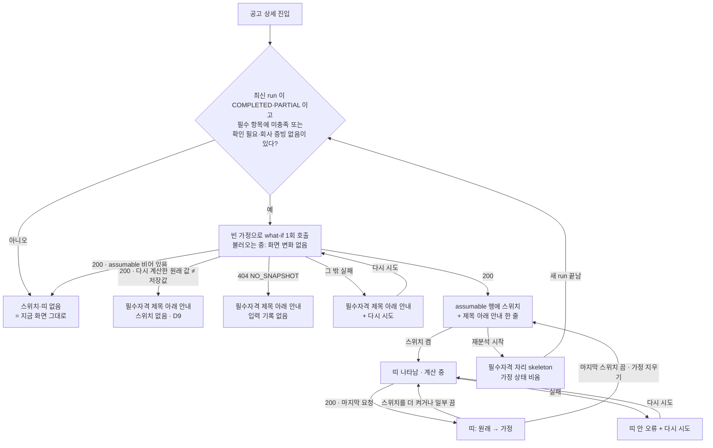

# 디자인 스펙: BOOST-2 가정 재계산 (`/bids/[id]`)

[[2026-10-20-demo-boost-design|데모 강화 설계]] §5 BOOST-2와 [[2026-10-20-boost2-what-if-plan|BOOST-2 계획]] Task 3을 구현자가 추측 없이 옮길 수 있게 고정한다. 승인은 메인 세션이 사용자 위임으로 대신했다(§13). Task 4(화면)는 이 문서대로 구현한다. 코드·정본·설정은 바꾸지 않는다. 화면 문구 중 §6에서 "고정"이라고 적은 두 줄 말고는 모두 초안이고 확정은 사용자 몫이다. 결정이 필요한 것은 §12에 D1~D10으로 모았다.

> [!warning] 미검증 가정
> 코드와 스크린샷만 읽고 썼다. 브라우저·dev 서버는 띄우지 않았다. 1440·1280 폭의 칸 너비는 `AppPage`·상세 격자 클래스에서 계산한 값이다. 지금 화면은 `docs/evidence/demo-day/20261020-1009/screenshots/20261020-demo-bid-detail-fx03-loaded-1440.png`·`20261020-demo-bid-detail-loaded-1280.png`로 봤다. API 응답 모양은 이 작업 폴더에서 Task 1 작업자가 쓰는 중인 미커밋 파일 `web/server/scoring/what-if.ts`(`WhatIfSummary`)를 읽고 맞췄다. Task 2 Route Handler는 아직 없다. 모양이 바뀌면 §5만 고친다.

## 0. 범위

이미 정해진 것(설계 §5·§6·§11, 계획 Global Constraints, 메인 세션 지시):

- 스위치는 필수 자격 행 가운데 서버가 가정 가능하다고 준 행(`assumable`)에만 붙는다. 이번에는 면허·등록 보유 가정뿐이다. 기술 가정(점수 분해 "기술 스택 적합" 칩)은 없다(계획 Task 6, 선택).
- 스위치를 켜면 분석 요약 띠 아래에 "가정 시나리오" 띠가 나온다. 켠 가정이 하나도 없으면 띠가 없다.
- 띠 내용: 켠 가정 목록, 원래 → 가정 권고(BID/WATCH/NO-BID)와 SOL Score, 바뀐 요소별 점수, 자격 판정 변화, 고정 문구 두 줄, "가정 지우기" 버튼.
- 오른쪽 "참여 판단" 패널의 권고·점수는 원래 값 그대로다. 두 값이 섞여 보이지 않아야 한다.
- 새 띠·스위치에 확률·승률·수주 가능성처럼 읽히는 수치·문구를 두지 않는다(설계 F1).
- 화면 폭은 1440px 기준, 1280px 최소다. 모바일 레이아웃은 만들지 않는다. 색·글꼴·글자 눈금은 `design/tokens.json` 토큰만 쓴다.
- 데모(설계 §7 1:30, §11-2): FX-03(NO-BID 68, 정보통신공사업 등록 미충족)에서 스위치 1번 → 띠에 NO-BID → WATCH, 68 → 68. 45초 장면 안에서 심사위원이 프로젝터로 바로 읽을 수 있어야 한다.

| 넣는다 | 넣지 않는다 |
|---|---|
| 필수자격 행의 "보유 가정" 스위치, 필수자격 제목 아래 안내 한 줄 | 기술 보유 가정 스위치(Task 6) |
| "가정 시나리오" 띠(원래 → 가정 비교표, 바뀐 자격 항목, 요소별 점수, 고정 문구, 가정 지우기) | "부족 항목 모두 가정" 버튼(설계 §11-2) |
| 가정 가능 목록 불러오기·실패, 가정 계산 중·실패, 연타 처리 | 가정 저장·공유·결정 기록 연결(설계 비목표) |
| 화면 낭독기용 상태 알림 한 곳 | 결정 패널·점수 분해·Kev 참고 지표·근거 인용의 변경(원래 값 그대로) |
| | 확률·승률·% 표시, 결정 모델 재호출 |

범위 외 확인: 결제·구독, 1280px 미만 레이아웃·모바일, 승률 예측, 자동 투찰은 이 화면 어디에도 없다.

## 1. 기준

| 무엇 | 근거 |
|---|---|
| 기능 정의·실패 조건 | 설계 §2 F1(확률 문구 금지)·F3(가정이 실제 기록에 섞이지 않음), §5.1(띠 내용), §5.2(서버 계산·`kev=null`·쓰기 0), §5.3(시험 기준), §6(배치), §7(1:30 장면), §11-2(스위치 1개) |
| 동작·고정 문구 | 계획 Global Constraints(띠 문구 두 줄 정확히, 결정 패널 원래 값 유지), Task 4(진입 때 빈 가정으로 1회, `assumable` 행에만 스위치, AbortController, 가정 지우기는 상태만 비움), Review Focus 5(연타 시 마지막 응답만) |
| API 모양 | `web/server/scoring/what-if.ts`(미커밋, Task 1) `WhatIfSummary`·`WhatIfOutcome`. 계획 Task 2 오류 대응(400·404·409·`NO_SNAPSHOT`) |
| 지금 화면 구조 | `web/app/(app)/(work)/bids/[id]/bid-detail-view.tsx`(정보 위계 ①~⑦, `AnalysisBand`·`AnalysisBanner`·`analysis-live`·격자 `minmax(0,1fr)_320px`), `api-envelope.ts`(`JSON_HEADERS`·`failureOf`) |
| 부품·라벨 | `web/components/bids/qualification-checklist.tsx`(행 `CheckRow`), `analysis-banner.tsx`(배너 모양·`role="status"`), `decision-panel.tsx`(권고 줄·`h3` 모양), `score-gauge.tsx`(점수 `type-title` + `/ 100` + `참고`), `status-badge.tsx`, `labels.ts`(`RECOMMENDATION_LABEL`·`QUALIFICATION_LABEL`·`STATUS_ICON`·`FACTOR_LABEL`), `format.ts`(`formatPoints`) |
| 토큰 | `design/tokens.json` — 앱 틀 눈금 `title`·`heading`·`body`·`label`·`caption`만. 상태 색 `success`·`warning`·`destructive`는 흰 바탕 위 글자·아이콘·테두리에만 |
| shadcn | `web/components/ui/`에 switch 가 없다. `@base-ui/react` 1.9.0 에는 `switch`(`SwitchRoot`: `<span role="switch">` + 숨은 `<input>`)가 있다. `radio-group.tsx`가 같은 방식으로 들여온 선례다 |
| 관례 | [[2026-10-19-c6-screens-design|C6 화면 디자인 스펙]] §3.3 상태 표기(아이콘 + 글자 + 색), §5.4 상세 |

한계: 다른 worktree 의 미병합 화면은 보지 않았다. 지금 코드의 "분석 요약 띠"는 `AnalysisBand`이고 `AnalysisBanner`는 그 바로 아래 경고 배너다. 메인 세션 지시는 "분석 요약 띠(AnalysisBanner) 바로 아래"라 둘을 같은 것으로 적었다. 이 스펙은 **`AnalysisBanner`(경고 배너)까지 지난 바로 아래**로 읽었다(§4.1, D3).

## 2. 흐름



- 새로 고침·다른 화면 이동은 가정 상태를 버린다(클라이언트 상태만, 설계 §5.2). 새로 고침 뒤 띠는 없다(계획 Task 5).
- 결정 기록(`결정 기록` 버튼 → `router.refresh()`)은 같은 분석 run 이면 가정 상태를 유지한다. 최신 run id 가 바뀌면 비운다(§4.4).

## 3. 공통 규칙

### 3.1 원래 값과 가정 값을 섞지 않는다

| 자리 | 보이는 값 | 바뀌나 |
|---|---|---|
| 분석 요약 띠(`AnalysisBand`)·경고 배너(`AnalysisBanner`) | 저장된 run | 안 바뀐다 |
| **가정 시나리오 띠**(새) | 원래(스냅샷을 `kev=null`로 다시 계산) → 가정 | 가정 값은 여기에만 |
| 필수자격 목록 행 | 저장된 판정 배지·사유·근거 | 안 바뀐다. 스위치 상태만 바뀐다 |
| SOL Score 분해·Kev 참고 지표·근거 인용 | 저장된 run | 안 바뀐다 |
| 오른쪽 "참여 판단"(결정 패널) | 저장된 권고·점수·플래그·폼 기본값 | 안 바뀐다(D10) |

- 가정 값이 나오는 글자에는 늘 "가정"이라는 말이 같은 띠 안에 있다(띠 제목, 비교표 열 머리 `가정`).
- 띠에는 결정 모델 플래그·Kev 분포를 두지 않는다. 비교는 점수·권고·자격 판정만 한다(설계 §5.2 메인 세션 결정).
- 확률·승률·%·"가능성"·"수주" 글자를 띠·스위치·안내·낭독 문구에 쓰지 않는다. 점수 차이는 "점"으로만 쓴다(예: `+6점`).

### 3.2 화면 폭

계산 근거: 사이드바 펼침 256px, `AppPage` 좌우 `px-8`(32px), 상세 격자 `grid-cols-[minmax(0,1fr)_320px] gap-6`. 사이드바를 접으면 본문 단이 넓어진다. 띠 안 칸 수는 화면 폭이 아니라 띠의 컨테이너 폭(`@container`)으로 정한다.

| 칸 | 1440px | 1280px | 비고 |
|---|---|---|---|
| 본문 단(`bid-detail-main`) | 776px | 616px | 스크롤 막대가 자리를 차지하는 OS 에서는 각각 약 −15px |
| 가정 시나리오 띠 안쪽(테두리 1 + `p-4`) | 742px | 582px | 아래 "자세히" 영역 2열 기준 `@2xl`(672px) → 1440 2열, 1280 1열 |
| 비교표(§4.3) | 행 머리 96 + 원래 ≥160 + 가정 나머지 | 같음 | 1280 에서 필요한 최소 폭 약 445px < 582px |
| 필수자격 행 첫 줄 | 왼쪽 묶음 `flex-1` + 오른쪽 스위치 묶음 약 92px | 같음 | 1280 왼쪽 묶음 약 512px |
| 결정 패널 | 320px | 320px | 바뀌지 않음 |

1280px 에서 가로로 넘치면 결함이다. 넘침 위험 지점은 §9.

## 4. 화면 명세

### 4.1 정보 위계와 배치

지금 위계(06 §6, `bid-detail-view.tsx` 머리 주석) ① 상단 요약 → ② 분석 요약 띠(+배너) → ③ 단계 이력 → ④ 필수자격 → ⑤ 점수 분해 → ⑥ Kev → ⑦ 근거 인용에, ②와 ③ 사이 한 자리를 더한다.

```
본문 단 (bid-detail-main, flex-col gap-6)
  ② AnalysisBand            분석 요약 띠 (그대로)
  ·  StatusCheckFailed       (있을 때만, 그대로)
  ·  AnalysisBanner          경고 배너 (있을 때만, 그대로)
  ②' WhatIfBand  ← 새        가정 시나리오 띠. 켠 가정이 1개 이상일 때만
  ③ 단계 이력
  ④ 필수자격  ← 행에 스위치    (스위치·안내 한 줄만 더함)
  ⑤ ⑥ ⑦ (그대로)
오른쪽 레일: DecisionPanel (그대로)
```

- `WhatIfBand`는 본문 단의 `gap-6`(24px)을 그대로 받는다. FX-03 처럼 배너가 없으면 분석 요약 띠 바로 24px 아래다.
- 낭독용 상태 알림 `<p data-slot="what-if-live" role="status" aria-live="polite" className="sr-only">`를 지금 `analysis-live` 옆에 **늘** 둔다(띠 안에 두면 띠가 생길 때 첫 알림을 놓친다).

### 4.2 필수자격 행의 "보유 가정" 스위치

**붙는 조건**(모두 참일 때): 최신 run 이 점수 run(`scored`)이고, 진입 호출(빈 가정)이 200 이고, 그 행의 `requirementCode`가 응답 `assumable`에 있다. 서버가 판정의 유일한 근거다. 클라이언트가 미충족 행을 보고 스위치를 미리 그리지 않는다.

**배치(1440·1280 같음, D2)**

```
├ li (py-3) ─────────────────────────────────────────────────────────────┤
│ ⊗ 미충족  정보통신공사업 등록  필수 · AI 추출              보유 가정 (○─) │  ← 첫 줄
│ 회사 프로필에 정보통신공사업 등록 미보유(NOT_HELD)로 기록됨                    │
│ 회사: 정보통신공사업 등록                                                  │
│ 근거 공고 본문 · "정보통신공사업법에 따른 정보통신공사업 등록업체"              │
│ (켰을 때만) 가정 시나리오 보기 ↑                                            │  ← D8
```

- 첫 줄을 `flex items-start gap-3`로 바꾸고, 지금 내용(배지·이름·필수·근거 종류)을 `flex min-w-0 flex-1 flex-wrap items-center gap-x-3 gap-y-1` 묶음에 넣는다. 오른쪽 끝에 스위치 묶음 `flex shrink-0 items-center gap-2`를 둔다. 이름이 길어 꺾여도 스위치는 첫 줄 오른쪽 위에 남는다.
- 스위치 묶음 = 보이는 글자 `<Label htmlFor={switchId}>보유 가정</Label>`(`type-label text-foreground`, 글자를 눌러도 켜진다) + `Switch`.
- 행의 판정 배지·사유·근거는 **바꾸지 않는다**. 켜도 "미충족"은 "미충족"이다(§3.1).
- 켠 행에만 첫 줄 아래(행 마지막)에 `Button variant="link" size="sm" className="px-0"` "가정 시나리오 보기"를 둔다. 누르면 띠로 스크롤하고(`prefers-reduced-motion`이면 즉시) 띠 제목(`h2 tabIndex={-1}`)에 초점을 옮긴다(D8).
- 스위치가 하나라도 있으면 필수자격 제목(`h2`) 바로 아래에 안내 한 줄 `<p id={hintId} className="type-label text-muted-foreground">`: "보유 가정을 켜면 저장하지 않고 권고와 점수를 다시 계산합니다." 모든 스위치가 이 줄을 `aria-describedby`로 가리킨다.
- 같은 `requirementCode`가 두 행에 있으면 두 행 모두 스위치를 그리고 같은 상태를 나눠 쓴다(§11 열린 질문 1).
- 켠 가정이 10개면(서버 zod `max(10)`) 꺼진 스위치를 `disabled`로 두고 안내 줄 끝에 " 가정은 10개까지 켤 수 있습니다."를 붙인다. 지금 데이터로는 생기지 않는다.

**스위치 모양(D1 ① 기준, shadcn `switch`를 들여와 맞춘다)**

| 상태 | 트랙 | 손잡이 | 비고 |
|---|---|---|---|
| 꺼짐 | 20×36px, `rounded-full border border-muted-foreground bg-background` | 14px `bg-muted-foreground`, 왼쪽 | shadcn 기본(`bg-input` 채움)은 흰 바탕과 대비 1.4:1 이라 상태가 안 보인다(WCAG 1.4.11). 테두리를 `muted-foreground`로 바꾼다 |
| 켜짐 | `data-checked:border-primary data-checked:bg-primary` | `data-checked:bg-primary-foreground`, 오른쪽 | `radio-group`의 선택 색(`primary`)과 같다. 새 색 없음 |
| 초점 | `focus-visible:ring-3 focus-visible:ring-ring/50` | — | 다른 입력과 같다 |
| 비활성 | `disabled:cursor-not-allowed disabled:opacity-50` | — | 10개 한도일 때만 |
| 움직임 | 손잡이 이동 `transition-transform motion-reduce:transition-none` | — | |
| 누를 자리 | `after:absolute after:-inset-x-3 after:-inset-y-2`(radio 와 같은 방식) + 라벨 글자 | — | 24px 이상 |

**계산 중에도 스위치를 막지 않는다.** 연타 처리는 §4.4.

### 4.3 가정 시나리오 띠 (`WhatIfBand`)

**틀**: `<section id="what-if-band" data-slot="what-if-band" aria-labelledby="what-if-title" className="@container flex scroll-mt-20 flex-col gap-4 rounded-lg border border-dashed border-muted-foreground bg-background p-4">`. 실선 카드인 실제 분석과 점선으로 구분한다(D4). 바탕은 흰색이다(상태 색은 흰 바탕 위에서만, tokens 주석).

**1440px (띠 안쪽 742px)**

```
┌ ─ ─ ─ ─ ─ ─ ─ ─ ─ ─ ─ ─ ─ ─ ─ ─ ─ ─ ─ ─ ─ ─ ─ ─ ─ ─ ─ ─ ─ ─ ─ ─ ─ ─ ─ ─ ┐
  가정 시나리오                                                [✕ 가정 지우기]
  가정 결과입니다. 저장되지 않고 결정 기록에 쓰이지 않습니다.
  결정 모델 의견은 가정에 포함하지 않았습니다.
  켠 가정  [정보통신공사업 등록 보유]

                  원래                  가정
  권고            ⊗ NO-BID          →   ◉ WATCH
  SOL Score       68 / 100 [참고]    →   68 / 100
                                         변화 없음
  필수자격        ⊗ 미충족           →   ✓ 충족
  ───────────────────────────────────────────────────────────────────────
  바뀐 자격 항목                          요소별 점수
  정보통신공사업 등록  ⊗ 미충족 → ✓ 충족     바뀐 요소 없음 · 필수자격 판정은
                                          SOL Score 계산에 들어가지 않습니다
└ ─ ─ ─ ─ ─ ─ ─ ─ ─ ─ ─ ─ ─ ─ ─ ─ ─ ─ ─ ─ ─ ─ ─ ─ ─ ─ ─ ─ ─ ─ ─ ─ ─ ─ ─ ─ ┘
```

**1280px (띠 안쪽 582px)**: 위와 같고, 맨 아래 "바뀐 자격 항목"과 "요소별 점수"가 위아래 두 덩어리로 쌓인다(`@2xl:grid-cols-2` 미만).

**요소별 명세(위에서 아래로)**

| # | 요소 | 모양 | 내용 |
|---|---|---|---|
| 1 | 머리 줄 | `flex items-start justify-between gap-3` | 왼쪽 `<h2 id="what-if-title" tabIndex={-1} className="type-heading text-foreground outline-none">가정 시나리오</h2>`. 오른쪽 `Button variant="outline" size="sm"` + `XIcon`(`data-icon="inline-start"`, 16px) "가정 지우기". 화면의 `default` 버튼(결정 기록·분석 실행)을 늘리지 않는다 |
| 2 | 고정 문구 두 줄 | `flex flex-col gap-0.5`, 각 `<p className="type-body text-foreground">` | 정확히 "가정 결과입니다. 저장되지 않고 결정 기록에 쓰이지 않습니다." / "결정 모델 의견은 가정에 포함하지 않았습니다." 상태와 상관없이(계산 중·실패 포함) 늘 보인다. 09 고정 배너처럼 `text-foreground`로 둔다 |
| 3 | 켠 가정 | `flex flex-wrap items-center gap-x-2 gap-y-1` | 라벨 `type-label text-muted-foreground` "켠 가정" + 칩마다 "{requirementName} 보유". 칩은 `bid-detail-view.tsx`의 `CHIP` 클래스와 같다(`h-5 rounded-sm border border-border bg-background px-1.5 type-caption text-foreground`). 순서는 필수자격 목록 순서. 이름은 지금 분석의 행 이름(사용자가 누른 그 글자)을 쓴다 |
| 4 | 비교표 | `<table>` + `<caption className="sr-only">원래 결과와 가정 결과 비교</caption>` | 아래 "비교표" |
| 5 | 자세히 | `grid gap-4 border-t border-border pt-4 @2xl:grid-cols-2` | 아래 "자세히" |

**비교표**

| 행 머리(`<th scope="row">`, `w-24 type-label text-muted-foreground`, 왼쪽 위 정렬) | 원래 열(`<th scope="col">` "원래") | 가정 열(`<th scope="col">` "가정") |
|---|---|---|
| 권고 | 아이콘(16px, `STATUS_ICON[rec]`) + `RECOMMENDATION_LABEL[rec]`, `type-title`, 상태 색(`STATUS_ICON[rec].className`) | `ArrowRightIcon`(16px, `text-muted-foreground`, `aria-hidden`) + 같은 모양. 값이 같으면 아래에 `type-caption text-muted-foreground` "변화 없음" |
| SOL Score | `Math.round(score)` `type-title tabular-nums text-foreground` + `type-label text-muted-foreground` "/ 100". 그 run 의 `qualificationStatus`가 `NOT_SATISFIED`면 `참고` 칩(`ScoreGauge`와 같은 `rounded-sm border border-border px-1.5 type-caption text-muted-foreground`) | 화살표 + 같은 모양(가정 쪽 `참고`도 같은 규칙). 아래 `type-caption text-muted-foreground tabular-nums`: 같으면 "변화 없음", 다르면 "+N점"·"−N점" |
| 필수자격 | `StatusBadge`와 같은 아이콘·글자·색, 글자만 `type-heading`(아이콘 16px) | 화살표 + 같은 모양. 같으면 "변화 없음" |

- 열 머리 "원래"·"가정"은 `type-caption text-muted-foreground font-normal`, 왼쪽 정렬.
- 칸 여백: `<th>`·`<td>` `py-1 pr-6 align-top`. 원래 열 `min-w-40`(160px). 가정 열은 나머지 폭이고 화살표와 값은 `inline-flex items-center gap-3`.
- 상태는 색만으로 나타내지 않는다(아이콘 + 글자 + 색, C6 §3.3).
- 권고·점수 값을 `type-title`(30px)로 키운 이유는 프로젝터 가독성이다(D5). 결정 패널의 점수 숫자(`ScoreGauge`)와 같은 크기다.

**자세히**

| 덩어리 | 제목 | 내용 | 비었을 때 |
|---|---|---|---|
| 바뀐 자격 항목 | `<h3 className="font-heading type-label text-foreground">바뀐 자격 항목</h3>` | `before.checks`와 `after.checks`를 `id`로 맞춰 `outcome`이 바뀐 행만. 한 줄: 이름 `type-body text-foreground wrap-anywhere` + `StatusBadge kind="qualification" variant="inline"`(원래) + 화살표 16px + 같은 배지(가정). 목록 `ul flex flex-col gap-1` | "바뀐 자격 항목 없음"(`type-body text-muted-foreground`) |
| 요소별 점수 | `<h3>` "요소별 점수" | `factors`를 `factor`로 맞춰 `points`가 바뀐 요소만, `FACTOR_ORDER` 순. 한 줄: `FACTOR_LABEL` + `formatPoints(before)` → `formatPoints(after)` ` / {maxPoints}` + `(+6.0)`. `tabular-nums` | "바뀐 요소 없음 · 필수자격 판정은 SOL Score 계산에 들어가지 않습니다"(`type-body text-muted-foreground`). v1(면허 가정만)에서는 늘 이 줄이다 |

**띠 높이 어림(FX-03, 1440)**: 약 390px. 분석 요약 띠 끝(페이지 위에서 약 322px) + 24px 아래에서 시작해 약 736px 에서 끝난다. 1440×900 창에서 스크롤 0 이면 띠 전체와 오른쪽 결정 패널(NO-BID 68)이 한 화면에 보인다.

### 4.4 연타·상태 전이 규칙

| 사건 | 화면이 하는 일 |
|---|---|
| 스위치를 켬·끔 | 켠 코드 집합을 바로 바꾸고 스위치에 반영한다(입력은 기다리지 않는다). 집합이 비면 → 진행 중 요청 취소, 띠를 없앤다. 비지 않으면 → 진행 중 요청을 `AbortController`로 취소하고, 정렬한 코드 목록으로 새 요청을 보내고, 띠를 "계산 중"으로 둔다 |
| 응답 도착 | 그 요청이 **마지막으로 보낸 요청**일 때만 그린다(요청 번호를 비교한다. 취소가 늦어 이미 끝난 응답도 버린다). 앞 요청 응답은 버린다 |
| 연타 중 표시 | 스위치는 매번 바로 바뀐다. 띠는 마지막 응답이 올 때까지 "계산 중"이다. 칩 줄은 지금 켠 집합을 바로 보인다. 지연(debounce)은 두지 않는다 |
| 낭독 | 마지막 응답의 결과만 한 번 알린다(§7). 계산 중 알림은 하지 않는다 |
| 가정 지우기 | 진행 중 요청 취소, 집합 비움, 띠 없앰. 초점은 처음 켰던 스위치(목록 순서 첫 번째)로 옮긴다. 알림 "가정을 지웠습니다. 원래 분석 결과만 보입니다." |
| 마지막 스위치를 끔 | 띠 없앰. 초점은 그 스위치에 남는다. 알림 같음 |
| 재분석 시작(`progress !== null`) | 진행 중 요청 취소, 집합·진입 결과 비움. 필수자격 자리는 지금처럼 skeleton |
| 최신 run id 가 바뀜(새 분석 끝·다른 사용자 재분석 뒤 새로 고침) | 집합 비우고 새 run 으로 진입 호출을 다시 한다 |
| 화면을 떠남 | 진행 중 요청 취소 |

### 4.5 상태표 — 필수자격 스위치 영역

| 상태 | 언제 | 보이는 것 | 사용자가 할 수 있는 것 |
|---|---|---|---|
| 대상 아님 | 점수 run 이 없음(미분석·FAILED·진행 중), 또는 필수 항목에 `NOT_SATISFIED`도 `NEEDS_REVIEW`+`COMPANY_EVIDENCE_MISSING`도 없음 | 지금 화면과 같다. 요청하지 않는다 | 없음 |
| 불러오는 중 | 진입 호출 응답 전 | 지금 화면과 같다(스위치·안내 없음, D6) | 다른 동작 모두 |
| 가정 없음 | 200, `assumable` 빈 배열 | 지금 화면과 같다 | 없음 |
| 스위치 있음 | 200, `assumable` 1개 이상 | 필수자격 제목 아래 안내 한 줄, `assumable` 행 첫 줄 오른쪽에 "보유 가정" 스위치(꺼짐) | 스위치 켜기 |
| 켜짐 | 켠 집합에 그 코드가 있음 | 스위치 켜짐(남색 채움), 행 아래 "가정 시나리오 보기" 링크. 행의 판정 배지·사유는 원래 그대로 | 끄기, 띠로 이동 |
| 한도 | 켠 가정 10개 | 꺼진 스위치 비활성, 안내 줄 끝 "가정은 10개까지 켤 수 있습니다." | 켠 것 끄기 |
| 불러오기 실패 | 404 `NO_SNAPSHOT` 외의 실패(401·404·409·5xx·네트워크) | 필수자격 제목 아래 한 줄 `data-slot="what-if-load-error"`: `CircleAlertIcon`(16px, `text-muted-foreground`) + "보유 가정을 불러오지 못했습니다" `type-label text-foreground` + 코드·요청 id `font-mono type-caption text-muted-foreground` + `Button variant="outline" size="sm"` "다시 시도". 스위치 없음. 분석 결과 자체는 멀쩡하므로 붉은 테두리·`role="alert"`를 쓰지 않는다 | 다시 시도(진입 호출 다시) |
| 입력 기록 없음 | 404 `details.reason === "NO_SNAPSHOT"` | 같은 자리 한 줄: "이 분석에는 가정 계산에 쓸 입력 기록이 없습니다. 재분석하면 보유 가정을 켤 수 있습니다." 다시 시도 버튼 없음(다시 해도 같다) | 머리의 재분석 |
| 원래 값 불일치(D9 ①) | 200 인데 `before`의 권고·반올림 점수·자격 종합 판정 중 하나가 저장된 run 과 다름 | 같은 자리 한 줄: "저장된 분석과 지금 규칙으로 다시 계산한 값이 달라 가정을 켤 수 없습니다. 재분석하면 쓸 수 있습니다." 스위치 없음 | 머리의 재분석 |
| 재분석 중 | `progress !== null` | 필수자격 자리 skeleton(지금 그대로), 띠 없음 | 없음 |

### 4.6 상태표 — 가정 시나리오 띠

| 상태 | 언제 | 보이는 것 | 사용자가 할 수 있는 것 |
|---|---|---|---|
| 없음 | 켠 가정 0개 | 띠 없음. 자리도 비우지 않는다(아래 구역이 올라온다) | — |
| 계산 중 | 켠 가정 1개 이상, 마지막 요청 응답 전 | 머리 줄·고정 문구 두 줄·켠 가정 칩은 그대로 보이고, 비교표 값 칸과 자세히 영역은 `Skeleton`(값 칸 `h-9 w-28`, 자세히 2줄 `h-5 w-full`, `motion-reduce:animate-none`). 이전 결과는 지운다(D7). `<section aria-busy="true">` | 가정 지우기, 스위치 계속 바꾸기 |
| 가정 결과 | 마지막 요청 200 | §4.3 전부 | 가정 지우기, 스위치 바꾸기 |
| 결과: 변화 없음 | 200 이고 권고·점수·자격 종합이 모두 같음 | §4.3 그대로, 세 행 모두 "변화 없음" | 같음 |
| 계산 실패 | 마지막 요청이 실패(400·401·404·409·5xx·네트워크) | 머리 줄·고정 문구·칩은 그대로. 비교표·자세히 자리에 `data-slot="what-if-calc-error"`: `OctagonAlertIcon`(16px, `text-destructive`) + "가정 결과를 계산하지 못했습니다" `type-body text-foreground` + 서버 `message` `type-label text-foreground wrap-anywhere` + 코드·요청 id `font-mono type-caption text-muted-foreground` + `Button variant="outline" size="sm"` `RefreshCwIcon` "다시 시도". 띠 테두리는 점선 그대로 둔다 | 다시 시도(같은 집합으로 다시 요청), 가정 지우기, 스위치 바꾸기 |
| 재분석 시작 | `progress !== null` | 띠 없음(상태 비움) | — |

화면 낭독기에는 `what-if-live` 한 곳이 알린다(§7). 띠 안에 `role="alert"`·`role="status"`를 따로 두지 않는다.

### 4.7 데모 장면 (설계 §7 1:30, 45초)

| 초 | 발표자 | 화면(1440) |
|---|---|---|
| 0 | FX-03 상세를 연다(스크롤 맨 위) | 오른쪽 "참여 판단" NO-BID 68 `참고`. 필수자격 "정보통신공사업 등록" 행 첫 줄 오른쪽에 "보유 가정" 스위치(꺼짐). 제목 아래 안내 한 줄 |
| ~10 | 미충족 행과 스위치를 가리킨다 | — |
| ~15 | 스위치를 한 번 누른다 | 1초 안에 분석 요약 띠 아래에 점선 띠. 권고 `⊗ NO-BID → ◉ WATCH`, SOL Score `68 [참고] → 68 / 변화 없음`, 필수자격 `⊗ 미충족 → ✓ 충족`. 요소별 점수 "바뀐 요소 없음 · 필수자격 판정은 SOL Score 계산에 들어가지 않습니다" |
| 15~40 | 띠를 읽고, 오른쪽 결정 패널이 그대로 NO-BID 68 임을 가리킨다 | 결정 패널 변화 없음 |
| 40~45 | "가정 지우기" | 띠 사라짐, 스위치 꺼짐 |

- 리허설 확인: 프로젝터 해상도에서 스크롤 0 일 때 FX-03 의 "정보통신공사업 등록" 행이 보이는지(1440 에서 페이지 위 약 628px). 안 보여서 스크롤해야 하면, 띠가 화면 위쪽 밖에 생길 수 있다 → 행의 "가정 시나리오 보기" 링크를 누른다(D8).
- 발표 원고의 숫자는 Task 1·5 골든이 고정한 뒤 쓴다(설계 §5.1).
- `demo:preanalyze`가 만든 FX-03 run 에 `input_snapshot`이 있어야 한다. 없으면 "입력 기록 없음" 상태가 된다 → Task 5 E2E 가 잡는다.

## 5. 화면 요소 ↔ API

`POST /api/v1/analyses/{id}/what-if`, 본문 `{ assumptions: { kind: "QUALIFICATION", code }[] }`, 머리글 `JSON_HEADERS`(CSRF 포함). `{id}`는 화면의 `scored.id`(최신 점수 run)다.

| 화면 요소 | 응답 필드 |
|---|---|
| 스위치가 붙는 행 | `assumable[]` ↔ 행 `check.requirementCode` |
| 켠 가정 칩 이름 | 화면이 가진 저장 run 의 `check.requirementName`(같은 코드의 첫 행) |
| 비교표 권고 | `before.recommendation` → `after.recommendation` |
| 비교표 SOL Score·`참고` | `before.score`·`after.score`(화면에서 반올림), `참고`는 각자의 `qualificationStatus === "NOT_SATISFIED"` |
| 비교표 필수자격 | `before.qualificationStatus` → `after.qualificationStatus` |
| 바뀐 자격 항목 | `before.checks[]`·`after.checks[]`를 `id`로 맞춤, `outcome` 비교, 이름 `after.checks[].requirementName` |
| 요소별 점수 | `before.factors[]`·`after.factors[]`를 `factor`로 맞춤, `points`·`maxPoints` |
| 원래 값 불일치(D9) | `before`의 권고·`Math.round(score)`·`qualificationStatus` vs 저장 run 의 `recommendation`·`Math.round(solScore)`·`qualification.status` |
| 오류 줄 | `failureOf()`의 `code`·`message`·`requestId`, `details.reason`(`NO_SNAPSHOT`) |

권고 사유(규칙 경로 `rulePath`)는 응답에 없어 띠에 쓰지 않는다(§11 열린 질문 3).

## 6. 화면 문구

"고정"은 메인 세션이 정한 그대로 쓴다. 나머지는 초안이고 확정은 사용자 몫이다.

| # | 자리 | 문구 | 상태 |
|---|---|---|---|
| W1 | 띠 고정 1 | 가정 결과입니다. 저장되지 않고 결정 기록에 쓰이지 않습니다. | 고정 |
| W2 | 띠 고정 2 | 결정 모델 의견은 가정에 포함하지 않았습니다. | 고정 |
| W3 | 띠 버튼 | 가정 지우기 | 고정 |
| W4 | 띠 제목 | 가정 시나리오 | 설계 §5.1 이름, 확인 필요 |
| W5 | 스위치 라벨 | 보유 가정 | 초안(대안: "보유했다고 가정") |
| W6 | 필수자격 제목 아래 안내 | 보유 가정을 켜면 저장하지 않고 권고와 점수를 다시 계산합니다. | 초안 |
| W7 | 한도 안내 | 가정은 10개까지 켤 수 있습니다. | 초안 |
| W8 | 칩 줄 라벨·칩 | 켠 가정 / {요건 이름} 보유 | 초안 |
| W9 | 비교표 | 원래 · 가정 · 권고 · SOL Score · 필수자격 · 변화 없음 · 참고 · +N점 | 초안(`참고`는 기존 `ScoreGauge`와 같다) |
| W10 | 자세히 제목 | 바뀐 자격 항목 / 요소별 점수 | 초안 |
| W11 | 요소 변화 없음 | 바뀐 요소 없음 · 필수자격 판정은 SOL Score 계산에 들어가지 않습니다 | 초안(사실 확인: 08 자격 관문과 점수 분리) |
| W12 | 자격 변화 없음 | 바뀐 자격 항목 없음 | 초안 |
| W13 | 행 링크 | 가정 시나리오 보기 | 초안(D8 ①일 때) |
| W14 | 불러오기 실패 | 보유 가정을 불러오지 못했습니다 / 다시 시도 | 초안 |
| W15 | 입력 기록 없음 | 이 분석에는 가정 계산에 쓸 입력 기록이 없습니다. 재분석하면 보유 가정을 켤 수 있습니다. | 초안 |
| W16 | 원래 값 불일치 | 저장된 분석과 지금 규칙으로 다시 계산한 값이 달라 가정을 켤 수 없습니다. 재분석하면 쓸 수 있습니다. | 초안(D9 ①일 때) |
| W17 | 계산 실패 | 가정 결과를 계산하지 못했습니다 / 다시 시도 | 초안 |
| W18 | 낭독: 결과 | 가정 결과. 권고 {원래}에서 {가정}으로 바뀜(같으면 "권고 {값} 그대로"). SOL Score {원래}에서 {가정}으로 바뀜(같으면 "SOL Score {값} 그대로"). 필수자격 {원래}에서 {가정}으로 바뀜(같으면 뺀다). | 초안 |
| W19 | 낭독: 실패 | 가정 결과를 계산하지 못했습니다. | 초안 |
| W20 | 낭독: 지움 | 가정을 지웠습니다. 원래 분석 결과만 보입니다. | 초안 |
| W21 | 비교표 caption(sr-only) | 원래 결과와 가정 결과 비교 | 초안 |

금지 글자 검사(F1): W1~W21 어디에도 "확률"·"승률"·"가능성"·"수주"·"%"가 없다. Task 4 브라우저 시험은 띠·스위치 묶음·안내 줄·`what-if-live`의 글자에서 이 다섯을 찾는다.

## 7. 접근성 체크 항목

- [ ] 스위치는 `role="switch"` + `aria-checked`(Base UI 가 준다). 이름은 `aria-labelledby="{행 이름 span id} {라벨 id}"` → "정보통신공사업 등록 보유 가정". 보이는 글자 "보유 가정"이 이름 안에 있다(WCAG 2.5.3). 설명은 `aria-describedby={안내 줄 id}`.
- [ ] 키보드: Tab 으로 스위치에 오고 Space(Base UI 는 Enter 도)로 바꾼다. 바꾼 뒤 초점은 스위치에 남는다. Tab 순서는 행 안에서 이름 → 스위치 → 근거 버튼 → (켰으면) "가정 시나리오 보기"다.
- [ ] 띠는 `<section aria-labelledby="what-if-title">`, 제목 `h2`(본문의 다른 구역과 같은 단계), 자세히는 `h3`. 제목은 `tabIndex={-1}`로 링크 이동 때 초점을 받는다.
- [ ] 비교표는 `<table>` + `caption`(sr-only) + 열 머리 `scope="col"`·행 머리 `scope="row"`. 화살표는 `aria-hidden`.
- [ ] 상태 알림은 늘 있는 `what-if-live` 한 곳(`role="status"`, polite). 연타 중에는 마지막 결과만 알린다. 띠 안에서 다시 알리지 않는다. 계산 중 `aria-busy="true"`.
- [ ] "가정 지우기" 뒤 초점이 사라지지 않는다(처음 켰던 스위치로).
- [ ] 상태는 아이콘 + 글자 + 색 셋으로. 색만으로 원래/가정을 가르지 않는다(열 머리 글자).
- [ ] 대비: 상태 색 `success`·`warning`·`destructive`는 흰 바탕 위 글자에서 4.5:1 이상(tokens 주석). `muted-foreground` 글자 약 7:1. 스위치 꺼짐 테두리 `muted-foreground`는 3:1 이상(WCAG 1.4.11). 점선 테두리 `muted-foreground`도 같다.
- [ ] 움직임 줄이기: skeleton·손잡이 이동·스크롤에 `motion-reduce` 대응.
- [ ] 1280px 에서 가로 넘침 없음, 1440·1280 두 폭 스크린샷.

## 8. 토큰·부품 매핑

### 8.1 색 (`design/tokens.json`만, 새 색 없음)

| 쓰임 | 토큰 클래스 |
|---|---|
| 띠 바탕·테두리 | `bg-background`, `border-dashed border-muted-foreground` |
| 띠 안 구분선 | `border-border` |
| 본문 글자 / 보조 글자 | `text-foreground` / `text-muted-foreground` |
| 권고·자격 상태 | `STATUS_ICON[...]`의 `text-success`·`text-warning`·`text-destructive`(글자·아이콘만) |
| 스위치 꺼짐 / 켜짐 | `border-muted-foreground bg-background`, 손잡이 `bg-muted-foreground` / `bg-primary border-primary`, 손잡이 `bg-primary-foreground` |
| 초점 | `ring-ring/50` |
| 오류 아이콘 | `text-destructive`(계산 실패), `text-muted-foreground`(불러오기 실패) |

`brand`·`chart-2`·`demo`·`warning` 바탕 채움은 쓰지 않는다.

### 8.2 글자 (앱 틀 기본 눈금만)

| 요소 | 눈금 |
|---|---|
| 띠 제목 | `type-heading` |
| 고정 문구 두 줄, 자세히 본문 | `type-body` |
| 비교표 권고·SOL Score 값 | `type-title`(D5) |
| 비교표 필수자격 값 | `type-heading` |
| 행 머리·라벨·스위치 라벨·안내 줄·자세히 `h3` | `type-label` |
| 열 머리·칩·"변화 없음"·코드 | `type-caption` |

`data-type-scale`(대시보드 눈금)은 쓰지 않는다(D5 ③을 고르지 않는 한).

### 8.3 간격 (Tailwind 눈금)

띠 `p-4 gap-4`, 고정 문구 `gap-0.5`, 칩 줄 `gap-x-2 gap-y-1`, 비교표 칸 `py-1 pr-6`, 자세히 `pt-4 gap-4`, 행 첫 줄 `gap-3`, 스위치 묶음 `gap-2`. 본문 단과의 간격은 기존 `gap-6`.

### 8.4 부품

| 부품 | 쓰임 |
|---|---|
| `Button`(`outline` `sm`) | 가정 지우기, 다시 시도 |
| `Button`(`link` `sm`) | 가정 시나리오 보기 |
| `Label` | 스위치 라벨 |
| `Skeleton` | 계산 중 값 칸 |
| `StatusBadge`(`qualification`, `inline`) | 바뀐 자격 항목 |
| `STATUS_ICON`·`RECOMMENDATION_LABEL`·`QUALIFICATION_LABEL`·`FACTOR_LABEL`·`FACTOR_ORDER`(`labels.ts`) | 비교표·자세히 글자와 아이콘 |
| `formatPoints`(`format.ts`) | 요소 점수 |
| `failureOf`·`JSON_HEADERS`(`api-envelope.ts`) | 요청·오류 |
| lucide 16px | `XIcon`, `ArrowRightIcon`, `RefreshCwIcon`, `CircleAlertIcon`, `OctagonAlertIcon` |
| **`Switch`(새, D1)** | 보유 가정 |

### 8.5 새로 필요한 것 (제안 — 승인 필요)

| 무엇 | 왜 | 넣는 법 |
|---|---|---|
| shadcn `switch`(`web/components/ui/switch.tsx`) | 켜고 끄는 상태를 `role="switch"`로 정확히 전한다. `ui/`에 없다 | `web`에서 `pnpm dlx shadcn@latest add switch` 뒤 design-system 스킬 5가지 확인(의존성·`check:tokens`·`check:colors`·눈금 클래스·훅 위치). 꺼짐 상태를 §4.2 표대로 바꾼다(대비). `@base-ui/react` 1.9.0 에 `switch`가 이미 있어 새 의존성은 없을 것으로 본다 |
| `WhatIfBand`(`web/components/bids/what-if-band.tsx`) | 계획 Task 4 에 이미 있는 파일 | — |

새 토큰은 없다.

## 9. 넘침 위험 지점

| 지점 | 위험 | 대응 |
|---|---|---|
| 필수자격 행 첫 줄(1280, 616px) | 긴 요건 이름 + 스위치 묶음이 한 줄을 넘는다 | 왼쪽 묶음 `min-w-0 flex-1 flex-wrap` + 이름 `wrap-anywhere`, 스위치 묶음 `shrink-0` |
| 켠 가정 칩 여러 개 | 한 줄을 넘는다 | `flex-wrap`, 칩은 `whitespace-nowrap`이므로 이름이 아주 길면 칩 `max-w-full truncate` + `title`에 전체 이름 |
| 비교표(1280, 582px) | `type-title` 값 두 개 + 화살표 | 최소 약 445px. 행 구조라 2열로 나란히 두지 않는다 |
| 자세히 2열 | 1280 에서 좁다 | `@2xl:grid-cols-2`(672px) — 1280 은 1열 |
| 머리 줄 | 제목 + 버튼 | `justify-between`, 버튼 `shrink-0` |
| 오류 줄 요청 id | 긴 id | `wrap-anywhere` |

## 10. 서버·다른 작업자에게 필요한 것

1. Task 2 응답 200 은 `{ assumable, before, after }`(빈 가정이면 `before`와 `after`가 같다)로 §5 의 필드가 다 있어야 한다. `checks[].id`가 `before`·`after`에서 같은 항목에 같은 값이어야 한다(`qualification.ts`의 위치 기반 id 라 지금은 그렇다).
2. 404 `NO_SNAPSHOT`은 `error.details.reason`으로 구분할 수 있어야 한다(계획 Task 2 그대로).
3. Task 4 브라우저 시험이 쓸 자리 이름: `data-slot="what-if-band"`, `what-if-live`, `what-if-load-error`, `what-if-calc-error`, 스위치 `data-slot="what-if-switch" data-code={code}`.
4. Task 5 E2E 기대값: 띠 비교표 권고 열 "NO-BID"·"WATCH", 점수 "68"·"68", 결정 패널 권고 NO-BID 유지, 새로 고침 뒤 `what-if-band` 없음, 1440·1280 스크린샷.
5. `demo:preanalyze` run 에 `input_snapshot`이 있는지 Task 5 가 확인한다(§4.7).

## 11. 열린 질문

1. 같은 `requirementCode`가 두 행에 나오면(예: 서로 다른 API 면허제한 행) 두 행 모두 같은 상태의 스위치를 그린다고 적었다. 지금 판정 코드는 API 행과 추출 행이 같은 코드면 하나로 합친다(`qualification.ts` `mergedCodes`)라 드물다. 다르게 하려면 알려 달라.
2. 취소된 공고(`CANCELLED`)에서도 스위치를 보인다고 두었다(읽기 계산이고 결정 기록과 상관없다). 숨기려면 상태표 "대상 아님"에 한 줄을 더한다.
3. "왜 BID 가 아니라 WATCH 인가"(점수 68 이 BID 기준 미만)를 띠에 쓰려면 응답에 `rulePath`가 있어야 한다. v1 은 쓰지 않고 발표자가 말로 한다.
4. 기술 가정(Task 6)을 하게 되면 점수 분해 "기술 스택 적합" 아래 칩에 같은 스위치를 붙이고, 요소별 점수 덩어리가 실제로 채워진다. 그때 이 스펙 §4.2 에 칩 배치만 더한다.

## 12. 결정 필요 항목

| # | 결정할 것 | 선택지 | 추천 이유 |
|---|---|---|---|
| D1 | 스위치 부품 | ① shadcn `switch` 추가(Base UI, `role="switch"`) ② 기존 `Button` `outline` + `aria-pressed` 토글 ③ 체크박스 | ①은 켜짐·꺼짐이 모양과 의미로 바로 읽히고(프로젝터), 새 의존성이 없다(`@base-ui/react`에 이미 있음). ②는 눌린 모양을 따로 만들어야 하고 `default` 버튼처럼 보일 위험이 있다 |
| D2 | 스위치 자리 | ① 필수자격 행 첫 줄 오른쪽 끝 ② 행 맨 아래 줄 | ①은 행마다 같은 자리라 찾기 쉽고 Tab 순서가 이름 바로 뒤다. 긴 이름도 오른쪽 위에 고정된다 |
| D3 | "분석 요약 띠 바로 아래"의 기준 | ① 경고 배너(`AnalysisBanner`)까지 지난 아래 ② `AnalysisBand` 바로 아래·배너 위 | 배너(PARTIAL·Mock 대체·실패)는 저장된 분석에 대한 말이라 분석 요약 띠와 붙어 있어야 한다. 메인 세션 지시 글자("AnalysisBanner 바로 아래")와도 맞다. FX-03 은 배너가 없어 두 안이 같아 보인다 |
| D4 | 띠를 실제 분석과 구분하는 모양 | ① 1px 점선 `border-dashed border-muted-foreground` ② 다른 카드와 같은 실선 `border-border` + 제목만 ③ 실선 `border-brand` | ①은 새 색 없이 "가정·초안"을 모양으로 알린다. ②는 프로젝터에서 진짜 분석 카드와 구분이 약하다. ③은 브랜드 색을 선택 표시 밖으로 넓힌다 |
| D5 | 비교 값(권고·SOL Score) 글자 크기 | ① `type-title`(30px, 결정 패널 점수 숫자와 같음) ② `type-heading`(16px, 결정 패널 권고 줄과 같음) ③ 띠에 `data-type-scale="dashboard"`(+3px) | ①은 프로젝터에서 바로 읽힌다. ③은 대시보드 전용 눈금(ADR-030 B25)을 상세로 넓혀 "같은 역할 같은 크기" 규칙과 부딪힌다 |
| D6 | 가정 가능 목록 불러오는 중 표시 | ① 아무것도 안 보임(응답 뒤 스위치가 나타남) ② 후보 행에 skeleton 스위치 | ①이 가장 단순하고, 서버가 "가정 불가"라 하면 사라지는 깜빡임이 없다. 순수 함수라 응답이 빠르다(S0 에서 한 번 열어 데워 둔다) |
| D7 | 가정 계산 중 표시 | ① 값 칸 skeleton(이전 결과 지움) ② 이전 결과를 흐리게 유지 | ②는 지금 켠 가정 목록과 다른 결과가 잠깐 함께 보여 "두 값이 섞여 보이지 않게"를 어긴다 |
| D8 | 띠가 화면 위쪽 밖에 생길 때(스크롤해 내려와 스위치를 누른 경우) | ① 켠 행에 "가정 시나리오 보기" 링크 ② 띠가 생기면 자동 스크롤 ③ 아무것도 안 함 | ①은 초점과 화면을 뺏지 않으면서 결과로 가는 길을 준다. ②는 스위치가 화면 밖으로 밀려 연타·되돌리기가 어렵다. ③은 눌러도 아무 일이 없는 것처럼 보일 수 있다 |
| D9 | 다시 계산한 원래 값이 저장된 run 과 다를 때(규칙 코드가 run 뒤에 바뀐 경우) | ① 스위치를 내지 않고 안내(W16) ② 스위치를 내고 띠에 경고 한 줄 ③ 검사하지 않음 | 띠의 "원래"와 결정 패널의 값이 다르면 두 값이 섞여 보인다. ①이 가장 안전하고 재분석으로 풀린다. 검사는 클라이언트에서 세 값 비교뿐이다 |
| D10 | 결정 패널에 가정 안내를 더하나 | ① 더하지 않음(지금 그대로) ② "가정 시나리오는 이 판단에 반영되지 않습니다" 한 줄 | 계획 Task 4 가 결정 패널을 고치지 않는다. 띠 고정 문구 W1 이 이미 같은 말을 한다. 패널에 "가정"이 나오면 오히려 섞여 보인다 |

## 13. 승인 기록 (2026-10-20)

사용자 지시(마스터 세션 전달: "고르라고 묻지 말고 추천안대로")에 따라 메인 세션이 승인했다. 문구는 데모 리허설에서 사용자가 바꿀 수 있다.

- D1~D10: 모두 추천안 ①.
- D1 넣는 법: design-system 스킬대로 `web` 에서 `pnpm dlx shadcn@latest add switch`. CLI 가 실패하면 `radio-group.tsx` 와 같은 방식으로 `@base-ui/react/switch` 를 감싸 손으로 쓴다. 어느 쪽이든 §4.2 꺼짐 대비를 맞춘다.
- W1~W3: 고정 그대로. W4~W21: 초안 그대로 구현한다.
- 열린 질문 1·2·4: 적은 대로. 3: v1 은 `rulePath` 를 쓰지 않는다.

## 관련 문서

- [[2026-10-20-demo-boost-design|데모 강화 설계]] — §2 F1·F3, §5 BOOST-2, §6 배치, §7 시간표, §11 사용자 결정
- [[2026-10-20-boost2-what-if-plan|BOOST-2 계획]] — Global Constraints, Task 2·4·5
- [[2026-10-19-c6-screens-design|C6 화면 디자인 스펙]] — §3.3 상태 표기, §5.4 공고 상세
- [[06-UI-UX|06 UI]] — §1 화면 폭, §3 토큰·눈금, §6 공고 상세 위계
- [[08-SCORING|08 SOL Score]] — 자격 관문과 점수 분리, 결정 정책
- [[09-SECURITY|09 보안]] — 고정 문구·정직성
- [[16-DECISIONS|16 ADR]] — ADR-007(범위 외 승률 예측)·ADR-030 B25·ADR-034·ADR-037(제안)
- [[18-HACKATHON|18 해커톤]] — §6 시간표
- [[19-DEMO-SCENARIO|19 데모 시나리오]] — S3 장면
