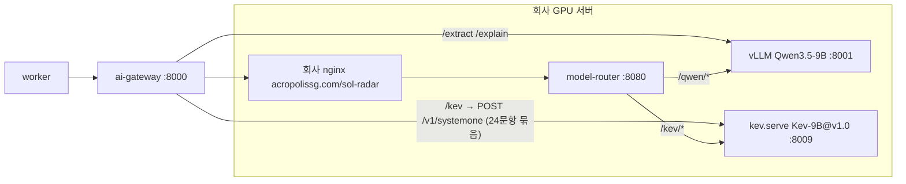

# 결정 모델 Kev-9B → Bosun v3.1 0.6B, 추출 모델 Qwen3.5-9B → Qwen3-4B-Instruct-2507 — 분석과 변경 계획 (ADR-034 초안)

> [!note] 2026-10-27 확인
> 이 계획의 `/sol-radar/kev`(회사 nginx → 모델 라우터) 경로는 회사 nginx 에 등록되지 않았다. 운영 gateway 는 같은 호스트의 `sol_decision` 에 `KEV_BASE_URL=http://127.0.0.1:8009` 로 직결한다([[10-DEPLOYMENT|10 배포]]).

> [!note] 후속 개정 (2026-10-21)
> 현재 추출 모델은 회사 API의 **Qwen3.8-Flash-Next**, 결정 모델은 **Bosun v3.1 0.6B**다([[16-DECISIONS|ADR-034]] 10-21 개정). served id는 `Qwen3.8-Flash-Next-AWQ-INT4`다. 아래 10-20 채택 콜아웃과 본문은 당시 기록이다. 회사 서버 구성은 [[10-DEPLOYMENT|10]] "회사 GPU 추론 엔드포인트"(결정 서버 `127.0.0.1:8009` 서빙 중), 계약·URL 정규화는 [[03-AI-PIPELINE|03]]을 따른다. 파인튜닝은 발표 뒤 진행 예정이다([[16-DECISIONS|ADR-067]]). Qwen 파인튜닝과 4B 신규 서빙은 하지 않는다.

> [!success] 채택·개정 (2026-10-20)
> - 사용자가 Q1~Q7 을 전부 ①로 확정하고 추가 지시 8건을 줬다(LoRA r=16·392 텐서 유지·decision 임베딩 동결, `EvalItem` 기반 변환·`datasets/decision/smoke.jsonl` 6건은 기능 검증용, `/v1/systemone` 호환성 테스트, GPU 1 은 PaddleOCR 공유·보호 최우선, `kev-preflight.sh` 보존·Bosun 전용 경로 분리, `docs/evidence/` Kev 기록 보존, 주말 재계획, ADR-034). ADR-034 는 [[16-DECISIONS|16]] 에 **채택**으로 올렸다.
> - **같은 날 저녁 개정 — 추출·설명 모델은 Qwen3-4B 가 아니라 회사가 이미 운영 중인 vLLM API 의 `Qwen/Qwen3.5-27B`** 다(공개 주소 `https://acropolissg.com/vllm/v1`, 키는 회사 제공 별도 환경변수). 게이트웨이 어댑터는 지금 `QWEN_BASE_URL` 뒤에 `/v1/chat/completions`·`/v1/models` 를 그대로 붙이므로(`adapters/http.py:107`, `qwen.py:27`, `local_setup.py:33`) B1 에서 끝의 `/v1` 중복을 정규화한다. env 값은 사용자 확정 그대로 **`QWEN_BASE_URL=https://acropolissg.com/vllm/v1`**, `QWEN_MODEL=Qwen/Qwen3.5-27B`. **Qwen 파인튜닝은 하지 않는다.** Qwen 4B 는 백업으로만 보존(다운로드·venv·서빙·학습 중단). 이 문서의 Qwen 4B 문장(§0 표·§1.2·§3·§4.3·§5·§8·§9·§10)은 이 콜아웃과 아래 §0.2 가 우선한다. Bosun 쪽은 그대로.
> - `/sol-radar/qwen`→8001 라우터 규칙은 백업(미사용)으로 남기고 8001 vLLM 은 띄우지 않는다. GPU 1 에 올리는 우리 것은 `sol_decision` Bosun 서빙과 Bosun LoRA 학습만.
> - AI 상태 API(`/api/v1/admin/ai/status`, 05 필드 이름 유지, main `c5c91b5`) 가 교체 뒤 보일 값: `kev.modelId=bosun-v3.1-0.6b`, `kev.registryMatch` = `sol_decision` `GET /v1/models` 의 `run: Hanno-Labs/bosun-v3.1-0.6b@5e78a37c` 대조 결과, `qwen.model=Qwen/Qwen3.5-27B`(회사 API `/v1/models` `id` 대조). 조정 세션 e8 의 정본 반영 5차는 ADR-035 를 쓰고, 겹치는 정본(04·05·06·07·09·10·11·12·15·16·19·PROGRESS)은 3e 게이트 병합 순서로 푼다.

> [!warning] 이 문서는 분석과 계획이다. 정본·코드·DB·회사 서버를 바꾸지 않는다
> 지시서 `docs/SOL_RADAR_BOSUN_QWEN4B_MIGRATION_BRIEF.md`(2026-10-20, 사용자)를 받아 정본 4개(10·21·22·23)와 03·05·08·15·16, 실제 코드(`services/ai`, `web`, `infra`, `supabase`, `scripts`, `fixtures`)를 전수 대조했다. 아래 §9 단계는 사용자가 이 문서를 검토하고 승인한 범위에서만 적용한다. GPU 학습·회사 서비스 종료·nginx 변경·실제 배포는 하지 않는다(지시서 §5·§7).

> [!success] 검증됨 (2026-10-20, 이 세션에서 직접 확인)
> - Hugging Face API 로 리비전 3개 존재 확인: `Hanno-Labs/bosun-v3.1-0.6b@5e78a37c8d86860ebac9ef2d5327d6299498498e`(= main, 2026-10-09), `Qwen/Qwen3-0.6B@c1899de289a04d12100db370d81485cdf75e47ca`, `Qwen/Qwen3-4B-Instruct-2507@cdbee75f17c01a7cc42f958dc650907174af0554`.
> - Bosun 파일 원문 읽음: `modeling_bosun.py`, `configuration_bosun.py`, `config.json`, `serving.json`, `manifest.json`, `adapter/adapter_config.json`.
> - Hanno Labs `jev-compatible-server`(GitHub, 2026-09-20 생성) 의 `protocol.py`·`bosun.py`·`app.py`·`docs/API.md`·`configs/public-models.json` 읽음.
> - 저장소: Kev·Qwen3.5 를 참조하는 파일 288개를 grep 으로 세고(§6), 게이트웨이·웹·DB·문서는 탐색 에이전트 3개가 파일:줄 단위로 읽었다.
> - 회사 서버 상태(PaddleOCR 가 GPU 1 에서 약 9,167 MiB 사용, `.venv-bosun`·`.venv-qwen`, Bosun CPU 2-step 학습 성공)는 **지시서의 사용자 보고**다. 이 세션은 서버에 접근하지 않았다.

## 0. 한눈에

| 항목 | as-is (정본·코드) | to-be (이 계획) |
|---|---|---|
| 결정 모델 | `jaredpalmer/kev-9b@v1.0`(9B, pointer head, `kev.serve` `:8009`) | `Hanno-Labs/bosun-v3.1-0.6b@5e78a37c`(0.6B, 256 decision token, 백본 `Qwen/Qwen3-0.6B@c1899de`) |
| 추출·설명 모델 | `Qwen/Qwen3.5-9B`(vLLM `:8001`) | ~~`Qwen/Qwen3-4B-Instruct-2507@cdbee75f`(vLLM `:8001`)~~ → **개정: 회사 운영 vLLM API `Qwen/Qwen3.5-27B`**(`QWEN_BASE_URL=https://acropolissg.com/vllm/v1`). 4B 는 백업 |
| 결정 모델의 역할 | 요구사항별 충족 분류(`req.{itemId}.status`), `techFit`·`perfRelevance`, `risk.*` 5개, v0.1 4문항. 규칙·점수를 바꾸지 못함 | **그대로**. 질문 세트 `kev-qs/v0.2` 12종(문항 수는 항목 수에 따라 11+N)을 Bosun typed decision 으로 1:1 변환(§4.1). BID/WATCH/NO-BID 단일 분류기로 축소하지 않는다 |
| 외부 엔드포인트 | `https://acropolissg.com/sol-radar` 하나, 라우터 `/qwen`→8001, `/kev`→8009 | **변경 없음**. 8009 에 `kev.serve` 대신 Bosun 결정 서버를 띄운다(§5.1). `/kev` 경로·`KEV_*` env 이름은 해커톤 동안 호환 유지, 이름 바꾸기는 ADR-028(NestJS) 때 |
| Bosun 런타임 | — | **우리가 만드는 얇은 서버** `services/decision`(FastAPI, `POST /v1/systemone` Kev wire 호환 + `GET /v1/models` + Bearer + `127.0.0.1:8009`). `kev.serve`·stock vLLM 드롭인이 아님(§1.3·§5.1) |
| 파인튜닝 | Kev-9B LoRA `--init_from`(`kev.train`), E4 vs E1 | Bosun 공개 LoRA(392 텐서, 10,092,544 파라미터) 이어 학습, decision token 임베딩 동결, 우리 학습 코드(§4.2). ~~Qwen 4B 조건부 QLoRA~~ → **개정: Qwen 파인튜닝 없음**(EX0 는 회사 API 품질 기준 측정만) |
| GPU | GPU 1 "5 MiB, 학습 전용" | GPU 1 은 **PaddleOCR 와 공유**(사용자 보고 약 9,167 MiB). 우리 것은 Bosun 서빙·학습만(Qwen 은 회사 API). 모든 문서·스크립트의 "전용"·"5 MiB"·`SOL_MIN_FREE_MIB=40000` 정정(§8) |
| 정본 영향 | — | 정본 25개·제출물 6개·코드 70개·테스트 82개·infra 9개(§6). ADR-027 폐기, ADR-020·025·012·023·033 개정(§7) |

### 0.1 사용자 결정이 필요한 것 (번호, 추천안 먼저)

| # | 질문 | 1(추천) | 2 | 3 |
|---|---|---|---|---|
| Q1 | Bosun 을 어떤 서버로 띄우나 | **우리 얇은 서버** `services/decision`(§5.1). 인증·`/v1/models`·루프백 바인딩·고정 snapshot sha256·학습본 로딩을 우리가 통제. 게이트웨이 `KevClient`·`kev_wire` 계약 무변경 | Hanno `jev-compatible-server` `--model bosun-v3.1-0.6b` + 응답 변환(`answers`→`responses`) + 인증 프록시. 단점: **LICENSE 파일 없음**(저장소 트리 확인), 인증 없음, `0.0.0.0:8000` 고정, `/v1/models` 없음, 로컬 학습본 로딩 미문서 | Bosun 을 게이트웨이 프로세스 안에서 직접 로드. 단점: 노트북 Compose 가 GPU 를 안 가짐, ADR-025(모델은 회사 GPU) 위배 |
| Q2 | URL 경로·env 이름 | **유지**: `/sol-radar/kev/*`, `KEV_BASE_URL`·`KEV_MODEL_ID`(값만 `bosun-v3.1-0.6b`)·`KEV_*` 플래그·DB 열. 라우터 재기동·마이그레이션·UI enum 변경 0. 이름 바꾸기는 ADR-028 과 함께 | `/sol-radar/decision/*` 신설 + `/kev` 별칭, `DECISION_*` env 와 `KEV_*` 호환 읽기. 라우터 컨테이너 재기동(회사) 필요 | 전면 개명(`BOSUN_*`, `bosun_*` 열). 마이그레이션 append + 17개 CHECK 값 변경 + UI·테스트 82개. 해커톤 안 불가 |
| Q3 | 사용자에게 보이는 "Kev" 문구 | **모델 중립 문구로 교체**("결정 모델 참고 지표", 모델명은 `kev_model` 값 그대로 표시). `KEV_DISCLAIMER` 는 새 문구 추가 + 기존 문구도 zod 가 허용(저장된 행 보호) | "Bosun" 으로 직접 표기 | 그대로 "Kev" (실제 모델과 다른 이름이 화면에 남음 — 비추천) |
| Q4 | `recommendation`(BID/WATCH/NO_BID) 문항 | **유지**(참고 질문 1개. worker 가 wire 에서 요구, `MODEL_RULE_DISAGREEMENT` 플래그·mock 데모 연속성). 학습에는 넣지 않음(22 §4.1 그대로) | 제거(worker `kevMockResponseSchema`·fixture 20개·goldens 변경) | — |
| Q5 | E4 기준선 | **E1' = Bosun v3.1 0.6B 공개본 zero-shot**(같은 test·state·질문). Kev-9B 는 가중치만 받았고(`db029f08` snapshot, 2026-10-20 오후 보고) `kev.serve`·F1 은 미실행이므로 E1(Kev) 은 "미측정"으로 적음 | E1(Kev-9B)도 측정(회사가 `kev` 패키지 설치·`kev.serve` 기동, 약 21.9 GB 추가. GPU 1 공유 상태에서 주말 안 비현실적) | — |
| Q6 | Qwen 4B 파인튜닝 | **조건부**: 10-23 EX0 측정 → 추출 지표 미달 + 원인 `EXTRACTION` 이면 10-25 QLoRA SFT. ADR-027 "방법만" 을 "조건부 실행"으로 개정 | 무조건 실행 | 해커톤 제외 유지 |
| Q7 | 데모 모델 | **공개 Bosun v3.1 zero-shot**(ADR-027 "데모는 v1.0" 의 유사 적용). 학습본은 E4 비교만 | 학습본으로 데모 | — |

결정 결과(2026-10-20): Q1~Q7 전부 ①. Q6 은 같은 날 저녁 "Qwen 파인튜닝 없음(회사 Qwen3.5-27B API 재사용)" 으로 다시 개정.

### 0.2 Qwen3.5-27B 회사 API 재사용에 따른 수정 (2026-10-20 저녁)

| 항목 | Qwen 4B 안(철회) | Qwen3.5-27B 안(확정) |
|---|---|---|
| 호출 | 회사 GPU 서버 `:8001` vLLM 을 우리가 문서화·회사가 기동, 라우터 `/sol-radar/qwen` | 회사가 이미 운영하는 vLLM API `https://acropolissg.com/vllm/v1`. 우리는 기동·설정 없음 |
| env | `QWEN_BASE_URL=https://acropolissg.com/sol-radar/qwen`, `QWEN_MODEL=Qwen/Qwen3-4B-Instruct-2507` | `QWEN_BASE_URL=https://acropolissg.com/vllm/v1`(끝의 `/v1` 중복은 게이트웨이가 정규화, B1), `QWEN_MODEL=Qwen/Qwen3.5-27B`, `QWEN_API_KEY`=회사 제공 키 |
| 레지스트리 | `qwen3-4b-instruct-2507` default | `qwen3.5-27b`(`run: Qwen/Qwen3.5-27B`, `revision: null`, default). `qwen3-4b-instruct-2507` 은 `status: backup`, `qwen3.5-9b` 는 `retired` |
| 어댑터 | `enable_thinking` 불필요(non-thinking 전용) | **변경 없음** — Qwen3.5 는 thinking 기본이라 `enable_thinking:false`·`temperature 0`·guided JSON 그대로(03 §4.3 근거 유효) |
| 파인튜닝 | EX0 뒤 조건부 QLoRA | **없음**. EX1 삭제. 추출·설명 SFT 데이터 계약 설계는 후속 과제로만 |
| E3 | Qwen3-4B logprob | Qwen3.5-27B logprob(회사 vLLM 이 `prompt_logprobs` 를 지원하는지 B2 확인) |
| GPU 1 | PaddleOCR + vLLM 4B + Bosun 서빙 + 학습 | PaddleOCR + Bosun 서빙 + Bosun 학습 |
| 서버 작업 | `.venv-qwen`, Qwen 4B 다운로드 | **중단**(백업 보존, 삭제 안 함) |
| 라우터 | `/sol-radar/qwen`→8001 사용 | 규칙은 그대로 두고 **백업(미사용)** 표기. nginx 변경 없음 |
| 미검증 | vLLM 4B guided JSON | 회사 vLLM 의 guided JSON(G4)·`prompt_logprobs`·`/v1/models` id·지연·호출 한도·추가 인증 |
| 일정 | 10-25 조건부 Qwen QLoRA | 삭제. B2 에 "회사 Qwen API 키·`/v1/models`·guided JSON 확인" 추가 |
| S-LIVE 칩 | `Qwen/Qwen3-4B-Instruct-2507 · …` | `AI: local · Qwen/Qwen3.5-27B · Hanno-Labs/bosun-v3.1-0.6b@5e78a37c` |

## 1. 확인한 사실 — 외부

### 1.1 Bosun v3.1 0.6B (`Hanno-Labs/bosun-v3.1-0.6b`)

| 항목 | 값 | 출처 |
|---|---|---|
| 리비전 | main = `5e78a37c8d86860ebac9ef2d5327d6299498498e`(2026-10-09). 지시서 값과 같다. 커밋 15개. `87cea31`(9-22, jev 레지스트리 핀) 이후 6개 커밋은 메시지 기준 README·LICENSE·`.eval_results` 만(diff 는 보지 않았다 → B2 에서 두 리비전의 `manifest.json` sha256 이 같은지 확인) | HF commits |
| 라이선스 | Apache-2.0(Clause Logic Inc., 커밋 `2afeacc`) | HF README |
| 백본 | `Qwen/Qwen3-0.6B@c1899de…`, 28층, hidden 1024, inter 3072, ctx 40,960 | `config.json`·백본 config |
| 어댑터 | PEFT LoRA r=16, alpha 32, dropout 0.05, target 7개(`q_proj k_proj v_proj o_proj gate_proj up_proj down_proj`), `inference_mode: true`. 28층 × 7 × (A,B) = **392 텐서**, 파라미터 수 계산값 **10,092,544** — 지시서의 서버 실측과 일치 | `adapter/adapter_config.json`, 계산 |
| 파일 sha256 | `adapter/adapter_model.safetensors` `961d237bc60a88f133bc723dd3cbf1133f743a7fde673cee96d1171c67b425d5`, `decision_embeddings.safetensors` `88f9e856054f78ac521ba0180052d25720c3786d1db4e80aa7a8ecf39be01188` | `manifest.json`(content-addressed) |
| decision token | 256개 `<|decision_000|>`~`<|decision_255|>`, id 151669~151924, `max_runtime_choices 255`, `null_token_index 255`, `decision_token_assignment: presented_slot`, `prompt_schema: bosun-decision-prompt-v3-stable-slots` | `serving.json`·`config.json` |
| 공개 API | `BosunForDecision.from_pretrained(path, revision=…)`(`trust_remote_code=True`, `AutoModelForCausalLM` auto_map), `predict(*, state, instructions, candidates, decision_type="choice", seed=0, row_id="0") → {"probabilities": [...]}`(**`torch.inference_mode()` 안**), `decision_logits(*, input_ids, attention_mask) → [B, 256]`(no_grad 아님 → 학습용), `render_decision_prompt(...) → (content, presentation_order, candidate_to_slot)`, `forward`(PEFT causal LM 그대로) | `modeling_bosun.py` |
| 프롬프트 | 시스템 "Choose exactly one supplied decision token. Return only that token. Do not explain the answer." + 유저 메시지 = canonical JSON `{"schema","state","question":{"instructions","type","criteria_fields","criteria":[[token, 원래 index, label, description…],…]}}`. 후보 제시 순서는 `sha256(f"{seed}:{row_id}:candidate-order")` 로 섞고 `candidate_to_slot` 으로 되돌린다. 후보 2~255개 | `modeling_bosun.py` |
| 타입 | `_DECISION_TYPES = {"choice","score","noul"}` 은 프롬프트의 `type` 문자열로만 들어간다. **noul 전용 null slot 구현은 없다**(noul = 후보 2개 true/false 로 표현, §1.3) | `modeling_bosun.py` |
| state 길이 | 제한 없음(`truncation=False`). 백본 ctx 40,960. 우리 state 최대 6,000 토큰(03 §5.6) 은 들어간다. DecisionBench state 는 14~18.9k 자 | `modeling_bosun.py`, 데이터셋 카드 |
| 로딩 | 어댑터는 `PeftModel.from_pretrained(..., is_trainable=False)` → 학습 때 LoRA 파라미터 `requires_grad=True` 를 직접 켠다. decision 임베딩은 `index_copy_` 로 입·출력 임베딩에 덧씌움 | `modeling_bosun.py` |
| 성능(공개) | DecisionBench 23,900행 acc 0.8118, ECE 0.0659. 후보 2개 0.946, 3개 0.983, 5개 0.953. 가장 약한 가족 `rubric_scoring_prioritization` 0.707(우리 `score` 문항과 가장 비슷) | `manifest.json`·README |
| 학습 코드 | **공개 안 됨**. 모델 카드·Hanno GitHub 11개 저장소에 Bosun 학습 코드 없음. 회사의 2-step 코드는 저장소 밖(`training/bosun/` 는 이 저장소에 없다, `git status` 확인) | GitHub org, `ls training` |

> [!warning] "Introducing Bosun"(hannolabs.ai, 2026-06-11) 은 Qwen3-Reranker 기반 yes/no 크로스인코더 Bosun-XS/4B 를 설명한다. v3.1 0.6B(decision token) 는 다른 세대다. 문서 인용 때 섞지 않는다.

### 1.2 Qwen3-4B-Instruct-2507 (철회 — 백업 보존. 2026-10-20 저녁 개정으로 추출·설명 모델은 회사 운영 Qwen3.5-27B API, §0.2)

- 4.0B(비임베딩 3.6B), 36층, ctx 262,144, **non-thinking 전용**(`<think>` 블록 없음, `enable_thinking=False` 불필요). Apache-2.0. 리비전 `cdbee75f…`(2025-09-17).
- 권장 샘플링 temp 0.7·top_p 0.8 이지만 우리 추출은 `temperature 0, seed 42`(03 §4.3, `adapters/qwen.py:32`) 를 유지한다(결정성 우선).
- vLLM ≥ 0.8.5, transformers ≥ 4.51. `vllm serve … --max-model-len` 은 262,144 가 아니라 **32,768** 로(메모리). bf16 가중치 약 8 GB.
- guided JSON(`response_format: json_schema`, `adapters/qwen.py:156`) 은 vLLM 쪽 기능이라 모델과 무관. C1 ③ G4 미검증 상태 그대로(실서버에서 확인).
- `/v1/models` 의 `id` 는 `--served-model-name` 과 같아야 레지스트리 대조(`registry.py`, `QWEN_MODEL`)가 통과한다.

### 1.3 Hanno `jev-compatible-server` (참고 구현)

- 목적: "Jev 호환 `POST /v1/systemone`" 뒤에서 공개 결정 모델을 돌리는 FastAPI. Bosun 은 `recipe: bosun-decision-tokens-v1`, 레지스트리 핀 `87cea31…`(가중치는 `5e78a37c` 와 동일 — 사이 커밋이 문서만).
- **요청 모양은 우리 게이트웨이가 보내는 Kev wire 와 같다**: `{model?, state: Any, questions: {name: {type, instructions, criteria}}}`. `choice.criteria` dict(2~255), `score.criteria` list, `noul.criteria` `{true, false}|null`. `extra="forbid"`.
- **응답 모양은 다르다**: `{model, answers: {name: …}, usage}`. 우리 `kev_wire.parse_response` 는 `{responses, usage, latency_ms}` 를 요구(`kev_wire.py:26-33`). 답 자체(`choice/probabilities/confidence`, `score/probabilities/confidence/legend`, `noul`)는 같다.
- Bosun 매핑(`bosun.py`): choice → 후보 `{id:key, label:key, description:criteria[key]}`; score → `{id:"i", label:legend[i]}`, `score = Σ i·p_i`, `confidence = max p`; noul → 후보 `true`/`false`(description 기본 "yes"/"no" 또는 criteria), `noul = P(true)`. `row_id = sha256(question_name + request)`. 이 매핑을 §4.1 계약의 기준으로 삼는다(코드는 복사하지 않는다).
- 없는 것: 인증, `/v1/models`, `x-typesafe-request-id`, `latency_ms`. `main()` 은 `0.0.0.0:8000` 고정. **LICENSE 파일 없음**(트리에 없음, GitHub API `license: null`). 생성 2026-09-20, 스타 0.
- 결론(Q1 추천 근거): 요청 계약은 그대로 쓰되 서버는 우리가 만든다. 응답을 Kev wire 로 내면 게이트웨이 변경이 가장 작다.

## 2. 확인한 사실 — 저장소

### 2.1 게이트웨이(`services/ai`)가 결정 모델에 기대는 것

| 계층 | 사실 | 위치 |
|---|---|---|
| 외부 계약 | `POST /kev` → `KevResponse{kev: KevAssist, stateHash, requirements[], wire[], errorCode KEV_UNAVAILABLE|INJECTION_SUSPECTED|null, timings.kevMs}`. 키 집합을 테스트가 고정 | `contracts.py:293-301`, `test_kev_adapter.py:168-171` |
| **worker 가 `wire` 를 재파싱** | worker 는 `wire[].responses` 를 합쳐 `kevMockResponseSchema` 로 검증한다. `recommendation{choice,confidence,probabilities}`·`mandatoryRisk.noul`·`needsHumanReview.noul`·`fit{score,legend,probabilities,confidence}` 가 **필수**. 틀리면 UNUSABLE → `KEV_UNAVAILABLE` | `web/server/analysis/analysis.model.ts:400-417`, `web/server/scoring/analysis-input.model.ts:287-315` |
| 어댑터 경계 | `KevClient` Protocol: `provider, model_id, assist_model, request_model, registry_match, question_sets, precheck(), answer(wire_request, request, *, deadline) → KevReply(body, request_id)`. `answer` 의 body 는 **Kev wire 응답 형식**이어야 한다(`KevAdapter` 가 `kev_wire.parse_response` 로 읽음) | `adapters/base.py:71-91`, `adapters/kev.py:214,250` |
| wire 코덱 | 요청 `{state, model: requestModel, questions{qid:{type,instructions,criteria?}}}`; 응답 `{responses, usage, latency_ms}`; choice 확률 키 ⊂ criteria 키·합 1±0.01; score = Σ i·p_i ±0.05, 서버 legend 무시; 요청 id 는 헤더 `x-typesafe-request-id`. "noul"·"latency_ms" 문자열이 다른 파일에 없음을 테스트가 강제 | `adapters/kev_wire.py`, `test_kev_adapter.py:129-162` |
| 묶음 | 24문항/요청, 같은 state 반복. 한 묶음 실패 = 전체 `KEV_UNAVAILABLE`. `KEV_TIMEOUT_MS`(5000) 한 deadline | `adapters/kev.py:54,158-160,272-274` |
| 레지스트리 | `KEV_MODEL_ID` 는 `kind: kev` 항목이어야 함. 기동 시 `GET /v1/models` 의 `run`(+non-null `base`·`lora`·`temperature`)과 대조, 불일치면 `KEV_MODEL_ID(REGISTRY_MISMATCH)` exit 78. 응답 없으면 기동 후 첫 요청에 lazy 대조. sha256 은 게이트웨이가 검사하지 않음(운영자 몫) | `registry.py`, `adapters/local_setup.py:124-161`, `adapters/kev_local.py:36-56,103-126` |
| 질문 세트 | `kev/question-sets/v0.2.json` 12종: `recommendation`(choice 3) `mandatoryRisk`(noul) `needsHumanReview`(noul, criteria 없음) `fit`(score 5) `req.{itemId}.status`(choice 3, 템플릿) `techFit`·`perfRelevance`(score 5) `risk.schedule|staffing|scale|techGap|scopeAmbiguity`(noul). qid→type 맵이 바뀌면 기동 실패 | `question_sets.py:23-43` |
| state | `en.v0.2` 템플릿 40키, NOTICE/COMPANY 블록, 6,000 토큰 상한(문자/4), 규칙 결과 미포함(테스트 고정), 한글 값은 translations 로 대체 아니면 `(untranslated)`. `stateHash = sha256(state)` | `kev_state.py`, `kev_state_v02.py`, `test_kev_adapter.py:630` |
| 한국어 | `stateLanguage: ko` 는 `KEV_ALLOW_KO_STATE=true` 일 때만(422 `KO_STATE_NOT_ALLOWED`), live 금지, hosted 금지 | `adapters/kev.py:190-191`, `run_mode.py:76-80`, `infra/run-modes.json:9` |
| 임계 | `kev/thresholds.v0.1.json` τ 0.7 `UNCALIBRATED` → `risks[].overThreshold`·`calibration` 만. worker 는 자기 `kevTau 0.7` 로 플래그 | `adapters/kev.py:131-136`, `web/server/scoring/analysis-input.model.ts:15` |
| mock | `MockKev` 는 `fixtures/kev/FX-xx.json`(v0.1 만) 또는 공식. 모델 교체와 무관 → **데모 mock 경로는 영향 없음** | `adapters/mock.py:200-235` |

### 2.2 웹·worker·DB 가 고착한 이름

- 리뷰 플래그 `KEV_MANDATORY_RISK`·`KEV_NEEDS_REVIEW`·`KEV_REQUIREMENT_DISAGREEMENT`·`KEV_DELIVERY_RISK`·`KEV_UNAVAILABLE`, `recommendation_basis` 값 `RULES_WITH_KEV_ASSIST`, `fallback_reason` 값 `KEV_UNAVAILABLE` 이 **DB CHECK 제약**에 있다(`supabase/migrations/20261019000004_score_runs.sql:83-94,228-237`). 열 `kev_model`·`kev_output`·`kev_assist`·`kev_calibration`·`kev_distribution`·`kev_label`, RPC `finish_score_run` 허용 열 목록 3개 마이그레이션.
- zod literal `KEV_DISCLAIMER = "Kev 확률은 선택지에 대한 모델 분포이며 충족 확률·수주확률이 아닙니다."` 가 저장 행 파싱에 쓰인다(`web/server/bids/analysis-view.model.ts:94-95`, strictObject). 문구를 바꾸면 기존 행이 `kev_assist_invalid` 로 떨어진다.
- 질문 세트 값 `kev-qs/v0.1|v0.2`, wire `schemaVersion kev-mock/v0.1`, `calibration.thresholdsVersion kev-thresholds/v0.1` 은 zod enum·fixture 검사(`scripts/bids/check.mjs:386-393`)에 박혀 있다.
- UI 문구: `web/components/bids/labels.ts:150-161`(플래그 라벨 6개), `kev-opinion.tsx`(10여 곳), `decision-panel.tsx:67`, 엔진 설명 템플릿 `web/server/scoring/explanation.ts:135`("Kev는 … 규칙 판정이 우선"), 게이트웨이 `explain.py:79`.
- "규칙을 덮어쓸 수 없다" 보장은 모델 이름과 무관하게 `decision.ts:25-40,93-113` 와 `kev-no-override.test.ts`·`review.independent.test.ts:394-449` 가 지킨다. **모델을 바꿔도 이 테스트는 그대로 통과해야 한다.**
- 화면·API 가 모델 식별자를 보여 주는 곳: `bid-detail-view.tsx:342`(AI 칩 `model.kev.model`), `kev-opinion.tsx:140-141`, `/api/v1/admin/ai/status`(`kev.modelId`·`registryMatch`). 저장된 `kev_model` 값을 그대로 보여 준다(ADR-029 A6 D12) → 서버가 `run` 을 `Hanno-Labs/bosun-v3.1-0.6b@5e78a37c` 로 내면 화면도 그 값.

### 2.3 문서가 고착한 것 (요약. 전체는 §6)

- 03 §5.1~5.13(Kev 사실·VRAM·wire·질문·state), §11 레지스트리 필드(`run/base/lora/temperature`), §3.2 Qwen 모델, §4.3 `enable_thinking:false`("Qwen3.5 thinking 기본" 근거).
- 10 "회사 GPU 추론 엔드포인트"(그림·포트·기동 명령), "학습 전용 GPU" 절(GPU 1 5 MiB), env 예시.
- 21 §4.2 E0~E4·EX0/EX1, §5(Kev LoRA), §7 수용 기준. 22 전체(Kev `kev.train`·sha256·`.venv-kev`·`--max_state`). 23 전체(주말 일정·A안 `kev.benchmark`).
- 16: ADR-012(영어 state 근거 = Kev 모델 카드), 020(역할·vLLM+kev.serve), 023(E3=Qwen3.5 logprob), 025(런타임 이름·포트·`/v1/models` 필드), **027(전부 Kev-9B)**, 029 A6 D13("Kev 참고 지표" 제목), 031 C7(wire score 모양), 033 E4(타임아웃 산식)·E10(v0.2 문구 확정). 미결정 2·3·17·22.
- 18·19 심사용 문구 "Qwen3.5-9B · Kev-9B", S-LIVE 칩 "AI: local · Qwen/Qwen3.5-9B · jaredpalmer/kev-9b@v1.0"(11 V2-02 테스트 문구).

## 3. 아키텍처 비교

### 3.1 as-is



### 3.2 to-be

```mermaid
flowchart LR
 W[worker] --> G[ai-gateway :8000]
 G -- "/extract /explain (변경 없음)" --> Q2["vLLM Qwen3-4B-Instruct-2507 :8001"]
 G -- "/kev → POST /v1/systemone (요청 모양 동일)" --> B["sol-decision(Bosun v3.1 0.6B) :8009<br/>Kev wire 응답 + GET /v1/models + Bearer"]
 subgraph GPU[회사 GPU 서버 · 물리 GPU 1 (PaddleOCR 와 공유)]
  EP["회사 nginx (변경 없음)"] --> RT["model-router :8080 (변경 없음)"]
  RT -- "/qwen/*" --> Q2
  RT -- "/kev/*" --> B
  P["PaddleOCR vLLM (회사, ~9.2 GB)"]
 end
 G --> EP
```

### 3.3 책임 경계

| 책임 | as-is | to-be | 비고 |
|---|---|---|---|
| 공고·RFP 구조화 추출(`RequirementExtraction` v0.1, KNOWN/UNKNOWN/CONFLICTED, 인용 검증 A1) | Qwen3.5-9B `/extract` | Qwen3-4B-Instruct-2507 `/extract` | 스키마·프롬프트 `req-extract/v0.1`·검증 체인 불변. `promptHash` 는 모델명과 별개지만 재사용 키 `(revision_id, model_name, prompt_hash)` 가 모델명을 포함하므로 캐시는 자연 무효화 |
| 한→영 `translations`(state 입력용) | Qwen3.5-9B | Qwen3-4B | 4B 번역 품질은 EX0 에서 `(untranslated)` 비율로 측정 |
| 근거 기반 설명 `/explain`(숫자 검증, 템플릿 대체) | Qwen3.5-9B | Qwen3-4B | 계약 불변. `kevSummary` 입력·"Kev 참고 지표는…" 문장(`explain.py:79`) 문구만 중립화 |
| 요구사항별 충족·적합성·리스크 **참고 분포** | Kev-9B | Bosun v3.1 0.6B | 질문 세트·state 빌더·임계·플래그 규칙 불변 |
| 필수자격 규칙·SOL Score·BID/WATCH/NO-BID 결정 | `web/server/scoring`(순수 함수) | 불변 | `kev-no-override.test.ts` 가 계속 지킴 |
| 모델 런타임 운영 | 회사(vLLM·`kev.serve`) | 회사(vLLM·`sol-decision`) | 기동 명령은 우리가 문서로 제공, 실행은 회사 |

## 4. 파인튜닝 목표와 데이터셋 형식

### 4.1 Bosun typed decision 계약 (kev-qs/v0.2 → Bosun)

Kev 는 "state 1 + 질문 N" 을 한 요청으로 받고, Bosun 은 **질문 하나당 forward 1회**다. 변환 규칙은 jev-compatible-server 의 Bosun 매핑과 같게 둔다(§1.3). 서빙(§5.1 서버)과 학습(§4.2)이 같은 함수를 쓴다.

| v0.2 타입 | 후보 `candidates` | gold | 응답(Kev wire) | 후처리 |
|---|---|---|---|---|
| `choice`(`recommendation`, `req.{itemId}.status`) | criteria 키 순서대로 `{id: key, label: key, description: criteria[key]}` (3개) | `candidateId = label`, `probabilities` one-hot(또는 `Label.target` soft) | `{choice: argmax, probabilities{key}, confidence: max}` | `req.*` 는 argmax, 동률은 NEEDS_REVIEW > NOT_SATISFIED > SATISFIED(`kev.py:56`) 그대로 |
| `score`(`fit`, `techFit`, `perfRelevance`) | `{id: "0".."4", label: legend[i]}` | one-hot(사람 라벨만) | `{score: Σ i·p_i, probabilities{"0".."4"}, confidence: max, legend}` | `kev_wire` 의 ±0.05 검사 통과(서버가 같은 식으로 계산) |
| `noul`(`mandatoryRisk`, `needsHumanReview`, `risk.*`) | `{id:"true", label:"true", description: criteria.true or "yes"}`, `{id:"false", …}` | true→`[1,0]` | `{noul: P(true)}` | τ 0.7 비교 불변 |

- `instructions` 는 `services/ai/kev/question-sets/v0.2.json` **원문 그대로**(ADR-033 E10 유지). `state` 는 `en.v0.2` 텍스트 문자열 그대로 Bosun `state` 에 넣는다(Bosun 은 `state: Any` 를 canonical JSON 으로 직렬화). 구조화 JSON state 는 후속 실험(§10).
- 후보 제시 순서: Bosun 이 `seed:row_id` 로 섞는다. 서빙은 `seed=0`, `row_id = sha256(qid + stateHash)`(결정적). 순서 민감도(`permute n_perm=6` 대체)는 **seed 0~5** 6회로 잰다(21 §4.3 "argmax_stable·spread" 유지).
- 24문항 묶음·`KEV_TIMEOUT_MS` 산식(ADR-033 E4): Bosun 서버가 한 요청 안에서 질문별 forward 를 순차(또는 배치) 실행. 6,000 토큰 state × 20문항 = 20회 prefill 이라 A40 에서 1~3초 예상(미측정). p95 를 G3 에서 재고 산식을 개정한다.

### 4.2 Bosun 파인튜닝 (X6 대체)

**목표**: `req.{itemId}.status` 3분류 Macro-F1 ≥ 0.80, NEEDS_REVIEW→NOT_SATISFIED 혼동 ≤ 5%, 보정 뒤 ECE ≤ 0.08(21 §4.4 그대로). "정보 부족을 미충족으로 배우지 않기"가 핵심(22 §4.1).

**학습 대상**: 공개 LoRA 392 텐서(10,092,544)만 `requires_grad=True`. decision token 임베딩(입·출력 256행)·백본·토크나이저 동결. 처음부터 새 LoRA 를 만들지 않는다(Kev `--init_from` 과 같은 원칙).

**손실**: `render_decision_prompt(...)` → (content, presentation_order, candidate_to_slot) → `decision_logits(input_ids, attention_mask)[:, :K]`(K = 후보 수) 에 CE(one-hot) 또는 soft-CE(`gold.probabilities`). 에폭마다 `seed=epoch` 로 제시 순서를 바꿔 slot 편향을 막는다. 왼쪽 패딩 필수(`decision_logits` 가 마지막 열 attention 1 요구). `predict()` 는 `inference_mode` 라 학습에 쓰지 않는다.

**레코드 형식** `bosun/{split}.en.jsonl`(한 줄 = 질문 하나. `EvalItem`·`Label` 필드를 보존):

```json
{"rowId":"sha256(itemId:qid)","itemId":"…","clusterId":"…","split":"train",
 "bid":{"source":"g2b","noticeId":"…","revisionId":"…"},"companyVariantId":"…",
 "qid":"req.requiredSkills[0].status","questionType":"choice",
 "instructions":"<v0.2.json 원문>",
 "candidates":[{"id":"SATISFIED","label":"SATISFIED","description":"<criteria>"},
               {"id":"NOT_SATISFIED","label":"NOT_SATISFIED","description":"<criteria>"},
               {"id":"NEEDS_REVIEW","label":"NEEDS_REVIEW","description":"<criteria>"}],
 "state":"NOTICE\n- stage: NOTICE; agency: (Korean public agency); …\n\nCOMPANY (profile revision 2)\n- …",
 "stateHash":"…","stateTemplate":"en.v0.2","questionSet":"kev-qs/v0.2",
 "gold":{"candidateId":"NEEDS_REVIEW","probabilities":[0,0,1]},
 "labelSource":"CONSTRUCTED","reason":"INSUFFICIENT_EVIDENCE",
 "noticeEvidence":[…],"companyEvidence":[…]}
```

- 어떤 질문에 어떤 라벨(22 §4.1 표 유지): `req.*` CONSTRUCTED(변형 3종 1/3 균형) + RULE_SILVER(train 만); `risk.*` 는 변형이 직접 바꾼 것만; `techFit`·`perfRelevance` 는 HUMAN 만(해커톤 사람 라벨은 dev·test 용 → train 미포함); `recommendation`·`fit`·`mandatoryRisk`·`needsHumanReview` 는 train 미포함.
- 분할·누수: 사업 클러스터 단위 split, 유사 RFP 병합, held-out 기업 원형 1개, fixture FX-01~20 제외, 개인정보 마스킹(21 §3.6). 번들 `manifest.json` 에 train∩(dev∪test) 클러스터 0건, 파일 sha256, 질문별·선택지별 분포(각 ≥ 5%).
- 번들 `sol-dataset-v0.1.tar` 구성에 `bosun/` 디렉터리를 두고 `kev/` 는 만들지 않는다(현재 `sol_eval.export` 는 Kev 레코드만 쓴다 → `--format bosun` 추가, §6).
- **E4 채점은 오프라인**(ADR-027 10번 A안 원칙 유지): `kev.benchmark` 가 없으므로 `sol_eval.bosun_score --package <dir> --data test.en.jsonl --seeds 0-5 --out runs/e4-test` 를 새로 만든다(출력 `predictions.jsonl`·`rows.json`·`report.json` 같은 이름). 기준선 E1' = 공개 Bosun(Q5). 지표·짝 부트스트랩 95% CI 는 21 §4.3 그대로.
- 학습본 패키지: `runs/bosun-sol-lora-v0.1/` 에 HF 레이아웃 그대로(`config.json`·`adapter/`·`decision_embeddings.safetensors`(복사, 변경 없음)·`tokenizer/`·`serving.json`·`manifest.json` 에 sha256). `BosunForDecision.from_pretrained(<dir>)` 로 로드. 레지스트리 항목 `bosun-sol-lora-v0.1` 은 `reports` 가 채워질 때까지 `default: false`.
- 회사 2-step smoke(장난감 6건)는 **파이프라인 증거**로만 적는다(`docs/evidence/bosun-train-feasibility.md` 신규). 성능 주장에 쓰지 않는다.

### 4.3 Qwen3-4B 파인튜닝 (철회 — 2026-10-20 저녁 개정으로 Qwen 파인튜닝 없음, §0.2. 아래는 이력)

| | 추출 SFT(EX1) | 설명 SFT(후속) |
|---|---|---|
| 입력 | `req-extract/v0.1` 시스템 프롬프트 + 공고·첨부 청크(현재 `build_user_message` 와 같은 코드) | `/explain` 입력(규칙 결과·점수·evidence·결정 모델 요약) |
| 정답 | 사람이 확정한 gold `RequirementExtraction` JSON(dev·test 와 분리된 train 사업), 인용 오프셋 검증 통과분만 | 사람이 쓴 2~4문장(숫자는 입력에 있는 것만) — 라벨 없음, 해커톤 범위 밖 |
| 지표(EX0 → EX1) | 필드 상태 정확도, 값 일치, 필수 요구 재현율, 인용 정확도, 스키마 위반율, `(untranslated)` 비율, 환각(입력에 없는 인용) | 숫자 환각률, 템플릿 대체율 |
| 착수 조건 | 10-23 EX0 측정에서 목표 미달이고 원인 코드가 `EXTRACTION` 우세 | 하지 않음 |
| 방법 | LLaMA-Factory QLoRA(4-bit, r 16) 또는 PEFT 직접. 템플릿 `qwen3`(non-thinking). 병합 뒤 vLLM `--served-model-name` 을 새 레지스트리 id 로 | — |
| 메모리 | 4B QLoRA 약 8~12 GB(추정) — GPU 1 공유 상태에서 가능(§8) | — |

## 5. API·엔드포인트·환경변수 변경표

### 5.1 회사 GPU 서버 (회사가 실행. 우리는 문서·스크립트만)

| 항목 | as-is | to-be | 회사 작업 |
|---|---|---|---|
| 회사 nginx | `location /sol-radar/ → 127.0.0.1:8080` | **변경 없음** | 없음 |
| 모델 라우터 `infra/gpu/model-router.conf` | `/qwen/*→8001`, `/kev/*→8009`, `/healthz` | **변경 없음**(주석의 "kev.serve" 문구만 후속 수정) | 없음 |
| `:8001` | `vllm serve Qwen/Qwen3.5-9B` | **띄우지 않는다**(개정 §0.2). Qwen 은 회사 운영 API `https://acropolissg.com/vllm/v1`. `/sol-radar/qwen`→8001 규칙은 백업 | 없음(회사 API 키·`/v1/models` 확인만) |
| `:8009` | `python -m kev.serve --run jaredpalmer/kev-9b@v1.0` | `python -m sol_decision.serve --package <snapshot or run dir> --host 127.0.0.1 --port 8009`(`DECISION_API_KEY` 필수, `HF_HUB_OFFLINE=1`) | 기동(`.venv-bosun`) |
| `:8010 /kev-lora` B안 | 선택지 | **삭제**(E4 는 오프라인) | 없음 |
| GPU | 추론 런타임 GPU 미확인, 학습 GPU 1 전용 | 추론·학습 모두 GPU 1, PaddleOCR 와 공유. `CUDA_DEVICE_ORDER=PCI_BUS_ID CUDA_VISIBLE_DEVICES=1` 유지 | 점유 확인 후 승인 |

`sol_decision.serve`(신규, `services/decision/`) 계약:

| 경로 | 동작 |
|---|---|
| `POST /v1/systemone` | 요청 = Kev wire(§2.1). `model` 은 서버 alias(`bosun-v3.1-0.6b`)와 같아야 함(다르면 422). 질문별 `predict`(또는 `decision_logits` 배치) → **응답 = Kev wire** `{responses{qid: choice|score|noul 답}, usage{input_tokens,output_tokens}, latency_ms}` + 헤더 `x-typesafe-request-id` |
| `GET /v1/models` | `{"data":[{"id":"bosun-v3.1-0.6b","run":"Hanno-Labs/bosun-v3.1-0.6b@5e78a37c…","base":"Qwen/Qwen3-0.6B@c1899de…","lora":"<adapter sha256>","revision":"5e78a37c…","questionTypes":["choice","score","noul"]}]}` — 레지스트리 대조 필드 `run`·`base`·`lora` 와 맞춘다 |
| `GET /health` | `{status, model, device, loadedAt}` |
| 인증 | `Authorization: Bearer $DECISION_API_KEY`(값은 노트북 `KEV_API_KEY` 와 같음). 없으면 401 |
| 기동 검사 | 패키지 `manifest.json` 의 sha256 과 파일 대조(실패 시 기동 거부), 리비전 고정, 네트워크 다운로드 금지 |
| 바인딩 | `127.0.0.1` 만. 요청 본문 1 MiB 상한, 질문 ≤ 24, 후보 ≤ 255 |

### 5.2 노트북 Compose·게이트웨이 env (해커톤: 이름 유지, 값·의미 갱신 — Q2 안 1)

| 변수 | as-is 값 | to-be 값 | 읽는 곳 | 비고 |
|---|---|---|---|---|
| `QWEN_MODEL` | `Qwen/Qwen3.5-9B` | `Qwen/Qwen3.5-27B`(개정 §0.2) | gateway | 레지스트리 default 항목·회사 API `/v1/models` `id` 와 같아야 함 |
| `QWEN_BASE_URL` | `…/sol-radar/qwen` | `https://acropolissg.com/vllm/v1`(개정 §0.2. 회사 안내 값 그대로. 게이트웨이가 `/v1` 중복을 정규화(B1)) | gateway | 호스트 `acropolissg.com` 그대로라 `allowedHosts` 불변 |
| `QWEN_API_KEY` | vLLM `--api-key` | 회사 제공 키(별도 환경변수) | gateway | 값은 `infra/.env` 에만 |
| `KEV_MODEL_ID` | `kev-9b-v1.0` | `bosun-v3.1-0.6b` | gateway(`settings.py:55` 기본값도 변경) | 레지스트리 `kind` 를 `decision` 으로 일반화 |
| `KEV_BASE_URL` | `…/sol-radar/kev` | 동일 | gateway | 경로 유지 |
| `KEV_API_KEY` | `kev.serve` 키 | `sol_decision` `DECISION_API_KEY` 와 같은 값 | gateway | |
| `KEV_QUESTION_SET` | `kev-qs/v0.2` | 동일 | gateway | 문구 불변(E10) |
| `KEV_ENABLED` | `true` | 동일 | gateway·web·run-modes | |
| `KEV_ALLOW_KO_STATE` | `false` | 동일 | gateway·run-modes | 영어 state 원칙은 §7 ADR-012 개정 근거로 유지 |
| `KEV_TIMEOUT_MS` | 5000 | 5000(G3 p95 측정 뒤 조정) | gateway·worker | |
| `AI_PROVIDER`·`SOL_RUN_MODE`·`AI_FALLBACK_TO_MOCK`·`AI_HOSTED_APPROVED`·`DEMO_MODE` | — | **불변** | 전부 | 지시서 §4 |

후속(ADR-028 과 함께) 이관표:

| 현재 | 이관 후 | 호환 기간 |
|---|---|---|
| `KEV_MODEL_ID`·`KEV_BASE_URL`·`KEV_API_KEY`·`KEV_QUESTION_SET`·`KEV_ENABLED`·`KEV_ALLOW_KO_STATE`·`KEV_TIMEOUT_MS` | `DECISION_MODEL_ID`·`DECISION_BASE_URL`·`DECISION_API_KEY`·`DECISION_QUESTION_SET`·`DECISION_ENABLED`·`DECISION_ALLOW_KO_STATE`·`DECISION_TIMEOUT_MS` | settings 가 둘 다 읽고 `KEV_*` 는 경고 로그. NestJS 전환 완료 때 제거 |
| `/sol-radar/kev/*` | `/sol-radar/decision/*`(+ `/kev` 별칭 1 릴리즈) | 라우터 재기동 1회(회사) |
| 플래그 `KEV_*`·`RULES_WITH_KEV_ASSIST`·열 `kev_*` | `DECISION_*`·`RULES_WITH_DECISION_ASSIST`·`decision_*` | 새 마이그레이션(append) + 뷰·UI 동시. 해커톤 뒤 |
| `kev-qs/v0.2` | `decision-qs/v0.3`(문구는 v0.2 와 동일, 이름만) | 질문 세트 파일 추가, v0.2 는 읽기 유지 |

### 5.3 모델 레지스트리 `services/ai/models/registry.yaml`

```yaml
entries:
  - id: bosun-v3.1-0.6b
    kind: decision              # 기존 kind: kev 는 읽기 호환(registry.py)
    run: Hanno-Labs/bosun-v3.1-0.6b@5e78a37c8d86860ebac9ef2d5327d6299498498e
    base: Qwen/Qwen3-0.6B@c1899de289a04d12100db370d81485cdf75e47ca
    lora: 961d237bc60a88f133bc723dd3cbf1133f743a7fde673cee96d1171c67b425d5   # adapter_model.safetensors sha256(manifest.json)
    decision_embeddings_sha256: 88f9e856054f78ac521ba0180052d25720c3786d1db4e80aa7a8ecf39be01188
    temperature: null
    questionSet: null
    stateTemplate: null
    requestModel: bosun-v3.1-0.6b
    reports: []
  - id: bosun-sol-lora-v0.1      # F2 뒤. default 아님
    kind: decision
    run: null                    # 회사가 돌려준 manifest 로 채움
    init_from: bosun-v3.1-0.6b
    reports: []
  - id: qwen3.5-27b                # 개정 §0.2: 회사 운영 vLLM API. 리비전은 회사 운영 값이라 null
    kind: qwen
    run: Qwen/Qwen3.5-27B
    revision: null
    default: true
  - id: qwen3-4b-instruct-2507     # 철회 안. 백업 기록만
    kind: qwen
    run: Qwen/Qwen3-4B-Instruct-2507
    revision: cdbee75f17c01a7cc42f958dc650907174af0554
    status: backup
  # kev-9b-v1.0, qwen3.5-9b 항목은 status: retired 로 남긴다(이력 보존, 지시서 §1). retired·backup 은 기동 대조 대상에서 제외
```

`registry.py` 변경: `kind in {kev, decision}` 허용, `revision`·`status`·`decision_embeddings_sha256` 필드 읽기, `retired` 항목은 `KEV_MODEL_ID` 로 선택 불가. `/v1/models` 대조는 `run`·`base`·`lora` non-null 비교 그대로.

## 6. 수정 파일 전체 목록

grep(`kev|Kev|KEV|Qwen3\.5`) 결과 288파일. 처리 코드: **A** 로직 변경 · **R** 식별자·문구만 · **D** 문서 개정 · **T** 테스트 갱신 · **N** 신규 · **K** 유지(동결·이력) · **X** 삭제/퇴역.

### 6.1 게이트웨이 `services/ai` (33 + 신규)

| 파일 | 처리 | 내용 |
|---|---|---|
| `src/sol_ai/registry.py` | A | `kind: decision`, `revision`·`status`·`init_from`·`decision_embeddings_sha256`, retired 제외 |
| `models/registry.yaml` | A | §5.3 |
| `src/sol_ai/settings.py` | R | `KEV_MODEL_ID` 기본 `bosun-v3.1-0.6b`, `QWEN_MODEL` 기본은 레지스트리 default |
| `src/sol_ai/adapters/local_setup.py` | A | 레지스트리 대조 메시지·`kind` 일반화. `/v1/models` 응답에 `revision` 있으면 함께 대조 |
| `src/sol_ai/adapters/kev_local.py` | R | 주석·로그 "kev.serve" → "decision server". 로직 불변(wire 동일) |
| `src/sol_ai/adapters/kev_wire.py` | K | 불변(서버가 Kev wire 로 응답) |
| `src/sol_ai/adapters/kev.py` | R | docstring·`disclaimer` 상수 참조. 24묶음·deadline 로직 불변 |
| `src/sol_ai/contracts.py` | A | `DISCLAIMER` 문구 중립화(Q3) — 새 문구 Literal + 구 문구 허용은 **web 쪽** zod 에서 |
| `src/sol_ai/explain.py:79` | R | "Kev 참고 지표는…" → "결정 모델 참고 지표는…" |
| `src/sol_ai/app.py` | R | `/health.kev` 키 유지, 주석. `qwen.model` 값은 env |
| `src/sol_ai/adapters/mock.py` | K | fixture 경로 `fixtures/kev/` 유지 |
| `src/sol_ai/adapters/base.py`·`factory.py`·`unavailable.py`·`__init__.py`·`deadline.py`·`paths.py`·`run_mode.py`·`http.py`·`thresholds.py`·`question_sets.py`·`kev_state.py`·`kev_state_v02.py` | K/R | 이름 유지. 주석에서 "Kev-9B" 만 "결정 모델" |
| `kev/question-sets/v0.2.json`·`v0.2.ko.json`·`v0.1.json`·`README.md` | K/R | 문구 불변(E10). README 의 모델 설명만 |
| `kev/state-templates/en.v0.2.txt`·`ko.v0.2.txt`·`thresholds.v0.1.json` | K | |
| `Dockerfile`·`Dockerfile.dockerignore` | R | 주석 |
| `dictionaries/qualification-codes.yaml` | K | |
| **신규** `eval/sol_eval/export.py` `--format bosun` | A/N | §4.2 레코드 |
| **신규** `eval/sol_eval/bosun_score.py` | N | 오프라인 E1'·E4 채점(`--seeds`), 출력 3종 |
| **신규** `eval/sol_eval/leakage.py` | N | 클러스터 교차·held-out 기업·fixture 포함·선택지 분포 검사 |
| `eval/README.md`·`eval/sol_eval/state.py`·`labels.py`·`build_branch1.py`·`dataset.py` | R | Bosun 레코드 설명, `questionType`·`candidates` 필드 |
| `pyproject.toml`(eval 그룹) | A | `torch`·`transformers`·`peft`·`safetensors` 는 **eval 선택 extra** 로만(게이트웨이 이미지에 넣지 않는다) |

### 6.2 신규 패키지 `services/decision` (N)

`pyproject.toml`, `src/sol_decision/{serve.py, bosun_contract.py, wire.py, package_check.py, train.py, __main__.py}`, `tests/`(fake 모델로 wire 변환·sha256 거부·인증·모델명 불일치 422·24문항 상한), `README.md`(회사 인수 문서). Compose 에 넣지 않는다(회사 호스트 실행). `verify.config.json` 에 pytest 등록.

### 6.3 infra (9)

| 파일 | 처리 |
|---|---|
| `infra/gpu/model-router.conf` | R 주석만(경로 불변). 적용은 회사 재기동 때 |
| `infra/gpu/README.md` | D 런타임 기동 명령(vLLM 4B·`sol_decision.serve`), GPU 1 공유 표(§8), 확인 명령 |
| `infra/gpu/kev-preflight.sh` 보존 + 신규 `infra/gpu/bosun-preflight.sh` | N `.venv-bosun`, Bosun snapshot sha256(어댑터·decision 임베딩·백본), `SOL_MIN_FREE_MIB` 재산정, GPU 1 공유 허용 목록(PaddleOCR 프로세스는 FAIL 아님), torch/transformers/peft 고정 검사 |
| `infra/gpu/kev-f1.sh` 보존 + 신규 `infra/gpu/bosun-f1.sh` | N `sol_decision.train --max_steps 20`, 메모리 기록, `dropped` 대신 "state 토큰 > 상한" 집계 |
| `infra/compose.gpu.yaml` | R 주석 |
| `infra/compose.yaml` | K(env 전달 키 불변) |
| `infra/env/ai-local.env.example` | R `QWEN_MODEL`·`KEV_MODEL_ID` 값, 주석 |
| `infra/env/demo.env.example` | K |
| `infra/run-modes.json` | K |

### 6.4 웹·worker `web` (35) — 로직 불변, 문구·식별자

| 파일 | 처리 |
|---|---|
| `web/components/bids/labels.ts:150-161,140-146` | R 플래그 라벨 "Kev" → "결정 모델"(키 이름 불변) |
| `web/components/bids/kev-opinion.tsx` | R 제목·안내 3줄·"Kev 선택지"·"Kev 분포"·"Kev 참고 지표"·"Kev 사용 불가" 문구. 모델명은 `kev.model` 값 표시 유지 |
| `web/components/bids/decision-panel.tsx:67` | R "규칙 + 결정 모델 참고" |
| `web/server/scoring/explanation.ts:135` | R 설명 템플릿 문장(저장 텍스트 → goldens 갱신 동반) |
| `web/server/scoring/analysis-result.model.ts:106`·`web/server/bids/analysis-view.model.ts:94` | A `KEV_DISCLAIMER` 새 문구 + `z.enum([새, 구])`(저장 행 보호) |
| `web/server/analysis/gateway.model.ts`·`analysis.model.ts`·`analysis.service.ts`·`fallback.model.ts`·`analysis-store.model.ts`·`analysis-job.model.ts`·`gateway.client.ts`·`index.ts`, `web/server/scoring/decision.ts`·`analyze.ts`·`analysis-input.model.ts`·`requirement-assessment.ts`·`index.ts`, `web/server/bids/*.ts`, `web/server/health/ai-status.model.ts`, `web/worker/analysis-job.ts`, `web/app/**` | K/R 주석·docstring 의 "Kev-9B" 만. 타입·enum·zod 키 불변 |
| `web/lib/database.types.ts` | K(마이그레이션 없음) |
| `web/.env.example` | R 주석 |
| `web/components/bids/format.ts`·`meter-bar.tsx` | K |

### 6.5 스크립트·fixture·마이그레이션

| 파일 | 처리 |
|---|---|
| `scripts/bids/check.mjs`·`scripts/check-env.mjs`·`scripts/run-mode.mjs` | K(값 검사 불변) |
| `scripts/demo/plan.mjs:308` | R 문구 |
| `fixtures/kev/*.json`(20)·`fixtures/manifest.yaml`·`fixtures/goldens/FX-02.json` | K(mock 계약 `kev-mock/v0.1` 불변). goldens 의 설명 문장만 `explanation.ts` 변경에 맞춰 R |
| `supabase/migrations/*`(6) | **K**(append-only. 이름 변경은 후속 ADR-028) |

### 6.6 테스트 (82)

- `services/ai/tests/`(35): `test_model_registry.py`(새 항목·sha256·retired), `test_local_startup.py`(기본 `KEV_MODEL_ID`), `test_local_kev*.py`·`test_local_hardening*.py`·`test_local_deadline.py`(fake 서버 `/v1/models` 응답에 `run` 새 값), `support.py`·`fake_models.py`·`conftest.py`(모델명 상수), `test_kev_adapter.py`(disclaimer 문구 상수), `test_explain.py`(문장). 나머지 K.
- `web/**/*.test.ts(x)`(47): 문구 단언(`labels.test.ts`, `analysis-display.browser.test.tsx`, `bid-detail-view.browser.test.tsx`, `test-data.ts:19`, `needs-review.test.ts:80`), 모델명 상수(`gateway.model.test.ts`, `ai-status.model.test.ts`), goldens 설명 문장(`worked-examples.golden.test.ts`, `decision-policy.golden.test.ts`). **`kev-no-override.test.ts`·`review.independent.test.ts` 는 수정 없이 통과해야 한다**(변경하면 설계 위반 신호).
- `scripts/*.test.mjs`(3): `check-env.test.mjs`·`database.test.mjs`·`demo-bids.test.mjs` K(값 불변).
- e2e(`web/e2e-auth/*`, 4): S-LIVE 칩 문구 "AI: local · Qwen/Qwen3-4B-Instruct-2507 · Hanno-Labs/bosun-v3.1-0.6b@5e78a37c"(11 V2-02 개정).

### 6.7 문서

| 파일 | 처리 | 범위 |
|---|---|---|
| `docs/16-DECISIONS.md` | D | ADR-034 추가, 027 폐기 표기, 020·025·012·023·031 C7·033 E4 개정 각주, 미결정 2·3·22 갱신, 부록 GPU 표 정정 |
| `docs/03-AI-PIPELINE.md` | D | §2 표·그림, §3.2 Qwen 모델, §4.3 `enable_thinking` 근거, §5.1~5.4·5.9·§11 → Bosun 사실·wire·서버·레지스트리 |
| `docs/10-DEPLOYMENT.md` | D | 엔드포인트 그림·기동 명령·env 예시·"학습 전용 GPU" → "GPU 1 공유", 메모리 표 |
| `docs/21-MODEL-TRAINING.md` | D | §4.2 E1'·E4 정의, §4.3 순서 민감도(seed), §5 Bosun 학습, §5.6 Qwen 조건부, §6 CLI, §7 수용 기준 |
| `docs/22-FINETUNE-RUNBOOK.md` | D | 전면: §2 출처(3 리비전·sha256), §3 환경(`.venv-bosun`·`.venv-qwen`, torch 2.8.0+cu128 유지·transformers/peft 핀), §4 Bosun(loader/train/save/reload/채점), §5 Qwen 4B QLoRA, §6 요청서 |
| `docs/23-WEEKEND-FINETUNE.md` | D | §0~§1 일정(§9), §2 엔드포인트(변경 없음·B안 삭제·`sol_eval.bosun_score`), §2.4 GPU 공유, §3 모델 3개, §5 레시피, §7 위험 |
| `docs/05-API-SPEC.md` | D | `AiStatus.kev`·`ModelRegistryEntry` 필드(`revision`·`status`), 예시 모델명, `systemId` E1' |
| `docs/08-SCORING.md` | D | "Kev-9B" → "결정 모델(Bosun)", §5.4 표현. 규칙 불변 |
| `docs/15-DATA-CONTRACTS.md` | D | `KevStateTrace` 설명 모델명, Bosun 레코드 계약 §(신규 소절) |
| `docs/02-ARCHITECTURE.md`·`09-SECURITY.md`·`11-TESTING.md`·`12-ROADMAP.md`·`18-HACKATHON.md`·`19-DEMO-SCENARIO.md`·`20-GLOSSARY.md`·`01-PRD.md`·`04-DATABASE.md`·`06-UI-UX.md`·`07-DATA-PIPELINE.md`·`00-README.md`·`17-CLAUDE-IMPLEMENTATION.md`·`PROGRESS.md`·`CLAUDE.md` | D/R | 모델명·VRAM·S-LIVE 문구·용어(Bosun, decision token, E1')·출처 콜아웃(Kev → Bosun 검증 날짜) |
| `docs/submission/*.md`(6) | D | 모델명·실험표 (c) 열·한계 문장 |
| `docs/plans/*`(13)·`docs/evidence/*`(42) | **K** | 보관·동결. 새 증거는 `docs/evidence/bosun-train-feasibility.md`·`docs/evidence/eval/e4-<일시>.md` |
| `.claude/agents/*.md`(8)·`AGENTS.md`·`README.md` | R | "Qwen·Kev" → "Qwen·Bosun" |
| `docs/SOL_RADAR_BOSUN_QWEN4B_MIGRATION_BRIEF.md` | 제안 | vault 규약(frontmatter)·`docs/plans/` 이동은 사용자 결정. 이 세션은 건드리지 않았다 |

## 7. ADR 충돌과 개정안

| ADR | 충돌 조항 | 처리 |
|---|---|---|
| **027** Kev-9B LoRA 해커톤 파인튜닝 | 전부 Kev-9B(`--init_from kev-9b@v1.0`, `kev.train/benchmark/compare`, `kev.serve` 8010, GPU 1 전용, F1 실패 시 Kev-4B) | **폐기 → ADR-034 가 대체**. 보존하는 원칙: 데모 모델은 공개본, 학습본은 E4 비교만, 오프라인 채점, Δ 95% CI 가 0 을 배제해야 "개선" |
| 020 실데이터 MVP·AI v0.2 | "Qwen3.5-9B = 추출·설명, Kev-9B@v1.0 = 질문별 분포", "vLLM + kev.serve", `runs/smoke` 대체 경고 | 개정: 모델명·런타임. 핵심("분포는 점수 입력 아님, 플래그만") 유지 |
| 025 회사 GPU 추론 엔드포인트 | 런타임 이름·포트 8001/8009·`/v1/models` 필드 `run/base/lora/temperature` | 개정: 8009 = `sol_decision`, `/v1/models` 에 `revision` 추가. 경로·포트·단일 location 유지 |
| 012 영어 state 만 | 근거 = Kev 모델 카드 `language: en` | 개정: 근거를 "Bosun·DecisionBench 학습 데이터가 영어, 한국어 미검증(E2 로 측정)"으로. 규칙 유지 |
| 023 데모 컷(E3 = Qwen 분류 대조군) | E3 모델 = Qwen3.5-9B logprob | 개정: E3 = Qwen3-4B-Instruct-2507 logprob(같은 절차) |
| 031 C7 wire score 모양 | `score=Σ i·p_i ±0.05`, `legend` 필수 | 유지(§5.1 서버가 같은 식) |
| 033 E4 타임아웃 산식, E10 v0.2 문구 | "(묶음 × 24문항 p95 + /v1/models) > 5000" | E4 개정(Bosun p95 실측 뒤), E10 유지 |
| 029 A6 D13 "Kev 참고 지표" 제목 | UI 제목 | 개정(Q3) |
| 010·026·028·030·032 | — | 유지 |
| 미결정 2(Kev v1.0) | Kev 사실 | 종결("교체됨") → 새 미결정 "Bosun 한국어 도메인 성능·p95" |
| 미결정 3(Qwen 런타임) | vLLM guided JSON G4 | 유지(모델명 갱신) |
| 미결정 17(경로·인증) | `/qwen`·`/kev` | 유지(경로 불변) |
| 미결정 22(GPU 1 전용) | 전용 전제 | 개정: 공유(§8) |

### ADR-034 초안 — 결정 모델 Bosun v3.1 0.6B·추출 모델 Qwen3-4B-Instruct-2507 (제안, 2026-10-20)

- **결정**: 해커톤 실추론의 결정 모델을 `Hanno-Labs/bosun-v3.1-0.6b@5e78a37c…`(백본 `Qwen/Qwen3-0.6B@c1899de…`)로, 추출·설명 모델을 `Qwen/Qwen3-4B-Instruct-2507@cdbee75f…`로 바꾼다. ADR-027 을 폐기한다.
- **근거**: (1) 사용자 결정(지시서). (2) Kev-9B 는 서버에 설치되지 않았고 9B 두 모델은 GPU 1 공유 환경(약 37 GB 가용)에 학습까지 함께 두기 어렵다. (3) Bosun 은 typed decision(choice/score/noul)을 공개 API 로 제공하고 후보 2~5개 정확도가 0.95 안팎이며 LoRA 392 텐서 학습이 CPU 에서 확인됐다. (4) Qwen3-4B-Instruct-2507 은 non-thinking 전용으로 추출 설정(`temperature 0`, guided JSON)과 맞고 bf16 8 GB 다.
- **보존**: 규칙 엔진·SOL Score·BID/WATCH/NO-BID 정책·`kev-qs/v0.2` 문구·`en.v0.2` state·τ 0.7 `UNCALIBRATED`·"분포는 점수 입력 아님"·`SOL_RUN_MODE`·`AI_PROVIDER`·live 의 mock 대체 금지·오프라인 평가 우선·단일 location.
- **엔드포인트**: 회사 nginx·라우터·경로(`/qwen`·`/kev`)·포트(8001·8009) 불변. 8009 는 우리 `sol_decision.serve`(Kev wire 호환 + `/v1/models` + Bearer + 루프백). `kev.serve`·stock vLLM 으로 Bosun 을 띄우지 않는다.
- **이름**: 해커톤 동안 `KEV_*` env·`kev_*` 열·`KEV_*` 플래그·`/kev` 경로 유지(값·의미만 갱신). 개명은 ADR-028 NestJS 전환과 함께 별도 ADR.
- **학습**: Bosun 공개 LoRA 이어 학습(decision 임베딩 동결), 데이터는 22 §4.1 원칙(구성·규칙 실버·사람 라벨, 유료 LLM 라벨 금지), E4 는 서버 안 오프라인 `sol_eval.bosun_score`, 기준선 E1' = 공개 Bosun. Qwen 4B 는 EX0 뒤 조건부 QLoRA.
- **GPU**: 물리 GPU 1 만, PaddleOCR 와 공유. 어떤 프로세스도 종료·이동하지 않는다. 학습·서빙 메모리 계획은 §8. GPU 학습은 회사 승인·점유 확인 뒤.
- **데모 컷**: `mock` 본편 불변. S-LIVE 칩 "AI: local · Qwen/Qwen3-4B-Instruct-2507 · Hanno-Labs/bosun-v3.1-0.6b@5e78a37c". 데모는 공개 Bosun, 학습본은 E4 표만.
- **롤백**: 레지스트리 `kev-9b-v1.0`·`qwen3.5-9b` 항목 `retired` 로 보존. 되돌릴 때는 env 값 2개(`KEV_MODEL_ID`·`QWEN_MODEL`)와 8009/8001 런타임만 바꾼다.
- **위험·미확인**: §10.

## 8. GPU·운영 안전 정정

| 사실 | 문서 현재 | 정정 |
|---|---|---|
| GPU 1 점유 | "5 MiB, SOL RADAR 학습·채점 전용" — 10:171,180 · 22:117 · 16:267 · 23 §2.4 · `infra/gpu/README.md:53` · `docs/evidence/kev-train-feasibility.md:34` · `docs/evidence/phase-0/external-deps.md:82` · PROGRESS:148 | "PaddleOCR vLLM 약 9,167 MiB 사용 중(2026-10-20 사용자 보고). 가용 약 36,900 MiB. **공유**, 전용 아님". 2026-10-20 오전 5 MiB 스냅샷은 그 시점 기록으로 남긴다 |
| `CUDA_VISIBLE_DEVICES=1` | "전용 변수" | "가시성만 제한. 독점 아님" |
| `kev-preflight.sh` `SOL_MIN_FREE_MIB=40000`, GPU 1 에 다른 프로세스 → FAIL | — | 공유 전제로 `SOL_MIN_FREE_MIB` 재산정(아래 계획 합계 + 여유), PaddleOCR 프로세스는 허용 목록. 그래도 **종료·이동 금지** |

메모리 계획(추정. F1 실측 전까지 미확정):

| 상주·작업 | 추정 | 비고 |
|---|---|---|
| PaddleOCR vLLM(회사) | 약 9.2 GB | 건드리지 않음 |
| ~~vLLM Qwen3-4B bf16~~ | — | 철회(§0.2). Qwen 은 회사 API, GPU 1 에 올리지 않는다 |
| `sol_decision.serve` Bosun bf16 | 약 1.5~3 GB | 6k 토큰 state 활성값 포함 |
| Bosun LoRA 학습(bf16, batch 1, 6k 토큰, grad checkpointing) | 약 6~10 GB | F1 20 step 으로 실측 |
| ~~Qwen 4B QLoRA~~ | — | 철회(§0.2). Qwen 파인튜닝 없음 |

금지(지시서 §5·§7, 변경 없음): GPU 0·2 사용, 프로세스 종료·이동, `docker compose down`, nginx 변경, 회사 승인 전 GPU 학습, 학습본 HTTPS 서빙, `score_runs`·`analyses` 덮어쓰기.

## 9. 단계별 구현·검증 계획

사용자 승인 단위는 **단계**다. 각 단계는 `/verify`(루트 `pnpm verify`, `services/ai` `uv run pytest`) 통과 전 완료라고 하지 않는다.

| 단계 | 날짜 | 내용 | 완료 기준·검증 | 누가 |
|---|---|---|---|---|
| **B0 결정** | 10-20~21 | 이 문서 검토, Q1~Q7 결정, ADR-034 채택 여부 | 사용자 결정 기록 → 16 ADR-034·미결정 갱신, GPU 1 공유 정정(§8 표의 문서 9곳) | 사용자·우리 |
| **B1 코드(노트북)** | 10-21~22 | 레지스트리·settings·`local_setup`(§6.1), `services/decision` 서버+테스트(§6.2), `sol_eval` `--format bosun`·`bosun_score`·`leakage`, 문구 중립화(§6.4), env 예시·infra 스크립트 개명(§6.3), 테스트 갱신(§6.6) | `pnpm verify` 초록, `uv run pytest` 초록, `kev-no-override`·`review.independent` **무수정 통과**, mock 모드 Compose 기동 + FX-01~03·16 의 점수·판정·플래그가 goldens 와 동일(설명 문장만 `explanation.ts` 변경에 맞춰 갱신), fake Bosun 서버로 게이트웨이 `/kev` 계약 테스트(`/v1/models` 대조·422·wire 변환·24묶음) | ai-gateway·backend·frontend·test 에이전트 |
| **B2 서버 준비(회사)** | 10-21~23(venv·다운로드·preflight 10-21~22, `sol_decision` 기동은 B1 뒤 10-22~23) | `.venv-bosun` 에 핀 설치(`uv pip install --dry-run` 뒤), Bosun·Qwen3-0.6B 백본 다운로드 + sha256 대조, `bosun-preflight.sh` 통과, `sol_decision.serve`(8009) 기동(GPU 1, PaddleOCR 공존, **사용자 승인 뒤**, 그리고 **3e 보안 검토 M1 — state 24,000자·본문 128 KiB·`DECISION_MAX_QUEUE` 503·마감 뒤 즉시 504 — 가 main 에 들어간 뒤에만**. 12 지시 2026-10-21. `fix/decision-hardening` 이 M1·L1(한글 state 422)·L2(학습기·parity·`bosun_score` 가 `verify_package` 뒤에만 `trust_remote_code` 로드)·L3(`probe-qwen-api.py` 허용 호스트 검사)를 담는다), 라우터 그대로. `.venv-bosun` 은 `uv sync --frozen --extra model` 로 바꾸지 않는다(`uv.lock` 의 torch 2.14.1 ≠ 서버 2.8.0+cu128) — `pip install -e . --no-deps` 로만 올린다. 회사 Qwen3.5-27B API 는 키 수령·`GET /v1/models` id·guided JSON·`prompt_logprobs` 확인만(개정 §0.2) | 서버 안 `curl 127.0.0.1:8080/sol-radar/{qwen,kev}/v1/models`; 밖에서 C1 ③ G1~G6 재실행(`/healthz` 200, 무인증 401/403, 게이트웨이 `registryMatch: true`, guided JSON G4, p50/p95 G3). 증거 `docs/evidence/phase-5/endpoint-bosun-<일시>.md` | 회사 실행, 우리 확인 |
| **B3 데이터·하네스** | 10-22~23 | 번들 `sol-dataset-v0.1.tar`(`bosun/` 레코드, manifest, leakage 리포트), 요청서(22 §6 개정판), `bosun_score` 를 가짜 출력으로 시험, EX0·E1'·E3 기준선을 노트북에서 엔드포인트로 측정 | train ≥ 1,000행, 누수 0, 선택지 ≥ 5%; EX0/E1'/E3 리포트 `docs/evidence/eval/` | fixture·pipeline·test 에이전트, 사용자 라벨 |
| **B4 주말 학습(회사)** | 10-24(토) | **F1** `bosun-f1.sh --max_steps 20`(메모리·step 시간) → PASS 면 **F2** 학습(`sol_decision.train`, 에폭·seed 순열) → 패키지 저장·재로딩 확인 | `runs/f1-results.md`, `train.log`, 메모리 최대값 < 예산, 재로딩 후 `predict` 동작. 18:00 KST 까지 F2 미시작이면 보고(23 중단선 유지) | 회사 |
| **B5 채점(회사→우리)** | 10-25(일) | 서버 안 `sol_eval.bosun_score` 로 E4·E1' × test·dev(seed 0~5) → 출력 폴더 전송. Qwen 학습 없음(개정 §0.2) | 우리: manifest sha256 대조 → 지표·짝 부트스트랩 Δ 95% CI → `docs/evidence/eval/e4-<일시>.md`, 레지스트리 `bosun-sol-lora-v0.1.reports` | 회사·우리 |
| **B6 제출 반영** | 10-26 | `experiment-tables.md` (c), `limitations.md`, 슬라이드, PROGRESS | 리허설 C9 와 충돌 없음(데모 mock) | docs-keeper·사용자 |
| **B7 후속** | 해커톤 뒤 | `KEV_*`→`DECISION_*`, `/decision` 경로, 열·플래그 개명(ADR-028 과 함께), 구조화 JSON state 실험 | 별도 ADR | — |

B1 의 검증 명령:

```bash
pnpm verify
pnpm -C web exec vitest run server/scoring/kev-no-override.test.ts server/scoring/review.independent.test.ts
cd services/ai && uv run pytest -q
cd services/decision && uv run pytest -q
node scripts/check-env.mjs
```

## 10. 위험·미확인

| # | 항목 | 영향 | 확인 방법 |
|---|---|---|---|
| 1 | Bosun 0.6B 의 우리 도메인 zero-shot 품질(9B→0.6B). DecisionBench `rubric_scoring` 가족 0.707 | E1' 가 낮으면 플래그 노이즈 ↑ | B3 E1' 측정, τ 재조정은 dev 로 |
| 2 | Bosun 한국어·장문 state 미검증. 학습 데이터 state 는 14~18.9k 자 | `(untranslated)` 많으면 성능 ↓ | E1' vs E2(ko, 평가 전용) |
| 3 | 6k 토큰 × 20문항 순차 prefill 지연 | `KEV_TIMEOUT_MS` 5000 초과 가능 | G3 p95. 대안: 질문 배치 forward(왼쪽 패딩), state KV 캐시 공유(후속) |
| 4 | Bosun 공식 학습 코드 없음. 우리 trainer 가 `render_decision_prompt`·slot 손실을 정확히 재현해야 함 | 학습이 서빙 분포와 어긋남 | 학습 전 `predict` 와 `decision_logits` 경로의 확률 동일성 테스트(seed 고정) |
| 5 | `jev-compatible-server` 무라이선스 | 코드 재사용 불가 | 참고만. 우리 구현 |
| 6 | 회사 Qwen3.5-27B API: `/v1/models` 의 `id` 가 `Qwen/Qwen3.5-27B` 인지, 추가 인증·호출 한도·지연(`AI_TIMEOUT_MS` 60000 안), 27B 추출·번역 품질 | 기동 대조 실패·EX0 저하·PARTIAL | B2 확인, B3 EX0 |
| 7 | 회사 vLLM 의 guided JSON(G4)·`prompt_logprobs`(E3) 지원 여부 미검증 | 추출 실패 → PARTIAL, E3 불가 | B2 |
| 8 | GPU 1 공유: PaddleOCR 피크 메모리·지연 간섭 미지 | OOM·p95 | 회사 점유 추이 요청(§8), 보수적 `--gpu-memory-utilization` |
| 9 | 서버 보고(PaddleOCR 9,167 MiB·venv 2개·2-step 성공)는 이 세션이 확인 못 함 | 문서 숫자 오류 | B2 `nvidia-smi` 기록으로 교차 |
| 10 | 회사 2-step 코드가 저장소 밖 | 재현 불가 | 코드 반입·리뷰 뒤 `services/decision/train.py` 로 흡수 |
| 11 | 저장된 `kev_assist.disclaimer` 구 문구 | 문구 교체 시 행 파싱 실패 | zod 가 두 문구 허용(§6.4) |
| 12 | 제출 문서·심사 Q&A 가 "Kev-9B·Qwen3.5-9B" 를 전제 | 메시지 불일치 | B6 에서 18·19·submission 일괄 |
| 13 | 리비전 핀: 지시서 `5e78a37c`(main) vs jev 레지스트리 `87cea31`(가중치 동일) | 혼선 | `5e78a37c` 로 고정, manifest sha256 으로 대조 |

## 관련 문서

- [[16-DECISIONS|16 결정 기록]] — ADR-012·020·023·025·027·029·031·033, 미결정 2·3·17·22
- [[03-AI-PIPELINE|03 AI 파이프라인]] — §2·§3.2·§4.3·§5·§11
- [[10-DEPLOYMENT|10 배포]] — 회사 GPU 추론 엔드포인트·학습 전용 GPU
- [[21-MODEL-TRAINING|21 모델 학습]] · [[22-FINETUNE-RUNBOOK|22 파인튜닝 실행서]] · [[23-WEEKEND-FINETUNE|23 주말 파인튜닝 계획]]
- [[05-API-SPEC|05 API 명세]] · [[08-SCORING|08 스코어링]] · [[15-DATA-CONTRACTS|15 데이터 계약]] · [[11-TESTING|11 테스트]]
- [[12-ROADMAP|12 로드맵]] · [[18-HACKATHON|18 해커톤 전략]] · [[19-DEMO-SCENARIO|19 데모 시나리오]]
- 지시서: `docs/SOL_RADAR_BOSUN_QWEN4B_MIGRATION_BRIEF.md`
- 이전 변경안: [ADR-027 변경안](2026-10-19-finetune-schedule-pull.md), [E3 실험 설계](2026-10-19-e3-experiment-design.md)
- [[PROGRESS|진행 상황]]
