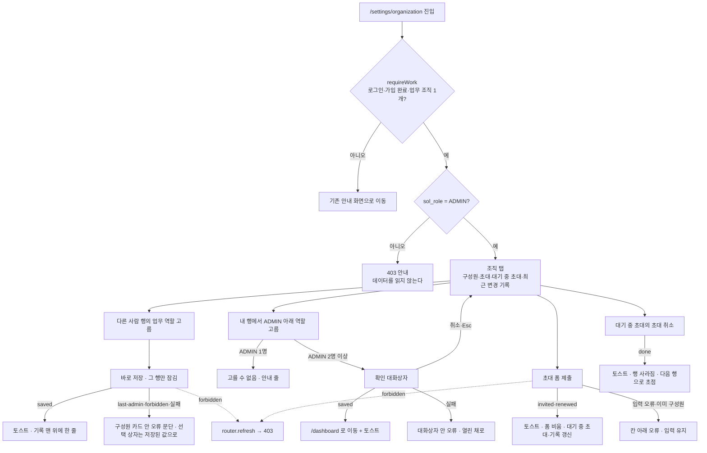

# 디자인 스펙: N2 설정 조직 탭 (`/settings/organization`, ADMIN)

[N2 구현 계획](2026-10-21-n2-org-settings-plan.md) 0단계 산출물이다. 구현자가 추측 없이 옮길 수 있게 화면 배치·상태·문구·부품을 고정한다. 이 문서는 **초안**이다. 화면 문구는 모두 초안이고 확정은 사용자 몫이다. 정본에 없어 결정이 필요한 것은 §12에 D1~D16으로 모았고, 각 항목의 ①이 추천안이다. 본문은 추천안을 따른 모양으로 그렸다.

> [!warning] 미검증 가정
> 코드와 문서만 읽고 썼다. 브라우저·dev 서버·DB는 띄우지 않았다. 1440·1280 폭의 칸 너비는 계산값이다. 감사 마이그레이션 `20261021000300_sol_role_change_audit.sql`은 이 작업 폴더에 아직 커밋되지 않은 상태로 있는 것을 읽었다(같은 브랜치 1단계 작업). 서버 도메인(§10)은 아직 없다.

## 0. 범위

계획 §1·§2에서 이미 정해진 것:

- 주소는 `/settings/organization`이고 업무 틀(`web/app/(app)/(work)/settings/organization/`) 안이다(계획 결정 1). `/settings`(템플릿 계정 화면으로 이동)는 그대로 둔다.
- 업무 역할(`memberships.sol_role`) ADMIN만 본다. 다른 역할은 데이터를 읽지 않고 403 안내를 본다(계획 결정 3, [[06-UI-UX|06]] §5.1·§5.10, [[09-SECURITY|09]] RBAC "설정 조직 탭").
- 쓰기는 서버 함수(`"use server"`) → `@/server/organization` → repo(anon 키 + RLS)다. `/api/v1/admin/users*`는 계속 미구현이다(계획 결정 4).
- 역할 변경 감사(`USER_ROLE_CHANGE`)는 별도 커밋이다. 사용자가 [[16-DECISIONS|16]] 미결정 26-5 미룸을 유지하면 그 커밋만 빠지고, 기록 구역은 `USER_INVITE`만 보인다(계획 결정 5, §4.6 끝 문단).

| 넣는다 | 넣지 않는다 |
|---|---|
| h1 "설정" + 하위 메뉴(링크 + `aria-current`) | 개인(계정) 탭 새로 그리기 — 템플릿 `/{slug}/settings`를 그대로 쓴다 |
| ① 구성원 표(이름·이메일·업무 역할·합류일), 행마다 업무 역할 선택 상자 | 구성원 내보내기·계정 정지(템플릿 멤버 화면·운영자 화면에 남는다) |
| ② 초대 폼(이메일 + 업무 역할 + [초대]) | 조직 역할(`org_role` owner·member) 바꾸기 |
| ③ 대기 중인 초대 표 + [초대 취소] | 초대 "다시 보내기" 단추(같은 이메일로 다시 초대하면 갱신된다, §4.3) |
| ④ 최근 변경 기록(감사 `USER_ROLE_CHANGE`·`USER_INVITE` 최근 20건, 읽기 전용) | 기록 거르기·더 보기·내보내기, 개인 알림 수신 설정 |
| 403 안내, 로딩 skeleton, 읽기 오류 | `/api/v1/admin/users*` Route Handler |

범위 외 확인: 결제·구독, 1280px 미만 레이아웃·모바일, 승률·확률 표시, 자동 투찰은 이 화면 어디에도 없다.

## 1. 기준

| 무엇 | 근거 |
|---|---|
| 화면 정의 | [[06-UI-UX\|06]] §5.10(조직 탭 = 구성원 목록·초대·업무 역할 변경과 감사 기록, ADMIN, 그 외 403), §4·§4.1(사이드바 "시스템 > 설정", 아이콘 `settings`), §5.1(로딩·빈 상태·오류·403 공통), §5.8(같은 ADMIN 화면의 403 모양), §10(접근성), §12(증거 상태명 `settings-org`) |
| 권한 | [[09-SECURITY\|09]] RBAC — 업무 역할 4개, "사용자 초대·업무 역할 변경·조직에서 내보내기 = ADMIN", "설정 조직 탭 = ADMIN", 마지막 ADMIN 보호, "감사 가능성"(역할 변경 감사 미구현) |
| DTO | [[05-API-SPEC\|05]] §3 `Role`·§4.2 `User`(`status`·`joinedAt` 포함)·`InviteInput`·`Invitation`·`UserPatch`, §2 `/admin/users*`(미구현) |
| DB | `20261019000001`(초대 `sol_role` 기본 `VIEWER`, ADMIN 정책), `20261019000014`(`protect_last_sol_admin`, 문구 "조직에는 업무 ADMIN이 한 명 이상 있어야 합니다", 멤버십 수를 센다), `20261019000006`(`audit_logs`, `actor_id` on delete set null), `20261019000007` §5(`USER_INVITE`는 초대 **insert**만), `20261021000300`(미커밋, `USER_ROLE_CHANGE` = `sol_role`이 실제로 바뀐 update, 행위자 `auth.uid()`, `target_id` = 대상 사용자 id), `20261014000001`(같은 이메일 update = 만료 7일 갱신, `profiles` 읽기 = 같은 조직 구성원만, 이메일 3~254자), `20261013000001`(표시 이름 1~40자) |
| 디자인 시스템 | `.claude/skills/design-system/SKILL.md` — 업무 틀, 하위 메뉴는 `SettingsNav` 모양(링크 + `aria-current`, Tabs 부품 아님), 주요 버튼 하나, `type-*` 눈금, 1440·1280 두 폭 |
| 같은 ADMIN 화면 | `web/app/(app)/(work)/admin/ingestion/` — `page.tsx`(역할 먼저 보고 안내만), `ingestion-forbidden.tsx`, `loading.tsx`·`error.tsx`(`WorkError`), [N8 디자인 스펙](2026-10-20-n8-admin-ingestion-design.md) §4.9·D10·D13 |
| 템플릿 구성원 화면(모양 참고만, 고치지 않는다) | `web/app/(app)/[slug]/settings/members/` — `member-table.tsx`(자기 강등·내보내기만 확인 대화상자, 다른 사람 역할은 바로 저장, 토스트), `invite-form.tsx`(이메일 + 역할 `Select` + [초대], 성공 뒤 이메일 칸으로 초점), `invitation-table.tsx`(취소에 확인 없음), `messages.ts`(초대 토스트 문구) · `settings-nav.tsx` · `settings-section.tsx` |
| 틀·부품 | `web/app/(app)/(work)/layout.tsx`·`work.ts`(`requireWork` → `role`·`org`), `web/components/app-page.tsx`(기본 단 `max-w-5xl`), `web/components/app-nav.ts`(`/settings` 줄이 하위 경로도 활성, 상단바 이름 "설정"), `web/components/ui/` select(트리거 40/32px, Base UI `readOnly`·`disabled`)·table(머리 40px, 셀 `px-3 py-2.5`)·card·dialog(`sm:max-w-sm`, 닫기 단추 sr-only 글자 영어 `Close`)·button·field |
| 데모 값 | `scripts/demo/plan.mjs` — `org-01` 구성원 4명: 김관리 `admin@soltech.invalid`(ADMIN, owner), 이영업(SALES), 박분석(ANALYST), 최열람(VIEWER). ADMIN이 한 명뿐이라 "마지막 ADMIN" 상태가 데모 기본이다 |

한계: 업무 역할의 한국어 이름은 정본·코드 어디에도 없다(검색: `docs/`·`web/`). 다른 브랜치의 미병합 코드는 보지 않았다.

## 2. 흐름



## 3. 공통 규칙

### 3.1 경로·틀·권한 — UI 요구와 서버 요구를 나눈다

| 항목 | UI 요구("안 보이게") | 서버 요구("못 하게") |
|---|---|---|
| 화면 진입 | `page.tsx`가 `requireWork("/settings/organization")`를 부르고 `role !== "ADMIN"`이면 데이터를 읽지 않고 403 안내(§4.9)를 그린다 | 데이터 읽기는 사용자 세션(anon 키)이고 RLS가 막는다: 초대 읽기·감사 읽기 = 그 조직 ADMIN, 구성원·프로필 읽기 = 같은 조직 구성원 |
| 역할 변경·초대·취소 | 버튼·선택 상자는 이 화면(ADMIN만 그려짐)에만 있다 | 서버 함수마다 지금 업무 조직과 `sol_role=ADMIN`을 다시 확인하고(편의), 최종 판정은 정책 "ADMIN 은 역할 변경"·"ADMIN 은 초대·갱신·취소"(`20261019000001`)와 `protect_last_sol_admin`(`20261019000014`)이다 |
| 마지막 ADMIN | 내 행의 낮은 역할을 미리 비활성 + 안내 줄(D6) | DB 트리거가 거절한다(`hint = 'last_admin'`). 화면이 막지 못한 경우(경쟁)도 같은 문구로 보인다 |
| 하위 메뉴 "조직" 링크 | ADMIN에게만 보인다(계정 화면의 `SettingsNav`에도) | 링크와 상관없이 위 검사를 항상 한다(NAV-07·NAV-09) |
| 감사 | 기록은 읽기 전용이다. 고치기·지우기 단추가 없다 | `audit_logs`는 화면 역할에 쓰기 권한이 없다. 트리거(security definer)만 넣는다 |

- 본문은 `AppPage`(`title="설정"`, `description` §6, `contentClassName` 없음 = 기본 `max-w-5xl`, D3)로 감싼다. `main`은 `AppPage`가 그린다. `actions` 자리는 비운다(주요 버튼 [초대]는 ② 구역 안에 있다).
- 하위 메뉴와 네 구역을 `<div>` 하나로 묶고(템플릿 멤버 화면과 같다, `AppPage`의 `gap-6`이 메뉴와 첫 카드 사이에 끼지 않게), 네 구역은 `flex flex-col gap-6 pt-6`.
- 사이드바는 "시스템 > 설정"이 활성이다(`app-nav.ts`의 `/settings`가 하위 경로를 포함한다). 상단바 화면 이름도 `설정`이다. 새 `NAV` 줄은 없다.
- `loading.tsx`·`error.tsx`를 둔다. `not-found.tsx`는 두지 않는다(상세 경로가 없다).
- 미인증·가입 미완료·업무 조직 0개/2개 이상은 `requireWork`가 이미 처리한다. 이 화면에서 새로 그리지 않는다.
- 메타데이터 제목은 `조직 설정`(브라우저 탭. 템플릿 멤버 화면 `멤버`와 같은 방식).

### 3.2 화면 폭

사이드바 256px, `AppPage` 좌우 여백 32px씩. 기본 단은 `max-w-5xl`(1024px)이고 가운데 정렬이다(D3).

| 화면 폭 | 가용 폭(사이드바 펼침) | 단 폭 | 카드 안 표 폭(테두리 2px 뺌) | 사이드바 접음 |
|---|---|---|---|---|
| 1440px | 1120px | 1024px(좌우 48px 여백) | 1022px | 단 1024px 그대로 |
| 1280px | 960px | 960px | 958px | 단 1024px |

가장 좁은 경우(1280px·펼침, 960px)에서 가로로 넘치지 않아야 한다. 칸 수는 화면 폭이 아니라 단 폭(`@container`)으로 정한다. 확인 대화상자는 두 폭에서 같다(`sm:max-w-sm`, 384px).

### 3.3 업무 역할 표기 (D1)

정본·코드에 업무 역할의 한국어 이름이 없다. 다른 화면은 코드를 그대로 보인다(403 "지금 역할: VIEWER", 공고 상세 "분석 요청은 ADMIN·SALES·ANALYST 역할만"). 그래서 이 화면도 **코드 글자 그대로** 쓴다(`ADMIN`·`SALES`·`ANALYST`·`VIEWER`, `font-mono` 아님, 일반 글꼴). 선택 상자 옵션 순서는 권한이 큰 순서 `ADMIN → SALES → ANALYST → VIEWER`다. 무엇을 할 수 있는지는 구성원 카드 아래 안내(§4.3 "역할 안내")가 [[09-SECURITY|09]] RBAC 표를 줄여 보인다.

### 3.4 날짜·이름

| 값 | 화면 글자 | 규칙 |
|---|---|---|
| 합류일 | `2026-10-19` | `memberships.created_at`을 서울 날짜로. `<time dateTime={UTC 원값} title={UTC 원값}>`. `formatKst`에서 날짜만 쓰는 함수 하나를 `components/bids/format.ts`에 더한다 |
| 만료일 | `2026-10-28까지` / `만료됨` | `expires_at` 서울 날짜. 지났으면 `만료됨`(`text-muted-foreground`, `title`에 만료 시각) |
| 기록 시각 | `2026-10-21 14:05` | `formatKst`(분까지). `<time>` + `title` UTC |
| 이름 | 표시 이름, 없으면 이메일(`nameOf`) | 내 행·내 기록은 이름 뒤 `(나)`(`text-muted-foreground`, `shrink-0`) |
| 행위자 없음 | `탈퇴한 사용자` | `actor_id`가 null(계정 삭제로 set null) — D11 |
| 이름을 읽을 수 없음 | `조직을 떠난 사용자` | id는 있는데 프로필을 읽지 못함(지금 조직 구성원이 아니다, RLS) — D11 |

## 4. 화면 명세

### 4.1 정보 위계와 레이아웃

**목적**: ADMIN이 조직 구성원의 업무 역할을 바로 바꾸고, 새 사람을 정한 역할로 초대하고, 누가 무엇을 바꿨는지 확인한다.

**위계**: h1 "설정" + 설명 → 하위 메뉴(계정·멤버·팀·조직) → ① 구성원 카드 → ② 초대 카드 → ③ 대기 중인 초대 카드 → ④ 최근 변경 기록 카드. 한 단으로 쌓는다(표가 넓어 두 칸으로 나누지 않는다).

```text
1440px · 사이드바 펼침 · 가용 1120 · 단 1024 (D3 ①, 가운데라 좌우 48 여백)
설정
구성원의 업무 역할과 초대를 관리합니다.
 계정    멤버    팀    조직
──────────────────────────────────────────────────────────────────────────────▀▀▀▀▀──  ← "조직" 아래 2px 막대
┌ 구성원 ─────────────────────────────────────────────────────────────────────── 4명 ┐
│ 업무 역할을 바꾸면 그 사람의 다음 요청부터 바로 적용됩니다. 구성원 내보내기는 멤버 탭에서 합니다. │
│ ADMIN이 나 한 명이라 내 업무 역할은 바꿀 수 없습니다. 다른 구성원을 먼저 ADMIN으로 바꾸세요.   │ ← ADMIN 1명일 때만
│ (오류 자리, role="alert")                                                             │
│ 이름(343)                 이메일(343)                  업무 역할(200)     합류일(136) │
│ 김관리 (나)                admin@soltech.invalid        [ADMIN    ▾]     2026-10-19 │
│ 박분석                     analyst@soltech.invalid      [ANALYST  ▾]     2026-10-19 │
│ 이영업                     sales@soltech.invalid        [ANALYST  ▾]     2026-10-19 │ ← 방금 바꿈(기록 맨 위)
│ 최열람                     viewer@soltech.invalid       [SALES    ▾] ⟳   2026-10-19 │ ← 저장 중(VIEWER → SALES)
│ ──────────────────────────────────────────────────────────────────────────────── │
│ ADMIN    SALES가 하는 일 + 구성원·초대·업무 역할, 회사 프로필 개정, 데이터 수집 관리       │
│ SALES    분석 요청, 참여 결정(BID·WATCH·NO-BID) 기록                                  │
│ ANALYST  분석 요청                                                                  │
│ VIEWER   읽기만. 모든 역할이 공고·분석 결과·조직·인력을 읽습니다.                         │
└───────────────────────────────────────────────────────────────────────────────────┘
┌ 초대 ─────────────────────────────────────────────────────────────────────────────┐
│ 이메일                                      업무 역할                                │
│ [                                     ]    [VIEWER      ▾]   [초대]                │
│ (칸 오류)                                                                          │
│ 초대받은 사람은 이 이메일로 로그인(계정이 없으면 가입)한 뒤 ‘받은 초대’에서 수락합니다. …     │
└───────────────────────────────────────────────────────────────────────────────────┘
┌ 대기 중인 초대 ─────────────────────────────────────────────────────────────── 1건 ┐
│ 수락하기 전의 초대입니다. 같은 이메일을 다시 초대하면 기한이 7일 늘고 업무 역할이 바뀝니다.   │
│ 이메일(606)                                      업무 역할(120) 만료일(160)    (136) │
│ new.analyst@soltech.invalid                      ANALYST      2026-10-28까지 [초대 취소]│
└───────────────────────────────────────────────────────────────────────────────────┘
┌ 최근 변경 기록 ─────────────────────────────────────────────────────────────── 2건 ┐
│ 업무 역할 변경과 새 초대를 최근 20건까지 보입니다. 초대 기한 연장·취소는 남지 않습니다.      │
│ 시각(160)          종류(104)  한 사람(283)         대상(283)              업무 역할(192)│
│ 2026-10-21 14:05   역할 변경   김관리 (나)          이영업                 SALES → ANALYST │
│ 2026-10-21 14:03   초대       김관리 (나)          new.analyst@soltech.…  ANALYST        │
└───────────────────────────────────────────────────────────────────────────────────┘
```

```text
1280px · 사이드바 펼침 · 단 960
설정
구성원의 업무 역할과 초대를 관리합니다.
 계정    멤버    팀    조직
──────────────────────────────────────────────────────────────────▀▀▀▀▀──
┌ 구성원 ───────────────────────────────────────────────────────── 4명 ┐
│ 업무 역할을 바꾸면 그 사람의 다음 요청부터 바로 적용됩니다. 구성원 내보내기는 │  ← 설명은 줄바꿈
│ 멤버 탭에서 합니다.                                                    │
│ 이름(311)            이메일(311)            업무 역할(200)    합류일(136) │
│ 김관리 (나)           admin@soltech.inva…    [ADMIN    ▾]    2026-10-19 │  ← 긴 값은 말줄임 + title
└──────────────────────────────────────────────────────────────────────┘
┌ 초대 ─────────────────────────────────────────────────────────────────┐
│ [이메일 448]                     [업무 역할 160]   [초대]                │  ← 1440과 같은 폭(좌측 정렬)
└──────────────────────────────────────────────────────────────────────┘
┌ 대기 중인 초대 ─ 이메일(542) · 업무 역할(120) · 만료일(160) · (136)        ┐
┌ 최근 변경 기록 ─ 시각(160) · 종류(104) · 한 사람(251) · 대상(251) · 업무 역할(192) ┐
```

1440과 1280의 차이는 가변 칸(이름·이메일·대상·한 사람) 폭과 설명 문장의 줄바꿈뿐이다. 칸 수·순서·글자 크기는 같다. 사이드바를 접으면 단이 1024px로 1440과 같아진다.

### 4.2 하위 메뉴 (D2)

- 템플릿 `SettingsNav`(`web/app/(app)/[slug]/settings/settings-nav.tsx`) **한 부품**을 두 화면이 같이 쓴다. 항목: `계정`(`/{slug}/settings`) · `멤버`(`/{slug}/settings/members`) · `팀`(`/{slug}/settings/team`, 팀 조직만) · `조직`(`/settings/organization`, ADMIN만). `조직`은 맨 끝이다(ADMIN이 아닌 사람의 다른 항목 자리가 바뀌지 않게, 템플릿 "팀"을 끝에 둔 이유와 같다).
- 모양은 그대로다: `nav aria-label="설정 메뉴"` + `border-b border-border`, 링크 `h-10 type-label font-medium text-muted-foreground`, 지금 화면은 `aria-current="page"` + `text-foreground` + 2px 막대(`after:bg-foreground`), 초점 `focus-visible:ring-3 focus-visible:ring-ring/50`. ARIA 탭·Tabs 부품을 쓰지 않는다.
- 부품에 prop 하나(`showOrganization: boolean`)를 더한다. 템플릿 설정 화면(계정·멤버·팀)은 `getMyBusinessAccess()`의 `solRole === "ADMIN"`일 때 켜고, 이 화면은 늘 켠다(ADMIN만 그려진다). 403 안내에는 하위 메뉴를 그리지 않는다(§4.9).
- `계정` 링크는 `/{slug}/settings`로 바로 간다(`/settings`를 거치면 이동이 한 번 더 생긴다). `slug`·`isTeam`은 `requireWork`의 `org`(`slug`·`isPersonal`)에서 읽는다.

### 4.3 ① 구성원 카드

`Card`(기본 크기, 안쪽 24px). `CardHeader`: `CardTitle` 안 `h2#org-members-title`(`type-heading`, `tabIndex={-1}` 없음) · `CardDescription`(설명 §6) · `CardAction` `{N}명`(`type-label text-muted-foreground tabular-nums`).

| 요소 | 내용 | 부품·클래스 |
|---|---|---|
| 마지막 ADMIN 안내 | ADMIN 행이 1개일 때만. `ADMIN이 나 한 명이라 내 업무 역할은 바꿀 수 없습니다. 다른 구성원을 먼저 ADMIN으로 바꾸세요.` id `org-last-admin-hint` | `CardDescription` 안 둘째 `p`, `type-label text-muted-foreground`, 아이콘 없음 |
| 오류 문단 | 역할 저장 실패 때(§4.8 표). 다음 변경 시도·성공 때 지운다 | `CardContent` 맨 위 `p role="alert" type-label text-destructive`, 표 위 `mb-3` |
| 표 | 아래 열 표 | `Table className="table-fixed"`, `<caption className="sr-only">` §7 |
| 역할 안내 | 4줄 `dl`(D1) | 표 아래 `div border-t border-border px-6 pt-4`, `dl grid grid-cols-[5rem_minmax(0,1fr)] gap-x-4 gap-y-1`, `dt type-label font-medium text-foreground`, `dd type-label text-muted-foreground` |

표는 템플릿처럼 카드 끝까지 닿는다(`CardContent className="px-0"`, 첫 칸 `pl-6`, 끝 칸 `pr-6`). 머리 줄 40px, 행 높이 52px(선택 상자 32px + 위아래 10px), 홀짝 바탕 없음, hover `bg-muted/50`(부품 기본).

| 열 | 폭(1440 / 1280) | 내용 | 필드 |
|---|---|---|---|
| 이름 | 가변 343 / 311, `pl-6` | `span truncate font-medium text-foreground` + 내 행 `(나)` + 정지 계정이면 `정지됨`(D14, `type-caption text-muted-foreground shrink-0`). `title`에 전체 이름 | `name`, `id === 나`, `status` |
| 이메일 | 가변 343 / 311 | `p truncate text-muted-foreground`, `title`에 전체 | `email` |
| 업무 역할 | 200 | 선택 상자(아래) + 저장 중 표시 | `solRole` |
| 합류일 | 136, `pr-6` | `<time>` `2026-10-19`, `tabular-nums text-muted-foreground` | `joinedAt` |

정렬은 **내 행 맨 위, 나머지 이름 가나다순**(같으면 이메일순)으로 고정한다(D10). 역할을 바꿔도 행이 움직이지 않아 초점과 눈의 자리가 그대로다. 정렬 단추는 없다.

**업무 역할 선택 상자** (행마다 하나)

- `Select`(`items` = 코드→코드 글자, 값 `ADMIN`·`SALES`·`ANALYST`·`VIEWER`) + `SelectTrigger size="sm" className="w-36"`(32px·144px) + `SelectValue` + `SelectContent`(`SelectItem` 4개, 순서 §3.3).
- 이름: `aria-label="{이름} 업무 역할"`(표 안이라 보이는 라벨이 없다). 내 행에 마지막 ADMIN 안내가 있으면 `aria-describedby="org-last-admin-hint"`.
- 고르는 즉시 저장한다(저장 단추 없음). Base UI 선택 상자는 닫힌 상태에서 화살표 키로 값이 바뀌지 않고, 목록을 열어 Enter로 골라야 바뀐다. `Esc`는 바꾸지 않고 닫는다. 그래서 실수로 바뀌지 않는다.
- 같은 값을 고르면 아무것도 하지 않는다.
- **다른 사람 행**: 확인 없이 바로 저장한다(D4). 되돌리고 싶으면 다시 바꾸면 되고, 기록에 남는다.
- **내 행, ADMIN이 2명 이상**: ADMIN 아래 역할을 고르면 값을 바꾸지 않은 채 확인 대화상자(§4.8)를 연다.
- **내 행, ADMIN이 1명**(데모 기본): `SALES`·`ANALYST`·`VIEWER` 항목을 `disabled`로 둔다. 트리거는 초점을 받고 열린다(이유는 `aria-describedby` 안내 줄이 읽힌다). DB도 거절하지만 화면이 먼저 막는다(D6). ADMIN 수는 서버가 보낸 구성원 행에서 센다. DB 트리거와 같은 기준(`sol_role='ADMIN'`인 멤버십 수, 계정 상태 무관)이어야 둘이 어긋나지 않는다(§11 7번).
- **저장 중**: 그 행의 `Select`를 `readOnly`로 둔다(`disabled`가 아니다. 비활성 트리거는 `tabIndex=-1`이 되어 초점이 사라진다). 트리거는 고른 새 값을 보이고, 트리거 오른쪽 `gap-2`에 `LoaderCircleIcon` 16px `animate-spin motion-reduce:animate-none text-muted-foreground aria-hidden`, 트리거에 `aria-busy="true"`. 다른 행은 그대로 바꿀 수 있다(서버 함수는 차례로 처리된다).
- **성공**: 토스트(D8) `{이름} 님의 업무 역할을 {이전}에서 {새}로 바꿨습니다`. 서버 함수가 `refresh()`해 기록 카드 맨 위에 한 줄이 생긴다. 초점은 그 선택 상자에 남는다(행 `key`는 사용자 id).
- **실패**: 선택 상자를 **저장된 값으로 되돌리고**(D15) 구성원 카드 오류 문단에 사유를 보인다. 초점은 선택 상자에 남는다.

### 4.4 ② 초대 카드

`Card` + `CardHeader`(`h2#org-invite-title` `초대`, 설명 없음) + `CardContent className="@container"`. 폼은 react-hook-form + zod(`field` 부품), 같은 zod 스키마로 서버가 다시 검증한다.

```text
이메일                                       업무 역할
[                                      ]   [VIEWER       ▾]   [초대]
(칸 오류 — FieldError)
(폼 오류 — role="alert")
초대받은 사람은 이 이메일로 로그인(계정이 없으면 가입)한 뒤 ‘받은 초대’에서 수락합니다.
수락하면 고른 업무 역할로 구성원이 됩니다. 초대는 7일 동안 유효합니다.
```

| 요소 | 규칙 |
|---|---|
| 배치 | `grid gap-4 @lg:grid-cols-[minmax(0,28rem)_10rem_auto] @lg:items-start @lg:justify-start`(이메일 최대 448px · 역할 160px · 단추). 단 폭이 960·1024라 두 폭 모두 한 줄이고 왼쪽 정렬이다. `justify-start` 가 없으면 남는 폭이 `auto` 칸(단추)으로 가서 단추가 늘어난다(실앱 확인 2026-10-21, 브라우저 시험 `배치` 가 단추 폭 100px 미만을 잰다) |
| 이메일 | `Field` + `FieldLabel htmlFor="org-invite-email"` `이메일` + `Input type="email" autoComplete="off"`(40px, 브라우저가 내 이메일을 채우지 않게) + `FieldError`. 앞뒤 공백은 서버가 지우고 소문자로 맞춘다. 화면은 입력 중 글자를 바꾸지 않는다 |
| 업무 역할 | `Field` + `FieldLabel htmlFor="org-invite-role"` `업무 역할` + `Select`(트리거 기본 40px, `w-full`) 옵션 4개. **기본값 `VIEWER`**(D7) |
| [초대] | 화면의 유일한 `default` 단추(36px), `@lg:mt-7`(라벨 20 + 간격 8만큼 내려 입력칸과 줄을 맞춘다, 템플릿과 같다). 보내는 동안 `초대 중…` + `disabled` + `focusableWhenDisabled`(누른 단추의 초점이 사라지지 않게). 이메일 칸은 `readOnly`, 역할 선택 상자는 `readOnly` |
| 도움말 | `FieldDescription` 위 그림 두 문장 |
| 성공 | 토스트(§4.10, 메일 결과별 문구). 폼을 기본값(`""`, `VIEWER`)으로 되돌리고 초점은 이메일 칸으로(템플릿과 같다). 서버 함수 `refresh()`로 대기 중인 초대·기록이 갱신된다 |
| 실패 | 입력은 그대로 둔다. 칸 오류는 칸 아래 `FieldError`(`aria-invalid` + `aria-describedby`)이고 그 칸으로 초점을 옮긴다(`setError(…, { shouldFocus: true })`). 폼 오류는 도움말 위 `p role="alert" type-label text-destructive`이고 초점은 그대로 둔다 |

### 4.5 ③ 대기 중인 초대 카드

`Card` + `CardHeader`(`h2#org-invitations-title` `대기 중인 초대`, 설명 §6, `CardAction` `{N}건`). 정렬은 만료가 늦은 순(= 최근 초대 순, 템플릿과 같다).

| 열 | 폭(1440 / 1280) | 내용 | 필드 |
|---|---|---|---|
| 이메일 | 가변 606 / 542, `pl-6` | `p truncate text-foreground`, `title` 전체 | `email` |
| 업무 역할 | 120 | 코드 글자 | `solRole` |
| 만료일 | 160 | `<time>` `2026-10-28까지`, 지났으면 `만료됨`(§3.4). `tabular-nums text-muted-foreground` | `expiresAt` |
| (동작) | 136, `pr-6`, 오른쪽 정렬 | `Button variant="outline" size="sm"` `초대 취소`, `aria-label="{이메일} 초대 취소"`(보이는 글자를 포함한다, WCAG 2.5.3). 머리 칸은 `sr-only` `동작` | `id` |

- 행 높이 52px(32px 단추).
- 0건: 표 대신 `CardContent` 안 한 줄 `대기 중인 초대가 없습니다.`(`type-label text-muted-foreground`, 템플릿과 같다, D16).
- 만료된 초대도 목록에 남긴다(수락할 수 없다). 같은 이메일로 다시 초대하면 갱신된다(설명 문장이 알린다).
- **초대 취소**: 확인 없이 바로 취소한다(D9). 보내는 동안 `취소 중…` + `disabled` + `focusableWhenDisabled`. 성공하면 토스트 `{이메일} 초대를 취소했습니다`, 행이 사라지므로 초점은 **다음 행의 [초대 취소] → 없으면 이전 행 → 없으면 카드 제목 `h2`(`tabIndex={-1}`)**로 옮긴다. 실패하면 카드 `CardContent` 맨 위 `p role="alert" type-label text-destructive`, 행은 남는다.

### 4.6 ④ 최근 변경 기록 카드

`Card` + `CardHeader`(`h2#org-audit-title` `최근 변경 기록`, 설명 §6, `CardAction` `{N}건`). 읽기 전용이다. 행에 초점 받는 요소가 없다. 정렬은 `created_at` 내림차순, 최대 20건, 더 보기 없음.

| 열 | 폭(1440 / 1280) | 역할 변경(`USER_ROLE_CHANGE`) | 초대(`USER_INVITE`) |
|---|---|---|---|
| 시각 | 160, `pl-6` | `<time>` `2026-10-21 14:05`, `tabular-nums text-muted-foreground whitespace-nowrap` | 같다 |
| 종류 | 104 | `역할 변경` | `초대` |
| 한 사람 | 가변 283 / 251 | 행위자 이름(+ `(나)`). §3.4 `탈퇴한 사용자`·`조직을 떠난 사용자`(D11, `text-muted-foreground`) | 같다 |
| 대상 | 가변 283 / 251 | 대상 구성원 이름(`target_id`로 찾는다), 못 찾으면 `조직을 떠난 사용자` | 초대한 이메일(`before_after.after.email`) |
| 업무 역할 | 192, `pr-6` | `SALES → ANALYST`. 화살표는 `aria-hidden`이고 그 자리에 `sr-only` `에서 `, 끝에 `sr-only` `로`(낭독 "SALES에서 ANALYST로") | `ANALYST`(`before_after.after.solRole`) |

- 행 높이 최소 44px(`h-11`, [[06-UI-UX|06]] §3.3). 모든 가변 칸은 한 줄 `truncate` + `title`.
- 0건: 한 줄 `아직 변경 기록이 없습니다. 업무 역할을 바꾸거나 새로 초대하면 여기에 남습니다.`(`type-label text-muted-foreground`, D16). `pnpm demo:reset` 직후 데모의 첫 모습이다.
- 감사 커밋을 빼면(26-5 미룸 유지) 설명이 `새 초대를 최근 20건까지 보입니다. 업무 역할 변경 기록은 아직 남기지 않습니다.`로 바뀌고 `USER_INVITE`만 보인다. 문구는 상수 한 곳에 둔다(D12).

### 4.7 상태표 — 화면

| 상태 | 언제 | 보이는 것 | 사용자가 할 수 있는 것 |
|---|---|---|---|
| 로딩 | 서버가 읽는 중(`loading.tsx`) | `AppPage` 제목·설명은 진짜 글자. 하위 메뉴 자리 skeleton 4칸(`h-5 w-8`), 카드 4장 skeleton: 구성원(머리 1줄 + 행 4줄 52px), 초대(입력칸 448 + 선택 160 + 단추 60 한 줄), 대기 중 초대(행 2줄), 기록(행 5줄 44px). `role="status"` + sr-only `조직 설정을 불러오는 중…`, skeleton `motion-reduce:animate-none` | 기다림. 사이드바·상단바 사용 |
| 정상 | 읽기 성공 | §4.1 그림 | 역할 바꾸기, 초대, 초대 취소, 기록 보기, 하위 메뉴 이동 |
| ADMIN 1명 | 구성원 중 ADMIN이 나뿐 | 마지막 ADMIN 안내 줄, 내 행 선택 상자의 낮은 역할 3개 비활성 | 다른 구성원을 ADMIN으로 바꾸기 |
| 구성원 나뿐 | 구성원 1명 | 표 1행 + ADMIN 1명 안내. 빈 상태가 아니다 | 초대 |
| 대기 중 초대 0건 | 초대 없음 | ④ 카드에 `대기 중인 초대가 없습니다.`, `CardAction` `0건` | 초대 |
| 기록 0건 | 감사 행 없음 | ⑤ 카드에 §4.6 빈 문장, `0건` | 역할 변경·초대 |
| 정지된 구성원 | `profiles.status='suspended'` | 이름 뒤 `정지됨`(D14). 선택 상자는 그대로 쓸 수 있다 | 역할 바꾸기 |
| 만료된 초대 | `expires_at ≤ now` | 만료일 칸 `만료됨` | 초대 취소, 같은 이메일로 다시 초대 |
| 행위자 탈퇴 | `actor_id = null` | 한 사람 칸 `탈퇴한 사용자` | — |
| 대상·행위자가 조직을 떠남 | id는 있으나 프로필을 못 읽음 | `조직을 떠난 사용자` | — |
| 긴 글자 | 이름 40자, 이메일 254자 | 한 줄 말줄임 + `title`(§9) | — |
| 대량 데이터 | 구성원 수십 명 | 쪽 나눔 없이 전부 그린다(해커톤 데모 4명). 기록은 20건 상한. 100명을 넘는 조직의 검색·쪽 나눔은 후속(§11 9번) | 스크롤 |
| 화면 오류 | 서버 읽기 실패(`error.tsx`) | `WorkError`(`title="설정"`, 단 폭 같음): `불러오지 못했습니다` + 서버 문구 + 오류 ID + [다시 시도]. 하위 메뉴는 없다(사이드바 "설정"으로 계정 화면에 간다). 세 표 중 하나만 실패해도 화면 전체가 오류다(일부만 보이지 않는다) | 다시 시도 |
| 권한 없음 | `sol_role ≠ ADMIN` | §4.9 | 대시보드로 |
| 미인증·계정 상태 | 로그인 전, 가입 미완료, 업무 조직 0·2+ | `requireWork`가 기존 안내 화면으로 보낸다 | 그 화면의 동작 |

### 4.8 상태표 — 구성원 역할 변경 · 확인 대화상자

오류 문단 문구는 서버 `message`를 그대로 보이지 않고 아래 문구를 쓴다(마지막 ADMIN 문장만 DB 문구와 같다).

| 상태 | 언제 | 보이는 것 | 사용자가 할 수 있는 것 |
|---|---|---|---|
| 저장 중 | 다른 사람 행에서 새 값 고름 | 그 행 `readOnly` + 회전 아이콘 + 새 값 | 다른 행 바꾸기, 기다림 |
| 저장됨 | `saved` | 토스트 `{이름} 님의 업무 역할을 {이전}에서 {새}로 바꿨습니다`, 오류 문단 지움, 기록 맨 위에 한 줄 | 계속 |
| 마지막 ADMIN 거절 | `last-admin`(화면이 막지 못한 경쟁, 예: 다른 ADMIN이 그새 내려감) | 값 되돌림 + 오류 문단 `{이름} 님의 업무 역할을 바꾸지 못했습니다. 조직에는 업무 ADMIN이 한 명 이상 있어야 합니다.` + `router.refresh()`(ADMIN 수를 다시 센다) | 다른 구성원을 먼저 ADMIN으로 |
| 권한 잃음 | `forbidden`(내 역할이 그새 바뀜) | 오류 문단 `업무 역할이 ADMIN이 아니어서 바꾸지 못했습니다. 화면을 새로 고칩니다.` → `router.refresh()` → 403 안내 | 대시보드로 |
| 구성원 아님 | `not-member`(그새 내보내짐) | 오류 문단 `{이름} 님은 이제 이 조직의 구성원이 아닙니다. 목록을 새로 고칩니다.` → `router.refresh()` | 계속 |
| 로그인 만료 | `signed-out` | 오류 문단 `로그인이 풀렸습니다. 다시 로그인하세요.` + 문장 뒤 링크 `로그인`(`/auth/login`) | 로그인 |
| 알 수 없는 실패 | 예외·네트워크 | 값 되돌림 + `처리하지 못했습니다. 잠시 뒤 다시 시도해 주세요.` | 다시 고르기 |
| 자기 강등 확인 | 내 행, ADMIN 2명 이상, 낮은 역할 고름 | 대화상자(아래). 선택 상자 값은 아직 ADMIN | 취소, 바꾸기 |
| 자기 강등 중 | [바꾸기] 누름 | 단추 `바꾸는 중…` 비활성, [취소] 비활성, `Esc`·바깥 눌러도 닫히지 않음(템플릿과 같다) | 기다림 |
| 자기 강등 성공 | `saved` | `router.replace("/dashboard")` + 토스트 `내 업무 역할을 {새}로 바꿨습니다`(D5). 사이드바의 "데이터 수집 관리"가 사라진다 | — |
| 자기 강등 실패 | `last-admin`·`forbidden`·`signed-out`·실패 | 대화상자 안 `p role="alert" type-label text-destructive`(위 문구), 대화상자는 열린 채 | 취소 |

**확인 대화상자** (`Dialog`, `showCloseButton={false}` — 닫기 단추의 sr-only 글자가 영어 `Close`라 쓰지 않는다, §11 6번)

```text
┌ 내 업무 역할을 SALES로 바꿀까요? ───────────────┐  384px
│ 바꾸면 설정의 조직 탭과 데이터 수집 관리를 더 볼 수   │
│ 없습니다. 다시 ADMIN이 되려면 다른 ADMIN이 바꿔 줘야 │
│ 합니다.                                       │
│ (오류 자리, role="alert")                       │
│                         [취소] [SALES로 바꾸기]  │
└──────────────────────────────────────────────┘
```

- `DialogTitle` `내 업무 역할을 {새 역할}로 바꿀까요?`, `DialogDescription` 위 문장.
- [취소] `outline`(`DialogClose`), [{새 역할}로 바꾸기] `destructive`(연한 빨강 바탕, `default` 아님 — 화면의 주요 단추는 [초대] 하나다).
- 처음 초점은 [취소](`initialFocus`, 되돌릴 수 없는 쪽이 기본이 아니게). 닫히면 초점은 내 행 선택 상자로(`finalFocus`에 그 트리거 ref). 성공하면 화면을 떠나므로 초점 복귀가 없다.

### 4.9 권한 없음 (403)

`IngestionForbidden`과 같은 꼴이고 문구는 [[06-UI-UX|06]] §5.1 형식이다. 데이터를 읽지 않는다. HTTP 200 + 안내다(서버 함수는 `forbidden` 결과를 돌려준다).

```text
설정
┌──────────────────────────────────────────────────┐
│ 이 화면을 볼 권한이 없습니다                          │  ← role="alert", h2 type-heading
│ 설정의 조직 탭은 업무 역할이 ADMIN인 구성원만 볼 수     │
│ 있습니다. 지금 역할: VIEWER                          │  ← type-body text-muted-foreground
│ [대시보드로]                                        │  ← outline 링크 /dashboard
└──────────────────────────────────────────────────┘
```

- `AppPage title="설정"`(설명 없음, 단 폭 기본) + `section role="alert" aria-labelledby` `flex flex-col items-start gap-3 rounded-lg border border-border p-6`. 하위 메뉴는 그리지 않는다(비ADMIN에게 "조직" 링크가 없어 지금 화면을 가리킬 항목이 없다. 계정 화면은 사이드바 "설정"으로 간다).
- 역할은 `requireWork`의 `role` 원문(`SALES`·`ANALYST`·`VIEWER`).
- 서비스 운영자(`profiles.is_admin`)도 업무 역할이 ADMIN이 아니면 이 화면이다(예: `analyst@soltech.invalid`).
- 부품은 이 화면 폴더의 `OrgSettingsForbidden`이다(D13).
- 증거 스크린샷: `…-settings-org-forbidden-{1440,1280}.png`(VIEWER, [[06-UI-UX|06]] §12).

### 4.10 상태표 — 초대 폼

| 상태 | 언제 | 보이는 것 | 사용자가 할 수 있는 것 |
|---|---|---|---|
| 처음 | 화면 열림·성공 뒤 | 이메일 빈칸, 업무 역할 `VIEWER` | 입력 |
| 빈 이메일 | 빈칸으로 제출 | 이메일 `FieldError` `이메일을 입력하세요`, 초점 이메일 | 입력 |
| 잘못된 이메일 | zod 형식 실패 | `이메일 형식이 아닙니다` | 고치기 |
| 내 이메일 | 서버 `invalid` | 이메일 칸 `내 이메일은 초대할 수 없습니다` | 고치기 |
| 이미 구성원 | 서버 `already-member` | 이메일 칸 `이미 이 조직의 구성원입니다. 업무 역할은 위 구성원 표에서 바꾸세요.` | 구성원 표로 |
| 초대 중 | 제출 | [초대] `초대 중…` 비활성(초점 유지), 칸 `readOnly` | 기다림 |
| 초대됨 · 메일 보냄 | `invited` + `sent` | 토스트(성공) `{이메일}을 {역할}로 초대하고 초대 메일을 보냈습니다` | 계속 |
| 초대됨 · 메일 설정 없음 | `invited` + `not-configured`(데모 기본) | 토스트(성공) `{이메일}을 {역할}로 초대했습니다. 초대받은 사람에게 직접 알려 주세요.` | 계속 |
| 초대됨 · 메일 실패 | `invited` + `failed` | 토스트(경고, 10초) `{이메일}을 {역할}로 초대했지만 메일을 보내지 못했습니다. 초대받은 사람에게 직접 알려 주세요.` | 직접 알림 |
| 이미 초대됨(갱신) | `renewed` | 토스트 `이미 초대한 이메일이라 기한을 7일 늘리고 업무 역할을 {역할}로 맞췄습니다`(+ 메일 결과 뒷말은 위와 같다). 대기 중 초대 행의 역할·만료일이 바뀐다. 기록에는 새 줄이 없다(§4.6 설명) | 계속 |
| 권한 잃음 | `forbidden` | 폼 오류 `ADMIN만 초대할 수 있습니다. 화면을 새로 고칩니다.` → `router.refresh()` → 403 | 대시보드로 |
| 로그인 만료 | `signed-out` | 폼 오류 `로그인이 풀렸습니다. 다시 로그인하세요.` + `로그인` 링크 | 로그인 |
| 실패 | 예외·네트워크 | 폼 오류 `초대하지 못했습니다. 잠시 뒤 다시 시도해 주세요.`, 입력 유지 | 다시 초대 |

### 4.11 상태표 — 대기 중인 초대

| 상태 | 언제 | 보이는 것 | 사용자가 할 수 있는 것 |
|---|---|---|---|
| 목록 | 1건 이상 | 표 | 초대 취소 |
| 0건 | 없음 | `대기 중인 초대가 없습니다.` | 위에서 초대 |
| 취소 중 | [초대 취소] 누름 | 그 단추 `취소 중…` 비활성(초점 유지) | 다른 행 취소 |
| 취소됨 | `done` | 토스트 `{이메일} 초대를 취소했습니다`, 행 사라짐, 초점 다음 행 → 이전 행 → 카드 제목 | 계속 |
| 이미 없음 | 그새 수락·다른 탭에서 취소 | `done`과 같게 다루고 새로 고친 목록을 보인다(수락했으면 구성원 표에 생긴다) | 계속 |
| 권한 잃음 | `forbidden` | 카드 오류 `ADMIN만 초대를 취소할 수 있습니다. 화면을 새로 고칩니다.` → 403 | 대시보드로 |
| 로그인 만료 | `signed-out` | 카드 오류 `로그인이 풀렸습니다. 다시 로그인하세요.` + `로그인` 링크 | 로그인 |
| 실패 | 예외·네트워크 | 카드 오류 `초대를 취소하지 못했습니다. 잠시 뒤 다시 시도해 주세요.`, 행 남음 | 다시 취소 |

## 5. 화면 요소 ↔ 05 DTO

| 화면 요소 | 필드 | 비고 |
|---|---|---|
| 구성원 이름·이메일·업무 역할·합류일 | `User.name`·`email`·`solRole`·`joinedAt` | `orgRole`·`employment`는 이 화면에서 쓰지 않는다 |
| `정지됨` | `User.status` | D14 |
| `(나)` | `User.id === requireWork().userId` | |
| ADMIN 수 | `User[]`에서 `solRole === "ADMIN"` 개수 | DB 트리거와 같은 기준(§4.3) |
| 역할 변경 | `UserPatch { solRole }` | 서버 함수 인자는 `(userId, solRole)` |
| 초대 폼 | `InviteInput { email, solRole }` | 화면 기본 `VIEWER`. 본문에는 늘 `solRole`을 싣는다 |
| 대기 중 초대 | `Invitation.email`·`solRole`·`expiresAt` | `invitedBy`·`createdAt`은 보이지 않는다(초대한 사람은 기록 카드가 보인다) |
| 기록 | `audit_logs.created_at`·`action`·`actor_id`(+ 프로필 이름)·`target_id`·`before_after` | 05에 DTO가 없다. 화면 전용 보기 모델(§10 5번) |

## 6. 화면 문구 (초안 — 확정은 사용자)

| 자리 | 문구 |
|---|---|
| h1 / 설명 | `설정` / `구성원의 업무 역할과 초대를 관리합니다.` (조직 이름을 넣지 않는다 — loading·error와 같은 글자) |
| 메타 제목 | `조직 설정` |
| 하위 메뉴 | `계정` `멤버` `팀` `조직` |
| 구성원 | 제목 `구성원`, 설명 `업무 역할을 바꾸면 그 사람의 다음 요청부터 바로 적용됩니다. 구성원 내보내기는 멤버 탭에서 합니다.`, 개수 `{N}명`, 마지막 ADMIN `ADMIN이 나 한 명이라 내 업무 역할은 바꿀 수 없습니다. 다른 구성원을 먼저 ADMIN으로 바꾸세요.` |
| 표 머리 | `이름` `이메일` `업무 역할` `합류일` |
| 역할 안내 | `ADMIN` `SALES가 하는 일 + 구성원·초대·업무 역할, 회사 프로필 개정, 데이터 수집 관리` · `SALES` `분석 요청, 참여 결정(BID·WATCH·NO-BID) 기록` · `ANALYST` `분석 요청` · `VIEWER` `읽기만. 모든 역할이 공고·분석 결과·조직·인력을 읽습니다.` (근거 [[09-SECURITY\|09]] RBAC 표) |
| 확인 대화상자 | §4.8 |
| 초대 | 제목 `초대`, 라벨 `이메일`·`업무 역할`, 단추 `초대`/`초대 중…`, 도움말 `초대받은 사람은 이 이메일로 로그인(계정이 없으면 가입)한 뒤 ‘받은 초대’에서 수락합니다. 수락하면 고른 업무 역할로 구성원이 됩니다. 초대는 7일 동안 유효합니다.` |
| 대기 중 초대 | 제목 `대기 중인 초대`, 설명 `수락하기 전의 초대입니다. 같은 이메일을 다시 초대하면 기한이 7일 늘고 업무 역할이 새로 고른 값으로 바뀝니다.`, 개수 `{N}건`, 머리 `이메일` `업무 역할` `만료일` `동작`(sr-only), 단추 `초대 취소`/`취소 중…`, 빈 `대기 중인 초대가 없습니다.` |
| 기록 | 제목 `최근 변경 기록`, 설명 `업무 역할 변경과 새 초대를 최근 20건까지 보입니다. 초대 기한 연장·취소는 남지 않습니다.`, 개수 `{N}건`, 머리 `시각` `종류` `한 사람` `대상` `업무 역할`, 종류 `역할 변경`·`초대`, 빈 `아직 변경 기록이 없습니다. 업무 역할을 바꾸거나 새로 초대하면 여기에 남습니다.`, 이름 없음 `탈퇴한 사용자`·`조직을 떠난 사용자` |
| 토스트·오류 | §4.8·§4.10·§4.11 표 |
| 403 | `이 화면을 볼 권한이 없습니다` / `설정의 조직 탭은 업무 역할이 ADMIN인 구성원만 볼 수 있습니다. 지금 역할: {role}` / `대시보드로` |
| 로딩 | sr-only `조직 설정을 불러오는 중…` |

## 7. 접근성 체크 항목

- 제목 계층: h1 `설정` → h2 `구성원`·`초대`·`대기 중인 초대`·`최근 변경 기록`. 403은 h1 + h2 하나. 대화상자는 `DialogTitle`이 이름이다.
- 랜드마크: `main#main-content`는 `AppPage`. 하위 메뉴는 `nav aria-label="설정 메뉴"`(부품 그대로).
- 표 이름: `<caption className="sr-only">` — 구성원 `구성원 {N}명. 업무 역할은 행마다 선택 상자에서 바로 바뀝니다.`, 대기 중 초대 `대기 중인 초대 {N}건. 만료가 늦은 순입니다.`, 기록 `최근 변경 기록 {N}건. 최근 것이 위에 있습니다.` 머리는 `th scope="col"`(부품 기본 `th`). `aria-labelledby`로 이름을 겹치지 않는다.
- 키보드 순서(= 보이는 순서): 하위 메뉴 링크(계정·멤버·팀·조직) → 구성원 선택 상자(위→아래) → 이메일 → 업무 역할 → [초대] → [초대 취소](위→아래) → 기록(초점 없음). 오류 문단 안 `로그인` 링크는 그 자리에서 초점을 받는다.
- 선택 상자: 이름 `aria-label="{이름} 업무 역할"`, 마지막 ADMIN이면 `aria-describedby` 안내 줄, 저장 중 `aria-busy="true"` + `readOnly`(초점 유지). 비활성 항목은 Base UI가 `aria-disabled`로 알린다.
- 확인 대화상자: 열면 초점 [취소], 초점 가두기·`Esc`(진행 중에는 닫히지 않음), 닫히면 내 행 선택 상자로. `DialogDescription`이 `aria-describedby`로 읽힌다.
- 상태 알림: 성공은 토스트 하나(sonner의 `aria-live` 영역). 실패는 그 자리의 `role="alert"` 문단 하나. 같은 사건을 두 곳에서 읽지 않는다(성공 때 표·기록이 바뀌는 것은 낭독하지 않는다). 개수 글자(`4명`·`1건`)는 `aria-live`가 아니다.
- 초점 보존: 저장·초대·취소 단추는 `focusableWhenDisabled`. 서버 함수의 `refresh()` 뒤에도 행 `key`(사용자 id·초대 id)가 같아 초점이 남는다. 사라지는 행은 §4.5 규칙으로 옮긴다.
- 폼: `FieldLabel htmlFor`, 칸 오류 `aria-invalid` + `aria-describedby`(`FieldError`), 폼 오류 `role="alert"`.
- 링크·단추 이름: [초대 취소]는 `aria-label="{이메일} 초대 취소"`(보이는 글자로 끝나지만 포함한다). 아이콘만 있는 단추 없음. 회전 아이콘 `aria-hidden`.
- 화살표 낭독: 기록의 `→`는 `aria-hidden` + sr-only `에서`·`로`.
- 색만으로 뜻을 전하지 않는다: 오류는 `text-destructive` + 문장, `만료됨`·`정지됨`·`(나)`는 글자다.
- 대비: `muted-foreground`·`destructive`를 흰 바탕 위 글자로만 쓴다. Playwright axe 위반 0건([[06-UI-UX|06]] §10).
- 움직임: 회전 아이콘·skeleton `motion-reduce:animate-none`, 대화상자 전환은 부품 기본.
- 시각: `<time dateTime>` + `title`(UTC). 낭독은 보이는 서울 시각을 읽는다.
- 검사: 1440·1280 두 폭에서 `loaded`(ADMIN 1명 안내 포함)·`empty`(대기 중 초대 0·기록 0, demo:reset 직후)·`forbidden`(VIEWER)과 확인 대화상자 열린 상태.

## 8. 토큰·부품 매핑

### 8.1 색 (`design/tokens.json`만, 새 색 없음)

| 쓰임 | 토큰 클래스 |
|---|---|
| 바탕·카드 | `bg-background`, `Card`(`bg-card` + `border` + `shadow-xs`) |
| 구역 선·표 줄·역할 안내 위 선 | `border-border`(표는 부품 기본 `border-b`) |
| 본문 글자·이름 | `text-foreground` |
| 이메일·날짜·개수·설명·`(나)`·`정지됨`·`만료됨`·이름 없음·회전 아이콘 | `text-muted-foreground` |
| 오류 문단 | `text-destructive` |
| 자기 강등 단추 | `Button variant="destructive"`(부품 변형) |
| 표 hover | `bg-muted/50`(부품 기본) |
| 하위 메뉴 활성 막대 | `after:bg-foreground`(부품 그대로) |
| 주요 단추 | `Button` 기본(`primary`) — [초대] 하나 |

`brand`·`demo`·`chart-2`·`success`·`warning`은 쓰지 않는다.

### 8.2 글자 (앱 틀 기본 눈금만)

`type-title`(h1), `type-heading`(카드 제목 h2·403 h2), `type-body`(표 본문·설명·입력칸·선택 상자), `type-label`(표 머리·하위 메뉴·개수·안내 줄·오류 문단·역할 안내·빈 문장·작은 단추), `type-caption`(`정지됨`). 숫자·날짜는 `tabular-nums`. `font-mono`는 쓰지 않는다(식별자를 보이지 않는다).

### 8.3 간격 (Tailwind 눈금)

하위 메뉴 아래 첫 카드 `pt-6`, 카드 사이 `gap-6`, 카드 안쪽 24(`--card-spacing`), 카드 머리와 내용 사이 `gap-6`(부품 기본), 표 첫·끝 칸 `pl-6`·`pr-6`, 셀 `px-3 py-2.5`, 오류 문단 아래 `mb-3`, 역할 안내 `pt-4`·`gap-x-4 gap-y-1`, 초대 폼 칸 사이 `gap-4`, 선택 상자와 회전 아이콘 `gap-2`.

### 8.4 부품

| 부품 | 쓰는 곳 | 비고 |
|---|---|---|
| `AppPage` | 화면·loading·error·403 | 단 폭 기본(D3) |
| `SettingsNav` | 하위 메뉴 | **기존 부품 확장**: prop `showOrganization` 하나(§4.2, 계획 결정 2) |
| `Card`·`CardHeader`·`CardTitle`·`CardDescription`·`CardAction`·`CardContent` | 네 구역 | 기본 크기 |
| `Table` 일습 | 세 표 | `table-fixed` |
| `Select` | 행 역할(`size="sm"`), 초대 역할(기본) | `readOnly`로 저장 중 잠금 |
| `Input`·`Field`·`FieldLabel`·`FieldError`·`FieldDescription` | 초대 폼 | react-hook-form + zod |
| `Button` | [초대](default), [초대 취소](outline sm), 대화상자([취소] outline, [바꾸기] destructive) | |
| `Dialog` | 자기 강등 확인 | `showCloseButton={false}` |
| `Skeleton` | loading | |
| `WorkError` | error.tsx | `title="설정"` |
| `toast`(sonner) | 성공 알림 | `<Toaster />`는 `providers.tsx`에 있다 |
| `formatKst` + 날짜만 함수 | 시각·날짜 | `components/bids/format.ts`에 함수 하나 더 |
| lucide | `LoaderCircleIcon`(저장 중) | 16px. 그 밖의 아이콘은 쓰지 않는다 |

화면 전용 조각(`OrgMemberTable`, `OrgInviteForm`, `OrgInvitationTable`, `OrgAuditTable`, `SelfDemoteDialog`, `OrgSettingsForbidden`, 문구 상수 `org-settings-copy.ts`)은 한 화면에서만 쓰므로 `web/app/(app)/(work)/settings/organization/` 안에 둔다. 템플릿 `members/messages.ts`의 초대 토스트 함수는 역할 글자가 달라(`org_role` → `sol_role`) 가져다 쓰지 않고 이 폴더에 새로 둔다(템플릿을 고치지 않는다).

### 8.5 새로 필요한 것 (제안 — 승인 필요)

| 무엇 | 이유 |
|---|---|
| 새 토큰 | **없음** |
| 새 shadcn 부품 | **없음** |
| `SettingsNav` prop `showOrganization` | 템플릿 부품을 고친다(계획 결정 2에 이미 있다). 두 화면이 같은 메뉴를 그리려면(D2) 이 부품 하나를 같이 쓴다. `(work)` 화면이 `[slug]` 폴더의 부품을 가져오는 것이 lodestar 계층 규칙에 걸리면 부품 위치를 옮긴다(위치만 바뀐다) |
| `components/bids/format.ts` 날짜만 함수 | 합류일·만료일. 표시 함수 하나 |

## 9. 넘침 위험 지점

| 위치 | 위험 | 처리 |
|---|---|---|
| 구성원 이름 칸(1280: 311px, 글자 약 275px) | 표시 이름 40자(약 560px) + `(나)` + `정지됨` | 이름 `span truncate` + `title`, `(나)`·`정지됨`은 `shrink-0`이라 항상 보인다 |
| 구성원 이메일 칸(1280: 311px) | 이메일 254자 | `truncate` + `title`. 칸은 `table-fixed`라 늘지 않는다 |
| 업무 역할 칸 200px | 선택 상자 144 + 간격 8 + 아이콘 16 + 여백 24 = 192 | 여유 8px. 트리거 글자 `ANALYST`(약 64px)는 144px 안에 들어간다 |
| 합류일 136px(`pr-6`) | `2026-10-19`(약 78px) + 여백 36 | `whitespace-nowrap`(부품 기본) |
| 대기 중 초대 이메일(1280: 542px) | 254자 | `truncate` + `title` |
| 만료일 160px | `2026-10-28까지`(약 105px) | 여유 있음 |
| [초대 취소] 칸 136px | `초대 취소`(sm 단추 약 76px) + 여백 36 | 여유 있음 |
| 기록 시각 160px(`pl-6`) | `2026-10-21 14:05`(약 118px) + 여백 36 | `whitespace-nowrap`, 여유 6px. 글꼴 대체 시 확인 필요 |
| 기록 한 사람·대상(1280: 251px) | 이름 40자·이메일 254자 + `(나)` | `truncate` + `title`, `(나)`는 `shrink-0` |
| 기록 업무 역할 192px(`pr-6`) | `ANALYST → VIEWER`(약 136px) | 여유 20px |
| 카드 설명·안내 줄 | 1280에서 두 줄 | 줄바꿈 허용(`wrap-anywhere` 불필요, 띄어쓰기 있음) |
| 역할 안내 `dl` | ADMIN 줄이 길다 | `dd`는 `minmax(0,1fr)`로 줄바꿈 |
| 초대 폼 | 이메일 칸 448 + 역할 160 + 단추 60 + 간격 32 = 700 | 단 960에서도 한 줄. 좁아지면 `@lg` 아래로 쌓인다(템플릿 규칙 그대로) |
| 확인 대화상자 | 역할 이름이 든 제목 | 384px 안 줄바꿈, `Dialog` 기본 `max-h-[calc(100dvh-2rem)]` + 안쪽 스크롤(지우지 않는다) |
| 선택 상자 목록 | 항목 4개 | `--available-height` 안(부품 기본) |
| 경로 | `(app)/settings/page.tsx`(`/settings`)와 `(app)/(work)/settings/organization/`(`/settings/organization`)가 첫 조각 `settings`를 같이 쓴다 | 주소는 겹치지 않는다. 구현 첫 단계에서 `pnpm -C web build`로 경로 충돌이 없는지 확인한다(계획 §4, 미검증) |

## 10. 서버·다른 작업자에게 필요한 것

"못 하게"는 모두 서버 몫이다. 화면이 위 명세대로 동작하려면:

1. **읽기 세 가지**(`@/server/organization`, 사용자 세션·RLS): 구성원(`memberships` + `profiles`: `user_id`·`display_name`·`email`·`sol_role`·`status`·`created_at`), 대기 중 초대(`invitations`: `id`·`email`·`sol_role`·`expires_at`), 감사(`audit_logs`의 그 조직 `USER_ROLE_CHANGE`·`USER_INVITE`, `created_at desc`, 20건). 하나라도 실패하면 오류를 던진다(`error.tsx`).
2. **역할 변경 서버 함수** `(userId, solRole)` → `saved` | `last-admin`(`hint last_admin`) | `forbidden`(정책 0행·ADMIN 아님) | `not-member`(대상 멤버십 없음) | `invalid` | `signed-out`. 인자는 `unknown`으로 받고 zod로 검증한다. 같은 값이면 DB를 부르지 않고 `saved`.
3. **초대 서버 함수** `(email, solRole)` → `invited`·`renewed`(+ `mail: sent|not-configured|failed`) | `already-member`(칸 `email`) | `invalid`(칸·문구) | `forbidden` | `signed-out`. `org_role`은 `member`로 넣는다. **갱신(같은 이메일)은 `sol_role`을 새로 고른 값으로 바꾼다**(템플릿 갱신은 `org_role`만 다시 적는다). 갱신은 update라 `USER_INVITE` 기록이 생기지 않는다(§4.6 설명이 밝힌다, D12).
4. **초대 취소 서버 함수** `(invitationId)` → `done` | `forbidden` | `signed-out`. 지금 조직의 초대인지 확인한다(템플릿 `cancel`처럼). 이미 없으면 `done`.
5. **기록 보기 모델**: `{ id, kind: "role-change" | "invite", at, actor: { name, isMe } | "deleted" | "left", target: { name } | { email } | "left", fromRole?, toRole }`. `actor_id` null → `deleted`, id는 있는데 프로필을 못 읽음 → `left`(D11). 역할 변경 대상은 `target_id`(사용자 id)로 찾는다. 계획 §2-5의 `before_after.userId`는 마이그레이션에 없고 `target_id`가 같은 값이다(§11 4번).
6. **마지막 ADMIN 수 세기**: 화면이 쓰는 ADMIN 수는 DB 트리거 `20261019000014`와 같은 기준(계정 상태를 보지 않는 멤버십 수)이다. 09가 예고한 "활동 계정만 센다" 후속 마이그레이션이 들어가면 화면 기준도 같이 바꾼다.
7. **템플릿 설정 화면의 `조직` 링크**: `/{slug}/settings`·`members`·`team` 화면이 `getMyBusinessAccess()`로 `solRole`을 읽어 `SettingsNav showOrganization`을 넘긴다(layout은 이미 읽지만 화면에 넘기지 않는다).
8. 모든 서버 함수는 `refresh()`로 화면을 다시 그린다(템플릿 `actions.ts`와 같다). 자기 강등 성공 뒤 이동은 화면(`router.replace`)이 한다.

## 11. 정본과 어긋나거나 모호한 점 (결정은 사람 몫)

1. [[06-UI-UX|06]] §5.10 탭 이름은 `개인`이지만 템플릿·계획은 `계정`이다. 이 스펙은 `계정`을 쓴다(템플릿 화면을 그대로 쓰므로). 06을 맞출지는 docs-keeper·사용자 몫이다.
2. 06 §4.1·§5.10에 `/settings/organization` 주소가 없다(계획 결정 1). 06에 주소를 적을지는 docs-keeper 몫이다.
3. [[09-SECURITY|09]] "감사 가능성"은 역할 변경 감사를 "미구현"이라 적는다. 감사 커밋이 들어가면 09·[[16-DECISIONS|16]] 26-5를 고쳐야 한다.
4. 계획 §2-5는 `before_after`에 `userId`를 넣는다고 했지만 마이그레이션 `20261021000300`은 넣지 않고 `target_id`에 둔다. 화면은 `target_id`를 쓴다(영향 없음).
5. `USER_INVITE`는 초대 insert만 남는다. 같은 이메일 갱신(update)·초대 취소(delete)·템플릿 멤버 화면의 내보내기는 기록이 없다. 06 §5.10 "감사 기록"이 이것까지 요구하는지 정본에 없다(D12).
6. `Dialog` 닫기 단추의 sr-only 이름이 영어 `Close`다(N8 스펙 §11 6번과 같은 공용 문제). 이 화면은 닫기 단추를 쓰지 않는다.
7. 09는 마지막 ADMIN을 "활동 계정만" 센다고 하지만 지금 DB는 멤버십 수를 센다. 화면은 지금 DB를 따른다(§10 6번). 정지된 ADMIN만 남는 조직에서 둘이 갈린다.
8. 06 §5.1 빈 상태는 "아이콘 + 한 줄 설명 + 다음 행동 버튼 1개"지만 이 화면의 하위 구역 빈 상태는 한 줄 글자다(D16). 화면 전체가 빈 경우는 없다(구성원은 적어도 나 한 명).
9. 구성원이 많을 때(100명+)의 검색·쪽 나눔은 정본에 없다. 해커톤 데모는 4명이라 넣지 않는다.
10. 다른 업무 조직에 이미 속한 사람을 초대해 수락하면 업무 멤버십이 2개가 되어 "지원되지 않는 계정 상태"([[06-UI-UX|06]] §5.11)가 된다. 초대 단계에서 막거나 알릴지는 정본에 없다. 이 화면은 막지 않는다(서버가 다른 조직 멤버십을 읽을 수 없다).
11. 템플릿 멤버 탭은 `org_role=owner`로 버튼을 보이지만 DB 정책은 `sol_role=ADMIN`을 본다. owner가 아닌 ADMIN은 멤버 탭에서 내보내기 단추를 못 보고, ADMIN이 아닌 owner는 DB가 거절하는 단추를 본다. 데모의 김관리는 둘 다라 문제가 드러나지 않는다. "내보내기는 템플릿 멤버 화면에 남는다"(계획 §1)는 owner + ADMIN에게만 맞다.
12. 06 §12의 `settings`(loaded)와 `settings-org`(forbidden) 외에 이 화면의 `loaded`·`empty` 증거 이름은 표에 없다. `settings-org-loaded`·`settings-org-empty`를 쓰자고 제안한다(상태 이름은 06 §12의 8개 안).

## 12. 결정 필요 항목

각 항목의 ①이 추천안이고 본문은 ①로 그렸다.

| # | 결정할 것 | 선택지 | 추천 이유 |
|---|---|---|---|
| D1 | 업무 역할 글자 | ① 코드 그대로(`ADMIN`·`SALES`·`ANALYST`·`VIEWER`) + 구성원 카드 아래 권한 안내 4줄(09 RBAC 요약) ② 새 한국어 이름(관리자·영업·분석·열람) + 코드 병기 | 정본·코드에 한국어 이름이 없고 다른 화면(403 "지금 역할: VIEWER", 분석 단추 안내)이 코드를 보인다. 새 이름을 만들면 화면마다 갈린다. 안내 4줄이 "무엇을 할 수 있는지"를 채운다 |
| D2 | 하위 메뉴 항목 | ① 두 화면이 같은 `SettingsNav` 하나: 계정·멤버·팀(팀 조직만)·조직(ADMIN만) ② 계획대로 새 화면은 계정·조직 둘, 템플릿 화면은 계정·멤버·팀·조직 | ①은 탭을 오갈 때 메뉴 항목이 생기거나 사라지지 않고, 내보내기가 남는 멤버 탭으로 조직 탭에서 바로 간다. 부품 하나라 모양이 어긋나지 않는다. 템플릿 고치는 양은 ②와 같다(prop 하나) |
| D3 | 단 폭 | ① `AppPage` 기본 `max-w-5xl`(1440에서 1024) ② `max-w-360`(N8과 같음, 1440에서 1120) | 계정·멤버 탭이 기본 폭이고 단이 가운데 정렬이라, 폭이 다르면 탭을 오갈 때 제목·하위 메뉴가 48px씩 움직인다. 1280에서는 둘 다 960이다 |
| D4 | 역할 변경 확인 대화상자 | ① 자기 강등(ADMIN → 낮은 역할)만 확인 ② ①에 더해 다른 사람을 ADMIN으로 올릴 때도 확인 | 템플릿 관례(잃는 것이 있고 남이 되돌려 줘야 하는 동작만 확인)와 같다. 다른 사람 변경은 내가 다시 바꿀 수 있고 기록에 남는다. ②는 데모에서 클릭이 늘고, 올린 사람이 나를 내릴 수 있다는 위험을 줄이지는 못한다 |
| D5 | 자기 강등 성공 뒤 | ① `/dashboard`로 이동 + 토스트 `내 업무 역할을 {새}로 바꿨습니다` ② 그 자리에서 `refresh()` → 403 안내 | 스스로 한 동작 뒤에 "권한이 없습니다" 경고 상자를 보이면 오류처럼 읽힌다. 토스트는 이동 뒤에도 남는다(`Toaster`가 루트에 있다) |
| D6 | 마지막 ADMIN 표시 | ① 미리 막기: 안내 줄 + 내 행의 낮은 역할 3개 비활성. DB 거절(경쟁)은 오류 문단 ② 막지 않고 고르게 한 뒤 DB 거절만 오류로 | 데모 조직은 ADMIN이 한 명이라 ②면 첫 시도가 늘 실패다. ①은 이유를 먼저 말한다(템플릿 마지막 owner 처리와 같다). 최종 판정은 어느 쪽이든 DB다 |
| D7 | 초대 업무 역할 기본값 | ① `VIEWER` ② 기본 없음(고르기 전 [초대] 오류 `업무 역할을 고르세요`) | 가장 작은 권한이라 잘못 눌러도 위험이 없고, DB 기본값·템플릿("가장 작은 권한부터")과 같다. 틀렸으면 수락 전엔 다시 초대(갱신), 수락 뒤엔 구성원 표에서 바꾼다. N8 배치처럼 되돌리기 어려운 동작이 아니다 |
| D8 | 성공 알림 방식 | ① sonner 토스트(성공) + 그 자리 `role="alert"` 문단(실패) ② N8처럼 구역마다 `role="status"` 상태 줄 | design-system 규칙("알림은 sonner `toast()`")과 템플릿 구성원 화면이 같다. 성공 결과는 선택 상자 값·대기 중 초대 행·기록 줄로 화면에 남으므로 토스트가 사라져도 된다. N8이 상태 줄을 쓴 이유(진행 중 polling, 결과가 남을 곳이 없음)는 여기 없다 |
| D9 | 초대 취소 확인 | ① 확인 없이 바로 취소 ② 확인 대화상자 | 잃는 것이 없고 다시 초대하면 된다(템플릿과 같다) |
| D10 | 구성원 정렬 | ① 내 행 맨 위, 나머지 이름 가나다순 ② 역할 순(ADMIN→VIEWER) 다음 이름 ③ 합류일 순 | ②는 역할을 바꾸면 행이 다른 자리로 옮겨져 초점이 풀리고(DOM 이동) 눈이 행을 놓친다. ①은 바꿔도 자리가 그대로고, 내 행(마지막 ADMIN 안내 대상)이 늘 같은 곳이다 |
| D11 | 기록에서 이름을 모를 때 | ① `actor_id` null → `탈퇴한 사용자`, id는 있는데 프로필을 못 읽음(조직을 떠남) → `조직을 떠난 사용자`(대상도 같다) ② 모두 `탈퇴한 사용자` | 내보내진 사람을 "탈퇴"라 적으면 감사 기록이 틀린 사실을 말한다. 서버가 두 경우를 가를 수 있다(§10 5번) |
| D12 | 기록 범위 | ① 지금 트리거 그대로(새 초대·역할 변경) + 설명에 "초대 기한 연장·취소는 남지 않습니다"를 밝힌다. 26-5 미룸을 유지하면 설명을 §4.6 끝 문장으로 바꾼다 ② 갱신·취소도 감사에 남긴다(마이그레이션·action 값 추가) | ①은 덧붙이기 범위 안이고 화면이 사실과 다르게 보이지 않는다. ②는 freeze 전 범위를 넓힌다 |
| D13 | 403 부품 | ① 이 화면 폴더에 `OrgSettingsForbidden`을 새로 둔다(N8 파일은 건드리지 않음) ② 공용 `WorkForbidden`(`(work)/`)을 만들고 N8도 그것을 쓰게 바꾼다 | 계획의 "덧붙이기만"과 freeze 10-23을 지킨다. 같은 모양이 두 곳이 되므로 공용화는 freeze 뒤에 한다(design-system "두 번 이상 쓴 것만 부품으로") |
| D14 | 정지된 구성원 표시 | ① 이름 뒤 `정지됨`(회색 caption), 역할은 바꿀 수 있다 ② 표시하지 않음 | 05 `User.status`가 이미 있고, 정지된 사람이 로그인 못 하는 이유를 ADMIN이 알 수 있다. 데모 데이터에는 없다. 시간이 모자라면 먼저 자를 항목이다 |
| D15 | 역할 저장 실패 때 선택 상자 값 | ① 저장된 값으로 되돌리고 오류 문단에 사람·사유를 적는다 ② 고른 값을 유지하고 오류만 | 표는 저장된 사실을 보여야 한다. ②는 저장되지 않은 역할이 저장된 것처럼 남는다. 초대 폼은 입력 유지다(다시 보내면 되는 입력이라서) |
| D16 | 하위 구역 빈 상태 모양 | ① 카드 안 한 줄 글자(템플릿 "대기 중인 초대가 없습니다."와 같다) ② `EmptyState` 상자(아이콘 + 제목 + 단추) | 한 화면에 상자가 둘 생기고, 다음 행동([초대])이 바로 위 카드에 있어 단추가 겹친다. 06 §5.1은 화면 전체의 빈 상태 규칙으로 읽는다(§11 8번) |

## 관련 문서

- [[06-UI-UX|06 UI]] — §4·§4.1 사이드바, §5.1 공통 상태, §5.8 403 모양, §5.10 `/settings`, §10 접근성, §12 증거 상태명
- [[09-SECURITY|09 보안]] — RBAC(업무 역할·마지막 ADMIN), 감사 가능성
- [[05-API-SPEC|05 API]] — §2 `/admin/users*`(미구현), §3 `Role`, §4.2 `User`·`InviteInput`·`Invitation`·`UserPatch`
- [[04-DATABASE|04 DB]] — `memberships`·`invitations`·`audit_logs`, `sol_role` enum
- [[16-DECISIONS|16 ADR]] — ADR-021, ADR-023, 미결정 26-5
- [[11-TESTING|11 테스트]] — §9 NAV-07·NAV-09
- [[19-DEMO-SCENARIO|19 데모 시나리오]] — 데모 계정과 역할
- [N2 구현 계획](2026-10-21-n2-org-settings-plan.md) — 범위·결정 1~7·단계
- [N8 디자인 스펙](2026-10-20-n8-admin-ingestion-design.md) — 같은 ADMIN 화면의 403(D10)·알림 방식(D13) 관례
- [사이드바 설계](2026-10-16-sidebar-ia-design.md) — §2.4 권한 매트릭스, N2 완료 기준
