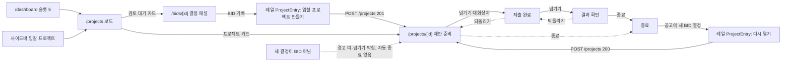

# 디자인 스펙: 입찰 프로젝트 (`/projects`, `/projects/[id]`, 공고 상세 들어가기, 대시보드 슬롯 5, 사이드바)

[N6 스펙](../../polaris/specs/done/2026-10-21-n6-bid-projects.md) §4 "화면 상세는 web-designer 스펙을 따른다"의 그 스펙이다. 구현자는 이 문서와 N6 스펙만 보고 화면을 짠다. 코드·정본·설정은 바꾸지 않았다. 고를 것은 §3(추천안 먼저), 문구는 §8(초안 표시는 사용자가 확정), 남은 질문은 §11 이다.

> [!warning] 미검증 가정
> 코드·문서·기존 스크린샷만 읽고 썼다. dev 서버·브라우저는 띄우지 않았다. 폭은 `AppPage`(`lg:px-8`)·사이드바(펼침 256px, 접음 64px)·상세 격자(`minmax(0,1fr)_320px`, `gap-6`)·대시보드 카드 격자(`@4xl:grid-cols-5 gap-4`)로 계산했다. 서버(`web/server/projects`·`/api/v1/projects`)는 이 작업 폴더에 아직 없다. §4.0 의 데이터 꼴은 **화면이 필요로 하는 값의 제안**이고, 서버 구현과 맞춰 이름을 바꿀 수 있다(뜻은 바꾸지 않는다).

## 0. 범위

| 넣는다 | 넣지 않는다 |
|---|---|
| `/projects` 보드 5열(검토 대기 → 제안 준비 → 제출 완료 → 결과 확인 → 종료, M14) | 드래그로 상태 바꾸기, 드래그 라이브러리, 새 패키지 |
| `/projects/[id]` 상세: 머리·경고 띠·진행 상태(한 칸 앞·한 칸 뒤·종료, 메모 선택)·체크리스트·상태 이력·프로젝트 정보(담당자·제출 마감)·결과 기록·관련 기록 | 상세 안의 "다시 열기" 버튼(다시 열기는 공고 상세에서만, M12 ③) |
| `/bids/[id]` 오른쪽 레일에 새 부품 `ProjectEntry` 하나(만들기·보기·다시 열기) | `DecisionPanel`·`HeaderActions` 변경. 결정 기록 흐름 변경 |
| 대시보드 슬롯 5 "진행 중 프로젝트"(누르면 `/projects`) | 결과 집계(낙찰 건수·비율 등 어떤 형태든) |
| 사이드바 `/projects` 준비 중 → 출시 | 묶음·아이콘 변경 |
| 상태: 로딩·빈·실패·없음(404)·미출시(404)·권한별(읽기 전용)·경고(최신 결정 BID 아님·공고 정정됨·공고 취소됨)·긴 글자·많은 카드 | 확률·승률·"수주 가능성"·예측 수치와 문구(ADR-007). 모바일·1280 미만 레이아웃. 결제 |
| 1440·1280 두 폭 | 템플릿 `/{slug}/tasks` 화면 변경(§11 질문 7 로만 남긴다) |

## 1. 기준

| 무엇 | 근거 |
|---|---|
| 요구 | N6 스펙 §1~§6(상태 4개·전이·권한·오류 코드·"이 스펙이 정한 것" 1~7), 사이드바 설계 §2.2 `/projects` 행, §2.3 슬롯 5, §2.4 권한 표(조회 전원·생성·관리 SALES·ADMIN·결과 기록 SALES·ADMIN), M9·M11·M12·M13·M14, D3·D4·D12 |
| 정본 | 06 §1(폭)·§3.1(의미색)·§3.2(상태 표기)·§3.3(앱 틀 눈금, 대시보드 +3px 예외 B25)·§4·§4.1(사이드바·준비 중)·§5.1(공통 상태)·§5.3(대시보드)·§5.5(공고 상세 권한 문구)·§9(부품)·§10(접근성)·§12(증거 이름). 09 RBAC P1 행·"수주확률 표현 금지" |
| 견본 코드 | 공고 상세 `web/app/(app)/(work)/bids/[id]/bid-detail-view.tsx`(머리 `DetailEyebrow`·`SummaryLines`, `CHIP`·`TEXT_LINK`, 격자·레일 `data-slot="bid-detail-rail"`, 분석 띠 `rounded-lg border border-border p-4`, 요청 실패 상자), `web/components/bids/decision-panel.tsx`(레일 `Card`·`FieldSet`·`RadioGroup`·잠금 사유 글자·`role="alert"` 오류 상자), 공고 목록 `bids/`(`max-w-360`), 대시보드 `dashboard/dashboard-view.tsx`(`StatCard` 다섯 칸), 템플릿 작업 `web/app/(app)/[slug]/tasks/`(`TaskFormDialog`·`DueDate`·`TASK_STATUS_DISPLAY`·`useOptimistic`·삭제 확인 대화상자·`canDelete`), 업무 오류 `work-error.tsx`, 사이드바 `web/components/app-nav.ts`·`app-shell.tsx` |
| 부품 | `web/components/ui/`: button·card·dialog·dropdown-menu·field·input·label·radio-group·select·separator·skeleton·table·textarea·tooltip. `StatusBadge`·`DemoBadge`(`bids/status-badge.tsx`), `dDay`·`formatKst`·`formatKstShort`(`bids/format.ts`), `RECOMMENDATION_LABEL`(`bids/labels.ts`), `AppPage`, `StatCard`, `WorkError` |
| 토큰 | `design/tokens.json`. 앱 틀 눈금 `type-title`·`type-heading`·`type-body`·`type-label`·`type-caption` 만. 대시보드 카드는 `data-type-scale="dashboard"` 안이라 +3px |
| 데모 데이터 | 19 §1 seed: FX-01 BID(sales@soltech.invalid), FX-03 NO-BID, 사전 분석 18건(FX-02 제외). 프로젝트 seed 는 없다 |

## 2. 흐름



- 읽기: 보드·상세는 서버 컴포넌트가 `@/server/projects` 서비스를 배럴로 직접 읽는다(06 §11). 요청마다 `requireWork(next)` 뒤 읽고, `now`(ISO)를 한 번 만들어 내린다(D-n 기준, 하이드레이션 차이 없음).
- 쓰기: 상태·담당자·제출 마감은 `PATCH /api/v1/projects/:id`, 결과는 `POST /api/v1/projects/:id/result`, 만들기·다시 열기는 `POST /api/v1/projects`. 모두 `X-Requested-With: sol-radar` 를 붙인다. 성공하면 `router.refresh()`(만들기·다시 열기는 `router.push("/projects/<id>")`). 체크리스트는 템플릿 작업 server action 에 `bidProjectId` 를 더해 쓴다(N6 스펙 §2).
- 조직은 서버가 정한다. 화면은 조직 ID 를 요청에 싣지 않는다(M17).

## 3. 결정 (추천안 먼저)

| # | 무엇 | 추천 | 다른 안 |
|---|---|---|---|
| U1 | VIEWER·ANALYST 의 쓰기 동작 | **보이지 않는다.** 값은 글자로 보이고, "진행 상태" 구역의 버튼 자리에 한 줄 안내 "입찰 프로젝트는 ADMIN·SALES 역할만 바꿀 수 있습니다. 지금 역할: {역할}"을 둔다. 이유: 쓰기 지점이 7곳(상태·담당자·제출 마감 2·체크리스트 3·결과)이라 모두 비활성으로 두면 회색 단추·상자가 화면을 덮고, 비활성 체크 상자·선택 칸은 초점을 받지 않아 낭독기 사용자에게 이유가 닿지 않는다. 템플릿 작업 화면의 `canDelete` 숨김과 같은 방식이다. 서버가 403·RLS 로 막는다(숨김은 권한이 아니다) | 비활성 + 사유 글자(공고 상세 `DecisionPanel` 방식). 한 폼짜리 패널에는 맞지만 이 화면에는 사유 글자가 7번 반복된다 |
| U2 | 보드 폭 | **5칸 같은 폭(`grid-cols-5 gap-3`), 보드 가로 스크롤 없음.** 칸 폭 1440 214px·1280 182px(§4.1.3). 카드 글자는 세로로 쌓아 182px 에 맞춘다 | 칸 240px 고정 + 보드 안 가로 스크롤. 1280 에서 마지막 칸이 화면 밖이라 "종료"가 안 보이고, 가로 스크롤 키보드 조작이 따로 필요하다 |
| U3 | 칸에 카드가 많을 때 | **칸마다 6장까지 보이고 나머지는 칸 맨 아래 `<details>` "나머지 {n}건"** 안에 같은 모양으로 둔다(클라이언트 상태 없음, 분석 이력·P08 후보와 같은 접기). 데모 직후 검토 대기는 16건(사전 분석 18 − 결정 2)이다 | ① 전부 펼침: 검토 대기 칸만 2,000px 가까이 길어진다. ② `/bids?decision=NONE` 링크: 그 목록은 미분석 공고도 포함해 칸 숫자와 다르다 |
| U4 | 검토 대기 카드 모양 | **점선 테두리(`border-dashed`)** + 권고 배지. 아직 프로젝트가 아니라 저장된 것이 없다는 뜻을 모양으로도 보인다(P08 연결 후보의 점선과 같은 뜻). 칸 머리 아래 "결정 전 공고" 한 줄이 뜻을 진다 | 프로젝트 카드와 같은 실선 |
| U5 | 상태 바꾸기 | **버튼 → 확인 대화상자 하나**(`StatusChangeDialog`, 바뀌는 단계·메모(선택)·확인). 앞으로·뒤로·종료 모두 같은 대화상자다. 상태 변경은 프로젝트당 몇 번뿐이고 모두 감사 기록에 남아 확인 한 번이 잘못 누름을 막는다 | ① 버튼 옆 메모 칸 인라인: 진행 상태 구역이 늘 무겁다. ② 상태 메뉴(템플릿 작업 방식): 막힌 전이를 메뉴 안에서 설명하기 어렵다 |
| U6 | 버튼 위계 | **앞으로 한 칸 = `default`(화면에 하나)**, 뒤로·종료 = `outline`, 종료는 줄 오른쪽 끝(`ml-auto`). `AWAITING_RESULT` 의 앞으로 한 칸은 종료라 [종료]가 `default` 다. 앞으로가 막히면 `default` 단추가 화면에 없다(0개는 규칙 안이다) | 종료를 `destructive`: 지우는 동작이 아니고, 다시 열 길이 있다 |
| U7 | 체크리스트 추가·편집 | **템플릿 `TaskFormDialog` 재사용**. 선택 prop 두 개를 더한다: `bidProjectId`(저장 action 에 넘김), `copy`(제목·설명·토스트 낱말을 "항목"으로). 템플릿 화면은 기본값 그대로다. 제목·설명·상태·담당자·마감일 칸, 검증, 오류 처리가 그대로 온다 | 목록 아래 한 줄 입력(제목만) + 편집은 대화상자. 빠르지만 같은 검증을 두 곳에 둔다 |
| U8 | 완료 토글 | **네이티브 `<input type="checkbox">` + `accent-primary size-4`**. 새 부품 없이 키보드(Space)·낭독(체크됨)이 맞다. 체크 = `done`, 해제 = `todo`. `in_progress` 행(템플릿 화면에서 바꾼 것)은 해제 상태 + 제목 옆 "진행 중" 글자 | ① shadcn `checkbox` 추가(새 부품, 승인 필요, 지금 한 곳에서만 쓴다). ② 템플릿 상태 메뉴: 체크리스트에 3값 메뉴는 과하다 |
| U9 | 담당자 바꾸기 | **선택 즉시 저장**(`Select` `onValueChange` → `PATCH {ownerId}`). 실패하면 앞 값으로 돌리고 토스트. 담당자 변경은 감사 대상이 아니다(N6 스펙 §5-1) | 선택 + [저장] 버튼 |
| U10 | 제출 마감 바꾸기·결과 기록 | **각각 대화상자.** 레일은 값만 보이고, [바꾸기]·[결과 기록]이 대화상자를 연다. 되돌리기(덮어쓰기 지우기)는 대화상자 없이 바로 한다(되돌린 뒤 다시 바꿀 수 있다) | 레일 인라인 폼: 320px 레일에 라디오 4개·메모·날짜 칸이 늘 보여 레일이 길어진다 |
| U11 | 결과 색 | **중립 칩(`border-border`·`text-foreground`), 상태 색을 쓰지 않는다.** 결과는 기록이고 경고가 아니다. 미낙찰을 빨강으로 칠하면 점수·권고와 같은 판정처럼 읽힌다 | 낙찰 success·미낙찰 destructive |
| U12 | "결과는 점수와 무관" 안내 | **넣는다.** 결과 카드 제목 아래와 결과 대화상자 설명에 고정 한 줄(§8 C40). D4 가 화면에 보이는 유일한 자리다 | 넣지 않는다(정책 문서에만) |
| U13 | 경고 범위 | **열린 프로젝트에만**(종료 뒤에는 띠·배지 없음). 종료 뒤 결정·정정은 진행을 막지 않는다. 공고 취소는 열린 프로젝트에서 안내 띠 | 늘 보인다: 종료 칸 카드마다 배지가 남아 소음이 된다 |
| U14 | 공고 상세의 들어가기 자리 | **레일 맨 위, `DecisionPanel` 바로 위에 슬롯 prop 하나**(`projectEntry?: React.ReactNode`, page 가 `<ProjectEntry …/>` 를 만들어 넘긴다). `bid-detail-view.tsx` 추가 4줄(§4.3.1). 해당 없으면 `null` 이라 레일이 지금과 같다. 결정 패널 아래면 1440×900 에서 레일 안쪽 스크롤 밖(결정 패널만 약 700px)이라 BID 기록 직후 보이지 않는다 | ① `DecisionPanel` 아래: 줄 수는 같지만 안 보인다. ② `HeaderActions` 안: 93·54 가 고치는 함수이고 화면의 `default` 단추 규칙과 얽힌다 |
| U15 | 대시보드 카드를 링크로 | **`StatCard` 에 선택 prop `href` 하나**(있으면 카드 전체가 `Link`). 다른 네 카드는 그대로(링크 아님). §9.5 제안 | dashboard-view 에서 `Link` 로 감싸기: 초점·hover 클래스를 화면마다 다시 적는다 |
| U16 | 종료된 프로젝트에서 바꿀 수 있는 것 | **상태만 막는다.** 담당자·제출 마감·체크리스트·결과는 그대로 바꿀 수 있다(서버 규칙과 같다. 결과는 종료 뒤에 기록하는 일이 흔하다) | 결과만 열고 나머지 잠금: 서버에 없는 규칙이 화면에만 생긴다 |
| U17 | 검토 대기의 공고 출처(`origin`) | **대시보드와 같은 기본 출처**(`defaultOrigin(runMode)`). 칸 숫자 = 대시보드 "검토 대기" 카드 숫자. 프로젝트 칸은 출처로 거르지 않는다 | 모든 출처: 대시보드 숫자와 갈라진다 |
| U18 | 칸 안 순서 | 검토 대기·제안 준비·제출 완료·결과 확인: **마감 가까운 순**(실효 마감, 지난 마감·마감 없음은 맨 뒤, 같으면 제목 가나다). 종료: **종료 최근 순**. 서버 모델의 순수 함수로 정하고 화면은 받은 순서대로 그린다 | 만든 순 |
| U19 | 카드의 `DEMO` 배지 | **붙인다**(`DemoBadge dense`). 06 §8 "행 단위 배지는 `isDemo=true` 레코드에 붙는다". 카드 맨 아래 배지 줄 첫 자리 | 붙이지 않는다(P08 은 같은 공고 안 목록이라 뺐지만 보드는 여러 공고다) |

## 4. 화면 명세

### 4.0 화면이 필요로 하는 값 (제안 — 서버 구현과 맞춘다)

```ts
// web/server/projects 의 화면용 꼴(제안). 이름은 서버 구현이 정하고, 뜻은 아래와 같다.
type ProjectStatus = "PREPARING" | "SUBMITTED" | "AWAITING_RESULT" | "CLOSED";
type ProjectResult = "WON" | "LOST" | "CANCELLED" | "NOT_SUBMITTED";

type PendingBidCard = {           // 검토 대기 칸(저장 안 함, 대시보드 카드 2 와 같은 정의)
  bidId: string; title: string; agency: string | null; deadlineAt: string | null;
  recommendation: Recommendation | null; bidStatus: BidStatus; isDemo: boolean;
};
type ProjectCard = {
  id: string; bidId: string; title: string; agency: string | null; isDemo: boolean;
  status: ProjectStatus;
  effectiveDueAt: string | null;   // submission_due_override ?? 공고 deadline_at
  dueOverridden: boolean;
  owner: { id: string; name: string } | null;
  checklist: { done: number; total: number };
  warnings: {
    latestDecision: Recommendation | null; // 최신 결정이 BID 가 아니면 그 값, BID 면 null
    bidAmended: boolean;                   // 여는 결정의 revision ≠ 공고 최신 revision
    bidCancelled: boolean;                 // 공고 status = CANCELLED
  };
  result: ProjectResult | null; closedAt: string | null;
};
type ProjectBoard = { pending: PendingBidCard[]; projects: ProjectCard[] };

type ProjectDetail = ProjectCard & {
  bid: { id: string; noticeId: string; deadlineAt: string | null; latestRevision: number };
  submissionDueOverride: string | null;
  resultNote: string | null; resultRecordedAt: string | null;
  openedBy: { reviewId: string; reviewer: string; decidedAt: string; revision: number;
              analysis: { finishedAt: string; solScore: number | null; recommendation: Recommendation | null;
                          algorithmVersion: string; inputSnapshotHash: string | null } | null };
  latestDecision: { decision: Recommendation; reviewer: string; decidedAt: string };
  events: { id: string; actor: string | null; from: ProjectStatus | null; to: ProjectStatus;
            note: string | null; createdAt: string }[];   // 새것부터
  checklist: TaskView[];           // 템플릿 TaskView(만든 순), canDelete 포함
  canManage: boolean;              // sol_role ∈ {ADMIN, SALES}
  reopenAvailable: boolean;        // CLOSED 이고 최신 결정이 closedAt 뒤의 BID
};
```

- 화면은 계산하지 않는다: 실효 마감·경고 세 개·`reopenAvailable`·칸 순서는 서버 모델이 정한다(시험하기 쉽고 보드·상세·대시보드가 같은 값을 쓴다).
- `warnings.latestDecision` 은 값 자체를 싣는다. 화면 글자 "최신 결정 WATCH"에 그대로 쓴다.

### 4.1 `/projects` 보드

파일(제안): `web/app/(app)/(work)/projects/page.tsx`·`loading.tsx`·`error.tsx`·`project-board.tsx`, 문구·라벨은 `web/components/projects/project-copy.ts`(§8, 공고 상세 들어가기와 대시보드도 쓴다).

#### 4.1.1 틀

- `AppPage` `title="입찰 프로젝트"` `description=C2` `contentClassName="max-w-360"`(공고 목록과 같은 단 폭). `actions` 없음(만들기는 공고 상세에서만).
- 프로젝트가 0건이면 제목 아래, 보드 위에 안내 상자 한 개(§4.1.5). 보드는 늘 5칸을 그린다(흐름을 보여 주는 틀이라 빈 상태에서도 칸을 숨기지 않는다).
- 보드: `<div data-slot="project-board" class="grid grid-cols-5 items-start gap-3">`. 칸은 DOM 순서 = 보이는 순서(검토 대기 → … → 종료).

#### 4.1.2 칸

```tsx
<section data-slot="board-column" data-column="PENDING|PREPARING|SUBMITTED|AWAITING_RESULT|CLOSED"
         aria-labelledby="board-col-{column}" class="flex min-w-0 flex-col gap-2">
  <div class="flex min-w-0 flex-col gap-0.5 border-b border-border pb-2">
    <h2 id="board-col-{column}" class="flex items-baseline gap-1.5 type-heading text-foreground">
      {칸 이름} <span class="type-label font-normal tabular-nums text-muted-foreground">{n}<span class="sr-only">건</span></span>
    </h2>
    {column === "PENDING" && <p class="type-caption text-muted-foreground">{C4}</p>}
  </div>
  <ul class="flex flex-col gap-2">{앞 6장}</ul>
  {n > 6 && <details data-slot="board-column-more" class="group">
     <summary class="… type-label text-muted-foreground">{C6(n-6)} <span aria-hidden class="group-open:rotate-180">▾</span></summary>
     <ul class="mt-2 flex flex-col gap-2">{나머지}</ul>
  </details>}
  {n === 0 && <p data-slot="board-column-empty" class="rounded-lg border border-dashed border-border px-3 py-4 text-center type-caption text-muted-foreground">{C5 또는 C3}</p>}
</section>
```

- 칸 바탕은 흰색 그대로다(면 색으로 칸을 나누지 않는다). 칸 머리 밑줄과 칸 사이 간격이 나눈다.
- 칸 이름은 고정(§8 C10~C14). 숫자는 그 칸의 전체 건수(접힌 것 포함)다.
- `summary` 는 버튼이 아니라 네이티브 `details` 의 요약이다. 펼친 뒤에도 같은 글자다(접으면 다시 숨는다).

#### 4.1.3 카드

공통 상자(`li`): `relative flex min-w-0 flex-col gap-1.5 rounded-lg border border-border bg-card p-3 shadow-xs has-[a:focus-visible]:ring-3 has-[a:focus-visible]:ring-ring/50`. 검토 대기 카드만 `border-dashed`(U4). hover 때 바탕을 칠하지 않고 제목에 밑줄만 긋는다(`group` + `group-hover:underline`). 상태 색 글자가 연한 바탕 위로 가지 않게 한다(tokens `$comment`).

카드 전체가 눌리도록 제목 링크를 늘린다: `<Link class="outline-none after:absolute after:inset-0 after:rounded-lg">`. 링크 이름 = 제목 글자(다른 글자는 링크 밖 형제 요소라 이름에 섞이지 않는다).

| 줄 | 프로젝트 카드(`data-kind="project"`) | 검토 대기 카드(`data-kind="pending"`) |
|---|---|---|
| 1 제목 | `Link /projects/{id}`. `type-body font-medium text-foreground line-clamp-3 wrap-anywhere` | `Link /bids/{bidId}`. 같은 모양 |
| 2 기관 | `type-caption text-muted-foreground truncate`, `title`=전체. 없으면 줄 없음 | 같다 |
| 3 마감 | 상태별(아래). `type-caption tabular-nums` | `마감 {D-n}`(공고 마감). 지난 마감 `마감 지남`, 없으면 `마감 —` |
| 4 담당 | `담당 {이름}` / `담당 없음`(`text-muted-foreground`). `truncate` | 없음 |
| 5 체크리스트 | `체크리스트 {done}/{total}` / `체크리스트 없음`(total 0) | 없음 |
| 6 배지 줄 | `flex flex-wrap gap-1`: `DemoBadge dense`(isDemo) → 경고 배지(열린 상태만, U13) → 결과 칩(결과가 있으면 어느 칸이든) | `DemoBadge dense` → `StatusBadge kind="recommendation"`(권고가 있으면) → `StatusBadge kind="bidStatus"`(취소만 그린다) |

프로젝트 카드 3줄(마감)의 상태별 글자:

| 상태 | 글자 | 색 |
|---|---|---|
| `PREPARING` | `제출 마감 {D-n}`(`dDay`: `D-12`·`D-Day`) / 지났으면 `제출 마감 지남` / 없으면 `제출 마감 —`. 덮어썼으면 뒤에 ` · 직접 정함` | 지남만 `text-destructive`(준비 중인데 마감이 지난 것은 실제 문제다), 나머지 `text-foreground` |
| `SUBMITTED`·`AWAITING_RESULT` | `제출 마감 {11. 6.}`(`formatKstShort`) / 없으면 `제출 마감 —` | `text-muted-foreground` |
| `CLOSED` | `종료 {10. 30.}`(`closedAt`), 결과가 없으면 같은 줄 뒤에 ` · 결과 미기록` | `text-muted-foreground` |

경고 배지(열린 상태만): 상자 `inline-flex h-5 items-center gap-1 rounded-sm border border-border bg-background px-1.5 type-caption`(=`StatusBadge` 의 `BADGE_BOX`), 아이콘 `size-3.5` `aria-hidden`.

| `data-warning` | 아이콘 | 글자 | 색 |
|---|---|---|---|
| `latest-decision-not-bid` | `TriangleAlertIcon` | `최신 결정 {WATCH\|NO-BID}`(C20) | `text-warning` |
| `bid-amended` | `TriangleAlertIcon` | `공고 정정됨`(C21) | `text-warning` |
| `bid-cancelled` | `BanIcon` | `공고 취소됨`(C22) | `text-muted-foreground` |

결과 칩(U11): 같은 상자, 아이콘 없음, `text-foreground`, 글자 §8 C30~C33. 낭독 앞말 `<span class="sr-only">결과 </span>`.

폭(`max-w-360` 단, `grid-cols-5 gap-3`):

| 화면 폭 | 사이드바 | 단 폭 | 칸 폭 | 카드 안쪽 |
|---|---|---|---|---|
| 1440 | 펼침 256 | 1120 | 214.4 | 190.4 |
| 1280 | 펼침 256 | 960 | 182.4 | 158.4 |
| 1280 | 접음 64 | 1152 | 220.8 | 196.8 |

- 158px 에 가장 긴 고정 글자 `최신 결정 NO-BID` 배지(아이콘 포함 약 130px)·`제출 마감 지남 · 직접 정함`(12px 약 140px)이 한 줄에 든다. 배지 줄은 `flex-wrap` 이라 둘 이상이면 다음 줄로 간다. 제목은 3줄, 기관은 1줄 말줄임이다.
- 1440·1280 사이에 바뀌는 것은 칸 폭뿐이다. 칸 수·카드 줄 구성은 같다.

#### 4.1.4 배치 그림 (1440, 데모 직후 FX-01 프로젝트를 연 상태)

```text
입찰 프로젝트
BID 결정 이후 제안 준비부터 결과 기록까지 진행 상황을 봅니다.
┌ 검토 대기 16 ─────┐ ┌ 제안 준비 1 ──────┐ ┌ 제출 완료 0 ──┐ ┌ 결과 확인 0 ──┐ ┌ 종료 0 ───────┐
│ 결정 전 공고       │ │                   │ │               │ │               │ │               │
│┌┄┄┄┄┄┄┄┄┄┄┄┄┄┄┄┄┐│ │┌─────────────────┐│ │┌┄┄┄┄┄┄┄┄┄┄┄┄┐│ │┌┄┄┄┄┄┄┄┄┄┄┄┄┐│ │┌┄┄┄┄┄┄┄┄┄┄┄┄┐│
│┆경기도교육청 통합 ┆│ ││세종특별자치시   ││ │┆프로젝트 없음┆│ │┆프로젝트 없음┆│ │┆프로젝트 없음┆│
│┆LMS 구축 (가상)   ┆│ ││차세대 행정정보… ││ │└┄┄┄┄┄┄┄┄┄┄┄┄┘│ │└┄┄┄┄┄┄┄┄┄┄┄┄┘│ │└┄┄┄┄┄┄┄┄┄┄┄┄┘│
│┆경기도교육청      ┆│ ││세종특별자치시   ││ │               │ │               │ │               │
│┆마감 D-10        ┆│ ││제출 마감 D-21   ││ │               │ │               │ │               │
│┆[DEMO] [◎ WATCH] ┆│ ││담당 이영업      ││ │               │ │               │ │               │
│└┄┄┄┄┄┄┄┄┄┄┄┄┄┄┄┄┘│ ││체크리스트 없음  ││ │               │ │               │ │               │
│ … (5장 더)        │ ││[DEMO]           ││ │               │ │               │ │               │
│ 나머지 10건 ▾     │ │└─────────────────┘│ │               │ │               │ │               │
└───────────────────┘ └───────────────────┘ └───────────────┘ └───────────────┘ └───────────────┘
```

(검토 대기 카드는 점선, 프로젝트 카드는 실선. "체크리스트 없음"은 total 0 일 때의 글자다.)

#### 4.1.5 빈 보드 안내

프로젝트가 0건(열린·종료 모두)일 때만, 보드 위에 `div data-slot="board-empty-note"` `flex items-center justify-between gap-4 rounded-lg border border-border p-4`: 왼쪽 `FolderKanbanIcon`(`text-muted-foreground`, `aria-hidden`) + `type-body` C7, 오른쪽 `Link /bids` `outline` `size="sm"` C8. 검토 대기 카드가 있어도 보인다(데모 직후 상태). 화면의 `default` 단추는 없다.

### 4.2 `/projects/[id]` 상세

파일(제안): `web/app/(app)/(work)/projects/[id]/page.tsx`·`loading.tsx`·`error.tsx`·`not-found.tsx`·`project-detail-view.tsx`·`status-change-dialog.tsx`·`due-dialog.tsx`·`result-dialog.tsx`·`project-checklist.tsx`.

#### 4.2.1 틀

- `AppPage contentClassName="max-w-360"`, 격자 `grid grid-cols-[minmax(0,1fr)_320px] items-start gap-6`(공고 상세와 같다). 주 영역 폭 1440 776·1280 616, 레일 320 고정. 레일은 `sticky` 가 아니다(레일이 주 영역보다 길 수 있다).
- 머리:
  - `eyebrow`: `← 입찰 프로젝트`(`Link /projects`, 공고 상세 `DetailEyebrow` 의 뒤로 링크와 같은 모양) 아래 줄에 `DemoBadge withTooltip`(isDemo) + 상태 칩(`CHIP` 모양, C10~C14 글자) + 결과 칩(있으면, U11).
  - `title`: 공고 제목(h1, `wrap-anywhere` 는 `AppPage` 가 한다).
  - `description`: `발주기관 {agency} · 공고번호 <font-mono>{noticeId}</font-mono> · 제출 마감 {formatKst} ({D-n})`. 제출 마감이 없으면 `제출 마감 —`.
  - `actions`: `Link /bids/{bidId}` `outline` C50 `공고 보기`(아이콘 `FileTextIcon`). 이 화면의 `default` 단추는 진행 상태 구역의 앞으로 단추다(U6).
- 메타데이터 제목은 고정 `입찰 프로젝트 상세`(공고 상세의 `공고 상세`와 같은 방식). 위 막대 화면 이름은 `입찰 프로젝트`(사이드바 출시 뒤 `screenLabelOf` 가 `/projects/…` 를 같은 메뉴로 본다).
- 경고 띠(§4.2.2)는 머리 아래, 격자 위에 전체 폭으로 쌓는다.

정보 위계(DOM 순서 = Tab 순서):

1. 머리 → 2. 경고 띠(있으면) → 3. 주 영역: 진행 상태 → 체크리스트 → 상태 이력 → 4. 레일: 프로젝트 정보 → 결과 → 관련 기록.

#### 4.2.2 경고 띠 (열린 프로젝트만, U13)

상자 `div data-slot="project-warning" data-warning="…"` `flex items-start gap-2 rounded-lg border p-3`. 처음 그릴 때 낭독을 끼어들지 않게 `role` 을 달지 않는다(화면 첫 내용이다). 여러 개면 아래 순서로 `flex-col gap-2`.

| 순서 | `data-warning` | 언제 | 테두리·아이콘 | 글자 | 링크 |
|---|---|---|---|---|---|
| 1 | `latest-decision-not-bid` | `warnings.latestDecision !== null` | `border-warning`, `TriangleAlertIcon text-warning` | 굵게 C23(`최신 결정이 {값}입니다`) + `type-caption text-muted-foreground` `{결정자} · {formatKst(decidedAt)}` / 본문 C24 | `공고 상세에서 결정 보기` → `/bids/{bidId}`(`TEXT_LINK` 밑줄) |
| 2 | `bid-amended` | `warnings.bidAmended` | `border-warning`, `TriangleAlertIcon text-warning` | 굵게 C25 + 본문 C26(`revision {openedBy.revision} → {bid.latestRevision}`) | `정정된 공고 보기` → `/bids/{bidId}` |
| 3 | `bid-cancelled` | `warnings.bidCancelled` | `border-border`, `BanIcon text-muted-foreground` | 굵게 C27 + 본문 C28 | 없음 |

- 띠 글자는 `type-body text-foreground`(굵은 줄은 `font-semibold`). 상태 색은 테두리·아이콘에만 쓴다.
- 자동 종료하지 않는다(M12 ①). 띠에 "종료" 단추를 따로 두지 않는다. 진행 상태 구역의 [종료]가 그대로 있다.

#### 4.2.3 진행 상태 (주 영역 첫 구역)

`section data-slot="project-status" aria-labelledby="project-status-title"` `flex flex-col gap-4 rounded-lg border border-border p-4`(공고 상세 분석 띠와 같은 상자).

- `h2 id="project-status-title" tabIndex={-1}` `type-heading` `진행 상태`(상태가 바뀐 뒤 초점을 받는다).
- 단계 표시 `ol data-slot="project-stepper" aria-label="진행 단계"` `flex items-center gap-2`. 단계 4개(`검토 대기`는 넣지 않는다, 저장 상태가 아니다). 단계 사이 `li aria-hidden` 선 `h-px flex-1 bg-border`.

| 단계 모양 | 언제 | 아이콘(16px, `aria-hidden`) | 글자 |
|---|---|---|---|
| 지금 | `status` 와 같다. `aria-current="step"` | `CircleDotIcon text-brand`(선택 표시, tokens `brand` 쓰임) | `type-label font-semibold text-foreground` |
| 지난 | 열린 상태에서 지금보다 앞(열린 상태는 한 칸씩만 오가므로 앞 단계는 반드시 거쳤다) | `CircleCheckIcon text-foreground` | `type-label text-foreground` + `sr-only` `, 지난 단계` |
| 남음 | 그 밖. **`CLOSED` 일 때 종료 앞 세 단계도 여기다**(바로 종료했을 수 있어 거친 단계를 알 수 없다) | `CircleIcon text-muted-foreground` | `type-label text-muted-foreground` |

- 동작 줄 `div data-slot="project-status-actions" class="flex flex-wrap items-center gap-2"` — `canManage` 일 때만:

| 상태 | 앞으로(`default`) | 뒤로(`outline`) | 종료(`outline`, `ml-auto`) |
|---|---|---|---|
| `PREPARING` | `제출 완료로 넘기기`(C51) | 없음 | `종료`(C54) |
| `SUBMITTED` | `결과 확인으로 넘기기`(C52) | `제안 준비로 되돌리기`(C55) | `종료` |
| `AWAITING_RESULT` | `종료`(앞으로 한 칸이 종료, 결정 검사 없음) | `제출 완료로 되돌리기`(C56) | 없음(앞으로 단추가 종료다) |
| `CLOSED` | 없음 | 없음 | 없음 |

- 앞으로가 막힘(`PREPARING`·`SUBMITTED` 이고 `warnings.latestDecision !== null`): 앞으로 단추 `disabled` + `aria-describedby="project-forward-blocked"`, 동작 줄 아래 `p id="project-forward-blocked" class="type-label text-warning"` C57. 비활성 단추는 초점을 받지 않아 이유를 보이는 글자로 둔다(공고 상세 §5.4.10 과 같다). 뒤로·종료는 그대로 누를 수 있다.
- `canManage=false`: 동작 줄 대신 `p data-slot="project-readonly-note" class="flex items-center gap-1.5 type-label text-muted-foreground"` + `LockIcon`(`aria-hidden`) + C58. 이 화면에서 이 안내는 여기 한 곳뿐이다(U1).
- `CLOSED`: 동작 줄 대신 `p data-slot="project-closed-note"`:
  - `reopenAvailable && canManage`: C59 + `Link /bids/{bidId}` `outline size="sm"` C60.
  - `!reopenAvailable && canManage`: C61 + 문장 링크 `공고 상세로`(`TEXT_LINK`).
  - `!canManage`: C62 한 줄(다시 열기 안내 없음).

#### 4.2.4 상태 바꾸기 대화상자 (`StatusChangeDialog`, U5)

| 칸 | 내용 |
|---|---|
| 열기 | 진행 상태의 단추 셋이 같은 대화상자를 `{from, to, kind: "forward"\|"back"\|"close"}` 로 연다. `aria-haspopup="dialog"` |
| 제목 `DialogTitle` | forward `'{to}' 단계로 넘길까요?` / back `'{to}' 단계로 되돌릴까요?` / close `입찰 프로젝트를 종료할까요?`(C63~C65) |
| 설명 `DialogDescription` | `{from} → {to}` 한 줄(화살표 `aria-hidden`, `sr-only` `{from}에서 {to}로`) + C66. close 는 C67 을 더한다 |
| 메모 | `Field` + `Label htmlFor="status-note"` `메모 (선택)` + `Textarea id="status-note" class="min-h-20"` + 글자 수 `{n} / 1000`(`aria-describedby`). 비워도 된다. 1000자 넘으면 `FieldError` C68(최대 길이는 §11 질문 3) |
| 단추 | `DialogFooter`: `DialogClose` `outline` `취소` · 확인 `default` forward `넘기기`·back `되돌리기`·close `종료`. 보내는 중 확인 단추 `disabled` + `LoaderCircleIcon animate-spin motion-reduce:animate-none` + `바꾸는 중…`, 대화상자는 닫히지 않는다(템플릿 작업 대화상자와 같다) |
| 첫 초점 | 메모 칸 |
| 성공 | 닫힘 → `toast` C69~C71 → `router.refresh()` → 초점 `#project-status-title`(누른 단추가 사라지거나 바뀌므로) |
| 취소·Esc | 닫힘, 초점은 연 단추 |
| 실패 | 대화상자 안 `div role="alert" class="rounded-lg border border-destructive p-3 type-label text-destructive"`(공고 상세 요청 실패 상자와 같다). 글자는 §8 오류 표. 409 `LATEST_DECISION_NOT_BID`·409 `INVALID_PROJECT_TRANSITION`·404 는 안내 뒤 `router.refresh()` 하고 확인 단추를 끈다(다시 눌러도 같은 결과다). 400 메모 길이는 메모 칸 `FieldError`. 그 밖은 코드 · `requestId`(`font-mono type-caption`) |

#### 4.2.5 체크리스트

`section data-slot="checklist" aria-labelledby="checklist-title"` `flex flex-col gap-3 border-t border-border pt-6`.

- 머리 줄 `flex items-center justify-between gap-3`: `h2 id="checklist-title" tabIndex={-1}` `type-heading` `체크리스트` + `span type-label font-normal text-muted-foreground tabular-nums` `{done}/{total} 완료`(total 0 이면 숨김). 오른쪽 `canManage` 일 때 `Button outline size="sm"` `PlusIcon` C80 `항목 추가`(`aria-haspopup="dialog"`).
- 표 `Table className="table-fixed"` `aria-labelledby="checklist-title"`, 감싸개 `rounded-lg border border-border`. 만든 순(오래된 것 위)이고 완료를 눌러도 줄 자리가 바뀌지 않는다(초점이 튀지 않는다).

| 열 | 폭 | `canManage` | 읽기 전용 |
|---|---|---|---|
| 완료 | `w-10` | `<input type="checkbox" class="size-4 accent-primary" aria-labelledby="item-title-{id}">`, `checked = status === "done"` | 완료면 `CircleCheckIcon text-success` + `sr-only` `완료`, 아니면 `CircleIcon text-muted-foreground` + `sr-only` `{할 일\|진행 중}` |
| 항목 | 남는 폭(1440 약 548·1280 약 388) | `span id="item-title-{id}"` 제목 `type-body wrap-anywhere`(완료면 `text-muted-foreground`), `in_progress` 면 뒤에 `type-caption text-muted-foreground` ` · 진행 중`. 설명이 있으면 아래 줄 `type-caption text-muted-foreground truncate` | 같다 |
| 담당자 | `w-24` | `type-label truncate`, 없으면 `—`(`sr-only` 없음) | 같다 |
| 마감일 | `w-24` | 템플릿 `DueDate`(지남·오늘 글자 포함) | 같다 |
| 동작 | `w-12` | `DropdownMenuTrigger` `Button ghost size="icon-sm"` `MoreHorizontalIcon`, `aria-label` C81. 항목 `편집`(`PencilIcon`) → `TaskFormDialog` 편집, `canDelete` 면 `삭제`(`Trash2Icon`, `variant="destructive"`) → 삭제 확인 | 열 없음 |

- 토글: 템플릿 `changeStatus` action(+ `bidProjectId` 경로), `useOptimistic` 으로 바로 바꾸고 실패하면 되돌린 뒤 `toast.error`(템플릿 `STATUS_FAILURE` 문구를 "항목"으로, §8). 성공 토스트는 띄우지 않는다(체크가 결과를 보인다. 연달아 누르면 토스트가 쌓인다).
- 추가·편집: `TaskFormDialog`(U7) `copy` = §8 C82~C86, `bidProjectId={project.id}`, `members` = 조직 멤버(담당자 선택). 열 때 대화상자 제목 `체크리스트 항목 추가`/`체크리스트 항목 편집`.
- 삭제: 확인 대화상자 제목 C87, 설명 C88, [취소] `outline` · [삭제] `destructive`. 성공 → `toast` C89, 초점 `#checklist-title`.
- 빈 상태(total 0): 표 대신 `p data-slot="checklist-empty" class="rounded-lg border border-dashed border-border px-4 py-6 text-center type-body text-muted-foreground"` C90. 다음 행동은 머리의 [항목 추가]가 맡는다(같은 단추를 두 번 두지 않는다).
- 1280(주 영역 616)과 1440(776)에서 열 구성은 같다. 항목 열 폭만 다르다.

#### 4.2.6 상태 이력

`section data-slot="project-events" aria-labelledby="events-title"` `flex flex-col gap-3 border-t border-border pt-6`. `h2 id="events-title"` `상태 이력` + `type-label text-muted-foreground` `{n}건`.

`ol class="flex flex-col divide-y divide-border"`, 새것부터 전부(쪽 나눔 없음, 프로젝트당 수가 작다). 줄 `li class="flex flex-col gap-1 py-3"`:

- 첫 줄 `type-body text-foreground`:
  - 열기(`from === null`): C91 `프로젝트를 열었습니다` + ` · 제안 준비`.
  - 다시 열기(`from === "CLOSED"`): C92 `다시 열었습니다` + ` · 종료 → 제안 준비`.
  - 그 밖: `<span aria-hidden>{from} → {to}</span><span class="sr-only">{from}에서 {to}로</span>`.
- 둘째 줄 `type-caption text-muted-foreground`: `{actor ?? C93} · <time dateTime title="UTC …">{formatKst}</time>`.
- 메모가 있으면 셋째 줄 `type-body whitespace-pre-wrap wrap-anywhere text-foreground`(1000자까지 전부 보인다. 말줄임 없음).
- 결과 기록은 이 목록에 없다(결과는 `bid_project_events` 가 아니라 감사 기록에만 남는다, N6 스펙 §1). 결과 카드가 지금 값을 보인다.

#### 4.2.7 레일 ① 프로젝트 정보

`Card` 를 `section data-slot="project-info" aria-labelledby="info-title"` 로 그린다(레일 감싸개는 `div`, 공고 상세 레일과 같다. 레일 카드마다 `aside` 를 달지 않는다). `Card` 안 `dl class="grid grid-cols-[auto_minmax(0,1fr)] gap-x-4 gap-y-3"`, `dt type-label text-muted-foreground`, `dd type-body text-foreground min-w-0`.

| `dt` | `dd` (`canManage`) | `dd` (읽기 전용) |
|---|---|---|
| 담당자 | `Select`(트리거 `id="project-owner" class="w-full"`, `aria-labelledby` 로 `dt` 를 잇는다). 항목: `담당자 없음`(C100) + 조직 멤버 이름. 바꾸면 바로 저장(U9): 보내는 동안 `disabled` + `aria-busy`, 성공 `toast` C101/C102, 실패 앞 값으로 + `toast.error`(§8) | `{이름}` / `담당자 없음`(`text-muted-foreground`) |
| 공고 마감 | `{formatKst(bid.deadlineAt)} ({D-n})` / 없으면 C103 `공고에 마감이 없습니다` | 같다 |
| 제출 마감 | `{formatKst(effectiveDueAt)} ({D-n})` + 아래 `type-caption text-muted-foreground` 덮어썼으면 C104 `직접 정함`, 아니면 C105 `공고 마감과 같음`. 그 아래 `flex gap-1`: `Button ghost size="sm"` C106 `바꾸기`(대화상자, §4.2.8) + 덮어썼으면 `Button ghost size="sm"` C107 `공고 마감으로 되돌리기`(바로 `PATCH {submissionDueOverride: null}` → `toast` C108) | 값과 캡션만 |
| 연 날 | `{formatKst(첫 열기 event.createdAt)} · {actor}` | 같다 |

- 제목 `h2 id="info-title"` `type-heading` `프로젝트 정보`.
- 담당자 선택 항목은 로그인 계정(조직 멤버십)이다. 200명 명부는 넣지 않는다(D12).

#### 4.2.8 제출 마감 대화상자 (`DueDialog`)

- 제목 C110 `제출 마감 바꾸기`, 설명 C111(공고 마감은 바뀌지 않는다는 한 줄 + `공고 마감 {formatKst}`).
- `Label htmlFor="due-at"` `제출 마감 (한국 시각)` + `Input id="due-at" type="datetime-local" step="60"`, 처음 값 = 지금 실효 마감(KST). 서버가 KST → UTC 로 바꾼다(형식은 §11 질문 2).
- 비우거나 형식이 아니면 `FieldError` C112. 지난 시각도 받는다(실제 제출 시각을 적는 경우).
- [취소] `outline` · [저장] `default`(대화상자 안 주 단추). 성공 → 닫힘 → `toast` C113 → `router.refresh()` → 초점 [바꾸기]. 실패는 §4.2.4 와 같은 상자.

#### 4.2.9 레일 ② 결과 (U10·U11·U12)

`Card` `section data-slot="project-result" aria-labelledby="result-title"`:

- `h2 id="result-title"` `결과` + 바로 아래 `p data-slot="result-disclaimer" class="type-caption text-muted-foreground"` C40(고정 문구 후보, 늘 보인다).
- 지금 값: 결과가 있으면 결과 칩(U11) + `type-caption text-muted-foreground` `기록 {formatKst(resultRecordedAt)}` + 메모 `type-body whitespace-pre-wrap wrap-anywhere`. 없으면 `type-body text-muted-foreground` C41 `아직 기록하지 않았습니다`.
- `canManage`: `Button outline className="w-full"` 결과 없으면 C42 `결과 기록`, 있으면 C43 `결과 고치기`(`aria-haspopup="dialog"`).

결과 대화상자(`ResultDialog`):

- 제목 C44(`결과 기록`), 설명 C40 + C45(`어느 단계에서나 기록할 수 있고 상태는 바뀌지 않습니다`).
- `FieldSet` + `FieldLegend` `결과` + `RadioGroup aria-label="결과"`, 항목 4개(C30~C33, 순서 낙찰·미낙찰·공고 취소·미제출), 처음 값 = 지금 결과(없으면 고르지 않음).
- 메모 `Textarea` `메모 (선택)` + `{n} / 1000`.
- 고르지 않고 저장 → `FieldError` C46, 초점 첫 라디오(공고 상세 `onInvalid` 와 같다).
- [취소] · [저장] `default`. 성공 → `toast` C47 → refresh → 초점 결과 단추. 실패는 §4.2.4 상자.

#### 4.2.10 레일 ③ 관련 기록

`Card` `section data-slot="project-links" aria-labelledby="links-title"`, `h2` `관련 기록`, 같은 `dl` 꼴:

| `dt` | `dd` |
|---|---|
| 공고 | `Link /bids/{bidId}` 공고 제목(`TEXT_LINK` + `underline decoration-muted-foreground`, `line-clamp-2 wrap-anywhere`). 이 카드의 유일한 링크다(같은 주소로 가는 링크를 여럿 두지 않는다) |
| 연 결정 | `StatusBadge kind="decision" value="BID" variant="inline"` + ` · {reviewer} · {formatKst(decidedAt)} · revision {n}` |
| 그 결정의 분석 | `{formatKst(finishedAt)} · 권고 {RECOMMENDATION_LABEL} · SOL Score {n} · {algorithmVersion}`, 입력 기록 해시가 있으면 아래 `font-mono type-caption text-muted-foreground` `입력 {앞 12자}`(`title`=전체). 결정에 분석이 없으면 `—` |
| 최신 결정 | `StatusBadge kind="decision"` + ` · {reviewer} · {formatKst}`. BID 가 아니면 앞에 `TriangleAlertIcon text-warning`(`aria-hidden`) — 뜻은 경고 띠가 진다 |

- 점수(`SOL Score 94`)는 결정 당시의 기록 값이다. 확률·비율로 바꿔 쓰지 않는다.

#### 4.2.11 배치 그림 (1440, SALES, `SUBMITTED`, 최신 결정 WATCH)

```text
← 입찰 프로젝트
[DEMO] [제출 완료]
세종특별자치시 차세대 행정정보시스템 고도화 (가상)                              [공고 보기]
발주기관 세종특별자치시 · 공고번호 DEMO-2026-0001 · 제출 마감 2026-11-10 18:00 (D-20)
┌⚠ 최신 결정이 WATCH입니다  이영업 · 2026-10-22 09:10 ─────────────────────────────────────────┐
│  다음 단계로 넘길 수 없습니다. 되돌리거나 종료할 수 있습니다.  공고 상세에서 결정 보기           │
└──────────────────────────────────────────────────────────────────────────────────────────────┘
┌ 진행 상태 ─────────────────────────────────────────┐  ┌ 프로젝트 정보 ──────────────────┐
│ ✓ 제안 준비 ── ◉ 제출 완료 ── ○ 결과 확인 ── ○ 종료 │  │ 담당자   [이영업          ▾]   │
│ [결과 확인으로 넘기기](비활성) [제안 준비로 되돌리기]  [종료] │  │ 공고 마감 2026-11-10 18:00 (D-20)│
│ 최신 결정이 WATCH라 다음 단계로 넘길 수 없습니다.     │  │ 제출 마감 2026-11-10 18:00 (D-20)│
└─────────────────────────────────────────────────────┘  │          공고 마감과 같음       │
체크리스트 2/5 완료                        [+ 항목 추가]  │          [바꾸기]               │
┌──┬───────────────────────────────┬────────┬────────┬──┐│ 연 날    2026-10-21 10:12 · 이영업│
│☑ │ 제안서 초안 작성               │ 이영업 │ 10. 28.│⋯ │└────────────────────────────────┘
│☐ │ 기술 인력 투입 계획 · 진행 중   │ 김분석 │ 10. 30.│⋯ │┌ 결과 ───────────────────────────┐
└──┴───────────────────────────────┴────────┴────────┴──┘│ 결과는 기록용입니다. …          │
상태 이력 2건                                             │ 아직 기록하지 않았습니다         │
제안 준비 → 제출 완료                                     │ [결과 기록]                     │
이영업 · 2026-10-25 16:40                                 └────────────────────────────────┘
조달청 전자입찰로 제출. 접수증은 공유 폴더.               ┌ 관련 기록 ─────────────────────┐
프로젝트를 열었습니다 · 제안 준비                          │ 공고  세종특별자치시 차세대 …   │
이영업 · 2026-10-21 10:12                                 │ 연 결정  BID · 이영업 · …       │
                                                          └────────────────────────────────┘
```

1280: 주 영역 616px. 진행 상태 단추 셋(약 150 + 150 + 56px + 간격)이 한 줄에 든다. 머리의 [공고 보기]는 제목이 길면 `AppPage` 의 `flex-wrap` 으로 제목 아래로 내려간다. 레일은 320 그대로다.

### 4.3 `/bids/[id]` 들어가기 (`ProjectEntry`)

#### 4.3.1 자리 — `bid-detail-view.tsx` 4줄 (U14)

```tsx
type BidDetailViewProps = {
  // … 그대로
  /** 입찰 프로젝트 들어가기(N6). page 가 만든다. 해당 없으면 null·undefined 라 레일이 지금과 같다. */
  projectEntry?: React.ReactNode;
};
// 구조 분해에 projectEntry 한 줄
<div data-slot="bid-detail-rail" className="sticky top-18 …">   {/* 그대로 */}
  {projectEntry}                                                  {/* 이 줄만 더한다 */}
  <DecisionPanel … />                                             {/* 그대로 */}
</div>
```

- 레일 `className` 을 바꾸지 않는다. 간격은 `ProjectEntry` 뿌리의 `mb-4` 가 맡는다.
- `bids/[id]/page.tsx` 가 기존 `Promise.all` 에 "이 공고의 프로젝트"(`{id, status, closedAt, result} | null`) 읽기를 더하고, `bid.reviews` 의 최신 결정·`canManageProject(work.role)`·공고 취소 여부와 함께 상태(아래 표)를 정해 `<ProjectEntry view={…} />` 를 넘긴다. 프로젝트 읽기가 실패하면 `console.error` 한 줄(`{"event":"bid_detail_project_failed","bidId":…}`) 뒤 `projectEntry` 를 넘기지 않는다(상세의 나머지는 그대로).
- 사이드바 출시 전(경로 404 기간)에는 page 가 `projectEntry` 를 넘기지 않는다(없는 화면으로 가는 링크를 두지 않는다).
- 결정을 기록하면 화면이 이미 `router.refresh()` 하므로 들어가기도 새 결정으로 다시 그려진다. `bid-detail-view` 의 결정 기록 흐름은 바꾸지 않는다.
- `[id]/loading.tsx` 의 레일 skeleton 은 바꾸지 않는다(해당 공고에서만 읽은 뒤 약 110px 내려간다. §11 질문 6).

#### 4.3.2 부품 꼴과 상태

파일 `web/components/projects/project-entry.tsx`(`"use client"`). 뿌리 `section data-slot="project-entry" data-state="…" aria-labelledby="project-entry-title"` = `Card size="sm" className="mb-4 min-w-0 gap-3"`. 안쪽 `px-(--card-spacing)`, 안쪽 폭 288px.

| `data-state` | 언제 | 보이는 것 |
|---|---|---|
| (그리지 않음) | 프로젝트 없음 + 최신 결정이 BID 아님·결정 없음 / 프로젝트 없음 + 최신 BID + 쓰기 권한 없음 / 프로젝트 없음 + 공고 취소(§11 질문 4) | 아무것도 없다(`null`) |
| `create` | 프로젝트 없음 + 최신 결정 BID + `canManage` + 공고 취소 아님 | `h2 type-heading` C120 `입찰 프로젝트` / `type-body text-muted-foreground` C121 / `Button outline className="w-full"` `PlusIcon` C122 `입찰 프로젝트 만들기` |
| `open` | 열린 프로젝트 있음(역할 무관) | 제목 줄 `flex justify-between`: h2 + 상태 칩 / 최신 결정이 BID 아니면 `type-label text-warning` `TriangleAlertIcon` C123 / `Link /projects/{id}` `cn(buttonVariants({variant:"outline"}), "w-full")` C124 `입찰 프로젝트 보기` |
| `closed` | 종료 프로젝트 + 종료 뒤 BID 결정 없음(또는 쓰기 권한 없음) | 제목 줄: h2 + `종료` 칩 + 결과 칩(있으면) / `canManage` 면 `type-caption text-muted-foreground` C125 / 링크 C124 |
| `reopen` | 종료 프로젝트 + 최신 결정이 `closedAt` 뒤의 BID + `canManage` | 제목 줄: h2 + `종료` 칩 / `type-body text-muted-foreground` C126 / `Button outline className="w-full"` `RotateCcwIcon` C127 `다시 열기` / 아래 문장 링크 C128 `지난 기록 보기` → `/projects/{id}` |

- 이 부품에 `default` 단추를 두지 않는다. 공고 상세의 `default` 는 [분석 실행] 또는 [결정 기록] 하나다(06 §5.5, ADR-033 E9).
- 만들기·다시 열기: `POST /api/v1/projects {reviewId: 최신 결정 id}` + `X-Requested-With`. 보내는 동안 단추 `disabled` + `LoaderCircleIcon` + C129 `만드는 중…`/C130 `여는 중…`.

| 응답 | 화면 |
|---|---|
| 201 | `toast` C131 → `router.push("/projects/{id}")` |
| 200(다시 연 프로젝트) | `toast` C132 → `router.push` |
| 409 `PROJECT_ALREADY_OPEN` `{projectId}` | `toast` C133 → `router.push("/projects/{projectId}")` |
| 409 `PROJECT_REQUIRES_BID_DECISION` | 단추 아래 `role="alert"` 상자 C134 → `router.refresh()` |
| 403 | 상자 C135 |
| 404 | 상자 C136 → `router.refresh()` |
| 401 | 상자 C137 |
| 그 밖·네트워크 | 상자 C138 + `font-mono type-caption` `{code} · {requestId}` |

#### 4.3.3 배치 그림 (레일 320, `create`)

```text
┌ 입찰 프로젝트 ──────────────────────┐
│ BID 결정이 기록된 공고입니다.        │
│ 제안 준비를 시작하려면 프로젝트를     │
│ 만드세요.                           │
│ [ + 입찰 프로젝트 만들기          ]  │
└─────────────────────────────────────┘
┌ 참여 판단 ──────────────────────────┐   ← DecisionPanel 그대로
│ 권고 ◎ BID …                         │
```

### 4.4 대시보드 슬롯 5

- `SummaryCards` 의 다섯째 `StatCard`(지금 "분석 현황")를 바꾼다. N9 의 `dashboard-card-slots.ts` 가 main 에 들어오면 그 슬롯 정의 한 줄로 옮긴다(설계 §2.3 "슬롯 정의 한 줄과 DTO 필드 하나"). 아래는 지금 `StatCard` 기준이다.

| prop | 값 |
|---|---|
| `label` | C140 `진행 중 프로젝트`(U-대안은 §11 질문 8) |
| `value` | `String(summary.projects.open)` — `bid_projects.status <> 'CLOSED'` 수. 출처 필터와 무관(U17 의 프로젝트 칸과 같다) |
| `hint` | 0 이면 C141 `진행 중인 프로젝트가 없습니다`, 아니면 C142 `보드에서 보기` |
| `href`(새 선택 prop, U15) | `/projects` |

- `href` 가 있으면 `StatCard` 가 `Card` 를 `Link` 로 그린다: `Link className="group/stat rounded-xl outline-none focus-visible:ring-3 focus-visible:ring-ring/50"` 안에 같은 `Card`, hover 때 `Card` 테두리 `group-hover/stat:border-foreground/20`(바탕은 칠하지 않는다). 링크 이름 = 카드 글자 전부(`진행 중 프로젝트 2 보드에서 보기`). `aria-label` 을 따로 달지 않는다(보이는 이름 그대로, WCAG 2.5.3).
- 글자는 대시보드 범위 변형 +3px(label 16·title 33·caption 15) 그대로다. 카드 안쪽 폭은 1440 179px·1280 147px(펼침). C140 은 16px 에서 약 125px 라 1280 에서도 한 줄이다. 설계 이름 "진행 중 입찰 프로젝트"(약 155px)는 1280 에서 두 줄로 꺾여 다른 카드와 숫자 높이가 어긋난다.
- 다른 네 카드는 바꾸지 않는다(링크 아님).
- N6 이 freeze 까지 green 이 아니면 슬롯 5 는 "분석 현황" 그대로다(ADR-042 조건 3).

### 4.5 사이드바 — 준비 중 → 출시

`web/components/app-nav.ts` 의 한 줄 `status: "planned"` → `"released"`(아이콘 `FolderKanbanIcon`, 이름 `입찰 프로젝트`, `roles` 없음 — 전원). 이 한 줄로 바뀌는 것:

| 무엇 | 준비 중(지금) | 출시 뒤 |
|---|---|---|
| 항목 | `span` 글자 + 오른쪽 `준비 중`(`type-caption`), `text-muted-foreground`, 초점 안 받음, `data-planned` | `Link href="/projects"`, `aria-label="입찰 프로젝트"`, 글자 `sidebar-foreground`, 초점 받음, `준비 중` 글자 없음 |
| 지금 화면 표시 | 없음 | `/projects`·`/projects/{id}` 에서 `aria-current="page"` + `sidebar-accent` 바탕 + 왼쪽 3px `brand` 막대 |
| 묶음 "입찰 관리" | 접힘 상태 기억대로 | `/projects…` 로 들어오면 항상 펼침(`currentNavGroupId`) |
| 접은 상태(64px) 툴팁 | `입찰 프로젝트 (준비 중)` | `입찰 프로젝트` |
| 위 막대 화면 이름 | (경로 404) | `입찰 프로젝트`(`screenLabelOf`, 상세도 같다) |

- 출시 표시는 메뉴 편의다. 경로를 여는 것은 서버의 출시 검사(404 → 화면)이고, 둘을 같은 커밋에서 바꾼다(설계 §2.1 "메뉴 노출과 라우트 접근은 따로").
- 시험 영향: `app-nav.test.ts` 의 `["/projects", "FolderKanban", "planned"]`, `app-shell.browser.test.tsx` 의 준비 중 목록·`[data-planned] svg` 개수 4. N3·N5·N7 도 같은 줄을 바꾸므로 병합 순서대로 숫자를 맞춘다.
- 06 §4.1 표의 "해커톤 노출" 칸 `준비 중 (P1 N6 …)` → `예` 는 정본 담당(45)이 출시 커밋 뒤 고친다.

## 5. 상태표

### 5.1 `/projects` 보드

| 상태 | 언제 | 보이는 것 | 사용자가 할 수 있는 것 |
|---|---|---|---|
| 미출시 | 출시 검사 전 | 404(not-found) | — |
| 로딩 | 읽는 중 | `loading.tsx`: 같은 제목·설명 + 5칸(머리 skeleton `h-6 w-24` + 카드 skeleton `h-28` 2장씩), `role="status"` `sr-only` `입찰 프로젝트를 불러오는 중…`, `motion-reduce:animate-none` | — |
| 실패 | 서비스 오류 | `error.tsx` = `WorkError title="입찰 프로젝트" contentClassName="max-w-360"`(불러오지 못했습니다·메시지·오류 ID·[다시 시도]) | 다시 시도 |
| 빈 보드 | 프로젝트 0 + 검토 대기 0 | 빈 보드 안내(§4.1.5) + 5칸 모두 빈 칸 글자 | [입찰 공고 보기] |
| 프로젝트 없음 | 프로젝트 0 + 검토 대기 ≥1(데모 직후) | 안내 + 검토 대기 카드 + 나머지 4칸 빈 칸 | 검토 대기 카드 → 공고 상세, [입찰 공고 보기] |
| 정상 | 프로젝트 ≥1 | 안내 없음, 카드 | 카드 → 상세·공고 상세 |
| 칸 넘침 | 칸 카드 > 6 | 6장 + `나머지 {n}건 ▾` | 펼치기·접기(Enter·Space) |
| 경고 카드 | 열린 프로젝트에 경고 | 배지 줄에 경고 배지(최신 결정 …·공고 정정됨·공고 취소됨) | 카드 → 상세 |
| 마감 지남 | `PREPARING` + 실효 마감 지남 | `제출 마감 지남`(`text-destructive`) | — |
| 종료 카드 | `CLOSED` | `종료 {날짜}`(+ ` · 결과 미기록`), 결과 칩, 경고 배지 없음 | 카드 → 상세 |
| 권한별 | VIEWER·ANALYST·SALES·ADMIN | 모두 같다(보드에 쓰기 동작이 없다) | 같다 |
| 긴 글자 | 띄어쓰기 없는 200자 제목, 긴 기관·담당자 이름 | 제목 3줄 말줄임(링크 이름은 전체), 기관·담당 1줄 말줄임 + `title` | — |

### 5.2 `/projects/[id]` 상세

| 상태 | 언제 | 보이는 것 | 사용자가 할 수 있는 것 |
|---|---|---|---|
| 미출시 | 출시 검사 전 | 404 | — |
| 없음 | 주소가 uuid 아님·없음·다른 조직 | `not-found.tsx`: `AppPage title="입찰 프로젝트를 찾을 수 없습니다"`(C150) `description="주소가 맞는지 확인하세요."`(C151) + `Link /projects` `outline` C152 | 보드로 |
| 로딩 | 읽는 중 | `loading.tsx`: 공고 상세 로딩과 같은 틀(머리 skeleton + `minmax(0,1fr)_320px` 격자, 주 영역 상자 3개, 레일 카드 3개), `sr-only` `입찰 프로젝트를 불러오는 중…` | — |
| 실패 | 서비스 오류 | `WorkError title="입찰 프로젝트 상세"` | 다시 시도 |
| `PREPARING` (SALES·ADMIN) | 막힘 없음 | 단계 ◉제안 준비, [제출 완료로 넘기기](default)·[종료] | 넘기기·종료·체크리스트·담당·마감·결과 |
| `SUBMITTED` | 막힘 없음 | ✓제안 준비 ◉제출 완료, [결과 확인으로 넘기기]·[제안 준비로 되돌리기]·[종료] | 같다 + 되돌리기 |
| `AWAITING_RESULT` | — | ✓✓◉, [종료](default)·[제출 완료로 되돌리기] | 종료·되돌리기 |
| 앞으로 막힘 | `PREPARING`·`SUBMITTED` + 최신 결정 BID 아님 | 경고 띠 1 + 넘기기 단추 비활성 + C57 | 되돌리기·종료(자동 종료 없음) |
| 공고 정정됨 | 열린 상태 + `bidAmended` | 경고 띠 2(`revision a → b`) | 정정된 공고 보기 |
| 공고 취소됨 | 열린 상태 + `bidCancelled` | 경고 띠 3(결과 "공고 취소" 기록·종료 안내) | 결과 기록·종료 |
| `CLOSED`, 다시 열 수 있음 | `reopenAvailable` + SALES·ADMIN | 단계 ◉종료(앞 단계 회색), C59 + [공고 상세에서 다시 열기] | 공고 상세로, 결과·담당·마감·체크리스트(U16) |
| `CLOSED`, 다시 열 수 없음 | SALES·ADMIN | C61 + 공고 상세로 링크 | 같다(다시 열기 제외) |
| 읽기 전용 | VIEWER·ANALYST | 동작 줄 대신 C58, 담당·마감은 글자, 체크리스트 아이콘 + 동작 열 없음, [항목 추가]·[바꾸기]·[되돌리기]·[결과 기록] 없음. `CLOSED` 는 C62 만 | 읽기, 공고 보기 |
| 대화상자 보내는 중 | 확인 누름 | 확인 단추 `바꾸는 중…`·비활성, 닫히지 않음 | 기다림 |
| 대화상자 실패 | 409·403·404·400·401·그 밖 | 대화상자 안 오류 상자(§8 오류 표), 409·404 는 refresh 뒤 확인 단추 꺼짐 | 취소 |
| 체크리스트 비었음 | total 0 | 점선 상자 C90 (SALES·ADMIN 은 머리 [항목 추가]) | 항목 추가 |
| 체크 실패 | action 실패 | 체크 되돌림 + `toast.error` | 다시 누르기 |
| 담당자 저장 실패 | PATCH 실패 | 앞 값 + `toast.error` | 다시 고르기 |
| 이력 메모 없음 | `note=null` | 셋째 줄 없음 | — |
| 결정자·행위자 탈퇴 | 이름 없음 | C93 `조직을 떠난 사용자` | — |
| 많은 데이터 | 체크리스트 50·이력 30 | 전부 보인다(쪽 나눔 없음) | — |

### 5.3 공고 상세 들어가기 — §4.3.2 표가 상태표다. 더하는 것:

| 상태 | 언제 | 보이는 것 | 사용자가 할 수 있는 것 |
|---|---|---|---|
| 보내는 중 | 만들기·다시 열기 누름 | 단추 비활성 + 회전 아이콘 + `만드는 중…`/`여는 중…` | 기다림 |
| 프로젝트 읽기 실패 | page 의 읽기 실패 | 부품 없음(나머지 상세는 그대로) | — |
| 미출시 | 출시 검사 전 | 부품 없음 | — |

### 5.4 대시보드 슬롯 5

| 상태 | 언제 | 보이는 것 | 사용자가 할 수 있는 것 |
|---|---|---|---|
| 0건 | 열린 프로젝트 0 | `0` + `진행 중인 프로젝트가 없습니다` | 카드 → `/projects` |
| N건 | ≥1 | `N` + `보드에서 보기` | 카드 → `/projects` |
| 미출시 | N6 green 아님 | 슬롯 5 = 분석 현황(지금 그대로) | — |
| 대시보드 실패 | 요약 읽기 실패 | 기존 대시보드 `error.tsx` | 다시 시도 |

## 6. 데모·시험 데이터 (`pnpm demo:reset` + `pnpm demo:preanalyze` 뒤)

| 장면 | 준비 | 기대 |
|---|---|---|
| 들어가기 `create` | sales@soltech.invalid, FX-01 상세 | 레일 맨 위 "입찰 프로젝트 만들기"(seed 결정 BID) |
| 만들기 | 위에서 누름 | `/projects/{id}` 제안 준비, 이력 1건 "프로젝트를 열었습니다" |
| 보드 | `/projects` | 검토 대기 16(= 대시보드 검토 대기 카드), 제안 준비 1(FX-01), 나머지 0 |
| 앞으로 막힘 | FX-01 에 WATCH 결정을 새로 기록 | 상세 경고 띠 1·넘기기 비활성, 보드 카드 `최신 결정 WATCH`, 들어가기 `open` + C123 |
| 공고 정정됨 | FX-06 에 BID 결정 → 프로젝트 → S5 두 번째 배치(r2) 수집 | 경고 띠 2 `revision 1 → 2`, 카드 `공고 정정됨` |
| 다시 열기 | FX-01 종료 → 새 BID 결정 | 들어가기 `reopen` → [다시 열기] → 제안 준비, 이력 "다시 열었습니다" |
| 읽기 전용 | viewer@soltech.invalid, 같은 상세 | 쓰기 동작 0, C58 |
| FX-03 | NO-BID | 들어가기 없음, 보드 어느 칸에도 없음 |

FX-02 는 S4 에서 WATCH 를 기록하므로 데모 흐름 안에서는 들어가기가 생기지 않는다. 19 데모 시나리오에 N6 장면은 아직 없다(§11 질문 9).

## 7. 접근성 체크 항목

- [ ] 제목 구조: 보드 h1 `입찰 프로젝트` → 칸마다 h2(이름 + 건수). 상세 h1 공고 제목 → h2 `진행 상태`·`체크리스트`·`상태 이력` → 레일 h2 `프로젝트 정보`·`결과`·`관련 기록`. 공고 상세 레일 h2 `입찰 프로젝트`(들어가기) → h2 `참여 판단`(기존). h 단계 건너뜀 없음.
- [ ] 랜드마크: 새 랜드마크 없음. 모두 `AppPage` 의 `main#main-content` 안. 칸·구역은 `section aria-labelledby`.
- [ ] 보드 카드: 링크 이름 = 공고 제목(WCAG 2.5.3), 늘린 링크(`after:inset-0`)라 카드 어디를 눌러도 같은 곳. 초점 링은 카드 상자(`has-[a:focus-visible]:ring-3 ring-ring/50`). 카드 안에 다른 누를 것 없음.
- [ ] 보드 Tab 순서: 칸 1 위→아래(→ 그 칸 `summary`) → 칸 2 … 보이는 순서와 같다. `summary` 는 Enter·Space 로 펼친다(네이티브, `aria-expanded` 를 따로 달지 않는다). `▾` 는 `aria-hidden`.
- [ ] 단계 표시: `ol aria-label="진행 단계"`, 지금 단계 `aria-current="step"`, 지난 단계 `sr-only` `, 지난 단계`. 아이콘·선은 `aria-hidden`. 색(brand)만으로 지금 단계를 알리지 않는다(굵기 + `aria-current`).
- [ ] 비활성 넘기기 단추: `aria-describedby="project-forward-blocked"`, 이유는 보이는 글자.
- [ ] 대화상자 셋(상태·제출 마감·결과)·삭제 확인: 초점 가둠, Esc 닫기(보내는 중 제외), 첫 초점 첫 입력, 닫힌 뒤 초점(성공 = 구역 제목 `tabIndex=-1`, 취소 = 연 단추). `DialogTitle`·`DialogDescription` 연결. 높이 `100dvh` 안 + 안쪽 스크롤(기존 `dialog`).
- [ ] 입력 라벨: 메모 `Label htmlFor`, 글자 수 `aria-describedby`, 담당자 `Select` 트리거는 `dt` 로 이름(`aria-labelledby`), `datetime-local` 라벨, 결과 `RadioGroup aria-label="결과"` + `FieldLegend`. 오류는 `FieldError` + `aria-invalid`.
- [ ] 체크 상자: 네이티브 `checkbox`, 이름 = 항목 제목(`aria-labelledby`), Space 로 토글, 상태는 브라우저가 낭독. 읽기 전용 아이콘은 `sr-only` 상태 글자.
- [ ] 아이콘 단독 단추: 줄 메뉴 `aria-label` C81(항목 제목 포함). `aria-haspopup` 은 대화상자·메뉴를 여는 단추에.
- [ ] 상태 이력 화살표: 보이는 `→` 는 `aria-hidden`, `sr-only` `{from}에서 {to}로`.
- [ ] 상태 표기: 경고는 아이콘 + 글자 + 색(06 §1). 결과 칩은 글자만(색 없음). 마감 지남은 글자 `지남` 이 뜻을 진다.
- [ ] 결과·성공·실패 알림: `sonner` 토스트(낭독됨). 대화상자 안 오류 `role="alert"`. 페이지 첫 화면의 경고 띠는 `role` 없음(첫 내용이라 끼어들 필요가 없다).
- [ ] 대비 AA: 상태 색 글자는 흰 바탕 위에만(hover 바탕 칠 없음). `muted-foreground` #4E5968, `warning` #B45309(흰 바탕 약 5.0:1), `destructive` #A51926.
- [ ] 움직임: 회전 아이콘 `motion-reduce:animate-none`, skeleton 같음, `▾` 회전 전환 없음.
- [ ] 1280·1440 가로 넘침 없음(`document.documentElement.scrollWidth <= innerWidth`), axe 위반 0(보드·상세·공고 상세 FX-01·대시보드).

## 8. 문구 표

"고정"은 정본·사용자 결정에서 온 것이라 그대로 쓴다. "초안"은 사용자가 확정한다. 상수는 `web/components/projects/project-copy.ts` 에 두고 시험이 같은 값을 읽는다.

| # | 자리 | 문구 | 상태 |
|---|---|---|---|
| C1 | 보드 h1·메뉴 이름 | `입찰 프로젝트` | 고정(06 §4.1) |
| C2 | 보드 설명 | `BID 결정 이후 제안 준비부터 결과 기록까지 진행 상황을 봅니다.` | 초안 |
| C3 | 빈 칸(프로젝트 칸) | `프로젝트 없음` | 초안 |
| C4 | 검토 대기 칸 설명 | `결정 전 공고` | 초안 |
| C5 | 빈 칸(검토 대기) | `검토를 기다리는 공고가 없습니다` | 초안 |
| C6 | 칸 접기 요약 | `나머지 {n}건` | 초안 |
| C7 | 빈 보드 안내 | `아직 입찰 프로젝트가 없습니다. 공고에 BID 결정을 기록한 뒤 공고 상세에서 만듭니다.` | 초안 |
| C8 | 빈 보드 링크 | `입찰 공고 보기` | 초안 |
| C10~C14 | 칸·상태 이름 | `검토 대기` · `제안 준비` · `제출 완료` · `결과 확인` · `종료` | 고정(M14·04 §4) |
| C20 | 카드 경고 | `최신 결정 {WATCH\|NO-BID}` | 초안(값은 `RECOMMENDATION_LABEL`) |
| C21 | 카드 경고 | `공고 정정됨` | 고정(M12 ②) |
| C22 | 카드 경고 | `공고 취소됨` | 초안 |
| C23 | 띠 1 제목 | `최신 결정이 {값}입니다` | 초안 |
| C24 | 띠 1 본문 | `다음 단계로 넘길 수 없습니다. 이전 단계로 되돌리거나 종료할 수 있습니다.` | 초안("자동 종료하지 않는다"는 뜻은 고정, M12 ①) |
| C25 | 띠 2 제목 | `공고가 정정되었습니다` | 초안 |
| C26 | 띠 2 본문 | `프로젝트를 연 결정 뒤에 공고가 바뀌었습니다(revision {a} → {b}). 바뀐 내용을 확인하세요.` | 초안 |
| C27 | 띠 3 제목 | `이 공고는 취소되었습니다` | 초안(06 §5.5 취소 문구와 같은 낱말) |
| C28 | 띠 3 본문 | `결과를 '공고 취소'로 기록하고 프로젝트를 종료할 수 있습니다.` | 초안 |
| C30~C33 | 결과 이름 | `낙찰` · `미낙찰` · `공고 취소` · `미제출` | 초안(WON·LOST·CANCELLED·NOT_SUBMITTED. LOST 는 `탈락` 도 후보, §11 질문 10) |
| C40 | 결과 안내 | `결과는 기록용입니다. SOL Score·결정 모델·학습 데이터에 쓰지 않습니다.` | 초안(뜻은 고정, D4) |
| C41 | 결과 없음 | `아직 기록하지 않았습니다` | 초안 |
| C42 / C43 | 결과 단추 | `결과 기록` / `결과 고치기` | 초안 |
| C44 / C45 | 결과 대화상자 | 제목 `결과 기록` / 설명 덧말 `어느 단계에서나 기록할 수 있고 상태는 바뀌지 않습니다.` | 초안 |
| C46 / C47 | 결과 검증·성공 | `결과를 고르세요` / `결과를 기록했습니다` | 초안 |
| C50 | 상세 머리 링크 | `공고 보기` | 초안 |
| C51 / C52 | 넘기기 | `제출 완료로 넘기기` / `결과 확인으로 넘기기` | 초안 |
| C54 | 종료 | `종료` | 초안 |
| C55 / C56 | 되돌리기 | `제안 준비로 되돌리기` / `제출 완료로 되돌리기` | 초안 |
| C57 | 넘기기 막힘 | `최신 결정이 {값}이라 다음 단계로 넘길 수 없습니다.` | 초안 |
| C58 | 읽기 전용 | `입찰 프로젝트는 ADMIN·SALES 역할만 바꿀 수 있습니다. 지금 역할: {역할}` | 초안(06 §5.5 "ADMIN·SALES 역할만 결정할 수 있습니다"와 같은 꼴) |
| C59 / C60 | 종료·다시 열 수 있음 | `종료 뒤에 새 BID 결정이 기록되었습니다. 공고 상세에서 다시 열 수 있습니다.` / `공고 상세에서 다시 열기` | 초안 |
| C61 | 종료·다시 열 수 없음 | `종료된 프로젝트입니다. 다시 열려면 공고 상세에서 새로 BID 결정을 기록하세요.` | 초안(규칙은 고정, M12 ③) |
| C62 | 종료·읽기 전용 | `종료된 프로젝트입니다.` | 초안 |
| C63~C65 | 상태 대화상자 제목 | `'{to}' 단계로 넘길까요?` / `'{to}' 단계로 되돌릴까요?` / `입찰 프로젝트를 종료할까요?` | 초안 |
| C66 | 상태 대화상자 설명 | `바꾼 내용은 상태 이력에 남고 조직 구성원 모두 볼 수 있습니다.` | 초안 |
| C67 | 종료 설명 덧말 | `종료하면 이 화면에서 상태를 바꿀 수 없습니다. 다시 열려면 공고에 새로 BID 결정을 기록해야 합니다.` | 초안 |
| C68 | 메모 길이 | `메모는 1000자 이하입니다` | 초안(§11 질문 3) |
| C69~C71 | 상태 성공 | `'{to}' 단계로 넘겼습니다` / `'{to}' 단계로 되돌렸습니다` / `입찰 프로젝트를 종료했습니다` | 초안 |
| C80 | 체크리스트 추가 | `항목 추가` | 초안 |
| C81 | 줄 메뉴 이름 | `'{제목}' 항목 메뉴` | 초안 |
| C82~C86 | `TaskFormDialog` copy | 제목 `체크리스트 항목 추가`·`체크리스트 항목 편집`, 설명 `이 입찰 프로젝트의 체크리스트입니다. 조직 구성원 모두 볼 수 있습니다.`, 토스트 `항목을 추가했습니다`·`항목을 저장했습니다` | 초안 |
| C87 / C88 / C89 | 삭제 | `항목을 삭제할까요?` / `삭제한 항목은 되돌릴 수 없습니다.` / `항목을 삭제했습니다` | 초안 |
| C90 | 체크리스트 빈 상태 | `아직 체크리스트 항목이 없습니다` | 초안 |
| C91 / C92 | 이력 열기 | `프로젝트를 열었습니다` / `다시 열었습니다` | 초안 |
| C93 | 탈퇴 사용자 | `조직을 떠난 사용자` | 초안 |
| C100 | 담당 없음 | `담당자 없음` | 초안 |
| C101 / C102 | 담당 성공 | `담당자를 {이름}(으)로 바꿨습니다`(이름 끝 받침에 따라 `으로`·`로` 를 고른다) / `담당자를 비웠습니다` | 초안 |
| C103 | 공고 마감 없음 | `공고에 마감이 없습니다` | 초안 |
| C104 / C105 | 제출 마감 캡션 | `직접 정함` / `공고 마감과 같음` | 초안 |
| C106 / C107 / C108 | 제출 마감 동작 | `바꾸기` / `공고 마감으로 되돌리기` / `제출 마감을 공고 마감으로 되돌렸습니다` | 초안 |
| C110 / C111 | 제출 마감 대화상자 | `제출 마감 바꾸기` / `이 프로젝트의 제출 마감만 바뀝니다. 공고 마감 {시각}은 그대로입니다.` | 초안 |
| C112 / C113 | 제출 마감 검증·성공 | `날짜와 시각을 입력하세요` / `제출 마감을 바꿨습니다` | 초안 |
| C120 | 들어가기 제목 | `입찰 프로젝트` | 고정(C1) |
| C121 | `create` 본문 | `BID 결정이 기록된 공고입니다. 제안 준비를 시작하려면 프로젝트를 만드세요.` | 초안 |
| C122 | 만들기 | `입찰 프로젝트 만들기` | 고정(설계 §2.2) |
| C123 | `open` 경고 | `최신 결정이 BID가 아닙니다. 프로젝트에서 다음 단계로 넘길 수 없습니다.` | 초안 |
| C124 | 보기 | `입찰 프로젝트 보기` | 초안(N6 스펙 §4 낱말) |
| C125 | `closed` 캡션 | `다시 열려면 새로 BID 결정을 기록하세요.` | 초안 |
| C126 / C127 / C128 | `reopen` | `종료 뒤에 새 BID 결정이 있습니다.` / `다시 열기` / `지난 기록 보기` | 초안 |
| C129 / C130 | 보내는 중 | `만드는 중…` / `여는 중…` | 초안 |
| C131 / C132 / C133 | 만들기 결과 | `입찰 프로젝트를 만들었습니다` / `입찰 프로젝트를 다시 열었습니다` / `이미 열린 입찰 프로젝트가 있어 그 화면으로 갑니다` | 초안 |
| C134 | 409 결정 | `최신 결정이 BID가 아니어서 만들 수 없습니다. 화면을 새로 고칩니다.` | 초안 |
| C135 | 403 | `이 역할로는 입찰 프로젝트를 만들 수 없습니다` | 초안 |
| C136 | 404 | `공고나 결정을 찾을 수 없습니다. 화면을 새로 고칩니다.` | 초안 |
| C137 | 401 | `로그인이 풀렸습니다. 다시 로그인하세요.` | 템플릿 작업 화면과 같음 |
| C138 | 그 밖 | `입찰 프로젝트를 만들지 못했습니다` | 초안 |
| C140 | 대시보드 카드 이름 | `진행 중 프로젝트` | 초안(설계 이름 `진행 중 입찰 프로젝트`, §11 질문 8) |
| C141 / C142 | 대시보드 카드 아랫줄 | `진행 중인 프로젝트가 없습니다` / `보드에서 보기` | 초안 |
| C150~C152 | 상세 없음 | `입찰 프로젝트를 찾을 수 없습니다` / `주소가 맞는지 확인하세요.` / `입찰 프로젝트 보드로` | 초안(공고 상세 없음과 같은 꼴) |

**상세 쓰기 오류 표**(대화상자 상자·토스트 공통):

| 응답 | 문구 | 상태 |
|---|---|---|
| 409 `LATEST_DECISION_NOT_BID` | `최신 결정이 BID가 아니어서 다음 단계로 넘길 수 없습니다. 화면을 새로 고칩니다.` | 초안 |
| 409 `INVALID_PROJECT_TRANSITION` | `그사이 상태가 바뀌었습니다. 화면을 새로 고칩니다.` | 초안 |
| 403 `FORBIDDEN` | `이 역할로는 바꿀 수 없습니다` | 초안 |
| 404 | `입찰 프로젝트를 찾을 수 없습니다. 화면을 새로 고칩니다.` | 초안 |
| 400 `VALIDATION_ERROR`(담당자) | `이 조직 구성원이 아닙니다. 담당자를 다시 고르세요.` | 공고 상세 `이 조직 구성원이 아닙니다` 와 같은 꼴 |
| 401 | C137 | — |
| 그 밖·네트워크 | `{상태를 바꾸지\|저장하지\|결과를 기록하지} 못했습니다` + `{code} · {requestId}` | 초안 |
| 체크리스트 action | 템플릿 `STATUS_FAILURE`·`DELETE_FAILURE`·`DELETE_ERROR` 문구에서 `작업` → `항목`, `이 팀의 멤버` → `이 조직의 구성원` | 초안 |

**금지 글자.** 보드·상세·들어가기·대시보드 카드 어디에도 `확률`·`승률`·`가능성`·`수주`·`예측`·`%` 를 쓰지 않는다. 결과 건수·비율(낙찰 N건, 낙찰률 등)을 어떤 화면에도 두지 않는다.

## 9. 토큰·부품 매핑

### 9.1 색 (`design/tokens.json` 만, 새 색 없음)

| 쓰임 | 토큰 클래스 |
|---|---|
| 바탕 | `bg-background`·`bg-card` |
| 카드·칸 머리·표·구역 선 | `border-border`, `divide-border`. 검토 대기 카드·빈 칸·빈 체크리스트 `border-dashed` |
| 본문·제목 | `text-foreground` |
| 보조 글자·빈 상태·읽기 전용 안내·지난 마감 아닌 날짜 | `text-muted-foreground` |
| 경고(최신 결정·정정됨), 앞으로 막힘 글자 | `text-warning`, 띠 테두리 `border-warning` |
| 제출 마감 지남(제안 준비), 오류 상자 | `text-destructive`, `border-destructive` |
| 체크리스트 완료 아이콘(읽기 전용) | `text-success` |
| 지금 단계 아이콘 | `text-brand`(선택 표시) |
| 주요 단추 | `bg-primary`·`text-primary-foreground`(Button `default`), 체크 상자 `accent-primary` |
| 초점 | `ring-ring/50` |
| DEMO | `text-demo border-demo`(`DemoBadge` 그대로) |

`chart-2`·`kakao`·`naver`·`sidebar-*`(사이드바 밖) 는 쓰지 않는다. 연한 바탕 채움(`bg-warning/10` 등)을 쓰지 않는다. `dark:` 없음.

### 9.2 글자 (앱 틀 눈금만)

| 요소 | 눈금 |
|---|---|
| 보드·상세 h1 | `type-title`(AppPage) |
| 칸 이름·구역 제목·레일 카드 제목 | `type-heading` |
| 카드 제목·띠 본문·표 항목·이력 첫 줄·`dd` | `type-body` |
| 칸 건수·단계 글자·`dt`·안내 한 줄·`summary` | `type-label` |
| 카드 보조 줄·배지·날짜·캡션·해시 | `type-caption`(해시 `font-mono`) |
| 대시보드 카드 | `StatCard` 그대로(`data-type-scale="dashboard"` 안 +3px) |

한 요소에 `type-*` 둘을 겹치지 않는다. 숫자(D-n·건수·n/m)는 `tabular-nums`.

### 9.3 간격 (Tailwind 눈금)

보드 칸 사이 `gap-3`, 칸 안 카드 `gap-2`, 카드 `p-3` 줄 사이 `gap-1.5`, 칸 머리 `pb-2`. 상세 격자 `gap-6`, 주 영역 구역 `gap-6` + `border-t pt-6`, 진행 상태 상자 `p-4 gap-4`, 레일 카드 사이 `gap-4`, `dl` `gap-x-4 gap-y-3`. 경고 띠 `p-3 gap-2`. 들어가기 `mb-4`.

### 9.4 부품

| 부품 | 쓰임 |
|---|---|
| `AppPage` | 보드·상세·없음·오류 틀 |
| `Card`(`size="sm"` 포함) | 레일 카드 셋, 들어가기, `StatCard` |
| `Button`·`buttonVariants` | 단추·링크 단추(`cn(buttonVariants({variant:"outline"}), "w-full")`) |
| `Dialog` 일가 | 상태·제출 마감·결과·삭제 확인 |
| `Field`·`FieldSet`·`FieldLegend`·`FieldError`·`Label`·`Textarea`·`Input`(`datetime-local`) | 대화상자 폼 |
| `RadioGroup`·`RadioGroupItem` | 결과 고르기 |
| `Select` 일가 | 담당자 |
| `DropdownMenu` 일가 | 체크리스트 줄 메뉴 |
| `Table` 일가 | 체크리스트 |
| `Skeleton` | 로딩 |
| `toast`(sonner) | 성공·실패 알림 |
| `StatusBadge`(`recommendation`·`decision`·`bidStatus`), `DemoBadge` | 권고·결정·취소·DEMO |
| `TaskFormDialog`(+ `bidProjectId`·`copy`), `DueDate`, `changeStatus`·`removeTask` action | 체크리스트(템플릿 재사용) |
| `WorkError` | 보드·상세 `error.tsx` |
| `dDay`·`formatKst`·`formatKstShort`, `RECOMMENDATION_LABEL` | 날짜·권고 글자 |
| 네이티브 `details`·`summary`, `input[type=checkbox]` | 칸 접기, 완료 토글 |
| lucide(16px, 배지 안 14px) | `FolderKanban`·`ArrowLeft`·`FileText`·`TriangleAlert`·`Ban`·`CircleDot`·`CircleCheck`·`Circle`·`Lock`·`Plus`·`MoreHorizontal`·`Pencil`·`Trash2`·`RotateCcw`·`LoaderCircle` |

새 shadcn 부품·새 토큰·새 패키지 없음. 경고 배지·칩 상자 클래스는 `StatusBadge` 의 `BADGE_BOX`·상세의 `CHIP` 과 같은 글자를 `web/components/projects/` 안에 한 번 더 적는다(`labels.ts`·`status-badge.tsx` 는 다른 세션이 고치는 파일이라 피한다. 병합 뒤 정리 대상).

### 9.5 새로 필요한 것 (제안 — 승인 필요)

1. **`StatCard` 선택 prop `href`**(U15). 없으면 지금과 같다. 있으면 `Link` 로 감싸고 초점 링·hover 테두리. 기존 쓰임(대시보드 네 카드·템플릿 대시보드)은 바뀌지 않는다.
2. **`TaskFormDialog` 선택 prop `bidProjectId`·`copy`**(U7). 없으면 템플릿 화면 그대로다.
3. **`web/components/projects/`** 새 폴더: `project-copy.ts`(§8 상수, `PROJECT_STATUS_LABEL`·`PROJECT_RESULT_LABEL`), `project-entry.tsx`. 공고 상세(`bids/[id]/page.tsx`)와 대시보드가 같이 쓰므로 `app/(app)/(work)/projects/` 밖에 둔다.

## 10. 브라우저 시험이 단언할 항목

준비: 기존 `*.browser.test.tsx` 처럼 `createRoot` 로 그리고 `host.style.width` 를 둔다 — 보드 **960px**(1280 단)·**1120px**(1440 단), 상세 전체 960·1120, 들어가기 **320px**(레일). `next/link` 흉내는 나머지 속성을 넘긴다(`({ href, children, ...rest }) => <a href={href} {...rest}>{children}</a>`). `fetch`·`router` 는 흉내 낸다. `now` 는 고정 ISO.

### 10.1 보드 (`project-board.browser.test.tsx`)

| # | 입력 | 단언 |
|---|---|---|
| B1 | pending 2 + 각 상태 1 | `[data-slot="board-column"]` 5개, `data-column` 순서 `PENDING,PREPARING,SUBMITTED,AWAITING_RESULT,CLOSED`. h2 이름이 C10~C14 + 건수 |
| B2 | pending 카드 | `data-kind="pending"`, 링크 `href` 정확히 `/bids/{bidId}`, 상자 `border-style` `dashed`, 글자에 `마감 D-`·권고 글자 |
| B3 | PREPARING 카드(owner 있음, 3/7, 마감 12일 뒤) | `data-kind="project"`, 링크 `/projects/{id}`, 글자 `제출 마감 D-12`·`담당 {이름}`·`체크리스트 3/7` |
| B4 | PREPARING, 마감 지남 | `제출 마감 지남` 글자의 계산 색 = `--destructive` |
| B5 | PREPARING, override | 뒤에 ` · 직접 정함` |
| B6 | SUBMITTED | `제출 마감 {M. D.}`(D-n 아님) |
| B7 | CLOSED, result null | `종료 {M. D.} · 결과 미기록`, 경고 배지 0(warnings 가 있어도) |
| B8 | CLOSED, result WON | 결과 칩 `낙찰`, 칩 색이 `--foreground`(상태 색 아님) |
| B9 | 열린 카드 + 경고 셋 | `[data-warning]` 3개, 순서 latest·amended·cancelled, 글자 `최신 결정 WATCH`·`공고 정정됨`·`공고 취소됨` |
| B10 | 칸 카드 9장 | 보이는 `li` 6 + `details[data-slot="board-column-more"]` `open=false`, 요약 `나머지 3건`. 펼친 뒤 9장 보임. 칸 머리 건수 9 |
| B11 | 칸 0장 | `[data-slot="board-column-empty"]` 글자 C3(검토 대기는 C5) |
| B12 | projects 0 | `[data-slot="board-empty-note"]` 있음, 링크 `/bids` 글자 C8. projects 1 이면 없음 |
| B13 | 순서 | 서버가 준 순서 그대로(다시 정렬하지 않는다) |
| B14 | 넘침(960·1120) | 띄어쓰기 없는 200자 제목 + 40자 기관·담당: 보드·각 카드 `scrollWidth <= clientWidth`, 칸 폭 ≥ 180(960)·≥ 212(1120) |
| B15 | 금지 글자 | `host.textContent` 에 `확률`·`승률`·`가능성`·`수주`·`예측`·`%` 없음 |
| B16 | 접근성 | 모든 `a[href]` 가 `^/(projects\|bids)/[0-9a-f-]{36}$` 또는 `/bids`. 카드 링크 이름 = 제목. Tab 으로 카드 링크 초점 → 카드 `li` `boxShadow !== "none"` |
| B17 | DEMO | isDemo 카드에 `DemoBadge` 1개, false 면 0 |

### 10.2 상세 (`project-detail-view.browser.test.tsx`)

| # | 입력 | 단언 |
|---|---|---|
| D1 | PREPARING, canManage | 단계 `aria-current="step"` 이 `제안 준비`. `default` 단추 정확히 1개 = `제출 완료로 넘기기`. `종료` 단추 있음, 되돌리기 없음 |
| D2 | SUBMITTED | 단추 `결과 확인으로 넘기기`(default)·`제안 준비로 되돌리기`·`종료`. `제안 준비` 단계에 `지난 단계` sr 글자 |
| D3 | AWAITING_RESULT | 단추 `종료`(default)·`제출 완료로 되돌리기` 둘뿐 |
| D4 | CLOSED, reopenAvailable, canManage | 상태 단추 0, `[data-slot="project-closed-note"]` C59 + 링크 `/bids/{bidId}`. 단계 앞 셋에 `지난 단계` 없음 |
| D5 | CLOSED, !reopenAvailable | C61 |
| D6 | 앞으로 막힘(SUBMITTED + latestDecision WATCH) | 넘기기 `disabled`, `aria-describedby` 가 C57 글자 요소, 되돌리기·종료는 활성. `[data-warning="latest-decision-not-bid"]` 띠 1개, 링크 `/bids/{bidId}` |
| D7 | 공고 정정됨 | 띠 글자에 `revision 1 → 2` |
| D8 | CLOSED + warnings 있음 | 띠 0개(U13) |
| D9 | 읽기 전용(canManage=false), PREPARING | `button` 중 `넘기기`·`종료`·`항목 추가`·`바꾸기`·`결과 기록` 0개, `select`·`input[type=checkbox]` 0개, `[data-slot="project-readonly-note"]` 글자 C58(역할 포함) 1개뿐 |
| D10 | 넘기기 누름 | 대화상자 제목 `'제출 완료' 단계로 넘길까요?`, 첫 초점 메모 칸. 확인 → `fetch` 가 `PATCH /api/v1/projects/{id}` 본문 `{"status":"SUBMITTED"}`(메모 있으면 `note`), 헤더 `X-Requested-With: sol-radar`. 성공 → 토스트 C69, `router.refresh` 1번, 초점 `#project-status-title` |
| D11 | 409 `LATEST_DECISION_NOT_BID` | 대화상자 안 `role="alert"` 글자 일치, 확인 단추 비활성, `router.refresh` 호출 |
| D12 | 409 `INVALID_PROJECT_TRANSITION`·403·500 | 각 문구, 500 은 코드 · requestId 보임 |
| D13 | 메모 1001자 | `FieldError` C68, fetch 0번 |
| D14 | 보내는 중 Esc | 대화상자 닫히지 않음 |
| D15 | 종료 | 제목 C65, 설명에 C67 |
| D16 | 체크리스트 | 열 순서 완료·항목·담당자·마감일·동작, 머리 `2/5 완료`. 체크 누름 → `changeStatus(…, "done")`, 실패 흉내 → 체크 되돌림 + 오류 토스트 |
| D17 | `in_progress` 항목 | 체크 해제 + ` · 진행 중` |
| D18 | `canDelete=false` 줄 | 메뉴에 `삭제` 없음 |
| D19 | 체크리스트 0 | `[data-slot="checklist-empty"]` C90, 표 없음 |
| D20 | 이력 | 새것부터, 열기 줄 C91, 다시 열기 줄 C92, 보통 줄 `sr-only` `{from}에서 {to}로`, 메모 없는 줄은 둘째 줄까지 |
| D21 | 담당자 바꿈 | `PATCH {"ownerId": "<id>"}`, 비움 `{"ownerId": null}`. 실패 → 앞 값 |
| D22 | 제출 마감 | override 없음 캡션 C105·되돌리기 없음. 있음 C104·되돌리기 → `PATCH {"submissionDueOverride": null}` |
| D23 | 결과 | C40 늘 보임. 고르지 않고 저장 → C46·fetch 0. 고름 → `POST /api/v1/projects/{id}/result {"result":"WON"}` |
| D24 | 넘침(960·1120) | 200자 제목·120자 항목·1000자 메모: `document.documentElement.scrollWidth <= host 폭`, 주 영역 `scrollWidth <= clientWidth`, 레일 폭 320 |
| D25 | 금지 글자 | B15 와 같다 |
| D26 | `default` 단추 수 | 모든 상태에서 화면(대화상자 밖) `default` 단추 ≤ 1 |

### 10.3 공고 상세 들어가기 (`project-entry.browser.test.tsx`)

| # | 입력 | 단언 |
|---|---|---|
| P1 | `create` | `[data-state="create"]`, 단추 C122, `default` 아님(`outline`). 누름 → `POST /api/v1/projects {"reviewId": "<최신 결정 id>"}` + `X-Requested-With` |
| P2 | 201 | 토스트 C131, `router.push("/projects/{id}")` |
| P3 | 409 `PROJECT_ALREADY_OPEN {projectId}` | `router.push("/projects/{projectId}")` |
| P4 | 409 `PROJECT_REQUIRES_BID_DECISION`·403·500 | `role="alert"` 문구, 500 은 코드 · requestId |
| P5 | `open`, 최신 결정 BID | 링크 `href` `/projects/{id}` 글자 C124, 경고 글자 없음 |
| P6 | `open`, 최신 WATCH | C123 |
| P7 | `closed` canManage / 아님 | C125 있음 / 없음 |
| P8 | `reopen` | 단추 C127 → POST 같은 본문, 200 → 토스트 C132 + push |
| P9 | `null` 상태 | `host.childElementCount === 0` |
| P10 | 넘침(320) | 뿌리 `scrollWidth <= clientWidth` |

`bid-detail-view.browser.test.tsx` 에 하나를 더한다: `projectEntry` 를 넘기면 `[data-slot="bid-detail-rail"]` 의 첫 자식이 `[data-slot="project-entry"]` 이고 다음이 `aside[aria-labelledby="decision-title"]`, 넘기지 않으면 레일 첫 자식이 결정 패널(지금과 같다).

### 10.4 대시보드·사이드바

| # | 단언 |
|---|---|
| S1 | 다섯째 카드 이름 C140, 값 = `summary.projects.open`, `a[href="/projects"]` 안에 있다. 다른 네 카드는 `a` 안이 아니다 |
| S2 | 0 이면 아랫줄 C141, 아니면 C142 |
| S3 | 1280 단(960)에서 다섯째 카드 이름이 한 줄(높이 ≤ 23px, 대시보드 label 줄 높이) |
| S4 | 사이드바: `/projects` 링크, `/projects/{uuid}` 에서 `aria-current="page"`, `[data-planned]` 에 `입찰 프로젝트` 없음, 위 막대 이름 `입찰 프로젝트` |

### 10.5 로그인 뒤 E2E (`web/e2e-auth`, NAV-P1-02 화면 쪽)

1. sales: FX-01 상세 → [입찰 프로젝트 만들기] → 상세 제안 준비 → 넘기기(메모) → 이력 2건 → 보드 제출 완료 칸에 FX-01.
2. sales: FX-01 에 WATCH 기록 → 상세 경고 띠·넘기기 비활성 → [종료] 가능 → 보드 종료 칸.
3. sales: 새 BID 기록 → 공고 상세 [다시 열기] → 제안 준비.
4. viewer: 상세 쓰기 동작 0, `PATCH /api/v1/projects/{id}` 직접 요청 403, 체크리스트 action 거부.
5. org-02 사용자: `/projects/{org-01 프로젝트 id}` 404.
6. 1440·1280 axe 위반 0, 가로 넘침 0.

**증거 스크린샷**(06 §12 이름 규칙, `docs/evidence/p1-n6/`, `web/test-results` 에 찍고 복사):

- `20261022-p1-projects-board-loaded-{1440,1280}.png` — 데모 직후 + FX-01 프로젝트
- `20261022-p1-projects-board-empty-{1440,1280}.png` — 프로젝트 0(검토 대기만)
- `20261022-p1-project-detail-loaded-{1440,1280}.png` — SALES, SUBMITTED, 체크리스트 2/5
- `20261022-p1-project-detail-warning-loaded-{1440,1280}.png` — 최신 결정 WATCH(앞으로 막힘)
- `20261022-p1-project-detail-viewer-loaded-{1440,1280}.png` — VIEWER 읽기 전용
- `20261022-p1-project-detail-error-{1440,1280}.png`·`-loading-` — 오류·로딩
- `20261022-p1-bid-detail-project-entry-loaded-{1440,1280}.png` — FX-01 `create`
- `20261022-p1-dashboard-loaded-{1440,1280}.png` — 슬롯 5

(날짜는 찍는 날로 바꾼다. 06 §12 의 state 8개 중 `loaded`·`empty`·`loading`·`error` 만 쓰고, 경고·읽기 전용은 route 이름에 붙였다.)

## 11. 열린 질문

1. **처음 담당자.** `open_bid_project` 가 `owner_id` 를 무엇으로 채우는지 N6 스펙에 없다. 추천: 여는 결정의 담당자(`bid_reviews.assignee`, 조직 멤버일 때) → 없으면 연 사람. 화면은 받은 값을 그대로 보인다.
2. **`submission_due_override` 형식.** 추천: `timestamptz`, 화면 입력은 KST `datetime-local`(공공 입찰 마감은 시각까지 정해진다). `date` 로 정하면 §4.2.8 을 `type="date"` 로 바꾸고 표시를 `formatKstShort` 로 한다.
3. **메모·결과 메모 최대 길이.** 스펙에 없다. 추천: 둘 다 1000자(결정 사유는 2000자). 서버 zod 와 같은 값을 화면 글자 수에 쓴다.
4. **취소된 공고에서 프로젝트 만들기.** DB 함수는 공고 취소를 보지 않는다. 화면은 결정 패널처럼 취소 공고에서 [만들기]를 그리지 않는다(추천). 서버도 막을지(409 새 코드가 필요) 12 가 정한다.
5. **체크리스트 삭제 권한.** 템플릿 삭제 정책(만든 사람·owner) 위에 restrictive(SALES·ADMIN)가 얹혀, 다른 SALES 가 만든 항목은 ADMIN(owner)만 지운다. 의도인지 확인. 아니면 프로젝트 행용 permissive 삭제 정책(`bid_project_id is not null` + SALES·ADMIN)을 더한다. 화면은 서버가 준 `canDelete` 만 따른다.
6. **공고 상세 레일 높이.** FX-01(데모 S3 보조 화면)은 seed 결정이 BID 라 출시 뒤 레일 맨 위에 들어가기 카드(약 110px)가 생긴다. 19 §6 리허설의 "1440 에서 스크롤 없이" 항목은 주 영역 기준이라 영향이 없을 것으로 보지만, S3 스크린샷 대조가 있으면 다시 찍는다.
7. **템플릿 `/{slug}/tasks` 의 프로젝트 행.** N6 스펙 §5-7 로 그 화면에도 보이는데, VIEWER·ANALYST·MEMBER 에게 편집·삭제·상태 메뉴가 보여 누르면 RLS 거부 토스트가 난다. 추천: 서버 모델이 프로젝트 행의 `canDelete`(와 새 `canEdit`)를 역할로 정하고, 그 줄에 `입찰 프로젝트` 칩(링크 `/projects/{id}`)을 단다. 이 스펙 범위 밖이라 12·30 이 정한다.
8. **대시보드 카드 이름.** 설계 이름 "진행 중 입찰 프로젝트"는 1280(카드 안쪽 147px, +3px 글자)에서 두 줄로 꺾인다. 추천 "진행 중 프로젝트". 설계 이름을 지키려면 두 줄을 받아들인다(숫자 높이가 다른 카드와 어긋난다). 사용자 확인.
9. **19 데모 시나리오.** N6 장면이 없다. 넣는다면 S4 뒤 30초(FX-01 [입찰 프로젝트 만들기] → 넘기기)가 가장 짧다. 일정은 12·45 몫.
10. **결과 이름.** `LOST` 를 `미낙찰`과 `탈락` 중 무엇으로 쓸지, `NOT_SUBMITTED` 를 `미제출`과 `참여 포기` 중 무엇으로 쓸지 사용자 확인(§8 C30~C33).
11. **정본 반영(45).** 06 §5.12 `/projects` 행에 이 스펙 링크, §9 부품 표에 `ProjectBoard`·`ProjectEntry`·`StatusChangeDialog` 행과 `DashboardCardSlots` 슬롯 5 이름, §4.1 노출 칸, §12 증거 목록. 05 §2 `GET /projects` 응답에 §4.0 의 칸(특히 `warnings`·`reopenAvailable`·`canManage`)을 적을지.

## 관련 문서

- [N6 스펙](../../polaris/specs/done/2026-10-21-n6-bid-projects.md) — 상태·전이·권한·API·이 스펙이 정한 것
- [[2026-10-16-sidebar-ia-design|사이드바 정보 구조 설계]] — §2.1 노출 조건, §2.2 `/projects`, §2.3 슬롯 5, §2.4 권한, §2.5 표, M9·M11~M14, D3·D4·D12
- [[06-UI-UX|06 UI/UX]] — §1 폭, §3 토큰·상태 표기, §4·§4.1 사이드바, §5.1 공통 상태, §5.3 대시보드, §5.5 공고 상세, §9 부품, §10 접근성, §12 증거
- [[04-DATABASE|04 DB]] — §3.8 `bid_projects`·`bid_project_events`, §4 상태·결과 값
- [[05-API-SPEC|05 API]] — §2 `/projects`, §5 오류 코드
- [[09-SECURITY|09 보안]] — RBAC P1 행, 수주확률 표현 금지
- [[11-TESTING|11 테스트]] — NAV-P1-02
- [[16-DECISIONS|16 결정]] — ADR-007(범위 외), ADR-021, ADR-042(P1 병행 조건·freeze)
- [[19-DEMO-SCENARIO|19 데모 시나리오]] — seed 결정(FX-01 BID·FX-03 NO-BID), 계정
- [[2026-10-21-p08-stage-links-ui-spec|P0-8 단계 연결 스펙]] — 같은 공고 상세 파일을 고치는 다른 스펙(점선 = 확인되지 않음, `details` 접기). `p08-prespec` worktree 에 있고 병합 전에는 이 브랜치에서 열리지 않는다
