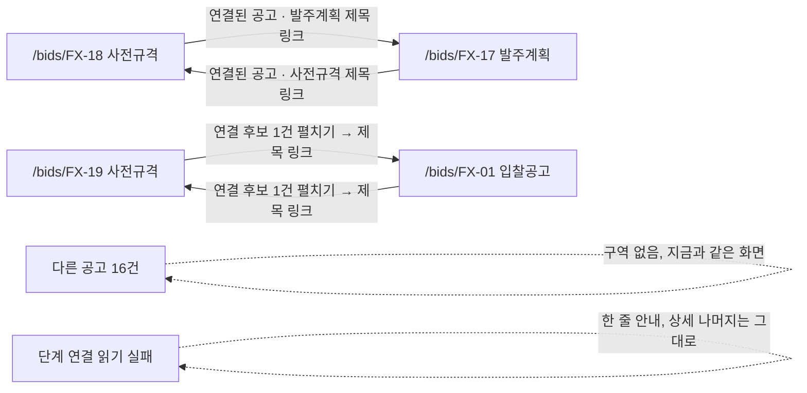

# 디자인 스펙: 공고 상세 단계 연결 (`StageLinks`)

[[2026-10-21-p08-prespec-plan|P0-8 계획]] Task 2 의 디자인 스펙이다. 구현자(`web/components/bids/stage-links.tsx`·`stage-links.browser.test.tsx`)는 이 문서 하나만 보고 짠다. 코드·정본·설정은 바꾸지 않았다. §8 문구 가운데 "고정"이라고 적은 것은 그대로 쓰고, 나머지는 초안이며 확정은 사용자 몫이다. 고를 것은 §3, 남은 질문은 §11 에 모았다.

> [!warning] 미검증 가정
> 코드와 기존 스크린샷만 읽고 썼다. dev 서버·브라우저는 띄우지 않았다. 폭은 `AppPage`(`lg:px-8`)·사이드바(256px)·상세 격자(`minmax(0,1fr)_320px`, `gap-6`)에서 계산했다. 세로 위치는 `docs/evidence/phase-3/e2e/20261020-phase3-bid-detail-loaded-1440.png`(FX-01, 1440×900)에서 눈으로 쟀다. 데이터 꼴은 작업 지시의 확정 타입(`StageLinkItem`·`StageLinkCandidateItem`·`StageLinksView`)이다. Task 1(서버)은 이 작업 폴더에 아직 없다. FX 연결·후보 결과는 `web/server/ingestion/stage-link.ts` 의 규칙과 주석 실측값(FX-01↔FX-19 0.529, 다음으로 높은 쌍 0.258)으로 정했다.

## 0. 범위

| 넣는다 | 넣지 않는다 |
|---|---|
| 상세 `/bids/[id]` "단계 이력" 구역 안, `StageTimeline` 다음 줄에 새 부품 `StageLinks` | `StageTimeline` 변경. S5(93)가 고친다(`revisionsHref`). 이 스펙은 그 파일을 건드리지 않는다 |
| 연결 묶음(식별자로 이은 공고), 연결 후보 묶음(제목만 비슷한 공고, 접힘), 읽기 실패 한 줄 | 연결을 사람이 확정·해제하는 동작(저장 없음, 계획 D1). 후보 숨기기·신고 버튼 |
| 상태: 연결만, 후보만, 둘 다, 없음(구역 없음), 읽기 실패, 취소된 연결 공고, 긴 제목, 기능 끔 | 유사도 숫자·퍼센트·점수 막대. 승률·확률 표시(사용자 결정). 모바일·1280 미만 레이아웃. 결제 |
| 1440·1280 두 폭 | `GET /api/v1/bids/:id` 응답 변경(계획 D4) |

데모(19 Q&A 예비 장면 FX-17 → FX-18): FX-18 상세에서 "연결된 공고" 아래 발주계획 FX-17 한 줄이 보이고, 제목을 누르면 FX-17 상세로 가서 사전규격 FX-18 한 줄이 보인다. FX-19 는 "연결 후보 1건"을 펼치면 FX-01 이 보인다.

## 1. 기준

| 무엇 | 근거 |
|---|---|
| 요구 | 계획 판정 D2(같은 `is_demo` 끼리)·D3(후보는 자동으로 잇지 않음, 최대 3건)·D5(`StageTimeline` 아래 새 부품, 둘 다 없으면 구역 없음, 유사도 숫자 없음), Task 2, Global Constraints(승률·확률·모바일 금지, freeze 때 한 줄로 뺀다) |
| 정본 | 07 §4("제목 유사도만으로 자동 병합하지 않고 '연결 후보'로만"), 07 §6.2 FX-17·18·19 행, 06 §1(폭)·§3.1(의미색)·§3.2(`취소됨`·`ban`)·§3.3(앱 틀 눈금)·§9 `StageTimeline` 행(연결 후보 표시 FX-19)·§10 접근성·§12 증거 이름, 19 Q&A 예비 FX-17 → FX-18·FX-19 행, 19 §6 리허설 "1440px에서 상단 요약·자격·점수가 스크롤 없이" |
| 기존 상세 스펙 | [[2026-10-19-c6-screens-design|C6 화면 스펙]] §5.4(정보 위계 ③ 단계 이력), §5.4.3(단계 연결·연결 후보는 확장 컷, 동작하지 않는 버튼 금지), §3.3(아이콘 + 글자 + 색) |
| 견본 코드 | `web/app/(app)/(work)/bids/[id]/bid-detail-view.tsx`: 단계 이력 `section`(`flex flex-wrap items-center gap-x-4 gap-y-2 border-t border-border pt-6`), `CHIP`·`TEXT_LINK` 클래스, 분석 이력 `<details className="group">`·`summary`·`▾ group-open:rotate-180`, "분석 이력을 불러오지 못했습니다" 한 줄. `SummaryLines` 의 `공고번호 <font-mono>`·` · ` |
| 부품 | `STAGE_LABEL`·`EXTRA_STATUS_LABEL`(`web/components/bids/labels.ts`), `StatusBadge kind="bidStatus"`(`status-badge.tsx`, `CANCELLED` 만 그린다), `next/link` |
| 토큰 | `design/tokens.json`. 앱 틀 눈금 `type-heading`·`type-body`·`type-label`·`type-caption` 만(이 부품은 `type-title` 을 쓰지 않는다) |

## 2. 흐름



- 서버 컴포넌트(`bids/[id]/page.tsx`)가 기존 `Promise.all` 에서 `getStageLinks` 를 같이 읽고 `BidDetailView` 에 `stageLinks` 로 넘긴다(계획 Task 2). 실패면 `console.error` 한 줄(`{"event":"bid_detail_stage_links_failed","bidId":…,"status":…}`, 기존 `bid_detail_history_failed` 와 같은 꼴) 뒤 `null` 이다. 404 도 `null` 로 넘긴다(공고 자체는 `getBid` 가 읽었으므로 화면은 그린다).
- `StageLinks` 는 데이터를 읽지 않는다. 클라이언트 상태도 없다. 후보 묶음의 펼침은 HTML `<details>` 가 맡는다.
- 링크 이동은 같은 탭의 Next `Link` 다. 새 상세가 열리면 `[id]/loading.tsx` 가 기존대로 보이고 맨 위로 스크롤한다.

## 3. 결정 (추천안 먼저)

| # | 무엇 | 추천 | 다른 안 |
|---|---|---|---|
| U1 | 자리 | "단계 이력" `section` **안**, `StageTimeline` 다음 형제로 `basis-full` 한 줄. `h2 단계 이력` 아래 `h3` 로 묶여 제목 구조가 맞다. 연결도 후보도 없으면 `section` 이 지금과 글자 하나 다르지 않다 | `section` 밖 형제 구역에 `h2`·`border-t` 를 따로 둔다. 구분선과 제목이 하나씩 늘어 상세가 무거워지고, 단계 이력과 다른 구역처럼 읽힌다 |
| U2 | 후보 묶음 기본 상태 | **접힘**(`<details>`). 요약 줄에 개수와 "자동으로 잇지 않았습니다"가 늘 보인다. 이유: FX-01(S3 주 화면)은 후보가 1건이라 펼친 채면 1440×900 에서 셋째 필수자격 행이 잘린다(§4.6 세로 계산, 19 §6 리허설 항목). 확인되지 않은 연결을 확인된 연결보다 낮게 보이는 것도 07 §4 뜻에 맞다 | 늘 펼침. 코드는 조금 더 단순하지만 S3 첫 화면이 바뀐다 |
| U3 | 링크 | **제목 글자만** `Link` `/bids/<bidId>`, 같은 탭, `?list=` 를 잇지 않는다. 도착한 상세의 "← 공고 목록"은 기본 목록 `/bids` 로 간다(브라우저 뒤로 가기는 그대로 돌아온다) | ① 행 전체를 링크로: 링크 이름이 칩·번호·근거까지 길어진다. ② `?list=` 를 이어 붙이기: `BidDetailView`·`StageLinks` 에 목록 조건 prop 이 하나 더 필요하다(93 과 겹치는 줄이 는다) |
| U4 | 후보 테두리 | 후보 목록만 **점선**(`border-dashed`·`divide-dashed`). 확인되지 않음을 모양으로도 보인다(06 `미분석`의 `circle-dashed` 와 같은 뜻). 뜻은 글자(요약 줄)가 지고 점선은 거든다 | 연결 목록과 같은 실선 |
| U5 | 근거 글자·문구 상수 자리 | `stage-links.tsx` 안(`STAGE_LINK_BASIS_LABEL`, `STAGE_LINKS_COPY` 를 내보내 시험이 쓴다). `labels.ts` 는 S5 가 `BID_STATUS_LABEL` 을 더하는 파일이라 피한다. 병합 뒤 옮길지는 3e·45 가 정한다 | `labels.ts` 끝에 더한다(병합 충돌 가능) |
| U6 | 행의 `DEMO` 배지 | 그리지 않는다. 연결·후보는 지금 공고와 같은 `is_demo` 만 나온다(계획 D2). 지금 공고의 `DEMO` 배지가 제목 위에 이미 있다 | 행마다 `DemoBadge`. 같은 배지가 반복된다 |
| U7 | prop 이 없을 때 | `bid-detail-view.tsx` 의 prop 은 `stageLinks?: StageLinksView \| null`. `undefined` 면 **부품을 부르지 않는다**(기능 끔. freeze 때 page 의 읽기를 빼면 이 상태). `null` 은 읽기 실패 한 줄 | `undefined` 도 실패로 보인다. 기능을 뺐는데 실패 안내가 남는다 |

## 4. 화면 명세

### 4.1 자리 — `bid-detail-view.tsx` 한 줄

```tsx
<section
  aria-labelledby="stage-history-title"
  className="flex flex-wrap items-center gap-x-4 gap-y-2 border-t border-border pt-6"   // 그대로
>
  <h2 id="stage-history-title" className="type-heading text-foreground">단계 이력</h2>   // 그대로
  <StageTimeline … />                                                                     // 그대로(S5 가 prop 을 더한다)
  {stageLinks !== undefined && <StageLinks stageLinks={stageLinks} />}                    // 이 줄만 더한다
</section>
```

- `BidDetailViewProps` 에 `stageLinks?: StageLinksView | null` 하나를 더한다(계획 Task 2). `section` 의 클래스·`StageTimeline` 줄은 바꾸지 않는다.
- `StageLinks` 의 뿌리 요소가 `basis-full` 이라 `flex-wrap` 줄의 다음 줄로 내려간다. 단계 이력 줄과의 간격은 `gap-y-2`(8) + 뿌리 `mt-1`(4) = 12px.
- 정보 위계는 06 §6 그대로다(③ 단계 이력 안의 아랫부분). 새 구역 번호를 만들지 않는다.

### 4.2 부품 꼴

```ts
// web/components/bids/stage-links.tsx — "use client" 를 붙이지 않는다(훅·상태 없음). 클라이언트 부품(BidDetailView)이 부르므로 브라우저 번들에 든다.
import type { StageLinksView, StageLinkItem, StageLinkCandidateItem } from "@/server/bids"; // 타입만(labels.ts 와 같은 방식)
type StageLinksProps = { stageLinks: StageLinksView | null };
```

| 입력 | 그리는 것 |
|---|---|
| `null` | 읽기 실패 한 줄(§4.5) |
| `linked.length === 0 && candidates.length === 0` | **`null` 을 돌려준다**(아무 요소도 없음, 계획 D5) |
| 그 밖 | 뿌리 `div` 안에 연결 묶음(있을 때) → 후보 묶음(있을 때) 순서 |

- 받은 순서 그대로 그린다. 연결은 서버가 단계 순서(PLAN → PRE_SPEC → NOTICE) 다음 `noticeId` 로 정렬해 준다. 후보는 서버 순서(비슷한 순) 그대로이고 최대 3건은 서버가 지킨다. 화면은 다시 정렬하거나 자르지 않는다.
- 요소 `id` 는 `useId` 없이 `bidId` 로 만든다(한 화면에 `StageLinks` 는 하나, 한 공고가 연결과 후보에 함께 나오지 않는다 — `linkStages` 가 이은 쌍을 후보에서 뺀다). 그래도 묶음 이름을 앞에 붙여 겹치지 않게 한다: `stage-link-{linked|candidate}-{bidId}`.

### 4.3 뿌리와 연결 묶음

```tsx
<div data-slot="stage-links" className="mt-1 flex min-w-0 basis-full flex-col gap-4">
  {/* 연결 묶음: linked.length > 0 일 때만 */}
  <div data-slot="stage-links-linked" className="flex min-w-0 flex-col gap-2">
    <h3 id="stage-links-linked-title" className="type-label font-semibold text-foreground">
      연결된 공고 <span className="font-normal text-muted-foreground">{linked.length}건</span>
    </h3>
    <ul aria-labelledby="stage-links-linked-title"
        className="divide-y divide-border rounded-lg border border-border">
      {linked.map((item) => <StageLinkRow key={item.bidId} kind="linked" item={item} />)}
    </ul>
  </div>
  {/* 후보 묶음: §4.4 */}
</div>
```

**행 하나**(연결·후보 공통 틀, `<li>`):

```tsx
<li data-slot="stage-link-item" data-kind="linked" data-bid-id={item.bidId} data-stage={item.stage}
    data-basis={item.basis /* 연결 행만 */}
    className="grid grid-cols-[auto_minmax(0,1fr)] items-start gap-x-3 gap-y-0.5 px-4 py-3">
  {/* ① 단계 칩 — 상세 eyebrow 의 CHIP 과 같은 글자 + mt-px(제목 첫 줄 22px 에 20px 칩을 맞춘다) */}
  <span id={`${base}-stage`}
        className="mt-px inline-flex h-5 shrink-0 items-center whitespace-nowrap rounded-sm border border-border bg-background px-1.5 type-caption text-foreground">
    {STAGE_LABEL[item.stage]}
  </span>
  {/* ② 제목 링크 — 감싸개가 눈금을 갖고, 링크는 인라인이라 밑줄·초점이 글자 줄을 따른다 */}
  <div className="min-w-0 type-body wrap-anywhere">
    <Link href={`/bids/${item.bidId}`} aria-describedby={`${base}-stage ${base}-meta`}
          className="rounded-sm font-medium text-foreground underline decoration-muted-foreground underline-offset-4 outline-none hover:decoration-foreground focus-visible:ring-3 focus-visible:ring-ring/50">
      {item.title}
    </Link>
  </div>
  {/* ③ 보조 줄 */}
  <p id={`${base}-meta`} className="col-start-2 type-caption text-muted-foreground wrap-anywhere">
    {item.status === "CANCELLED" && (<><StatusBadge kind="bidStatus" value="CANCELLED" variant="inline" />{" · "}</>)}
    공고번호 <span className="font-mono">{item.noticeId}</span>
    {agency && ` · ${agency}`}
    {` · ${STAGE_LINK_BASIS_LABEL[item.basis]}`}
  </p>
</li>
```

- `base` = `stage-link-linked-{bidId}`.
- 보조 줄 순서: (취소면) `⊘ 취소됨` → `공고번호 {noticeId}` → 발주기관 → 연결 근거. 가운뎃점은 `SummaryLines` 처럼 글자 ` · ` 다.
- 발주기관이 `null` 이거나 빈 글자(`trim() === ""`)면 그 토막과 앞 ` · ` 를 뺀다(`—` 를 두지 않는다. 보조 줄이라 빈 칸을 알릴 까닭이 없다).
- 연결 근거 글자: `PLAN_REF` → `발주계획 번호로 연결`, `PRE_SPEC_REF` → `사전규격 번호로 연결`. **행의 단계가 아니라 `basis` 로 고른다**(FX-17 상세의 사전규격 행도 `PLAN_REF` 라 `발주계획 번호로 연결`이다).
- 공유한 번호 값(`DEMO-PLAN-0042`)은 행에 쓰지 않는다. 타입에 없고, 지금 공고의 번호는 바로 위 `StageTimeline` 이 보인다.
- 공고 상태는 `CANCELLED` 만 보인다(`StatusBadge kind="bidStatus"` 가 다른 값은 그리지 않는다. 상세 eyebrow·목록과 같다). 취소된 공고도 링크다(상세는 언제나 열린다, 06 §5.5).
- 제목은 말줄임 없이 다 보인다(상세 h1 과 같은 원칙, 긴 제목은 §4.6). `title` 속성은 두지 않는다(글자가 다 보인다).
- 행에는 hover 바탕을 두지 않는다. 누를 수 있는 것은 제목뿐이라 행 전체가 눌리는 것처럼 보이면 안 된다.

### 4.4 후보 묶음 (접힘)

```tsx
<details data-slot="stage-links-candidates" className="group/candidates min-w-0">
  <summary className="flex w-fit max-w-full cursor-pointer list-none flex-wrap items-baseline gap-x-2 gap-y-0.5 rounded-sm outline-none focus-visible:ring-3 focus-visible:ring-ring/50 [&::-webkit-details-marker]:hidden">
    <span className="type-label font-semibold text-foreground">
      연결 후보 <span className="font-normal text-muted-foreground">{candidates.length}건</span>{" "}
      <span aria-hidden="true" className="inline-block group-open/candidates:rotate-180">▾</span>
    </span>
    <span id="stage-links-candidates-note" className="type-caption text-muted-foreground">
      이 공고와 제목이 비슷합니다. 자동으로 잇지 않았습니다.
    </span>
  </summary>
  <ul aria-label="연결 후보"
      className="mt-2 divide-y divide-dashed divide-border rounded-lg border border-dashed border-border">
    {candidates.map((item) => <StageLinkRow key={item.bidId} kind="candidate" item={item} />)}
  </ul>
</details>
```

- 처음엔 닫혀 있다(`open` 속성 없음, U2). 새로 고치면 다시 닫힌다. 펼침 상태를 저장하지 않는다.
- `details`·`summary` 는 분석 이력(`AnalysisBand`)과 같은 모양이다. 이름 붙은 묶음(`group/candidates`)을 써서 바깥의 다른 `group` 과 섞이지 않게 한다. `details` 에 `flex` 를 주지 않는다(`ul` 은 `mt-2` 로 띄운다).
- 후보 행은 §4.3 행 틀과 같고 두 가지만 다르다.
  - `data-kind="candidate"`, `data-basis` 없음, `base` = `stage-link-candidate-{bidId}`.
  - 보조 줄: `공고번호 {noticeId}` · 발주기관. 연결 근거·공고 상태가 없다(타입에 없다).
  - 링크 `aria-describedby` = `{base}-stage {base}-meta stage-links-candidates-note`. 낭독: "세종특별자치시 차세대 행정정보시스템 고도화 (가상), 링크, 입찰공고, 공고번호 DEMO-2026-0001 · 세종특별자치시, 이 공고와 제목이 비슷합니다. 자동으로 잇지 않았습니다."
- **유사도 값은 어디에도 없다**: 글자·`title`·`data-*`·`aria-*`·숨긴 글자 모두. 타입에도 없다(서버가 뺀다). "유사도"·"%"·소수·막대·순위 번호도 쓰지 않는다.
- 연결과 후보가 둘 다 있으면 연결 묶음이 위, 후보 묶음이 아래다(뿌리 `gap-4`).

### 4.5 읽기 실패 (`stageLinks === null`)

```tsx
<p data-slot="stage-links-error" className="mt-1 basis-full type-caption text-muted-foreground">
  다른 단계 공고를 불러오지 못했습니다
</p>
```

- 상세의 나머지(분석 띠·필수자격·결정 패널)는 그대로다. 오류 경계로 던지지 않는다.
- 아이콘·다시 시도 버튼·`role="alert"` 없음. 서버가 그린 정적 글자라 알림 영역이 필요 없고, 다시 읽는 길은 화면 새로 고침이다(분석 이력 실패 줄과 같은 수준).

### 4.6 폭·넘침·세로 예산

| 화면 폭 | 사이드바 | 주 영역 | 목록 상자 안쪽(테두리 2 + `px-4` 32 뺌) | 제목 칸(칩 ≈62 + 간격 12 뺌) |
|---|---|---|---|---|
| 1440 | 펼침 | 776px | 742px | ≈668px |
| 1280 | 펼침 | 616px | 582px | ≈508px |
| 1440 | 접음 | 1032px | 998px | ≈924px |
| 1280 | 접음 | 872px | 838px | ≈764px |

- 단계 칩 셋(`발주계획`·`사전규격`·`입찰공고`)은 모두 한글 네 글자라 폭이 같다. 그래서 행마다 격자를 따로 두어도 제목 시작 자리가 맞는다.
- FX 제목(가장 긴 FX-17 ≈ 405px)과 보조 줄(≈ 395px)은 1280 에서도 한 줄이다(계산값).
- 넘침 대응: 제목 감싸개·보조 줄 `wrap-anywhere`, 격자 둘째 칸 `minmax(0,1fr)`, 뿌리·묶음 `min-w-0`. 띄어쓰기 없는 200자 제목도 칸 안에서 꺾인다. 1280 미만 레이아웃은 만들지 않는다(가로 스크롤 허용, ADR-007).
- 요약 줄(`연결 후보 1건 ▾` + 안내 ≈ 450px)은 1280 에서도 한 줄이다. 좁아지면 안내가 다음 줄로 꺾인다(`flex-wrap`).

**세로 예산 — FX-01, 1440×900**(지금 실측: 셋째 필수자격 행의 마지막 글자 줄 아래 끝 ≈ 845px):

| 안 | 더해지는 높이 | 셋째 행 끝 | 판정 |
|---|---|---|---|
| U2 접힘(추천) | `gap-y-2` 8 + `mt-1` 4 + 요약 줄 20 ≈ **32px** | ≈ 877px | 900 안. 19 §6 리허설 항목 유지 |
| 늘 펼침 | 32 + `mt-2` 8 + 상자(테두리 2 + `py-3` 24 + 제목 22 + 간격 2 + 보조 16) 66 ≈ **106px** | ≈ 951px | 셋째 행이 잘린다 |

FX-17·FX-18 은 연결 묶음이 펼친 채라 ≈ 102px(8 + 4 + 제목 20 + `gap-2` 8 + 상자 62~66) 아래로 밀린다. 두 공고는 19 §6 첫 화면 확인 대상이 아니다. 구현 뒤 실측으로 다시 확인한다.

### 4.7 배치 그림

기호: `⟨제목⟩` 밑줄 링크(`decoration-muted-foreground`), `[칩]` 단계 칩, `┆` 점선 테두리, `(ban)` lucide `BanIcon` 14px. 시각·폭은 예시다. 레일(320px)은 자리만 그렸다.

**연결 — FX-18 상세, 1440(주 영역 776)**

```text
┌ Sidebar ┬─ Content 1120 ─────────────────────────────────────────────────────────────────────────────────────┐
│         │ ← 공고 목록                                                                [원문 보기] [재분석]      │
│         │ [DEMO] [사전규격] 출처 fixture                                                                     │
│         │ 과학기술정보통신부 AI 행정서비스 구축 사전규격 (가상)                                                  │
│         │ 발주기관 과학기술정보통신부 · 예산 4,800,000,000원 · 마감 … (D-7)                                     │
│         │ 공고번호 DEMO-2026-0018 · revision 1 · 수집 … KST                                                   │
│         │ ┌ 분석 요약 띠 ─────────────────────────────────────────────────────────┐  ┌ 참여 판단 ─────────┐ │
│         │ └───────────────────────────────────────────────────────────────────────┘  │ 권고 BID           │ │
│         │ ───────────────────────────────────────────────────────────────────────── │ 82 / 100           │ │
│         │ 단계 이력  ○ 발주계획 DEMO-PLAN-0042   ● 사전규격 r1   ○ 입찰공고 —           │ …                  │ │
│         │                                                                           │                    │ │
│         │ 연결된 공고 1건                                                             │                    │ │
│         │ ┌───────────────────────────────────────────────────────────────────────┐ │                    │ │
│         │ │ [발주계획] ⟨과학기술정보통신부 2027년 AI 행정서비스 구축 발주계획 (가상)⟩     │ │                    │ │
│         │ │           공고번호 DEMO-2026-0017 · 과학기술정보통신부 · 발주계획 번호로 연결 │ │                    │ │
│         │ └───────────────────────────────────────────────────────────────────────┘ │                    │ │
│         │ ───────────────────────────────────────────────────────────────────────── │                    │ │
│         │ 필수자격 (…)                                                               └────────────────────┘ │
└─────────┴─────────────────────────────────────────────────────────────────────────────────────────────────────┘
```

**연결 — FX-18 상세, 1280(주 영역 616)**: 구성·순서는 1440 과 같고 상자 폭만 좁다. 제목·보조 줄은 한 줄씩이다.

```text
│ 단계 이력  ○ 발주계획 DEMO-PLAN-0042   ● 사전규격 r1   ○ 입찰공고 —   │ ┌ 참여 판단 ─┐
│                                                                  │ │ …          │
│ 연결된 공고 1건                                                    │
│ ┌──────────────────────────────────────────────────────────────┐ │
│ │ [발주계획] ⟨과학기술정보통신부 2027년 AI 행정서비스 구축 발주계획 (가상)⟩│ │
│ │           공고번호 DEMO-2026-0017 · 과학기술정보통신부 · 발주계획 번호로 연결│
│ └──────────────────────────────────────────────────────────────┘ │
│ ──────────────────────────────────────────────────────────────── │
│ 필수자격 (…)                                                      │
```

**후보 접힘 — FX-01 상세, 1440×900(S3 첫 화면)**: 단계 이력 줄 아래 요약 한 줄만 더해진다. 셋째 필수자격 행까지 첫 화면에 든다(§4.6).

```text
│ 단계 이력  ○ 발주계획 —   ○ 사전규격 —   ● 입찰공고 r1
│ 연결 후보 1건 ▾  이 공고와 제목이 비슷합니다. 자동으로 잇지 않았습니다.
│ ─────────────────────────────────────────────────────────────────────────
│ 필수자격 (3건 · 모두 충족)
│ ✓ 충족  소프트웨어사업자 신고확인서 …
│ ✓ 충족  소프트웨어 직접생산확인증명서 …
│ ✓ 충족  중소기업확인서 …                       ← ≈ 877px, 900 안
```

**후보 펼침 — FX-19 상세, 1280(주 영역 616)**: 1440 은 상자 폭만 넓다.

```text
│ 단계 이력  ○ 발주계획 —   ● 사전규격 r1   ○ 입찰공고 —
│ 연결 후보 1건 ▴  이 공고와 제목이 비슷합니다. 자동으로 잇지 않았습니다.
│ ┌┄┄┄┄┄┄┄┄┄┄┄┄┄┄┄┄┄┄┄┄┄┄┄┄┄┄┄┄┄┄┄┄┄┄┄┄┄┄┄┄┄┄┄┄┄┄┄┄┄┄┄┄┄┄┄┄┄┄┐
│ ┆ [입찰공고] ⟨세종특별자치시 차세대 행정정보시스템 고도화 (가상)⟩       ┆
│ ┆           공고번호 DEMO-2026-0001 · 세종특별자치시                ┆
│ └┄┄┄┄┄┄┄┄┄┄┄┄┄┄┄┄┄┄┄┄┄┄┄┄┄┄┄┄┄┄┄┄┄┄┄┄┄┄┄┄┄┄┄┄┄┄┄┄┄┄┄┄┄┄┄┄┄┄┘
│ ─────────────────────────────────────────────────────────────
│ 필수자격 …
```

**둘 다 + 취소 + 긴 제목 — 합성 데이터, 1280(주 영역 616)**: live 데이터에서 생길 수 있는 꼴이다.

```text
│ 단계 이력  ○ 발주계획 R26DD00012345   ○ 사전규격 R26BD00067890   ● 입찰공고 r1
│
│ 연결된 공고 2건
│ ┌──────────────────────────────────────────────────────────────┐
│ │ [발주계획] ⟨○○시 2027년 통합 정보시스템 구축 발주계획⟩               │
│ │           공고번호 R26DD00012345 · ○○시 · 발주계획 번호로 연결      │
│ ├──────────────────────────────────────────────────────────────┤
│ │ [사전규격] ⟨○○시 통합정보시스템구축사업(1단계)사전규격공개및의견수렴에  │
│ │           관한건 …(띄어쓰기 없는 긴 제목은 칸 안에서 꺾인다)⟩         │
│ │           (ban) 취소됨 · 공고번호 R26BD00067890 · ○○시 · 사전규격 번호로 연결 │
│ └──────────────────────────────────────────────────────────────┘
│ 연결 후보 1건 ▾  이 공고와 제목이 비슷합니다. 자동으로 잇지 않았습니다.
```

**읽기 실패 — 1440·1280 같음**

```text
│ 단계 이력  ○ 발주계획 —   ○ 사전규격 —   ● 입찰공고 r1
│ 다른 단계 공고를 불러오지 못했습니다                 ← type-caption muted
│ ─────────────────────────────────────────────────────────────
│ 필수자격 …(그대로)
```

**없음 — 다른 공고 16건**: 지금 화면과 같다(`data-slot="stage-links"` 요소 없음).

## 5. 상태표

| 상태 | 언제 | 보이는 것 | 사용자가 할 수 있는 것 |
|---|---|---|---|
| S1 연결만 | `linked` 1건 이상, `candidates` 0건 (FX-17·FX-18) | 단계 이력 줄 아래 `연결된 공고 N건`(h3) + 실선 상자 목록. 행: 단계 칩 · 밑줄 제목 링크 · `공고번호 … · 기관 · {근거}` | 제목을 눌러 그 공고 상세로 이동 |
| S2 후보만(접힘) | `linked` 0건, `candidates` 1~3건 (FX-01·FX-19), 처음 열 때 | 요약 한 줄 `연결 후보 N건 ▾` + `이 공고와 제목이 비슷합니다. 자동으로 잇지 않았습니다.` 목록은 안 보인다 | 요약을 눌러(또는 `Enter`·`Space`) 펼치기 |
| S2' 후보 펼침 | S2 에서 펼친 뒤 | 요약 `▴` + 점선 상자 목록. 행: 단계 칩 · 밑줄 제목 링크 · `공고번호 … · 기관`. 유사도 표시 없음 | 제목을 눌러 이동, 요약을 다시 눌러 접기 |
| S3 둘 다 | 둘 다 1건 이상 (live 에서 가능, FX 에는 없음) | S1 묶음 위, S2 요약 아래(`gap-4`) | S1 + S2 |
| S4 없음 | 둘 다 0건 (FX 16건) | **구역 없음.** 단계 이력 `section` 은 지금과 같다 | — |
| S5 읽기 실패 | `stageLinks === null` (서비스 404·500, 던짐) | 단계 이력 줄 아래 `다른 단계 공고를 불러오지 못했습니다`(caption, muted). 상세 나머지는 그대로 | 새로 고침 |
| S6 취소된 연결 공고 | 연결 행 `status === "CANCELLED"` | 보조 줄 맨 앞 `(ban) 취소됨 · `. 제목은 그대로 링크 | 이동(취소 공고 상세는 언제나 열린다) |
| S7 긴 제목·긴 기관 | 제목 100자 이상, 띄어쓰기 없음 | 말줄임 없이 제목 칸 안에서 줄바꿈. 칩은 첫 줄에 붙어 있다. 가로 넘침 없음 | — |
| S8 기능 끔 | `stageLinks === undefined` (freeze 때 page 읽기를 뺐다) | S4 와 같다(부품을 부르지 않는다) | — |
| 로딩 | 상세 서버 읽기 중 | 기존 `[id]/loading.tsx` 그대로. 이 부품은 따로 skeleton 이 없다(서버가 다 읽고 그린다) | 기다림 |
| 권한 | 모든 업무 역할 | 역할별 차이 없음. `bid_notices` 는 "활동 중 회원은 공고 읽기" RLS 로 읽는다. 다른 조직 사용자(S7 org-02)도 같은 연결을 본다(공고는 공용) | 같음 |

## 6. 데모 데이터 (`pnpm demo:reset` 뒤)

| 상세 | 단계 이력 줄(지금 그대로) | `StageLinks` |
|---|---|---|
| FX-18 사전규격 | `○ 발주계획 DEMO-PLAN-0042 · ● 사전규격 r1 · ○ 입찰공고 —` | 연결된 공고 1건: `[발주계획] 과학기술정보통신부 2027년 AI 행정서비스 구축 발주계획 (가상)` / `공고번호 DEMO-2026-0017 · 과학기술정보통신부 · 발주계획 번호로 연결` → `/bids/<FX-17 id>` |
| FX-17 발주계획 | `● 발주계획 r1 · ○ 사전규격 — · ○ 입찰공고 —` | 연결된 공고 1건: `[사전규격] 과학기술정보통신부 AI 행정서비스 구축 사전규격 (가상)` / `공고번호 DEMO-2026-0018 · 과학기술정보통신부 · 발주계획 번호로 연결` → `/bids/<FX-18 id>` |
| FX-19 사전규격 | `○ 발주계획 — · ● 사전규격 r1 · ○ 입찰공고 —` | 연결 후보 1건(접힘). 펼치면 `[입찰공고] 세종특별자치시 차세대 행정정보시스템 고도화 (가상)` / `공고번호 DEMO-2026-0001 · 세종특별자치시` → `/bids/<FX-01 id>` |
| FX-01 입찰공고 | `○ 발주계획 — · ○ 사전규격 — · ● 입찰공고 r1` | 연결 후보 1건(접힘). 펼치면 `[사전규격] 세종특별자치시 행정정보 연계 플랫폼 사전규격 (가상)` / `공고번호 DEMO-2026-0019 · 세종특별자치시` → `/bids/<FX-19 id>` |
| 그 밖 FX 16건 | 지금 그대로 | 구역 없음 |

- FX-17 ↔ FX-18 은 같은 `planRef`(`DEMO-PLAN-0042`)라 양쪽 다 근거가 `PLAN_REF` 다. 두 공고는 서로 후보에 나오지 않는다(이은 쌍은 후보에서 빠진다).
- FX-20(발주계획)은 FX-17 과 단계가 같아 후보가 아니고, 다른 단계와는 비슷한 정도가 기준(0.5)보다 낮다.
- 발표 동선(Q&A 예비, 추천): **FX-18 → FX-17**. FX-18 에서는 단계 이력 `발주계획 DEMO-PLAN-0042` 와 연결 행이 같은 말을 한다. 그다음 연결 행을 눌러 FX-17 로 가서 사전규격 FX-18 이 이어져 있음을 보인다(FX-17 의 단계 이력 `사전규격 —` 는 §11 질문 1). FX-19 는 "연결 후보 1건"을 펼쳐 "제목만 비슷해서 사람이 확인할 후보로만 둔다"를 말한다.

## 7. 접근성 체크 항목

- [ ] 제목 구조: h1(공고명) → h2 `단계 이력` → h3 `연결된 공고`(연결이 있을 때) → h2 `필수자격`. 후보 묶음은 제목 요소가 아니라 `summary` 다(버튼 역할 안에 제목을 넣지 않는다). 후보 목록은 `ul aria-label="연결 후보"`.
- [ ] 랜드마크: 새 랜드마크 없음. `main#main-content`(`AppPage`) 안의 기존 `section aria-labelledby="stage-history-title"` 안이다.
- [ ] 링크 이름 = 보이는 제목 글자(WCAG 2.5.3). 설명(`aria-describedby`): 연결 행은 단계 칩 + 보조 줄, 후보 행은 단계 칩 + 보조 줄 + 후보 안내. 참조하는 `id` 가 모두 DOM 에 있다.
- [ ] 누를 수 있는 것은 제목 링크와 후보 요약뿐이다. 칩·보조 줄·근거 글자는 링크·버튼 모양이 아니다(밑줄·포인터 없음). `button` 요소 없음. 모든 `a` 는 `/bids/<uuid>` 로 실제 이동한다.
- [ ] 링크는 색만으로 구분하지 않는다: 늘 밑줄(`underline`, `decoration-muted-foreground`), hover 에 밑줄 진하게.
- [ ] 키보드(Tab): …분석 띠 → (S5 병합 뒤 revision 2개 이상이면 `r2` 링크) → 연결 제목 링크(위에서 아래) → 후보 요약 → (펼쳤으면) 후보 제목 링크 → 필수자격. 보이는 순서와 같다. 요약은 `Enter`·`Space` 로 펼치고 접는다(네이티브), 펼침 상태는 브라우저가 낭독한다(`aria-expanded` 를 따로 달지 않는다).
- [ ] 초점 표시: 제목 링크·요약 모두 `focus-visible:ring-3 focus-visible:ring-ring/50` + `rounded-sm`(상세 `TEXT_LINK` 와 같다).
- [ ] 상태 표기: 취소는 `BanIcon`(`aria-hidden`) + 글자 `취소됨` + `muted-foreground`(06 §3.2). 확인되지 않은 후보는 글자(요약 안내)가 뜻을 지고, 점선은 거든다.
- [ ] 장식 기호 `▾` 는 `aria-hidden`. 가운뎃점 ` · ` 는 상세 `SummaryLines` 와 같이 글자 그대로 둔다.
- [ ] 대비 AA(흰 바탕 위): 제목 `foreground` #191F28, 보조 `muted-foreground` #4E5968(약 7:1). 연한 바탕 채움 없음.
- [ ] 움직임: `▾` 회전에 전환 효과를 주지 않는다(분석 이력과 같다).
- [ ] 1280 에서 가로 넘침 없음(`document.documentElement.scrollWidth <= 1280`), axe 위반 0.

## 8. 문구 표

| 자리 | 문구 | 상태 |
|---|---|---|
| 연결 묶음 제목(h3) | `연결된 공고` + `{n}건` | 초안 |
| 후보 요약 | `연결 후보` + `{n}건` + `▾` | 초안 |
| 후보 안내(요약 안) | `이 공고와 제목이 비슷합니다. 자동으로 잇지 않았습니다.` | 초안. "자동으로 잇지 않았다"는 뜻은 고정(07 §4, 계획 D3) |
| 후보 목록 이름(`aria-label`) | `연결 후보` | 초안 |
| 단계 칩 | `발주계획` · `사전규격` · `입찰공고` | 고정(`STAGE_LABEL`) |
| 공고번호 | `공고번호 {noticeId}` | 상세 `SummaryLines` 와 같은 낱말 |
| 연결 근거 `PLAN_REF` | `발주계획 번호로 연결` | 초안 |
| 연결 근거 `PRE_SPEC_REF` | `사전규격 번호로 연결` | 초안 |
| 취소 | `취소됨` | 고정(`EXTRA_STATUS_LABEL.CANCELLED`) |
| 읽기 실패 | `다른 단계 공고를 불러오지 못했습니다` | 초안. "분석 이력을 불러오지 못했습니다"와 같은 꼴, 끝 마침표 없음 |

이 구역 어디에도 `확률`·`승률`·`수주`·`유사도`·`점수`·`%`·소수(`0.53` 꼴)를 쓰지 않는다.

`stage-links.tsx` 가 내보낼 상수(시험이 같은 값을 읽는다, U5):

```ts
export const STAGE_LINK_BASIS_LABEL = {
  PLAN_REF: "발주계획 번호로 연결",
  PRE_SPEC_REF: "사전규격 번호로 연결",
} as const satisfies Record<StageLinkItem["basis"], string>;

export const STAGE_LINKS_COPY = {
  linkedTitle: "연결된 공고",
  candidatesTitle: "연결 후보",
  candidatesNote: "이 공고와 제목이 비슷합니다. 자동으로 잇지 않았습니다.",
  loadFailed: "다른 단계 공고를 불러오지 못했습니다",
  noticeIdPrefix: "공고번호",
} as const;
```

## 9. 토큰·부품 매핑

### 9.1 색 (`design/tokens.json` 만, 새 색 없음)

| 쓰임 | 토큰 클래스 |
|---|---|
| 목록 상자·행 구분·칩 테두리 | `border-border`, `divide-border` (후보는 `border-dashed`·`divide-dashed`) |
| 칩 바탕 | `bg-background` |
| 제목 링크·칩 글자·묶음 제목 | `text-foreground` |
| 보조 줄·개수·후보 안내·실패 줄·밑줄 색 | `text-muted-foreground`, `decoration-muted-foreground`(hover `decoration-foreground`) |
| 취소 아이콘·글자 | `text-muted-foreground`(`STATUS_ICON.CANCELLED`) |
| 초점 | `ring-ring/50` |

`brand`·`primary`·`success`·`warning`·`destructive`·`demo`·`chart-2` 는 쓰지 않는다. 링크를 파랑으로 칠하지 않는다(상세의 다른 문장 링크와 같다).

### 9.2 글자 (앱 틀 눈금만)

| 요소 | 눈금 |
|---|---|
| 제목 링크(감싸개) | `type-body` + 링크 `font-medium` |
| 묶음 제목 h3·후보 요약 | `type-label` + `font-semibold`(개수는 `font-normal`) |
| 단계 칩·보조 줄·후보 안내·실패 줄 | `type-caption` |
| 공고번호 | `font-mono`(`type-caption` 안) |

한 요소에 `type-*` 둘을 겹치지 않는다. `data-type-scale` 은 쓰지 않는다(상세는 대시보드 범위 변형 대상이 아니다).

### 9.3 간격 (Tailwind 눈금, 간격 토큰 없음)

단계 이력 줄과 구역 `gap-y-2`(기존) + `mt-1`, 묶음 사이 `gap-4`, 묶음 제목과 목록 `gap-2`(연결)·`mt-2`(후보), 행 `px-4 py-3`, 칩과 제목 `gap-x-3`, 제목과 보조 줄 `gap-y-0.5`, 요약 안 `gap-x-2`.

### 9.4 부품

| 부품 | 쓰임 |
|---|---|
| `Link`(`next/link`) | 제목 링크 |
| `StatusBadge kind="bidStatus" variant="inline"` | 취소된 연결 공고 |
| `STAGE_LABEL`(`bids/labels.ts`) | 단계 칩 글자 |
| 네이티브 `details`·`summary` | 후보 접기(분석 이력과 같은 모양) |

새 shadcn 부품·새 토큰은 필요 없다. 단계 칩 클래스는 `bid-detail-view.tsx` 의 `CHIP` 과 같은 글자를 이 파일에 한 번 더 적는다(`CHIP` 을 공용으로 옮기면 93 과 같은 파일을 고쳐야 해서 이번에는 하지 않는다. 병합 뒤 정리 대상).

### 9.5 새로 필요한 것 (제안 — 승인 필요)

없다. 계획이 이미 정한 새 파일 `web/components/bids/stage-links.tsx` 안에 §8 상수와 `StageLinks`·행 부품을 둔다.

## 10. 브라우저 시험이 단언할 항목 (`stage-links.browser.test.tsx`)

준비: 기존 `bid-list.browser.test.tsx` 처럼 `createRoot` 로 그리고 `host.style.width` 를 **616px**(1280 주 영역)·**776px**(1440 주 영역)로 둔다. `next/link` 를 흉내 낼 때 **나머지 속성을 넘긴다**(`({ href, children, ...rest }) => <a href={href} {...rest}>{children}</a>`). 기존 흉내는 `href`·`className`·`title` 만 넘겨서 그대로 쓰면 `aria-describedby`·`id` 시험이 늘 실패한다. 아래 `{FX-17}` 등은 시험 데이터의 uuid 다.

| # | 입력 | 단언 |
|---|---|---|
| T1 | FX-18 꼴: `linked=[{stage:"PLAN", basis:"PLAN_REF", noticeId:"DEMO-2026-0017", title:FX-17 제목, agency:"과학기술정보통신부", status:"OPEN"}]`, `candidates=[]` | `[data-slot="stage-links"]` 1개. h3 이름에 `연결된 공고`·`1건`. `[data-slot="stage-link-item"][data-kind="linked"]` 1개, `data-stage="PLAN"`, `data-basis="PLAN_REF"`. `getByRole("link", { name: FX-17 제목 })` 의 `href` 가 정확히 `/bids/{FX-17}`. 행 글자에 `발주계획`·`공고번호`·`DEMO-2026-0017`·`발주계획 번호로 연결`. `details` 없음 |
| T2 | FX-17 꼴: `linked=[{stage:"PRE_SPEC", basis:"PLAN_REF", …FX-18}]` | 칩 `사전규격`, 근거 글자 `발주계획 번호로 연결`(단계가 아니라 `basis` 로 고른다), 링크 `href` `/bids/{FX-18}` |
| T3 | `basis:"PRE_SPEC_REF"` 연결 1건 | 근거 글자 `사전규격 번호로 연결` |
| T4 | FX-19 꼴: `linked=[]`, `candidates=[FX-01]` | 연결 묶음·h3 없음. `details[data-slot="stage-links-candidates"]` 의 `open === false`. 요약 글자에 `연결 후보`·`1건`·`이 공고와 제목이 비슷합니다. 자동으로 잇지 않았습니다.` 후보 링크는 보이지 않는다(`not.toBeVisible()`) |
| T5 | T4 를 펼친다: `userEvent.click(summary)` | `open === true`. `getByRole("link", { name: FX-01 제목 })` 의 `href` `/bids/{FX-01}`. 행 `data-kind="candidate"`, `data-basis` 속성 없음, 글자에 `공고번호 DEMO-2026-0001`·`세종특별자치시`, `번호로 연결` 글자 없음. 후보 `ul` 의 `border-style` 이 `dashed` |
| T6 | T4 에서 키보드: 요약에 초점 → `{Enter}` → `{Enter}` | 열림 → 닫힘. 초점은 요약에 남는다 |
| T7 | T1·T4 공통(유사도 금지) | `host.textContent` 에 `%`·`유사도`·`확률`·`승률`·`수주`·`점수` 가 없고 `/\d+\.\d+/` 에 맞는 글자가 없다. `host.innerHTML` 에 `similarity` 가 없다 |
| T8 | `{ linked: [], candidates: [] }` | `host.childElementCount === 0`(부품이 `null`) |
| T9 | `stageLinks={null}` | `[data-slot="stage-links-error"]` 글자가 정확히 `다른 단계 공고를 불러오지 못했습니다`. `a`·`details` 없음 |
| T10 | 연결 1건 `status:"CANCELLED"` | 그 행 보조 줄에 `취소됨`, 그 앞 `svg[aria-hidden="true"]` 1개. 제목은 여전히 링크 |
| T11 | `agency: null` | 보조 줄 글자가 정확히 `공고번호 {noticeId} · {근거}`. `null`·`—` 글자와 가운뎃점 두 개가 붙은 빈 토막이 없다 |
| T12 | 후보 3건 순서 A·B·C | 행 3개가 A·B·C 순서(다시 정렬하지 않는다) |
| T13 | 연결 1 + 후보 1 | DOM 순서가 연결 묶음 → 후보 묶음 |
| T14 | 접근성 | 모든 제목 링크의 `aria-describedby` 의 `id` 가 다 존재한다. 연결: 참조 글자에 단계 칩·근거 글자. 후보: 참조에 `stage-links-candidates-note` 포함. `▾` 는 `aria-hidden`. `button` 요소 0개. 모든 `a[href]` 가 `^/bids/[0-9a-f-]{36}$` |
| T15 | 넘침(616·776 각각) | 띄어쓰기 없는 200자 제목 + 긴 기관 이름: 뿌리 `scrollWidth <= clientWidth`, 목록 상자 `scrollWidth <= clientWidth`, 제목 감싸개 높이가 한 줄(22px)보다 크다(꺾였다). 한 줄 여부는 글꼴에 따라 달라 FX 제목으로는 단언하지 않는다 |
| T16 | 초점 표시 | Tab 으로 제목 링크에 초점 → `getComputedStyle(link).boxShadow !== "none"` |

**증거 스크린샷**(06 §12 이름 규칙, `state` 는 `loaded`·`error` 만): `page.viewport(width, 900)` 뒤 `page.screenshot({ path: "../../test-results/<이름>.png" })` 로 `web/test-results` 에 찍고 `docs/evidence/p08/` 로 복사한다(`web/` 밖에는 바로 못 쓴다).

- `20261021-p08-bid-detail-fx18-loaded-{1440,1280}.png` — 연결(T1)
- `20261021-p08-bid-detail-fx19-loaded-{1440,1280}.png` — 후보 펼침(T5)
- `20261021-p08-bid-detail-stage-links-error-{1440,1280}.png` — 읽기 실패(T9)

**실제 앱 확인**(격리 스택을 띄울 수 있을 때, 계획 Task 2 완료 기준):

- FX-18·FX-17·FX-19(펼침)·FX-01 상세를 1440·1280 으로 본다. §6 표의 글자·링크 목적지와 같은지 확인한다.
- FX-01 1440×900: 셋째 필수자격 행 끝이 900px 안(§4.6). 아니면 결함으로 보고 U2 를 다시 본다.
- FX-02 등 다른 공고: `[data-slot="stage-links"]` 가 없다.
- 1280 에서 `document.documentElement.scrollWidth <= 1280`, axe 위반 0.

## 11. 열린 질문

1. **FX-17 단계 이력의 `사전규격 —`.** `StageTimeline` 은 지금 공고의 `preSpecRef` 값을 보이므로, FX-17(발주계획)에서는 사전규격 칸이 `—` 인데 바로 아래 연결 행은 사전규격 FX-18 을 보인다. 이 스펙은 `StageTimeline` 을 바꾸지 않는다(S5 파일). 추천: 데모 동선을 FX-18 → FX-17 로 하고(§6), 병합 뒤 93·45 가 "이어진 단계 칸은 `—` 대신 연결 공고 번호를 보인다" 같은 변경을 할지 정한다.
2. **취소된 후보.** `StageLinkCandidateItem` 에는 `status` 가 없어 취소된 공고가 후보로 나와도 표시가 없다. 타입은 확정이라 바꾸지 않았다. Task 1 담당이 ① 후보 풀에서 `CANCELLED` 를 빼거나 ② 후보에 `status` 를 더할지 정한다(②면 §4.3 의 취소 표시를 후보 행에도 그대로 쓴다).
3. **정본 반영(45).** 06 §9 `StageTimeline` 행의 "연결 후보 표시(FX-19)"는 이제 `StageLinks` 가 맡는다. 06 §9 에 `StageLinks` 행(`stageLinks: StageLinksView | null`, 연결 묶음·후보 접힘·읽기 실패)을 더하고, §6 와이어프레임의 단계 이력 아래에 한 줄 더한다. 계획의 "정본 문서에 반영할 것"(D5)과 같은 항목이다.
4. **문구 확정.** §8 의 초안 문구(묶음 제목, 후보 안내, 근거 글자, 실패 줄)는 사용자가 확정한다.

## 관련 문서

- [[2026-10-21-p08-prespec-plan|P0-8 계획]] — 판정 D2·D3·D5, Task 2, Global Constraints
- [[06-UI-UX|06 UI/UX]] — §1 폭, §3.1·§3.2 의미색·상태 표기, §3.3 눈금, §6 상세 와이어프레임, §9 `StageTimeline` 행, §10 접근성, §12 증거 이름
- [[07-DATA-PIPELINE|07 데이터 파이프라인]] — §4 공고 이력 연결, §6.2 FX-17·FX-18·FX-19
- [[19-DEMO-SCENARIO|19 데모 시나리오]] — Q&A 예비 FX-17 → FX-18·FX-19, §6 리허설
- [[2026-10-19-c6-screens-design|C6 화면 디자인 스펙]] — §5.4 상세 정보 위계, §5.4.3 단계 이력, §3.3 상태 표기
- [[2026-10-21-s5-revisions-ui-spec|S5 변경 이력 화면 스펙]] — 같은 단계 이력 구역의 `StageTimeline` 변경(`revisionsHref`). `s5-change-detect` worktree 에 있고 병합 전에는 이 브랜치에서 열리지 않는다
- [[12-ROADMAP|12 로드맵]] — P0-8, 확장 컷
- [[16-DECISIONS|16 결정]] — ADR-007(범위 외), ADR-023(확장 컷)
