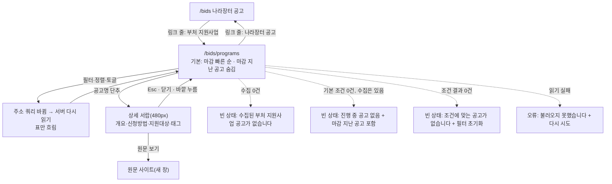

# 디자인 스펙: 부처 지원사업 공고 (`/bids` 전환 · `/bids/programs`)

[스펙](../../polaris/specs/in-progress/2026-10-21-agency-program-notices.md) §6과 [구현 계획](2026-10-21-program-notices-plan.md) Task 8을 구현자가 추측 없이 옮길 수 있게 고정한다. 이 문서는 **초안**이다. 코드·정본·설정은 바꾸지 않는다. 화면 문구는 모두 초안이고 확정은 사용자 몫이다. 결정이 필요한 것은 §12에 Q1~Q8로 모았고, 답은 §12.1에 있다(2026-10-21 확정). **본문과 §12.1이 다르면 §12.1을 따른다.**

> [!warning] 미검증 가정
> 코드와 문서만 읽고 썼다. 브라우저·dev 서버는 띄우지 않았다. 1440·1280 폭의 칸 너비는 계산값이다(본문 폭 = 화면 폭 − 사이드바 256 − 좌우 여백 64, C6 디자인 스펙 §5.3과 같은 계산). 쓸 때는 `web/server/program-notices/`와 `GET /api/v1/program-notices`가 이 작업 폴더에 없었다. 데이터 모양은 계획의 "이름과 값"·Task 6 인터페이스를 따랐고, 그 뒤 Task 6 구현으로 `hasAnyNotice`·`isCapped`가 더해졌다(§12.1 Q3). 확인할 항목은 §11에 모았다.

## 0. 범위

고정(바꾸지 않는다 — 스펙 §6 [사용자 결정]·[12 판단], 계획 Task 8):

- `/bids`(나라장터 공고) 위에 "나라장터 공고 | 부처 지원사업" 링크 줄을 둔다. 모양은 `SettingsNav`(경로 이동 링크 + `aria-current="page"`, 지금 화면에만 2px 밑줄). Tabs 부품이 아니고, 사이드바 `NAV`에 더하지 않는다.
- 두 화면 제목(h1)은 "공고"다. → 지금 `/bids` 제목은 "입찰 공고"라 그대로는 지킬 수 없다(§12 Q1). **결정: `/bids`는 그대로 두고 `/bids/programs` h1만 "부처 지원사업 공고"(§12.1).**
- 부처 지원사업 목록 열: 출처 배지(기업마당·중기부), 공고명, 소관기관, 신청 마감(없으면 "기간 미표기"), 등록일. 점수·권고·분석·결정 열과 버튼은 없다.
- 정렬: 마감 빠른 순(기본, 마감 없음은 뒤)·등록일 최신 순. 필터: 출처, 소관기관 검색어. "마감 지난 공고 포함" 토글(기본 꺼짐, 마감 없음은 늘 보임). 필터 값은 주소 쿼리가 정본이다.
- 행의 상세는 서랍(Sheet): 사업개요·신청방법·지원대상·태그, "문의처는 원문에서 확인하세요", "원문 보기"(새 창, `rel="noopener noreferrer"`).
- 글자는 평문이다. HTML로 해석하지 않고(`dangerouslySetInnerHTML` 금지) 줄바꿈은 유지한다.
- 화면 확인은 1440·1280 두 폭. 1280 미만 레이아웃은 만들지 않는다(ADR-007).

이 문서가 정하는 것: 링크 줄 자리·문구·주소, 표 열 폭·글자 눈금·말줄임, 출처 배지 모양, 마감 표시 형식, 필터 막대 구성, 빈 상태·로딩·오류, 서랍 구조·초점, 접근성, 행이 많을 때, 파일·컴포넌트 이름.

| 넣는다 | 넣지 않는다 |
|---|---|
| 링크 줄 `BidsSourceNav`(두 화면 공통) | 사이드바 메뉴 항목, 상단바 화면 이름 바꾸기 |
| `/bids/programs` 목록(필터·결과 줄·표)과 상세 서랍 | 점수·권고·분석·결정 기록·관심 공고·알림 단추 |
| 빈 상태 3종(수집 0건·진행 중 0건·조건 0건), 로딩·오류 | 쪽 나누기·"더 보기"(최대 300행, §4.5) |
| 서랍 안 원문 링크와 문의처 안내 | 문의처 표시(저장하지 않는다, 스펙 §5) |
| | 수동 수집 단추(부처 수집은 실행 API가 없다), 수집 신선도 표시(§12 Q5) |
| | 나라장터 목록과 한 표로 섞기(스펙 미결정, freeze 뒤) |

## 1. 기준

| 무엇 | 견본(근거 경로) | 이 스펙에서 |
|---|---|---|
| 하위 메뉴 링크 줄 | `web/app/(app)/[slug]/settings/settings-nav.tsx` | 같은 클래스·구조. 단 `usePathname` 대신 `current` prop(서버 컴포넌트, `loading.tsx`에서도 그린다) |
| 하위 메뉴 자리 | `web/app/(app)/[slug]/settings/page.tsx`·`members/page.tsx` | h1·설명 아래 첫 자식. 두 하위 화면이 같은 h1("설정")을 쓰고 설명만 다르다 → 여기서도 h1 "공고", 설명만 다르다 |
| 업무 화면 틀 | `web/components/app-page.tsx`, `web/app/(app)/(work)/work.ts`(`requireWork`) | `AppPage contentClassName="max-w-360"`(`/bids`와 같다) |
| 목록 화면 구조 | `web/app/(app)/(work)/bids/page.tsx`·`bid-list-view.tsx`·`list-query.ts`·`loading.tsx`·`error.tsx`·`bids-copy.ts` | 같은 파일 나눔. 서버가 서비스를 직접 읽고(Route Handler 거치지 않음), 필터 바꾸면 주소만 바꾸고 표만 흐린다 |
| 필터 막대 | `web/components/bids/bid-filters.tsx` | 같은 부품(`Input`·`Select`·`Field`)·크기(검색 240·선택 144px)·동작(`useOptimistic`, 기본값은 주소에 적지 않음). 그 파일은 고치지 않는다(`FilterSelect`는 내보내지 않아 새 파일에 같은 모양으로 둔다) |
| 표 | `web/components/bids/bid-table.tsx`, `web/components/ui/table.tsx` | `table-fixed`, 머리 40px, 행 최소 44px, 제목 2줄 말줄임 + `title`, 기관 1줄 말줄임, 출처 칸 `px-1.5`, 마감 D-n 2줄 |
| 마감 표기 | `web/components/bids/format.ts`(`dDay`·`formatKstShort`), C6 디자인 스펙 §3.4 | `D-21` + 날짜 `11. 6.` 두 줄, 지난 마감 `마감`(muted), 상세는 날짜 + `(D-n)` |
| 배지 상자 | `web/components/bids/status-badge.tsx`(`BADGE_BOX`·`DemoBadge dense`) | 출처 배지는 같은 상자에 중립 글자색 |
| 서랍 | `web/components/bids/evidence-drawer.tsx`, `web/app/(app)/(work)/admin/ingestion/ingest-run-drawer.tsx`, `web/components/people/person-drawer.tsx`·`people-directory.tsx` | 오른쪽 480px 덮어쓰기 클래스, 원문 링크는 `SourceLink`, 열림 상태는 화면 지역 상태 + `finalFocus`(인력 명부 관례) |
| 원문 링크 | `web/components/bids/source-link.tsx`·`external-url.ts` | `SourceLink` 그대로(http·https 아니면 글자로만) |
| 빈 상태·오류 | `web/app/(app)/(work)/empty-state.tsx`(`EmptyState`), `work-error.tsx`(`WorkError`) | 그대로 재사용 |
| 토글 | `web/components/ui/switch.tsx`(BOOST-2에서 대비 보정), `qualification-checklist.tsx`의 라벨 연결 | `Switch` + `Label`, `aria-labelledby` |
| 정본 | [[06-UI-UX\|06 UI]] §1·§3·§5.1·§5.4·§10·§12, C6 디자인 스펙 §3.4·§5.3 | 상태 규칙·폭·접근성·스크린샷 이름 |

## 2. 흐름



- 진입: 사이드바 "입찰 공고" → `/bids` → 링크 줄 "부처 지원사업". 주소 `/bids/programs`로 바로 들어와도 된다.
- 로그인 전·가입 보완 전·업무 조직 없음은 `requireWork("/bids/programs?…")`가 기존 안내로 보낸다(새로 그리지 않는다).
- 링크 줄은 쿼리 없는 주소로 간다. 두 목록의 필터는 서로 이어지지 않는다(키가 다르다). 돌아오면 그 목록의 기본 조건이다.
- 서랍은 화면 안의 지역 상태다(주소에 남기지 않는다). 목록 항목이 상세 필드를 모두 갖고 있어 따로 읽지 않는다. 브라우저 뒤로 가기는 서랍이 아니라 화면을 떠난다.

## 3. 공통 규칙

### 3.1 경로·틀·권한 — UI 요구와 서버 요구를 나눈다

| 항목 | UI 요구 | 서버 요구 |
|---|---|---|
| 경로 | `web/app/(app)/(work)/bids/programs/`. 정적 경로라 `/bids/[id]`보다 먼저 맞는다(공고 id는 UUID라 겹치지 않는다) | — |
| 틀 | 업무 틀 + `AppPage`. 사이드바 활성 항목은 "입찰 공고"(접두 일치), 상단바 화면 이름도 "입찰 공고"(`app-nav.ts`, 고치지 않는다 — §12 Q7) | — |
| 누가 보나 | 모든 업무 역할. 역할로 숨기는 것 없음 | 읽기는 RLS(`program_notices` 활동 회원 select, 계획 Task 3). 쓰기 권한은 화면에 없다(worker만) |
| 수집 기록 | 화면에 없다 | `program_notice_runs`는 화면 역할에 권한이 없다(계획 Task 3) |

### 3.2 화면 폭

| 폭 | 사이드바 | 본문 폭 | 공고명 칸 |
|---|---|---|---|
| 1280 | 펼침 256 | 960 | 504 |
| 1280 | 접힘 64 | 1152 | 696 |
| 1440 | 펼침 256 | 1120 | 664 |
| 1440 | 접힘 64 | 1312 | 856 |

- 단 폭은 `max-w-360`(1440px). 1920 이상은 1440에 가둔다(06 §4).
- 1280·펼침에서 가로로 넘치면 결함이다. 표·필터 막대·링크 줄 모두 한 줄 계산이 960 안이다(§4.4·§4.5).
- 서랍은 두 폭 모두 480px(`xl:max-w-[480px]`, 1280 이상에서 덮인다).

### 3.3 날짜·마감 표기

`applyEndOn`·`applyStartOn`은 시각 없는 서울 날짜(`YYYY-MM-DD`)다. 기존 `dDay(deadlineAt, now)`에 날짜만 넘기면 `new Date("2026-10-31")`이 UTC 자정(서울 09:00)이 되어 **마감일 오전 9시부터 "마감"으로 보인다.** 목록 서비스는 마감일 하루 내내 진행 중으로 남기므로(KST 오늘 비교, 계획 Task 6) 표시와 거르기가 어긋난다. 그래서 날짜 차이로 센다.

| 경우 | 표 칸(1줄 `type-label tabular-nums` / 2줄 `type-caption text-muted-foreground tabular-nums`) | 서랍 "신청 기간" |
|---|---|---|
| 마감이 오늘 뒤 n일 | `D-n` / `10. 31.` | `2026-10-01 ~ 2026-10-31 (D-n)` |
| 마감이 오늘 | `D-Day` / `10. 21.` | `… ~ 2026-10-21 (D-Day)` |
| 마감이 지남(토글 켬) | `마감`(`text-muted-foreground`) / `9. 30.` | `… ~ 2026-09-30 (마감)` |
| 마감 없음 | `기간 미표기`(`type-label text-muted-foreground`, 1줄) | 시작만 있으면 `2026-10-01 ~ 미표기`, 둘 다 없으면 `기간 미표기` |
| 시작 없음·마감 있음 | 위와 같다 | `~ 2026-10-31 (D-n)` |

- "오늘"은 서버가 요청마다 한 번 만든 `now`(ISO)의 서울 날짜다. 클라이언트가 새로 만들지 않는다(하이드레이션 차이 방지, `/bids`와 같다). 목록 거르기의 `kstToday(now)`와 같은 값을 쓴다.
- 짧은 날짜 `10. 31.`은 `formatKstShort`와 같은 모양(월·일 숫자, 점 뒤 한 칸)이다. 연도는 표에 없다. 연도가 다른 마감은 D-n이 구분한다.
- 등록일(`publishedAt`, ISO 시각)은 서울 날짜 `2026-10-21`(`formatKst`의 날짜 부분과 같은 모양). 없으면 `—`. `<time dateTime={publishedAt}>`.
- 마감 칸도 `<time dateTime={applyEndOn}>`을 쓴다.
- 구현은 순수 함수로 두고 시험한다(§9의 `program-format.ts`): `deadlineOf(applyEndOn, now) → {label, past, srText} | null`, `periodText(start, end, now)`, `kstDate(iso)`. KST 자정 근처(`2026-10-21T15:30:00Z`는 서울 10-22) 시험을 넣는다(계획 Review Focus 4와 같은 경계).

### 3.4 평문·긴 글

- 공고명·소관기관·개요·신청방법·지원대상·태그는 React 글자 노드로만 그린다. `dangerouslySetInnerHTML`·마크다운 해석 없음. 서버가 남긴 `<b>` 같은 글자는 글자 그대로 보인다(정상).
- 여러 줄 필드(개요·신청방법·지원대상)는 `whitespace-pre-line wrap-anywhere`. 서버가 줄바꿈을 `\n`으로 남긴다(계획 Task 1 `htmlToPlainText`).
- 가린 연락처(`***-****`)는 그대로 보인다. 화면에서 다시 가리거나 풀지 않는다.

## 4. 화면별 명세

### 4.1 링크 줄 `BidsSourceNav` (두 화면 공통)

```text
공고                                                     ← h1 type-title
SOL Score는 내부 적합도이며 …  (화면마다 다른 설명)       ← type-body muted
나라장터 공고   부처 지원사업                              ← 링크 줄 h-10, gap-6
━━━━━━━━━━━━──────────────────────────────────────────    ← border-b, 지금 화면만 2px foreground 막대
(24px)
[필터 막대]
```

| 항목 | 값 |
|---|---|
| 파일·이름 | `web/app/(app)/(work)/bids/bids-source-nav.tsx` · `BidsSourceNav({ current }: { current: "g2b" \| "programs" })` |
| 종류 | 서버 컴포넌트(`"use client"` 없음). `current`로 지금 화면을 받는다 — `loading.tsx`에서도 같은 줄을 그릴 수 있다 |
| 항목 | `나라장터 공고` → `/bids` (`g2b`) · `부처 지원사업` → `/bids/programs` (`programs`). 순서 고정 |
| 바깥 | `<nav aria-label="공고 종류" className="border-b border-border">` |
| 목록 | `<ul className="-mb-px flex gap-6">` (막대가 아래 선 위에 겹치게 1px 내림) |
| 링크 | `next/link`. `aria-current={item.key === current ? "page" : undefined}`. 클래스는 `SettingsNav`와 글자 하나까지 같다: `relative inline-flex h-10 items-center rounded-md type-label font-medium text-muted-foreground outline-none after:absolute after:inset-x-0 after:bottom-0 after:h-0.5 after:rounded-full hover:text-foreground focus-visible:ring-3 focus-visible:ring-ring/50 aria-[current=page]:text-foreground aria-[current=page]:after:bg-foreground` |
| 주소 | 쿼리 없이 경로만. 지금 화면 링크도 링크로 둔다(누르면 기본 조건으로 다시 읽는다 — `SettingsNav`와 같다) |
| 자리 | `AppPage`의 첫 자식. `AppPage`의 `gap-6`이 머리와 링크 줄, 링크 줄과 필터 막대 사이를 24px로 둔다. 감싸는 `div`를 새로 두지 않는다 |
| 하지 않는 것 | `role="tablist"`·`role="tab"`·Tabs 부품, 건수 표시, 아이콘 |

### 4.2 `/bids` 변경 (최소)

- `web/app/(app)/(work)/bids/page.tsx`: `import { BidsSourceNav } from "./bids-source-nav";` 와 `<AppPage …>` 안 첫 줄 `<BidsSourceNav current="g2b" />` (`<BidListView …/>` 앞). 계획의 "링크 줄 1개"다.
- 제목·설명·필터·표·더 보기는 그대로다. 설명(SOL Score 면책)도 그대로다.
- 승인이 필요한 덧붙임(§12): Q1 제목 "공고"로 맞추기(`bids-copy.ts`·`error.tsx`·E2E 단언 3곳), Q2 `bids/loading.tsx`에 같은 줄 한 줄(없으면 `/bids/programs` → `/bids` 이동과 `/bids` 첫 진입 때 링크 줄이 사라졌다 나타나며 필터 막대가 64px 튄다).
- `/bids` 오류 화면(`WorkError`)에는 링크 줄이 없다. `WorkError`는 `AppPage`를 직접 그려 자식을 받지 않는다. 오류 때는 사이드바나 주소로 옮긴다(그대로 둔다).

### 4.3 `/bids/programs` — 목적·정보 위계·레이아웃

**목적**: 정부 부처가 직접 올린 지원사업 공고를 마감 순으로 훑고, 관심 가는 공고의 개요를 서랍에서 읽은 뒤 원문으로 간다(스펙 §1 "놓친 사업 기회").

**정보 위계**: ① h1 "공고" + 설명 → ② 링크 줄 → ③ 필터 막대 → ④ 결과 줄 → ⑤ 표(또는 빈 상태) → (행) 서랍.

```text
1280px, 사이드바 펼침 (본문 960)
공고
기업마당·중소벤처기업부의 지원사업 공고입니다. SOL Score와 권고는 계산하지 않습니다.
나라장터 공고   부처 지원사업
───────────────━━━━━━━━━━━━──────────────────────────────────────────────────────────
[🔍 소관기관 이름으로 찾기 (240)]  출처            정렬
                                  [전체 (기본) ▾]  [마감 빠른 순 (기본) ▾]  (○ ) 마감 지난 공고 포함   [⊘ 필터 초기화]
공고 37건 표시
┌출처──┬공고명(가변, 2줄 말줄임, 504)──────────────┬소관기관(160)──┬신청 마감(104)┬등록일(112)┐
│기업마당│2026년 AI 바우처 지원사업 수요기업 모집 …   │과학기술정보통신부│D-10          │2026-10-20  │
│      │                                          │               │10. 31.       │            │
│중기부 │2026년 스마트공장 구축 지원사업 공고         │중소벤처기업부   │기간 미표기    │2026-10-21  │
└──────┴──────────────────────────────────────────┴───────────────┴──────────────┴────────────┘
```

- 서버 페이지(`page.tsx`): `await connection()` → `searchParams` → `requireWork(nextPathOf(raw))`(돌아올 주소 `/bids/programs?…`, `/bids`의 `nextPathOf`와 같은 모양) → `listQueryOf(raw)`(§4.4, 잘못된 키는 버림) → `listProgramNotices(query, { repo, today: kstToday(now) })` → `AppPage` + `BidsSourceNav current="programs"` + `ProgramListView`.
- `now`는 요청마다 한 번 만들어 ISO 문자열로 내린다(D-n 기준).
- `metadata.title`은 `부처 지원사업 공고`(탭 이름은 h1보다 구체적이어도 된다. 경로가 바뀔 때 Next 경로 안내가 이 글자를 읽는다). `/bids` 탭 이름은 Q1을 따른다.

### 4.4 필터 막대 (`ProgramFilters`, 새 파일 안)

`BidFilters`와 같은 부품·모양·동작이다. 값은 주소 쿼리가 정본이고 기본값은 주소에 적지 않는다. 바꾸면 `router.push(pathname?query, { scroll: false })`를 전환(`startTransition`)으로 감싸고, `useOptimistic`으로 고른 값을 바로 보인다. 필터 밖의 쿼리 키는 건드리지 않는다.

| 순서 | 필터 | 부품·크기 | 화면 값 → 쿼리 | 기본(주소에 없음) |
|---|---|---|---|---|
| 1 | 소관기관 검색 | `form role="search"` `w-60`(240) 안 `Input type="search" name="q"` 40px, 앞 `SearchIcon` 16px(`pl-9`), `maxLength={50}`, Enter로 적용, 공백만이면 키 지움. `key={q}`로 주소가 바뀌면 다시 그린다 | `q`(1~50자) | 없음 |
| 2 | 출처 | `Field`+`FieldLabel`("출처") + `Select` 트리거 `w-36`(144) | `전체 (기본)` → 키 없음 · `기업마당` → `source=bizinfo` · `중기부` → `source=mss` | 전체 |
| 3 | 정렬 | 같은 모양, 라벨 "정렬" | `마감 빠른 순 (기본)` → 키 없음 · `최근 등록 순` → `sort=published` | 마감 빠른 순 |
| 4 | 마감 지난 공고 포함 | `div className="flex h-10 items-center gap-2"` 안 `Switch` + `Label`(보이는 글자). 즉시 적용 | 켬 → `includeClosed=true` · 끔 → 키 없음 | 꺼짐 |
| 5 | 필터 초기화 | `Button variant="ghost" size="sm"` + `FilterXIcon`(`data-icon="inline-start"`). 기본과 다를 때만 보인다 | 네 키(`q`·`source`·`sort`·`includeClosed`)를 지움 | 숨김 |

- 바깥: `<div className="flex flex-wrap items-end gap-3">`(`BidFilters`와 같다). 토글 묶음은 높이 40px라 `items-end`에서 입력칸·선택 칸 아래 선과 맞는다.
- 1280·펼침 한 줄 계산: 240 + 144 + 144 + 토글 약 172(스위치 36 + 8 + 글자 약 128) + 초기화 약 110 + 간격 48 = 약 858 < 960. 넘치면 두 줄로 꺾이고 그것도 정상이다(`flex-wrap`).
- 쿼리 키는 계획 Task 6 `parseProgramNoticeListQuery`와 같아야 한다: `source`·`q`·`sort`·`includeClosed`. `sort` 값은 `deadline`(기본)·`published`.
- "기본 조건" = `source`·`q`·`includeClosed` 키가 없음(`sort`는 거르지 않으므로 빈 상태 판정에서 뺀다). `list-query.ts`가 `isDefault`를 함께 돌려준다.
- `programs/list-query.ts`는 `/bids`의 `list-query.ts`와 같은 규칙이다: 아는 키만 남기고, 값이 틀린 키는 그 키만 버리고 다시 읽는다(오류 화면을 내지 않는다). 남은 조건의 쿼리 문자열 `search`를 돌려준다.
- `Select`는 `BidFilters`의 `FilterSelect`와 같은 모양(트리거 `SelectValue` 안 `truncate`, 항목 `truncate`, 같은 값 다시 고르면 무시)을 새 파일에 둔다. 두 번째 쓰임이라 나중에 공용으로 뺄 후보다(그때 `bid-filters.tsx`를 고쳐야 하므로 freeze 뒤, §12 Q8).
- 선택 칸 id: `program-filter-source`·`program-filter-sort`, 스위치 id는 `useId()`.

### 4.5 결과 줄·표 (`ProgramTable`)

**결과 줄**: `<p role="status" className="type-label text-muted-foreground">공고 {N}건 표시</p>`(`/bids`와 같다. 조건이 바뀐 것을 화면 낭독기에 여기 한 곳에서만 알린다). `N === 300`(서버 상한)이면 뒤에 ` · 최대 300건까지 보입니다. 출처나 소관기관으로 좁혀 보세요`를 붙인다.

**표 모양**: `Table className="table-fixed"`, 머리 줄 40px(`TableHead` 기본), 행 `h-11`(최소 44px, 공고명 2줄·마감 2줄이면 늘어난다), 홀짝 바탕 없음·hover `bg-muted/50`(`TableRow` 기본). 숨은 표 이름 `<caption className="sr-only">`(§6). 표를 감싸는 `div`에 `aria-busy`와 `transition-opacity`, 다시 읽는 동안 `opacity-60`(`BidTable`과 같다).

| 열 | 폭(여백 포함) | 머리(`scope="col"`) | 칸 내용 | 글자·말줄임 |
|---|---|---|---|---|
| 출처 | `w-20`(80), 칸 `pr-1.5 pl-1.5` | `출처` | `isDemo=false` → 출처 배지(§4.5.1). `isDemo=true` → `DemoBadge dense`(출처 배지 대신, `BidTable` 관례) | 배지 `type-caption` |
| 공고명 | 가변(1280 펼침 504 · 1440 펼침 664) | `공고명` | `<button type="button">` 하나(§4.5.2). 칸은 `whitespace-normal` | `type-body`, `line-clamp-2`, `break-words`, `title`에 전체 |
| 소관기관 | `w-40`(160) | `소관기관` | `agency`. `null`이면 `—` | `type-body`, `block truncate`, `title`에 전체. 칸 `overflow-hidden` |
| 신청 마감 | `w-26`(104) | `신청 마감` | §3.3 두 줄. 마감 없음은 `기간 미표기` 한 줄 | 1줄 `type-label tabular-nums`, 2줄 `type-caption text-muted-foreground tabular-nums` |
| 등록일 | `w-28`(112) | `등록일` | `2026-10-21`, 없으면 `—` | `type-body tabular-nums text-muted-foreground` |

- 고정 열 합 456px. 1280·펼침 공고명 504px(한 줄 약 36자, 두 줄이면 70자 안팎까지 보인다).
- 신청 마감 칸 내용 폭 80px: `기간 미표기`(13px 약 69px)·`D-123`·`10. 31.`이 들어간다. 머리 `신청 마감`도 한 줄이다.
- 소관기관 칸 내용 폭 136px: `과학기술정보통신부`(9자, 약 126px)까지 한 줄에 다 보인다. 더 길면 말줄임.
- 정렬 표시: 지금 정렬 열의 `th`에 `aria-sort`를 단다(`sort` 없음 → 신청 마감 `ascending`, `published` → 등록일 `descending`). 머리를 눌러 정렬하지는 않는다(정렬은 필터 막대).
- 지난 마감 행(토글 켬)은 마감 칸만 `마감`(muted)이고 공고명은 흐리지 않는다(`BidTable` 관례).

#### 4.5.1 출처 배지

- 모양: `BADGE_BOX`와 같은 상자 — `inline-flex h-5 shrink-0 items-center whitespace-nowrap rounded-sm border border-border bg-background px-1.5 type-caption text-muted-foreground`. 아이콘 없음.
- 글자: `bizinfo` → `기업마당`, `mss` → `중기부`(계획 "이름과 값"). 두 출처 모두 같은 중립색이다. 색으로 출처를 나누지 않는다(새 색 토큰 없음, 강조색 하나 원칙). 글자가 출처를 말한다.
- 폭: `기업마당` 약 62px, `중기부` 약 50px — 출처 칸 내용 폭 68px 안.
- 초점을 받지 않는다(툴팁 없음).
- 부품 이름 `SourceBadge({ source })`. 표와 서랍이 같이 쓴다(§9).

#### 4.5.2 공고명 단추 — 행에서 서랍 열기

- 행마다 초점을 받는 것은 공고명 단추 하나다. 행 전체 누르기는 두지 않는다(`/bids` 제목 링크, `/admin/ingestion` 시작 시각 단추와 같은 관례 — §12 Q6). "행을 누르면 서랍"은 "행의 공고명을 누르면 서랍"으로 옮긴다.
- 요소: `<button type="button" aria-haspopup="dialog" aria-expanded={열린 행이면 true, 아니면 false} title={item.title}>`. 글자는 `item.title`.
- 클래스: `line-clamp-2 min-w-0 rounded-sm text-left break-words whitespace-normal text-foreground outline-none hover:underline focus-visible:ring-3 focus-visible:ring-ring/50`(`BidTable` 제목 링크 + `text-left`).
- 열린 행 표시: `TableRow` 기본 `has-aria-expanded:bg-muted/50`가 `aria-expanded="true"`인 행을 칠한다. 새 클래스 없음.
- 누르면 그 항목으로 서랍을 연다. 누른 단추를 기억해 닫을 때 초점을 돌려준다(§4.6).

#### 4.5.3 행이 많을 때

- 서버가 최대 300행을 준다(계획 Task 6). 쪽 나누기·"더 보기" 없이 한 표로 그리고 화면을 세로로 스크롤한다. 300행 × 5칸은 DOM·렌더 부담이 작고, 서랍 열기·필터가 전부 서버 한 번 읽기라 쪽 상태를 둘 이유가 없다.
- 머리 줄 고정(sticky)은 하지 않는다. `ui/table`의 바깥 상자가 `overflow-x-auto`라 그 안의 `sticky`가 페이지 스크롤에 붙지 않고, `/bids`도 고정하지 않는다. 열이 다섯 개이고 칸 내용이 스스로 무엇인지 말한다(배지·D-n·날짜).
- 키보드로 300개 단추를 지나야 표 아래에 닿는다. 표 아래에 다른 조작이 없어 문제가 되지 않는다. 건너뛰기 링크는 본문 시작으로 간다(기존).

### 4.6 상세 서랍 (`ProgramNoticeDrawer`)

```text
┌ 480px ──────────────────────────────────────── [×] ┐  닫기 단추(sr-only "닫기", Sheet 기본)
│ [기업마당]                                          │  SourceBadge (isDemo면 DemoBadge 함께)
│ 2026년 AI 바우처 지원사업 수요기업 모집 공고          │  SheetTitle(h2) type-heading wrap-anywhere
│ 과학기술정보통신부                                   │  SheetDescription = 소관기관 / "소관기관 미표기"
│                                                     │
│ 신청 기간   2026-10-01 ~ 2026-10-31 (D-10)          │  dl: dt type-label muted · dd type-body tabular-nums
│ 등록일      2026-10-20                               │
│                                                     │
│ [↗ 원문 보기]                                       │  SourceLink + buttonVariants outline
│ ⓘ 문의처는 원문에서 확인하세요                        │  type-label muted, InfoIcon 16px muted
│ ─────────────────────────────────────────────────── │  border-t
│ 사업개요                                            │  h3 font-heading type-label text-foreground
│ 본문(줄바꿈 유지) …                                  │  type-body whitespace-pre-line wrap-anywhere
│ 신청방법                                            │
│ …                                                   │
│ 지원대상                                            │
│ …                                                   │
│ 분야·태그                                           │
│ [기술] [AI] [SW융합]                                 │  ul flex-wrap gap-1, 칩 = 출처 배지와 같은 상자
└─────────────────────────────────────────────────────┘
```

| 항목 | 값 |
|---|---|
| 부품 | `Sheet` + `SheetContent side="right"` + `SheetHeader`·`SheetTitle`·`SheetDescription`(`ui/sheet.tsx`). 새 부품 없음 |
| 폭 | `data-[side=right]:w-[480px] data-[side=right]:max-w-full data-[side=right]:xl:max-w-[480px]`(근거 서랍·실행 상세 서랍과 같은 덮어쓰기) + `motion-reduce:transition-none`(인력 서랍 관례) |
| 머리 | `SheetHeader className="gap-3 pr-12"`(닫기 단추 자리, 인력 서랍의 `gap-3` 관례). 순서: 배지 줄 → (제목 + 소관기관, 안쪽 `gap-0.5` 묶음) → 메타 `dl` → (원문 보기 + 문의처 안내, 안쪽 `gap-2` 묶음) |
| 메타 | `<dl className="grid grid-cols-[auto_1fr] gap-x-4 gap-y-1">`: `신청 기간`(§3.3), `등록일`(§3.3) |
| 원문 보기 | `SourceLink href={sourceUrl} ariaLabel={`원문 보기: ${title} (새 창)`} className={cn(buttonVariants({ variant: "outline" }), "self-start")}` + 앞에 `ExternalLinkIcon` 16px `aria-hidden`. `target="_blank" rel="noopener noreferrer"`는 `SourceLink`가 붙인다. http·https가 아니면 `SourceLink`가 "원문 주소 …" 글자로만 보인다 |
| 문의처 안내 | 원문 보기 바로 아래 한 줄. 늘 보인다(문의처를 저장하지 않으므로 출처와 상관없이) |
| 본문 구역 | `div className="flex flex-col gap-4 border-t border-border px-4 pt-4 pb-4"` 안 `section`마다 `h3` + 글. 값이 `null`인 구역은 그리지 않는다. 태그가 빈 배열이면 "분야·태그" 구역도 그리지 않는다 |
| 내용 없음 | 개요·신청방법·지원대상이 모두 `null`이고 태그도 없으면(중기부 RSS는 늘 이렇다, 계획 "이름과 값") 구역 대신 한 줄: "이 출처는 제목과 등록일만 제공합니다. 사업 내용과 신청 기간은 원문에서 확인하세요." (`type-body text-muted-foreground`) |
| 태그 칩 | `<ul className="flex flex-wrap gap-1">`, 칩은 출처 배지 상자 + `max-w-full truncate`, `title`에 전체. 최대 20개(서버 상한) |
| 하지 않는 것 | 점수·권고·분석·결정·관심 공고 단추, 문의처, 원본 HTML, 수집 시각(§12 Q5) |

**열기·초점·닫기**

- 열림 상태는 `ProgramListView`의 지역 상태 `{ query, item }`이다(인력 명부 `people-directory.tsx` 관례). 주소의 조건(`query`)이 바뀌면 서랍을 닫는다(바뀐 목록에 그 행이 없을 수 있다).
- 열 때 초점: `initialFocus`를 주지 않는다. Base UI 기본(첫 탭 요소)이 머리의 **원문 보기** 링크로 간다(원문 주소가 링크가 아니면 닫기 단추). 서랍 이름은 제목(`aria-labelledby`), 설명은 소관기관(`aria-describedby`)으로 낭독된다.
- 초점 가둠·바깥 스크롤 잠금·`Esc` 닫기·바깥 누름 닫기는 `Sheet`(Base UI Dialog) 기본이다.
- 닫을 때 초점: `finalFocus={() => trigger.isConnected ? trigger : document.getElementById("main-content")}` — 연 공고명 단추로 돌아간다. 그 행이 없어졌으면 본문(`main`, `tabIndex=-1`)으로 간다.
- 서랍 안 글이 길면 `SheetContent`(이미 `overflow-y-auto overscroll-contain`) 안에서 스크롤한다. 원문 보기를 머리에 둔 것은 긴 개요 아래로 밀려 안 보이지 않게 하려는 것이다.

### 4.7 상태표 — `/bids/programs`

| 상태 | 언제 | 보이는 것 | 사용자가 할 수 있는 것 |
|---|---|---|---|
| 로딩(첫 진입) | 서버가 읽는 중(`programs/loading.tsx`) | h1 "공고" + 설명 + 링크 줄(진짜, `current="programs"`) + 필터 막대 뼈대(검색 240·선택 2칸 라벨 20+칸 40·토글 40×176) + 결과 줄 뼈대 + 머리 줄 + 10행 뼈대(배지 56·공고명 가변·기관 112·마감 64·등록일 80). `role="status"` 안 sr-only "부처 지원사업 공고를 불러오는 중…". `Skeleton`에 `motion-reduce:animate-none` | 링크 줄로 `/bids` 이동, 사이드바 |
| 필터 변경 중 | 주소가 바뀌고 서버가 다시 읽는 동안 | 표(또는 빈 상태)만 `opacity-60` + `aria-busy="true"`. 필터 막대는 그대로이고 초점은 고른 칸에 남는다 | 다른 필터 계속 바꾸기 |
| 정상 | 1건 이상 | 결과 줄 "공고 N건 표시", 표 | 공고명 → 서랍, 필터·정렬·토글 |
| 상한 도달 | 300건 | 결과 줄 뒤에 상한 안내(§4.5) | 출처·소관기관으로 좁히기 |
| 기간 미표기 행 | `applyEndOn=null` | 마감 칸 `기간 미표기`. 마감 빠른 순에서 맨 뒤 무리, 토글과 상관없이 늘 보인다 | 서랍 |
| 마감 지난 행 | 토글 켬, `applyEndOn` < 오늘 | 마감 칸 `마감`(muted) + 날짜 | 서랍 |
| 중복 묶음 | 두 출처에 같은 공고 | 기업마당 행 하나만(서버가 묶는다). `source=mss`이면 중기부 행이 보인다 | — |
| DEMO 행 | `isDemo=true`(계획상 표에 넣지 않지만 들어오면) | 출처 칸 `DemoBadge dense`. 서랍 배지 줄에 출처 배지 + `DemoBadge` | 서랍 |
| 수집 0건 | 저장된 공고가 없음(조건과 무관, §12 Q3) | `EmptyState icon=InboxIcon` 제목 "수집된 부처 지원사업 공고가 없습니다", 설명 "부처 공고는 정해진 주기로 자동 수집됩니다.", 단추 [나라장터 공고 보기](`outline` 링크 → `/bids`). 결과 줄 "공고 0건 표시" | `/bids`로 이동 |
| 진행 중 0건 | 기본 조건(토글 꺼짐)에서 0건, 저장된 공고는 있음 | `EmptyState icon=CalendarXIcon` 제목 "진행 중인 부처 지원사업 공고가 없습니다", 설명 "마감 지난 공고는 숨겨져 있습니다.", 단추 [마감 지난 공고 포함](`outline`, 누르면 `includeClosed=true`) | 토글 켜기 |
| 조건 결과 0건 | 기본이 아닌 조건(출처·검색어·토글 켬)에서 0건 | `EmptyState icon=SearchIcon` 제목 "조건에 맞는 공고가 없습니다", 토글이 꺼져 있으면 설명 "마감 지난 공고는 숨겨져 있습니다.", 단추 [필터 초기화](`outline`) | 초기화 |
| 기업마당 키 없음 | worker가 기업마당을 건너뜀(스펙 §9) | 중기부 행만 보인다. 화면에 따로 알리지 않는다(수집 기록을 화면이 못 읽는다) | 출처 "기업마당"을 고르면 "조건 결과 0건" |
| 잘못된 쿼리 | `?source=foo`·`?sort=x`·`?includeClosed=1` 등 | 그 키만 버리고 기본으로 보인다. 필터 칸도 기본 값. 오류 화면 없음 | — |
| 긴 공고명 | 2줄 넘음 | 2줄 말줄임, 마우스를 올리면 `title`로 전체. 서랍에서 전체 | 서랍 |
| 긴 소관기관 | 칸 136px 넘음 | 1줄 말줄임 + `title` | 서랍 설명에서 전체 |
| 오류 | 서비스 실패(`programs/error.tsx`) | `WorkError title="공고" contentClassName="max-w-360"`: "불러오지 못했습니다", 서버 메시지, 오류 ID(digest), [다시 시도](`retry()`). 링크 줄 없음 | 다시 시도, 사이드바 |
| 계정 상태 | 로그인 전·가입 보완 전·업무 조직 없음·정지 | `requireWork`가 기존 안내 화면으로 보낸다 | 그 화면의 동작 |

### 4.8 상태표 — 상세 서랍

| 상태 | 언제 | 보이는 것 | 사용자가 할 수 있는 것 |
|---|---|---|---|
| 열림(기업마당) | 공고명 단추 누름 | §4.6 전체. 값이 있는 구역만 | 원문 보기, 닫기 |
| 열림(내용 없는 출처) | 개요·방법·대상 `null`, 태그 없음 | 머리(배지·제목·기관·기간·등록일·원문 보기·문의처 안내) + "이 출처는 제목과 등록일만 제공합니다…" 한 줄 | 원문 보기, 닫기 |
| 일부 없음 | 예: 신청방법만 `null` | 그 구역만 빠진다 | — |
| 소관기관 없음 | `agency=null` | 설명 줄 "소관기관 미표기"(muted) | — |
| 원문 주소 이상 | `sourceUrl`이 http·https 아님(DB가 `https`만 받지만 화면도 믿지 않는다) | 원문 보기 단추 대신 "원문 주소 …" 글자(`SourceLink`). 첫 초점은 닫기 단추 | 닫기 |
| 긴 본문 | 개요 수천 자 | 서랍 안 세로 스크롤. 머리(원문 보기)는 맨 위 | 스크롤, 원문 보기 |
| 닫힘 | `Esc`·닫기·바깥 누름 | 서랍이 오른쪽으로 사라지고(움직임 줄이기면 바로) 초점이 연 공고명 단추로 | — |

### 4.9 상태표 — 링크 줄

| 상태 | 언제 | 보이는 것 | 사용자가 할 수 있는 것 |
|---|---|---|---|
| 지금 화면 | `/bids` 또는 `/bids/programs` | 그 링크 `text-foreground` + 아래 2px `foreground` 막대, `aria-current="page"` | 눌러 기본 조건으로 다시 읽기 |
| 다른 화면 | 나머지 링크 | `text-muted-foreground`, 막대 없음. hover `text-foreground` | 눌러 이동 |
| 초점 | 키보드 | `ring-3 ring-ring/50`(둥근 8px) | Enter로 이동 |
| 이동 중 | 링크 누른 뒤 | 다음 화면의 `loading.tsx`가 그린다. `/bids/programs` 로딩은 링크 줄이 있다. `/bids` 로딩은 Q2가 승인돼야 있다 | — |
| 오류 화면 | 어느 쪽이든 `error.tsx` | 링크 줄 없음(§4.2) | 사이드바 |

### 4.10 1440·1280 폭에서 바뀌는 것

| 요소 | 1440(펼침, 본문 1120) | 1280(펼침, 본문 960) |
|---|---|---|
| 공고명 칸 | 664px, 대부분 한 줄 | 504px, 긴 공고명은 두 줄 |
| 필터 막대 | 한 줄(약 858px) | 한 줄. 사이드바를 펼친 채 검색어가 길어도 칸 폭은 고정이라 그대로 |
| 고정 열 | 출처 80·기관 160·마감 104·등록일 112 그대로 | 같다 |
| 서랍 | 480px | 480px(뒤 화면 480px가 남는다) |
| 링크 줄 | 같다 | 같다 |

## 5. 화면 요소 ↔ 데이터 (`ProgramNoticeListItem`, 계획 Task 6)

| 화면 요소 | 필드 | 비고 |
|---|---|---|
| 출처 배지 | `source`(`bizinfo`·`mss`) | 글자는 `programs-copy.ts` |
| DEMO 배지 | `isDemo` | `true`일 때만 |
| 공고명(표·서랍 제목) | `title` | 평문 |
| 소관기관(표·서랍 설명) | `agency` | `null` → `—`(표)·"소관기관 미표기"(서랍) |
| 신청 마감 | `applyEndOn` | §3.3 |
| 신청 기간(서랍) | `applyStartOn`·`applyEndOn` | §3.3 |
| 등록일 | `publishedAt` | 서울 날짜 |
| 사업개요·신청방법·지원대상 | `summary`·`applyMethod`·`target` | `null`이면 구역 생략 |
| 분야·태그 | `tags` | 빈 배열이면 생략 |
| 원문 보기 | `sourceUrl` | `SourceLink` |
| 행 key·열림 상태 | `id` | — |
| 결과 줄 건수 | `items.length` | — |
| 빈 상태 판정 | (새로 필요) 저장 건수 | §10, §12 Q3 |

## 6. 화면 문구 (초안 — 확정은 사용자)

| 자리 | 문구 |
|---|---|
| h1(두 화면) | 공고 |
| `/bids/programs` 설명 | 기업마당·중소벤처기업부의 지원사업 공고입니다. SOL Score와 권고는 계산하지 않습니다. |
| `/bids/programs` 탭 이름(`metadata.title`) | 부처 지원사업 공고 |
| 링크 줄 이름(`aria-label`) | 공고 종류 |
| 링크 줄 항목 | 나라장터 공고 · 부처 지원사업 |
| 검색 칸 | placeholder "소관기관 이름으로 찾기", `aria-label` "소관기관 검색" |
| 필터 라벨 | 출처 · 정렬 · 마감 지난 공고 포함 |
| 출처 항목 | 전체 (기본) · 기업마당 · 중기부 |
| 정렬 항목 | 마감 빠른 순 (기본) · 최근 등록 순 |
| 초기화 | 필터 초기화 |
| 결과 줄 | 공고 {N}건 표시 / 상한: ` · 최대 300건까지 보입니다. 출처나 소관기관으로 좁혀 보세요` |
| 표 이름(caption, sr-only) | 부처 지원사업 공고 목록. 공고명을 누르면 상세가 열립니다. |
| 표 머리 | 출처 · 공고명 · 소관기관 · 신청 마감 · 등록일 |
| 출처 배지 | 기업마당 · 중기부 |
| 마감 칸 | D-n · D-Day · 마감 · 기간 미표기 |
| 마감 sr 글자 | "{n}일 남음" · "오늘 마감" · "마감 지남" (보이는 D-n은 `aria-hidden`) |
| 빈 상태(수집 0건) | 수집된 부처 지원사업 공고가 없습니다 / 부처 공고는 정해진 주기로 자동 수집됩니다. / [나라장터 공고 보기] |
| 빈 상태(진행 중 0건) | 진행 중인 부처 지원사업 공고가 없습니다 / 마감 지난 공고는 숨겨져 있습니다. / [마감 지난 공고 포함] |
| 빈 상태(조건 0건) | 조건에 맞는 공고가 없습니다 / (토글 꺼짐이면) 마감 지난 공고는 숨겨져 있습니다. / [필터 초기화] |
| 로딩 sr | 부처 지원사업 공고를 불러오는 중… |
| 서랍 메타 | 신청 기간 · 등록일 |
| 서랍 원문 | 원문 보기 (`aria-label` "원문 보기: {공고명} (새 창)") |
| 서랍 안내 | 문의처는 원문에서 확인하세요 |
| 서랍 구역 | 사업개요 · 신청방법 · 지원대상 · 분야·태그 |
| 서랍 내용 없음 | 이 출처는 제목과 등록일만 제공합니다. 사업 내용과 신청 기간은 원문에서 확인하세요. |
| 서랍 기관 없음 | 소관기관 미표기 |
| 오류 | (기존 `WorkError`) 불러오지 못했습니다 · 다시 시도 |

## 7. 접근성 체크 항목

- [ ] h1은 화면에 하나("공고"). 서랍 제목은 `h2`(`SheetTitle`), 서랍 구역은 `h3`.
- [ ] 랜드마크: `main#main-content`는 `AppPage`가 그린다. 링크 줄은 `nav aria-label="공고 종류"`(사이드바 "주요 메뉴"와 이름이 다르다). 검색은 `form role="search"`.
- [ ] 링크 줄은 링크 + `aria-current="page"`. `tablist`·`tab` 역할 없음. 지금 화면은 색이 아니라 밑줄 막대와 `aria-current`로도 구분된다.
- [ ] 키보드 순서 = 보이는 순서: 링크 줄 → 검색 → 출처 → 정렬 → 토글 → (초기화) → 공고명 단추들. 마감·배지는 초점을 받지 않는다.
- [ ] 모든 입력에 보이는 라벨: 검색은 `aria-label`, 선택 칸은 `FieldLabel htmlFor`, 스위치는 `Label`(+ `aria-labelledby`, 보이는 글자와 이름이 같다 — WCAG 2.5.3).
- [ ] 표 머리 `th scope="col"`, 숨은 `caption`, 정렬 열 `aria-sort`.
- [ ] 출처 배지·DEMO 배지는 글자를 가진다(아이콘·색만으로 뜻을 전하지 않는다).
- [ ] 마감 칸: 보이는 `D-10`은 `aria-hidden`, 옆에 sr-only "10일 남음". `<time dateTime>`.
- [ ] 공고명 단추 이름 = 공고명, `aria-haspopup="dialog"`, `aria-expanded`.
- [ ] 원문 링크 이름은 보이는 글자 "원문 보기"로 시작하고 공고명과 "(새 창)"을 덧붙인다. 아이콘은 `aria-hidden`.
- [ ] 서랍: `role="dialog"`(Base UI), 제목·설명 연결, 초점 가둠, `Esc`, 닫기 단추 이름 "닫기", 닫으면 연 단추로 초점.
- [ ] 결과 줄 `role="status"` 하나로만 조건 변화를 알린다(빈 상태 제목에 따로 `aria-live`를 두지 않는다).
- [ ] 대비: `muted-foreground`(#4E5968)/흰색 약 7:1, hover 바탕(`muted/50`) 위에서도 AA. 스위치 꺼짐 테두리는 `muted-foreground`(BOOST-2 보정, 1.4.11).
- [ ] 초점 표시: 링크·단추 `focus-visible:ring-3 ring-ring/50`, 스위치는 부품 기본.
- [ ] 움직임 줄이기: 서랍 `motion-reduce:transition-none`, 뼈대 `motion-reduce:animate-none`.
- [ ] 평문: 서랍·표 어디에도 `dangerouslySetInnerHTML` 없음(E2E에서 `<b>` 같은 글자가 글자로 보이는지 하나 확인).
- [ ] axe 위반 0건(06 §10) — `/bids/programs` 정상·빈 상태·서랍 열림.

## 8. 토큰·부품 매핑

### 8.1 색 (`design/tokens.json`만, 새 색 없음)

| 쓰는 곳 | 토큰 |
|---|---|
| 본문 글자·공고명·지금 링크·밑줄 막대 | `foreground` |
| 보조 글자(설명·라벨·배지 글자·등록일·마감 날짜·지난 마감·기간 미표기·안내) | `muted-foreground` |
| 선·배지 테두리 | `border` |
| 배지·칩 바탕, 화면 바탕 | `background` |
| 행 hover·열린 행 | `muted`(`/50`, `TableRow` 기본) |
| 빈 상태 아이콘 상자 | `muted`·`muted-foreground`(`EmptyState` 기본) |
| 스위치 켬 | `primary`·`primary-foreground`(부품 기본) |
| 초점 링 | `ring` |
| 서랍 바탕·덮개 | `popover`·`foreground/10`(부품 기본) |
| 오류 화면 | `destructive`(`WorkError` 기본) |
| DEMO 배지 | `demo`(`DemoBadge` 기본, `isDemo` 행만) |

`brand`·`success`·`warning`은 쓰지 않는다. 출처를 색으로 나누지 않는다. 마감 임박(D-3 등)에 경고색을 칠하지 않는다(`/bids`도 칠하지 않는다, 상태색은 장식이 아니다).

### 8.2 글자 (앱 틀 기본 눈금만)

`type-title`(h1) · `type-heading`(서랍 제목) · `type-body`(공고명·기관·등록일·서랍 본문) · `type-label`(링크 줄·필터 라벨·결과 줄·표 머리·마감 1줄·서랍 dt·구역 h3) · `type-caption`(배지·칩·마감 날짜). 한 요소에 눈금 두 개를 겹치지 않는다. 날짜·D-n은 `tabular-nums`.

### 8.3 간격 (Tailwind 눈금)

화면 구역 `gap-6`(AppPage) · 필터 `gap-3` · 결과 줄과 표 `gap-3`(`flex flex-col gap-3`, `/bids`와 같다) · 링크 줄 항목 `gap-6` · 토글 묶음 `gap-2` · 배지 `px-1.5` · 출처 칸 `px-1.5` · 서랍 `p-4`·구역 `gap-4`·칩 `gap-1` · 서랍 메타 `gap-x-4 gap-y-1`.

### 8.4 부품

| 쓰는 것 | 경로 |
|---|---|
| `AppPage` | `web/components/app-page.tsx` |
| `Table` 무리 | `web/components/ui/table.tsx` |
| `Input`·`Select` 무리·`Field`·`FieldLabel`·`Label`·`Switch`·`Button`·`buttonVariants`·`Skeleton` | `web/components/ui/` |
| `Sheet` 무리 | `web/components/ui/sheet.tsx` |
| `SourceLink` | `web/components/bids/source-link.tsx` |
| `DemoBadge` | `web/components/bids/status-badge.tsx` |
| `formatKstShort`(날짜 모양 참고) | `web/components/bids/format.ts` |
| `EmptyState` | `web/app/(app)/(work)/empty-state.tsx` |
| `WorkError` | `web/app/(app)/(work)/work-error.tsx` |
| 아이콘(lucide 1.57, 16px) | `SearchIcon`·`FilterXIcon`·`InboxIcon`·`CalendarXIcon`·`ExternalLinkIcon`·`InfoIcon` |

### 8.5 새로 필요한 것 (제안 — 승인 필요)

- **새 토큰: 없음.** **새 shadcn 부품: 없음.** 토글은 이미 있는 `switch`, 서랍은 `sheet`다(`checkbox`를 들이지 않는다 — 즉시 적용 토글이라 스위치가 맞고, 새 부품 점검 다섯 가지를 피한다).
- 공용으로 뺄 후보(지금은 만들지 않는다): `FilterSelect`(`bid-filters.tsx`와 새 필터의 두 쓰임). 빼려면 `bid-filters.tsx`를 고쳐야 해서 freeze 뒤(§12 Q8).

## 9. 파일·컴포넌트 매핑 (계획 Task 8)

| 파일 | 종류 | 담는 것 |
|---|---|---|
| `web/app/(app)/(work)/bids/bids-source-nav.tsx` | 서버 | `BidsSourceNav` |
| `web/app/(app)/(work)/bids/page.tsx` | 수정 1줄 + import | `<BidsSourceNav current="g2b" />` |
| `web/app/(app)/(work)/bids/programs/page.tsx` | 서버 | `ProgramsPage`, `metadata`, `nextPathOf` |
| `web/app/(app)/(work)/bids/programs/loading.tsx` | 서버 | 뼈대(§4.7) + `BidsSourceNav current="programs"` |
| `web/app/(app)/(work)/bids/programs/error.tsx` | 클라이언트 | `WorkError title={PROGRAMS_TITLE} contentClassName="max-w-360"` |
| `web/app/(app)/(work)/bids/programs/programs-copy.ts` | 상수 | `PROGRAMS_TITLE`·`PROGRAMS_DESCRIPTION`·`PROGRAMS_DOCUMENT_TITLE`·`SOURCE_LABEL`·빈 상태·안내 문구(§6) |
| `web/app/(app)/(work)/bids/programs/list-query.ts` (+`.test.ts`) | 서버 전용 | `listQueryOf(raw) → { query, search, isDefault }` |
| `web/app/(app)/(work)/bids/programs/program-list-view.tsx` | 클라이언트 | `ProgramListView`(필터·결과 줄·표·빈 상태·서랍 열림 상태), 안쪽 `ProgramFilters`·`FilterSelect`·`ProgramTable`·`DeadlineCell` |
| `web/app/(app)/(work)/bids/programs/program-notice-drawer.tsx` | 클라이언트 | `ProgramNoticeDrawer`, `SourceBadge`(표도 여기서 가져온다 — 목록 화면이 서랍을 가져오므로 순환 없음) |
| `web/app/(app)/(work)/bids/programs/program-list.browser.test.tsx` | 시험 | §11의 부품 항목 |
| (제안) `web/app/(app)/(work)/bids/programs/program-format.ts` (+`.test.ts`) | 순수 함수 | `deadlineOf`·`periodText`·`kstDate`(§3.3). 계획 목록 밖 파일 하나다. 넣지 않으면 `program-list-view.tsx` 안에 두되 시험은 브라우저 시험으로만 하게 된다 |

`program-list-view.tsx`가 300줄을 넘으면 같은 폴더에 `program-filters.tsx`·`program-table.tsx`로 나눈다([작업자 몫], 계획 파일 목록이 늘어난다).

## 10. 서버·다른 작업자에게 필요한 것

| 대상 | 필요한 것 | 이유 |
|---|---|---|
| Task 6(`listProgramNotices`) | 결과에 **조건·마감 거르기 전 저장 건수**(예: `collectedCount`, 중복 묶은 뒤)를 더하거나 `total`을 그렇게 정의 | "수집 0건"과 "진행 중 0건"을 가르려면 필요하다. 기본 조건이 마감 지난 공고를 숨기므로 `items.length === 0`만으로는 둘을 구분하지 못한다(§12 Q3) |
| Task 6 | `sort`·`source`·`includeClosed`·`q` 키와 값(`deadline`·`published`·`bizinfo`·`mss`·`true`)을 이 스펙 §4.4와 같게 | 화면 `list-query.ts`가 같은 파서를 쓴다 |
| Task 6 | 최대 300행을 넘으면 어떤 300행인지(정렬 뒤 자르는지) | 상한 안내 문구가 맞는지 |
| Task 1 | 줄바꿈을 `\n`으로 남기기(`htmlToPlainText`) | 서랍 `whitespace-pre-line` |
| E2E(Task 9) | `/bids` → 링크 줄 "부처 지원사업" → 결과 줄 N건 → 공고명 단추 → 서랍 → "원문 보기" `target="_blank"`·`rel="noopener noreferrer"` → `Esc` → 초점이 단추로 | 스펙 §8-4 |
| 데모(19·45) | "원문 보기"는 실제 부처 사이트를 새 창으로 연다. 인터넷 없는 데모에서는 열리지 않는다 | 데모 장면에서 원문 보기를 누를지, 링크 속성만 보일지 미리 정한다 |

## 11. 브라우저 확인 항목 (QA·E2E 기준 — 이 문서에서는 하지 않았다)

1. 1280(사이드바 펼침·접힘)·1440에서 `/bids`·`/bids/programs` 가로 넘침 0(`document.documentElement.scrollWidth <= innerWidth`).
2. `/bids`: 링크 줄이 h1·설명 아래, 필터 막대 위에 있고 "나라장터 공고"에 2px 밑줄, `aria-current="page"`.
3. `/bids/programs`: "부처 지원사업"에 밑줄·`aria-current`, h1 "공고"(Q1 결과에 따라 `/bids` h1도 확인).
4. 링크 줄로 두 화면을 오갈 때 링크 줄·제목 자리가 튀지 않는지(Q2 승인 시 `/bids` 로딩 포함).
5. 1280·펼침에서 필터 막대 한 줄, 표 고정 열 폭(80·160·104·112), 공고명 2줄 말줄임과 `title`.
6. 마감 칸: D-n·D-Day·마감·기간 미표기 네 모양. 마감일 당일 오전(KST)에 `D-Day`로 보이는지(9시 이후 "마감"으로 바뀌면 결함).
7. 정렬 기본 마감 빠른 순·기간 미표기 맨 뒤, "최근 등록 순" 전환, 토글 켬·끔, 출처, 소관기관 검색, 필터 초기화 — 주소 쿼리가 바뀌고 새로 고침해도 같은 화면.
8. 잘못된 쿼리(`?source=foo&includeClosed=1`)에서 오류 없이 기본.
9. 빈 상태 세 가지 문구와 단추 동작.
10. 서랍: 480px, 첫 초점 원문 보기, `Tab` 가둠, `Esc`·닫기·바깥 누름으로 닫힘, 닫은 뒤 초점이 연 공고명 단추, 열린 행 바탕.
11. 서랍 원문 링크 `target="_blank"`·`rel="noopener noreferrer"`, 이름 "원문 보기: … (새 창)".
12. 중기부 행 서랍의 "제목과 등록일만 제공" 한 줄, 기업마당 행의 구역·태그, 긴 개요 스크롤, 줄바꿈 유지.
13. axe 위반 0(정상·빈 상태·서랍).
14. 스크린샷(06 §12 상태명, `docs/evidence/program-notices/`): `bids-list-loaded-{1440,1280}`(링크 줄), `bids-programs-loaded-{1440,1280}`, `bids-programs-empty-1280`(조건 0건), `bids-programs-drawer-loaded-{1440,1280}`. 파일 앞에 `YYYYMMDD-<phase>-`(17 구현 규칙).

## 12. 열린 질문 (결정은 사람 몫)

| # | 질문 | 선택지(추천 먼저) | 근거 |
|---|---|---|---|
| Q1 | **두 화면 h1 "공고"와 "`/bids`는 `page.tsx` 한 줄만"이 함께 지켜지지 않는다.** 지금 `/bids` h1은 `BIDS_TITLE = "입찰 공고"`(`bids-copy.ts`)이고 `error.tsx`에 같은 글자가 적혀 있다 | ① (추천) 두 화면 "공고": `bids-copy.ts` 한 줄(`BIDS_TITLE`), `bids/error.tsx` 한 줄(글자 → `BIDS_TITLE`), e2e-auth 단언 3곳(`work-screens.spec.ts:103`·`fx01-flow.write.spec.ts:78`·`demo-badge.spec.ts:26`)을 "공고"로. `/bids` 탭 이름도 "공고"가 된다. 사이드바·상단바 "입찰 공고"는 그대로 ② `/bids`는 손대지 않고 `/bids/programs` h1만 "공고"(전환 때 제목이 "입찰 공고" ↔ "공고"로 바뀐다) ③ `/bids/programs` h1 "부처 지원사업 공고"(고정 항목을 바꾼다) | ①은 설정 화면(h1 "설정" + 하위 메뉴)과 같은 구조라 "한 화면의 두 목록"으로 읽힌다. 바뀌는 것은 글자 2줄과 시험 단언 3곳이고 코드 경로·계약은 그대로다(ADR-039 ① 범위 밖). ②는 고칠 것이 없지만 링크 줄 위 제목이 화면마다 달라 SettingsNav 모양의 뜻이 약해진다 |
| Q2 | `/bids/loading.tsx`에 링크 줄 한 줄을 넣을까 | ① (추천) 넣는다(`<BidsSourceNav current="g2b" />`, `role="status"` 묶음 앞) ② 넣지 않는다 | 없으면 `/bids` 첫 진입·`/bids/programs`→`/bids` 이동 때 링크 줄이 사라졌다 나타나 필터 막대가 64px 튄다(데모 장면에서 보인다). 계획의 "기존 파일 수정은 셋뿐"을 넘으므로 승인 필요 |
| Q3 | "수집 0건"과 "진행 중 0건"을 가를 값 | ① (추천) `listProgramNotices`가 거르기 전 저장 건수를 함께 준다 ② 가르지 않고 기본 조건 0건이면 늘 "수집된 … 없습니다"(마감 지난 공고만 있을 때 틀린 말이 된다) ③ 가르지 않고 늘 "진행 중인 … 없습니다 + 마감 지난 공고 포함"(정말 0건일 때 단추가 헛돈다) | 기본 조건이 마감 지난 공고를 숨긴다. 녹음 데이터는 시간이 지나면 마감이 지나 데모 당일 이 경우가 실제로 생길 수 있다 |
| Q4 | 토글을 켰을 때 마감 빠른 순이면 오래전에 마감된 공고가 맨 위에 온다 | ① (추천) 정렬 규칙은 그대로(고정 항목) 두고 지난 마감은 `마감`(muted)으로 구분 ② 진행 중 → 기간 미표기 → 지난 마감(최근 마감 순)으로 서버 정렬을 바꾼다 | ②가 읽기 쉽지만 스펙 §6 정렬 규칙과 계획 Task 6 시험을 바꾼다. 토글은 보조 기능이라 ①로 시작하고 써 보고 정한다 |
| Q5 | 수집 시각·신선도를 보일까 | ① (추천) 이번에는 보이지 않는다 ② 목록 항목에 `fetchedAt`을 더해 서랍에 "수집 2026-10-21 09:30 KST"(근거 서랍 관례) | 상단바 "수집 N분 전"은 나라장터 수집만 말한다. 녹음 재생(fixture·mock)이라는 사실을 보이려면 ②가 정직하지만 Task 6 계약이 늘어난다. 상단바 DEMO·실행 모드 표시가 이미 데모임을 밝힌다 |
| Q6 | 행 전체를 눌러도 서랍이 열리게 할까 | ① (추천) 공고명 단추만 ② 행 `onClick`도 더한다(키보드는 단추) | `/bids`·`/admin/ingestion`이 행 전체 누르기를 두지 않는다. 행 누르기는 글자 선택·서랍 두 번 열림 같은 부작용이 있다 |
| Q7 | `/bids/programs`에서 상단바 화면 이름이 "입찰 공고"로 보인다 | ① (추천) 그대로(사이드바 항목과 같은 이름) ② `app-nav.ts`에 하위 화면 이름을 더한다 | 사이드바 `NAV`를 건드리지 않는 것이 고정 항목이다 |
| Q8 | `FilterSelect` 중복 | ① (추천) freeze 뒤 `web/components/bids/`로 공용 부품을 빼고 두 필터가 쓴다 ② 지금 뺀다(`bid-filters.tsx` 수정) | 지금은 `bid-filters.tsx`를 고치지 않는 것이 조건이다 |

### 12.1 결정 (2026-10-21, 12 확인)

| # | 답 | 구현에서 |
|---|---|---|
| Q1 | ③ `/bids`의 제목·`bids-copy.ts`·`bids/error.tsx`는 손대지 않는다. `/bids/programs` h1만 "부처 지원사업 공고" | 링크 줄 항목 이름은 "나라장터 공고"·"부처 지원사업" 그대로. §4.3·§11-3의 h1 "공고"는 "부처 지원사업 공고"로 읽는다. e2e-auth 단언은 바꾸지 않는다 |
| Q2 | ① `bids/loading.tsx`에 `<BidsSourceNav current="g2b" />` 한 줄 | 계획 Global Constraints·Task 8 파일 목록에 반영 |
| Q3 | ① 변형: 목록 결과에 `hasAnyNotice`(출처·마감·검색으로 거르기 전 저장 행이 있는지)와 `isCapped`(300행에서 잘렸는지)를 넣는다 | §10의 `collectedCount` 자리는 `hasAnyNotice`로 읽는다. `false`면 "수집 0건", `true`이고 기본 조건 0건이면 "진행 중 0건", 조건을 바꿔 0건이면 "조건 0건". 300행은 정렬 뒤 자른다 |
| Q4 | ① 정렬 규칙 그대로 | 토글을 켜면 지난 마감이 위에 올 수 있다. `마감`(muted)으로 구분 |
| Q5 | ① 수집 시각 미표시 | — |
| Q6 | ① 공고명 단추로만 서랍을 연다 | — |
| Q7 | ① 상단바·사이드바 그대로 | — |
| Q8 | ① freeze 뒤 공용 부품 | 이번에는 `FilterSelect`를 `programs/` 안에 따로 둔다 |

## 관련 문서

- [스펙 — 부처 지원사업 공고 수집·목록 표시](../../polaris/specs/in-progress/2026-10-21-agency-program-notices.md) — §6 화면, §8 완료의 정의, §9 엣지 케이스
- [구현 계획](2026-10-21-program-notices-plan.md) — "이름과 값", Task 6 목록 조회, Task 8 화면, Task 9 E2E
- [[06-UI-UX|06 UI]] — §1 데스크톱 전용, §3 토큰·상태 표기, §5.1 공통 상태, §5.4 `/bids`, §10 접근성, §12 스크린샷 상태명
- [C6 화면 디자인 스펙](2026-10-19-c6-screens-design.md) — §3.4 마감 표기, §5.3 `/bids` 표·필터 관례
- [N8 데이터 수집 관리 디자인 스펙](2026-10-20-n8-admin-ingestion-design.md) — 실행 상세 서랍 관례
- [[09-SECURITY|09 보안]] — 평문 표시, 외부 링크
- [[16-DECISIONS|16 ADR]] — ADR-007(데스크톱 전용), ADR-021(사이드바 메뉴)
- [[19-DEMO-SCENARIO|19 데모 시나리오]] — 부처 지원사업 장면(스펙 §7)
