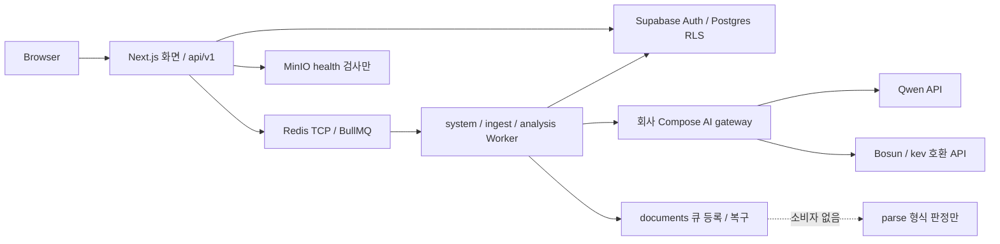
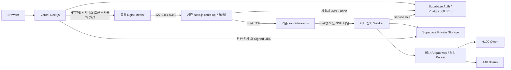
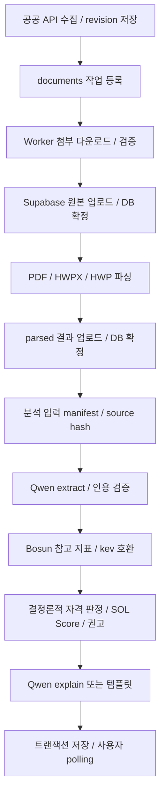

# SOL RADAR — Redis HTTPS 연동·Supabase Storage 전환 계획

> **후속 실행 승인:** 2026-10-21 사용자 “전환 계획에 따라서 전환하자” 지시로 MinIO→Storage Task 3·4 구현을 진행한다. 아래 최초 Phase 1 승인 제한은 당시 이력이다. 클라우드 DDL 적용·실제 운영 배포는 구체적 변경 검토와 별도 확인 규칙을 유지한다. 구현 계약은 `polaris/specs/in-progress/2026-10-21-supabase-storage.md`, 결정은 ADR-048이다.


> **구현자에게:** `superpowers:executing-plans`로 단계별 작업한다. 최초 요청은 조사·계획서 작성만 승인했고, 후속 지시로 **Phase 1 Gateway 로컬 코드·테스트만 승인**됐다. 현재 실행 범위는 아래 Task 2다. 운영 컨테이너·Nginx·DB·Vercel production 변경과 MinIO/Storage/parser 다음 단계는 별도 승인 대상이다. 실행 결과와 미검증 항목을 구분하며 과거 조사 기록은 아래에 보존한다.

> **후속 포트 조사 반영(2026-10-21):** 사용자가 회사 Redis `127.0.0.1:6379`의 PONG, Gateway용 `127.0.0.1:6380`의 미점유, Nginx `/redis/` → `http://127.0.0.1:6380/` 설정과 `nginx -t` 통과를 확인했다. 포트와 기존 프록시는 확정 입력으로 사용한다. **기존 Nginx·다른 운영 서비스는 수정하지 않으며 reload/restart도 하지 않는다. 운영 컨테이너 생성·중지·삭제·network/env/설정 변경은 별도 실행 승인 전에는 하지 않는다.** 기존 API 재사용·Storage 전환·문서 신규 구현 계획은 그대로 유지한다.

**목표:** Vercel Next.js가 회사 Redis의 업무 기능을 HTTPS로 사용하고, SOL RADAR의 MinIO 의존성을 Supabase Storage로 교체한 뒤 미완성 문서 처리 파이프라인을 신규 구현한다.

**구조:** 기존 Next.js 업무 API를 같은 코드의 회사 서버 `redis-api` 런타임으로 재사용한다. BullMQ·ioredis는 회사 서버에서 TCP로 Redis에 연결하고 Vercel은 인증된 HTTPS 접수만 수행한다. 상시 Worker·AI gateway·파서는 회사 서버, Qwen은 H100, Bosun은 A40, 파일·DB·Auth는 Supabase에 둔다.

**기술:** Next.js 16.4.1, Supabase JS/SSR, PostgreSQL/RLS, BullMQ 6.3.16 계열, ioredis 6.0.0 계열, Python/FastAPI, Docker Compose, 기존 Nginx. 별도 NestJS 서버·Redis 명령 중계 서비스·새 메시지 브로커는 도입하지 않는다.

**요구사항 근거:** 2026-10-21 사용자의 본 요청 1~11절 및 [[CLAUDE]], [[00-README]], [[02-ARCHITECTURE]], [[03-AI-PIPELINE]], [[04-DATABASE]], [[05-API-SPEC]], [[07-DATA-PIPELINE]], [[08-SCORING]], [[09-SECURITY]], [[10-DEPLOYMENT]], [[11-TESTING]], [[12-ROADMAP]], [[15-DATA-CONTRACTS]], [[16-DECISIONS]], [[17-CLAUDE-IMPLEMENTATION]]. `polaris/mission.md`는 없다. 최초 조사 때 구현 스펙은 없었으며 후속 사용자 승인 범위인 Gateway Phase 1을 `polaris/specs/done/2026-10-21-redis-http-gateway.md`와 ADR-045에 기록했다.

## 1. 조사 범위와 결론

2026-10-21 작업 트리와 HEAD `086ac1e`를 조사했다. 기존 미커밋 변경·Vercel Services 구성·직원 200명 보강을 현황에 포함했다. 같은 날 작성된 [[2026-10-21-supabase-infrastructure-consolidation|선행 인프라 검토안]]은 참고 자료이며, **회사 `/redis/`·6380 포트·서비스 토큰·단계별 산출물은 본 계획안으로 구체화**한다. 둘 다 아직 실행 승인이 아니다.

| 구분 | 확인 결과 | 판단 |
| --- | --- | --- |
| Redis 외부 경로 | 이번 조사에서 `GET https://acropolissg.com/redis/health` → **502**, `curl` 인증서 검증 결과 0 | TLS 접속은 정상. HTTP upstream 복구 전이며 Redis PING 성공과 별개 |
| 회사 서버 내부 | 사용자 제공: `/data/www/ai_workspace/sol-radar`, Nginx 1.24.0, `sol-radar-redis`, `redis:7.4-alpine`, 호스트 `127.0.0.1:6379`, PONG | SSH/Docker로 재검증하지 않았다. 공유 Nginx와 기존 Redis를 재생성하지 않음 |
| Gateway 포트 조사 | 후속 사용자 확인: `127.0.0.1:6380` 점유 프로세스 없음, `/redis/` → `http://127.0.0.1:6380/` 설정 완료, `nginx -t` 통과 | **6380을 HTTP 전용으로 확정**. 미실행 upstream으로 인한502이며 Nginx 변경 작업은 필요 없음 |
| 저장소 Compose | `infra/compose.yaml`: Redis `8.8.3-alpine`, 호스트 포트 기본 **6380**, 프로젝트명 `sol-radar-stack` | 회사 현황과 다름. 그대로 실행하면 HTTP 6380 충돌·별도 Redis 생성 위험 |
| 기존 업무 HTTP API | 분석·수집 접수와 DB 상태 조회가 Next.js Route Handler로 존재 | 기존 API 재사용을 권장. 범용 Redis REST Gateway 신규 구현은 불필요 |
| MinIO | Compose·환경검사·readiness·smoke 의존성 있음. SDK·저장 어댑터·버킷 생성 코드 없음 | 설정 제거와 파일 저장 신규 구현을 구분. 실제 object 존재는 별도 조사 필요 |
| 문서 처리 | documents 큐 생산·복구, fixture fetcher, 형식 판정, DB 열·reader 계약은 존재 | 실 다운로드·소비자·저장·PDF/HWP/HWPX 파서는 신규 구현 |
| Supabase | DB/Auth 연결 코드·마이그레이션 존재. Storage 버킷/정책/어댑터 정의 없음 | Pro 사용은 사용자 제공 사실. 클라우드 bucket·사용량·파일 목록은 미조회 |

비밀 파일 내용을 읽거나 출력하지 않았다. 회사 SSH 접속·Docker inventory·인증된 클라우드 Storage/API 조회·GPU 추론은 실행하지 않았다. 따라서 **MinIO 데이터가 없다는 판정이나 운영 E2E 성공은 아직 없다.**

### 1.1 변경 승인 시 갱신할 정본

- ADR-005·017의 MinIO 저장 원칙을 Supabase Storage로 바꾸는 새 ADR을 추가한다. 기존 ADR을 과거부터 Storage를 쓴 것처럼 덮어쓰지 않는다.
- ADR-044와 현재 `vercel.json`은 공개 web + 내부 Python ai + `AI_GATEWAY_URL` binding이다. 이번 목표는 **Vercel web, 회사 AI gateway/Worker**이므로 새 health 경로 검증 후 binding·Vercel ai 배치를 정리한다. 현재 구성은 아직 수정하지 않는다.
- 웹의 service role 금지, 조직 RLS, API·worker의 현재 Next.js 위치, 해커톤 이후 NestJS 전환, `KEV_*`·`/kev` 호환은 유지한다.
- 가상 직원은 ADR-043의 **200명**이 기준이다. 27명만 분석하는 과거 설명을 현황으로 재사용하지 않는다.
- 이번 인프라 변경은 자동 투찰·승률 예측·모바일·결제를 추가하지 않는다.

## 2. 현재 시스템 아키텍처와 Redis 호출 지점



현재 작업 트리의 별도 Vercel `ai` 서비스는 웹 health용 연결도 가진다. 외부 Worker가 실제 사용하는 gateway와 웹이 검사하는 gateway가 다를 수 있다.

| 용도 | 구현·파일 | 현재 동작 / 전환 시 보존할 것 |
| --- | --- | --- |
| Redis 클라이언트 | `web/package.json`, `web/app/_lib/redis-client.ts` | ioredis, BullMQ. HTTPS URL을 `REDIS_URL`에 넣는 방식은 동작하지 않음 |
| 분석 생산자 | `web/app/_lib/{work-deps,analysis-queue}.ts`, `web/server/bids/bids.service.ts` | 권한 → 조직 limiter → 입력/멱등 검사 → DB QUEUED → analysis 큐. enqueue 실패 정리 있음 |
| 수동 수집 생산자 | `web/app/_lib/{ingestion-deps,ingest-queue,idempotency-store}.ts`, `web/server/ingestion/ingestion-admin.service.ts` | ADMIN, org별 제한, 24시간 멱등 키, BullMQ jobKey. `ingest_runs`는 Worker가 생성 |
| Rate Limit | `web/app/_lib/rate-limit.ts` | Lua `INCR`+첫 `EXPIRE`, 조직당 분석 **30회/분**, 수집 **5회/분**, 고정 창. 분리된 키 유지 |
| 멱등성 | `idempotency-store.ts`, `bids.service.ts`, DB UNIQUE | 수집 `SET NX EX`, 분석 DB 조직+키 UNIQUE, 동일 키 다른 요청 409. Redis claim·enqueue·DB 전체가 하나의 트랜잭션인 것은 아님 |
| 공공 API 예산 | `web/worker/quota-store.ts`, `web/server/ingestion/{quota,quota-store,ingestion.service}.ts` | `quota:{serviceId}:{YYYYMMDD}` KST, TTL 2일, 90% 보조 조회 중단, 코드 22 이후 소진. **조회→실호출→사후 증가**이므로 다중 Worker 동시성에서 엄밀한 상한 보장 미완성 |
| Worker | `web/worker/main.ts` | system·ingest·analysis 소비, live 30분 기본 수집 scheduler, DB notification outbox polling. documents는 생산/복구만 등록 |
| 분석 복구 | `web/worker/{analysis-job,analysis-reconcile,analysis-runtime}.ts` | 3회/2초 exponential backoff, CAS, 기본 10분 stale. 임의 QUEUED DB 행의 자동 enqueue는 보안상 금지 |
| 문서 큐 | `web/server/ingestion/ingestion.queue.ts`, `web/worker/documents-reconcile.ts` | revision UUID+created_at 기반 jobId, 3회 재시도, 완료 1일·실패 7일 보존 |
| readiness | `web/server/health/{health.repo,health.service}.ts` | 웹에서 Redis TCP·MinIO HTTP·AI health 검사. Vercel용으로 교체 필요 |

**Vercel의 TCP 연결 제거 대상:** 분석 POST, 수집 POST, `/health/ready`와 이를 쓰는 화면 상태 조회다. 공고·분석 결과·수집 이력의 DB 조회, 자격 WHAT-IF 순수 계산은 Redis가 필요 없다. 의존성 객체 생성이 Redis 연결을 만들지 않는다는 점도 시험한다.

## 3. 최종 배포 아키텍처와 선택지



| 방안 | 장점 | 비용·제약 | 결정 |
| --- | --- | --- | --- |
| **기존 Next.js API를 회사 서버에서도 실행** | 기존 인증·RBAC·RLS·limiter·멱등·BullMQ 구현 재사용 | 같은 SHA의 Vercel/회사 2개 배포, 실행 역할·허용 경로 제한 필요 | **권장** |
| 별도 전용 Node Gateway | 경량 런타임 | 기존 접수 로직 분리·인증 재조립·API 중복 위험 | Next.js 패키징으로 요구를 충족할 수 없다는 증거가 있을 때만 재검토 |
| Redis TCP 공개 또는 임의 명령 HTTP 중계 | 해당 없음 | 요구 위반·BullMQ blocking/Lua 계약 문제·공격면 증가 | 채택하지 않음 |

`redis-api`는 배포 서비스 이름이며 새 백엔드 프레임워크가 아니다. 화면·사용자 API의 외부 주소는 기존 Vercel `/api/v1`을 유지한다. 회사 `/redis/`는 서버 간 업무 API 경로이고 브라우저에는 알려주지 않는다.

### 3.1 실행 역할과 네트워크

- 신규 `SOL_DEPLOYMENT_ROLE=frontend|redis-api|standalone`. 운영 배포는 역할 필수, 누락·알 수 없는 값은 기동 실패. `standalone`은 기존 로컬 개발/격리 시험용이다.
- `frontend`: 두 접수 POST만 HTTPS로 전달. 회사 API 인증 실패 때 TCP로 우회하지 않는다. GET·WHAT-IF는 기존 DB/RLS를 사용한다.
- `redis-api`: 허용한 업무 경로와 `/health`만 실행. 나머지 화면·Server Action·구형 API·`/_next` 경로를 거부한다. `proxy.ts`가 현재 `/api`·`/health`를 제외하므로 **프록시에만 인증을 추가해서는 보호되지 않는다**. 각 허용 handler/공통 가드와 upstream 접근 제한을 함께 구현한다.
- 호스트 `127.0.0.1:6380` → 컨테이너 `3000`. Docker 컨테이너 안 HTTP listener는 컨테이너 네트워크에서 수신하고 **호스트 publish만 loopback**으로 제한한다. 0.0.0.0:6380 게시 금지.
- 회사 HTTP 포트는 **6380으로 고정**하고 기존 Nginx를 맞추기 위해 포트를 바꾸지 않는다. 기존 `infra/compose.yaml`의 로컬 Redis 호스트 기본6380은 회사 배포에 가져오지 않는다. 같은 호스트의 로컬 시험이 필요하면 Redis는 게시하지 않거나 충돌 없는 별도 loopback 포트를 사용한다. 실제 회사 설정 변경은 별도 승인 대상이다.
- 회사의 기존 `sol-radar-redis`·6379·버전·볼륨을 그대로 사용한다. 회사 배포 파일에는 새 Redis 서비스를 정의하지 않고, 소유자 확인 후 전용 external Docker network에 연결한다. 컨테이너에서 호스트 `127.0.0.1:6379`는 Redis 주소가 아니다.
- **Redis 호스트와 GPU Worker 호스트가 같은지는 미확인**이다. 같은 호스트면 Docker 사설 network를 사용한다. 다른 호스트면 기존 내부망의 제한된 TLS Redis 연결 또는 관리되는 OpenSSH 로컬 포워딩을 먼저 검증한다. Vercel 요청으로 BullMQ 소비를 중계하지 않는다.
- 별도 GPU 호스트의 SSH 터널을 선택하면 GPU host의 loopback 포트만 열고 known_hosts·터널 재접속·부팅 복구를 관리한다. Linux Worker 컨테이너의 host network 사용 여부 및 AI gateway loopback 경로를 전용 배포 설정으로 맞춘다. 6379 외부 공개나 검증 없는 SSH host key 수락으로 해결하지 않는다. **이 연결 확인은 원격 GPU Worker 배포의 선행 조건**이다.
- Qdrant와 다른 회사 서비스는 이번 변경에서 삭제·재구성하지 않는다.

## 4. Redis HTTP API 명세와 인증

### 4.1 경로·응답

기존 Nginx `location /redis/ { proxy_pass http://127.0.0.1:6380/; }`는 접두어를 제거한다. 따라서 외부 `/redis/api/v1/...`가 upstream `/api/v1/...`로 간다. `/redis/health`는 upstream `/health`다. [Nginx proxy_pass 공식 규칙](https://nginx.org/en/docs/http/ngx_http_proxy_module.html#proxy_pass).

| 외부 경로 (`https://acropolissg.com` 기준) | 메서드 | 인증 | 결과 |
| --- | --- | --- | --- |
| `/redis/health` | GET | 서비스 토큰 | 200 준비 / 503 핵심 의존성 장애. Redis·DB·Storage·AI 상태 요약, 비밀/연결 문자열 없음 |
| `/redis/api/v1/bids/{bidId}/analyses` | POST | 서비스 토큰 + 사용자 JWT | 기존 202 `{analysisId,status,deduplicated,pollUrl}` |
| `/redis/api/v1/analyses/{analysisId}` | GET | 동일 | 기존 분석 상태/결과. 다른 조직 404 |
| `/redis/api/v1/admin/ingestion/runs` | POST | 동일 + 업무 ADMIN | 기존 202 IngestionRun |
| `/redis/api/v1/admin/ingestion/runs/{runId}` | GET | 동일 + 업무 ADMIN | 기존 수집 상태. Worker 시작 전 QUEUED 조회 보완은 §4.3 |

목록 GET·새 작업 취소·임의 retry·raw Redis GET/SET/EVAL·큐 이름 임의 지정은 허용하지 않는다. 상태의 정본은 PostgreSQL이며 BullMQ completed 상태만으로 분석 성공을 반환하지 않는다. 브라우저 polling은 기존 Vercel `pollUrl`을 사용한다. 회사 URL을 응답에 넣지 않는다.

공통 오류는 기존 JSON envelope를 유지한다. 인증 실패 401, 역할 403, 대상 없음 404, 입력 400, 멱등 충돌/실행 중 409, 제한 429 + `Retry-After`, 의존성 장애 503이다. Nginx 502/504·비 JSON 응답은 Vercel에서 안전한 503 `SERVICE_UNAVAILABLE`로 바꾸고 본문 HTML이나 upstream 정보를 노출하지 않는다.

### 4.2 서비스 인증과 전달 규칙

1. 브라우저는 기존 Vercel API로 요청한다. `requireBusinessUser`의 세션·계정 상태·가입 완료·멤버십·CSRF를 먼저 검증한다. 쿠키 요청의 `X-Requested-With: sol-radar` 규칙을 유지한다.
2. Vercel이 검증된 access token을 `Authorization: Bearer <user JWT>`로 전달한다. 전체 Cookie·refresh token은 전달하지 않는다. 별도 `X-Sol-Service-Token` 헤더에 `REDIS_API_TOKEN`을 넣는다. 두 인증을 같은 Authorization 헤더에 섞지 않는다.
3. 회사 API는 32바이트 이상 난수 서비스 토큰을 상수 시간 비교하고 사용자 JWT·현재 조직/RBAC를 다시 확인한다. 요청의 `orgId/userId/role` 헤더를 신뢰하지 않는다. 업무 DB는 **anon key + 사용자 JWT**로 접근한다.
4. `/health`만 사용자 JWT 없이 서비스 토큰으로 허용한다. 토큰 누락/오류는 건강 상태와 관계없이 401이다. 정상 토큰의 Redis 실패는 503이다. Nginx에서 토큰을 자동 삽입하지 않는다.
5. 외부가 보낸 `X-Sol-*`와 forwarded 인증 관련 헤더는 폐기하고 Vercel이 다시 만든다. base URL은 환경변수의 고정 HTTPS origin/path, redirect `manual`, TLS 검증 필수, URL 사용자정보/query/fragment 금지다.
6. 요청 본문은 기존 **16 KiB** 상한, 응답은 해당 기존 DTO로 검증한다. Idempotency-Key·허용 Content-Type·Retry-After·상관 request ID만 필요한 방향으로 전달한다. Set-Cookie와 임의 hop-by-hop 헤더는 전달하지 않는다.
7. 접수 HTTP deadline은 **15초**, backend Redis 명령은 기존 3초 상한이다. 서비스 토큰·JWT·signed URL을 로그/트레이스/오류에 넣지 않는다. 토큰은 현행+이전 값의 짧은 교체 기간을 두고 즉시 폐기할 수 있게 한다.

이 방식은 TLS + 두 인증으로 요청자를 제한한다. HMAC timestamp/nonce 기반 요청 서명은 이번 필수 Gateway에 추가하지 않는다. 요청 재생의 업무 부작용은 멱등 키와 DB 제약으로 막는다. 선행 검토안의 HMAC ingress 제안보다 운영을 단순화한 선택이며, 아래 **내부 dispatch 증명**은 접수 API 공개 인증과 목적이 다르다.

브라우저→회사 API 직접 호출이 없으므로 새 wildcard CORS는 필요 없다. CORS는 서비스 인증을 대체하지 않는다. Production/Preview의 API 토큰·Supabase·Redis 실행 환경은 분리하고 Preview가 운영 수집을 실행하지 못하게 한다.

### 4.3 재시도·멱등성과 DB/큐 경계 보강

**기존 기능 이전:** Lua limiter, 수집 `SET NX EX`, 분석 UNIQUE/CAS, 현재 실패 정리와 3회 재시도를 먼저 같은 동작으로 보존한다. 두 런타임에서 limiter를 각각 호출하지 않는다. Vercel은 인증/전달, 회사 API만 업무 limiter/접수를 담당한다.

**신규 신뢰성 보강:** 현재 분석 DB 생성→Redis 등록 사이 crash와 수집 멱등 claim→등록 사이 crash는 원자적이지 않다. 이를 그대로 두고 무손실을 보장한다고 하지 않는다. Phase 5에서 `job_dispatches`를 도입한다. 기존 알림 `outbox_events`와 다른 **접수 작업의 durable dispatch 기록**이다.

- UUID 작업 ID·org·요청자·작업 종류(analysis/ingest)·멱등 키·본문 hash·run ID·모드·입력 버전·접수 시각·dispatch 상태를 보존한다. `(org_id, kind, idempotency_key)`는 UNIQUE다.
- 분석 run과 dispatch를 사용자 권한의 DB 트랜잭션/RPC로 함께 생성한다. 수집도 Worker 시작 전 dispatch를 정본으로 QUEUED 상태를 조회하게 한다. Redis 멱등 기록만 남은 상태를 접수 완료로 재생하지 않는다.
- 사용자가 PostgREST로 넣은 가짜 작업이 limiter를 우회하지 못하도록 회사 접수 코드가 limiter 통과 후 **별도 `JOB_DISPATCH_SIGNING_SECRET`**으로 canonical dispatch를 서명한다. 버전·key id·ID·org/user·kind·payload hash·run ID·모드·입력 버전·접수 시각을 모두 묶는다. Worker는 서명 및 실제 run/payload 일치를 검증한 dispatch만 발행한다. 사용자 입력 서명·임의 QUEUED 행은 실행하지 않는다.
- `job_dispatches` RLS는 자기 조직+업무 역할의 제한된 insert/select만 허용하고 갱신·발행 상태 변경은 Worker만 한다. 서명 키는 회사 API/Worker만 소유한다. RPC는 security invoker를 우선하고 위험한 광역 실행 권한을 열지 않는다.
- Redis 등록 응답 유실은 같은 jobId로 재발행한다. 실행은 at-least-once, 결과 저장은 CAS/고유키로 중복 부작용을 차단한다. exactly-once 실행이라고 부르지 않는다.
- durable 접수 후 Redis 발행이 실패해도 DB에서 복구 가능한 QUEUED로 202를 반환한다. **기존 enqueue 실패 503/FAILED와 달라지는 장애 경로**이므로 API/ADR·회귀 시험에 명시한다. limiter/DB/dispatch 검증 실패 전에는 503이고 접수 성공을 반환하지 않는다.
- Vercel의 자동 접수 재시도는 네트워크/502/503/504에 **최대 1회**, 동일 업무 키·동일 본문, 짧은 jitter, 전체 15초 이내다. 키가 없으면 Vercel에서 한 번 생성해 재시도에도 고정한다. 400/401/403/409는 자동 재시도하지 않고 429는 Retry-After를 사용자 흐름에 전달한다.

### 4.4 공공 API 예산의 원자성

기존 `INCRBY` 자체는 원자적이지만 허용 여부 확인·API 전송·증가·TTL·코드22 처리는 전체로 원자적이지 않다. 이 보강은 단순 HTTPS 어댑터 변경과 별도 Task로 취급한다.

- `QuotaStore.reserve(serviceId, at, purpose, attemptId)`를 추가한다. Lua 한 번으로 현재 값 검증→상한/90% 정책 판정→허용된 1회 예약 증가→TTL을 처리한다. `purpose=PRIMARY|AUXILIARY`, `attemptId`는 실제 HTTP 전송 시도별 식별자다.
- 목록·보조 3종·페이지네이션·재시도 **각 실제 HTTP 전송 직전** 예약한다. 사후 `retried+1` 일괄 증가를 제거해 이중 차감을 막는다. 보조 묶음 전체 예약으로 미호출까지 실제 호출처럼 기록하지 않는다.
- 같은 예약 응답 유실을 재조회할 때는 같은 attemptId로 중복 차감하지 않는다. 전송 자체를 재시도하면 새 attemptId다. 예약만 하고 crash한 경우 서버 도달 여부를 알 수 없으므로 환급하지 않고 보수적으로 사용 처리한다. 실제 응답 호출 수와 예약 사용량을 별도 지표로 둔다.
- 코드22는 Lua로 `used=max(used,dailyLimit)` + TTL. 숫자 아닌 counter·Redis 장애·예산 불명은 fail-closed다. KST 날짜 경계는 **요청 전송 직전 시각** 기준이다.
- 현재 키·기존 당일 사용량을 유지한다. 신규 예약 처리로 전환할 때 구 Worker를 중지/drain한 뒤 단일 버전만 실행한다. 초기화·FLUSHDB로 예산을 0으로 만들지 않는다.
- 동일 서비스키를 다른 프로젝트도 사용하면 이 Redis만으로 제공자 전체 예산을 정확히 알 수 없다. 서비스키 공유 여부와 실제 daily limit을 운영자가 확인하고 사용량 합산/보수적 한도를 정해야 한다.

## 5. MinIO 제거 대상과 데이터 확인

### 5.1 파일별 제거·교체 범위

| 대상 | 승인 후 변경 |
| --- | --- |
| `infra/compose.yaml` | SOL 전용 `minio` service·`miniodata` 선언·Worker의 MINIO_ROOT_* 전달 제거. 회사 Redis 보존과 별개 |
| `infra/env/{demo,ai-local}.env.example`, `web/.env.example` | MINIO_ROOT_USER/PASSWORD·MINIO_HOST_PORT·MINIO_ENDPOINT와 관련 설명 제거, Storage/HTTP 설정 추가 |
| `scripts/check-env.mjs`, `scripts/check-env.test.mjs` | MinIO 필수/placeholder 검사 제거, 실행 역할별 필요한 설정 검사로 교체 |
| `web/server/health/{health.repo,health.service}.ts`와 시험, `web/app/health/ready/route.test.ts` | `/minio/health/live` 제거, 실제 private Storage 읽기/쓰기 검증 결과와 HTTP backend health 사용 |
| `infra/smoke.sh` | minio 컨테이너 검사 제거, Storage·Gateway·documents round trip 추가. 기존 Redis 예시 6380 혼동 수정 |
| `web/server/ingestion/attachment.model.ts`, `web/server/analysis/analysis.service.ts`, `services/ai/src/sol_ai/{parse,settings}.py` | MinIO 구현을 전제하는 현행 주석 갱신. key 함수는 Storage key로 재사용 |
| `web/e2e-auth/support/{work-setup,ingestion-setup,ingestion-fixtures}.ts`, `web/e2e-auth/work-screens.spec.ts` | MinIO 환경 가정·화면 링크 금지 시험을 새 정책에 맞춤. signed URL 노출 시험은 별도 명시 |
| `README.md`, `AGENTS.md`, `CLAUDE.md`, `docs/CLAUDE.md`, 설계 00~05·07·09~12·14~17 | **현재 운영 설명**을 동기화. 과거 evidence·완료 스펙·기존 migration의 MinIO 언급은 이력으로 보존 |
| dependencies/lockfile | 현재 MinIO/S3 SDK 패키지가 없으므로 제거할 SDK도 없음. 관계없는 S3 문자열/의존성은 무작정 삭제하지 않음 |

완전 제거의 기준은 **활성 SOL 실행·설정·배포 의존성 0**이다. 역사 기록까지 문자열을 0개로 만들기 위해 append-only migration·감사 증거를 수정하지 않는다.

### 5.2 운영 데이터 조사와 제거 게이트

회사 서버에 배포할 때 먼저 아래를 읽기 전용으로 확인한다. 이번 조사에서는 실행하지 않았다.

1. Docker label·mount·network로 SOL 전용 컨테이너/볼륨 소유자를 확정한다. 이름의 `minio` 포함 여부만으로 소유자를 판정하지 않는다. 기존 회사 다른 프로젝트는 제외한다.
2. 승인된 MinIO 접근 수단으로 bucket별 object 수·총 bytes·key·SHA-256 manifest를 수집한다. credential이나 원문을 로그에 남기지 않는다. 단순 볼륨 크기·HTTP health만으로 비어 있다고 판정하지 않는다.
3. DB의 `bid_documents.object_key/text_object_key` 및 임시/학습 파일 참조와 object manifest를 대조한다. 실제 rows/objects가 모두 0이면 ‘데이터 이전 없음’으로 기록한다.
4. 파일이 있으면 신규 업로드를 정지/drain, 읽기 가능한 원본 백업, Supabase 복사, 건수/bytes/전수 SHA 검증 후 참조를 전환한다. 검증 실패 시 제거를 중단한다.
5. Storage smoke와 MinIO 없는 기동을 확인한 뒤 **확정한 SOL 컨테이너만** 중지·구성에서 제거한다. 볼륨·object 삭제는 자동화하지 않고 사용자의 별도 삭제 승인 전까지 보존한다.

`docker compose down -v`, 광역 prune, `--remove-orphans`, 다른 프로젝트 `mc rm`은 이 전환 절차에 포함하지 않는다.

## 6. Supabase Storage 설계

### 6.1 버킷·파일 경로·접근

저장소에는 실제 bucket 정의가 없고 기존 설계의 소문자 kebab-case를 따른다. 생성 전 클라우드 이름 충돌·소유자·설정을 조회한다.

| private bucket | 저장 대상 / 경로 |
| --- | --- |
| `bid-documents` | 원본 PDF/HWP/HWPX 및 첨부. 기존 `raw/bids/{bidId}/{revisionId}/{sha256}.{ext}` 유지 |
| `bid-parsed` | `parsed/bids/{bidId}/{revisionId}/{rawSha256}/{parserVersionHash}/result.json`에 text/pages/blocks/quality·text SHA 보존 |
| `ai-training` | 필요한 export만 `orgs/{orgId}/datasets/{datasetVersion}/{sha256}.{ext}`. 실제 사용 단계에서 생성, manifest·출처·org 권한 필수 |

- 원본 상한은 기존 **52,428,800 bytes(50 MiB)**, 0 byte 거절. MIME·확장자뿐 아니라 magic bytes로 판정한다. global/bucket 한도를 모두 맞추고 실제 project 설정을 확인한다.
- `application/pdf`, `application/x-hwp`, `application/hwp+zip`, `application/zip`, XLSX MIME 및 명시적 unknown 원본용 `application/octet-stream`만 허용한다. ZIP/XLSX/unknown을 보관하더라도 **지원 parser 성공으로 표시하지 않는다**. parsed는 JSON MIME, 학습은 승인된 JSON/JSONL/ZIP만 별도 한도를 둔다.
- 원본·결과 key는 checksum/version 기반 immutable, `upsert:false`. ‘이미 존재’ 400/409 응답은 현재 SDK/Storage 에러 코드를 확인하고 크기/hash가 같은 object인지를 검증한 뒤 재사용한다.
- service role은 **회사 Worker·운영 CLI**에서만 사용한다. Vercel·Next.js redis-api·브라우저·파서 하위 프로세스·GPU 모델 서버에는 넣지 않는다. 기존 `getSupabaseAdmin()`을 Worker 저장 어댑터에서 재사용한다.
- 원본 다운로드는 신규 `GET /api/v1/bids/{bidId}/documents/{documentId}/download-url`: 업무 사용자·DB RLS·문서/공고 연결·download OK 확인 후 **사용자 JWT**로 60초 signed URL을 생성한다. 사용자로부터 bucket/path를 받지 않는다. 응답 `Cache-Control:no-store`, attachment 다운로드다.
- `storage.objects` SELECT 정책은 `bid-documents`의 **DB 참조가 있는 OK object**와 활동 중 업무 사용자에만 연다. anon 읽기와 authenticated 쓰기는 열지 않는다. 임의 업로드/목록 허용 범위를 넓히지 않는다. `bid-parsed`는 Worker 전용으로 시작한다.
- 공고/원본은 현행 DB에서 조직 공용 자료다. 가짜 org 경로로 소유권을 만들지 않는다. 회사 프로필·인력·학습 자료는 `org_id` 정책으로 격리하고 공용 공고 정책을 적용하지 않는다.
- signed URL은 만료 전 양도 가능한 권한이므로 로그에 넣지 않는다. 로그아웃/계정 정지 후 이미 발급된 URL의 즉시 폐기를 보장하지 않는다.

[Supabase private bucket](https://supabase.com/docs/guides/storage/buckets/fundamentals), [Storage 권한·service key](https://supabase.com/docs/guides/storage/security/access-control), [파일 한도](https://supabase.com/docs/guides/storage/uploads/file-limits)를 대조했다. 서비스키가 RLS를 우회하므로 Worker의 org/path 검증은 별도로 필요하다.

표준 업로드는 **6 MB 초과에서 resumable 방식을 권장**한다. 초기 구현은 기존 SDK immutable upload·제한된 재시도로 50 MiB/연결 중단 시험을 수행하고 통과하지 못하면 Worker에 TUS adapter를 추가한다. 이 경우 관련 패키지·부분 업로드 정리도 Task 4 범위에 포함한다. [Supabase 업로드 안내](https://supabase.com/docs/guides/storage/uploads/standard-uploads).

### 6.2 메타데이터와 일관성

기존 `public.bid_documents`를 논리적 문서의 정본으로 확장한다. 이미 있는 bid_id, revision_id, name, original_url, object_key, sha256, mime_type, size_bytes, download_status/error, parse_status/error, parser_id/quality, text_object_key, page_count, created_at은 재사용한다. **같은 의미의 documents 테이블을 다시 만들지 않는다.**

추가 열: `storage_bucket`, `text_storage_bucket`, `uploaded_at`, `parsed_at`, `download_error_message`, `parse_error_message`, `raw_storage_id`, `parsed_storage_id`, `processing_attempt_id`, `processing_lease_until`. 오류 메시지는 안전한 최대 500자 요약이고 원본 URL query·token·문서 본문을 포함하지 않는다. parser 버전과 원본/text SHA는 parsed manifest에도 보존한다.

신규 `document_storage_objects`는 논리적 문서 복제가 아니라 **물리 object의 업로드/삭제 lease 원장**이다. bucket+path UNIQUE, SHA/size/MIME, 상태 `UPLOADING|STORED|DELETE_PENDING|ERROR`, lease token/기한·오류·시각을 둔다. 사용자 직접 권한은 닫고 Worker만 조작한다. `bid_documents`의 기존 key와 원장 참조가 어긋나지 않게 원자적 확정 RPC로만 연결한다.

1. DB에 object 업로드 의도·lease를 먼저 남긴다. 동일 bucket/path 동시 업로드는 원장 고유키/CAS로 조정한다.
2. Worker가 검증한 바이트를 Storage API로 업로드하고 hash/size를 확인한다. 실패 시 원장 ERROR, 문서 download 실패 사유 기록, 재시도 시 재사용 여부 확인이다.
3. object STORED·문서 download OK/parse PENDING·원본 참조를 **DB 트랜잭션으로 함께** 확정한다. DB 실패 시 object를 바로 삭제하지 않고 원장으로 재연결/정리한다. 다른 문서가 같은 object를 참조할 수 있기 때문이다.
4. 파싱 결과도 별도 immutable upload 후 text 참조·parse 상태를 함께 확정한다. 원본 업로드 성공과 파싱 실패를 서로 다른 상태로 남긴다.
5. `storage-reconcile`은 만료 lease·참조 누락·고아 후보를 점검한다. 새로 만든 SOL object 중 24시간 이상 지난 무참조 후보만 삭제 대상으로 잡고, 같은 object의 연결 작업과 삭제 작업이 같은 lease/CAS를 사용한다. DELETE_PENDING에서는 새 참조를 허용하지 않고 복구/재업로드 후 재시도한다.
6. Storage object 변경·삭제는 **Storage API**로만 한다. `storage.objects` SQL DELETE로 파일을 지우지 않는다. 임시 로컬 파일은 작업별 디렉터리+finally 정리, crash 잔존은 TTL 정리하며 원본은 임시 폴더에만 의존하지 않는다.

현재 `UNIQUE(revision_id,sha256)`는 같은 내용을 가진 첨부 두 행이 다운로드 완료될 때 충돌할 수 있다. 새 migration에서 이를 일반 checksum 인덱스로 바꾸고 물리 object를 재사용한다. 원본 파일명·URL·document ID·근거 참조는 모두 보존하며 SHA가 같다는 이유로 문서 행을 삭제하지 않는다. checksum은 중복 **파일 바이트** 판정이지 서로 다른 문서 참조를 없애는 기준이 아니다.

[Supabase Storage schema 지침](https://supabase.com/docs/guides/storage/schema/design): 정책/인덱스 외 managed schema 구조를 임의로 바꾸지 않고 object I/O는 API를 사용한다.

## 7. DB 마이그레이션과 접근 정책

신규 번호는 실행 시 최신 migration 뒤로 배정한다. 이미 클라우드에 적용한 `20261021000600_enrich_all_demo_people.sql` 등 기존 migration은 수정하지 않는다.

| 새 migration 목적 | 변경 / 검증 |
| --- | --- |
| `document_storage` | §6의 bid_documents 열·lease 원장·외래키·상태 제약·checksum 중복 정책·Worker 확정 RPC. 사용자 권한 최소화·RLS 즉시 적용 |
| `document_storage_access` | private 원본의 storage.objects SELECT 정책만 추가, 기존 다른 bucket 정책은 유지. public bucket·anon 허용 없음 |
| `trusted_job_dispatch` | §4.3 접수 원장·org/멱등 고유키·RPC·RLS. 사용자 갱신 차단·Worker 서명 검증과 통합 시험 |
| `analysis_source_version` | `requirement_extractions.source_hash`, `score_runs.analysis_input_version`, 새 캐시 유일성/조회 키·진행 중 중복 판정 보강. legacy 행과 과거 snapshot 보존 |

버킷은 멱등 운영 스크립트 `scripts/ops/ensure-storage-buckets.mjs`가 Storage API로 생성/설정 검증한다. 이름 충돌·이미 public·소유 불명은 강제로 바꾸지 않고 실패한다. 버킷 생성은 `db:push`에 포함됐다고 가정하지 않는다. DB DDL과 bucket 준비 결과를 별도 증거로 남긴다.

`scripts/supabase-pglite.mjs`의 모사는 실제 사용하는 최소 `storage.objects`·RLS 정책 시험까지 확장하고 `scripts/database.test.mjs`와 타입 생성기가 같은 모사를 사용한다. PGlite 통과는 실제 Storage HTTP 권한 검증을 대체하지 않는다. 새 public 표는 RLS·REVOKE 후 명시적 GRANT, 함수 search_path/EXECUTE, org 격리를 검사한다. 사용자 직접 실행 함수는 security invoker를 우선한다.

실행 단계의 검증은 `pnpm db:types`, `pnpm test:db`, `pnpm check:db-types`, 승인된 `pnpm db:push --check`→`pnpm db:push`→`pnpm db:verify`다. DDL 연결 문자열은 운영 CLI 전용이며 Worker/Vercel에 배포하지 않는다. 이번 계획 작성에서 이 명령들로 클라우드를 변경하지 않는다.

## 8. 문서 처리 파이프라인 — 신규 구현

### 8.1 실행 순서와 기존 AI 책임 보존



기존 구현 `analysis.service.ts`는 추출→Bosun consult→`analyze()` 규칙 계산→설명→저장 순서다. 이를 유지한다. 자격 검증의 최종 권한은 규칙 엔진에 있으며 Bosun 분포를 SOL Score에 더하거나 자격 판정을 뒤집지 않는다. 설명용 Qwen 호출은 결과를 변경하지 않는다.

목표 흐름은 **먼저 문서 작업이 있어야 다운로드할 수 있으므로**, 기존 documents 등록을 수집 직후 유지하고 그 소비자가 다운로드·Storage·parse를 진행한다. 별도 임의 큐를 추가하지 않는다. 분석 작업은 대상 revision의 문서 처리를 기다리는 bounded dependency로 연결한다. 초기 분석 대기는 **300초**로 정해 기본 QUEUED stale 600초보다 짧게 두고, 종료 실패/미지원/시간 초과면 사유가 포함된 부분 입력으로 분석한다. dependency 확인은 RUNNING CAS **이전**에 수행하고 BullMQ delayed 재확인으로 넘기며 active processor 안에서 sleep하지 않는다. 문서 작업 자체는 별도 600초 예산을 가진다. 늦은 문서 완료 이후 새 분석은 새 source_hash를 사용한다.

### 8.2 구현할 소비자와 모드

- 기존 `documentsJobDataSchema`·`toDocumentsJobId`·3회/2초 backoff·1일/7일 보존을 재사용한다. payload에는 IDs와 revisionCreatedAt만 두며 JWT/파일 바이트/signed URL은 넣지 않는다.
- Worker가 DB에서 bid/revision 존재·created_at·demo/live 모드를 재검증한다. reset 뒤 같은 ID의 새 행을 이전 job이 처리하지 못하게 한다.
- 문서별 attempt UUID·lease로 claim하고 checkpoint한다. 성공 원본 재다운로드/재업로드를 생략하고 parse 실패만 재시도할 수 있다. 4xx 인증/형식/암호·손상은 영구 오류, timeout/5xx/일시 Storage·DB 오류는 제한된 재시도다.
- 마지막 시도 실패·stalled 초과 시 소유 lease의 미완료 문서를 명시적 FAILED로 닫는다. 기존 복구기가 같은 retained failed jobId를 다시 add하는 것만으로 회복된다고 가정하지 않는다. DB 확정까지 실패하면 복구기가 terminal job 상태와 만료 lease를 대조해 상태를 닫는다. 새 parser로 재처리할 때는 승인된 운영 명령이 processing generation을 발급해 새 jobId를 사용한다. 공개 임의 retry API는 만들지 않는다.
- live fetcher는 기존 `checkAttachmentUrl/checkRedirect/checkResolvedAddresses`를 재사용하고 검증한 IP로 실제 연결을 고정한다. 자동 redirect를 끄고 매 이동마다 재검증, 3회·30초·50 MiB 상한, chunked 실제 수신 크기 검사, URL query 로그 금지다.
- `mock`: 저장 fixture+mock AI. 실제 공공 API/GPU 호출 없음. 문서 parser는 원래 계약대로 세 모드에 동일 적용하되 지원 adapter가 없으면 UNSUPPORTED다. 시험용 가짜 parser와 실제 parser 성공을 구분한다.
- `fixture`: fixture 파일+실제 Qwen/Bosun, `live`: 공식 API+실제 파일+실제 모델. mode를 접수/Worker/gateway에 일치시키고 자동 mock 전환하지 않는다.

### 8.3 PDF/HWP/HWPX 지원 방법

현재 Python `parse_document()`는 알려진 형식도 `UNSUPPORTED_FORMAT` + `PARSER_NOT_CONFIGURED`를 반환한다. 아래는 **도입 후보**이지 설치·지원 완료가 아니다. 실제 RFP 형식별 10건 이상 비교 후 버전/해시를 고정한다.

| 형식 | 우선 후보 / 대안 | 지원·실패 정책 |
| --- | --- | --- |
| PDF 텍스트층 | `pdfplumber`(MIT), 표/문자 위치 추출. 대안은 정본 후보 `opendataloader-pdf` | 스캔은 `NO_TEXT_LAYER`, 암호 `ENCRYPTED`, 손상 `CORRUPTED`. OCR은 이번 기본 지원 범위에서 제외 |
| HWPX | `python-hwpx`(Apache-2.0), ZIP/XML의 문단·표·텍스트 추출. 대안 `hwpxlib` | ZIP 파일수·해제 크기·경로 제한, XML 외부 entity/네트워크 접근 금지. 실제 페이지를 재현하지 못하면 page를 지어내지 않고 block/char offset으로 근거 표시 |
| HWP 5.0 | 정본 1차 후보 `kordoc` 또는 `rhwp-python`; Python 밖 실행이 필요한 대안 `hwplib`(Apache-2.0, Java) | 실문서·런타임·의존성 비교로 하나 선택. 암호/배포용 보호는 각각 ENCRYPTED/DISTRIBUTION_PROTECTED, 지원하지 않는 버전은 UNSUPPORTED |

공식 upstream: [pdfplumber 동작 범위](https://github.com/jsvine/pdfplumber), [MIT 라이선스](https://github.com/jsvine/pdfplumber/blob/stable/LICENSE.txt), [python-hwpx](https://github.com/airmang/python-hwpx), [kordoc](https://github.com/chrisryugj/kordoc), [rhwp-python](https://github.com/DanMeon/rhwp-python), [hwplib](https://github.com/neolord0/hwplib). 과거 정본의 후보 버전을 최신이라고 가정하지 않는다. 추가되는 transitive dependency와 라이선스는 실제 선택 시 확인한다.

형식별 자격 조항 누락 0·요구사항 번호 재현율 ≥0.95가 지원 판정 기준이다([[03-AI-PIPELINE]] §10.3). 미달은 PARTIAL, 미지원은 UNSUPPORTED로 남긴다. `/parse`의 `ParseResult.text/pages/blocks/quality/parserId/errorCode` 계약과 Unicode 문자 offset 규칙을 보존한다.

파서는 모델·Storage·DB 키 없는 child process에서 실행한다. 입력 문서당 **120초**·문서 job 시도당 **600초**를 초기 상한으로 제안하고 실제 파일 benchmark로 조정한다. CPU/메모리·출력·압축 해제 한도와 child 강제 종료를 둔다. CPU 파싱이 Node event loop/BullMQ lock 갱신을 막지 않게 한다. timeout은 현행 ParseResult enum과 맞춰 `FAILED/PARSER_ERROR` + 안전한 `PARSER_TIMEOUT` warning으로 남긴다. 새로운 errorCode를 추가하려면 Python 계약·DB check·TS·정본을 같은 단계에서 변경한다. `services/ai/parsers/` adapter는 Docker/배포 패키지에도 포함되는지 확인하고 개발 checkout에서만 import 가능한 구현을 금지한다.

### 8.4 늦게 완료되는 문서와 추출 캐시

현재 `analysis-runtime.ts`는 `EMPTY_ATTACHMENT_READER`를 사용하고 캐시 키는 revision/model/prompt다. 문서가 뒤늦게 완료돼도 예전 본문-only 추출을 재사용할 수 있다.

- `document-text.repo.ts` reader를 연결하고 정렬된 본문·구조화 요구조건·document ID/raw SHA·parse 상태·parser version·text SHA manifest로 `source_hash`를 만든다.
- 캐시 키를 `(revision_id, model_name, prompt_hash, source_hash)`로 확장한다. 과거 null/legacy source_hash는 새 문서 기반 분석에서 동등 캐시로 쓰지 않는다.
- `analysis_input_version`은 source_hash·회사 revision·200명 계산 속성/배정 hash·algorithm/model/prompt/question-set 버전을 포함한다. Worker가 실제 사용한 버전을 snapshot에 기록한다.
- gateway health 실패 시 현재처럼 임의 모델의 최근 캐시를 선택하는 경로는 보강한다. 기대 버전을 확인한 캐시만 허용하고 확인 불가면 PARTIAL/재검토로 남긴다.
- 완료된 과거 score_runs·extraction·인용 원문은 갱신하지 않는다. 문서 완료 이후 요청은 새 입력 버전의 run을 생성하고 이전 run과 구분한다.

## 9. 기존 AI·인력 기능의 보존과 실제 미구현 범위

| 요구 기능 | 확인된 상태 | 이 전환의 처리 |
| --- | --- | --- |
| 공고 수집·revision·격리 | 구현됨 | 기존 connector/registry·quota·멱등 회귀 유지 |
| 기업 역량·필수 자격·SOL Score·권고 | 규칙 엔진 구현 | 공식 산식·버전·BID/WATCH/NO-BID·근거 추적 보존 |
| 가상 직원 200명 | DB/fixture/인력 API·FTE 입력 구현 | 200행·가용95.5 FTE·회사/org 격리·snapshot 검증 |
| 직원 자격증·개인 실적 | DB/API 저장·조회됨. **분석 loader의 TEAM_SCORING_COLUMNS는 member_id/role/grade/skills/availability만 읽음** | 저장 데이터를 보존. 개인 자격증/실적을 AI 매칭·인력 적합성에 투입하는 일은 신규 기능으로 별도 계약/시험 필요 |
| 실적 점수 | 현재 company_profiles.past_projects 사용 | 개인 프로젝트를 기업 실적으로 오인해 점수를 올리지 않음 |
| WHAT-IF | 최대10개 회사 자격 가정, snapshot 순수 규칙 재계산, DB 쓰기/GPU 호출 없음 | 이 경로 유지, 200명 입력·동시10명 p95≤5초 실측. 현재 성능 달성 증거는 없음 |
| 인력 배치 충돌 | assignments 차감·FTE 규칙 존재 | 기존 차감/기간 경계 보존. 전체 배치 편집/충돌 UI는 별도 P1 범위 |
| 포트폴리오 최적화 | 이번 작업 트리에 완성된 optimizer 경로 없음 | ‘기존 기능 이전 완료’에 포함하지 않음. 별도 스펙·구현 승인 대상 |
| live/fixture/mock·모델 장애 | 구현됨 | 모드 표시·PARTIAL/RULES_ONLY·HITL 유지, 숨은 mock 금지 |

200명 회귀 기준은 FX-01/02/03 **94/72/68**, FX-15 **68 WATCH**다. 가용95.5 FTE는 고정 검증 기간 `2026-12-01 ≤ t < 2027-07-01`의 값이며 모든 공고의 보편적 가용량이 아니다.

Qwen은 `https://acropolissg.com/vllm/v1`, Bosun은 기존 `/kev`·`/v1/systemone` 호환을 유지한다. H100/A40 배치는 사용자 목표이고 실제 GPU/endpoint는 배포 전 검증한다. 사용자 호칭 ‘Qwen 3.5-Flash-Next 128B’와 현재 레지스트리 `Qwen/Qwen3.8-Flash-Next` 불일치는 인증된 `/v1/models`로 확인해야 한다. A40 실제 주소·모델 manifest·질문 세트·인증·timeout도 대조한다. 이번 계획을 위해 모델을 새로 띄우거나 유료 추론을 실행하지 않았다.

## 10. 수정·신규 파일 지도

아래 신규 경로는 제안이며 아직 존재하지 않는다. 기존 파일은 도메인 배럴·server-only·계층 규칙을 지키며 수정한다. Next.js 코드를 실제 수정하기 전 설치된 `web/node_modules/next/dist/docs/`의 Route Handler·proxy·환경변수·패키징 안내를 다시 읽는다.

| 작업 | 기존 수정 | 신규 |
| --- | --- | --- |
| 실행 역할·HTTPS 접수 | `web/app/api/v1/_lib/{http,work-route}.ts`, 분석/수집 POST route, `web/app/_lib/{work-deps,ingestion-deps}.ts`, `web/proxy.ts` | `web/app/_lib/{redis-api-client,deployment-role,redis-api-auth}.ts`, `web/app/health/route.ts`, 각 시험 |
| API 결과/상태 | `web/app/api/v1/analyses/[id]/route.ts`, `web/app/api/v1/admin/ingestion/runs/[id]/route.ts`, ingestion 조회 도메인 | relay/role 계약 시험 |
| Redis 예산 | `web/worker/quota-store.ts`, `web/server/ingestion/{quota-store,ingestion.service,g2b-http,retry,g2b-aux}.ts`, connector 조립 | reserve/동시성 시험 |
| durable dispatch | `web/server/bids/{bids.service,bids.repo,bids.supabase}.ts`, ingestion-admin 도메인, `web/worker/main.ts` | `web/server/analysis/{dispatch.model,dispatch.repo}.ts`, `web/worker/job-dispatch.ts`, 시험, migration |
| Storage | ingestion 배럴·attachment model | `web/server/ingestion/{document-storage.model,document-storage.repo,document-storage.service,document-text.repo}.ts`, `web/worker/storage-reconcile.ts`, 시험 |
| 원본 다운로드 URL | bids 배럴 | `web/server/bids/document-download.service.ts`, `web/app/api/v1/bids/[id]/documents/[documentId]/download-url/route.ts`, 시험 |
| 문서 소비 | `web/worker/{main,analysis-runtime,documents-reconcile}.ts`, pending-documents repo | `web/worker/{documents-job,documents-runtime}.ts`, `web/server/ingestion/g2b-attachment-fetcher.ts`, 시험 |
| 형식별 파서 | `services/ai/src/sol_ai/{parse,app,settings,contracts}.py`, `services/ai/{Dockerfile,pyproject.toml,uv.lock}` | `services/ai/parsers/{pdf,hwpx,hwp}/` adapter·selector·benchmark 시험 |
| 입력/캐시 버전 | `web/server/analysis/{analysis.repo,analysis-store.model,analysis-job.model}.ts`, bids 결과 재사용 경로 | source/input hash model·migration·시험 |
| DB·버킷 | `scripts/{supabase-pglite,database.test}.mjs`, `supabase/config.toml`의 로컬 Storage 시험 설정, 생성 `web/lib/database.types.ts` | 새 migration, `scripts/ops/ensure-storage-buckets.mjs`, Storage 실연결 시험 |
| 배포·health | `infra/compose.yaml`, `infra/smoke.sh`, env 예시, `scripts/check-env*`, health 도메인, `web/next.config.ts`, `vercel.json` | `infra/compose.company.yaml`, `infra/compose.worker.yaml`, `web/Dockerfile`·dockerignore, `web/worker/dependency-health.ts`, 기존 Nginx 연결 검증 runbook. **회사 Nginx 설정 파일 수정 없음** |
| 정본/검증 | §1.1·§5.1 문서, `verify.config.json` 필요한 검사 **추가** | 비밀 없는 `docs/evidence/` 실행 결과 |

보호된 `.github/`·`.husky/`·`.claude/settings*`·lodestar 설정은 이 계획에서 수정하지 않는다. 필요한 별도 CI 권한 변경은 소유자 검토로 분리하고, 기존 gate를 끄거나 약하게 만들지 않는다.

## 11. Worker 배포·운영

- 기존 실행 명령 `pnpm -C web worker`, 모듈 검사 `pnpm -C web worker:check`, 큐 왕복 `pnpm -C web worker:ping`을 유지한다. 상시 실행은 회사 Compose의 `worker`다. Vercel 함수/after/waitUntil로 소비하지 않는다.
- `infra/compose.company.yaml`은 회사 **redis-api**만 loopback 6380에 게시하고 확인된 Redis external network를 사용한다. 새 Redis 컨테이너/볼륨은 생성하지 않는다. 신규 MinIO 서비스도 넣지 않는다.
- `infra/compose.worker.yaml`은 회사 Worker·AI gateway를 배포한다. 같은 호스트라면 external network, 다른 GPU 호스트라면 §3.1의 검증된 내부 연결을 사용한다. GPU 모델 endpoint와 CPU gateway를 구분한다.
- 생산자는 빠른 실패·제한 timeout, 소비자는 재접속 가능한 Redis 연결(`maxRetriesPerRequest:null`), quota는 빠른 fail-closed 연결을 유지한다. Redis `maxmemory-policy=noeviction`·AOF/백업·디스크 여유를 확인한다. 회사 7.4에서 현재 BullMQ 버전을 실검증하며 이번에 Redis 버전을 자동 업그레이드하지 않는다.
- scheduler는 동일 Redis의 기존 `g2b-scheduled` 하나를 유지한다. live와 fixture/mock Worker를 같은 큐에서 동시에 실행하지 않는다. 기존 syncG2bSchedule이 일정을 지울 수 있으므로 모드 전환은 중지/drain 후 진행한다.
- 초기 concurrency는 analysis/documents 각각1, 기존 수집1부터 시작해 GPU/DB/메모리를 측정한다. 파일 파싱은 격리 child에서 실행한다. 실패 job은 보존하고 secret 없는 오류/시도 횟수를 기록한다.
- SIGTERM 시 새 작업 수신·reconcile을 중단하고 진행 작업을 마감한 뒤 연결을 닫는다. 분석 시도 상한300초·문서 시도600초를 제안하고 stop_grace_period는 공유 Worker의 최대 상한+30초 이상으로 맞춘다. 강제 종료 시 lease/CAS와 BullMQ stalled 복구를 검증한다.
- `restart:unless-stopped`, `init:true`, 로그 회전, Docker daemon 부팅 시작을 설정한다. 현재 `on-failure:3`만으로 장기 운영 복구를 보장하지 않는다. unhealthy 표시만으로 Compose가 자동 재시작한다고 가정하지 않는다.
- heartbeat·system ping 외에 analysis/documents/ingest의 oldest waiting·active age·마지막 성공·failed 수, dispatch lag·Storage reconcile 잔존·quota를 모니터링한다. Worker 파일 heartbeat 성공은 문서/모델 기능 성공을 뜻하지 않는다.

BullMQ의 연결·재시도/lock 특성은 [Connections](https://docs.bullmq.io/guide/connections), [운영 설정](https://docs.bullmq.io/guide/going-to-production), [Stalled jobs](https://docs.bullmq.io/guide/workers/stalled-jobs)와 대조했다. 단일 회사 Redis는 HA가 아니며 백업 복원 시 손실 가능한 구간을 RPO/RTO로 명시한다.

## 12. Nginx·Vercel 연결 검증

### 12.1 기존 Nginx 유지·upstream 연결 검증

사용자 후속 조사에 따라 `/etc/nginx/sites-available/default`의 `/redis/` → `http://127.0.0.1:6380/`와 `nginx -t` 통과는 확인된 운영 입력이다. Gateway는 미실행이고6380은 비어 있다. **기존 프록시를 그대로 사용하고, 별도 배포 승인 후 Gateway upstream만6380에 실행해502를 해결한다.** TLS/server block·location·회사 vLLM·다른 운영 서비스 설정을 수정하지 않는다.

별도 배포 승인 후 절차:6380 재점유 여부 읽기 전용 확인 → Gateway 컨테이너의 호스트 바인딩 `127.0.0.1:6380` 확인 → upstream localhost 시험 → 기존 HTTPS `/redis/` 경유 시험 → 기존 서비스 대표 URL의 status/latency 비교다. **이 절차에는 Nginx 설정 편집·reload·restart가 없다.** 라우팅 문제가 발견되면 기존 설정은 보존하고 원인과 별도 변경안을 보고한다.

앱의16 KiB 입력 상한과 Vercel의 전체15초 deadline을 적용한다. 기존 Nginx의 body/timeout/cache/header/재시도 설정은 읽기 전용으로 대조하고 이 계획에서 값을 바꾸지 않는다. 더 낮은 body 제한이나 upstream deadline이 있으면 실제 실패를 기록하고 적용 가능한 앱 설정 또는 별도 변경안을 검토한다. Nginx 413은 Vercel에서 일관된 입력 오류로 정규화한다. 외부 `/redis`→`/redis/` redirect에 토큰을 보내는 방식에 기대지 않고 client base URL을 정확히 조립한다.

아래는 **나중에 운영자가 실행할 검증 예시**다. `/run/secrets/sol-radar-redis-api-curl`은 권한600의 curl config로 토큰 헤더를 제공하며 값은 기록하지 않는다.

```bash
# upstream과 nginx의 경로 제거를 각각 확인한다.
curl --silent --show-error --max-time 5 --config /run/secrets/sol-radar-redis-api-curl http://127.0.0.1:6380/health
curl --silent --show-error --max-time 8 --config /run/secrets/sol-radar-redis-api-curl https://acropolissg.com/redis/health

# 배포 뒤 미인증 요청은 502나 200이 아닌 401이어야 한다.
curl --silent --show-error --max-time 8 --output /dev/null --write-out '%{http_code}\n' https://acropolissg.com/redis/health
curl --silent --show-error --max-time 8 --output /dev/null --write-out '%{http_code}\n' -H 'X-Sol-Service-Token: invalid-test-token' https://acropolissg.com/redis/health
```

인증 health 200만으로 작업 기능을 승인하지 않는다. 같은 도메인을 경유한 분석/수집 202→DB 상태 조회→결과, 잘못된 JWT 401·다른 org404·role403·토큰 회전·외부6379/6380 차단까지 검사한다. 회사 공유 서버에 광역 포트 스캔이나 장애 주입은 하지 않고 합의한 SOL 포트만 확인한다.

### 12.2 Vercel 호환성

Vercel에는 짧은 인증/DB 조회/접수/순수 계산만 둔다. 공식 Functions 요청·응답 본문 상한은 **4.5 MB**이므로 50 MiB 원본/파싱 JSON을 Vercel을 경유해 전송하지 않는다. Worker가 다운로드/업로드하고 사용자 원본은 signed URL로 받는다. 함수 duration은 플랜별로 확인하되 접수15초 설계와 상시 Worker 분리는 유지한다. [Vercel Functions 제한](https://vercel.com/docs/functions/limitations).

Node runtime·환경별 API URL·정확한 TLS 인증서 검증·인증 cookie/redirect 설정을 확인한다. Preview는 별도 토큰/데이터/작업 환경으로 격리한다. 공개 `/health/ready`는 서비스 토큰으로 backend health를 조회하되 외부에는 상태만 반환한다. Worker의 `dependency-health`가 private sentinel 읽기와 최근 write smoke·실제 사용하는 AI gateway 결과를 30초마다 고정된 Redis health key에 기록하고 120초 후 만료시킨다. backend는 그 결과/시각과 자체 DB·Redis 검사를 합성한다. **health만을 위해 service role을 API에 배포하지 않는다.** 매 readiness마다 업로드/삭제를 반복하지 않으며 만료된 Worker 보고를 정상으로 간주하지 않는다. AI만 장애면 기존 degraded/PARTIAL 원칙, Storage 불가/미확인이면 unavailable이다. system heartbeat와 기능별 상태는 구분한다.

## 13. 환경변수와 Secret 소유권

| 변수 | Vercel frontend | 회사 redis-api | 회사 Worker | AI gateway / GPU |
| --- | --- | --- | --- | --- |
| `NEXT_PUBLIC_SUPABASE_URL`, `NEXT_PUBLIC_SUPABASE_ANON_KEY` | 기존 사용 | JWT/RLS 접근 | URL 사용 | 불필요 |
| `SUPABASE_SERVICE_ROLE_KEY` | **금지** | **금지** | DB/Storage | **금지** |
| `SOL_DEPLOYMENT_ROLE` (신규) | `frontend` | `redis-api` | 해당 없음 | 해당 없음 |
| `REDIS_API_BASE_URL` (신규) | `https://acropolissg.com/redis` | 불필요 | 불필요 | 불필요 |
| `REDIS_API_TOKEN`, 교체용 `REDIS_API_TOKEN_PREVIOUS` (신규) | 현행 송신값 | 현행/이전 검증값 | 불필요 | 불필요 |
| `REDIS_API_TIMEOUT_MS` (신규) | `15000` 제안 | 불필요 | 불필요 | 불필요 |
| `REDIS_URL`·Redis 인증/ACL | **없음** | 사설 TCP producer | 사설 TCP consumer/quota | 없음 |
| `JOB_DISPATCH_SIGNING_SECRET`, `JOB_DISPATCH_KEY_ID`, 이전 검증키 (신규) | 없음 | 내부 접수 서명 | 검증 | 없음 |
| `SUPABASE_STORAGE_RAW_BUCKET`, `SUPABASE_STORAGE_PARSED_BUCKET` (신규) | 원본 URL 발급용 이름 | health용 이름 | `bid-documents`/`bid-parsed` | 없음 |
| `SUPABASE_STORAGE_TRAINING_BUCKET` (후속) | 필요 없음 | 필요 없음 | export 전용 `ai-training` | 학습 CLI에 필요한 권한만 |
| `API_CURSOR_SECRET` | 기존 유지 | 기존 조회 필요한 경우 | 없음 | 없음 |
| `SOL_RUN_MODE`, `DEMO_MODE` 및 기존 provider flags | 표시/접수 계약 | 모드 검증 | 처리 모드 | gateway에 일치 |
| `AI_GATEWAY_URL` | 기존 Vercel binding은 승인 후 제거, backend health 사용 | 실제 회사 내부 health | 실제 회사 내부 gateway | 없음 |
| `QWEN_BASE_URL`, `QWEN_MODEL`, `QWEN_API_KEY` | 없음 | 없음 | 없음 | gateway → H100 |
| `KEV_BASE_URL`, `KEV_MODEL_ID`, `KEV_API_KEY`, `KEV_QUESTION_SET` | 비밀 없음 | 필요 없음 | 호환 설정 필요분 | gateway → A40, `DECISION_API_KEY`와 대조 |
| `AI_TIMEOUT_MS`, `KEV_TIMEOUT_MS`, `ANALYSIS_STALE_*`, `ANALYSIS_RECONCILE_INTERVAL_MS` | 접수 대기와 분리 | 필요분 | 기존 값 유지/측정 | gateway timeout과 Worker deadline 정합 |
| `G2B_*_SERVICE_KEY`, `G2B_INGEST_INTERVAL_MINUTES` | 없음 | 없음 | 기존 사용 | 없음 |
| `PARSER_PDF`, `PARSER_HWPX`, `PARSER_HWP` | 없음 | 없음 | parser 호출 설정 | 선택한 adapter ID |
| `FIXTURES_DIR`, `SOURCES_REGISTRY_FILE`, `NOTIFY_POLL_INTERVAL_MS` | 기존 필요분 | 기존 필요분 | 기존 read-only mount·설정 | fixtures 필요분 |
| `SUPABASE_DB_URL` | **금지** | **금지** | **금지** | **금지**, DDL CLI 전용 |
| `MINIO_*` | 제거 | 제거 | 제거 | 제거 |

신규 Redis API/dispatch 변수에 `NEXT_PUBLIC_`를 붙이지 않는다. Storage bucket 이름 자체는 비밀이 아니지만 Secret과 함께 클라이언트 설정으로 넘기지 않는다. env 검사기는 runtime별 필수 집합을 나누며 Vercel에 Worker/GPU 키를 요구하지 않는다. 실제 Secret은 Vercel 환경설정·회사 권한 제한 env/secret 파일로 배포하고 예시 파일에는 이름/placeholder만 기록한다.

## 14. 구현 순서·우선순위·완료 기준

모든 단계는 관련 실패 시험→최소 구현→단계 시험→`pnpm verify`→증거→검토 순서다. 아래 단계의 코드/DB/운영 명령은 **승인 후** 실행한다. 코드 커밋은 단계별로 분리하고 기존 미커밋 작업을 함께 스테이징하지 않는다.

### Task 1 — Phase 1: 운영 입력·정본 확정 (P0)

- [ ] 회사 Redis의 version/auth/ACL/AOF/noeviction·mount·network·큐·TTL·quota inventory, MinIO 소유/파일/DB 참조, Supabase bucket/한도, Worker 호스트 관계를 읽기 전용으로 확인한다.
- [ ] 후속 사용자 확인값(6379 Redis/PONG,6380 미점유·Gateway용, 기존 `/redis/` 매핑·nginx -t 통과)을 유지한다. 배포 직전6380 재점유 여부만 다시 확인하며 포트 조사나 기존 계획을 처음부터 다시 시작하지 않는다.
- [ ] 새 ADR·`polaris/specs/` 계약에 기존 API 재사용·토큰·6380 분리·Storage·새 신뢰성 기능 범위를 반영한다. 현재 dirty tree와 작업 소유권을 확인한다.
- [ ] 별도 호스트 Worker의 Redis 내부 연결 방식, 실제 모델 ID/endpoint, 기존 서비스 smoke URL·RPO/RTO·백업 위치를 확정한다.
- [ ] 완료: ‘사용자 보고/소스 확인/운영 실검증’을 구분한 inventory, 충돌 없는 배포 설정 입력과 소유자 확인. 데이터 삭제 없음.

### Task 2 — Phase 2: 기존 API 재사용·HTTPS Redis 연동 (P0)

> 후속 사용자 요청의 **실행 Phase 1**은 이 Task 2의 로컬 구현·검증을 뜻한다. 원래7개 Task 번호와 이후 Storage/parser 범위는 유지한다. 운영 Nginx/컨테이너·실서비스 E2E는 로컬 검증과 구분한다.

- [x] §10의 relay/role/auth 시험을 추가한다: 미인증401, JWT 실패401, org404, role403, body400, 동일 키 재생/충돌, 429 헤더·503 정규화, 외부 위조 헤더 무시, TCP 호출0. 기존 업무 계약 시험과 신규 전송 경계 시험을 함께 사용한다.
- [x] `relayRedisApi(request: Request, targetPath: string): Promise<Response>`와 역할 가드를 app 조립층에 구현한다. 허용 method/path만 전달하고 원문 body/키를 고정한다. 기존 접수 서비스는 회사/로컬 standalone 역할에서 호출한다.
- [ ] 저장소에 준비한 회사 Compose/이미지를 검토하고, **운영 컨테이너·network·env 변경의 별도 실행 승인 후에만** 기존 Redis에 연결해 loopback6380에 HTTP를 게시한다. 같은 SHA로 회사 API를 먼저 준비하고 Vercel relay를 연결한다. 기존 Nginx는 변경하지 않는다.
- [ ] `pnpm -C web exec vitest run app/api/v1/bids-contract.test.ts app/api/v1/admin-ingestion-contract.test.ts app/_lib` 및 신규 relay/health 시험, 회사 Nginx 경유 202/조회 smoke를 통과한다.
- [ ] 완료: 기존 mock/fixture 수집·분석·DB polling 유지, 토큰 실패401, 외부6379/6380 미공개, Vercel Redis TCP 연결0. 이 시점의 crash 복구 한계는 §4.3대로 남음.

### Task 3 — Phase 3: MinIO inventory·활성 의존성 해제 (P0)

- [ ] §5.2 inventory와 백업을 작성한다. 데이터가 있으면 Storage 복사·전수 checksum 완료까지 서비스 제거를 보류한다.
- [ ] MinIO 필수 env·readiness·smoke 의존성을 분리하고 새 Storage probe를 받을 seam을 만든다. Storage 준비 전에는 unavailable을 정직하게 표시한다.
- [ ] `node --test scripts/check-env.test.mjs`와 health 시험에 MinIO 없이 기동·probe 실패가 정상 표기되는 사례를 추가한다.
- [ ] 완료: 제거할 SOL 자원 소유 확정·데이터 이전 필요 여부 판정. **실제 컨테이너 제거는 Task 4 Storage 검증 뒤** 수행한다. 기존 볼륨 삭제 없음.

### Task 4 — Phase 4: Storage·DB·접근·복구 (P0)

- [ ] §6의 private/anon·조직·signed URL 만료·중복 원본2행·50MiB·0byte·upload 성공/DB 실패·삭제/참조 경합 시험을 먼저 만든다.
- [ ] `document_storage`/access migration·물리 원장·확정 RPC·SDK adapter·bucket 운영 CLI·원본 URL endpoint·reconciler를 구현한다. `uploadImmutable(input): Promise<StoredObject>`는 bucket/path/SHA/size/MIME·원장 ID를 반환한다.
- [ ] `pnpm db:types`, `pnpm test:db`, 관련 Storage/health web 시험, 격리 Supabase Storage의 upload/download/delete smoke를 통과한다. 50MiB/끊김 복구가 불충분하면 TUS까지 구현·검증한다.
- [ ] 별도 승인 범위에서 cloud migration·private bucket 준비·실연결 검증 후 SOL MinIO 활성 설정/컨테이너를 제거한다. 실데이터가 있으면 복사 manifest를 대조한다.
- [ ] 완료: MinIO 없이 원본/결과 저장·권한·중복·고아 복구, 과거 DB/파일 보존. 문서 parser 완료와 혼동하지 않음.

### Task 5 — Phase 5A: durable dispatch·정확한 예산 (P0, live 확대 선행)

- [ ] DB commit 전후 crash·Redis 등록 응답 유실·위조 서명/다른 org·동일 키/다른 본문·동시 quota 예약·KST 경계·코드22·실제 retry별 예약 시험을 추가한다.
- [ ] §4.3 `job_dispatches`와 Worker dispatcher, §4.4 reserve 인터페이스를 구현한다. 기존 arbitrary QUEUED 자동 실행 금지는 유지한다.
- [ ] 위조 dispatch는 실행0, commit된 정상 dispatch는 재시작 뒤 같은 jobId로 복구, quota 초과 전송0, 예약+사후 이중 차감0을 실제 Redis 포함 격리 시험으로 확인한다.
- [ ] 완료: 기존 기능 이전과 구분된 신뢰성 보강 증거, 새202 장애 경로 문서화, 보수적 예산 지표·복구 운영법 준비.

### Task 6 — Phase 5B: documents 소비자·파서·AI 입력 (P0)

- [ ] stale revision·demo/live 혼입·중복 전달·장애 checkpoint·실 다운로드 SSRF·각 형식 실패·늦은 문서 캐시 무효화 시험을 먼저 추가한다.
- [ ] `processDocumentsJob(data: DocumentsJobData): Promise<void>`·runtime·fetcher·Storage reader·분석 dependency를 연결한다. 형식별 후보를 실문서 비교하고 통과한 adapter만 지원으로 등록한다.
- [ ] source/input version migration·새 캐시 키를 연결하고 추출→Bosun→규칙→설명→저장을 기존 gateway/score 엔진으로 실행한다.
- [ ] `pnpm -C web exec vitest run worker/documents-job.test.ts worker/analysis-job.test.ts server/analysis`, `bash services/ai/verify.sh`, 실제 RFP 형식별 benchmark를 통과한다.
- [ ] 완료: 공고→첨부→Storage→parse→인용→분석→저장→상태 조회. unsupported/partial/error를 성공으로 숨기지 않고 재시작/중복에도 결과·근거를 보존.

### Task 7 — Phase 6: 배포·실모델·성능·롤백 (P0)

- [ ] 새 `pnpm verify`, 격리 인증 E2E·infra smoke·장애/복원 시험·`/predeploy-review`를 통과한다. 구현자와 다른 검증 담당이 검토하고 데모는 demo-verifier GO/NO-GO를 받는다.
- [ ] 회사 API/Worker/gateway를 먼저 검증하고 같은 SHA의 Vercel web을 전환한다. 새 health 통과 후 기존 Vercel ai/binding을 정리한다.
- [ ] 실제 공고1건 이상·지원 형식별 파일·H100/A40 실제 모델·200명 골든·WHAT-IF p95≤5초·기존 Nginx 서비스 전후 smoke를 측정한다.
- [ ] 운영 데이터에 임의 seed/reset/장애 주입하지 않고 별도 시험 환경에서 Redis/Storage/GPU/DB 실패와 이전 release rollback을 리허설한다.
- [ ] 완료: 사용자 승인 범위 내 배포·복구 증거, 알려진 미지원 형식·미구현 인력 기능 명시, 데이터 삭제0. 배포 실행은 이번 계획 작성 요청의 승인에 포함되지 않음.

## 15. 테스트 계획과 보안 검토 초점

| 보안 위험 | 계획의 방어 |
| --- | --- |
| 서비스 토큰 유출·사용자 JWT 탈취 | 서버 전용 보관·TLS·두 인증·현재 권한 재검사·회전·로그 삭제. 토큰 소지만으로 사용자 권한을 생성하지 않음 |
| service role의 RLS 우회 | Worker/운영 CLI 한정, org·허용 bucket/path 명시 검증, 파서/GPU에 전달 금지 |
| 공개된 기존 Next route/Server Action | redis-api 역할의 전 경로 차단 기본값·허용 handler 재검증·직접 upstream 접근 제한 |
| 외부 문서의 SSRF·파서 취약점·prompt injection | 연결 IP 고정·격리 child·리소스 한도·외부 문서 불신·인용 검증·모델 출력 규칙 덮어쓰기 금지 |
| signed URL 공유·학습 자료 테넌트 혼합 | 60초·no-store·URL 비로그·공용 원본/조직 학습 정책 분리 |
| 공유 Nginx·기존 Redis/MinIO 오조작 | Nginx 변경/reload 없음·소유 inventory·새 Redis 미생성·컨테이너 작업 별도 승인·전후 smoke/롤백 |

| 층 | 반드시 검증할 조건 |
| --- | --- |
| API/서비스 인증 | 올바른/잘못된/누락 토큰·이전 토큰 회전·잘못된 JWT·계정 정지·역할 변경·다른 org404·CSRF·위조 헤더·허용 외 route/action 차단 |
| relay/원자성 | 동시 동일 키·다른 본문·본문 chunk 초과·15초 timeout·POST 응답 유실·이중 limiter 없음·TLS 실패 닫힘·raw Redis API 없음 |
| 예산 | 두 Worker 동시 상한 경합·90% 보조 차단·매 HTTP retry·KST 00시·코드22·counter 손상·재시작 TTL/기존 사용량 보존·키 공유 |
| dispatch/작업 | DB/Redis 각각 실패·commit 직후 crash·중복 발행·위조/변조 서명·QUEUED 직삽입 실행금지·CAS stale 결과 저장금지·SIGTERM/stalled |
| Storage/DB | private 원본/parsed/학습 정책·사용자 직접 쓰기 금지·임의 path 주입·60초 URL 만료·동일 파일2참조·upload/DB 분리 실패·무참조 삭제 lease·다른 프로젝트 불변 |
| 다운로드/파서 | DNS rebinding/IPv6/redirect·실제50MiB 제한·0byte·확장자 위장·ZIP/XML 폭탄·암호/배포용/스캔/손상·timeout kill·임시파일 정리·원문 offset/표 |
| 캐시/AI | 문서 늦은 완료·parser/model/prompt/인력/배정 변경·기존 snapshot 불변·모드 구분·인용 무효 처리·Qwen/Bosun 401/timeout/모델 불일치→PARTIAL |
| 기능/성능 | 200명·FX 94/72/68·FX15 68·FTE 고정창95.5·WHAT-IF 동시10명/가정10개 p95≤5초·GPU 호출0·배치 기간 경계 |
| 운영 | 루프백6380·Redis6379 비공개·Secret 로그/번들 검사·격리 환경 재부팅/AOF 복원·Gateway 기동 전후 기존 서비스·Nginx 설정 불변·MinIO 없는 기동 |

검토 초점 다섯 가지는 **접수 응답 유실**, **인증 후 사용자 권한 변경**, **동일 object의 연결/삭제 경합**, **동일 revision에 늦게 완료되는 문서**, **동시 Worker의 예산 초과**다. 각각 Task 2/5, Task 2/7, Task 4, Task 6, Task 5에서 실패 시험으로 고정한다.

`pnpm -C web test:e2e:auth`는 seed를 실행하므로 격리 로컬 DB 전용이다. CPU mock 시험은 실제 Storage/GPU 성공을 보증하지 않는다. 이번 문서 작성에서 전체 제품 `pnpm verify`나 E2E를 실행했다고 보고하지 않는다.

## 16. 롤백 계획

| 전환 실패 | 복구 방법 / 보존할 것 |
| --- | --- |
| HTTPS API·토큰·Vercel relay | 이전 검증 release SHA/env로 되돌림. 이미 회사에서 접수한 작업은 같은 DB/Redis에서 완료/조회. TCP 공개나 인증 해제로 우회하지 않음 |
| Gateway 기동 후 기존 `/redis/` 연결 실패 | 별도 승인 범위 안에서 SOL Gateway만 이전 release/설정으로 복구하거나 중지. Nginx는 변경하지 않았으므로 복원/reload하지 않음.6380 loopback 바인딩·경로·인증·로그를 조사 |
| Worker/dispatch | 신규 접수·scheduler 정지, 진행 작업 drain, 이전 호환 Worker로 복구. 서명 미지원 구 Worker로 새 dispatch를 무작정 소비하지 않음. 신규 DB 기록/큐/멱등 키 보존 |
| quota 버전 변경 | 구/신 Worker 동시 운영 금지. 당일 counter/TTL·예약 사용량을 보존하고 더 보수적인 값을 사용. 0으로 초기화하지 않음 |
| Storage 신규 장애 | 문서 작업만 중지/실패 표시, 기존 결과 조회 유지. 이전 검증 adapter/release로 복구하되 신규 Storage 파일은 그대로 유지 |
| MinIO에서 데이터 복사한 경우 | 백업·기존 provider/key manifest 보존. Supabase에서 새로 쓴 파일은 MinIO에 없으므로 무조건 provider 일괄 복귀 금지. 파일별 참조와 checksum 대조 |
| parser/모델/캐시 문제 | 이전 adapter/model/prompt 버전으로 복구, 새 결과 삭제 없이 version 분리. 미지원/partial 처리, 이전 인용 파일 유지 |
| DB migration 문제 | 호환 추가형 schema 유지·새 보정 migration. 기존 migration 수정·DROP/DB reset으로 복구하지 않음 |
| Redis 호스트 손실 | 승인된 백업으로 복원→dispatch/run/큐/quota 정합 대조→단일 scheduler 재개. 미확인 예산은 닫힘 처리, 손실 구간을 운영 보고 |

서비스 중지는 SOL 전용 범위만 수행한다. 원본·MinIO 볼륨·Redis 볼륨·Supabase 파일 삭제는 롤백 명령에 포함하지 않는다. 데이터 보존/삭제 승인과 배포 승인은 구분한다.

## 17. 남은 미구현 기능·배포 전 확인 입력

**이 계획으로 구현할 신규 기능:** Storage adapter/원장/원본 URL·bucket 정책·불일치 복구, 실제 첨부 downloader, documents 소비자/문서 상태 lease, PDF/HWPX/HWP adapter, source/input 버전 캐시, durable dispatch, 원자적 API 예산 예약이다. 기존 MinIO 기능을 그대로 옮긴 것으로 분류하지 않는다.

**별도 기능 범위:** 직원 자격증/개인 실적의 분석·추천 입력, 전체 인력 배치 UI/충돌 관리, 포트폴리오 optimizer, 학습 데이터 export 운영, OCR·범용 ZIP/XLSX 파싱은 현재 완성되지 않았다. 이번 전환에서 이미 동작한다고 전제하지 않고 별도 계약/승인 후 구현한다.

| 미확인 입력 | 확인 방법 / 영향 |
| --- | --- |
| 회사 Redis 실제 auth/ACL/AOF/network/다른 프로젝트 공유 | 운영자 read-only inventory. 기존 서비스와 분리·백업·안전한 연결 결정 |
| Redis와 GPU Worker의 물리 호스트 관계 | 운영자 토폴로지 확인. 별도 호스트면 private/TLS/SSH 연결이 배포 차단 조건 |
| MinIO SOL object/DB 참조 존재 | object manifest·DB 대조. 비어 있다는 검증 전 삭제 금지 |
| Supabase bucket 충돌·project region·사용량·global 한도 | 승인된 dashboard/API read-only 확인. bucket 생성·파일 크기·egress 예산 결정 |
| Vercel plan/region·Production/Preview 분리 | dashboard 확인. 함수 제한·API timeout·Auth redirect·비용 결정 |
| 실제 Qwen model ID·A40 endpoint/manifest | 인증된 모델 목록/health 대조. 레지스트리·TLS·key·질문 세트 확정 |
| 공공 API 서비스키 공유·실제 daily limit | 운영자/registry/제공자 사용량 확인. 예약 카운터의 집계 범위 결정 |
| RPO/RTO·삭제 보존기간·운영 담당 | 제품/운영자 결정과 복원 리허설. 이번 초기 고아후보24시간 정책의 최종 승인 |

이 입력들은 계획서 작성을 막지 않지만 실배포 GO 판정 전에 확인해야 한다. Secret 값은 입력표/문서에 적지 않고 설정 이름과 검증 결과만 기록한다.

## 18. 최초 계획 작성의 검증 기록

실제 코드·Compose·env 예시·의존성·schema·정본·선행 검토안을 읽고 공식 Vercel/Supabase/BullMQ/Nginx/파서 upstream과 대조했다. 외부 `/redis/health`의 TLS 검증 성공·502를 읽기 전용으로 확인했다. 필수15항목·Task7개·위키링크18개·현재 소스 참조48개·코드펜스4개·Bash 블록1개 구문을 검사했다. `pnpm format:check`와 `git diff --check`는 통과했으며 Markdown은 저장소 Prettier 제외 설정에 따라 별도로 구조/참조를 점검했다. 기존 변경72개 파일의 hash 대조에서 진행 기록 외 파일을 보존했다. 전체 제품 verify·Storage/GPU E2E는 이번 문서 검증에 포함하지 않았다.

최초 산출물은 **계획서와 진행 기록**이었다. 후속 포트 조사 결과도 같은 계획에 반영했으며 처음부터 재작성하거나 기존 범위를 폐기하지 않았다. 그 조사 시점에는 제품 코드·Secret·DB·bucket·회사 Nginx/Redis/MinIO·Vercel 배포를 변경하지 않았다. 이후 사용자가 승인한 로컬 Gateway 구현·검증은 아래 실행 기록으로 구분한다. 운영 컨테이너 생성·중지·삭제·설정 변경은 여전히 별도 실행 승인 대상이다.

## 19. 후속 실행 Phase 1 — Gateway 로컬 구현

2026-10-21 사용자 승인에 따라 Task 2의 로컬 구현을 진행했다. 기존 Next.js API를 frontend/redis-api 역할로 재사용하고 서비스 token+사용자 JWT·현재 계정/조직/RBAC/RLS를 검사한다. 최초 인증부터 접수15초, 본문16KiB, 같은 키/bytes 재시도1회, 엄격한 method/path와 응답 DTO, TCP 없는 frontend, 별도5초 remote readiness를 구현했다. 기존 limiter·멱등·BullMQ·quota 로직은 그대로다. ADR-045와 Gateway 스펙에 범위를 고정했다.

회사 전용 Compose/Next standalone 이미지·환경 예시만 준비했으며 실행하지 않았다. Redis6379·host HTTP127.0.0.1:6380·기존 Nginx를 유지한다. 로컬 Redis/Next smoke와 최종 `pnpm verify`가 exit0으로 통과했다(공통774·웹6,900·AI1,517·decision152테스트, 웹 빌드 포함). 별도 검증 담당자의 Gateway/auth/기존 계약222테스트도 통과했다. [API·수정 파일·전체 검증·리뷰·남은 작업](../evidence/redis/20261021-phase1-redis-gateway.md)에 결과를 보존한다.

이 Phase의 구현 완료와 운영 배포 완료는 다르다. 회사 external network/auth·현재 의존성·실제 HTTPS 인증/202/DB polling은 별도 운영 승인 후 검증한다. MinIO 데이터 조사·제거, Storage·DB migration·파서/Worker 신규 기능은 다음 승인 단계로 유지한다.

## 관련 문서

- [[CLAUDE|구현 지침]] · [[00-README|문서 인덱스]] · [[PROGRESS|진행 기록]]
- [[02-ARCHITECTURE|현재 구조]] · [[10-DEPLOYMENT|현재 배포]] · [[16-DECISIONS|기존 결정]]
- [[03-AI-PIPELINE|AI·파서 계약]] · [[07-DATA-PIPELINE|수집·문서 큐]] · [[15-DATA-CONTRACTS|근거 계약]]
- [[04-DATABASE|DB·RLS]] · [[05-API-SPEC|API]] · [[09-SECURITY|보안]]
- [[08-SCORING|규칙 점수]] · [[11-TESTING|시험]] · [[12-ROADMAP|미구현/P1 범위]]
- [[2026-10-21-supabase-infrastructure-consolidation|선행 배포 검토안]] · [[2026-10-21-vercel-services|현재 Vercel Services 계획]]
