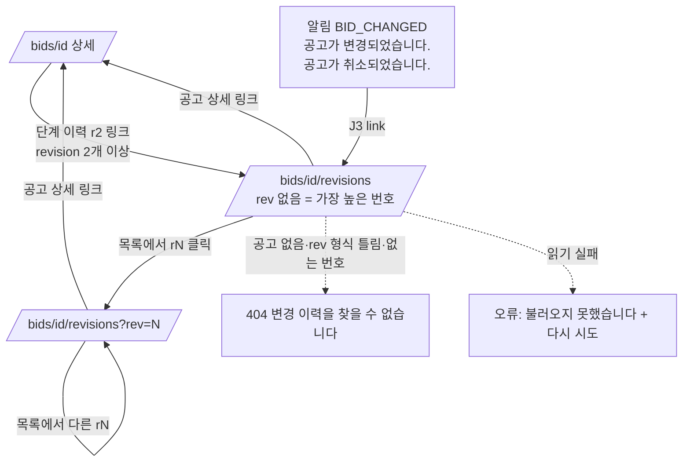

# 디자인 스펙: 공고 변경 이력 (`/bids/[id]/revisions`)

[[2026-10-21-s5-change-detection-plan|S5 변경 감지 계획]] Task 2 산출물이다. Task 3(화면 구현) 작업자는 이 문서 하나만 보고 짠다. 코드·정본·설정은 바꾸지 않았다. §7 문구 가운데 "고정"이라고 적은 것(계획 Global Constraints·기존 코드 문구)은 그대로 쓰고, 나머지는 초안이며 확정은 사용자 몫이다. 결정이 필요한 것은 §12에 모았다.

> [!warning] 미검증 가정
> 코드와 기존 스크린샷만 읽고 썼다. dev 서버·브라우저는 띄우지 않았다. 1440·1280 폭의 칸 너비는 `AppPage`(`px-8`)·사이드바(256px)·상세 격자 클래스에서 계산한 값이다. 지금 상세 화면은 `docs/evidence/phase-3/e2e/20261020-phase3-bid-detail-loaded-1280.png` 로 봤다. 데이터 모양은 이 작업 폴더의 미커밋 Task 1 파일 `web/server/bids/revision.model.ts`·`revision-diff.ts`·`revision.service.ts` 를 읽고 맞췄다. FX-07 본문 조각(§4.4)은 `revision-diff.ts` 와 같은 알고리즘을 임시 스크립트로 돌린 결과다.

## 0. 범위

| 넣는다 | 넣지 않는다 |
|---|---|
| 새 화면 `/bids/[id]/revisions?rev=N`: 머리말, 바뀐 항목 표, 본문 diff, revision 목록 | 전/후 비교 API(J7: 화면은 서비스를 직접 부른다) |
| 상태: 정상, revision 하나뿐, 첫 revision 선택, 이전 revision 없음, 바뀐 항목 없음, 취소 공고 띠, 긴 본문 접기, 로딩, 오류, 없음(404) | 권한 없음 화면(공고·revision 은 모든 조직·모든 역할이 읽는다. 로그인·조직 확인은 `requireWork` 가 보낸다) |
| 진입점: 상세 "단계 이력"의 `r{latestRevision}` 링크(revision 2개 이상일 때) | 알림 화면의 모양 변경(알림 link 만 J3 `/bids/<bidId>/revisions`) |
| 1440·1280 두 폭 | 1280 미만 레이아웃, 승률·확률·`%`, 결제 |

데모(19 S5 3단계): FX-07 을 열면 첫 화면(1440×900, 1280×800, 스크롤 없이)에 **예산 `18억` → `21.6억`** 줄과 **본문의 `Kubernetes` 밑줄**이 함께 보여야 한다(§4.7).

## 1. 기준

| 무엇 | 근거 |
|---|---|
| 요구 | 계획 Task 2 "꼭 정할 것", Global Constraints(문구 3개), 판정 J3·J5·J7, Review Focus 1·2·5 |
| 정본 | 06 §1(폭)·§3.1(의미색)·§3.2(상태 표기, `취소됨`·`ban`)·§3.3(눈금)·§5.1(공통 상태)·§5.5(취소 공고 문구)·§8 "변경 diff" 줄·§10 접근성·§12 증거 이름. 19 S5 3단계 |
| 데이터 | `RevisionComparison`·`RevisionFieldChange`·`TextSegment`·`RevisionRef`(Task 1 Interfaces, `revision.model.ts`), `BidRevisionSummary`(`bid.model.ts`: `revision`·`amendmentNo`·`fetchedAt`·`changedFields`) |
| FX 데이터 | `fixtures/bids/FX-07.json`(r1 예산 1800000000 → r2 2160000000, 본문에 Kubernetes·정정공고 문장 추가), `FX-08.json`(r2 `status: CANCELLED`, 본문에 취소 문장), `FX-06.json`(마감 +14d → +28d). fixture 의 r2 는 상태가 `OPEN` → `AMENDED` 로 바뀐다(`ingestion/revision.ts` `statusForRevision`) |
| 견본 화면 | `web/app/(app)/(work)/bids/[id]/`(`page.tsx` 순서, `bid-detail-view.tsx` 의 `DetailEyebrow`·`SummaryLines`·격자 `minmax(0,1fr)_320px`·`sticky top-18` 레일, `loading.tsx`·`not-found.tsx`·`error.tsx`·`detail-copy.ts`) |
| 부품 | `AppPage`, `EmptyState`(`web/app/(app)/(work)/empty-state.tsx`), `WorkError`, `AnalysisBanner`(취소 줄), `ui/table`·`ui/button`·`ui/skeleton`, `bids/format.ts`·`labels.ts`·`stage-timeline.tsx` |
| 토큰 | `design/tokens.json`. 앱 틀 눈금 `title`·`heading`·`body`·`label`·`caption` 만. 상태 색은 흰 바탕 위 글자·아이콘·테두리에만 |

한계: `TextSegment` 만으로는 "본문이 길어 통째로 바꿨다"(`DIFF_CELL_LIMIT` 초과)와 "짧은 본문을 다 고쳤다"를 구분하지 못한다. 두 경우를 같은 문구로 보인다(§4.4).

## 2. 흐름



- 진입 경로는 둘이다. 상세의 `r{latestRevision}` 링크와 알림 link(J3) 모두 `?rev` 없이 `/bids/<bidId>/revisions` 로 간다 → 가장 높은 revision 과 그 직전을 비교한다.
- `page.tsx` 순서(계획 Task 3 그대로 + 한 줄): `await connection()` → `requireWork(\`/bids/${id}/revisions\`)` → `isUuid(id)` 아니면 `notFound()` → `searchParams.rev` 가 **배열이면 `notFound()`**(이 스펙이 더한 한 줄) → 값이 있는데 `parseRevisionParam` 이 `null` 이면 `notFound()` → `compareBidRevision(work.orgId, id, rev, { repo: workDeps().bids })` → 404 면 `notFound()`, 다른 실패는 `throw new Error(result.message)`.
- revision 을 바꾸는 것은 서버 렌더 링크 이동이다. 클라이언트 상태는 본문 접기(§4.4) 하나뿐이다.

## 3. 공통 규칙

### 3.1 틀과 폭

- 업무 틀(`web/app/(app)/(work)/`) 안, 본문은 `AppPage`. `contentClassName` 은 상세와 같은 `DETAIL_CONTENT_CLASS`(`max-w-360`)를 `@/app/(app)/(work)/bids/[id]/detail-copy` 에서 가져온다(상세 ↔ 변경 이력을 오갈 때 머리말 자리가 같다). `../` 상대경로는 쓰지 않는다.
- 본문은 2단 격자 `grid grid-cols-[minmax(0,1fr)_280px] items-start gap-6`. 왼쪽 주 영역, 오른쪽 revision 목록 레일. 칸 수는 1280·1440 모두 같다(1280 미만 레이아웃 없음).

| 폭 | `AppPage` 단 | 주 영역 | 레일 | 바뀐 항목 표 열(항목 / 이전 / 이후) | 본문 diff 상자 안쪽 |
|---|---|---|---|---|---|
| 1440 (사이드바 펼침) | 1120px | 816px | 280px | 128 / 344 / 344 | 782px |
| 1280 (사이드바 펼침) | 960px | 656px | 280px | 128 / 264 / 264 | 622px |

사이드바를 접으면 주 영역만 넓어진다. 다른 변화는 없다.

### 3.2 추가·삭제 표시 (색만으로 구분하지 않는다)

한 화면에서 같은 표시 언어를 쓴다. 모양(밑줄·취소선)과 화면 낭독 글자가 의미를 지고, 색은 거든다.

| 뜻 | 요소 | 클래스 | 화면 낭독 글자(sr-only, 정확히) |
|---|---|---|---|
| 추가 | `<ins>` | `font-semibold text-success underline decoration-2 underline-offset-4` | 앞 `추가됨`, 뒤 `추가 끝` |
| 삭제 | `<del>` | `text-destructive line-through decoration-2` | 앞 `삭제됨`, 뒤 `삭제 끝` |
| 유지 | 표시 없음 | `text-foreground` | 없음 |

- 마크업: `<ins><span className="sr-only">추가됨 </span>Kubernetes<span className="sr-only"> 추가 끝</span></ins>`. 띄어쓰기는 sr-only 글자 **안**에 둔다(보이는 글자 간격이 바뀌지 않고, 시험의 `getByText("추가됨")` 이 공백을 잘라 맞는다).
- 조각 앞뒤의 공백·줄바꿈은 `<ins>`·`<del>` **밖**에 그대로 둔다(빈칸에 밑줄이 그어지지 않게). 예: `"Kubernetes "` → `<ins>…Kubernetes…</ins>` + `" "`. 글자 자체는 바꾸지 않는다(이으면 원문과 같아야 한다).
- 바뀐 항목 표의 단일 값(예산·마감 등)은 같은 모양을 쓰되 `<span>` 이고 sr-only 글자를 붙이지 않는다. 열 머리 `이전 r1`·`이후 r2` 가 뜻을 준다(표 낭독 때 열 머리를 함께 읽는다).
- 구역 머리 아래 범례 한 줄(§4.3)이 모양의 뜻을 글로 밝힌다.
- 대비(흰 바탕 위 글자): `success` #15803D 약 5.0:1, `destructive` #A51926 약 7.6:1, `muted-foreground` 약 7:1 — 모두 AA.

### 3.3 값 표시

| 항목(`field`) | 이름(`REVISION_FIELD_LABEL`) | 값 표시 |
|---|---|---|
| `budgetKrw` | 예산 | 첫 줄 `formatKrwCompact(v).text`(`18억`·`21.6억`, `tabular-nums`), 둘째 줄 `type-caption text-muted-foreground` 로 `formatKrwCompact(v).full`(`1,800,000,000원`). `null` 이면 `—` + sr-only `미공개`, 둘째 줄 없음 |
| `deadlineAt` | 마감 | `<time dateTime={v} title={\`UTC ${v}\`} className="tabular-nums">{formatKst(v)} KST</time>` |
| `noticeDate` | 공고일 | 마감과 같다(정규화 값이 ISO UTC 시각이다) |
| `status` | 공고 상태 | `BID_STATUS_LABEL[v]`(§8.5). `CANCELLED` 면 글자 앞에 `STATUS_ICON.CANCELLED` 아이콘(`BanIcon`, 14px, `aria-hidden`). 표에 없는 값은 받은 문자열을 `font-mono` 로 |
| `stage` | 단계 | `STAGE_LABEL[v]`(`발주계획`·`사전규격`·`입찰공고`). 없는 값은 받은 문자열 |
| `title` | 공고명 | 글자 그대로, `wrap-anywhere` |
| `agency` | 발주기관 | 글자 그대로 |
| `sourceUrl` | 원문 주소 | `font-mono wrap-anywhere` 글자. 링크로 만들지 않는다(바뀐 값 비교가 목적이고, 외부 링크 검사는 상세의 `SourceLink` 몫) |
| `planRef` | 발주계획 번호 | `font-mono` |
| `preSpecRef` | 사전규격 번호 | `font-mono` |
| `structuredQualifications` | 자격 요건 | 목록 칸(§4.3) |
| `attachments` | 첨부 | 목록 칸(§4.3) |
| `content` | 본문 | 표에 넣지 않고 표 아래 "본문" 블록(§4.4) |

- 값이 `null` 이면 `—`(`text-muted-foreground`) + sr-only `없음`(예산만 `미공개`). 이 칸에는 추가·삭제 모양을 입히지 않는다.
- `formatKst` 가 날짜를 못 읽으면 `—` 를 준다. 그대로 쓴다.

## 4. 화면 명세

### 4.1 정보 위계

```text
① 머리말(AppPage)    eyebrow: ← 공고 상세 / 공고명      h1: 변경 이력      설명: r1 → r2 · 차수 01 → 02 · 수집 … KST
② 주 영역(왼쪽)       [취소 띠 — cancelled 일 때만] → [바뀐 항목 구역: h2 · 범례 · 표 · 본문 블록  또는  빈 상태]
③ 레일(오른쪽, sticky) revision 목록(h2) — 최신이 위
```

DOM 순서 = 보이는 순서: ① → ② → ③. 키보드 순서도 같다(§6).

### 4.2 머리말

- `eyebrow`(상세 `DetailEyebrow` 와 같은 모양, `mb-3 flex flex-col items-start gap-2`):
  1. 링크 `공고 상세` → `/bids/{bidId}`. `ArrowLeftIcon`(16px, `aria-hidden`) + 글자, `inline-flex items-center gap-1 type-label text-muted-foreground hover:text-foreground` + 초점 `rounded-sm outline-none focus-visible:ring-3 focus-visible:ring-ring/50`.
  2. 공고명 `<p data-slot="revision-bid-title" className="type-body font-medium text-foreground wrap-anywhere">{comparison.title}</p>`. 링크가 아니다(위 링크와 같은 곳이라 겹친다).
- `title`: `변경 이력`(고정). `export const metadata = { title: "변경 이력" }`.
- `description`(`AppPage` 의 `p type-body text-muted-foreground`) 한 줄:
  - `previous` 가 있으면: `r{previous.revision}` → `r{current.revision}` · `차수 {previous.amendmentNo ?? "—"}` → `{current.amendmentNo ?? "—"}` · `수집 {formatKst(current.fetchedAt)} KST`
  - `previous` 가 `null` 이면: `r{current.revision}` · `차수 {current.amendmentNo ?? "—"}` · `수집 {formatKst(current.fetchedAt)} KST`
  - 두 차수가 모두 `null` 이면 `차수 …` 토막을 뺀다.
  - 화살표는 `<span aria-hidden="true"> → </span><span className="sr-only"> 에서 </span>`(낭독: "r1 에서 r2"). 가운뎃점 ` · ` 는 상세 `SummaryLines` 와 같다.
  - 수집 시각은 `<time dateTime={current.fetchedAt} title={\`UTC ${…}\`} className="tabular-nums">`.
  - 차수(`amendmentNo`)는 여기에만 보인다. 바뀐 항목 표에는 넣지 않는다(J5).
- `actions`: 없다. 이 화면에는 기본(default) 버튼이 없다.

### 4.3 바뀐 항목 구역 (주 영역)

`<section data-slot="revision-changes" aria-labelledby="revision-changes-title" className="flex min-w-0 flex-col gap-3">` — 상태와 상관없이 늘 있다. 안의 내용만 상태(§5)에 따라 바뀐다.

1. 머리 줄 `flex items-baseline gap-2`: `<h2 id="revision-changes-title" className="type-heading text-foreground">바뀐 항목</h2>` + 바뀐 항목이 있을 때만 `<span className="type-caption text-muted-foreground">{changes.length}개</span>`.
2. 범례(바뀐 항목이 있을 때만) `<p className="type-caption text-muted-foreground">`: `밑줄은 추가, 취소선은 삭제, 표시 없음은 유지입니다.` 이 문장의 "밑줄" 두 글자는 추가 모양(§3.2 클래스, `<span>`), "취소선" 세 글자는 삭제 모양으로 칠해 견본을 겸한다.
3. 표(`changes` 가운데 `kind !== "text"` 가 하나 이상일 때): `changes` 순서(`DISPLAY_ORDER`)에서 `content` 만 빼고 그대로 줄을 만든다.
4. 본문 블록(`field === "content"` 가 있을 때, §4.4): 표 아래.

표 마크업(`web/components/ui/table`):

```text
<div className="overflow-hidden rounded-lg border border-border">
  <Table className="table-fixed">
    <TableCaption className="sr-only">바뀐 항목 표: 이전 r1, 이후 r2</TableCaption>
    <colgroup><col className="w-32" /><col /><col /></colgroup>
    <TableHeader><TableRow>
      <TableHead scope="col">항목</TableHead>
      <TableHead scope="col">이전 r1</TableHead>
      <TableHead scope="col">이후 r2</TableHead>
    </TableRow></TableHeader>
    <TableBody>
      <TableRow data-slot="revision-change-row" data-field="budgetKrw">
        <th scope="row" className="px-3 py-2.5 text-left align-top type-label font-medium text-muted-foreground">예산</th>
        <TableCell className="align-top whitespace-normal wrap-anywhere">…이전…</TableCell>
        <TableCell className="align-top whitespace-normal wrap-anywhere">…이후…</TableCell>
      </TableRow>
```

- `TableCell` 의 기본 `whitespace-nowrap align-middle` 은 위처럼 덮는다(긴 공고명·주소가 칸 안에서 꺾여야 1280 에서 넘치지 않는다).
- 단일 값(`kind: "scalar"`): 이전 칸은 삭제 모양 `<span>`, 이후 칸은 추가 모양 `<span>`(§3.2). 값이 `null` 인 칸은 모양 없이 `—`.
  예산 칸만 둘째 줄(전체 금액 caption)이 있고, 둘째 줄에는 모양을 입히지 않는다.
- 목록 값(`kind: "list"`): 칸 안에 `<ul className="flex flex-col gap-1">`.
  - 이전 칸: `removed` 각 항목(`<li><del>…</del></li>`, §3.2 sr 글자 포함) 다음에 `kept` 각 항목(표시 없음).
  - 이후 칸: `added` 각 항목(`<li><ins>…</ins></li>`) 다음에 `kept` 각 항목.
  - 한쪽이 비면(예: 이전에 첨부 0개) 그 칸은 `—` + sr-only `없음`.
  - 순서는 받은 배열 순서. 항목 글자는 `wrap-anywhere`.
- 줄 높이는 내용에 맞춘다(목록·긴 값은 여러 줄). 행 hover 는 `TableRow` 기본(`hover:bg-muted/50`) 그대로.

### 4.4 본문 블록 (`kind: "text"`)

`<div data-slot="revision-content" className="flex flex-col gap-2 pt-3">`

1. 머리 줄 `flex items-center justify-between gap-3`: `<h3 className="type-label font-semibold text-foreground">본문</h3>` + (접을 곳이 있을 때만) 펼치기 버튼.
2. (통째 교체일 때만) 안내 `<p className="type-caption text-muted-foreground">바뀐 곳을 나누지 못해 이전 본문과 이후 본문을 통째로 보입니다.</p>` — 조건: `same` 조각이 하나도 없고 `removed`·`added` 가 둘 다 있다.
3. diff 상자 `<div id="revision-content-diff" data-slot="revision-content-diff" className="rounded-lg border border-border p-4 type-body text-foreground whitespace-pre-wrap wrap-anywhere">` 안에 조각을 차례로: `same` 은 글자 그대로, `removed` 는 `<del>`, `added` 는 `<ins>`(§3.2). `segments` 가 `[]` 이면 상자 안에 `—` + sr-only `없음`.

FX-07 조각(r1 → r2, `revision-diff.ts` 알고리즘으로 계산):

| op | 글자 |
|---|---|
| same | `한국도로공사가 교통정보 데이터플랫폼 고도화 사업의 제안사를 모집한다. 사업 분야는 데이터 플랫폼이며 사업예산은 ` |
| removed | `18억원이다.` |
| added | `21.6억원이다.` |
| same | ` 필수 기술은 Hadoop, ` |
| removed | `Spark` |
| added | `Spark,` |
| same | ` ` |
| added | `Kubernetes ` |
| same | `이다. 우대 기술은 PostgreSQL, Airflow 이다. 참가 자격은 소프트웨어사업자 신고확인서를 보유한 업체이다.` |
| added | ` 정정공고: 사업예산을 21.6억원으로 증액하고 필수 기술에 Kubernetes 를 추가한다.` |

`Kubernetes` 가 `<ins>` 안에 두 번 나온다. 둘째 `added` 는 앞 공백을 `<ins>` 밖에 둔다.

**긴 본문 접기**(클라이언트 부품 `web/components/bids/text-diff.tsx`, `"use client"`). 접기 계산은 같은 파일의 순수 함수 `foldSegments(segments)` 로 두고 단위 시험한다. 처음엔 접힌 상태다.

| 상수 | 값 | 뜻 |
|---|---|---|
| `FOLD_MIN` | 400 | 이보다 긴 조각만 접는다 |
| `FOLD_CONTEXT` | 120 | 접은 `same` 조각에서 남기는 앞·뒤 글자 수 |
| `WHOLE_HEAD` | 240 | 통째 교체에서 조각마다 보이는 앞 글자 수 |

- `same` 조각이 하나라도 있으면: 길이 > `FOLD_MIN` 인 `same` 조각만 접는다. 첫 조각은 뒤 `FOLD_CONTEXT` 글자만, 마지막 조각은 앞 `FOLD_CONTEXT` 글자만, 가운데 조각은 앞·뒤 `FOLD_CONTEXT` 글자씩 남기고 그 사이를 표시 `… 바뀌지 않은 {n}자 생략 …` 으로 바꾼다(`{n}` 은 숨긴 글자 수). 조각이 `same` 하나뿐이면(첫 조각이자 마지막) 앞 `FOLD_CONTEXT` 글자만 남긴다. `added`·`removed` 는 **접지 않는다**(바뀐 곳은 늘 보인다).
- `same` 조각이 없으면(통째 교체·전부 추가·전부 삭제): 길이 > `FOLD_MIN` 인 조각을 앞 `WHOLE_HEAD` 글자 + 표시 `… {n}자 더 있음` 으로 줄인다. 줄인 부분도 `<ins>`·`<del>` 모양 안에 있고, 표시 글자는 모양 밖에 둔다.
- 글자 수는 `Array.from(text).length`, 자르기도 `Array.from` 기준(이모지 등 둘로 쪼개지 않게). `{n}` 은 `n.toLocaleString("ko-KR")`(예 `1,234`).
- 표시 글자는 `<span data-slot="diff-fold" className="text-muted-foreground">`. 화면 낭독기도 그대로 읽는다.
- 접을 곳이 하나라도 있을 때만 버튼: `Button` `variant="outline"` `size="sm"`, `aria-expanded`, `aria-controls="revision-content-diff"`, 글자 접힘 `본문 전체 펼치기` / 펼침 `본문 접기`, 뒤에 `ChevronDownIcon`(`data-icon="inline-end"`, `aria-hidden`, 펼침이면 `rotate-180`). 누른 뒤 초점은 버튼에 남는다.
- FX-07(158자 → 224자)·FX-06·FX-08 은 접을 곳이 없어 버튼이 없다. live 공고(수천 자)에서만 접힌다.

### 4.5 revision 목록 (레일)

`<nav data-slot="revision-list" aria-labelledby="revision-list-title" className="sticky top-18 max-h-[calc(100dvh-5.5rem)] min-w-0 overflow-y-auto rounded-xl border border-border">`

- 머리 `flex items-baseline gap-2 px-4 pt-4 pb-3`: `<h2 id="revision-list-title" className="type-heading text-foreground">revision 목록</h2>` + `<span className="type-caption text-muted-foreground">{revisions.length}개</span>`.
- `<ol className="divide-y divide-border border-t border-border">`, 받은 순서(revision 내림차순, 최신이 위).
- 항목 하나 = `<li>` 안의 `Link`(블록 전체가 링크) `href={\`/bids/${bidId}/revisions?rev=${r.revision}\`}`, `data-slot="revision-item"`, `data-revision={r.revision}`.
  - 클래스 `flex flex-col gap-0.5 border-l-2 px-4 py-3 outline-none hover:bg-muted/50 focus-visible:ring-3 focus-visible:ring-ring/50 focus-visible:ring-inset`.
  - 고른 항목(`r.revision === current.revision`): `aria-current="page"` + `border-brand` + 첫 줄 `font-semibold`. 나머지: `border-transparent`. 고른 표시는 막대(모양) + 굵기 + `aria-current` 셋이다.
  - 첫 줄 `type-label text-foreground tabular-nums`: `r{revision}` · `차수 {amendmentNo ?? "—"}`
  - 둘째 줄 `type-caption text-muted-foreground`: `<time dateTime title="UTC …">{formatKst(fetchedAt)} KST</time>`
  - 셋째 줄 `type-caption text-muted-foreground`: `revision === 1` 이면 `처음 수집`, 아니면 `shownChangeCount(changedFields)` 가 1 이상이면 `바뀐 항목 {n}개`, 0 이면 `바뀐 항목 없음`.
- 개수 규칙: `shownChangeCount` 는 `changedFields` 가운데 `REVISION_FIELD_LABEL` 에 있는 이름만 센다(`amendmentNo`·모르는 이름 제외, J5). 그래서 레일의 숫자와 주 영역 "바뀐 항목 N개"가 같다(FX-07 r2: `["amendmentNo","status","budgetKrw","content"]` → 3).
- 목록이 길면 레일 안에서 스크롤한다(높이 상한은 상세 레일과 같다). 고른 항목으로 자동 스크롤하지 않는다(서버 렌더 화면을 단순하게 둔다).
- 링크 이동은 Next `Link` 기본 동작(맨 위로 스크롤)을 쓴다.

### 4.6 진입점 — 상세 "단계 이력"

- `StageTimeline` 에 새 prop `revisionsHref: string | null`. 지금 단계(`aria-current="step"`) 칸의 `r{latestRevision}` 글자를, `revisionsHref` 가 있으면 `Link` 로, 없으면 지금처럼 글자로 그린다.
- 링크 클래스: `rounded-sm tabular-nums text-muted-foreground underline decoration-muted-foreground underline-offset-4 outline-none hover:text-foreground hover:decoration-foreground focus-visible:ring-3 focus-visible:ring-ring/50`. 글자 뒤에 `<span className="sr-only"> 변경 이력 보기</span>` → 이름 "r2 변경 이력 보기"(보이는 글자가 이름 앞에 있다, WCAG 2.5.3).
- `page.tsx`(상세)가 `detail.data.revisions.length >= 2 ? \`/bids/${id}/revisions\` : null` 을 만들어 `BidDetailView` → `StageTimeline` 으로 넘긴다(`DetailBid` 는 `revisions` 를 빼므로 page 에서 계산). revision 1개면 링크가 아니다.
- freeze(10-23) 때 빼려면 상세 `page.tsx` 에서 `null` 만 넘기면 된다(Global Constraints).
- 알림(J3): `BID_CHANGED` 의 link 는 `/bids/<bidId>/revisions`. 알림 화면 모양은 그대로다.

### 4.7 데모 FX-07 — 첫 화면에 보여야 하는 것

1440×900(1280×800 도 같다), 스크롤 없이:

1. h1 `변경 이력`, 그 위 공고명 `한국도로공사 교통정보 데이터플랫폼 고도화 (가상)`, 아래 `r1 → r2 · 차수 01 → 02 · 수집 … KST`.
2. 바뀐 항목 표 첫 줄 **예산**: 이전 칸 `18억`(취소선) + `1,800,000,000원`, 이후 칸 `21.6억`(굵은 밑줄) + `2,160,000,000원`.
3. 둘째 줄 **공고 상태**: `공고` → `정정 공고`.
4. 본문 블록: `~~18억원이다.~~ __21.6억원이다.__`, `Hadoop, ~~Spark~~ __Spark,__ __Kubernetes__ 이다.`, 끝의 `__정정공고: … Kubernetes 를 추가한다.__`.
5. 레일: `r2 · 차수 02 / … KST / 바뀐 항목 3개`(고름 막대), `r1 · 차수 01 / … KST / 처음 수집`.

세로 예산(1280×800, 계산): 상단 막대 48 + 위 여백 24 + eyebrow 62 + h1 36 + 설명 26 ≈ 196 → 간격 24 → 구역 머리·범례 ≈ 60 → 표(머리 40 + 예산 줄 58 + 상태 줄 44) ≈ 142 → 본문 머리 ≈ 36 → diff 상자(622px 폭에 약 6줄) ≈ 164 → 끝 ≈ 640px. 800 안에 든다.

말할 것(발표자용, 19 S5 3단계): "정정공고가 들어오면 이전 revision 과 나란히 비교한다. 예산 18억이 21.6억으로, 필수 기술에 Kubernetes 가 더해졌다."

## 5. 상태

### 5.1 상태 고르기 순서

주 영역 "바뀐 항목" 구역 안의 내용은 위에서부터 처음 맞는 하나다. 취소 띠는 이와 따로, 조건이 맞으면 구역 위에 더한다.

1. `revisions.length === 1` → **하나뿐**(S2)
2. `previous === null && current.revision === 1` → **첫 revision 선택**(S3)
3. `previous === null` → **이전 revision 없음**(S4)
4. `changes.length === 0` → **바뀐 항목 없음**(S5)
5. 그 밖 → **정상**(S1)

빈 상태는 `EmptyState`(아이콘 + 제목 + 설명 + 동작 하나, 06 §5.1)를 `data-slot="revision-empty"` `data-reason="single|first|gap|no-changes"` 로 감싼다. 동작 링크는 `cn(buttonVariants({ variant: "outline" }))` 의 `Link`.

### 5.2 상태표

| 상태 | 언제 | 보이는 것 | 사용자가 할 수 있는 것 |
|---|---|---|---|
| S1 정상 | `previous` 있음, `changes` 1개 이상 (FX-06·07·10 r2) | 머리말 `rP → rC`. 구역 머리 `바뀐 항목 N개`, 범례, 표(본문 뺀 항목), 본문 블록(본문이 바뀌었을 때). 레일에서 rC 고름 | 공고 상세로 돌아가기, 다른 revision 고르기, (긴 본문이면) 본문 펼치기·접기 |
| S2 revision 하나뿐 | `revisions.length === 1` (FX-01 등, 직접 주소로 올 때) | 머리말 `r1 · 차수 01 · 수집 … KST`. 구역 머리 `바뀐 항목`(개수·범례 없음) 아래 빈 상태: 아이콘 `HistoryIcon`, 제목 `처음 수집한 공고입니다. 아직 바뀐 내용이 없습니다.`(고정), 설명 없음, 동작 `공고 상세로` → `/bids/{id}`. 표 없음. 레일에 r1 하나(고름) | 공고 상세로 |
| S3 첫 revision 선택 | `?rev=1` 이고 revision 이 2개 이상 | 머리말 `r1 · …`. 빈 상태: `HistoryIcon`, 제목 `처음 수집한 revision 입니다`, 설명 `이전 revision 이 없어 비교할 내용이 없습니다.`, 동작 `최신 변경 보기` → `/bids/{id}/revisions`. 레일에서 r1 고름 | 최신 변경 보기, 다른 revision 고르기 |
| S4 이전 revision 없음 | `previous === null` 인데 `current.revision > 1` (r{N-1} 기록이 빠짐. 정상 수집에서는 생기지 않는다) | 빈 상태: `HistoryIcon`, 제목 `이전 revision 을 찾을 수 없습니다`, 설명 `r{N-1} 기록이 없어 비교할 수 없습니다.`, 동작 `공고 상세로` | 공고 상세로, 다른 revision 고르기 |
| S5 바뀐 항목 없음 | `previous` 있음, `changes` 0개 (`changed_fields` 가 비었거나 `amendmentNo`·모르는 이름뿐) | 머리말 `rP → rC · 차수 P → C`(차수 변화는 여기서 보인다). 빈 상태: `CircleDashedIcon`, 제목 `표시할 바뀐 항목이 없습니다`, 설명 `차수 번호만 바뀌었거나 수집 기록에 바뀐 항목이 남아 있지 않습니다.`, 동작 `공고 상세로`. 레일 그 항목 `바뀐 항목 없음` | 공고 상세로, 다른 revision 고르기 |
| S6 취소 공고 | `cancelled === true` (FX-08 r2) — S1~S5 와 겹친다 | 주 영역 맨 위 `<div data-slot="revision-cancelled">` 안에 `<AnalysisBanner analysis={null} bidStatus="CANCELLED" />`: 흰 바탕·`border-border` 테두리·`BanIcon`(muted) + `이 공고는 취소되었습니다. 기존 분석·결정 기록은 보존됩니다`(06 §5.5·기존 코드 문구 그대로). 그 아래 S1 표의 공고 상태 줄 `공고` → `BanIcon` + `취소됨`(아이콘 + 글자, §3.3), 본문 블록 끝 `__취소공고: 본 공고는 취소한다.__` | S1 과 같다 |
| S7 긴 본문 | 접을 조각이 있다(§4.4) | diff 상자 안 `… 바뀌지 않은 1,234자 생략 …` 또는 `… 1,234자 더 있음`, 머리 줄 오른쪽 `본문 전체 펼치기` | 펼치기·접기 |
| S8 통째 교체 | 본문 조각에 `same` 이 없고 추가·삭제가 둘 다 있다(`DIFF_CELL_LIMIT` 초과 포함) | 본문 머리 아래 `바뀐 곳을 나누지 못해 이전 본문과 이후 본문을 통째로 보입니다.` + 삭제 조각 전체 → 추가 조각 전체(길면 S7 처럼 줄임) | 펼치기·접기 |
| S9 로딩 | `revisions/loading.tsx` (§5.3) | 같은 틀의 skeleton. h1 은 진짜 글자 `변경 이력`. sr-only `변경 이력을 불러오는 중…`(`role="status"`) | 기다림 |
| S10 오류 | 서비스가 404 말고 실패를 주거나 던짐(스냅샷 스키마 불일치·DB 오류) | `revisions/error.tsx` → `WorkError`(title `변경 이력`, `contentClassName` 같음): `불러오지 못했습니다` + 서버 message(운영 빌드는 대체 문장) + `오류 ID {digest}` + `다시 시도` | 다시 시도(`retry()`) |
| S11 없음(404) | id 가 uuid 아님, 공고 없음, `rev` 가 배열·`0`·`01`·`-1`·`a`·`1.5`·7자리 이상, 없는 번호 | `revisions/not-found.tsx`: `AppPage` title `변경 이력을 찾을 수 없습니다`, description `공고 주소나 revision 번호가 맞는지 확인하세요.`, outline 링크 `공고 목록으로` → `/bids`(`ArrowLeftIcon`). 상세 `not-found.tsx` 와 같은 모양 | 공고 목록으로 |
| — 로그인 전·조직 없음 | `requireWork` | 이 화면 없이 로그인·조직 상태 화면으로 보낸다(기존 규칙) | — |
| 진입 링크 있음 | 상세, `revisions.length >= 2` | 단계 이력 `● 입찰공고 r2` 의 `r2` 밑줄 링크 | 눌러 변경 이력으로 |
| 진입 링크 없음 | 상세, revision 1개 | `r1` 글자(지금과 같음) | — |

`error.tsx` 는 계획 Task 3 파일 목록에 없다. **더해야 한다**: 없으면 `[id]/error.tsx` 가 잡아 제목이 `공고 상세` 로 보인다. `loading.tsx`·`not-found.tsx` 도 같은 이유로 revisions 폴더에 둔다(계획에 있다).

### 5.3 배치 그림

기호: `~~x~~` 취소선(`destructive`), `__x__` 굵은 밑줄(`success`), `┃` 고른 항목 막대(`brand` 2px), `[ ]` 버튼·링크 모양, `(이름)` lucide 아이콘. 시각은 예시다.

**S1 정상 — FX-07, 1440 (사이드바 256 펼침, 단 1120 = 주 816 + 24 + 레일 280)**

```text
┌ Sidebar ┬─ Content ─────────────────────────────────────────────────────────────────────────────────────────┐
│         │ ← 공고 상세                                                                                         │
│         │ 한국도로공사 교통정보 데이터플랫폼 고도화 (가상)                                                         │
│         │ 변경 이력                                                                    ← h1 type-title         │
│         │ r1 → r2 · 차수 01 → 02 · 수집 2026-10-24 10:12 KST                                                   │
│         │                                                                                                     │
│         │ 바뀐 항목 3개                                                      ┌ revision 목록 2개 ────────────┐ │
│         │ __밑줄__은 추가, ~~취소선~~은 삭제, 표시 없음은 유지입니다.             ├──────────────────────────────┤ │
│         │ ┌──────────┬────────────────────────────┬────────────────────────┐ │┃ r2 · 차수 02                 │ │
│         │ │ 항목      │ 이전 r1                     │ 이후 r2                 │ │┃ 2026-10-24 10:12 KST         │ │
│         │ ├──────────┼────────────────────────────┼────────────────────────┤ │┃ 바뀐 항목 3개                 │ │
│         │ │ 예산      │ ~~18억~~                    │ __21.6억__              │ ├──────────────────────────────┤ │
│         │ │          │ 1,800,000,000원             │ 2,160,000,000원         │ │  r1 · 차수 01                │ │
│         │ │ 공고 상태  │ ~~공고~~                    │ __정정 공고__            │ │  2026-10-24 08:50 KST        │ │
│         │ └──────────┴────────────────────────────┴────────────────────────┘ │  처음 수집                    │ │
│         │                                                                    └──────────────────────────────┘ │
│         │ 본문                                                                                                │
│         │ ┌─────────────────────────────────────────────────────────────────┐                                  │
│         │ │ 한국도로공사가 교통정보 데이터플랫폼 고도화 사업의 제안사를 모집한다. 사업 분야는 │                                  │
│         │ │ 데이터 플랫폼이며 사업예산은 ~~18억원이다.~~ __21.6억원이다.__ 필수 기술은        │                                  │
│         │ │ Hadoop, ~~Spark~~ __Spark,__ __Kubernetes__ 이다. 우대 기술은 PostgreSQL,     │                                  │
│         │ │ Airflow 이다. 참가 자격은 소프트웨어사업자 신고확인서를 보유한 업체이다.          │                                  │
│         │ │ __정정공고: 사업예산을 21.6억원으로 증액하고 필수 기술에 Kubernetes 를 추가한다.__ │                                  │
│         │ └─────────────────────────────────────────────────────────────────┘                                  │
└─────────┴─────────────────────────────────────────────────────────────────────────────────────────────────────┘
```

**S1 정상 — FX-07, 1280 (단 960 = 주 656 + 24 + 레일 280)**

```text
┌ Sidebar ┬─ Content ──────────────────────────────────────────────────────────────────┐
│         │ ← 공고 상세                                                                  │
│         │ 한국도로공사 교통정보 데이터플랫폼 고도화 (가상)                                  │
│         │ 변경 이력                                                                     │
│         │ r1 → r2 · 차수 01 → 02 · 수집 2026-10-24 10:12 KST                            │
│         │                                                                              │
│         │ 바뀐 항목 3개                                  ┌ revision 목록 2개 ─────────┐ │
│         │ __밑줄__은 추가, ~~취소선~~은 삭제, …              ├───────────────────────────┤ │
│         │ ┌────────┬───────────────────┬───────────────┐ │┃ r2 · 차수 02              │ │
│         │ │ 항목    │ 이전 r1            │ 이후 r2        │ │┃ 2026-10-24 10:12 KST      │ │
│         │ │ 예산    │ ~~18억~~           │ __21.6억__     │ │┃ 바뀐 항목 3개              │ │
│         │ │        │ 1,800,000,000원    │ 2,160,000,000원│ ├───────────────────────────┤ │
│         │ │ 공고 상태│ ~~공고~~           │ __정정 공고__   │ │  r1 · 차수 01             │ │
│         │ └────────┴───────────────────┴───────────────┘ │  2026-10-24 08:50 KST     │ │
│         │ 본문                                            │  처음 수집                 │ │
│         │ ┌──────────────────────────────────────────┐   └───────────────────────────┘ │
│         │ │ 한국도로공사가 교통정보 데이터플랫폼 고도화   │                                 │
│         │ │ 사업의 제안사를 모집한다. 사업 분야는 데이터   │                                 │
│         │ │ 플랫폼이며 사업예산은 ~~18억원이다.~~        │                                 │
│         │ │ __21.6억원이다.__ 필수 기술은 Hadoop,        │                                 │
│         │ │ ~~Spark~~ __Spark,__ __Kubernetes__ 이다. … │                                 │
│         │ │ __정정공고: … Kubernetes 를 추가한다.__      │                                 │
│         │ └──────────────────────────────────────────┘                                 │
└─────────┴──────────────────────────────────────────────────────────────────────────────┘
```

1440 과 1280 의 차이는 칸 폭과 본문 줄 수뿐이다. 구성·순서는 같다.

**S6 취소 공고 — FX-08 r2, 1440** (1280 은 S1 처럼 칸만 좁다)

```text
│ ← 공고 상세 / 충청북도 농업기술정보시스템 구축 (가상)
│ 변경 이력
│ r1 → r2 · 차수 01 → 02 · 수집 … KST
│
│ ┌───────────────────────────────────────────────────────────┐   ┌ revision 목록 2개 ─┐
│ │ (ban) 이 공고는 취소되었습니다. 기존 분석·결정 기록은 보존됩니다 │   │┃ r2 · 차수 02       │
│ └───────────────────────────────────────────────────────────┘   │┃ … KST              │
│ 바뀐 항목 2개                                                     │┃ 바뀐 항목 2개       │
│ __밑줄__은 추가, ~~취소선~~은 삭제, 표시 없음은 유지입니다.            ├────────────────────┤
│ ┌──────────┬───────────────┬────────────────┐                   │  r1 · 차수 01      │
│ │ 공고 상태  │ ~~공고~~       │ (ban) __취소됨__ │                   │  … KST · 처음 수집  │
│ └──────────┴───────────────┴────────────────┘                   └────────────────────┘
│ 본문
│ ┌───────────────────────────────────────────────────────────┐
│ │ 충청북도가 … 보유한 업체이다. __취소공고: 본 공고는 취소한다.__    │
│ └───────────────────────────────────────────────────────────┘
```

FX-08 은 상태 줄 하나 + 본문만 바뀐다(`changedFields` `amendmentNo`·`status`·`content` → 표시 2개). 본문은 끝 문장 하나만 추가다.

**S2 하나뿐 · S3 첫 revision · S4 이전 없음 · S5 바뀐 항목 없음 — 주 영역 (1440: 816px, 1280: 656px 폭, 구성 같음)**

```text
│ 변경 이력
│ r1 · 차수 01 · 수집 … KST                      (S5 는 r1 → r2 · 차수 01 → 02 · …)
│
│ 바뀐 항목                                        ┌ revision 목록 1개 ─┐
│ ┌──────────────────────────────────────────┐    │┃ r1 · 차수 01       │
│ │                  [history]                     │    │┃ … KST              │
│ │ 처음 수집한 공고입니다. 아직 바뀐 내용이 없습니다. │    │┃ 처음 수집           │
│ │                                          │    └────────────────────┘
│ │              [ 공고 상세로 ]               │
│ └──────────────────────────────────────────┘
```

S3·S4·S5 는 같은 틀에 §5.2 의 아이콘·제목·설명·동작만 다르다.

**S9 로딩 — 1440·1280 (`revisions/loading.tsx`)**

```text
│ ▭▭▭▭ (h-5 w-20)                              ← 뒤로 링크 자리
│ ▭▭▭▭▭▭▭▭▭▭▭▭ (h-5 w-80)                       ← 공고명 자리
│ 변경 이력                                     ← 진짜 h1 글자
│ ▭▭▭▭▭▭▭▭▭▭▭▭▭▭▭ (h-5 w-96)                     ← 설명 자리
│
│ ▭▭▭ (h-6 w-28)                                ┌──────────────────┐
│ ┌──────────────────────────────────────┐      │ ▭▭▭ (h-6 w-32)    │
│ │ ▭▭▭▭▭▭▭▭▭▭▭▭▭▭▭▭▭▭▭ (h-10 w-full)          │      │ ▭▭ (h-14 w-full) │
│ │ ▭▭▭▭▭▭▭▭▭▭▭▭▭▭▭▭▭▭▭ (h-14 w-full)          │      │ ▭▭ (h-14 w-full) │
│ │ ▭▭▭▭▭▭▭▭▭▭▭▭▭▭▭▭▭▭▭ (h-11 w-full)          │      └──────────────────┘
│ └──────────────────────────────────────┘
│ ▭▭ (h-5 w-12)
│ ▭▭▭▭▭▭▭▭▭▭▭▭▭▭▭▭▭▭▭▭ (h-32 w-full rounded-lg)
```

`Skeleton` + `motion-reduce:animate-none`. h1·p 안에는 상세 `loading.tsx` 의 `InlineBlock`(span) 방식을 쓴다. 격자는 정상 화면과 같은 `minmax(0,1fr)_280px`.

**S10 오류 · S11 없음 — 1440·1280**

```text
│ 변경 이력                                    │ 변경 이력을 찾을 수 없습니다
│ ┌ (border-destructive) ─────────────────┐    │ 공고 주소나 revision 번호가 맞는지 확인하세요.
│ │ (octagon-alert) 불러오지 못했습니다     │    │ [ ← 공고 목록으로 ]
│ │ {서버 message}                        │    │
│ │ 오류 ID {digest}                      │    │
│ │ [ (refresh) 다시 시도 ]                │    │
│ └───────────────────────────────────────┘    │
```

두 화면 모두 레일이 없고 `AppPage` 단 폭(`max-w-360`)만 같다.

## 6. 접근성 체크 항목

- [ ] 제목 구조: h1 `변경 이력`(화면에 하나) → h2 `바뀐 항목` → h3 `본문`, h2 `revision 목록`(레일). 빈 상태 제목은 `EmptyState` 의 `p`(제목 단계 아님).
- [ ] 랜드마크: `main#main-content`(`AppPage`) 안에 `nav`(revision 목록, `aria-labelledby="revision-list-title"`). 사이드바·상단 막대는 틀 그대로.
- [ ] revision 목록: 고른 항목만 `aria-current="page"`. 고른 표시는 막대 + 굵기 + `aria-current`(색만이 아니다).
- [ ] 추가·삭제: `<ins>`·`<del>` + 밑줄·취소선 + sr-only `추가됨`/`추가 끝`, `삭제됨`/`삭제 끝`(§3.2). 범례 문장이 모양의 뜻을 글로 준다. 색만으로 구분하는 곳이 없다.
- [ ] 표: `TableCaption`(sr-only), 열 머리 `scope="col"`, 항목 이름은 `th scope="row"`. 머리말·표의 화살표는 `aria-hidden` + sr-only `에서`.
- [ ] 키보드 순서(Tab): 건너뛰기 링크 → `공고 상세` → (있으면) `본문 전체 펼치기` → (빈 상태면) 그 동작 링크 → revision 목록 링크(최신부터). 보이는 순서와 같다. 레일 링크 초점은 `ring-inset` 이라 둥근 테두리 밖으로 잘리지 않는다.
- [ ] 펼치기 버튼: `aria-expanded`·`aria-controls="revision-content-diff"`, 누른 뒤 초점 유지. 상태를 따로 알리는 live 영역은 두지 않는다(버튼 글자·`aria-expanded` 로 충분).
- [ ] 시각은 `<time dateTime>` + `title="UTC …"`(상세와 같다). 날짜만 보지 않게 `KST` 를 붙인다.
- [ ] 대비 AA: 본문 `foreground`, 보조 `muted-foreground`(약 7:1), 추가 `success`(약 5.0:1), 삭제 `destructive`(약 7.6:1), 모두 흰 바탕 위. 연한 바탕 채움 없음.
- [ ] 초점 표시: 링크·버튼 모두 `focus-visible:ring-3 ring-ring/50`(상세와 같다).
- [ ] 움직임 줄이기: skeleton `motion-reduce:animate-none`, 펼치기 아이콘 회전에 전환 효과를 주지 않는다.
- [ ] 단계 이력 링크 이름 "r2 변경 이력 보기"(보이는 `r2` 가 이름 앞).
- [ ] 1280 에서 가로 넘침 없음(`document.documentElement.scrollWidth <= 1280`), 1440·1280 스크린샷. axe 위반 0.

## 7. 화면 문구

"고정" 표시는 그대로 쓴다. 나머지는 초안(확정은 사용자).

| 자리 | 문구 |
|---|---|
| 탭 제목·h1 | `변경 이력` (고정, Global Constraints) |
| 뒤로 링크 | `공고 상세` |
| 머리말 설명 | `r{P} → r{C} · 차수 {P차수} → {C차수} · 수집 {YYYY-MM-DD HH:mm} KST` / 이전 없음: `r{C} · 차수 {C차수} · 수집 … KST` |
| 화살표 낭독 | ` 에서 ` (sr-only) |
| 구역 제목·개수 | `바뀐 항목` · `{n}개` |
| 범례 | `밑줄은 추가, 취소선은 삭제, 표시 없음은 유지입니다.` |
| 표 캡션(sr-only) | `바뀐 항목 표: 이전 r{P}, 이후 r{C}` |
| 열 머리 | `항목` · `이전 r{P}` · `이후 r{C}` |
| 항목 이름 | `예산` `마감` `자격 요건` `첨부` `본문` `공고 상태` `공고명` `발주기관` `공고일` `단계` `원문 주소` `발주계획 번호` `사전규격 번호` |
| 공고 상태 값 | `OPEN` `공고` · `AMENDED` `정정 공고` · `CANCELLED` `취소됨`(고정, 기존 `EXTRA_STATUS_LABEL`) · `CLOSED` `마감` |
| 빈 값 | `—` + sr-only `없음`(예산은 `미공개`) |
| 추가·삭제 낭독 | `추가됨` · `추가 끝` · `삭제됨` · `삭제 끝` |
| 본문 소제목 | `본문` |
| 통째 교체 안내 | `바뀐 곳을 나누지 못해 이전 본문과 이후 본문을 통째로 보입니다.` |
| 접기 표시 | `… 바뀌지 않은 {n}자 생략 …` · `… {n}자 더 있음` |
| 펼치기 버튼 | `본문 전체 펼치기` / `본문 접기` |
| 레일 제목·개수 | `revision 목록` · `{n}개` |
| 레일 항목 | `r{N} · 차수 {차수 또는 —}` / `{YYYY-MM-DD HH:mm} KST` / `처음 수집` · `바뀐 항목 {n}개` · `바뀐 항목 없음` |
| S2 하나뿐 | `처음 수집한 공고입니다. 아직 바뀐 내용이 없습니다.` (고정, Global Constraints) · 동작 `공고 상세로` |
| S3 첫 revision | `처음 수집한 revision 입니다` · `이전 revision 이 없어 비교할 내용이 없습니다.` · 동작 `최신 변경 보기` |
| S4 이전 없음 | `이전 revision 을 찾을 수 없습니다` · `r{N-1} 기록이 없어 비교할 수 없습니다.` · 동작 `공고 상세로` |
| S5 바뀐 항목 없음 | `표시할 바뀐 항목이 없습니다` · `차수 번호만 바뀌었거나 수집 기록에 바뀐 항목이 남아 있지 않습니다.` · 동작 `공고 상세로` |
| 취소 띠 | `이 공고는 취소되었습니다. 기존 분석·결정 기록은 보존됩니다` (고정, 06 §5.5 · `analysis-banner.tsx`. 끝 마침표 없음 그대로) |
| 로딩(sr-only) | `변경 이력을 불러오는 중…` |
| 오류 | `WorkError` 기존 문구(`불러오지 못했습니다` · `오류 ID …` · `다시 시도`), 제목 `변경 이력` |
| 404 | `변경 이력을 찾을 수 없습니다` · `공고 주소나 revision 번호가 맞는지 확인하세요.` · `공고 목록으로` |
| 단계 이력 링크 낭독 | ` 변경 이력 보기` (sr-only, `r{N}` 뒤) |
| 알림(참고, 이 화면 아님) | `공고가 변경되었습니다.` · `공고가 취소되었습니다.` (고정) |

이 화면 어디에도 "확률"·"승률"·"수주"·`%` 를 쓰지 않는다.

## 8. 토큰·부품 매핑

### 8.1 색 (`design/tokens.json` 만, 새 색 없음)

| 쓰임 | 토큰 클래스 |
|---|---|
| 바탕 | `bg-background`(틀 기본) |
| 구역 선·표·상자·레일 테두리 | `border-border`, `divide-border` |
| 본문 글자 / 보조 글자 | `text-foreground` / `text-muted-foreground` |
| 추가 | `text-success`(+ 밑줄·굵기) |
| 삭제 | `text-destructive`(+ 취소선) |
| 고른 revision 막대 | `border-brand`(선택 표시) |
| 행·항목 hover | `bg-muted/50` |
| 취소 아이콘 | `text-muted-foreground`(`STATUS_ICON.CANCELLED`) |
| 오류 테두리·아이콘 | `border-destructive`·`text-destructive`(`WorkError` 그대로) |
| 초점 | `ring-ring/50` |

`success`·`destructive` 를 "변경 diff 추가·삭제"에 쓰는 것은 06 §3.1 표에 없는 새 쓰임이다(새 토큰은 아니다, §12 D3). `chart-2`·`demo`·`warning`·연한 바탕 채움은 쓰지 않는다.

### 8.2 글자 (앱 틀 기본 눈금만)

| 요소 | 눈금 |
|---|---|
| h1 `변경 이력` | `type-title`(`AppPage`) |
| 공고명(eyebrow), 머리말 설명, 표 값, 본문 diff | `type-body` |
| h2 `바뀐 항목`·`revision 목록` | `type-heading` |
| h3 `본문`, 뒤로 링크, 표 머리·항목 이름, 레일 첫 줄 | `type-label` |
| 개수, 범례, 전체 금액, 레일 둘째·셋째 줄, 통째 교체 안내 | `type-caption` |

숫자는 `tabular-nums`. 주소·번호·모르는 상태 값은 `font-mono`. `data-type-scale` 은 쓰지 않는다.

### 8.3 간격 (Tailwind 눈금, 간격 토큰 없음)

머리말과 본문 `gap-6`(`AppPage`), 격자 `gap-6`, 주 영역 세로 `gap-6`, 구역 안 `gap-3`, 본문 블록 `pt-3 gap-2`, 표 칸 `px-3 py-2.5`(부품 기본), diff 상자 `p-4`, 목록 칸 `gap-1`, 레일 머리 `px-4 pt-4 pb-3`, 레일 항목 `px-4 py-3 gap-0.5`, 레일 `sticky top-18`.

### 8.4 부품

| 부품 | 쓰임 |
|---|---|
| `AppPage` | 틀(eyebrow·title·description·contentClassName) |
| `Link`(next) | 뒤로, revision 항목, 빈 상태 동작, 단계 이력 `rN` |
| `buttonVariants({ variant: "outline" })` + `cn` | 빈 상태 동작·404 링크 |
| `Button`(`outline`, `sm`) | 본문 펼치기 |
| `Table`·`TableCaption`·`TableHeader`·`TableBody`·`TableRow`·`TableHead`·`TableCell` | 바뀐 항목 표 |
| `Skeleton` | 로딩 |
| `EmptyState`(`@/app/(app)/(work)/empty-state`) | S2~S5 |
| `AnalysisBanner`(`analysis={null} bidStatus="CANCELLED"`) | 취소 띠(같은 문구·모양을 다시 만들지 않는다) |
| `WorkError` | 오류 |
| `formatKrwCompact`·`formatKst`(`bids/format.ts`) | 금액·시각 |
| `STAGE_LABEL`·`EXTRA_STATUS_LABEL`·`STATUS_ICON`(`bids/labels.ts`) | 단계·취소 글자·아이콘 |
| `DETAIL_CONTENT_CLASS`(`bids/[id]/detail-copy.ts`) | 단 폭 |
| lucide 16px | `ArrowLeftIcon`, `HistoryIcon`, `CircleDashedIcon`, `ChevronDownIcon`, `BanIcon`(14px, `STATUS_ICON` 경유) |

새 shadcn 부품은 필요 없다(`ui/` 에 있는 것만).

### 8.5 새로 필요한 것 (제안 — 승인 필요)

새 토큰·새 shadcn 부품은 없다. 계획 Task 3 이 이미 정한 새 파일 안에 아래를 둔다.

| 무엇 | 자리 | 내용 |
|---|---|---|
| `REVISION_FIELD_LABEL` | `web/components/bids/revision-field-labels.ts` | §3.3 이름 13개. `as const satisfies Record<RevisionFieldChange["field"], string>`(타입은 `import type`) |
| `shownChangeCount(changedFields: readonly string[]): number` | 같은 파일 | `REVISION_FIELD_LABEL` 에 있는 이름만, 중복 없이 센다 |
| `BID_STATUS_LABEL` | `web/components/bids/labels.ts`(기존 라벨과 겹쳐서 여기, 계획 Task 3 규칙) | `{ OPEN: "공고", AMENDED: "정정 공고", CANCELLED: EXTRA_STATUS_LABEL.CANCELLED, CLOSED: "마감" } as const satisfies Record<BidStatus, string>` |
| `TextDiff`·`foldSegments` | `web/components/bids/text-diff.tsx`(`"use client"`) | §4.4. `foldSegments` 는 순수 함수로 내보내 단위 시험 |
| `revisions/error.tsx` | `web/app/(app)/(work)/bids/[id]/revisions/` | 계획 파일 목록에 없다. §5.2 이유로 더한다 |
| `revisions-copy.ts`(선택) | 같은 폴더 | `REVISIONS_TITLE = "변경 이력"`, 404 문구. 서버 부품(loading·not-found)이 값으로 받게 `"use client"` 밖에 둔다(상세 `detail-copy.ts` 와 같은 이유) |

`revisions-view.tsx` 는 서버 부품으로 둘 수 있다(상호작용은 `TextDiff` 의 펼치기뿐). 브라우저로 내려가는 데이터는 본문 조각뿐이다.

## 9. 넘침 위험 지점

| 지점 | 위험 | 대응 |
|---|---|---|
| 표(1280, 656px) | 긴 공고명·주소·자격 이름 | `table-fixed` + `<col className="w-32">`, 칸 `whitespace-normal wrap-anywhere align-top`. `Table` 감싸개의 `overflow-x-auto` 가 가로 스크롤을 만들 일이 없다 |
| 본문 diff | 띄어쓰기 없는 긴 낱말·URL, 줄바꿈 | `whitespace-pre-wrap wrap-anywhere` |
| 본문 길이 | live 수천 자 | §4.4 접기. 바뀐 곳은 늘 보인다 |
| 공고명(eyebrow) | 띄어쓰기 없는 긴 이름 | `wrap-anywhere`(`AppPage` 의 `min-w-0` 단 안) |
| 레일(280px) | 긴 차수 문자열, revision 수십 개 | 첫 줄 `wrap-anywhere`, 레일 `max-h-[calc(100dvh-5.5rem)] overflow-y-auto` |
| 목록 칸 | 자격·첨부 수십 개 | 세로로 쌓는다(자르지 않는다) |

## 10. 시험·증거에 쓰는 자리 (Task 3·5)

- `data-slot`: `revision-bid-title`, `revision-changes`, `revision-change-row`(+ `data-field`), `revision-content`, `revision-content-diff`, `diff-fold`, `revision-empty`(+ `data-reason`), `revision-cancelled`, `revision-list`, `revision-item`(+ `data-revision`).
- 브라우저 시험 기대값(계획 Task 3 Step 1 과 맞춤):
  - FX-07 꼴: `[data-field="budgetKrw"]` 줄에 `18억`·`21.6억`. `revision-content-diff` 안 `ins` 가운데 `Kubernetes` 를 담은 것이 있다. sr 글자 `추가됨` 이 있다. 범례 문장이 있다.
  - 하나뿐: `처음 수집한 공고입니다. 아직 바뀐 내용이 없습니다.`, `table` 없음.
  - `cancelled: true`: `이 공고는 취소되었습니다. 기존 분석·결정 기록은 보존됩니다`.
  - 레일: 각 `revision-item` 의 `href` 가 `?rev=N` 로 끝나고, 고른 하나만 `aria-current="page"`.
  - 1280: `document.documentElement.scrollWidth <= 1280`.
  - 단계 이력: revisions 2개 이상이면 `r2` 가 `/bids/<id>/revisions` 링크(이름 "r2 변경 이력 보기"), 1개면 링크 없음.
  - `foldSegments`(단위): 400자 이하 `same` 은 그대로, 1,000자 첫 `same` 은 뒤 120자 + `… 바뀌지 않은 880자 생략 …`, `added`·`removed` 는 길어도 그대로, `same` 없는 1,000자 교체는 앞 240자 + `… 760자 더 있음`.
- 증거 이름(06 §12, `docs/evidence/s5/`): `20261021-s5-bid-revisions-fx07-loaded-{1440,1280}.png`, `…-fx08-loaded-…`(취소), `…-fx01-empty-…`(하나뿐), `…-loading-…`, `…-error-…`. `state` 는 06 §12 의 8개 이름 안에서 고른다.

## 11. 타입 변경 제안

**없다.** Task 1 의 `RevisionComparison`·`RevisionFieldChange`·`TextSegment`·`RevisionRef` 그대로 이 화면을 다 그린다.

- 레일의 "바뀐 항목 N개"는 `revisions[].changedFields` 로 화면이 센다(§4.5).
- 차수 변화는 `previous.amendmentNo`·`current.amendmentNo` 로 머리말에 보인다(J5).
- 통째 교체를 `DIFF_CELL_LIMIT` 초과와 구분하는 표지는 없지만, 같은 문구로 보여도 사실과 어긋나지 않아(§4.4 안내 문장은 두 경우 모두 참) 필드를 더하지 않는다.
- 공고 전체의 취소 여부는 없고 고른 revision 의 `cancelled` 만 있다. 취소된 공고의 r1 을 고르면 띠가 없다. r1 시점에는 취소되지 않았으므로 맞다고 본다(§12 D6).

## 12. 결정 필요 항목 (추천안 먼저)

| # | 무엇 | 추천 | 다른 안 |
|---|---|---|---|
| D1 | 레이아웃 | 2단: 주 영역 + 오른쪽 280px revision 목록 레일(상세의 레일 자리와 같다) | 1단: 머리말 아래 가로 revision 줄 → 표·본문 전체 폭. revision 이 많으면 줄이 꺾여 지저분하다 |
| D2 | 본문 diff 자리 | 표 아래 별도 "본문" 블록(넓은 폭, 소제목, 펼치기 버튼 자리) | 표 안 한 줄(이전·이후 칸 합침). 칸이 좁고 상태 줄이 본문 뒤로 밀린다 |
| D3 | 추가·삭제 색 | `success`(추가)·`destructive`(삭제) + 모양 + 낭독 글자. 프로젝터에서 "하이라이트"가 잘 보인다. 06 §3.1 표에 "변경 diff 추가·삭제" 줄을 더하도록 45 에 요청 | 색 없이 모양만(추가 `foreground` 굵은 밑줄, 삭제 `muted-foreground` 취소선). 색을 더 아끼지만 데모에서 덜 띈다 |
| D4 | 공고 상태 라벨 | `공고`·`정정 공고`·`취소됨`·`마감` | 원천 용어 `등록`·`변경`·`취소`·`마감` |
| D5 | 접기 기준 | `FOLD_MIN` 400 · `FOLD_CONTEXT` 120 · `WHOLE_HEAD` 240, 처음엔 접힘 | 상자 높이 제한 + 전체 펼치기(바뀐 곳이 아래에 묻힐 수 있어 비추천) |
| D6 | 취소 띠 범위 | 고른 revision 이 취소 상태일 때만(`cancelled`) | 공고가 취소됐으면 모든 revision 에서 — 타입에 공고 상태를 더해야 한다 |

## 13. 열린 질문

1. 06 §8 "변경 diff" 줄은 "상세 단계 이력 → revision 클릭"이다. 이 스펙은 지금 단계의 `rN` 하나만 링크로 만든다(다른 단계 칸은 revision 이 아니라 발주계획·사전규격 번호다). 정본 문장을 이대로 두어도 되는지 45 에 확인.
2. 이 화면에는 `DEMO` 배지가 없다(`RevisionComparison` 에 `isDemo` 가 없고, 상단 막대의 `DEMO` 표시는 그대로 있다). 06 §8 은 상세 제목 앞에 배지를 요구하지만 이 화면은 대상에 없다. 필요하면 D 항목으로 올린다.
3. revision 목록에 고른 revision 의 공고 상태(취소 여부)를 표시하려면 `BidRevisionSummary` 에 상태가 있어야 한다. 해커톤 범위에서는 하지 않는다.

## 관련 문서

- [[2026-10-21-s5-change-detection-plan|S5 변경 감지 계획]] — Global Constraints, 판정 J3·J5·J7, Task 1 Interfaces, Task 3
- [[06-UI-UX|06 UI/UX]] — §1 폭, §3.1·§3.2 의미색·상태 표기, §5.1 공통 상태, §5.5 취소 공고, §8 변경 diff, §10 접근성, §12 증거 이름
- [[19-DEMO-SCENARIO|19 데모 시나리오]] — S5 변경 감지
- [[05-API-SPEC|05 API]] — §2 `GET /bids/:id/revisions`·`/:rev`, §4.3 `BidRevisionSummary`
- [[07-DATA-PIPELINE|07 데이터 파이프라인]] — §5 변경 감지, fixture FX-06~FX-10
- [[13-NOTIFICATIONS|13 알림]] — `BID_CHANGED` link
- [[2026-10-19-c6-screens-design|C6 화면 디자인 스펙]] — 상세 화면·상태 표기 관례
- [[2026-10-20-boost2-what-if-ui|BOOST-2 화면 스펙]] — 상세 화면 스펙 형식
- [[16-DECISIONS|16 결정]] — ADR-007(범위 외), ADR-023(확장 컷)
