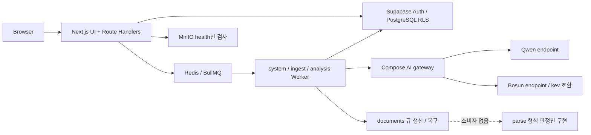
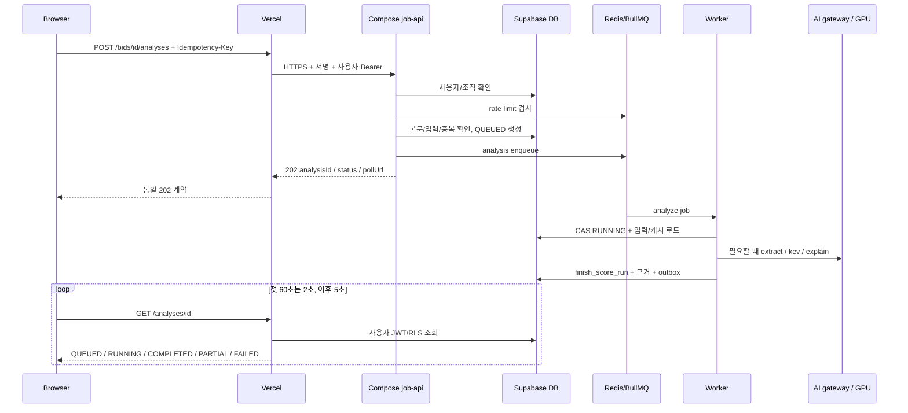

# SOL RADAR 실제 배포 아키텍처와 단계별 실행 계획

> **범위:** 분석과 계획만 작성했다. 애플리케이션 코드·환경변수·DB·운영 서버를 변경하지 않았다. 최초 요청의 파일명을 유지하되, 후속 요청에 따라 **Redis 제거/pgmq 전환은 이번 계획에서 제외**한다. Redis/BullMQ는 별도 서버에 유지하고 MinIO의 역할을 Supabase Storage로 옮긴다.
>
> **구현자에게:** 이 문서 검토와 별도 구현 지시 이후에만 `superpowers:executing-plans` 또는 사용자가 선택한 실행 방법으로 작업한다. 아래 체크박스는 모두 앞으로 수행할 작업이다.

**목표:** Vercel의 Next.js와 기존 Supabase Pro, Compose 서버의 API·Redis·Worker·Parser, H100의 Qwen·A40의 Bosun을 연결하면서 인증·RLS·API 계약·실행 모드를 보존한다.

**설계:** 화면·조회·WHAT-IF는 Vercel, 작업 접수는 HTTPS로 연결하는 Compose의 기존 Next.js API 런타임, 지속 실행과 문서 처리는 Compose, 데이터는 Supabase에 둔다. 브라우저와 Vercel에서 Redis/GPU에 직접 접속하지 않는다.

**기술:** 기존 Next.js 16.4.1·React·Supabase JS/SSR·Redis/BullMQ·Python/FastAPI·Docker Compose·nginx를 재사용한다. NestJS·새 ORM·pgmq·새 인증 시스템은 도입하지 않는다.

**근거:** 사용자 후속 요청, [[CLAUDE]], [[00-README]], [[02-ARCHITECTURE]], [[03-AI-PIPELINE]], [[04-DATABASE]], [[05-API-SPEC]], [[07-DATA-PIPELINE]], [[08-SCORING]], [[09-SECURITY]], [[10-DEPLOYMENT]], [[11-TESTING]], [[12-ROADMAP]], [[14-OBSERVABILITY]], [[15-DATA-CONTRACTS]], [[16-DECISIONS]], [[17-CLAUDE-IMPLEMENTATION]]. `polaris/mission.md`와 이번 변경의 기존 승인 스펙은 없다. 이 문서는 승인된 새 ADR이나 구현 완료 기록이 아니다.

## 1. 결론과 조사 범위

| 질문                                     | 판단                                                                                                                                                                                                     |
| ---------------------------------------- | -------------------------------------------------------------------------------------------------------------------------------------------------------------------------------------------------------- |
| Next.js를 Vercel에 배포할 수 있는가?     | 가능하다. 화면·SSR·Server Actions·짧은 Route Handler·Supabase Auth·DB 조회·순수 규칙 계산을 배포한다. 상시 Worker·Redis·문서 파싱 프로세스는 Compose에 둔다.                                             |
| 기존 API 서버를 통째로 이전해야 하는가?  | 현재 독립 업무 API 서버는 없다. API는 `web/app/api/v1/`다. **같은 Next.js 빌드를 Compose의 `job-api`로도 실행하여 작업 접수 POST 두 개만 맡기는 방식**을 권장한다. 새 백엔드 프레임워크를 만들지 않는다. |
| Redis는 제거하는가?                      | 아니다. 큐·요청 제한·수집 멱등 키·공공 API 예산을 모두 유지한다. Vercel의 생산자 실행 위치를 Compose로 옮기는 작업과 기능 재구현을 혼동하지 않는다.                                                      |
| MinIO를 제거할 수 있는가?                | 가능하다. 현재 파일 I/O 구현은 없지만 readiness·env 검사·smoke가 의존한다. 이 의존성 교체와 실제 볼륨 조사 후 컨테이너를 제거한다. 볼륨 데이터가 없다고 단정하거나 삭제하지 않는다.                      |
| Supabase Pro만으로 전체 운영이 가능한가? | DB·Auth·파일 저장에는 충분한 기능이 있다. 이 목표에서는 Redis·상시 Worker·Parser·GPU가 별도로 필요하다. Pro 사용 사실이 해당 실행 환경이나 Vercel 요금제를 제공하지는 않는다.                            |
| 주된 위험은 무엇인가?                    | Vercel→사설망의 연결 불가, 접수 API 인증 누락, DB/Redis 이중 쓰기, 문서 처리 미구현, 파일/DB 불일치, 늦게 완료된 문서의 추출 캐시 재사용, Redis 단일 서버 장애, A40 endpoint 미확정이다.                 |

조사 기준은 2026-10-21 작업 트리이며 HEAD는 `086ac1e`다. 다수의 기존 미커밋 변경과 `vercel.json` 등이 있어 HEAD만을 조사 대상으로 삼지 않았다. 실제 호출을 확인한 경로와 정본의 설계만 있는 경로를 아래에 나누었다. 숨김 비밀 파일은 읽지 않았고, 서비스 키·관리 API로 Supabase 사용량이나 운영 Redis/MinIO/GPU를 조회하지 않았다. **런타임 사용량·파일 존재·배포 성공·실제 지연은 미검증**이다. H100 Qwen 운영과 A40 Bosun 예정은 사용자가 제공한 사실이다.

### 1.1 기존 결정과 이번 제안의 차이

- ADR-017: Next.js API·Supabase Auth/RLS·worker 위치·웹의 service role 금지는 유지한다. ADR-028의 NestJS 전환은 해커톤 뒤로 유지한다.
- ADR-005·017: MinIO 첨부 저장을 Supabase Storage로 변경하는 후속 ADR이 필요하다.
- **ADR-044와 현재 `vercel.json`: Vercel Services의 `web` + 내부 `ai` + `AI_GATEWAY_URL` binding이다.** 이번 제안은 Vercel에는 `web`만 남기고 실제 Worker가 쓰는 Compose gateway 한 곳을 상태 검사 대상으로 삼는다. 기존 파일을 지금 삭제하거나 이미 변경된 것으로 기술하지 않는다.
- ADR-025·034의 같은 GPU 호스트/라우터 가정은 H100 Qwen·A40 Bosun 배치에 맞게 갱신한다. `KEV_*`, `/kev`, `/v1/systemone`, 모델 책임은 유지한다.
- ADR-043의 계산 대상 200명을 기준으로 한다. 과거 27명 설명을 현황으로 사용하지 않는다. 인력 시뮬레이션·포트폴리오의 미구현 기능은 이번 배포 작업의 완료 항목에 포함하지 않는다.

## 2. 현재 아키텍처와 구현 상태

위 그림은 현재 실행 코드 관계다. 별도로 작성된 Vercel Services 구성은 웹의 AI health를 Vercel 내부 gateway로 보내며, 외부 Worker는 Compose gateway를 사용한다. 현재 웹 AI 상태가 Worker 전체의 건강을 보증하지 않는다는 한계가 정본에도 명시돼 있다.

| 영역      | 코드에서 확인한 현황                                                                                           | 근거 경로                                                                                                                  |
| --------- | -------------------------------------------------------------------------------------------------------------- | -------------------------------------------------------------------------------------------------------------------------- |
| 업무 API  | Next.js Route Handler + 도메인 서비스. 독립 NestJS API 없음                                                    | `web/app/api/v1/`, `web/server/<도메인>/`                                                                                  |
| 인증·세션 | Supabase Auth, 쿠키 갱신, v1 쿠키/Bearer 지원, 활동 계정·가입 정보·업무 멤버십 검사                            | `web/proxy.ts`, `web/server/supabase/{client,claims,session}.ts`, `web/app/api/v1/_lib/http.ts`                            |
| 분석      | QUEUED DB 행 → BullMQ → RUNNING CAS → 추출 캐시/AI → 규칙 계산 → 트랜잭션 저장                                 | `web/server/bids/bids.service.ts`, `web/worker/analysis-job.ts`, `web/server/analysis/{analysis.service,analysis.repo}.ts` |
| 수집      | 공식 API/fixture connector, revision·첨부 PENDING 메타데이터 저장, documents enqueue                           | `web/worker/ingest-queue.ts`, `web/server/ingestion/{ingestion.service,ingestion.repo,ingestion.queue}.ts`                 |
| 파일      | 원본 URL·object key 열·SHA 키 생성 규칙은 있음. MinIO/S3/Storage 실입출력 어댑터 없음                          | `web/server/ingestion/attachment.model.ts`, `supabase/migrations/20261019000002_bid_notices.sql`                           |
| 다운로더  | fixture fetcher와 SSRF 검증 순수 함수 있음. 실 HTTP 첨부 다운로더·documents 소비자는 없음                      | `fixture-attachment-fetcher.ts`, `attachment-allowlist.ts`, `web/worker/main.ts`                                           |
| 파서      | PDF/HWP/HWPX 매직 바이트 판정. 알려진 형식도 `PARSER_NOT_CONFIGURED`로 UNSUPPORTED                             | `services/ai/src/sol_ai/parse.py`, `app.py`, `pyproject.toml`                                                              |
| 첨부→분석 | 실 첨부 텍스트 reader 대신 `EMPTY_ATTACHMENT_READER` 주입                                                      | `web/worker/analysis-runtime.ts`                                                                                           |
| 알림      | DB `outbox_events` 폴링. Redis 메시지 소비가 아님                                                              | `web/worker/notify-outbox.ts`, `web/server/notifications/`                                                                 |
| WHAT-IF   | 저장 스냅샷 조회 1회 후 자격 가정으로 규칙 재계산. AI·쓰기 없음                                                | `web/server/bids/what-if.service.ts`, `web/server/scoring/what-if.ts`                                                      |
| 인력      | 200명 속성·자격증·개인 실적 fixture/DB 변경 존재. `/workforce`·포트폴리오 API는 현 작업 트리에서 확인되지 않음 | `team_member_scoring`, `team_assignments`, `web/server/people/`, ADR-043, [[12-ROADMAP]] P1                                |
| 검색      | Qdrant 컨테이너 존재. 현 런타임의 검색 클라이언트 호출은 찾지 못함                                             | `infra/compose.yaml`; 현 검색은 Postgres/pg_trgm                                                                           |
| 학습 파일 | fixture·평가/학습 CLI·GPU 로컬 패키지 사용. MinIO 학습 파일 reader/writer 없음                                 | `services/ai/eval/`, `services/decision/`, [[22-FINETUNE-RUNBOOK]]                                                         |

실제 파이프라인과 장래 설계를 구별한다. 현재 `extract` 전용 큐 소비자는 없고, Qwen 추출은 `analysis` 작업 안에서 호출한다. **수집→문서 처리→모든 조직 자동 분석**이 이미 연결돼 있다고 가정하지 않는다. 새 자동 분석 팬아웃은 조직 선택·요청 권한·예산 정책을 별도 정의해야 한다.

## 3. Redis 의존성 전체 분류

여기서 ‘사용’은 코드 경로가 연결돼 있다는 뜻이며, 해당 운영 인스턴스가 현재 실행 중임을 뜻하지 않는다.

| 기능·키/큐                          | 호출/조립 위치                                                                                                                                              | 현재 정책                                                                                                          | 분류·처리                                                                         |
| ----------------------------------- | ----------------------------------------------------------------------------------------------------------------------------------------------------------- | ------------------------------------------------------------------------------------------------------------------ | --------------------------------------------------------------------------------- |
| 분석 enqueue `analysis` / `analyze` | `web/app/_lib/analysis-queue.ts` ← `work-deps.ts` ← `web/app/api/v1/bids/[id]/analyses/route.ts` POST                                                       | `analysis_<orgId>_<scoreRunId>` 중복 억제, producer 3초 상한                                                       | 사용. 생산자만 job-api에서 실행                                                   |
| 분석 소비                           | `web/worker/analysis-job.ts`, `analysis-runtime.ts`, `main.ts`; 계약 `web/server/analysis/analysis-job.model.ts`                                            | concurrency 1, 총 3회 시도, exponential 2초, 완료 1일·실패 7일 보존                                                | 사용. 유지                                                                        |
| 분석 유실/정체 복구                 | `web/worker/analysis-reconcile.ts`, `analysis-runtime.ts`                                                                                                   | 60초마다, QUEUED/RUNNING 10분 기준. RUNNING+job 없음 재등록, QUEUED+job 없음 FAILED                                | 사용. 보안 조건과 CAS 유지                                                        |
| 수동 수집 enqueue `ingest` / `run`  | `web/app/_lib/ingest-queue.ts`, `ingestion-deps.ts`, `web/server/ingestion/ingestion-admin.service.ts`, `web/app/api/v1/admin/ingestion/runs/route.ts` POST | jobKey→URL 인코딩 jobId, run 행은 Worker가 생성                                                                    | 사용. job-api에서 기존 서비스 실행                                                |
| 수집 소비·정기 실행                 | `web/worker/main.ts`, `ingest-queue.ts`, `web/server/ingestion/ingestion.queue.ts`                                                                          | live에서 `g2b-scheduled` scheduler, 기본 30분. fixture/mock은 scheduler 제거                                       | 사용. BullMQ scheduler 유지; Cron 신설 안 함                                      |
| 문서 enqueue `documents` / `fetch`  | `web/server/ingestion/ingestion.queue.ts`, `ingestion.service.ts`, `web/worker/main.ts`                                                                     | `documents-<revisionId>-<created_at epoch ms>`, 3회·2초 backoff·완료 1일·실패 7일                                  | 생산 경로 사용. 소비 기능은 신규                                                  |
| 문서 큐 복구                        | `web/worker/documents-reconcile.ts`, `web/server/ingestion/pending-documents.repo.ts`                                                                       | 60초·batch 100. download PENDING 또는 OK+parse PENDING; live/demo 분리                                             | 사용. 신규 소비자와 연결                                                          |
| 시스템 round trip                   | `web/worker/system-queue.ts`, `main.ts`, `ping.ts`                                                                                                          | `system`/`ping`, 검사 전체 10초 상한                                                                               | 운영 검사에 사용. 유지                                                            |
| 데모 사전 분석                      | `web/worker/demo-preanalyze.ts`, 루트·web `package.json`                                                                                                    | 같은 analysis 큐, DB 사전 run                                                                                      | 사용. 같은 Redis/모드 유지                                                        |
| 분석 요청 제한                      | `web/app/_lib/rate-limit.ts`, `work-deps.ts`, `web/server/bids/bids.service.ts`                                                                             | `rate:analysis:<orgId>:<분>`; 30회/분, Lua INCR+EXPIRE 60초                                                        | 사용. job-api로 이동, 단순 삭제 금지                                              |
| 수집 요청 제한                      | `rate-limit.ts`, `ingestion-deps.ts`, `ingestion-admin.service.ts`                                                                                          | `rate:ingest:<orgId>:<분>`; 5회/분, 분석과 별도                                                                    | 사용. 유지                                                                        |
| 수집 멱등 키                        | `web/app/_lib/idempotency-store.ts`, `ingestion-admin.service.ts`                                                                                           | `idem:ingest:<orgId>:<requestId>`; SET NX EX 86,400초. 본문 hash·runId·시각·요청자; 실패 시 release                | 사용. 유지. 분석 멱등 기록은 별도로 DB에 있음                                     |
| 공공 API 호출 예산                  | `web/worker/quota-store.ts`, `main.ts`; `web/server/ingestion/{quota,quota-store,ingestion.service}.ts`; `infra/sources/registry.yaml`                      | `quota:<serviceId>:<KST YYYYMMDD>`, TTL 2일. 90% 보조조회 중단, 100% 전체 중단, 코드22 소진. 연결 오류면 호출 중단 | 사용. Worker에 유지. 현 get/add는 사전 원자 예약이 아니므로 수집 동시성 증설 주의 |
| 연결·readiness                      | `web/app/_lib/redis-client.ts`, `web/server/health/{health.repo,health.service}.ts`, `web/worker/{env,readiness}.ts`                                        | producer 빠른 실패·공유 연결; worker 장기 연결, Redis PING                                                         | 사용. Vercel은 HTTPS 요약으로 전환, job-api/worker는 유지                         |
| 오류 계약·표시                      | `web/app/(app)/(work)/admin/ingestion/{request-errors,error-kind}.ts`, bids/ingestion 서비스                                                                | 503 `component: redis/queue`, 429 `Retry-After`                                                                    | 호환 유지. 신규 경계 장애는 별도 `backend` 사유                                   |
| 분석 결과·매칭·점수 캐시            | Redis 호출 없음. `requirement_extractions`, `score_runs` 재사용                                                                                             | 추출/분석 결과는 Postgres                                                                                          | 미사용. Redis 캐시나 pgmq를 새로 만들지 않음                                      |
| 세션·Realtime·알림 pub/sub          | Redis 세션 저장/업무 pub/sub 구현 없음. BullMQ 내부 이벤트는 사용                                                                                           | Supabase Auth, DB outbox, 화면 polling                                                                             | 미사용 기능의 대체 구현 불필요                                                    |

설정·검증 의존성도 유지/갱신 대상이다: `infra/compose.yaml`, `infra/env/{demo,ai-local}.env.example`, `web/.env.example`, `scripts/check-env.mjs`, `infra/smoke.sh`, `web/next.config.ts`, `web/package.json`/`web/pnpm-lock.yaml`, `web/playwright.{work,ingestion}.config.ts`, `web/e2e-auth/support/{work-setup,ingestion-setup,ingestion-fixtures}.ts`. 관련 단위 시험은 각 파일 옆 `*.test.ts`, API 계약 시험은 `bids-contract.test.ts`·`admin-ingestion-contract.test.ts`다. **bullmq·ioredis 패키지는 제거하지 않는다.**

### 3.1 현재 재시도에서 과장하면 안 되는 부분

- analysis/documents의 job 옵션 3회와 공공 API HTTP 재시도는 서로 다르다. `web/server/ingestion/retry.ts`는 최초 호출 외 최대 3회 재시도, 기본 1초 지수 증가 + 250ms 미만 jitter, Retry-After 최대 60초다.
- ingest 큐 전체에 analysis와 같은 `attempts: 3`이 설정돼 있지는 않다. 실패 run의 cursor/수집 창 재사용과 다음 정기 수집을 구분해 운영한다.
- BullMQ 실패 job 보존은 별도 DLQ 서버/큐가 아니다. failed 상태를 운영 실패함으로 사용한다. age 청소는 즉시 실행되는 법정 보존 타이머로 간주하지 않는다.
- DB `score_runs` 생성과 Redis enqueue는 서로 다른 저장소다. 기존 `ENQUEUE_FAILED` 정리와 stale 복구가 있지만 완전한 원자성·무손실을 보장하지 않는다. 특히 QUEUED 임의 재등록은 직접 DB insert로 요청 제한을 우회하는 보안 문제 때문에 금지돼 있다.

## 4. 권장 배포 구조와 대안

```mermaid
flowchart TB
  U[Browser] -->|HTTPS same-origin| V[Vercel Next.js web]
  U -->|Auth / 허용된 signed URL| SB[Supabase Pro Auth / PostgreSQL / Private Storage]
  V -->|사용자 JWT + RLS / 짧은 조회 / WHAT-IF| SB
  V -->|HTTPS 443 / 서비스 서명 + 사용자 JWT| E[Compose 서버 nginx]
  subgraph C[별도 CPU 서버 / Docker Compose]
    E --> A[job-api / 같은 Next.js Route Handler 코드]
    A --> R[Redis + BullMQ / 내부 6379]
    R --> W[기존 Worker + 신규 documents 소비자]
    W --> G[Python AI gateway / 내부 8000]
    G --> P[격리된 Parser 프로세스 / 신규]
    W --> H[파일 업로드·DB 저장·복구]
  end
  A -->|anon + 사용자 JWT| SB
  H -->|worker service role / HTTPS| SB
  G -->|TLS + QWEN_API_KEY| Q[H100 / 기존 Qwen vLLM]
  G -->|TLS + KEV_API_KEY| K[A40 / Bosun sol_decision]
```

Parser는 MVP에서 기존 `ai-gateway`의 `/parse` 뒤 **제한된 하위 프로세스**로 구현한다. 별도의 공개 parser API는 없다. CPU 파싱이 모델 요청/health를 막거나 메모리 격리가 부족하다는 측정 결과가 나오면 같은 Python 코드의 `parser` 컨테이너로 분리한다. ‘별도 서버에서 API/Worker/Parser 운영’은 역할의 배치이며, 반드시 새로운 프레임워크 세 개를 만드는 뜻이 아니다.

| 안                             | 장점                                                                      | 비용/제약                                                                                         | 판단                                       |
| ------------------------------ | ------------------------------------------------------------------------- | ------------------------------------------------------------------------------------------------- | ------------------------------------------ |
| A. HTTPS job-api + 사설 Redis  | Redis 포트 비공개, Vercel 고정 IP 옵션 불필요, 기존 API/도메인/RLS 재사용 | Next.js API 런타임 1개와 서명 프록시 필요, 웹/서버 버전 동기화                                    | **권장**                                   |
| B. Vercel→TLS Redis 직접 연결  | producer 코드 변경 최소, 별도 API 런타임 불필요                           | TLS 종단·ACL·접속 제한·연결 수 관리 필요. 일반 Vercel에서 10.x/192.168.x/`redis` 주소에 연결 불가 | 고정 egress/사설 연결이 확보된 경우만 대안 |
| C. 전체 API를 새 NestJS로 이전 | 장기 분리가 명확                                                          | 인증·계약·구조 재구현, ADR-028 선행, MVP 일정 위험                                                | 이번 범위 제외                             |

**A의 API 런타임:** 새 서버 소스를 복사하지 않는다. `web`의 동일 release SHA를 Vercel과 Compose `job-api`에 배포한다. Compose는 `pnpm build` 산출물로 `next start`를 실행하며 `web/Dockerfile`은 신규다. nginx가 POST `/api/v1/bids/<uuid>/analyses`, POST `/api/v1/admin/ingestion/runs` 및 서명된 내부 health만 허용한다. 다른 페이지·Auth callback·Server Action·임의 `/api/*`는 ingress에서 404로 닫는다. 컨테이너 :3000은 호스트에 게시하지 않는다. 앱에서도 배포 역할과 허용 경로를 검사하여 nginx 설정 누락 하나로 전체 앱이 열리지 않게 한다.

웹의 두 POST는 `SOL_DEPLOYMENT_ROLE=frontend`일 때 HTTPS 전달, `job-api`일 때 기존 서비스 실행, `local`일 때 기존 로컬 실행으로 명시한다. frontend인데 backend URL이 없으면 503으로 닫는다. 자동으로 Redis 직접 접속으로 되돌아가거나 프록시가 자기 자신을 다시 부르는 기본값을 두지 않는다. `workDeps()`/`ingestionDeps()`는 읽기용 생성만으로 Redis에 연결하지 않는 현재 성질을 유지한다.

Next.js의 Node server/Docker 지원과 reverse proxy 권고는 설치된 `web/node_modules/next/dist/docs/01-app/01-getting-started/17-deploying.md`, `01-app/02-guides/self-hosting.md`에서 확인했다. 작업 코드가 `next/headers`·`server-only`에 의존하므로 지금 별도 Node HTTP 서버로 그대로 옮길 수 있다고 가정하지 않는다.

## 5. Vercel 기능 경계

| 기능                                                 | 배치                                               | 조건                                                                                    |
| ---------------------------------------------------- | -------------------------------------------------- | --------------------------------------------------------------------------------------- |
| UI·SSR/RSC·정적 자산·이미지 최적화                   | Vercel                                             | 현재 nonce CSP/동적 레이아웃 유지, 1280/1440px 검증                                     |
| 로그인·가입·callback·세션 갱신                       | Vercel + Supabase Auth                             | 현재 cookie/Bearer 계약·리다이렉트 allowlist 유지                                       |
| 공고·분석 상태·직원·회사 프로필·알림 조회, 검토 기록 | Vercel Route Handler/Server Action                 | anon + 사용자 JWT + RLS, 조직 데이터 no-store                                           |
| 분석/수집 접수                                       | Vercel은 인증 후 HTTPS 전달, Compose에서 실제 접수 | DB/Redis 작업과 202 결정은 job-api 한 곳. 이중 요청 제한/이중 enqueue 금지              |
| WHAT-IF                                              | Vercel Node runtime                                | 스냅샷 조회 + 규칙 계산. AI·큐·장기 파일 읽기 없음                                      |
| 파일 다운로드 URL 발급                               | Vercel                                             | DB 권한 확인 + 사용자 세션으로 Storage signed URL. 파일 본문을 Vercel로 프록시하지 않음 |
| 첨부 다운로드·업로드·파싱·Qwen/Bosun 실행 조정       | Compose Worker/gateway/parser                      | 장기 실행, 50 MiB 처리, CPU·메모리·재시도 제어                                          |
| Redis/BullMQ 소비·정기 scheduler·outbox·복구 loop    | Compose                                            | 상시 프로세스. Vercel Route Handler/`after()`를 소비자로 사용하지 않음                  |
| Qwen·Bosun 가중치/추론                               | H100·A40                                           | Vercel/CPU 서버에 가중치 배포 안 함                                                     |

Vercel 공식 문서상 Functions 본문 제한은 **요청/응답 4.5 MB**다. Fluid Compute 일반 최대 실행 시간은 플랜에 따라 다르고 Pro/Enterprise 일반 상한은 800초이며, 더 긴 beta도 상시 Worker의 배치 근거로 쓰지 않는다. 본 설계의 접수 프록시는 15초 요청 상한을 제안하며 추론 완료를 기다리지 않는다. [Vercel Functions 제한](https://vercel.com/docs/functions/limitations), [Next.js 지원](https://vercel.com/docs/frameworks/full-stack/nextjs).

Node runtime을 사용한다. Edge로 Redis·`node:crypto`·DB 라이브러리를 옮기지 않는다. `after()`/`waitUntil()`은 함수 수명 제한 안에서의 후속 처리이며 BullMQ durable 소비의 대체가 아니다(설치된 Next `04-functions/after.md`). Vercel의 새 queue/daemon 제품도 이번에는 도입하지 않는다.

### 5.1 사설 Redis와 Vercel 연결

권장안은 **Vercel→HTTPS job-api→내부 Redis**다. Compose DNS `redis:6379`, 호스트 loopback, RFC1918 주소를 Vercel 환경변수에 넣어도 인터넷에서 연결되지 않는다. HTTPS job-api만 DNS와 유효한 TLS 인증서로 접근 가능하게 하고 Redis는 포트 게시를 없앤다.

직접 연결 대안을 선택한다면 `rediss://`·인증서 검증·Redis ACL·방화벽 allowlist·최소 producer 권한을 모두 갖춰야 한다. 비밀번호만 건 공개 6379나 `rejectUnauthorized=false`는 허용하지 않는다. HTTP REST Redis endpoint를 ioredis/BullMQ의 TCP endpoint 대신 넣을 수 없다.

일반 Vercel egress IP는 고정이라고 가정할 수 없다. 공식 Static IPs는 Pro/Enterprise에서 제공하며 Pro 기준 **프로젝트당 월 $100 + 지역별 전송료**, Secure Compute는 Enterprise의 별도 옵션이다. Static IPs는 출발 IP 고정이며 사내망 라우팅 자체를 만들어 주지 않는다. routing middleware의 통신에도 그대로 적용되지 않는다. **Supabase Pro와 Vercel Pro는 별개**이며 현재 Vercel 플랜은 확인되지 않았다. [Static IPs](https://vercel.com/docs/networking/static-ips), [Secure Compute](https://vercel.com/docs/networking/secure-compute).

## 6. HTTPS·인증·CORS·네트워크 경계

### 6.1 요청 인증

1. 브라우저는 기존 Vercel origin의 `/api/v1`을 호출한다. v1 cookie 요청은 현재 `X-Requested-With: sol-radar` 검사와 인증을 유지한다. 임의 Authorization 헤더가 있으면 실패 시 cookie로 fallback하지 않는 규칙도 유지한다.
2. Vercel이 기존 `requireBusinessUser`로 활동 계정·프로필·멤버십을 확인한다. 검증된 세션의 access token만 backend에 Bearer로 전달한다. refresh token과 전체 Cookie는 보내지 않는다. 이 변환 전에 CSRF 검사를 끝낸다.
3. Vercel은 별도 서비스 HMAC 서명을 붙인다. 서명 입력은 버전·key id·timestamp·nonce·method·정규화 path/query·본문 SHA-256·Bearer token SHA-256·Idempotency-Key다. `API_CURSOR_SECRET`과 키를 공유하지 않는다. 외부에서 받은 `X-Sol-*` 값은 폐기하고 서버에서 만든다.
4. job-api는 허용 route·method, HMAC 상수 시간 비교, ±30초 timestamp, Redis `dispatch:nonce:<kid>:<uuid>`의 SET NX EX 120초로 재전송을 검사한다. nonce 저장 실패는 요청 허용이 아니라 503이다. 두 서버 시각을 동기화한다.
5. job-api는 사용자 JWT와 현재 멤버십/활동 상태를 다시 검증하고, **anon key + 사용자 JWT**로 기존 도메인 서비스를 실행한다. 요청 본문/헤더의 orgId·userId·role을 권한으로 믿지 않는다. nonce 재전송 방지와 업무 Idempotency-Key 재생은 별개다. 재시도는 새 nonce와 동일 업무 키를 쓴다.

서명 키는 32바이트 이상 무작위 값, key id로 현재/이전 키를 짧게 병행한 뒤 교체한다. Browser→job-api 직접 요청은 정상 사용자 JWT만으로도 허용되지 않는다. 공개 HTTPS endpoint라는 사실과 ‘Vercel만 인증 후 사용 가능’이라는 정책을 구분한다. 고정 IP를 추가하면 방어층이 늘지만 HMAC/사용자 권한 검사를 대체하지 않는다.

내부 `/api/internal/backend-health`는 사용자 작업을 수행하지 않는 예외다. 사용자 JWT 대신 HMAC·시각·nonce 검사만 사용하고 서명 입력의 사용자 token 자리는 명시적인 빈 값으로 고정한다. 반환값은 §11.2의 상태 요약뿐이며, 이 예외를 업무 POST에 적용하지 않는다.

16 KiB 입력 상한을 프록시와 backend 모두 유지한다. 단순 nginx 413이 기존 JSON 계약을 깨지 않게 엣지 한도는 여유 있게 두고 앱에서 현재 400 `VALIDATION_ERROR`를 반환한다. JSON 변환 없이 원문 바이트를 서명·전달하며, method/path는 allowlist로 제한하고 redirect를 따르지 않는다. 공개 API의 202 body·pollUrl·409·429·Retry-After·오류 envelope를 그대로 전달한다. `X-Request-Id`와 프록시 상관 ID는 로그에 연결하되 원본 토큰·키·문서 본문은 남기지 않는다.

본문 서명 때문에 프록시의 제한된 바이트 읽기는 기존 도메인 limiter보다 먼저 일어난다. 권한·키·선언 크기를 먼저 검사하고, 정상 크기의 잘못된 JSON도 backend에 전달해 기존 limiter→본문 검증 순서를 유지한다. Content-Length 없는 초과 본문은 프록시가 400으로 차단하므로 기존 로컬 경로와 요청 제한 횟수 계산이 달라질 수 있다. 이 작은 경계 차이도 API 회귀 시험과 ADR에 명시하며, 본문 읽기 순서까지 기존과 동일하다고 주장하지 않는다.

### 6.2 공개/내부 통신 표

| 대상                               | 외부 공개                                       | 인증·접근                                                                                                                           |
| ---------------------------------- | ----------------------------------------------- | ----------------------------------------------------------------------------------------------------------------------------------- |
| Vercel 제품 도메인                 | HTTPS 443                                       | 기존 Supabase 세션, 업무 RBAC/RLS                                                                                                   |
| Compose ingress 도메인             | HTTPS 443만                                     | 업무 요청은 서비스 서명 + 사용자 JWT, 내부 health는 위 예외. 정확한 route/method allowlist. 80은 필요할 때 인증서 발급/HTTPS 이동만 |
| job-api :3000                      | 아니오                                          | nginx→Compose 전용 네트워크. 서명 검증 앱에서도 강제                                                                                |
| Redis :6379                        | 아니오                                          | job-api/worker 전용 네트워크·인증/ACL. API 프로세스와 Worker ACL 분리 검증                                                          |
| AI gateway :8000·parser subprocess | 아니오                                          | Worker와 내부 운영 health만. `/extract`·`/kev`·`/parse` 공개 rewrite 금지                                                           |
| Worker                             | 아니오                                          | 포트 없음. 읽기 전용 fixture/registry mount, 필요한 outbound만                                                                      |
| Qwen H100·Bosun A40                | 기존 회사 HTTPS ingress만 또는 승인된 사설 연결 | 회사 TLS + 모델별 API key. raw vLLM/decision 포트 외부 미공개                                                                       |
| Supabase API/Auth/Storage          | 관리 서비스 HTTPS                               | anon은 공개 식별자, 권한은 JWT/RLS. private object는 짧은 signed URL                                                                |
| Supabase SQL 연결                  | 애플리케이션에 신규 공개 안 함                  | 현재 PostgREST 사용 유지. DDL 접속은 운영 CLI 전용                                                                                  |
| Qdrant :6333                       | 아니오                                          | 현 사용 경로 없음. 기본 기동에서 제외하는 profile 제안, 데이터 볼륨 보존                                                            |
| SSH·Docker API·MinIO console       | 제품 인터넷 경로에 없음                         | SSH는 관리자 제한망/IP. Docker socket은 컨테이너에 mount하지 않음                                                                   |

CORS는 브라우저 정책이며 서버 간 인증/방화벽이 아니다. 브라우저가 job-api/GPU를 직접 부르지 않으므로 새 cross-origin 업무 API/CORS wildcard가 필요 없다. 기존 API의 CORS·CSRF 정책을 유지한다. Storage signed URL의 다운로드는 직접 이동을 기본으로 하고 JS fetch가 필요한 경우에만 정확한 제품 origin/Storage 응답 설정을 검증한다. Auth Site URL·Redirect URLs는 실제 제품/허용 preview만 등록한다.

### 6.3 환경변수·Secret 소유권

| 값                                                                   | Vercel web                                             | Compose job-api          | Worker                                     | gateway / GPU                                |
| -------------------------------------------------------------------- | ------------------------------------------------------ | ------------------------ | ------------------------------------------ | -------------------------------------------- |
| `NEXT_PUBLIC_SUPABASE_URL`, `NEXT_PUBLIC_SUPABASE_ANON_KEY`          | 사용                                                   | 사용                     | URL 사용; anon 불필요                      | 불필요                                       |
| `SUPABASE_SERVICE_ROLE_KEY`                                          | **금지**                                               | **금지**                 | 기존 DB 작업 + 신규 Storage 쓰기/읽기/삭제 | 금지                                         |
| `SOL_DEPLOYMENT_ROLE` (신규)                                         | `frontend`                                             | `job-api`                | 불필요                                     | 불필요                                       |
| `JOB_API_BASE_URL`, `JOB_API_TIMEOUT_MS` (신규)                      | HTTPS ingress, 15000 제안                              | 불필요                   | 불필요                                     | 불필요                                       |
| `JOB_API_SIGNING_KEY_ID`, `JOB_API_SIGNING_SECRET` 및 이전 키 (신규) | 서명                                                   | 검증                     | 불필요                                     | 불필요                                       |
| `REDIS_URL`·Redis ACL/password                                       | 없음                                                   | 내부 producer            | 내부 consumer/quota                        | 없음                                         |
| `API_CURSOR_SECRET`                                                  | 기존 유지                                              | 필요한 기존 의존성에만   | 없음                                       | 없음                                         |
| `SOL_RUN_MODE`·`DEMO_MODE`·기존 AI 모드 flag                         | 웹 표시/계약                                           | 접수 모드 검증           | 처리 모드                                  | gateway에 일치                               |
| `AI_GATEWAY_URL`                                                     | 직접 내부 URL/binding 제거; 서명된 backend health 사용 | `http://ai-gateway:8000` | 같은 내부 URL                              | 불필요                                       |
| `QWEN_BASE_URL`, `QWEN_MODEL`, `QWEN_API_KEY`                        | 없음                                                   | 없음                     | 없음                                       | gateway→H100                                 |
| `KEV_BASE_URL`, `KEV_MODEL_ID`, `KEV_API_KEY`, `KEV_QUESTION_SET`    | 필요한 표시 정보만, 비밀 없음                          | 없음                     | 호환 모드/timeout만                        | gateway→A40; A40의 `DECISION_API_KEY`와 일치 |
| `G2B_*_SERVICE_KEY` 4종                                              | 금지                                                   | 금지                     | live에서 기존 규칙 유지                    | 불필요                                       |
| `SUPABASE_DOCUMENT_BUCKET`, `SUPABASE_PARSED_BUCKET` (신규)          | signed URL 발급 시 서버 설정                           | 필요 없음                | 읽기/쓰기                                  | 불필요                                       |
| `PARSER_PDF/HWPX/HWP`·parse 제한                                     | 없음                                                   | 없음                     | 호출 timeout                               | gateway/parser에만                           |
| `MINIO_ENDPOINT`, `MINIO_ROOT_*`, `MINIO_HOST_PORT`                  | 전환 후 제거                                           | 없음                     | 전환 후 제거                               | 없음                                         |
| 루트 `SUPABASE_DB_URL`                                               | 금지                                                   | 금지                     | 금지                                       | 운영 마이그레이션 CLI에만                    |

실제 secret은 Vercel 환경별 비밀 설정과 서버의 소유자 제한 파일/운영 secret 주입으로 관리한다. Compose secrets를 선택하면 기존 코드가 `_FILE`을 읽는다고 가정하지 말고 전용 loader를 구현한다. 이미지·Docker build ARG·git·브라우저 `NEXT_PUBLIC_*`에 비밀을 넣지 않는다. `.env.example`에는 이름과 placeholder만 둔다. `docker compose config`·`docker inspect` 전체 출력을 증거/로그에 남기지 않는다.

Production/Preview는 backend 키·Redis·Storage 경로·DB 환경을 분리한다. 비용 때문에 별도 Supabase 프로젝트를 못 쓰면 preview의 운영 쓰기/작업 접수를 닫고 mock 전용으로 둔다. 운영 데이터베이스에 preview seed/reset을 실행하지 않는다. 공개 Supabase URL/anon은 Next 빌드에 포함되므로 이미지의 빌드 환경과 런타임 대상도 확인한다.

## 7. MinIO 제거와 Supabase Storage 신규 연동

### 7.1 MinIO 의존성 분류

| 항목                                                     | 실제 상태                                              | 조치                                                              |
| -------------------------------------------------------- | ------------------------------------------------------ | ----------------------------------------------------------------- |
| `infra/compose.yaml` minio·miniodata·9000·root env       | 컨테이너 정의 존재. 실제 파일 수 미확인                | Storage 검증 후 서비스 제거. 기존 volume 별도 보존                |
| worker에 전달되는 `MINIO_ROOT_USER/PASSWORD`             | 코드 사용 경로 없음                                    | 실입출력 신규 구현과 별개로 제거                                  |
| `web/server/health/health.repo.ts` `/minio/health/live`  | 실제 호출. `health.service.ts`가 `MINIO_ENDPOINT` 사용 | Storage/worker 상태 검사로 교체                                   |
| `scripts/check-env.mjs`, env example·smoke               | MinIO 필수값/healthy 기대                              | 역할별 env와 새 smoke로 갱신                                      |
| `attachmentObjectKey`·DB `object_key`, `text_object_key` | 참조 계약만 구현                                       | 키와 document ID 유지, bucket 위치 추가                           |
| MinIO/S3 SDK·upload/download/delete·presigned 구현       | web/Python dependency와 runtime에서 미확인             | 제거할 SDK 없음. `@supabase/supabase-js` 재사용                   |
| 파싱 텍스트·학습 파일 MinIO 저장                         | 설계 설명만 있고 호출 구현 없음                        | 필요한 문서 저장부터 신규 구현. 학습 전체 저장소 이전은 하지 않음 |

### 7.2 버킷·접근 설계

- private bucket `bid-documents`: 원본 PDF/HWP/HWPX. 기존 `raw/bids/{bidId}/{revisionId}/{sha256}.{ext}` 키 유지.
- private bucket `bid-parsed`: `parsed/bids/{bidId}/{revisionId}/{rawSha256}/{parserVersionHash}/result.json`. `ParseResult.text`, `pages`, `blocks`, quality, parser/version, text SHA를 함께 보존한다. 기존 `text_object_key`는 이 immutable JSON의 키를 가리키며 reader가 text를 꺼낸다. 서명 URL은 DB에 저장하지 않는다.
- 학습 파일은 당장 별도 bucket을 만들지 않는다. 공유가 실제 필요한 데이터셋만 후속 private `ai-training`에 checksum manifest와 함께 올린다. Git fixture·GPU 가중치·학습 checkpoint의 현재 경로를 이 배포 작업에서 바꾸지 않는다.
- 원본 최대 **52,428,800 bytes(50 MiB)**는 기존 계약대로 유지한다. Supabase 프로젝트/버킷 업로드 제한도 이를 허용하도록 설정하되 최대 허용량 전체를 무작정 열지 않는다. MIME과 확장자를 신뢰하지 않고 내용 판정값을 사용한다.
- worker는 service role로 Storage API를 사용한다. 웹의 signed URL 발급은 현재 사용자 JWT와 Storage SELECT 정책으로 가능하므로 service role을 웹에 넣을 필요가 없다.

Private bucket·signed URL·service key의 RLS 우회 성격은 공식 문서에서 확인했다. [버킷 접근](https://supabase.com/docs/guides/storage/buckets/fundamentals), [Storage 권한](https://supabase.com/docs/guides/storage/security/access-control), [signed URL 권한](https://supabase.com/docs/reference/javascript/storage-from-createsignedurl).

새 `GET /api/v1/bids/{bidId}/documents/{documentId}/download-url`은 추가형 API다. 활동 계정·공고/문서 연결·DB RLS 확인 후 **원본에 한해 TTL 60초** URL을 반환한다. bucket/path를 클라이언트 입력으로 받지 않는다. 정책도 DB의 `bid_documents` 참조가 있는 원본만 허용하며 anon 쓰기/읽기는 금지한다. 공고는 현재 조직 공용 자료이므로 가짜 `org_id` 경로로 재분류하지 않는다. 향후 기업 증빙/조직 학습 자료는 별도 org 정책이다. parsed bucket은 worker 전용으로 시작한다.

Signed URL은 만료 전 공유될 수 있는 bearer 권한이다. 사용자 정지/로그아웃이 이미 발급한 URL을 즉시 무효화한다고 주장하지 않는다. URL·query는 로그/분석 이벤트에 넣지 않고 응답은 no-store, 다운로드는 attachment로 제공한다.

표준 업로드는 기술적으로 50 MiB를 지원하지만 공식 권장은 6 MB 초과에서 resumable upload다. MVP는 기존 SDK의 immutable upload + 제한된 재시도로 시작하고 **50 MiB·통신 단절·재시도 메모리 시험을 필수 게이트**로 둔다. 재전송 비용/실패율이 기준을 넘으면 해당 adapter에만 TUS를 도입하며 미리 S3 SDK를 추가하지 않는다. [업로드 방식](https://supabase.com/docs/guides/storage/uploads/standard-uploads), [파일 제한](https://supabase.com/docs/guides/storage/uploads/file-limits).

### 7.3 DB 변경과 파일/DB 일관성

새 append-only migration으로 다음을 구현한다. 파일명은 실행 시 최신 migration 다음 번호를 배정하며 기존 migration을 수정하지 않는다.

| 변경                                                                      | 목적·권한                                                                                                                                                                                                                                                                                                                      |
| ------------------------------------------------------------------------- | ------------------------------------------------------------------------------------------------------------------------------------------------------------------------------------------------------------------------------------------------------------------------------------------------------------------------------ |
| `bid_documents.storage_provider`, `storage_bucket`, `text_storage_bucket` | 기존 object key와 document ID 유지. 기존 non-null 참조는 inventory 후 명시적 backfill; 미확인 참조를 Supabase로 일괄 간주하지 않음                                                                                                                                                                                             |
| `document_storage_objects`                                                | bucket+object_key UNIQUE, provider·revision_id·kind RAW/PARSED·sha256·size·parser version·상태 PENDING/UPLOADED/LINKED/DELETE_PENDING/DELETED/FAILED·시각·sanitized error. worker/운영 CLI 쓰기 전용, RLS·grant 명시                                                                                                           |
| `bid_documents`와 저장 객체의 FK/참조                                     | 원본/파싱 결과가 실제로 저장됐을 때만 참조와 OK/PARSED 상태를 DB transaction으로 확정                                                                                                                                                                                                                                          |
| 동일 revision의 중복 첨부 참조                                            | 현재 UNIQUE(revision_id,sha256)는 같은 파일을 가리키는 두 문서 행을 모두 OK로 만들 수 없다. 새 migration에서 **물리 객체 유일성은 storage objects의 UNIQUE로 옮기고**, 문서 참조는 동일 객체를 공유하도록 한다. 기존 문서 ID·이름·original_url을 삭제해 중복을 해결하지 않음. 원래 hash 조회 인덱스와 객체 hash 일치 검증 유지 |
| `storage.objects` SELECT 정책                                             | 활동 사용자 + 원본 bucket + 자신에게 읽기 허용된 공고 문서의 확정 참조. parsed/training·미연결 object는 사용자에게 열지 않음                                                                                                                                                                                                   |
| 타입·시험 기반                                                            | `pnpm db:types`로 `web/lib/database.types.ts` 생성. `scripts/supabase-pglite.mjs`에 필요한 storage schema 최소 모사 추가; 실제 Storage HTTP 시험 별도                                                                                                                                                                          |

파일 I/O와 Postgres는 단일 트랜잭션이 아니다. 처리 순서는 다음으로 고정한다.

1. 다운로드 성공 바이트를 SHA-256으로 검증하고 immutable key를 계산한다. DB에 업로드 intent를 먼저 기록한다.
2. `upsert:false`로 업로드한다. 이미 존재하면 409를 무조건 성공으로 삼지 않고 크기·trusted checksum을 검증한다. provider의 ETag를 SHA-256으로 간주하지 않는다.
3. 업로드 성공 후 document 참조·download OK/parse PENDING와 object LINKED 상태를 같은 DB transaction으로 저장한다. 그 전에는 UI에 다운로드 가능으로 표시하지 않는다.
4. DB 저장 실패 시 같은 key로 다시 확인/연결한다. 즉시 파일을 삭제하면 동시 참조를 깨므로 삭제하지 않는다. intent를 읽는 복구기가 object 존재/참조를 대조한다.
5. 파싱 결과도 새 immutable key에 저장한 뒤 상태·페이지·quality·text key를 함께 확정한다. 원본 성공 후 파싱 실패는 원본을 보존하고 parse 실패만 기록한다.
6. 삭제는 참조 없음 확인→DELETE_PENDING→Storage API remove→DELETED다. 이미 없는 파일도 멱등 처리하고, 삭제 실패는 다시 시도한다. 최초 전환에서는 orphan **리포트만** 내며 자동 실제 삭제를 켜지 않는다.

Storage 객체 삭제는 SQL 메타데이터 삭제로 대신할 수 없다. DB backup에는 Storage 파일 본문이 포함되지 않으므로 별도의 checksum manifest·object 백업과 복원 리허설을 둔다. [삭제 API 원칙](https://supabase.com/docs/guides/storage/management/delete-objects), [백업 범위](https://supabase.com/docs/guides/platform/backups).

### 7.4 기존 MinIO 데이터가 있을 때

운영자가 확인 가능한 환경에서 bucket/object 수·크기·checksum·DB object key 참조를 읽기 전용 inventory로 먼저 만든다. 0건이 확인되면 데이터 복사는 생략한다. 파일이 있으면 새 쓰기를 일시 정지하고 동일 key로 복사→전수 SHA/크기 비교→원본·parsed 연결 표 확인→DB provider/bucket 참조 갱신→다운로드 smoke 순서로 전환한다. DB에 없는 파일도 삭제하지 말고 별도 manifest로 보존한다. 데이터 삭제·MinIO volume 제거는 별도 보존 결정 전까지 하지 않는다.

## 8. 문서 소비자와 파서: 신규 구현 트랙

이 절은 Redis 기능 이전이 아니다. 현재 없는 기능을 구현하는 별도 완료 기준이다.

### 8.1 documents 소비자

- 입력·jobId·3회/2초 backoff·1일/7일 보존은 기존 `documentsJobDataSchema`, `toDocumentsJobId`, `DOCUMENTS_JOB_OPTIONS`를 재사용한다. payload에 파일 바이트·JWT·secret·signed URL을 넣지 않는다.
- bidId/revisionId/created_at과 `is_demo` 범위를 DB에서 검증한다. demo reset 이전의 오래된 job, 대상 없는 job은 기존 ADR-033 계약대로 안전한 no-op+로그다.
- `G2bAttachmentFetcher` 실 HTTP 구현을 추가한다. 기존 URL/redirect/IP 검사 함수를 재사용하되 DNS 검사 뒤 실제 접속 IP도 검증/고정해 rebinding을 막는다. HTTPS g2b allowlist, redirect 최대 3, 다운로드 30초, 스트리밍 50 MiB 상한을 지킨다.
- 문서별 durable checkpoint를 두고 이미 저장/파싱된 immutable 결과는 재사용한다. 재시도 가능한 일시 오류는 throw, 영구/최종 오류는 해당 문서를 FAILED/UNSUPPORTED로 닫는다. 전체 job 완료 시 해당 revision의 처리 대상이 PENDING으로 남지 않아야 한다.
- 오류는 DOWNLOAD·STORAGE·PARSE를 구별한다. 신규 storage error는 DB text code와 API 경고 매핑에 명시하고 download HTTP 오류로 숨기지 않는다. 파싱 내용이 없으면 추론으로 채우지 않는다.
- `AttachmentTextReader`를 실제 DB+Storage reader로 연결하고 `analysis-runtime.ts`의 EMPTY reader를 교체한다. `ParseResult`의 text와 page offset을 그대로 보존해 `EvidenceRef` 인용 검증을 유지한다.

### 8.2 파서와 실행 제한

기존 `/parse`는 바이트 입력/`ParseResult` 응답 계약을 유지한다. 형식별 adapter는 정본의 `services/ai/parsers/{pdf,hwpx,hwp}/` 아래 구현하고 registry/selector를 연결한다. PDF/HWPX/HWP 라이브러리는 기존 후보 표가 있다는 이유만으로 확정하지 않고 **형식별 실문서 10건 이상**, 자격 조항 누락 0·요구사항 번호 재현율 0.95 이상 기준으로 선택한다. 패키지·라이선스는 선택 시 공식 upstream을 다시 검증한다.

파싱은 네트워크/DB/Storage/GPU key가 없는 하위 프로세스로 실행하고 입력을 임시 파일/pipe로 전달한다. gateway env 전체를 자식에게 상속하지 않는다. 임시 폴더·총 해제 바이트·압축 파일 수·CPU/메모리·실행 시간·출력 크기를 제한한다. MVP 제안 상한은 **문서당 120초, documents 작업 시도당 600초**이며 실제 RFP benchmark로 검증한다. 실패하면 subprocess를 종료하고 결과를 확정하며 무한 lock 갱신을 피한다. 제한 미충족 파일은 실제 실패/부분 파싱으로 남긴다.

스캔 PDF `NO_TEXT_LAYER`, 암호 `ENCRYPTED`, 배포용 HWP `DISTRIBUTION_PROTECTED`, 미지원 ZIP/XLSX는 현재 계약을 유지한다. OCR·PaddleOCR GPU·보호 해제는 이번 변경에 포함하지 않는다. 파서 지원 전에는 지원한다고 표시하지 않는다. `/health` parser inventory가 선택된 adapter/version을 실제로 나타내야 한다.

### 8.3 문서 완료와 추출 캐시

현재 추출 UNIQUE 키는 `(revision_id, model_name, prompt_hash)`다. 본문만으로 추출한 뒤 같은 revision의 첨부 파싱이 늦게 끝나도 이 키는 바뀌지 않는다. 따라서 단순 Storage reader 연결만으로는 충분하지 않다.

신규 `source_hash`는 정규화 본문·구조화 요구조건·문서 ID/원본 SHA·파싱 상태·parser version·text SHA의 정렬된 manifest로 만든다. `requirement_extractions`에 이를 추가하고 유일성/조회 키를 `(revision_id, model_name, prompt_hash, source_hash)`로 확장한다. 기존 행은 legacy/null로 보존하고 새 문서 기반 추출과 동일하다고 취급하지 않는다. 과거 `score_runs.extraction_id`와 인용은 수정하지 않는다.

분석 요청 시 사용 입력을 고정하고, 문서 PENDING 상태에서 본문만 분석한 결과에는 현재처럼 불완전 근거를 표시한다. 문서가 완료되면 새 hash로 재분석할 수 있게 한다. 단일 작업 안에 Qwen→규칙 자격/점수→Bosun 참고 신호→결과 저장을 유지하며, 이 변경만을 위해 별도 `extract` 큐를 새로 도입하지 않는다. 모델 점수를 SOL Score에 더하거나 법적 자격을 모델이 뒤집게 하지 않는다.

## 9. 비동기 요청·조회와 AI 연결

rate limit의 도메인 처리 순서는 기존 서비스대로 **권한/키/선언 크기 뒤, 본문 검증·DB 생성 전**이다. 프록시의 바이트 읽기 차이는 §6.1에 명시했다. Vercel은 queue나 score run을 별도로 만들지 않는다. 완료를 알리는 GPU→Vercel callback은 필요 없다. 화면 polling 구현은 `web/app/(app)/(work)/bids/[id]/use-analysis-run.ts`에 이미 있으며 300초 후 지연 안내, 재방문 시 GET 재개를 유지한다. 화면 지연과 Worker 실패를 동일시하지 않는다. Realtime도 신설하지 않는다.

backend 응답이 유실되면 이미 접수됐을 수 있다. 프록시가 새 Idempotency-Key로 자동 재전송하지 않는다. 원래 키로 확인/재시도하고 다른 body이면 409다. 연결 시간 초과가 Redis enqueue 실패를 증명하지 않으므로 프록시에서 DB run을 FAILED로 바꾸지 않는다. 수집의 경우 run 행은 Worker 시작 시 생성되므로 202 직후 목록/단건 반영 지연은 기존 계약대로 처리한다.

### 9.1 H100 / A40 연결

| 모델  | 운영 위치·역할                                                    | 연결·검증                                                                                                                                                                            |
| ----- | ----------------------------------------------------------------- | ------------------------------------------------------------------------------------------------------------------------------------------------------------------------------------ |
| Qwen  | 사용자 확인: H100에서 실행 중. 요구조건 추출/설명                 | gateway의 `QWEN_BASE_URL`·`QWEN_API_KEY`·`QWEN_MODEL`. 현 예시는 `https://acropolissg.com/vllm/v1`, registry는 `Qwen/Qwen3.8-Flash-Next`. 현 H100 endpoint와 일치하는지 배포 전 확인 |
| Bosun | 사용자 계획: A40. 결정 참고 분포/리스크, 규칙 판정·SOL Score 불변 | `KEV_BASE_URL`, `KEV_API_KEY`, `KEV_MODEL_ID`, `KEV_QUESTION_SET`; A40 `sol_decision`의 `DECISION_API_KEY`와 일치                                                                    |

현재 `infra/gpu/model-router.conf`의 `/kev`는 **그 라우터 호스트의 127.0.0.1:8009**를 가리킨다. 이 설정을 H100에 둔 채 A40으로 연결됐다고 간주하면 안 된다. 권장 배치는 A40의 로컬 model-router→A40 localhost:8009와 회사 HTTPS ingress를 잇는 것이다. 회사의 기존 단일 ingress를 유지한다면 회사가 승인한 A40 private upstream으로 라우팅을 바꾸는 별도 작업이 필요하다. 공용 IP/도메인은 아직 정해지지 않아 값으로 지어내지 않는다.

`services/ai/models/registry.yaml`은 `acropolissg.com`만 허용한다. A40 도메인이 달라지면 정확한 새 hostname과 registry entry를 검증 후 추가한다. `https`/TLS 검증을 완화하거나 wildcard 호스트를 허용하지 않는다. Qwen `/v1` 정규화 규칙, Bosun `/v1/models` manifest/hash·질문 세트·state 언어 검사 유지. 파인튜닝본은 현재 공개 모델과 구별되는 model id/revision/hash로 등록하며 A40이라고 파인튜닝 완료로 기록하지 않는다.

기본 timeout은 Qwen gateway 60초/Worker 65초, Bosun gateway 5초/Worker 7초, decision 서버 4.5초다. H100/A40 실측에 맞춰 변경할 때 **모델 서버 < gateway < Worker < 작업 전체 제한** 순서를 맞춘다. Worker의 gateway 클라이언트 1회 재시도까지 포함한 총 소요를 계산한다. GPU가 분리돼도 초기 analysis 동시성은 기존 1을 유지하고 모델별 처리량/VRAM/queue time을 측정한 뒤 올린다. 실행 중 회사 모델 프로세스를 임의 종료하거나 이동하지 않는다.

## 10. WHAT-IF 5초·200명·결과 재사용

현재 WHAT-IF는 **자격 가정 최대 10개**를 기존 `input_snapshot`에 적용하는 기능이다. 200명 전체를 재배치하는 portfolio optimizer가 이미 있는 것은 아니다. `web/server/scoring/{analyze,factors,calendar,what-if}.ts`와 개인 자격증/실적·`team_assignments`·근거 데이터를 보존한다. 미래 인력 후보/기간 충돌·포트폴리오는 기존 P1 작업과 조율하고 이번 배포에 끼워 넣지 않는다.

- Vercel→Supabase 스냅샷 1회→규칙 엔진→응답의 현재 경로 유지. Redis·Compose job-api·Qwen·Bosun·Storage를 WHAT-IF 요청 경로에 추가하지 않는다.
- 화면/함수 region은 Supabase와 Compose의 실제 region/네트워크 지연을 확인해 정한다. ‘한국 사용자이니 무조건 서울’보다 DB 왕복 측정을 우선한다.
- 성능 수용 기준은 제안 SLO **200명 스냅샷, 10개 가정, 동시 사용자 10명, p95 ≤5초**, cold/warm과 인증 시간을 분리 기록한다. 계산 예산 0.5초, Auth/DB 2초, 함수 기동/네트워크/전송 2.5초를 초기 진단 예산으로 둔다. 현재 측정 결과가 아니다.
- 과거 분석의 WHAT-IF는 그 당시 스냅샷을 재현한다. 지금 직원 정보로 몰래 바꾸지 않는다. 최신 데이터 비교가 필요하면 새 분석을 만들고 어느 기준인지 표시한다.
- 새 Redis 결과 캐시를 도입하지 않는다. Postgres 추출·score run 재사용의 정확성을 먼저 보완한다.

| 변경                                  | 재사용/무효화 조건                                                          |
| ------------------------------------- | --------------------------------------------------------------------------- |
| 공고 변경                             | 새 revision + normalized checksum                                           |
| 첨부 뒤늦은 완료/파서 교체            | §8.3 `source_hash` + parser version/text SHA                                |
| 회사 프로필 변경                      | company profile ID/revision                                                 |
| 직원 자격증·기술·실적 변경            | org의 능력 revision 또는 200명 canonical hash                               |
| 배치/기간/가용성 변경                 | assignment revision/hash + 평가 기준 날짜/기간                              |
| Qwen/Bosun·prompt·질문 세트·보정 변경 | 정확한 모델/가중치 revision·prompt/schema·question set/calibration·run mode |
| SOL Score 정책 변경                   | algorithm version + policy/threshold/config hash                            |

**발견된 차이:** `web/server/bids/bids.supabase.ts:findSameInput`은 org/bid/revision/company_profile/algorithm/status만 비교하고 직원·배치·model/prompt를 모두 비교하지 않는다. `analysis.repo.ts`는 gateway health가 없으면 해당 revision의 최신 성공 추출을 model key 없이 선택한다. 따라서 최신 변경까지 안전하게 무효화된다고 말할 수 없다.

후속 구현에서는 score run에 요청 입력의 `analysis_input_version`을 추가하고 위 표의 안정 hash를 구성해 완료 결과 재사용·진행 중 중복 인덱스를 맞춘다. Worker가 실제 사용한 입력 버전도 검증/기록한다. legacy/null 버전은 새로운 요청의 동등 결과로 재사용하지 않고 과거 조회만 유지한다. gateway health 불가 시에도 기대 model/prompt가 확인된 캐시만 사용하고, 확인 불가면 명시적 PARTIAL 경로로 처리한다. 이 정책 보완은 별도 migration·회귀 시험 작업이며 배포 연결 변경으로 자동 해결되지 않는다.

## 11. Compose 운영·헬스체크·장애 복구

### 11.1 운영 Compose 구성

현재 파일명은 `docker-compose.yml`이 아니라 `infra/compose.yaml`이며 5개 서비스(redis/minio/qdrant/ai-gateway/worker), host loopback 포트, Redis/minio/qdrant named volume이다. worker의 `depends_on`은 Redis healthy만 가리킨다. ai-gateway와 worker는 현재 `on-failure:3`; heartbeat는 30초 이내 mtime만 본다. GPU Compose는 모델 라우터만 있으며 CPU Compose와 합치는 파일이 아니다.

신규 `infra/compose.prod.yaml`을 **독립 운영 구성**으로 작성한다. 기존 loopback ports와 merge돼 의도치 않게 열리는 overlay를 피한다. 배포 이미지 SHA/digest, 필요한 서비스만 명시한다.

| 서비스     | 초기 구성 제안                                                                                                          | 기동·종료                                                               |
| ---------- | ----------------------------------------------------------------------------------------------------------------------- | ----------------------------------------------------------------------- |
| nginx      | 443 ingress, TLS 인증서 read-only, route/method allowlist, 제한된 request size/접속 rate, 인증 헤더/URL query 로그 제외 | 설정 검사 후 reload, HTTP health와 실제 서명 요청 둘 다 점검            |
| job-api    | 같은 Next.js build, :3000 내부만, anon 사용자 DB·Redis producer만                                                       | readiness DB/Redis 확인, 종료 시 새 접수 차단                           |
| redis      | 기존 고정 버전, AOF+영속 volume, `maxmemory-policy noeviction`, 메모리 상한/디스크 여유·백업                            | restart unless-stopped, PING + 복원 시험                                |
| worker     | 기존 main + documents 소비자 등록, fixture/registry read-only, init true                                                | SIGTERM에 새 job 수신 중단→진행 job 마감→close. 기본 반복 프로세스 유지 |
| ai-gateway | 기존 이미지, HTTP :8000 내부, 모델 key 소유                                                                             | GPU 일시 불가 시 규칙 PARTIAL 경로, 설정 오류는 기동 거부 유지          |
| parser     | gateway 뒤 격리 subprocess, concurrency 1부터                                                                           | 문서당 timeout/메모리 한도·임시 파일 정리. 독립 container는 측정 후     |
| qdrant     | minimal 운영 구성에서는 제외 제안                                                                                       | 현 사용 미확인. 원본/volume 삭제 없이 별도 profile로 보존               |

nginx/job-api의 ingress network, job-api/Worker/Redis의 queue network, Worker/job-api/gateway의 AI network를 구분한다. job-api/worker/gateway는 외부 Supabase·공공 API·회사 모델에 필요한 outbound가 있으므로 모든 네트워크를 무조건 `internal:true`로 만들지 않는다. Redis에 egress가 없어도 Worker는 별도 egress 경로를 가져야 한다. 비root·read-only 가능한 filesystem·필요한 tmpfs·capability 최소화·로그 rotation을 적용하고 Docker socket을 mount하지 않는다.

서버 크기는 실제 측정 전 확정하지 않는다. **초기 시험 후보 4 vCPU/8 GiB + 영속 SSD**에서 API/Redis/Parser가 서로 OOM을 유발하지 않는지 확인한다. parser 후보에 따라 증가할 수 있다. AOF rewrite·OS 여유를 포함해 Redis maxmemory는 container memory limit보다 낮게 잡는다. [BullMQ 운영 권고](https://docs.bullmq.io/guide/going-to-production).

### 11.2 health 의미를 나눈다

| 검사                   | 판정                                                                                                                                             |
| ---------------------- | ------------------------------------------------------------------------------------------------------------------------------------------------ |
| Vercel `/health/live`  | 웹 함수 응답 가능. DB·GPU 장애로 liveness 실패시키지 않음                                                                                        |
| Vercel `/health/ready` | 현 `checks.db/redis/storage/ai` 응답 모양을 가능하면 유지. DB 직접 검사 + 서명된 backend 상태 집계. Vercel에서 Redis/MinIO를 직접 probe하지 않음 |
| job-api 내부 readiness | DB/RLS 경로·Redis PING·서명 검증·모드/release 일치. 인증 없는 외부에는 세부 상태/주소 안 보냄                                                    |
| Worker heartbeat       | 기존 로컬 30초 heartbeat + system ping. **system consumer 성공이 analysis/documents 성공을 뜻하지는 않음**                                       |
| 기능별 상태            | analysis/documents/ingest 마지막 성공·최근 실패·oldest waiting age·active age·failed 수, outbox lag 확인                                         |
| Storage                | 기동 시 bucket private/설정 확인, 주기적으로 고정 canary 조회. 쓰기/읽기/삭제는 배포 smoke의 별도 격리 prefix에서 실행                           |
| AI                     | gateway process 상태와 H100/A40 endpoint/model registry 상태 구분. 매 health 요청마다 유료/장기 추론하지 않음                                    |

backend 상태용 내부 route는 신규 `web/app/api/internal/backend-health/route.ts`로 두고 HMAC 필수다. job-api에는 service role을 주지 않는다. 신규 `web/worker/health-status.ts`가 기존 Redis의 `health:worker:<instanceId>`에 검증된 상태 요약을 15초마다 기록하고 TTL은 60초로 둔다. 필드는 release/mode·checkedAt·기능별 상태와 처리량/지연 수치·Storage probe 시각/결과로 제한한다. Storage canary는 별도 60초 주기로 검사하며 heartbeat 갱신을 Storage 재검사 성공으로 간주하지 않는다. job-api는 이 prefix의 읽기 권한으로 요약만 조회한다. 이는 **신규 운영 heartbeat 용도**이며 §3의 기존 Redis 호출 목록에는 포함되지 않는다. 별도 DB 상태 표·공개 health RPC 권한·Worker HTTP 포트는 추가하지 않는다.

상태 값은 runtime schema로 검증하고 TTL 만료·오래된 개별 probe·예상 release/mode 불일치는 unknown/degraded로 표시한다. Redis 단절 시 이 요약도 확인할 수 없다는 한계를 그대로 노출한다. 이를 구현하기 전에는 Storage 또는 Worker 기능 상태를 확인했다고 표시하지 않는다. 공개 health에는 endpoint·queue payload·조직/사람 ID·비밀을 내보내지 않는다.

현재 readiness는 db/redis/storage 하나라도 실패하면 503, AI만 실패하면 200 degraded다. 이 호환 규칙은 유지하되 웹 전체 트래픽을 readiness만 보고 내려 조회/WHAT-IF까지 차단하지 않는다. `/admin/ai/status`·대시보드도 실제 Worker gateway의 요약을 보도록 바꾼다.

### 11.3 긴 추론과 장애

현재 설치된 BullMQ worker 기본값은 lock 30초, 갱신 주기 lock의 절반, stalled 검사 30초, maxStalledCount 1이다. `web/node_modules/bullmq/dist/cjs/classes/worker.js`에서 확인했다. 큐 메시지 visibility timeout을 pgmq 방식으로 새 구현하지 않는다. CPU parser를 Node event loop에 직접 실행하지 않아 lock 갱신을 지키고, Redis 단절 뒤에는 duplicate delivery가 가능하므로 기존 CAS/started_at fencing을 유지한다. [Stalled jobs](https://docs.bullmq.io/guide/workers/stalled-jobs).

- analysis 시도 전체 deadline은 초기 300초 제안. 개별 HTTP timeout·재시도 합과 맞춰 검증한다. deadline 이후 늦게 온 결과는 해당 시도 CAS 없이는 저장하지 못한다. documents는 600초 및 문서별 checkpoint를 사용한다.
- `stop_grace_period`는 작업 상한+정리 시간에 맞춘다(analysis 330초 이상, documents가 같은 process면 630초 이상 제안). 종료 신호 전달·강제 종료→stalled 재처리를 시험한다. 건강하지 않은 container가 Compose healthcheck만으로 자동 재시작된다고 가정하지 않는다.
- Redis 장애: 새 접수/제한·멱등 판정은 503으로 닫고 Worker는 재연결. 읽기·WHAT-IF는 DB가 정상이라면 유지한다. 복구 후 정기 scheduler·quota·idempotency TTL과 queue 상태를 확인한다.
- Redis 호스트 상실: AOF만으로 무손실을 주장하지 않는다. 별도 백업 복구 후 DB run과 job inventory를 대조한다. quota를 빈 값 0으로 초기화해 추가 호출하지 말고 소진/사용량을 확인할 때까지 live 수집을 멈춘다.
- DB 장애: 완료 결과를 기록하기 전 job 완료 처리 금지. 복구 후 같은 run CAS로 재처리한다. enqueue 응답 유실·DB 생성 후 crash의 현재 한계는 운영 실패로 드러내고 인증되지 않은 QUEUED를 자동 실행하지 않는다.
- GPU 장애: 기존 circuit breaker·PARTIAL/근거 부족·mode 기록 유지. 자동 live→fixture 전환이나 숨은 mock 응답 금지.
- Parser/Storage 장애: 문서 상태와 오류 종류 기록, 다른 문서/본문 분석은 계약에 따라 진행, 다시 시도할 단계만 실행.
- 실패함은 운영 CLI에서 target/org/revision/mode 확인 후 같은 키로 재처리하며 운영 감사 기록을 남긴다. failed job 일괄 삭제나 새 ID 무한 재등록을 복구책으로 사용하지 않는다.

## 12. 수정 파일과 작업 경계

`수정`은 앞으로의 대상이며 현재 바꿨다는 뜻이 아니다. 신규 경로는 명시적으로 `신규`로 적었다.

| 작업                     | 수정/신규 파일                                                                                                                                                                                                                                                      | 책임                                                                                              |
| ------------------------ | ------------------------------------------------------------------------------------------------------------------------------------------------------------------------------------------------------------------------------------------------------------------- | ------------------------------------------------------------------------------------------------- |
| A1 배포 역할/HTTPS 접수  | 수정 `web/app/api/v1/bids/[id]/analyses/route.ts`, `web/app/api/v1/admin/ingestion/runs/route.ts`, `web/app/api/v1/_lib/{http,work-route}.ts`; 신규 `web/app/_lib/{job-api-client,job-api-auth,deployment-role}.ts`와 옆 시험                                       | frontend 전달/job-api 로컬 실행, 인증·서명·body 상한·기존 오류 계약                               |
| A2 Redis 운영 이동       | 수정 `web/app/_lib/{work-deps,ingestion-deps,redis-client,analysis-queue,ingest-queue}.ts` 중 필요한 배치 설정만; `web/worker/{env,readiness,main}.ts`                                                                                                              | 기능 그대로 사설 Redis 실행. limiter/idempotency/quota 알고리즘 변경은 별도 사유 없으면 하지 않음 |
| A3 Compose/웹 패키징     | 신규 `web/Dockerfile`, `infra/compose.prod.yaml`, `infra/nginx/job-api.conf`, `infra/env/production.env.example`; 수정 `vercel.json`, `web/next.config.ts`, 기존 Compose/env/smoke                                                                                  | web 단독 Vercel, job-api 별도 Next 런타임, internal ports·TLS·볼륨                                |
| A4 env/health            | 수정 `scripts/check-env.mjs`·시험, `.env.example`, `web/.env.example`, `web/server/health/{health.repo,health.service,health.model,ai-status.repo,ai-status.service}.ts`; 신규 `web/app/api/internal/backend-health/route.ts`, `web/worker/health-status.ts`와 시험 | 역할별 필수/금지 secret, Redis TTL 상태 요약, 실제 처리 gateway health, MinIO 검사 제거           |
| B1 Storage 어댑터        | 신규 `web/server/ingestion/{document-storage.model,document-storage.repo,document-storage.service,document-text.repo}.ts`, `web/worker/storage-reconcile.ts`; 수정 ingestion 배럴                                                                                   | immutable upload/download/remove·metadata 연결·orphan 복구·텍스트 reader                          |
| B2 DB/권한               | 신규 `supabase/migrations/<새번호>_document_storage.sql`; 수정 `scripts/{supabase-pglite,database.test}.mjs`, 생성 `web/lib/database.types.ts`                                                                                                                      | bucket metadata/RLS·file 참조/중복·권한; 기존 migration 불변                                      |
| B3 파일 접근 API         | 신규 `web/server/bids/document-download.service.ts`·시험, `web/app/api/v1/bids/[id]/documents/[documentId]/download-url/route.ts`; 수정 bids 배럴/계약                                                                                                              | 현재 사용자 권한으로 원본 signed URL, 임의 key 입력 금지                                          |
| C1 실 다운로드·문서 소비 | 신규 `web/server/ingestion/g2b-attachment-fetcher.ts`, `web/worker/{documents-job,documents-runtime}.ts`와 시험; 수정 `main.ts`, `analysis-runtime.ts`, ingestion 배럴                                                                                              | 기존 documents 큐의 미구현 소비자를 연결. 모드·대상·재시도·저장 경계                              |
| C2 파서                  | 수정 `services/ai/src/sol_ai/{parse,app,settings}.py`, `services/ai/{Dockerfile,pyproject.toml,uv.lock}`; 신규 `services/ai/parsers/{pdf,hwpx,hwp}/`·selector·시험                                                                                                  | 형식별 adapter·격리·품질/인용·timeout. Python 외 런타임은 선택 결과에만 추가                      |
| C3 입력 버전/재사용      | 수정 `web/server/analysis/{analysis.repo,analysis-store.model,analysis-job.model}.ts`, `web/server/bids/{bids.repo,bids.supabase,bids.service}.ts`; 신규 입력 hash model·시험·migration                                                                             | source_hash·analysis_input_version·문서/인력/모델 변경 무효화. 기존 snapshot 보존                 |
| D GPU 연결               | 수정 `infra/compose.gpu.yaml`, `infra/gpu/{model-router.conf,README.md}`, `services/ai/models/registry.yaml`, env examples; 필요한 계약 시험                                                                                                                        | A40 실제 ingress/라우팅·모델 manifest 확인. Qwen 기존 H100 유지                                   |
| E 검증·운영              | 수정 `infra/smoke.sh`, API/worker/health 시험, `web/playwright.{work,ingestion}.config.ts`, E2E support; 신규 `scripts/ops/{storage-inventory,storage-reconcile-check,deploy-smoke}.mjs` 및 시험                                                                    | 격리 환경·모드·장애·권한·실파일 smoke. 스크립트명은 신규 인터페이스 제안                          |
| F 정본                   | `docs/{00-README,02-ARCHITECTURE,03-AI-PIPELINE,04-DATABASE,05-API-SPEC,07-DATA-PIPELINE,09-SECURITY,10-DEPLOYMENT,11-TESTING,14-OBSERVABILITY,16-DECISIONS,CLAUDE,PROGRESS}.md`, `README.md`, 루트 지침의 스택 설명                                                | 승인 후 ADR·배포·보존/장애·환경 역할 동기화. 과거 evidence는 고치지 않음                          |

`web/server`는 server-only·도메인 배럴·기존 계층 경계를 지킨다. 파일이 늘어도 `web/lodestar.config.*`, 훅, 린트를 약하게 만들지 않는다. CI는 현재 `.github/workflows/ci.yml`이 `verify.config.json`을 읽어 공통·web·ai·decision 검증을 수행하고 critical dependency audit·공개 E2E를 포함한다. 인증 E2E/Compose/GPU 실연결은 별도다. 운영 배포 자동화는 확인되지 않았다. `.github/`는 저장소 편집 금지 영역이므로 이 계획의 구현자는 수정하지 않고, 필요한 CI workflow 변경은 보호된 설정의 소유자가 검토한다. 우선 기존 `verify.config.json`/검증 스크립트의 검사 **추가**로 통합한다.

## 13. 단계별 실행 계획

각 단계는 관련 시험부터 작성하고 구현 후 해당 시험과 `pnpm verify`를 통과시킨다. 단순 문서 작성인 이번 턴에 이 단계들을 실행하지 않는다. Redis 배치 변경 A와 문서 신규 구현 B/C의 완료 판정을 분리한다.

### P0 — 배포 입력 확정과 정본 동기화

- [ ] 실제 Vercel 플랜/region, Supabase project/region/compute·사용량, Compose 호스트·DNS/TLS 담당, H100 endpoint와 A40 endpoint/인증/manifest를 기록한다. 비밀값 대신 설정 이름·검증 결과만 남긴다.
- [ ] ADR-005·017·025·034·044 변경안을 반영하고 같은 SHA 배포 규칙, API 역할 분리, 원본 보존 정책을 확정한다. 관련 스펙이 필요하면 `polaris/specs/`에 둔다.
- [ ] 운영 Redis 데이터/큐·quota·멱등 키 inventory, MinIO object/DB 참조 inventory·백업을 읽기 전용으로 준비한다. 새 환경을 만들기 전에 실제 데이터 존재를 확인한다.
- [ ] 완료 기준: 미확정 운영값 표가 담당/검증 절차로 채워짐, 기존 환경/데이터에 변경 없음, 선택한 A 구조가 검토 가능함.

### P1 — 기존 Redis 기능의 사설 서버 배치와 HTTPS 접수

- [ ] A1의 서명·JWT·CSRF·허용 route·본문 상한·동일 키 재시도 시험을 먼저 추가한다. 202/409/429/503과 30회/5회 제한이 유지되는지 확인한다.
- [ ] 동일 web 코드의 frontend/job-api 역할, Docker 패키징, nginx allowlist를 구현한다. Vercel에는 Redis/모델/service-role secret을 주지 않는다.
- [ ] producer·worker·scheduler가 같은 Redis를 쓰게 하고 system/ingest/analysis round trip, quota KST 경계/소진, idempotency TTL·동시 경합을 검사한다.
- [ ] Redis 호스트를 바꾸는 경우 접수/정기 scheduler를 멈추고 active drain→정합 백업→새 인스턴스 복원→queue/count/TTL 검증→단일 scheduler 활성화 순서로 옮긴다. 새 Redis를 빈 상태로 시작하면서 기존 예산을 0으로 취급하지 않는다.
- [ ] 완료 기준: 기존 mock/fixture 분석·수집·알림·WHAT-IF가 동작, 외부 6379 차단, 별도 API에 서명 없는 요청 차단. **문서 파싱은 아직 완료 항목이 아니다.**

### P2 — Supabase Storage와 MinIO 제거 준비

- [ ] B1/B2/B3의 권한·중복·파일/DB 불일치 시험을 먼저 작성한다. PGlite schema 모사와 실제 Storage 시험을 모두 준비한다.
- [ ] 새 migration·private bucket·immutable adapter·signed URL·reconcile을 구현한다. `pnpm db:types`, `pnpm test:db`, 관련 web 시험을 통과시킨다.
- [ ] 기존 파일이 있으면 §7.4 복사 검증, 없으면 신규 파일 smoke를 수행한다. 백업/복원과 50 MiB 실패 복구를 검증한다.
- [ ] health/env/smoke를 Storage로 변경한 뒤 MinIO 서비스를 운영 구성에서 제거한다. volume과 원본 manifest는 보존한다.
- [ ] 완료 기준: upload/download/delete·중복·만료·권한 시험 통과, MinIO 없이 health/작업 실행 가능. **이 단계만으로 parser 구현 완료라고 하지 않는다.**

### P3 — documents 소비자·파서 신규 구현

- [ ] C1의 실제 downloader·문서 상태 전이·재시도·stale job·정리/재개 시험을 추가한다. 기존 fixture fetcher·allowlist 함수를 재사용한다.
- [ ] C2의 형식별 benchmark를 수행하고 선택된 adapter만 설치한다. unsupported/partial 계약, text/page offset·인용 검증을 고정한다.
- [ ] C3의 `source_hash`를 포함해 새 문서 완료가 과거 본문-only 추출을 잘못 재사용하지 않게 한다. 실제 text reader를 연결한다.
- [ ] 완료 기준: mock/fixture/live별 첨부→저장→parse→추출→근거를 끝까지 확인하고 재시작·중복 작업에서도 원본/결과가 손상되지 않음. 지원 못하는 형식은 명시적 상태로 종료.

### P4 — H100/A40 실연결·200명 성능/정확성 검증

- [ ] H100/A40를 별개 endpoint로 검증한다. `/v1/models`, manifest, Qwen 모델 ID·Bosun 질문 세트/파인튜닝 revision·TLS·key·timeout 순서를 확인한다.
- [ ] 직원/배치/model/prompt/정책 변경의 `analysis_input_version` 회귀 시험과 200명 골든을 실행한다. 모델 분포가 점수/자격을 바꾸지 않음을 확인한다.
- [ ] WHAT-IF p95 5초, 분석 큐 대기/추론/저장 시간, memory·Storage egress를 측정한다. 실패하면 원인을 수정하고 재측정하며 새 LLM 호출로 WHAT-IF를 대체하지 않는다.
- [ ] 완료 기준: 실제 공고 E2E·장애 PARTIAL·모드/근거 기록·200명 계산이 확인됨. ‘Bosun 서버 예정’을 실추론 검증으로 대체할 증거 확보.

### P5 — 배포 리허설·전환·롤백 검증

- [ ] `pnpm verify`, 필요한 인증 E2E, 별도 infra smoke·장애 시험·`/predeploy-review`를 통과시키고 `docs/evidence/`에 비밀 없는 결과를 남긴다. 큰 변경의 검증은 구현자와 다른 검증 담당/에이전트, 데모는 `demo-verifier` GO/NO-GO를 사용한다.
- [ ] 새 backend를 먼저 배포해 호환 API를 확인하고 Vercel을 같은 SHA/환경으로 전환한다. 기존 `vercel.json`의 ai/binding 제거는 새 health 경로가 동작한 뒤 적용한다.
- [ ] cloud migration과 실제 배포는 그때 사용자의 별도 실행 승인 범위를 확인한다. 현재 계획 요청은 `db:push`·GPU 변경·배포 승인으로 취급하지 않는다.
- [ ] 완료 기준: 승인된 smoke·롤백 리허설 통과, 운영 복구 책임자·백업 위치·로그 확인법·known limitation 기록. Redis와 MinIO 볼륨을 삭제하지 않음.

## 14. 테스트·수용 기준

| 구분          | 필수 검증                                                                                                                                                                                            |
| ------------- | ---------------------------------------------------------------------------------------------------------------------------------------------------------------------------------------------------- |
| API 호환      | 분석/수집 202 body·pollUrl, 400 body/key, 401/403·다른 조직 404, force 중복 409, 동일 key 다른 body 409, 429 Retry-After, enqueue 503. 두 배로 제한하거나 두 번 enqueue하지 않음                     |
| 프록시 보안   | 변조 body/path/JWT/key, 만료 timestamp, replay nonce, 잘못된 서비스 키, 사용자 정지/탈퇴, 쿠키 CSRF, 위조 forwarded 헤더, 임의 upstream·redirect, API role 미설정 fail-closed                        |
| Redis         | 두 동시 요청·두 producer에서 같은 id, rate/idem/quota 분리, KST 일자 전환, 코드22, 저장소 장애 fail-closed, AOF 재시작·백업 복원·TTL 유지, scheduler 단일 실행                                       |
| DB/큐 경계    | run 생성 직후 crash·enqueue 응답 유실·Worker 저장 직후 crash·늦은 결과·stale CAS; 임의 DB QUEUED가 재실행되지 않음                                                                                   |
| Storage       | private/anon 금지, 원본 60초 URL·만료, parsed 접근 금지, 다른 문서 path 주입, 0/경계/50 MiB/초과, 중복 두 ref·409 검증, upload 후 DB 실패, DB intent 후 upload 실패, orphan report, 삭제 실패 재시도 |
| 다운로드/파싱 | 실 public DNS와 사설 IP/DNS rebinding, redirect 3/4회, timeout/크기 cap, PDF/HWPX/HWP, 암호·배포용·scan·ZIP 폭탄·확장자 위장, child kill·메모리 상한·오프셋/표 인용                                  |
| 문서 큐       | 행 없음·오래된 created_at·demo/live 교차 job·동일 job 재전달·마지막 시도 종료·PENDING 잔존·원본 OK/parse 실패·reader 재개                                                                            |
| 캐시/규칙     | 첨부 완료/source hash, 직원/자격증/개인 실적/배치 변경, 모델/prompt/question set/정책 변경, health 미응답 시 wrong-model 캐시 금지, 과거 snapshot 불변                                               |
| AI            | H100/A40 각각 401·timeout·5xx·registry mismatch·queue full, PARTIAL, mock 표시, KEV 호환, 근거와 model/version/run mode 저장                                                                         |
| 성능          | 200명·10개 가정·동시 10명 WHAT-IF p95≤5초; cold/warm 별도. 분석 적체 속에서도 조회/WHAT-IF에 GPU 의존 없음                                                                                           |
| 운영          | 외부 공개 포트 검사·nginx allowlist·secret 로그/번들 검사·SIGTERM·host reboot·unhealthy 탐지·Redis/DB/Storage 장애·이전 release rollback                                                             |

후속 실행 명령의 기준은 `pnpm verify`, `pnpm test:db`, `pnpm -C web exec vitest run <대상>`, `pnpm -C web test:e2e:work`, `pnpm -C web test:e2e:ingestion`, Python 프로젝트의 `verify.sh`다. `test:e2e:auth`는 seed를 다시 넣으므로 **격리 로컬 DB에서만** 실행한다. 운영에 seed/reset하거나 장애를 주입하지 않는다. CPU mock CI 통과를 GPU/Storage 실연결 성공으로 대체하지 않는다.

Review focus는 다섯 가지다: 접수 성공 후 응답 유실(P1), 서명된 요청의 사용자 권한 변경(P1), 업로드 성공 후 DB 실패와 중복 참조(P2), 같은 revision에 늦게 추가되는 parsed text(P3), GPU 장애 중 200명 WHAT-IF 지연(P4). 각 항목은 위 단계와 시험에 포함한다.

## 15. 롤백·비용·남은 운영 입력

### 15.1 위험과 롤백

| 위험                      | 대응·롤백                                                                                                                                                                                       |
| ------------------------- | ----------------------------------------------------------------------------------------------------------------------------------------------------------------------------------------------- |
| HTTPS job-api 장애        | 이전 검증된 job-api/web release SHA로 되돌림. Redis를 공개하거나 서명을 끄는 fallback 없음. 이미 접수한 작업은 같은 DB/Redis에서 계속 조회                                                      |
| DB/Redis 이중 쓰기        | 현재 실패 정리/CAS/stale 규칙 유지·장애 시험. 완전한 무손실 요구가 생기면 별도 인증된 transactional dispatch outbox 설계. 임의 QUEUED 스캔 자동 실행 금지                                       |
| MinIO 실제 데이터 누락    | inventory·전수 checksum·backup 확인 전 제거 금지. provider mapping과 이전 파일 보존. Storage에만 생긴 신규 파일은 이전 MinIO에 자동 존재하지 않으므로 무조건 과거 provider로 일괄 rollback 금지 |
| Storage 신규 장애         | 문서 작업만 일시 정지/실패 표기, 기존 DB 결과 조회 유지. 이전 adapter 버전으로 복구하되 새 schema/키 읽기 호환 유지. 원본 DB/파일 삭제 안 함                                                    |
| Parser 저품질/정체        | 해당 adapter를 unsupported/partial로 전환하고 이전 검증 버전으로 복구. 기존 인용용 parsed 결과를 덮어쓰지 않음                                                                                  |
| 모델/프롬프트 버전 불일치 | 명시적 레지스트리 실패/partial, 이전 검증 모델 패키지/설정으로 복구. 실제 A40 학습본을 공개 base 모델 결과처럼 기록하지 않음                                                                    |
| Redis 단일 서버 상실      | 검증된 백업 복원·run/queue/quota 대조. 단일 Compose가 HA인 것처럼 주장하지 않음. 운영 규모 증가 시 replica/managed Redis는 별도 판단                                                            |
| migration rollback        | 새 컬럼/표를 추가하는 호환 단계로 배포하고 이전 앱이 읽는 동안 유지. 기존 migration 수정/drop으로 복구하지 않음                                                                                 |
| 다른 진행 작업과 충돌     | 현재 dirty tree·P1 병렬 작업을 기준으로 최신 API/DB 재대조. 본 문서의 신규 migration 번호·파일 소유권을 실행 시 배정                                                                            |

### 15.2 비용과 Supabase 활용

현재 공식 Pro 기준은 월 **$25부터**, DB disk 8 GB/project 후 $0.125/GB, Storage 100 GB 후 $0.0213/GB, uncached egress 250 GB 후 $0.09/GB, cached egress 250 GB 후 $0.03/GB다. 같은 조직의 다른 사용량·compute·추가 프로젝트·부가 서비스가 청구에 영향을 준다. 이미 Pro를 쓰므로 기본 요금을 이번 변경의 순증 비용으로 다시 계산하지 않는다. [Supabase 공식 요금](https://supabase.com/pricing).

예시일 뿐인 산정: 평균 5 MB 원본 1,000개면 원본 약 5 GB, 파싱 결과가 원본의 10%면 약 0.5 GB다. 월 uncached egress가 기존 조직 사용량을 합쳐 300 GB라면 포함량 250 GB 초과 50 GB의 요금은 약 $4.50다. 문서 크기·조회 빈도·실제 누적 사용량은 아직 측정하지 않았다. 업로드 1회보다 다운로드/재파싱/학습 반복의 egress를 함께 센다. private signed URL의 전송을 전부 cached로 가정하지 않는다.

추가 비용은 Compose CPU 서버/SSD/백업/트래픽·Vercel 플랜/함수 사용량·기존 H100/A40 비용이다. 서버 제공자와 과금 방식이 없으므로 월 총액을 확정하지 않는다. 권장 HTTPS 구조는 Vercel Static IPs 월 $100 옵션을 필수로 만들지 않는다. MinIO container 제거가 큰 비용 절감이라고 단정할 수도 없다. 기존 서버가 계속 필요하기 때문이다.

현재 애플리케이션은 Supabase JS/PostgREST/RPC를 사용하므로 이 변경에서 신규 직접 SQL pool을 만들 필요가 없다. Worker HTTP 동시성부터 제한하고, 직접 SQL이 필요해질 때 지속 서버는 direct/session pooler·serverless는 transaction pooler 조건을 검토한다. transaction pooling의 prepared statement/session state 제한과 실제 compute별 연결 수를 확인한다. [Supabase 연결 안내](https://supabase.com/docs/guides/database/connecting-to-postgres).

Queues/pgmq·Supabase Cron·Realtime는 이번 운영에 도입하지 않는다. 기존 BullMQ scheduler, DB outbox, 화면 polling이 있으므로 같은 일을 두 군데서 실행하지 않는다. Pro dashboard에서 CPU/RAM/disk/connection peak·DB p95·Storage 사용량/egress/업로드 설정·Spend Cap을 확인한 뒤 추가 비용 여유를 판정한다. 이번 조사에는 dashboard 접근/측정이 없었다.

### 15.3 배포 전에 채울 운영 입력

| 미확인 값                                        | 확인 주체·방법                                     | 계획에 미치는 영향                              |
| ------------------------------------------------ | -------------------------------------------------- | ----------------------------------------------- |
| Vercel plan/region·제품 domain                   | 프로젝트 운영자가 dashboard 확인                   | 함수 한도·region·preview·TLS/Auth redirect      |
| Supabase project region/compute·현재 사용량      | 계정 운영자가 dashboard 또는 승인된 read-only 측정 | 서버 region·DB/Storage 예산·pool 연결 한도      |
| Compose 서버 제공자·공인 ingress·방화벽/DNS 권한 | 서버 운영자                                        | 443 도달성·TLS 갱신·백업·고정 outbound          |
| A40 실제 endpoint·모델 패키지·TLS/인증           | GPU 운영자, `/v1/models` read-only 검증            | 모델 라우터 upstream·registry allowlist·timeout |
| H100 실제 URL/model ID와 현 설정 일치            | GPU 운영자, 기존 서비스 명세 대조                  | 사용자 확인 사실을 배포 설정에 정확히 반영      |
| Redis persistent data와 MinIO object 존재        | 운영자 inventory, 비밀 없는 counts/checksum        | 데이터 이전 필요 여부·작업 정지/복구 순서       |
| 복구 허용 시간/데이터 손실 허용량                | 제품/운영 담당자가 정하고 복원 리허설로 검증       | 단일 Compose+백업으로 충분한지 판단             |

이 값들이 없어도 아키텍처·수정 범위는 위와 같이 정할 수 있다. 다만 실제 배포 가능 판정이나 비용/성능 보장은 이 확인과 리허설 후에만 한다.

## 16. 해커톤 MVP 우선순위

1. **기존 기능 배포:** HTTPS job-api·사설 Redis·Supabase Auth/RLS·현재 polling·H100/A40 경계. 현재 mock/fixture 동작을 먼저 보존한다.
2. **저장 기능 신규 구현:** private Storage·DB metadata·signed URL·불일치 복구. MinIO의 health/env 의존성 교체 후 서비스만 제거한다.
3. **문서 기능 신규 구현:** 실제 downloader·documents 소비자·형식별 parser·인용·source hash. 이 단계가 끝나기 전 ‘첨부 전체 파이프라인 이전 완료’라고 하지 않는다.
4. **정확성/성능:** 200명·직원/배치/모델 버전 무효화, WHAT-IF p95 5초, 실제 모델 결과/모드·근거 기록, 장애/rollback 리허설.
5. 후순위: Redis 대체/pgmq, Realtime, 별도 Cron, NestJS, Qdrant 검색, 전체 학습 파일 클라우드 이전, 새로운 portfolio 기능, HA 확장. 기존 P1 기능을 삭제하거나 미구현 기능을 완료로 재분류하지 않는다.

## 17. 이번 문서의 검증 범위

현재 소스·정본·env 예시·Compose·dependency·마이그레이션·CI 설정을 읽고 Vercel/Supabase/BullMQ 공식 문서와 대조했다. 제품 코드, 정본 ADR, 운영 환경은 수정하지 않았으며 이 계획 파일만 작성했다. 실제 배포·모델 호출·Storage I/O·Redis 연결·전체 `pnpm verify` 결과는 이번 문서의 완료 근거로 주장하지 않는다. 문서 구조·참조 경로·수정 범위 검사는 별도로 수행한다.

## 관련 문서

- [[CLAUDE|구현 지침]] · [[00-README|문서 인덱스]]
- [[02-ARCHITECTURE|현재 아키텍처]] · [[10-DEPLOYMENT|현재 배포 구성]] · [[16-DECISIONS|ADR]]
- [[03-AI-PIPELINE|AI와 파서 계약]] · [[07-DATA-PIPELINE|수집·documents 계약]] · [[15-DATA-CONTRACTS|근거·데이터 계약]]
- [[04-DATABASE|DB·RLS]] · [[05-API-SPEC|API 계약]] · [[09-SECURITY|보안]]
- [[08-SCORING|규칙·스냅샷]] · [[11-TESTING|검증]] · [[12-ROADMAP|MVP/P1 범위]] · [[PROGRESS|기존 진행 상태]]
