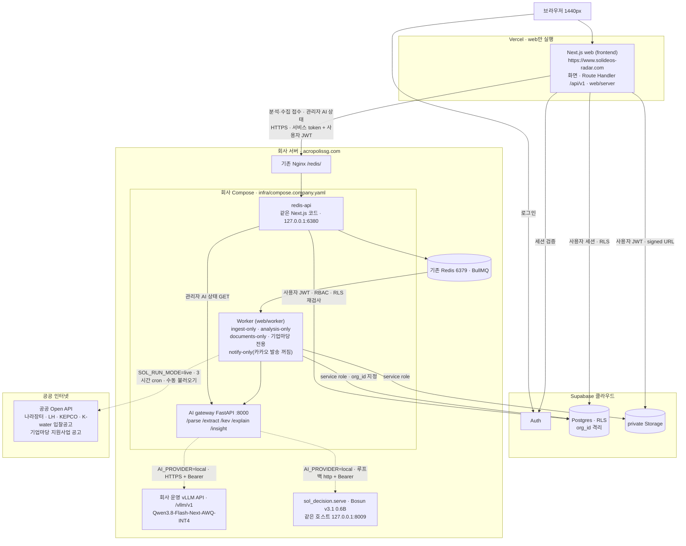
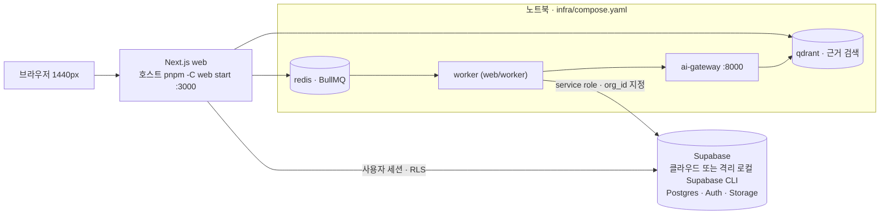
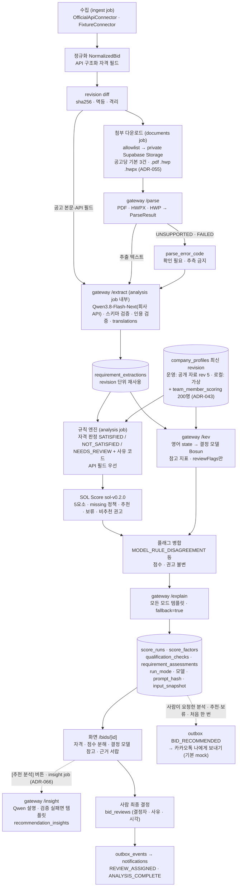

# 시스템 아키텍처·데이터 흐름

[[02-ARCHITECTURE|02 아키텍처]]와 [[03-AI-PIPELINE|03 AI 파이프라인]]을 발표용으로 줄인 그림이다. 둘과 다르면 02·03이 맞고, 배포 경로는 [[10-DEPLOYMENT|10 배포]]와 [[16-DECISIONS|ADR-049]]가 맞다. 구현 상태는 그림이 아니라 [[PROGRESS|진행 상황]]과 `evidence-list.md`가 말한다.

main에 있는 것: DB·RLS(C2), 수집·정규화·revision·보조 조회(C3)와 변경 감지(S5), 3시간 정기 수집(BullMQ cron `0 */3 * * *` Asia/Seoul)과 관리자 [지금 불러오기]·서버 gate(`GET /api/v1/admin/ingestion/manual-gate`), 규칙 엔진·SOL Score(C4), AI gateway(`GET /health`, `POST /parse`·`/extract`·`/kev`·`/explain`·`/insight`, `services/ai/src/sol_ai/app.py:144-259`)의 mock·`local` 어댑터·worker 분석 클라이언트·`PARTIAL` 대체(C5), 화면·Route Handler(C6), 결정 기록·인앱 알림(C7), P1 다섯 화면, 새 메뉴 3개(자격 갭 레이더·발주 현황·입찰 일정, [[16-DECISIONS|ADR-060]]), 카카오톡 나에게 보내기(ADR-038), 회사 Gateway·Worker 배포 묶음(ADR-049), 첨부 다운로드·파서·documents worker([[16-DECISIONS|ADR-054]]), 버튼으로 부르는 Qwen 추천 분석([[16-DECISIONS|ADR-066]]). 첨부 처리는 2026-10-28부터 회사 Documents Worker가 운영한다. 분석 job의 설명은 템플릿이다. 추천 분석은 2026-10-29 운영에 반영했다([기록](../evidence/company-rollout/20261029/rec-insight-rollout.md)).

모델은 [[16-DECISIONS|ADR-034]]를 따른다. 추출·설명은 회사 운영 vLLM API(`https://acropolissg.com/vllm/v1`)의 Qwen3.8-Flash-Next(served id `Qwen3.8-Flash-Next-AWQ-INT4`)이고, 결정 모델은 우리 `sol_decision` 서버의 Bosun v3.1 0.6B다. 회사 vLLM은 2026-10-21 probe를 통과했다(`/v1/models` 200, guided JSON 추론 200, `docs/evidence/phase-5/qwen-probe-20261021-2343.json`). 운영 앱 경로를 거친 실모델 분석(`Qwen3.8-Flash-Next-AWQ-INT4` + `bosun-v3.1-0.6b`, 대체 없음)은 DEMO 가상 공고와 실공고다. DEMO 첫 분석은 2026-10-24 FX-02 66점 보류(`WATCH`, 가상 프로필)다. 66이 골든 72와 다른 까닭은 당시 마감이 가까워 일정 계수가 낮았기 때문으로 본다(추정, `docs/evidence/demo-deadline/20261027/README.md` S4 절). 골든 72는 `mock` 시험 기준이다. 실공고는 2026-10-29 회사 AI gateway 교체([[16-DECISIONS|ADR-064]]·[[16-DECISIONS|ADR-065]]) 뒤 개별 3건을 분석했고, 같은 날 IT 실공고 371건을 1회 일괄 분석했다([[16-DECISIONS|ADR-069]] 5번, `docs/evidence/company-rollout/20261029/ai-gateway-rollout.md`, `docs/evidence/it-scope/prod-20261029/README.md`). 2026-10-30 SOL Score v0.2 재채점 뒤 실공고 run 372건은 43~88점으로 모두 보류다. 그림의 `/kev`·`KV`·`kev_model` 같은 이름은 식별자라 그대로 둔다.

## (a) 시스템 아키텍처 — 운영 배포 (ADR-049)

- 모델을 부르는 컴포넌트는 AI gateway 하나다. web·redis-api·worker는 Qwen·결정 모델에 직접 닿지 않는다.
- Vercel은 web만 실행한다. 분석·수집 접수와 관리자 AI 상태 조회만 회사 Gateway로 넘기고, 조회·가정 재계산은 Supabase RLS 경로로 읽는다. Vercel에는 service role 키·Redis 주소·모델 키를 넣지 않는다([[10-DEPLOYMENT|10 배포]] "운영 구성 (ADR-049)").
- 회사 Compose는 redis-api·AI gateway와 역할별 Worker다. Worker는 수집(`infra/compose.ingest-only.company.yaml`)·분석(`compose.analysis-only.company.yaml`)·첨부(`compose.documents-only.company.yaml`)·부처 공고(`compose.program-notices-only.company.yaml`, 기업마당)로 나뉜다. 알림 전용 Worker(`compose.notify-only.company.yaml`)는 2026-10-30부터 회사에서 돈다. 인앱·마감 알림을 처리하고 카카오 발송은 꺼 두었다(`infra/company/README.md` §9, [기동 기록](../evidence/company-rollout/20261030/notify-worker-rollout.md)). 회사의 기존 Redis와 Nginx를 재사용하고 Redis·Qdrant·DB·모델 서버를 새로 만들지 않는다. 호스트에 여는 포트는 기존 Nginx upstream인 `127.0.0.1:6380` 하나다. 모델 키는 AI gateway만, service role·수집 키는 Worker만 받는다(`infra/company/README.md`).
- 운영 상태의 정본은 [[PROGRESS|진행 상황]] 운영 상태 표다(수집 건수·첨부 처리 건수 포함). Vercel `/health/ready`는 `ai: local`을 보고한다. 회사 ingest Worker는 나라장터·LH·KEPCO·K-water 입찰공고를 3시간마다 수집하고, 다른 외부 3종은 꺼져 있다(`DISABLED`). 기업마당은 전용 Worker다(`infra/sources/registry.yaml`, `infra/company/README.md` §7·§10). 운영 회사 프로필은 공개 자료 프로필 revision 5다([[16-DECISIONS|ADR-052]]). 화면 기본 출처는 Vercel env `SOL_DEFAULT_ORIGIN`이 정하고, 발표는 `?origin=demo`로 연다(D1, ADR-054).
- DB·Auth·Storage는 Supabase 클라우드(ADR-048)라 데모 중 인터넷이 필요하다. 대체 경로는 `limitations.md`와 아래 (a-2).
- 회사 GPU 서버는 외부에서 접근할 수 없다. 결정 모델 Bosun v3.1 0.6B는 우리 `sol_decision.serve`가 회사 GPU 서버 `127.0.0.1:8009`에서 Kev wire 호환으로 서빙한다([[16-DECISIONS|ADR-025]]·[[16-DECISIONS|ADR-034]]). 운영 AI gateway는 같은 호스트의 회사 Compose(`network_mode: host`)에서 `KEV_BASE_URL=http://127.0.0.1:8009`로 바로 붙는다. 처음 설계한 공개 경로 `https://acropolissg.com/sol-radar/kev`(GPU 서버 안 nginx 모델 라우터 `infra/gpu/model-router.conf`)는 회사 nginx에 등록되지 않았다. 인증은 각 런타임의 Bearer 키(`QWEN_API_KEY`·`KEV_API_KEY`)다([[16-DECISIONS|16 ADR]] 미결정 17번). 회사 vLLM은 Bearer 인증 조회·추론을 확인했다(2026-10-21 probe). 결정 서버는 운영 DEMO 분석과 2026-10-29 실공고 2건에서 응답했고, `GET /v1/models` 레지스트리 대조(`registryMatch: true`)를 확인했다. 지연은 측정하지 않았다. 엔드포인트로 가는 데이터는 실제 공고(개인정보 마스킹)와 회사 프로필(운영은 공개 자료, 로컬은 가상)뿐이다.
- GPU 하드웨어와 메모리 배분은 회사 측 운영이다. 결정 모델은 물리 GPU 1에서 돌고, 우리가 올리는 것은 Bosun 서빙·학습뿐이다. 같은 GPU의 회사 컨테이너는 우리 것이 아니라 멈추거나 옮기지 않고, 학습·서빙 전에 메모리만 확인한다([[16-DECISIONS|ADR-066]] 7번, ADR-034 10번 개정). Qwen3.8-Flash-Next는 회사 API라 GPU 1을 쓰지 않는다. 우리 쪽 점검은 `GET /v1/models` 레지스트리 대조와 지연 실측뿐이다(P0-0 ③ G1~G6, [[10-DEPLOYMENT|10 배포]]).

## (a-2) 로컬 데모 Compose — 대체 경로

- 로컬 Compose는 redis·qdrant·ai-gateway·worker 4개다. DB·Auth·Storage는 Supabase이고 web은 호스트에서 띄운다. 기동 절차는 [[10-DEPLOYMENT|10 배포]] "대체 경로·녹화용(S5·S6) 기동 절차"다.
- 리허설과 운영 경로 장애 때 쓰는 경로다. 회선이 끊기면 격리 로컬 Supabase CLI로 바꾼다([[19-DEMO-SCENARIO|19 데모 시나리오]] §5 대체 경로 ①).
- 운영 경로와 같은 코드·같은 규칙 엔진이다. 다른 것은 Redis·worker·AI gateway가 도는 위치와 Supabase 프로젝트뿐이다.

## (b) 데이터 흐름

- Qwen 추출을 사용할 수 없거나 gateway 연결이 끊기면 `PARTIAL`·`RULES_ONLY`로 끝낸다. 추출은 정상이고 결정 모델만 불가하면 `COMPLETED`·`RULES_ONLY`다. `/explain` 실패는 템플릿 설명으로 대체하며 분석을 실패시키지 않는다([[03-AI-PIPELINE|03]] §8).
- 결정 모델 출력은 `reviewFlags` 추가와 "모델 참고 지표 (점수 미반영)" 표시만 한다. 자격·점수·권고를 바꾸는 코드 경로는 없다.
- 공공 API·Qwen·결정 모델·gateway 실패를 구분한다. 첨부를 읽지 못하면 공고 상세에 "첨부 원문 확인" 배지가 붙는다(`web/components/bids/labels.ts:179-180`). 처리 범위 밖 첨부(공고당 기본 3건 초과, `.pdf`·`.hwp`·`.hwpx` 밖)는 `PENDING`으로 남는다([[16-DECISIONS|ADR-055]]). 추출 캐시 키에 문서 집합이 없어, 첨부 일부만 반영된 추출이 재사용될 수 있다([[16-DECISIONS|ADR-056]]).
- 이 첨부 경로는 2026-10-28부터 회사 Documents Worker로 돈다(`infra/company/README.md` §8, `docs/evidence/company-rollout/20261028/sources-rollout.md`). 처리 건수는 [[PROGRESS|진행 상황]]을 본다.
- [추천 분석]은 분석된 공고 상세에서 사람이 눌렀을 때만 Qwen을 부른다. 판정 이름을 다시 쓰지 않고, 출력 검증에 걸리면 규칙 결과로 만든 문장(TEMPLATE)으로 대체한다([[16-DECISIONS|ADR-066]]). 2026-10-29 운영에 반영했고, 실공고·DEMO 각 1건이 `DONE`·`MODEL`로 끝났다([기록](../evidence/company-rollout/20261029/rec-insight-rollout.md)).

## 실행 모드 3종

| `SOL_RUN_MODE` | 공고 | AI | 회사 프로필 | 화면 표시 | 쓰는 곳 |
|---|---|---|---|---|---|
| `live` | 실제 공고(`is_demo=false`), 첨부 다운로드 · 파싱(회사 Documents Worker 운영) | 회사 vLLM API Qwen3.8-Flash-Next(`Qwen3.8-Flash-Next-AWQ-INT4`, HTTPS) · 회사 GPU 서버 Bosun v3.1 0.6B(루프백) 실추론(`AI_PROVIDER=local`). 운영 분석은 DEMO 가상 공고 19건(2026-10-24 FX-02 66 보류, 10-27 17건, 10-28 FX-03 53 보류), 실공고 개별 3건과 IT 실공고 371건 일괄 분석(2026-10-29, 모두 보류). 2026-10-30 규칙 v0.2 로 저장 입력을 다시 계산했다(DEMO 18건 68~95, 실공고 372건 43~88, 모두 보류) | 운영은 공개 자료 솔리데오(`is_demo=false`, ADR-052) | 공고 상세 분석 요약 띠 "분석 실행 모드: live"·"AI: local · …", "공개 자료 회사 프로필로 분석" | 운영 회사 런타임. 실공고 S-LIVE 녹화는 남았다 |
| `fixture` | fixture 20건(`is_demo=true`, `DEMO` 배지) | 실추론 그대로 | 가상 솔리데오 | 분석 요약 띠 "분석 실행 모드: fixture"·"AI: local" | 공공 API 장애 시 대체, 한국어 state 평가(E2) |
| `mock` | fixture 20건 | 고정 응답(`AI_PROVIDER=mock`, `fixtures/extractions`·`fixtures/kev`) | 가상 솔리데오 | 분석 요약 띠 "분석 실행 모드: mock"·"AI: mock" | CI, 골든 94/72/68, 격리 로컬 리허설 |

- 상단바에는 실행 모드·AI 표시가 없다(2026-10-26 제거). 데이터 출처는 상단바 `DEMO` 배지(보는 출처가 demo일 때만)와 행 `DEMO` 배지로 보인다.
- 발표는 D1이다(ADR-054). 운영 사이트에서 `?origin=demo`로 운영 DB의 DEMO 데이터를 열고 `demo:reset`은 하지 않는다. 클립은 이 경로에서 찍고, 변경 감지(S5)와 장애 대체(S6)만 로컬 Compose(`mock`)에서 찍는다([[19-DEMO-SCENARIO|19]] §4). 회사 런타임이 `live`라 FX-02 [재분석]은 실모델 결과다. 운영 회사 프로필이 공개 자료 프로필이라 예상은 59 보류(SOL Score v0.2)이고, 골든 72는 `mock`(가상 프로필) 시험 기준이다([[16-DECISIONS|ADR-059]]·[[16-DECISIONS|ADR-071]]).
- 모드마다 바뀌는 것은 **입력(공고 출처)과 모델 호출 방식**뿐이다. 스키마 검증·인용 검증·규칙 엔진·점수 알고리즘(`sol-v0.2.0`)·저장·화면 경로는 세 모드가 같다.
- 모드와 모순된 env(`live` + `AI_PROVIDER=mock`, `live` + `AI_FALLBACK_TO_MOCK=true`, `live` + `KEV_ALLOW_KO_STATE=true`)는 `pnpm check:env`와 gateway가 기동을 거부한다. 자동 대체는 없다. 모드 전환은 env 교체와 worker·gateway 재시작으로 사람이 한다.
- 분석마다 `score_runs.run_mode`·`ai_provider`·`qwen_model`·`kev_model`이 남아 과거 분석이 어느 모드였는지 알 수 있다. `kev_model`에는 결정 모델 식별자(레지스트리 `run`)가, mock이면 `mock`이 들어간다(ADR-034 15번).

## 관련 문서

- [[02-ARCHITECTURE|02 아키텍처]] — 경계 · AI 호출 경로 · 장애 원칙
- [[03-AI-PIPELINE|03 AI 파이프라인]] — §2 파이프라인, §3 실행 모드, §8 장애와 대체
- [[10-DEPLOYMENT|10 배포]] — 현재 배포(ADR-049) · 프로필 · 회사 GPU 추론 엔드포인트 · 대체 경로 기동 절차
- [[16-DECISIONS|16 ADR]] — ADR-017 · ADR-020 · ADR-025 · ADR-034 · ADR-048 · ADR-049 · ADR-052 · ADR-054 · ADR-055 · ADR-056 · ADR-060 · ADR-064 · ADR-065 · ADR-066
- `infra/company/README.md` — 회사 Compose 실행서
