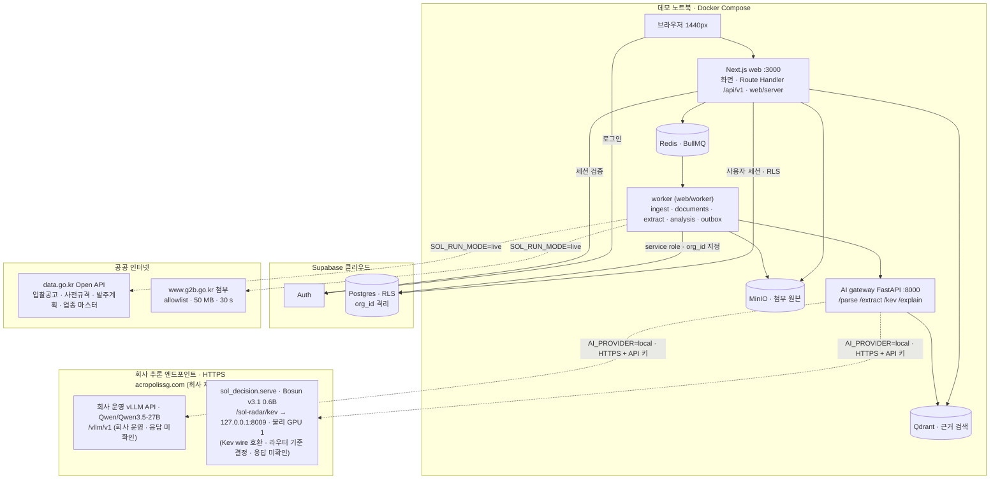
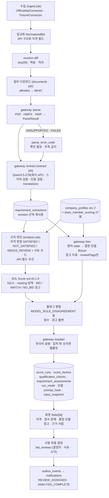

# 시스템 아키텍처·데이터 흐름

[[02-ARCHITECTURE|02 아키텍처]]와 [[03-AI-PIPELINE|03 AI 파이프라인]]을 발표용으로 줄인 그림이다. 둘과 다르면 02·03이 맞다. 구현 상태는 그림이 아니라 [[PROGRESS|진행 상황]]과 `evidence-list.md`가 말한다. 이 그림은 **설계**다. 2026-10-20 기준 main에 있는 것: DB·RLS(C2), 수집·정규화·revision·보조 조회(C3), 규칙 엔진·SOL Score(C4), AI gateway 4 엔드포인트 mock·`local` 어댑터·worker 분석 클라이언트·`PARTIAL` 대체(C5), 화면 `/dashboard`·`/bids`·`/bids/[id]`·`/notifications`(C6), 결정 기록·인앱 알림(C7). 구현 전: 첨부 다운로드 소비자·파싱, 실모델 추론(엔드포인트 응답 대기). 모델은 2026-10-20 [[16-DECISIONS|ADR-034]]로 바뀌었다: 결정 모델 Bosun v3.1 0.6B(우리 `sol_decision` 서버), 추출·설명 모델은 회사가 운영하는 vLLM API의 `Qwen/Qwen3.5-27B`다. 전환 코드(B1)는 main 병합 전이다. 그림의 `/kev`·`KV`·`kev_model` 같은 이름은 식별자라 그대로 둔다.

## (a) 시스템 아키텍처

- 모델을 부르는 컴포넌트는 AI gateway 하나다. web과 worker는 Qwen·결정 모델에 직접 닿지 않는다.
- DB·Auth는 Supabase 클라우드(Compose 밖)라 데모 중 인터넷이 필요하다. 대체 경로는 `limitations.md`.
- 회사 GPU 서버는 외부에서 접근할 수 없다. 추출·설명은 회사가 이미 운영하는 vLLM API(`QWEN_BASE_URL=https://acropolissg.com/vllm/v1`, `Qwen/Qwen3.5-27B`)를 쓰고, 결정 모델 Bosun v3.1 0.6B는 우리 `sol_decision.serve`가 회사 GPU 서버 `127.0.0.1:8009`에서 Kev wire 호환으로 서빙해 `https://acropolissg.com/sol-radar/kev`로 나간다. 노트북의 AI gateway가 TLS·API 키로 붙는다([[16-DECISIONS|ADR-025]]·[[16-DECISIONS|ADR-034]]). `KEV_BASE_URL`의 하위 경로 `/kev`는 GPU 서버 안 nginx 모델 라우터(`infra/gpu/model-router.conf`) 기준으로 **결정**했고(`/sol-radar/qwen`은 백업 경로, 미사용), 인증은 각 런타임의 Bearer 키(`QWEN_API_KEY`·`KEV_API_KEY`)다([[16-DECISIONS|16 ADR]] 미결정 17번). 바깥(회사) nginx의 `/sol-radar` 접두어 처리·회사 측 추가 인증·실제 응답과 지연은 아직 **미확인**이다(B2에서 `GET /v1/models`·지연을 기록한다). 엔드포인트로 가는 데이터는 실제 공고(개인정보 마스킹)와 가상 회사 프로필뿐이다.
- GPU 하드웨어와 메모리 배분은 회사 측 운영이다. 결정 모델은 물리 GPU 1을 회사 PaddleOCR 서비스와 공유하고, 우리가 올리는 것은 Bosun 서빙·학습뿐이다(ADR-034 10번, 사용자 보고. B2에서 교차 확인). Qwen3.5-27B는 회사 API라 GPU 1을 쓰지 않는다. 우리 쪽 점검은 `GET /v1/models` 레지스트리 대조와 지연 실측뿐이다(P0-0 ③ G1~G6, [[10-DEPLOYMENT|10 배포]]).

## (b) 데이터 흐름

- AI 단계 어느 것이 실패해도 규칙 판정·점수·권고는 규칙만으로 끝나고 `status=PARTIAL`, `recommendationBasis=RULES_ONLY`다.
- 결정 모델 출력은 `reviewFlags` 추가와 "모델 참고 지표 (점수 미반영)" 표시만 한다. 자격·점수·권고를 바꾸는 코드 경로는 없다.
- 실패 유형(공공 API · 첨부 다운로드 · 파싱 · Qwen 미접속 · 결정 모델 미접속 · gateway 미접속)은 각각 다른 코드로 기록하고 따로 보인다.

## 실행 모드 3종

| `SOL_RUN_MODE` | 공고 | AI | 회사 프로필 | 화면 표시 | 쓰는 곳 |
|---|---|---|---|---|---|
| `live` | data.go.kr 실제 공고(`is_demo=false`), 첨부 실제 다운로드 | 회사 vLLM API `Qwen/Qwen3.5-27B` · 회사 GPU 서버 Bosun v3.1 0.6B 실추론(`AI_PROVIDER=local`, HTTPS) | 가상 솔리데오(`is_demo=true`) | 머리말 "실행 모드: live", 분석 패널 "AI: local · Qwen/Qwen3.5-27B · Hanno-Labs/bosun-v3.1-0.6b@5e78a37c", "가상 회사 프로필로 분석" | S-LIVE 1건, 해커톤 MVP 목표 |
| `fixture` | fixture 20건(`is_demo=true`, `DEMO` 배지) | 실추론 그대로 | 가상 솔리데오 | "실행 모드: fixture", "AI: local" | 공공 API 장애 시 대체, 한국어 state 평가(E2) |
| `mock` | fixture 20건 | 고정 응답(`AI_PROVIDER=mock`, `fixtures/extractions`·`fixtures/kev`) | 가상 솔리데오 | "실행 모드: mock", "AI: mock" | 발표 본편 S2~S7, CI, 골든 94/72/68 |

- 모드마다 바뀌는 것은 **입력(공고 출처)과 모델 호출 방식**뿐이다. 스키마 검증·인용 검증·규칙 엔진·점수 알고리즘(`sol-v0.1.0`)·저장·화면 경로는 세 모드가 같다.
- 모드와 모순된 env(`live` + `AI_PROVIDER=mock`, `live` + `AI_FALLBACK_TO_MOCK=true`, `live` + `KEV_ALLOW_KO_STATE=true`)는 `pnpm check:env`와 gateway가 기동을 거부한다. 자동 대체는 없다. 모드 전환은 env 교체와 worker·gateway 재시작으로 사람이 한다.
- 분석마다 `score_runs.run_mode`·`ai_provider`·`qwen_model`·`kev_model`이 남아 과거 분석이 어느 모드였는지 알 수 있다. `kev_model`에는 결정 모델 식별자(레지스트리 `run`)가, mock이면 `mock`이 들어간다(ADR-034 15번).

## 관련 문서

- [[02-ARCHITECTURE|02 아키텍처]] — 경계 · AI 호출 경로 · 장애 원칙
- [[03-AI-PIPELINE|03 AI 파이프라인]] — §2 파이프라인, §3 실행 모드, §8 장애와 대체
- [[10-DEPLOYMENT|10 배포]] — 프로필 · 회사 GPU 추론 엔드포인트 구성
- [[16-DECISIONS|16 ADR]] — ADR-017 · ADR-020 · ADR-025 · ADR-034
