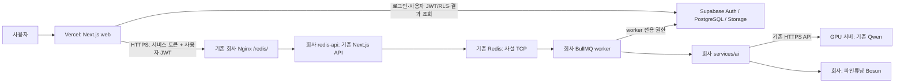

# 배포 아키텍처 확정 기준

사용자의 2026-10-22 지시를 반영한다. **아키텍처는 확정됐고 구현·운영 전환은 끝났다**(ADR-049). ADR-044의 Vercel AI 배치는 이 지시로 대체한다. 기존 문서의 당시 배포 성공 기록은 삭제하지 않는다.

## 책임과 호출 경로

| 위치 | 책임 |
| --- | --- |
| Vercel | `web` 하나. Next.js 화면, Supabase 로그인·인증, Route Handlers, 분석 접수 전달, 사용자 JWT/RLS로 결과 조회 |
| 회사 서버 | 기존 Redis, 같은 Next.js 코드의 `redis-api` 역할, BullMQ worker, `services/ai` gateway, 파인튜닝된 Bosun의 `services/decision` 런타임 |
| GPU 서버 | 이미 실행 중인 Qwen `Qwen3.8-Flash-Next-AWQ-INT4` 재사용 |
| Supabase | 기존 Auth·PostgreSQL·private Storage. 별도 Postgres 인스턴스를 만들지 않는다 |

## 고정 제약

1. Vercel에 AI·decision·worker를 배포하지 않는다. `web`만 실행한다.
2. redis-api는 기존 Next.js Route Handlers·도메인 서비스·JWT/RLS를 재사용한다. 새 대규모 backend, 새 Redis, 새 reverse proxy, 새 큐를 만들지 않는다.
3. Redis 6379는 외부에 공개하지 않는다. Vercel은 회사 HTTPS 업무 API만 호출한다.
4. Qwen 주소는 `https://acropolissg.com/vllm/v1`, 요청 모델은 `Qwen3.8-Flash-Next-AWQ-INT4`다. 기존 Qwen 프로세스·포트·모델/양자화/서빙 설정을 변경하지 않는다.
5. 기존 Nginx, 운영 중인 컨테이너·모델 프로세스를 수정·재시작·재생성하지 않는다. 실행 중인 자원을 발견하면 먼저 현황과 필요한 조치를 보고한다.
6. 회사 gateway가 Qwen/Bosun 자격을 소유한다. Vercel/redis-api에 모델 키나 Supabase service role을 전달하지 않는다. `KEV_*`와 `/kev` wire 호환은 유지한다.
7. 학습본 Bosun의 실제 패키지·manifest·served identity를 확인한다. 공개 기본 모델 등록만으로 파인튜닝본 연결이 완료됐다고 판정하지 않는다.
8. web·redis-api·worker·gateway의 실행 모드와 Supabase/Storage 범위를 맞춘다. 현재 mock을 조사 도중 fixture/live로 바꾸지 않는다.
9. 관리자 AI 상태는 Vercel에서 회사 업무 API를 통해 조회한다. ADMIN 권한과 서비스 토큰·사용자 JWT, 응답 스키마 검증을 유지한다.
10. 실제 배포·환경변수 변경 전에 파일 diff, 정확한 실행 명령, 대상 자원, 예상 영향과 되돌림 범위를 보고한다. 이번 작업은 조사·설계·계획 문서만 작성한다.

## 완료 판정

- Vercel 배포 메타데이터에 `web`만 있고 AI binding이 없다.
- 회사 HTTPS `/redis/health`는 미인증 401, 올바른 서비스 토큰으로 유효한 readiness 응답을 반환한다.
- Redis 사설 연결, 같은 scope의 worker 보고, private Storage, 실제 회사 AI gateway가 확인된다.
- 관리자 상태는 Vercel에서 모델/gateway에 직접 접근하지 않고 회사 redis-api의 같은 handler를 재사용한다.
- 캐시가 없는 승인된 시험 공고 1건의 접수 202 → worker → Qwen 추출 → Bosun 참고 지표 → 결과 조회를 확인한다. 실모델 추론 비용·DB 쓰기가 발생하므로 이번 읽기 전용 조사에서는 실행하지 않는다.
- `/health/ready`의 DB·Redis·Storage 실패와 AI 단독 장애를 구분한다. 전자는 503, 후자는 기존 계약대로 200/degraded다. 모델 상세 health의 기동 당시 정보와 실제 추론 성공을 구분한다.
- 첨부 파서·소비자는 별도 기능 작업이며 main에 구현됐다(회사 반영은 별도 실행서). 인프라 green만으로 전체 첨부 분석 완료를 주장하지 않는다.

## 조사와 실행 계획

- 현재 상태·최소 변경 계획(원문: git `f0ad424a` `docs/plans/2026-10-22-web-company-deployment-review.md`)
- [읽기 전용 증거](../../../docs/evidence/deployment/20261022-readonly-review.json)

기존 배포 정본 `docs/02-ARCHITECTURE.md`, `docs/10-DEPLOYMENT.md`, `docs/16-DECISIONS.md`, `docs/CLAUDE.md`, 문서 인덱스의 Vercel AI 설명은 구현 변경과 함께 이 기준에 맞춘다. 해당 파일에는 다른 세션의 미커밋 변경이 있어 이번 조사에서 덮어쓰지 않았다.
