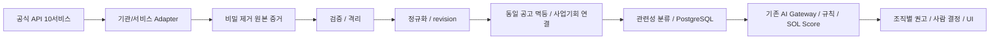

# 공공 SI·AI·AX 수집 확장 및 업무 UI 개편

> **구현 승인: 2026-10-21 사용자 “승인할게 시작해.”** 승인 설계를 `feat/public-procurement` 격리 작업 트리에서 구현한다. 새 migration 파일 생성과 격리 PGlite 시험은 허용 범위다. 운영 DB 적용·실인증 API 수집·배포·Redis/Gateway/Nginx/Compose 설정·모델 교체는 수행하지 않는다. 아래 현황 표는 설계 조사 당시 main 스냅샷이며, 실제 구현/검증과 남은 제약은 [구현 보고](../../../docs/evidence/procurement-expansion/20261021-implementation.md)를 우선해 읽는다.

> **2026-10-22 운영 추가 승인:** 사용자 지시로 커밋·main 병합·운영 DB 적용·배포를 진행한다. 위 운영 금지는 최초 로컬 구현 승인 시점의 경계다. 신규 API 활성화/실수집·모델 교체·Nginx 변경은 포함하지 않으며 [운영 적용 기록](../../../docs/evidence/procurement-expansion/20261022-release.md)에서 실제 결과를 구분한다.

### 승인 뒤 구체화한 실행 경계

- 기존 v0.2와 신규 외부 v0.3를 함께 읽고, source 공고·revision·score/review FK를 유지한다. 신규 여섯 서비스는 registry disabled/NOT_VERIFIED가 기본이다.
- private `ingest_payloads`는 자격증명·담당자 필드를 지운 파싱 구조를 JSONB로 보존한다. byte 단위 JSON/XML 원문 보존은 아직 구현하지 않았으며 Storage provider 통합 뒤 object_ref로 확장한다. 이 제한을 숨겨 원문 전체 보존으로 보고하지 않는다.
- 기존 AI wire/scoring은 PLAN/PRE_SPEC/NOTICE만 받는다. 신규 PROCUREMENT_REQUEST/OPENING/AWARD/CONTRACT는 조회 가능 단계이며 분석 접수는 STAGE_NOT_SUPPORTED로 차단한다. 임의 단계 변환이나 모델 계약 변경을 하지 않는다.
- 관련성은 제목·업종·제공된 본문 근거를 사용하며 첨부/검증된 AI 근거의 확장 입력을 제공한다. 미완성 문서 소비자나 AI 관련성 자동 실행이 완료된 것으로 표시하지 않는다.
- 미검증 상태 코드·안정 ID·operation 필수 입력은 격리/NOT_VERIFIED로 처리한다. KEPCO는 발급 완료와 인증 미검증을 분리하고, 금액 대표값/회사 전체조회/첨부/완전성은 실응답 검증 뒤 승격한다.

## 1. 목적과 유지 조건

공공 SI·AI·AX 사업기회를 더 넓게 발견하고 기업의 기술·실적·인력과 비교해 사람이 입찰 참여를 결정하도록 돕는다. 기존 조달청 4개 서비스와 신규 6개 서비스를 관리한다. Source는 G2B/KWATER/LH/KEPCO 4종이며 API 서비스 수·기관 수·사업기회 수는 서로 다르다. KEPCO의 14개 companyId는 한 서비스 내부 구분이다.

Next.js 16·Supabase Postgres/RLS/Auth·기존 Redis/BullMQ Worker·Python AI Gateway를 재사용한다. 해커톤 이후 NestJS 전환, 모바일·결제·자동 투찰·승률 예측 제외는 유지한다. `polaris/mission.md`는 조사 시 없었으며 현재 목적·제약은 사용자 지시와 `docs/01-PRD.md`를 근거로 한다.

SOL Score `sol-v0.1.0`, 가중치 **30/25/20/15/10**, 임계값 **75/50**, 정보 부족·필수 자격 정책, 사람 결정·감사 기록을 유지한다. 관련성 점수는 회사 적합도가 아니다. 모델·가중치·파인튜닝 계획을 이 확장 때문에 교체하지 않는다.

## 2. 현재 구현과 설계의 차이

조사 기준은 `main@206db64`이며 운영 DB/API의 현재 상태를 조회한 결과가 아니다. 기존 untracked 브리프와 레퍼런스 이미지 2장은 읽기만 했다. 자세한 근거·병렬 작업 스냅샷은 [조사 기록](../../../docs/evidence/procurement-expansion/20261021-review.md)에 있다.

| 영역 | 현재 main의 실제 근거 | 이번 설계의 차이 |
|---|---|---|
| 웹 | `web/app/(app)/(work)` 업무 화면, `web/components/ui` Base UI/shadcn, Tailwind v4, `design/tokens.json` | 기존 셸·토큰·URL 기반 필터 재사용 |
| API/서버 | `web/app/api/v1`, `web/server/<도메인>` 배럴·server-only·사용자 세션/RLS | 사업기회 읽기 모델을 추가하되 기존 공고 ID 계약 보존 |
| DB | `bid_notices` UNIQUE(source, notice_id), append-only `bid_revisions`, documents·extractions·org별 score/review | 출처 간 동일 사업기회 묶음과 서비스별 수집 이력이 없음 |
| 기존 API 4종 | registry 승인·2026-10-19 실호출 증거 있음. 정기 Worker는 `g2b-bid-notice`와 보조 3조회만 생성 | 사전규격·발주계획·업종 마스터는 등록/녹음과 정기 적재 완료를 구분 |
| 수집 | 30분 기본 scheduler, 날짜 창·cursor·재시도·revision·격리·Redis quota | 신규 소스 Adapter와 회사/업무별 partition 필요 |
| 실행 모드 | live=G2B+실제 AI, fixture=fixture+실제 AI, mock=fixture+mock AI. 자동 fallback 금지 | 신규 API도 live에만 허용하는 계약 확장이 필요 |
| 원본 | 담당자 필드를 지운 행을 `bid_revisions.raw_payload` JSONB로 저장 | byte 단위 JSON/XML 원본 보존과 동일하지 않음 |
| 첨부/검색 | HTTPS 나라장터 allowlist·fixture fetcher·documents 생산/복구 존재. `/parse`는 형식 판정 후 미지원, 실 다운로드/소비자/본문 reader 미완성. Qdrant 검색 미완성 | 첨부 분석은 선행 문서 파이프라인 완료가 필요. 신규 수집만으로 해결된다고 보고하지 않음 |
| AI | 레지스트리 active Qwen3.8-Flash-Next·Bosun v3.1 0.6B, `/extract`·`/kev`·`/explain`. 규칙 점수·PARTIAL 구현 | 다른 기관 입력을 기존 정규화/증거 계약으로 연결. `/explain` 실모델 설명은 현재 템플릿 fallback과 구분 |
| 업무 | 관심공고·입찰 프로젝트는 별도 branch에 작업 존재. 분석 비교·독립 인력 배치 화면은 main에 없음. WHAT-IF 규칙 재계산은 main에 있음 | 새 목록이 이 기능들을 이미 완성한 것으로 전제하지 않음 |
| 관리자 | `/admin/ingestion` run 목록·상세·수동 실행, `/api/v1/admin/ai/status` | 연결/인증/서비스별 마지막 성공·총량 요약은 신규 설계 |
| 배포 구성 | main `vercel.json`에 공개 web/내부 ai Services와 AI_GATEWAY_URL binding 존재 | 회사 Gateway/Storage 전환은 별도 작업이며 클라우드 실배포 성공은 이번에 확인하지 않음 |

### 2.1 병렬 계획과 충돌 방지

`feat/redis-http-gateway@71cf481`에는 기존 Next API를 회사 HTTP 6380 역할로 재사용하는 로컬 구현과 ADR-043~045가 있다. 현재 main은 아직 Redis TCP·MinIO readiness를 사용한다. `feat/supabase-storage` worktree에는 private Storage 전환 승인 스펙과 미커밋 구현이 있다. 그 worktree의 승인 사실을 이번 세션의 운영 변경 승인으로 간주하지 않는다.

저장소 기본 정본의 MinIO와 병렬 작업의 private Supabase Storage가 충돌한다. 본 설계는 **원본의 object 참조 계약만 정의**하고 provider 전환은 해당 작업의 병합·검증 결과에 따른다. 새로운 S3/Storage SDK나 파일 저장소를 중복 설계하지 않는다. 회사 Gateway가 먼저 병합되면 같은 수집 접수 DTO를 전달하고, 회사 수집 Worker는 계속 내부 Redis를 쓴다. Nginx·Compose·모델 서버 변경은 이 계획의 종속 작업이 아니다.

N3·N6·N9·P0-8·S5·부처 지원사업·카카오 작업은 branch에 있고 main 반영과 구분한다. 공고 상세·대시보드·`bids` 배럴·생성 DB 타입·정본 문서의 파일 담당을 구현 착수 시 하나로 정한다. 부처 지원사업(ADR-040)은 별도 목록을 유지하며 4개 조달 Source에 넣지 않는다.

## 3. API 서비스와 인증

서비스별 공식 URL·엔드포인트·문서상 입력·실호출 공백은 [API 조사](../../../docs/evidence/procurement-expansion/20261021-review.md#2-신규-api-6개-공식-명세-확인)에 있다. **공식 페이지/Swagger 확인은 인증 성공 증거가 아니다.**

| 서비스 | ID | 서버 환경변수 | 우선순위/상태 |
|---|---|---|---|
| G2B 입찰공고 | 15129394 | `G2B_BID_NOTICE_SERVICE_KEY` | 유지·과거 실호출 성공 |
| G2B 사전규격 | 15129437 | `G2B_PRE_SPEC_SERVICE_KEY` | 유지·과거 실호출 성공, 정기 적재 미완성 |
| G2B 발주계획 | 15129462 | `G2B_ORDER_PLAN_SERVICE_KEY` | 유지·과거 실호출 성공, 정기 적재 미완성 |
| G2B 업종/법규 | 15129467 | `G2B_INDUSTRY_MASTER_SERVICE_KEY` | 유지·참조 마스터, 공고 건수에 합산 금지 |
| K-water 입찰공고 | 15101635 | `KWATER_BID_NOTICE_SERVICE_KEY` | P0·문서 확인, 키/호출 미확인 |
| LH 입찰공고 | 15159012 | `LH_BID_NOTICE_SERVICE_KEY` | P0·문서 확인, 키/호출 미확인 |
| K-water 발주계획 | 15102588 | `KWATER_PROCUREMENT_PLAN_SERVICE_KEY` | P1·문서 확인, 키/호출 미확인 |
| LH 사전규격 | 15159011 | `LH_PRE_SPECIFICATION_SERVICE_KEY` | P1·문서 확인, 키/호출 미확인 |
| G2B 조달요청 | 15129468 | `G2B_PROCUREMENT_REQUEST_SERVICE_KEY` | P1·문서 확인, 키/호출 미확인 |
| KEPCO 전자입찰계약 | 15148223 | `KEPCO_EBID_CONTRACT_SERVICE_KEY` | P0·**40자리 키 발급 완료(사용자 확인)**, 호출 미검증 |

현재 공통 키 fallback은 없다. 지정한 서비스별 env 이름을 유지한다. 선택안은 Worker secret 설정에서 같은 값을 여러 env에 참조시키는 방식이다. 코드에 공통 fallback을 더하면 승인 누락을 숨길 수 있어 이번 추천안에는 넣지 않는다. 동일 키 사용 가능 여부·서비스별 활용승인·quota 공유 범위는 각각 확인한다. 신규 키가 **미발급이라고 확인된 항목은 없으며**, KEPCO 외 신규 5개는 발급 상태 미확인이다. 비밀 파일/키 값은 읽거나 문서화하지 않는다.

`KEPCO_EBID_CONTRACT_API_URL`의 허용 기본값은 `https://bigdata.kepco.co.kr/openapi/v1/electContract.do`다. 자유 URL override가 아니며 서버 allowlist와 일치해야 한다. 키는 `NEXT_PUBLIC_`, 큐 payload, 원본 object, DB, 오류, trace, 브라우저에 넣지 않는다. G2B 키의 한 번 디코딩/한 번 인코딩 계약을 유지하고 KEPCO 40자리 키에는 G2B 인코딩 가정을 적용하지 않는다.

### 3.1 KEPCO 검증 계약

아래 세부 필드·90일 제한·회사 코드는 **사용자가 확보한 공식 명세를 입력으로 채택**한다. 이번 조사에서 인증된 응답으로 독립 확인하지 않았다. 포털 LINK형/별도 키 발급은 공개 공식 페이지에서 확인했다.

- UTF-8, GET/POST, JSON/XML. 필수 `noticeBeginDate`, `noticeEndDate`(YYYYMMDD), `apiKey`. 선택 `companyId`, `no`, `name`, `bidAttendReqCloseDatetime`, `progressState`, `returnType`. 페이지 파라미터는 주어진 명세에 없으므로 임의로 `pageNo`를 보내지 않는다.
- 조회 날짜는 KST의 닫힌 날짜 구간으로 계산한다. 90일 이하(양 끝 포함)로 분할하고 다음 구간은 다음 날부터 시작한다. 1/90/91일·월말 경계를 검증한다. 응답 잘림/상한이 있으면 일별·company별 축소 후 완전성을 확인한다. 확인할 방법이 없으면 완료 cursor를 전진시키지 않고 `PARTIAL`로 남긴다.
- 초기 범위 추천은 최근 90일이다. 더 오래된 이력은 기간·예산 승인 후 별도 backfill이다. 증분은 마지막 **완전 성공 partition**을 기준으로 하루 겹쳐 조회하고, 진행 공고는 재조회한다. 공고일 검색만으로 오래된 공고의 수정/취소가 잡힌다고 가정하지 않는다.
- companyId 생략과 개별 회사 조회를 같은 짧은 날짜 범위에서 비교한다. `(companyId,no)` 집합·건수·상태·잘림 여부를 기록한다. 생략 조회가 완전함이 입증되면 전체 조회 하나를 사용하고 개별 조회와 상시 중복 실행하지 않는다. 미입증이면 확인된 company partition을 사용한다.
- `PreAttendProgress`·`AttendProgress`를 우선 갱신하되 종료·유찰·취소/정정 이력을 놓치지 않도록 상태 제한 없는 보정 조회를 둔다. 상태 부재/미등장만으로 취소·마감을 생성하지 않는다.
- 진행 가능 여부는 상태+참가신청 마감+투찰 시작/종료를 함께 표시한다. `Fail`은 유찰이며 취소가 아니다. `OpenTimed`는 개찰, `Final`은 종료이며 낙찰/계약 확정의 증거는 아니다.
- 첫 호출은 짧은 기간·허용된 소량으로 수행하고 수집 저장/AI 분석 없이 마스킹한 결과만 검토한다. 성공, 오류 envelope, 0건, company 범위, 날짜 경계, 필드 대소문자, 첨부 접근을 구분한다. 정상 키를 사용한 고의 반복 실패·quota 소진 시험은 하지 않는다.

| companyId | 발주기관 | companyId | 발주기관 |
|---|---|---|---|
| COM01 | 한국전력공사 | COM02 | 한국서부발전 |
| COM03 | 한국전력국제원자력대학원대학교 | COM04 | 한국남부발전 |
| COM05 | 한국중부발전 | COM06 | 한국남동발전 |
| COM08 | 한국동서발전 | COM09 | 한국전력기술 |
| COM10 | 한전KPS | COM11 | 한국전력거래소 |
| COM12 | 한국원자력연료 | COM14 | 한국발전교육원 |
| COM16 | 한국해상풍력 | COM19 | KAPES |

회사 코드별 상태는 `NOT_CHECKED / DATA_OBSERVED / EMPTY_WINDOW / ERROR`로 기록한다. 한 기간의 0건은 미지원의 증거가 아니다. `placeName`을 회사/발주기관 이름으로 단정하지 않는다. 회사 코드의 기관과 실제 수요기관이 다르면 각각 보존한다.

진행 상태 매핑 제안은 다음과 같다. `providerStatus`는 원문을 항상 보존하며 아래 상태가 정정/취소를 대신하지 않는다.

| KEPCO 원상태 | 공통 상태/이벤트 제안 | 입찰 가능성 표시 |
|---|---|---|
| PreAttendProgress | OPEN, 공고 진행 | 참가신청 시작/마감 및 투찰 시각 별도 확인 |
| AttendProgress | OPEN, 입찰 진행 | 투찰 기간과 참가신청 요건을 함께 확인 |
| Close | CLOSED | 마감 |
| Fail | CLOSED, 유찰 이벤트 | 유찰. 후속 재공고는 별도 연결 |
| OpenTimed | CLOSED, 개찰 이벤트 | 개찰 단계, 새 투찰 가능으로 표시하지 않음 |
| Final | CLOSED, 종료 이벤트 | 공고 종료. 낙찰/계약 확정으로 추정하지 않음 |

진행 상태가 OPEN이어도 `participationStatus=NOT_STARTED/APPLICATION_OPEN/BIDDING_OPEN/ENDED/UNKNOWN`을 일정 근거로 별도 계산한다. 신청 마감이 지났거나 이미 투찰 종료된 공고를 신규 참여 가능으로 안내하지 않는다. 일정/접수 사실이 부족하면 UNKNOWN으로 두고 실제 가능 여부를 사람이 원문에서 확인하게 한다.

## 4. 개념과 PostgreSQL 변경안

새 SQL 파일은 아직 만들지 않는다. 기존 Postgres를 쓰며 새 migration은 append-only, DB 타입은 같은 구현 커밋에서 생성한다. 기존 공고·revision·score_run·review·watch/project FK를 이동하거나 삭제하지 않는다.

| 개념 | 계약 |
|---|---|
| Source family | `G2B / KWATER / LH / KEPCO`. 기존 `bid_notices.source` registry key와 별도. fixture는 환경(origin=demo)이며 외부 Source family가 아님 |
| API service / operation | data ID와 registry key, operation, 회사/업무 partition. 10서비스와 여러 operation을 구분 |
| Procuring Agency | 공식 코드 namespace+기관 코드 우선. KEPCO companyId는 `KEPCO_COMPANY` namespace. 원문 기관명·정규화 기관을 함께 저장 |
| Notice stage | 기존 `PLAN / PRE_SPEC / NOTICE` 보존, `PROCUREMENT_REQUEST / OPENING / AWARD / CONTRACT` 추가안. 데이터가 실제 제공될 때만 사용 |
| Notice event/status | 정정·취소는 원공고 stage를 지우지 않고 revision/event로 기록. `AMENDED / CANCELLED` 기존 상태 호환. 화면 단계 라벨에 정정/취소 이벤트 보조 표시 |
| Category | `AI_AX / SI_SW / CLOUD / DATA / SECURITY / DIGITAL_TWIN / OTHER` 다중 분류. 스마트시티·BIM·ISP/ISMP·유지보수는 세부 태그 |

사업 단계 요청의 “정정공고/취소공고”를 stage 열에 그대로 추가하는 대안은 기존 원공고 이력을 흐리므로 **stage+event 분리안을 제안**한다. 신규 stage를 기존 점수 엔진에 무조건 전달하지 않는다. 비입찰 단계는 기존 `STAGE_NOT_APPLICABLE` 정책을 따른다.

| 추가/확장 대상(이름 제안) | 주요 열·제약·소유·용도 |
|---|---|
| `procurement_agencies` | id, code_namespace, agency_code, name, aliases. UNIQUE(namespace, code) where code not null. 코드 없는 같은 이름만으로 자동 통합하지 않음 |
| `bid_notices` 추가 열 | source_family, service_id, provider_company_id, provider_record_key, procuring_agency_id. 기존 source/notice_id 유일성 유지. KEPCO는 companyId+no를 무손실 인코딩한 notice_id로 namespace 충돌 방지 |
| `bid_opportunities` | id, canonical_notice_id, first_seen_at, identity_version, is_demo. 공용 사업기회. 대표 공고 FK 보존, demo/live 통합 금지 |
| `opportunity_notice_links` | bid_id UNIQUE, opportunity_id FK, relation=PRIMARY/DUPLICATE/STAGE_LINK, evidence, policy_version, decided_at. 확정 관계만 한 사업기회로 집계 |
| `notice_match_candidates` | ordered bid pair UNIQUE, outcome=CONFIRMED_DUPLICATE/CANDIDATE/DISTINCT, reasons, evidence, policy_version, supersedes_id. 검토 이력 append-only. 자동 확정은 강한 식별 근거에만 허용 |
| `bid_notice_events` | bid_id, revision_id, kind, provider_status, occurred_at, related_bid_id, evidence. provider 이벤트 키 또는 내용 hash로 멱등. corrected/cancelled/rebid 관계 보존 |
| `ingest_payloads` | run_id, service_id, operation, partition, fetched_at, content_type, sanitized_object_ref/hash, parser_version. 비밀 제거된 JSON/XML 증거와 실패/0건 응답도 추적 |
| `ingest_run_items` | run_id+source_record_key+payload_hash 유일, bid/revision/payload ref, outcome, error_code. 한 번 처리한 원본을 재처리해도 처리량 중복 증가 방지 |
| `bid_relevance_assessments` | revision_id+policy_version+input_hash 유일, state, categories, tags, relevance_score nullable, evidence, classifier metadata. 공용 관련성, org별 점수와 별도 |
| `ingest_runs` 확장 | service_id, operation, partition, window_basis, from/to, completeness, fetched/accepted/created/updated/duplicate/quarantined/errors, quota_used. 서비스/partition별 cursor·마지막 성공. 기존 summary 6키는 호환 projection으로 유지 |

기존 `bid_revisions.raw_payload/normalized`, `bid_documents`, `requirement_extractions`, `score_runs.input_snapshot`을 계속 사용한다. 첨부 object 참조는 병렬 Storage 작업의 원장/참조를 재사용하며 위 표가 별도 파일 원장을 만들지 않는다. 두 새 원본/처리 표는 전송 증거와 행 처리 결과를 구분하기 위한 것이다.

공용 공고·사업기회·기관·분류는 활동 중 authenticated 읽기/worker 쓰기 원칙을 따른다. 원본 object·수집 payload·오류 상세·중복 판정 변경은 ADMIN 제한 또는 worker 전용이다. 공용 관계 쓰기에 조직 ADMIN이 전역 삭제/강제 병합 권한을 얻지는 않는다. 수동 중복 확정은 최초 출시에서 운영자 CLI로 제한하고 감사 기록을 남긴다. UI 권한 확대는 별도 설계다. org별 score/review/watch/project/assignment는 기존 org_id RLS다. `profiles.is_admin`은 업무 ADMIN을 대체하지 않는다.

필요 인덱스는 service/partition의 마지막 성공, family/agency/stage/status/published_at, opportunity link, revision 분류, 기존 trigram이다. 집계와 정렬은 DB에서 수행한다. `source_family`를 붙이기 위한 기존 G2B/fixture backfill은 additive·멱등이며 fixture를 G2B 실데이터로 바꾸지 않는다. 실제 DB 적용 상태는 migration 목록과 별도 확인한다.

## 5. 공통 파이프라인과 안전한 원본

`BidSourceConnector.fetchPage`·`FetchedPage`·실패 값 반환·Worker를 확장한다. 이름만 바꾼 새 수집 엔진을 만들지 않는다. registry는 env 이름·승인·공식 endpoint·operation·형식·quota·fieldMapping·조회 기준을 갖고, 미승인/미검증 서비스는 비활성이다. 업체별 raw 스키마는 Adapter가 소유하며 공통 v0.3 정규화 DTO로 넘긴다. v0.2 입력·fixture는 명시적 호환 변환으로 읽는다.

- 초기 수집은 최근 90일을 상한으로 제안하되 API별 날짜/월/의견마감 기준으로 나눈다. 대규모 과거 전수 수집은 기본 실행에 넣지 않는다. G2B 기존 창 정책을 KEPCO 90일로 일괄 바꾸지 않는다.
- cursor는 service+operation+partition+window+schema version에 묶는다. 페이지 전체 처리와 저장 확인 후 전진한다. 중간 실패 때 기존 revision 멱등 저장으로 재개한다. 페이지 번호를 row ID로 쓰지 않는다.
- 날짜만/월만 제공하는 서비스는 원래 정밀도와 window_basis를 보존한다. 월별 재조회는 네트워크 중복이 있어도 동일 payload/revision을 재저장하지 않는다. 수정일 필터가 없는 서비스는 활성 공고·최근 월을 제한적으로 다시 읽는다.
- 429/일시 5xx/timeout은 기존 bounded exponential backoff+jitter와 Retry-After를 따른다. 인증 거부·승인 누락·스키마 오류·그날 quota 소진은 반복 호출하지 않는다. 일일 quota는 operation이 아니라 제공자의 실제 서비스/키 한도에 묶고 같은 키 공유가 확인되면 합산한다.
- Redis quota 예약 원자화는 병렬 계획과 합친다. 지금 read→call→increment 구조에 여러 신규 Worker를 동시에 붙여 상한이 보장된다고 주장하지 않는다. 활성화 전 단일 호출 경로 또는 원자 예약을 검증한다.
- 인증 실패 `AUTH_INVALID/AUTH_UNAPPROVED`, 장애 `UPSTREAM_UNAVAILABLE`, 정상 0건 `SUCCEEDED_EMPTY`, 형식 오류 `PARSE_INVALID`, 잘림/일부 `PARTIAL`을 별도 기록한다. HTTP 200만으로 성공을 정하지 않는다. 0건 정상은 인증된 정상 envelope+완전한 조회가 확인될 때만 사용한다.
- 수집 실패가 기존 정상 공고·분석 결과를 지우지 않는다. 신규 공고 폭증이 자동 유료/실모델 분석을 폭증시키지 않도록 관련성 후보·업무 요청·동시성/예산 제한을 재사용한다. 기본은 기존 사람 요청 분석이며 자동 전체 분석은 별도 승인이다.

### 5.1 원본 보존과 보안 제안

현재 담당자 개인정보 제거 정책을 유지한다. 추천안은 **키/인증/담당자 정보를 제거한 원문 구조의 JSON/XML**을 private object에 보존하고 hash·응답 형식·operation·정규화 버전을 DB에 남기는 것이다. 가공 전 byte 단위 원본 전체 보관은 현 정책과 충돌하므로 이번에 채택하지 않는다. byte 원본이 필요하면 보존기간·접근자·암호화·삭제 정책 승인을 먼저 받는다. 키가 echo된 응답도 저장 전에 제거한다. 원본 API 응답/실제 RFP를 Git evidence에 넣지 않는다.

`redaction.ts`의 URL 마스킹은 현재 `serviceKey`만 인식한다. KEPCO 전에는 대소문자/percent encoding을 포함한 `apiKey`와 알려진 비밀값의 원문/인코딩 형태를 함께 지우는 회귀 검증이 필요하다. HTTP 클라이언트 전체 URL·응답 원문을 로그로 남기지 않는다. 회사 reverse proxy/access log에 query가 남는지도 확인하며 이번에는 설정을 바꾸지 않는다.

첨부 다운로드는 HTTPS·기관별 정확한 host/path allowlist, redirect 매 hop·DNS/IP 재검사, size/timeout·형식 판정·격리 parser를 유지한다. KEPCO `filenlink1~5`의 HTTP URL은 메타데이터만 보존하고 자동 다운로드를 차단한다. 검증된 동등 HTTPS URL이 있을 때만 사용한다. HTTP 예외·새 호스트 허용은 보안 검토/승인 사항이다. 임의 https 치환·proxy 우회로 성공을 만들지 않는다.

LH 등 XML 응답도 신뢰하지 않는다. 크기/깊이 제한과 DTD·외부 entity 비활성화를 적용하고 원문 보존 전의 파싱에서도 외부 URL/file을 읽지 않는다. 단일 item/배열/빈 body/성공 code 차이는 서비스 Adapter가 처리한다.

## 6. 정규화·중복·사업 연결

### 6.1 정규화

문자열 공고번호·회사 코드·차수의 선행 0을 보존한다. KEPCO 필드는 명시적 alias 표+대소문자 무시 lookup을 적용하며 같은 이름에 상충한 두 값이 있으면 CONFLICTED/격리한다. `-`, 공백, null은 결측이며 예산 0이나 마감 시각으로 메우지 않는다. 날짜는 KST 해석 후 UTC, 원본·정밀도 보존. 일자만 있는 신청마감은 정확한 입찰 종료시각으로 확정하지 않는다.

KEPCO `no/name/noticeDate/progressState/companyId`를 식별/제목/공고일/원상태/회사 구분으로 보존한다. 참가 신청(`bidAttendReq*`)과 투찰(`beginDatetime/endDatetime`)을 따로 저장한다. `etc/bidAttendRestrict/bidAttendDocument`, 계약 방식·공동수급 원문은 근거로 남기고 법적 자격을 임의 boolean으로 만들지 않는다. `filename1~5/filenlink1~5`는 이름-URL 짝을 보존한다.

예산은 원 단위 정수 문자열/numeric(18,0), JS Number 경유 금지다. 원문 금액 종류·통화·단위·VAT 여부를 metadata로 남긴다. KEPCO presumedPrice/presumedAmount/estimatedPriceBasicAmount 중 무엇을 사업 예산으로 쓸지는 **필드 의미/단위/VAT 실응답 대조 후** 서비스 매핑을 승인한다. 그 전에는 금액 각각을 보존하고 대표 예산은 null이다. 서로 다른 종류를 무조건 첫 non-null로 합치지 않는다. K-water 계획의 백만원은 ×1,000,000하되 operation별 단위 확인을 거친다. LH 추정가격·기초금액도 종류를 구분한다.

### 6.2 중복 처리

1. **동일 source record**: 서비스+기관 partition+공고번호+차수와 내용 hash로 멱등. 같은 공고의 차수/내용 변경은 revision이며 다른 사업기회가 아니다. 오래된 응답이 최신 공고를 역행시키지 않는다.
2. **확정 중복**: 공식 cross-reference/같은 발급 namespace의 공고번호·차수·기관 등 강한 식별 근거가 일치한 출처 사본만 한 opportunity로 연결한다. 출처가 다른데 번호 문자열만 같으면 확정하지 않는다.
3. **중복 후보**: 기관·정규화 제목·공고일·마감·금액 종류/단위·원본 URL·첨부 hash로 후보를 좁힌다. 제목 유사도만으로 확정하지 않으며 근거와 버전을 저장한다. Qdrant를 필수 의존성으로 새로 만들지 않고 Postgres 기존 trigram을 먼저 쓴다.
4. **별도 공고**: 재입찰/재공고·분리발주·다른 lot·연도·기관·공고 회차가 다른 경우 원번호 연결을 기록하고 별도 기회로 둔다. 첨부가 같아도 동일 공고의 증거로 충분하지 않다.
5. **단계 연결**: 발주계획→조달요청→사전규격→입찰공고는 중복과 다른 관계다. 공식 참조가 있을 때 사업기회로 연결한다. 유사 제목만 있으면 단계 연결 후보로 남긴다.

K-water 계획·LH 사전규격의 공개 명세 일부에는 안정 ID가 없다. 후속 명세/공식 상세 URL로 안정 ID를 확보하기 전에는 provisional row로 보존하고 확정 연결/자동 최신 revision 판정에서 제외한다. row 번호나 제목+예산 hash를 영구 외부 ID로 확정하지 않는다. 같은 내용 반복은 payload hash로만 억제한다.

원본 출처·URL·revision·정정/취소 관계는 전부 유지한다. 대표 공고는 최신 유효 NOTICE 우선, 같은 단계는 공식 원발급 출처·검증 시각·안정 ID 순으로 선택한 이유를 저장한다. 중요한 금액/마감/취소가 출처끼리 충돌하면 “출처 간 확인 필요”로 표시하고 자동 추천(`BID`) 우선 노출/마감 확정을 보류한다. 한 출처의 취소가 다른 재공고까지 일괄 취소하지 않는다.

고유 사업기회 수는 확정 link로 연결된 opportunity의 distinct 수다. **미확정 후보는 아직 별개로 집계하며 잠재 중복 수를 별도 표시**한다. 전 출처의 완전한 중복 제거가 보장된 숫자라고 부르지 않는다. 합침/분리는 기존 review/analysis/watch/project ID를 고치지 않고 link 이력으로 복구한다.

## 7. 공공 SI·AI 우선 분류

수집 범위는 승인된 API/업무 partition에서 넓게 유지하고 Connector에서 낮은 관련성 행을 버리지 않는다. 현재 G2B broad 필터도 비관련 행을 저장 전 제외하므로 변경 승인·용량/quota 계획이 필요하다. “전 공공입찰을 빠짐없이 수집”을 보장하지 않는다.

분류 순서는 제목/업종 후보 → 본문 → 첨부 근거 → 기존 Qwen Gateway를 통한 관련성 검토 → 근거 저장이다. 제목의 AI·AX·SI·SW·LLM·RAG는 단어 경계·국문 설명·업종과 함께 판단한다. 클라우드·데이터 플랫폼·보안·디지털트윈/BIM·스마트시티·개발/유지보수·ISP/ISMP를 포함하며 “데이터 케이블 납품” 같은 단순 키워드 오탐을 검토한다.

상태는 `UNCLASSIFIED / CANDIDATE / RELEVANT / LOW_RELEVANCE / NEEDS_REVIEW`. 제목에 안 나온다고 LOW_RELEVANCE를 확정하지 않는다. 본문/첨부 미확보·충돌은 UNCLASSIFIED 또는 NEEDS_REVIEW, 낮은 관련성도 삭제하지 않는다. 기관별 업종체계 차이를 분류 규칙 버전에 반영한다.

초기 `relevance-v0.1` 제안은 **제목 30·공식 업종 20·본문 25·첨부 25**의 확인된 양성 근거 합(0~100)이다. 각 채널에서 직접 확인한 관련 근거만 점수를 준다. 없는 채널은 `missingChannels`로 기록하며 부정 증거로 취급하지 않는다. 점수는 신호의 양이며 확률/정확도가 아니다. `RELEVANT`는 50점 이상+제목/본문/첨부 중 직접 근거가 있는 경우, 양성 근거가 있으나 부족하면 CANDIDATE, 근거 충돌은 NEEDS_REVIEW가 우선이다. 충분한 본문을 사람이/검증된 분류기가 확인해 비관련으로 판단한 경우만 LOW_RELEVANCE다. 근거가 전혀 미확보면 score=null이다. Qwen은 기존 증거 검증을 통과한 채널 근거를 제안하고 점수를 직접 생성하지 않는다. source별 라벨 표본으로 오탐/누락을 확인한 후 정책을 버전 확정한다.

“공공 SI·AI 우선”은 기본 ON인 **정렬 우선순위**이며 숨김 필터가 아니다. RELEVANT→CANDIDATE→NEEDS_REVIEW/UNCLASSIFIED→LOW_RELEVANCE, 그 안에서 최근 공고와 안정 ID 순이다. RELEVANT끼리 relevance_score만으로 최신 공고를 무조건 밀어내지 않는다. 분야 필터는 별도다. 이 해석은 낮은 관련성/미분류도 보존하고 볼 수 있게 하기 위한 제안이며 최종 승인 대상이다.

## 8. 기존 AI·점수·인력 연계

`RequirementExtraction`의 사업 개요/범위·예산·기간·자격·기술·실적·인력·공동수급·리스크·EvidenceRef를 재사용한다. 기관별 비구조화 원문은 기존 Qwen `/extract`, 근거 검증, 규칙 엔진에 연결한다. `/kev` 이름·질문 세트·Bosun 참고 확률 계약은 유지한다. 관련성용 Gateway 기능은 별도 DTO/버전으로 제안하며 `RequirementExtraction`/score 입력 필드에 관련성 점수를 끼워 넣지 않는다.

현재 레지스트리가 Qwen3.8-Flash-Next/Bosun 0.6B인 사실과 운영 endpoint의 실제 응답 성공은 구분한다. untracked Qwen4B 브리프의 모델 전환/학습 지시는 현재 ADR-034·레지스트리와 다르므로 실행하지 않는다. Bosun LoRA 비교실험·공개 모델 데모·Qwen 학습 제외 정책은 유지한다. 신규 출처 데이터로 평가셋을 늘릴 때 같은 opportunity/모든 revision/첨부 hash가 train/dev/test를 넘지 않게 묶고 source별 성능을 나눈다. 출처가 늘었다는 이유로 재배포/재학습 이용권을 확보한 것으로 보지 않는다.

분석은 특정 source bid/revision + 회사 profile revision + 실제 사용한 추출/인력/배정 snapshot에 묶는다. opportunity 통합은 분석을 다른 출처로 복사하지 않는다. 대표 revision이 달라지면 이전 점수/결정은 이력으로 표시하고 현재 유효 결과로 세지 않는다. API 구조화 자격과 원문이 충돌/부족하면 NEEDS_REVIEW, 법적 자격을 모델 추정으로 확정하지 않는다. early stage는 입찰 가능 BID로 취급하지 않는다.

조사 기준 main의 가상 명부는 200명이고 `scoringEligible=true`는 27명이다. 별도 200명 계산 확장 branch가 있으므로 통합 시점의 실제 정책을 따르며 27명 전제를 이번 변경에 고정하지 않는다. main에는 고정 구간 FTE·기존 WHAT-IF 재계산이 있으나 직원 자격증/개인 실적 분석·자동 배치 optimizer·독립 시뮬레이션 화면 완성은 아니다. 신규 개인 정보/인력 정책을 이 수집 확장에 묶어 바꾸지 않는다.

## 9. 읽기 API와 서버 페이지네이션 제안

기존 `/api/v1/bids`와 `/bids/:id`·분석·review 계약은 source record ID 기준으로 유지한다. 고유 사업기회 목록을 같은 DTO로 위장하지 않고 **새 읽기 계약**을 제안한다. 기존 Next Route Handler와 `web/server/opportunities/{model,repo,service,index}`를 사용하고 새 API 서버는 만들지 않는다.

| 제안 API | 계약/권한 |
|---|---|
| `GET /api/v1/opportunities` | q, sourceFamily[], agencyId[], providerCompanyId[], stage[], status[], recommendation[], category[], decision[], siAiFirst(default true), includeEarly(default false), origin, sort, cursor, limit. 업무 구성원·org별 분석/결정은 RLS |
| `GET /api/v1/dashboard/opportunity-summary` | 같은 scope의 distinct 집계·generatedAt·모드·분류/중복 미확정 수·4 Source 요약. 최신 공고 20개만 읽어 전체를 세지 않음 |
| `GET /api/v1/ingestion/source-summary` | 업무 구성원에게 비밀 없는 연결/신선도 요약만. 외부 API 탐침·재수집을 일으키지 않음 |
| `GET /api/v1/admin/ingestion/services` | ADMIN만 서비스별 상태/통계/검증 시각/오류 code. env 값·요청 URL 미노출 |
| 기존 `POST /api/v1/admin/ingestion/runs` 확장 | ADMIN만 registry service key·operation/partition·제한된 window 접수. 기존 g2b/fixture 요청 호환. 읽기/통계 API와 분리 |

목록 행은 opportunityId, representativeBidId/revisionId, analysisTargetBidId/revisionId, sourceFamilies/primarySource, agency, stage/event, categories, budget/금액종류, 일정, org별 현재 분석·권고·결정, 원본 출처 수·충돌 상태를 포함한다. 검색은 제목·공고번호·발주기관이다. 회사 코드가 발주기관과 다르면 두 조건을 AND로 적용한다.

sort는 `publishedAt:desc / deadlineAt:asc / score:desc / budgetKrw:desc`, 기본은 siAiFirst+publishedAt:desc다. 사용자가 명시적으로 다른 정렬을 선택하면 해당 정렬을 전체 1차 기준으로 사용하고 SI·AI 우선은 동률 보조 기준으로만 적용한다. null 금액/점수/날짜는 마지막, 최종 opportunityId로 안정 정렬한다. 기본 20·최대 100, 서버 keyset pagination, cursor에는 필터·정렬·origin·조직·분류/identity 버전·집계 기준시각을 묶는다. 필터 변경 시 cursor 초기화, 잘못되거나 버전이 달라진 cursor는 `INVALID_CURSOR`로 재시작한다.

includeEarly=false는 NOTICE 계열(정정/취소 포함, status 필터 별도)만 보여준다. true는 PLAN/PROCUREMENT_REQUEST/PRE_SPEC도 포함한다. Early가 꺼진 상태에서 early stage를 명시 선택하면 UI가 Early를 켜고 주소에도 기록한다. API에 모순된 조합을 보내면 400이다. OPENING/AWARD/CONTRACT는 명시 stage 조회에서만 제공하고 early 옵션으로 섞지 않는다.

수동 실행은 기존 CSRF·ADMIN·조직당 5회/분·24시간 멱등키·감사를 유지한다. 같은 서비스/partition의 겹친 실행은 큐 대기/실행까지 포함해 lease로 차단한다. 광역 backfill/전체 재수집은 이 UI 기본 동작에 포함하지 않는다. 접수 응답 유실은 같은 키로 조회/재현하며 새로운 작업을 무작정 만들지 않는다.

## 10. 대시보드 디자인

레퍼런스 2장은 `docs/design/references/`에서 직접 확인했다. 흰 바탕·가는 회색 선·짙은 글자·절제된 파랑·작은 상태 배지·기존 여백/토큰을 따른다. 이미지의 예시 날짜/숫자/배지 결과는 디자인 자료이며 seed/실제 통계로 복제하지 않는다. 이미지와 사용자 본문이 다르면 이번 본문 요구가 우선이다.

상단: 제목/설명, generatedAt, 기존 읽기 새로고침. 새로고침은 공식 API 수집 버튼이 아니다. 그 아래 KPI 5개와 2×2 업무 영역을 둔다.

| 영역 | 표시/DB 정의 |
|---|---|
| 신규 발견 | 선택한 origin의 NOTICE 사업기회 중 `first_seen_at ∈ [now−24h,now]`. 정정/중복 수신은 신규가 아님 |
| 분석 대기 | 동일 NOTICE scope에서 현재 대표 입력에 COMPLETED/PARTIAL 결과가 없는 고유 기회. NOT_ANALYZED/QUEUED/RUNNING/FAILED 세부 수를 tooltip에 구분 |
| 추천 권고 | 현재 유효 회사별 최신 분석의 권고가 추천이면서 진행/기한 유효한 고유 NOTICE. 출처 충돌/자격 확인 필요 제외 |
| 마감 임박 | now 이상 now+7일 이하, 취소/종료 제외, 정확한 마감이 확인된 NOTICE. 신청마감과 투찰마감 차이는 보조 문구 |
| 수집 상태 | 활성·승인된 API 중 신선/성공한 서비스 n/m. 비활성/미검증은 별도 숫자. 오류 하나면 전체 정상으로 표현하지 않음 |
| 왼쪽 위: 우선 검토할 입찰 | 출처·공고명·발주기관·예산·마감·SOL Score·권고. SI·AI 우선+최근 공고, 기본 5개·전체 보기. 점수 없으면 “—”, 분석 대기 표시 |
| 오른쪽 위: 수집 소스 상태 | G2B/K-water/LH/KEPCO 4행, 서비스 수·마지막 성공·신선도·오류. 기관 요약 펼치면 API별 상세. 미연동은 “연동 준비” |
| 왼쪽 아래: 예정 사업 및 사전규격 | PLAN/PROCUREMENT_REQUEST/PRE_SPEC, 사업명·기관·금액·예정 일정. 같은 기회에 NOTICE가 있으면 여기서 중복 노출하지 않음 |
| 오른쪽 아래: 입찰 포트폴리오 | 동일 NOTICE scope를 추천(`BID`)·보류(`WATCH`)·비추천(`NO_BID`)·분석 대기로 분할. 유효 PARTIAL 규칙 권고는 해당 권고에 포함하되 부분 분석 배지. 예산은 대표 공고 금액 한 번만 합산, 미확인 건수 별도 |

초기 포트폴리오는 **권고 분포**이며 실제 입찰 프로젝트 단계나 수주 실적이 아니다. 사람 최종 결정은 별도 정보다. KPI·목록·전체 보기의 필터/기준시각을 공유한다. early panel은 별도 scope임을 제목과 API 응답에 명시한다. fixture/mock은 DEMO·실행모드·AI provider를 각각 표시하고 실공고 집계와 합치지 않는다.

1440px에서는 본문 폭이 허용할 때 왼쪽 넓은 영역/오른쪽 상태 레일(대략 7:3), 1280px에서는 기존 +3px 대시보드 글자 정책을 보존하고 영역을 위아래로 배치하는 안을 제안한다. 양쪽 배치를 위해 글자를 줄이지 않는다. 이는 데스크톱 두 폭 설계이며 1280px 미만 화면을 추가하지 않는다.

## 11. 입찰 공고 디자인

페이지 제목은 **입찰 공고**. 설명은 **“SOL Score는 내부 적합도이며 낙찰 확률이 아닙니다. 최종 참여 결정은 사람이 합니다.”**를 그대로 사용한다. 기존 source row 상세 경로를 유지하며 opportunity의 대표 공고로 연결하고 모든 출처 확인 링크를 제공한다.

가장 왼쪽에 공공 SI·AI 우선(ON), 이어 전체/나라장터/K-water/LH/KEPCO 출처 선택, 기관 선택, Early Opportunity 포함(OFF)을 둔다. 이미지의 “지방자치단체”는 수집 Source가 아니라 기관 유형이므로 기관 필터에서만 제공한다. 이미지에 early 행이 있어도 기본 OFF에서는 보이지 않는다.

두 번째 영역은 검색어·출처·기관·단계·상태·권고·분야·정렬이다. source 선택 카드와 출처 select는 URL의 같은 값에 연결하며 상충된 중복 상태를 만들지 않는다. 기관 선택에 한전 companyId 기관을 제공하고 실제 관측/미확인 상태를 구분한다. 상태 기본은 진행 중, 취소/종료는 명시 선택. 서버 페이지네이션과 전체 결과 건수를 사용한다.

열 순서는 **출처 / 기관 / 단계 / 제목 / 분야 / 예산 / 마감 / SOL Score / 권고 / 분석 상태 / 최종 결정**이다. 제목은 두 줄까지, 숫자 우측/tabular-nums, 빈값 “—”, 예산 종류와 마감 정밀도는 tooltip/상세에서 확인한다. 같은 기회의 다중 출처는 대표 배지+“외 n”이며 펼치면 원본 목록을 본다. 이전 revision 점수는 현재 점수처럼 노출하지 않는다.

기존 공통 `web/components/bids/status-badge.tsx`를 재사용하고 sibling `SourceBadge` 확장을 제안한다. generic `web/components/ui/badge.tsx`는 현재 없다. 출처 배지는 `inline-flex h-7 min-w-[76px] items-center justify-center rounded-md border px-2 type-caption font-medium whitespace-nowrap`를 기준으로 한다. `text-xs` 대신 기존 `type-caption`, 색은 기존 border/foreground/brand 토큰이다. **LH를 포함한 모든 배지의 글자 가로/세로 중앙 정렬**을 동일하게 검증한다.

11열 최소 가독 폭은 구현 전 디자인 검토에서 확정하되 권장 1184px다. 기존 “1280px 가로 스크롤 없음” 정책과 충돌하므로 **표 영역에만 가로 스크롤**을 허용하는 변경을 제안한다. 페이지 전체 스크롤/열 누락/과도한 글자 축소는 피한다. 승인 전에는 기존 정책을 바꾸지 않는다. 1440/1280·사이드바 펼침/접힘에서 키보드 가로 이동·표 caption·헤더 연계를 확인한다.

공통 상태는 skeleton/데이터 없음/필터 결과 없음/조회 오류+재시도/연동 준비/분석 대기/부분 분석/미분류/출처 충돌/DEMO를 구분한다. 긴 기관명·큰 금액은 넘침 없이 표시하고 상태는 색만으로 구분하지 않는다. 필터 라벨·포커스·aria-pressed·정렬 방향·페이지 이동 후 결과 안내를 제공한다.

## 12. 수집 운영 화면과 권한

기존 `/admin/ingestion`에 **서비스 현황 / 실행 이력**을 분리한다. 전자는 DB 저장 통계 조회이고 후자에서만 제한된 수동 실행을 접수한다. 화면 열은 소스 기관·API 서비스명·연결 상태·인증 상태·마지막 수집·마지막 성공·전체 수집·신규·업데이트·중복·오류·격리다. 행 펼침에 company/operation partition과 0건/부분/실패 code를 보인다.

연결 상태 `NOT_CONFIGURED / NOT_CHECKED / REACHABLE / ERROR`, 인증 상태 `NOT_ISSUED / ISSUED_UNVERIFIED / VERIFIED / REJECTED / UNKNOWN`를 분리한다. KEPCO 초기 인증은 ISSUED_UNVERIFIED, 다른 신규 서비스는 UNKNOWN이다. 운영자가 확인한 “미발급”만 NOT_ISSUED다. 마지막 인증 검증 시각을 함께 표시하고 키 존재만으로 VERIFIED로 만들지 않는다.

전체 수집은 기간 내 fetched 행 수(반복 수신 포함), 신규/업데이트/동일사본/격리는 멱등 `ingest_run_items` 결과 합, 오류는 run/page/row 범주로 구분한다. HTTP 호출 수·서비스별 고유 공고 수·고유 사업기회 수는 서로 다른 지표다. 기관 요약은 실제 활성 서비스 결과를 집계하고 최근 run 하나로 전부 정상이라고 하지 않는다. 정상 0건도 마지막 완전 성공 시각으로 기록한다.

수동 재수집은 기존 업무 `sol_role=ADMIN`만 허용하며 서버 권한·CSRF·RLS·감사를 유지한다. worker만 외부키/service role을 갖는다. 일반 업무 구성원은 대시보드의 안전한 요약만 읽는다. 관리자 전체 오류·원문·기관 연결을 일반 summary에 싣지 않는다.

## 13. 승인 대상과 완료 기준

기존 정책 유지: API 4종·현재 점수/판정/모델·사람 결정·RLS·실행모드/DEMO·검증 게이트·운영 변경 확인. 신규 분류/중복·UI/읽기 계약은 본 설계와 ADR-047을 검토한 뒤 구현한다.

승인 요청은 다음 6개다.

1. 기존 source record를 보존하는 opportunity/link 추가형 모델과 새 읽기 API를 사용할지.
2. 정정/취소를 stage+event로 분리하고, 공공 SI·AI 우선은 숨김 없는 정렬로 사용할지. 신규 관련성 점수/초기 규칙은 라벨 검증 후 버전 확정한다.
3. 개인정보 제거 원문 구조를 보존할지. 가공 전 byte 원본 전체 보존은 별도 정책 승인 없이는 하지 않는다.
4. 1280px 11열 표 내부 스크롤과 대시보드 세로 배치 예외를 허용할지.
5. 신규 P0 3서비스→P1 3서비스 순서와 최초 최근 90일 범위를 채택할지. 기존 해커톤 freeze/완료 일정을 임의 변경하지 않는다.
6. Redis Gateway/Storage/200명 인력 등 병렬 작업의 통합 기준 SHA와 공유 파일 담당을 확정할지.

새 키 5개의 발급·활용승인 상태, KEPCO 인증/전 기관 범위/페이지 잘림/금액 의미/첨부 접근, early API 안정 ID, 서비스별 quota·수정 탐지 가능성은 외부 확인 입력이다. 없어도 설계는 검토할 수 있으나 해당 서비스를 live 활성화하지 않는다. **본 문서 작성 완료는 기능 완료가 아니다.**

단계별 목표·파일·선행 조건·위험·검증·완료 조건과 승인 후 구현/테스트/배포 순서는 실행 계획(git `3ae02acf` 의 `docs/plans/2026-10-21-public-procurement-expansion-plan.md`)을 따른다. 이 문서와 ADR-047 승인 전 다음 구현을 시작하지 않는다.

## 관련 문서

- [정본 인덱스](../../../docs/00-README.md)
- [ADR-047 제안](../../../docs/16-DECISIONS.md)
- [현황·API 조사](../../../docs/evidence/procurement-expansion/20261021-review.md)
- 단계별 계획(git `3ae02acf` 의 `docs/plans/2026-10-21-public-procurement-expansion-plan.md`)
